公众号懒人搜索，懒人专属群分享

**3000** 元成本，**3** 个月营收 **50** 万：一个同城高客单项目的复盘

260729 副业 SC 精华

整理：公众号懒人搜索，懒人专属群精选

懒人微信：lazyhelper1

大家好，我是楚中天，目前在做同城高客单获客。

这篇文章想复盘的是我之前操盘过的一个同城高客单项目。

因为涉及合作商家和具体赛道，本文不会透露具体行业名称，也不会展开具体服务项目。我只分享其中可以复用到其他同城高客单项目里的判断、方法、工具和踩坑经验。

先说结果。

这个项目，我前期直接现金投入大概 **3000** 元。

3 个月时间里，帮商家带来了大约 **500** 个到店客户，商家产生了约 **50** 万元营收，我自己最后拿到了约 **10** 万元利润。

具体节奏是：

- 第一个月，商家营收约 **20** 万元。
- 第二个月，商家营收约 **20** 万元。
- 第三个月，商家营收约 **10** 万元。

我每天投入的时间大概 1 个小时左右。

这 1 小时不是每天在那里硬干，也不是我一个人把所有事情做完。

我主要做几件事：

- 找素材。
- 找爆款。
- 做内容方向判断。
- 用 AI 改写文案。
- 把任务整理进表格和在线文档，再让素人去分发。

这个项目最开始不是靠大额投流跑出来的。

3000 元成本里，有 1000 元是固定的入驻／启动费用，剩下大概 2000 元，主要是素人代发费用和部分作品流量激励。

也就是说，这个项目的路径不是：

投广告 → 买流量 → 成交。

而是：

素人种草 → 第三方信任 → 客户咨询 → 到店 → 商家成交 → 我按营业额分佣。

后来我把这种内容形式总结成一句话，叫 **“A 种 B 收”**。

A 负责种草，负责造势，负责把信任先种到用户心里；B 负责承接，负责成交，负责把前端种下来的信任转化成真实到店和后端营收。

它不是简单的素人代发，也不是把广告换个人发一遍。

它真正的价值在于：用第三方视角先完成用户心智里的“预热”和“定势”，再让商家或主账号去承接这部分已经有信任基础的流量。

500 个到店客户，不是我凭感觉估的。

我们有客户登记系统，后面可以放一张打码后的系统截图。

50 万元营收和 10 万元利润，是到店客户成交以后，按照对账和分佣统计出来的。

所以这篇文章不是想讲“我怎么用 3000 元投出了 50 万”。

更准确地说，是我用 3000 元左右的直接现金成本，撬动了一套低成本内容分发系统，最后通过到店成交分佣，拿到了 10 万元利润。

## 3000 元投入，3 个月 50 万营收：同城高客单项目复盘

大家好，我是楚中天，目前在做同城高客单。

这次分享的是我在二线城市实际操盘过的一个同城高客单项目。三线、四线城市更好复制。

项目前期，我主要通过素人种草和第三方内容分发获取客户，并用 AI 完成文案改写，通过飞书多维表格和腾讯云文档管理内容、任务和素人。

最终，我用大约 3000 元的直接现金成本，在 3 个月内为商家带来了约 500 名到店客户，商家累计产生约 50 万元营收，我自己获得了约 10 万元利润，日常投入时间大约为每天 1 小时。

这篇文章不会透露具体赛道和商家信息，主要复盘以下内容：

- 一、我为什么从全国项目转向同城高客单项目？
- 二、我筛选同城商家时，重点看哪 5 个条件？
- 三、只收 2000 元意向金，我是怎么启动项目测试的？
- 四、前 10 条内容爆出百万播放后，我如何判断流量能不能转化成真实到店？
- 五、什么是“A 种 B 收”，素人种草为什么不等于简单代发广告？
- 六、我如何用 AI、飞书多维表格和腾讯云文档，把每天的工作压缩到 1 小时？
- 七、接近 200 名素人，为什么最后只留下 50—60 人？
- 八、内容、任务、到店和成交，我是怎么追踪和对账的？
- 九、500 个客户到店以后，我为什么发现原来的收费模式有问题？
- 十、两个案例，分别如何通过“A 种 A 收”和“A 种 B 收”完成成交？

这次分享不只是讲一次项目结果，也会把过程中有效的方法、踩过的坑，以及后续可以继续复用的系统整理出来。

## 01｜我为什么从全国项目掉头做同城：这不是换赛道，是降维打击

我不是一开始就想做这个具体赛道。

之前我做过全国婚恋项目。

那个时候我意识到一个问题：

线上全国项目，流量很大，但信任很难建立。

尤其是高客单项目，如果用户只在线上看到你、在线上和你沟通，他很难马上相信你。

但如果线下有实体店，信任度会高很多。

用户会觉得：

你有地方。

你有团队。

你有真实场景。

你不是一个纯线上看不见摸不着的项目。

信任度上来以后，客单价才能开得高，成交也会顺很多。

当时还有一个背景，就是 315 对原来的项目方向影响比较大。我开始重新思考，继续做全国项目，竞争、信任和合规压力都会更大。

后来我就有了一个判断：

如果把我之前做全国项目时积累的流量能力，放到同城实体商家里，效率可能会更高。

因为很多同城商家不是没有服务能力。

他们有门店，有老板，有团队，也有真实客户。

他们的问题是：

- 不会做内容。
- 不会线上获客。
- 不会用 AI。
- 不会管理素人。
- 不会把线上流量和线下到店串起来。
- 更不会把内容、任务、到店和成交放到一套数据系统里追踪。

这就是机会。

我当时不是坐在电脑前想出来的。

有了这个想法以后，我就开始一个个地推，去线下跟老板聊，挨个碰撞。

聊多了以后，我发现很多商家线下能力不差，但线上几乎是空白。

他们不缺服务，缺的是一个线上获客部门。

而这个部门，我可以先用很低成本帮他们搭出来。

## 02｜我筛选同城商家时，只看这 5 个条件

当时我大概看了七八家商家。

最后选中这个商家，不是因为它看起来最热闹，而是因为它符合几个条件。

### 第一，线上几乎空白

这个商家之前线上做得很少。

对很多人来说，这是缺点。

但对我来说，这是机会。

如果一个商家线上已经做得很好，那我进去的价值就不大。

我更喜欢的是：

线下有能力，线上没系统。

这种商家最适合用内容和流量打法切进去。

### 第二，有成交能力和转化能力

很多商家不是缺流量，而是接不住流量。

你把客户带过去，老板不会成交，服务流程混乱，后端产品接不住，最后前端流量越多，矛盾越多。

这个商家不一样。

他们之前主要服务中高端客户，有一定成交能力和转化能力，类似私人会所的形式，客单价能够拉高。

这也是为什么 500 个到店，最后能产生 50 万营收。

如果商家没有后端成交能力，500 个到店可能也只是热闹。

### 第三，客单价能拉高

同城高客单项目，前端低价不重要。

重要的是后端有没有利润。

客户第一次到店以后，商家能不能继续成交？

能不能做长期服务？

能不能把单个客户价值做高？

如果一个项目只能靠低价一次性消费，我不会优先做。

因为这种账太薄。

获客成本稍微高一点，利润就没了。

### 第四，老板心态开放

我当时排除了很多商家。

有的老板完全没有线上意识。

有的是连锁店，决策链路太长。

有的老板不愿意配合。

有的商家自己线上已经做了一些，比如美团这类平台，虽然内容能力一般，但也不一定愿意接受新的打法。

现在我会更直接。

配合度不高的商家，直接排除。

因为同城项目不是你一个人能做完的。

商家不配合，后面一定很累。

### 第五，适合做第三方信任种草

这个项目本身有信任门槛。

越需要信任，第三方种草的价值就越大。

商家自己说自己专业，用户天然会防备。

但如果是第三方素人视角去讲：

- 我为什么来。
- 我到店以后看到什么。
- 我体验过程怎么样。
- 我为什么觉得这个地方靠谱。

用户更容易接受。

所以这个商家适合做：

素人种草 + 第三方分发 + 到店成交。

这就是我选它的原因。

## 03｜先收 2000 元意向金，我是怎么和商家启动测试的

我当时跟商家合作，一开始只收了 2000 元意向金。

这个钱不高。

对商家来说，试错成本很低。

对我来说，关键也不是靠这 2000 元赚钱，而是先把合作关系确定下来，拿到真实项目测试。

我当时心态也比较清楚。

之前做的是全国生意，对线下老板来说，其实没有那么强的说服力。

你跟老板讲全国项目做得怎么样，他不一定有感觉。

老板真正关心的是：

你能不能给我的店带来客户？

所以我没有一上来要很高的代运营费。

我把门槛放得很低，只用 2000 元确定合作意向。

当时我对自己的流量能力有信心。

这种信心不是拍胸脯保证，而是状态上比较确定。

我知道可以测试。

我知道应该先做什么内容。

我知道怎么把内容跑起来。

我也知道这个商家缺的，就是这样一个线上获客部门。

当时我没有承诺具体结果。

合作模式大概是：

2000 元意向金 + 按营业额 20% 分成。

商家信不信，看他自己。

但商家确实需要线上获客能力，而他们自己没有这个部门，所以最后选择相信我。

这里有一个很重要的点：一定要签协议。

如果没有协议，后面会有很多风险。

比如：

- 商家有业绩不跟你报备。
- 明明是线上来的客户，他说是自己的老客。
- 明明成交了，他说没有成交。

你虽然有客户联系方式，但你很难掌握后端真实成交。

同城高客单项目里，协议不是走形式。

它解决的是后续的数据归属、业绩核算和分佣边界。

如果这几个东西不提前写清楚，前期没结果时不明显，一旦项目跑起来，问题马上就会出来。

## 04｜30 天测试期，我怎么验证内容能不能带来真实到店

这个项目第一次看到有效结果，是在发作品的第一个星期。

测试期前 10 条左右内容里，就爆了一条百万播放作品。

但我判断这个项目能做，不是因为播放量好看。

播放量只是表面。

真正让我确定能做的，是流量跑出来以后，门店电话被打爆了。

很多内容有播放量，但不带客户。

那种流量只是热闹。

但这条内容跑出来以后，客户真的在打电话，真的在咨询，真的想来店里。

甚至因为播放量太高，咨询客户不只是本地人，全国各地都有。

我在江苏常州这边，还有从浙江专程跑过来的客户。

这个信号很重要。

它说明内容不只是有流量，而是打中了真实需求和信任点。

前期最先带来到店的内容，不是商家自己宣传，而是第三方素人视角的种草内容。

同城高客单项目里，用户不是看到商家说自己好，就马上相信。

他更愿意看到：

- 别人为什么来。
- 别人到店以后怎么体验。
- 这个地方是不是真实存在。
- 服务过程有没有氛围感。
- 有没有人已经替自己试过。

所以我们前期不是做硬广，而是用第三方素人内容去营造信任。

这个打法的关键，不是简单找人代发广告。

而是通过不同素人的视角，让用户觉得：

好像很多人都去过。

这个地方不是突然冒出来的。

它有真实客户，有真实场景，也有一定专业感。

当用户第一次刷到时，可能只是有印象。

第二次刷到，开始好奇。

第三次刷到，刚好自己有需求，就可能打电话咨询。

这就是第三方种草的价值。

当然，也有播放量高但不带客户的情况。

这套打法，我后来更愿意叫它 **“A 种 B 收”**。

A 可以是素人号、本地小号、第三方体验号，也可以是一些看起来不那么商业化的内容账号。

它们负责做三件事：

### 第一，造势

让用户在同城范围内反复看到这个人、这个商家、这个服务场景。

### 第二，定势

不是直接告诉用户“我很厉害”，而是通过环境、人物、过程、客户体验和第三方描述，让用户自己形成一个判断：这个地方好像确实不一样。

### 第三，降低信任成本

用户第一次看到官方账号时，可能会觉得这是广告；但他如果已经在多个第三方内容里见过这个商家，再看到主账号或到店场景时，防备心会低很多。

B 负责承接。

B 可以是商家主账号、IP 账号、门店电话、POI 地址、官方小程序，也可以是线下到店系统。

用户不是被 A 直接成交的，而是先被 A 种下印象，再被 B 承接和转化。

所以这个模型的重点不是“谁发了内容”，而是：

前端谁负责种信任，后端谁负责收结果。

这也是为什么它更适合有文化属性、有专业属性、有信任门槛的高客单项目。

如果是普通低价快消，用户看价格就能下单，A 种 B 收的价值没那么大。

但像大健康、传统文化、高端定制、本地专业服务这类项目，用户买的不只是产品，也是买信任、买氛围、买判断。

这种赛道里，第三方内容的作用就会被放大。

但我当时判断，这更多是素人账号本身的问题。

同样的内容结构，发在不同素人账号上，效果不一样。

有些账号人群不对，有些账号看起来不真实，有些账号虽然播放高，但客户不精准。

所以后面不能只看内容。

还要看账号质量、素人执行力和客户匹配度。

## 05｜两个参考案例：内容如何先种信任，再把信任收回来

前面讲的“A 种 B 收”，并不是只能用在同城服务项目里。

它的核心其实很简单：

先通过内容完成价值塑造和信任积累，再把用户引导到能够成交的阵地。

根据内容账号和成交账号是否为同一个主体，还可以分成两种形式：

- **A 种 A 收**：同一个账号负责内容种草，也通过自己的橱窗、直播间完成成交。
- **A 种 B 收**：A 端账号负责种信任，B 端的客服、私域、门店或销售人员负责成交。

下面用两个案例，把这两种路径讲清楚。

### 案例一：一串 78 元的葡萄，如何通过“A 种 A 收”完成溢价

这个案例卖的是辽宁产的妮娜皇后葡萄。（我发现他的时候卖的还是草莓，说明可以横向复制）

单串售价 78 元，净重约 1.3—1.5 斤。

单看产品，它仍然是一串葡萄。

用户为什么愿意支付 78 元，关键不只是葡萄本身，而是账号通过持续内容，先完成了产品价值塑造。

#### 先给产品一个清晰的身份

内容不断强调：

- 原产地来自辽宁。
- 品种是妮娜皇后。
- 单串重量约 1.3—1.5 斤。
- 带有奶香、草莓香、红酒香等风味特点。
- 属于品质和辨识度更高的葡萄品种。

这些信息改变了用户的比较标准。

用户不再只拿它与普通葡萄比较每斤价格，而是开始关注：

这个品种有什么不同？

所谓奶香和草莓香到底是什么味道？

是否值得专门买一次尝试？

#### 用家庭故事增加产品温度

内容里还讲了父亲种葡萄的故事。

父亲辛苦种了一季葡萄，拿到市场后却被压价。子女心疼父亲，不想让他每天蹲在市场等待收购商，于是开始自己拍视频，尝试通过互联网把葡萄卖出去。

这类内容表面上讲的是父亲种葡萄辛苦，实际上是在给产品增加三层信息：

- 谁种的。
- 为什么自己出来卖。
- 这串葡萄背后经历了什么。

产品因此不再是一件没有来历的商品，而是和一个家庭、一片果园、一段具体劳动联系在一起。

#### 用感官描述制造购买想象

内容没有只说“葡萄很好吃”，而是用奶香、草莓香、红酒香等具体描述，让用户在吃到以前先产生味觉想象。

“好吃”没有辨识度。

但奶香、草莓香这些词，会让用户开始想象它与普通葡萄有什么不同。

用户一旦开始想象口感，购买欲望也就开始形成。

#### 同一个账号完成交易回收

这个案例属于“A 种 A 收”。

内容、人物、产品和交易入口，都在同一个账号里。

用户先看到产地、品种和口感内容，再看到父亲种植和市场压价的故事。持续看过几条以后，用户对人物和产品产生基本信任，最后可以直接进入账号的商品橱窗或直播间购买。

它的完整路径是：

内容触达 → 产品认知 → 家庭故事 → 信任积累 → 进入主页 → 橱窗或直播间成交。

这个案例值得借鉴的，不是照搬“父亲种水果”的故事，而是它的内容结构：

先赋予产品身份，再加入人物故事，用细节解释价格，最后把流量收回自己的交易阵地。

公众号懒人搜索，懒人专属群分享 

### 案例二：一家订单减少的床垫厂，如何通过**“A种B收”** 获得客户

第二个案例卖的是手工床垫。

床垫和葡萄不同。

用户看到葡萄后，可以直接进入橱窗购买；但床垫涉及尺寸、材料、软硬程度、运输和售后，成交前通常需要进一步沟通。

所以这个案例采用的是更典型的“A种B收”：

- A端内容账号负责吸引注意、建立人物信任和展示产品；
- B端客服或私域负责了解需求、报价并完成成交。

#### 用真实困境吸引注意

视频开头没有直接介绍床垫，而是先说：

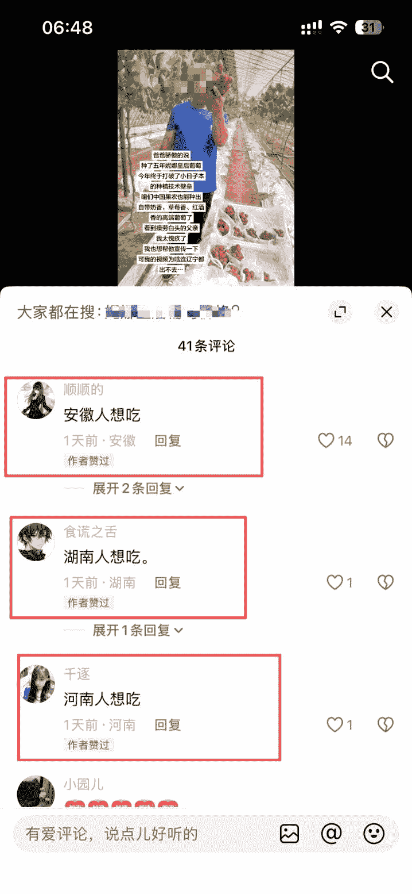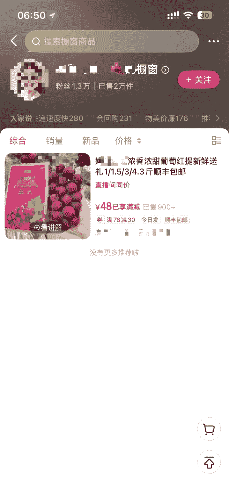

爸爸不懂什么是互联网，只知道厂里的订单越来越少。

一句话同时交代了工厂困境、父亲不会线上获客，以及女儿准备介入解决问题。

用户继续看下去，不再只是为了了解床垫，而是想知道：

这家工厂最后还能不能继续经营？

#### 用父女关系塑造人物

画面中，女儿站在工厂里，情绪低落。

文案表达的是：

我不能看着爸爸半辈子的心血就这样结束。小时候爸爸是我的靠山，长大以后，我来做爸爸的靠山。

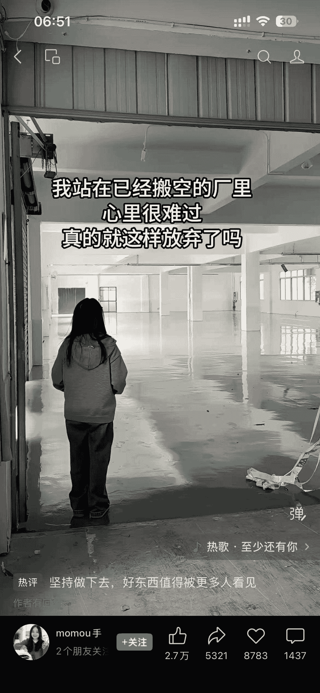

这一段把普通的工厂经营问题，变成了一个具体的人物任务：

女儿要用自己懂的互联网，帮助父亲守住做了半辈子的工厂。用户开始关注的不只是产品，也会关注这个人能不能把事情做成。

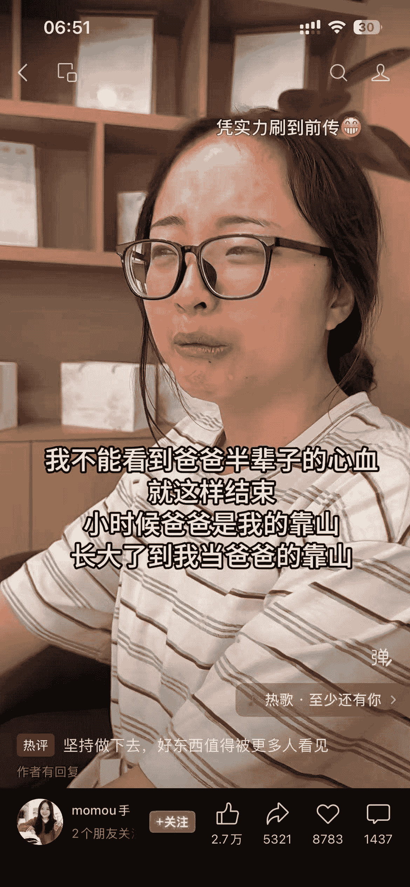

#### 从情绪转向行动

内容没有一直停留在工厂困难和父亲辛苦上。

女儿随后拿起手机，开始在厂里拍视频，并表达：

我决定试一试，把爸爸做的床垫重新卖出去。

这一步很重要。

人物从等待同情，转成主动解决问题。

只有情绪，没有行动，内容很容易变成单纯卖惨；当人物真正开始行动以后，用户才更愿意相信和持续关注。

#### 用生产过程证明产品

故事只能让用户停下来，真正能不能卖出床垫，还要靠产品证明。

视频继续展示：

- 工人在厂里制作床垫；

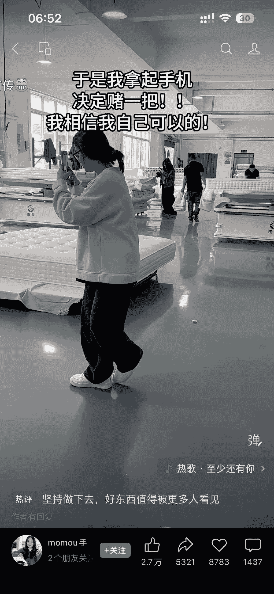

- 材料铺设和手工缝制过程；
- 床垫内部结构；
- 工厂真实生产场景。

内容将产品卖点概括为手工缝制、环保材料，以及“0胶水、0化工”等特点。

这部分承担的作用是：

让用户看见产品是怎么做出来的，降低床垫内部材料和工艺的信息差。

#### A端种信任，B端完成成交

视频最后展示了一长串订单，证明这套内容已经开始带来真实结果。

但床垫不是直接在内容里完成成交。

用户看完以后，还需要通过主页联系方式、客服或私域继续咨询：

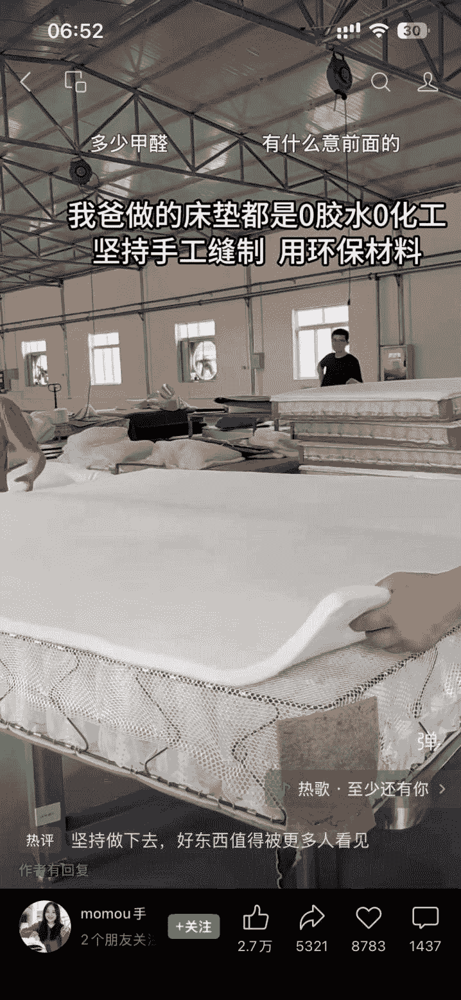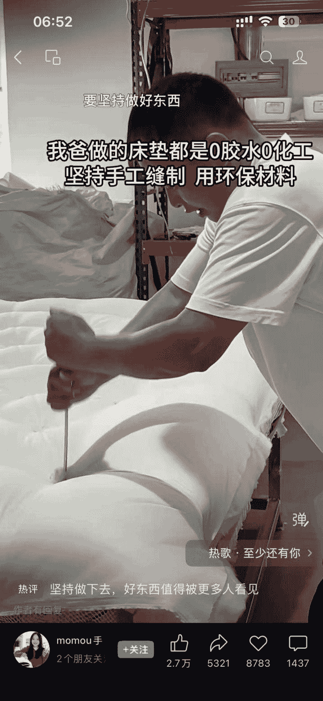

- 需要什么尺寸；
- 喜欢偏软还是偏硬；
- 使用什么材料；
- 价格是多少；
- 如何配送；
- 售后怎么处理。

所以这个案例的路径是：

工厂困境 → 父女故事 → 女儿开始行动 → 展示真实工艺 → 用户产生信任 → 进入客服或私域 → 沟通需求并成交

这个案例真正值得借鉴的，也不是照搬“女儿救父亲工厂”的故事。

它值得复用的是五步结构：

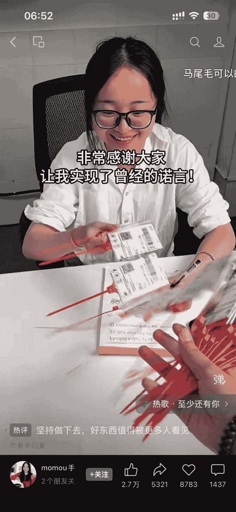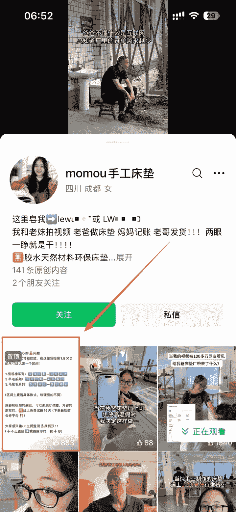

1. 用真实困境制造内容张力；
2. 用人物关系承载故事；
3. 人物必须采取行动；
4. 用工艺和材料完成产品证明；
5. 把高意向用户交给更适合沟通的B端完成成交。

### 两个案例带给我的启发

葡萄案例是“A种A收”。

账号自己通过内容完成种草，再通过自己的橱窗和直播间成交。它更适合标准化程度较高、可以直接在线购买的产品。

床垫案例是“A种B收”。

内容账号负责种信任，客服或私域负责解决具体需求并完成成交。它更适合高客单、非标准化、购买前需要深入沟通的产品和服务。

两种模式没有绝对优劣。

关键要看：

前端内容种下的信任，最终由谁来收，以及哪个阵地最适合完成成交。无论是“A种A收”还是“A种B收”，都必须解决最后一个问题：

流量最终沉淀在哪里？

如果内容爆了，用户看完了，但没有橱窗、直播间、主账号、客服、门店或个人IP承接，这波流量很快就会散掉。

流量不能只是一阵风。

它必须被收回到自己的账号、自己的交易入口，或者自己能够持续触达的用户资产里。

## 06｜我每天只花1小时，具体把哪些事交给AI、表格和执行人员

这个项目里，我每天大概只花1个小时。

不是事情少，而是我没有把所有事情都抓在自己手里。当时的内容形式主要是图文。

图文的好处是快。

我会用醒图制作实况图，拍摄和处理素材也比较快。

最快的时候，大概5分钟就能拍出一个星期要发的素材。

剩下的时间，我主要做两件事：

找爆款。

把爆款用图文形式重新做出来。这里面AI帮我省掉了大量文案改写工作。

我找了一个文案二创提示词。

流程很简单：

先找一个已经验证过的爆款框架。再结合商家的真实信息和用户痛点。然后让AI改写成不同素人视角、不同表达方式的版本。如果纯靠人工写，这件事会很慢。

但用AI以后，我不用每一篇都从零写。

我只需要审核：

这篇像不像真人说话。

有没有广告感。

有没有夸大。

能不能让素人发。

内容和素材是否匹配。

有没有平台风险。

飞书多维表格主要用来做内容和数据管理。

我在里面记录作品层面的信息，比如：

作品形式。

标题。

正文。

图片。

背景音乐。

是否发过。

是否爆了。

这张表的价值不是“看起来很规范”。

它真正解决的是：

我不用靠脑子记每条内容。

哪些内容发过，哪些没发过。

哪些爆了，哪些没爆。

哪些可以复用，哪些要淘汰。

腾讯云文档主要给素人使用。

我会把腾讯云文档开成在线文档，把内容、素材、文案、图片、背景音乐都放进去。

素人自己进去提取，然后按照要求发布。

这个流程比微信群里一个个私发省事很多。

不用反复解释。

不用每次重新整理。

不用担心有人拿错内容。

新人进来也能直接看文档执行。

当时没有员工专门管理素人。

主要是素人拿到文案以后自己去发布。

所以我每天这1小时的核心，不是做所有执行，而是把内容和任务整理成别人可以执行的状态。

这句话很重要：

老板不是做所有事的人，而是把事情拆清楚，让别人能做的人。

注：这里采集平台是生财学的高级多维表格操作，后面买的圈友做好的软件进行的更改；二创提示词是圈友@哆元公众号找到的，素人相关是从圈友@晴天小姐姐这里请教的。

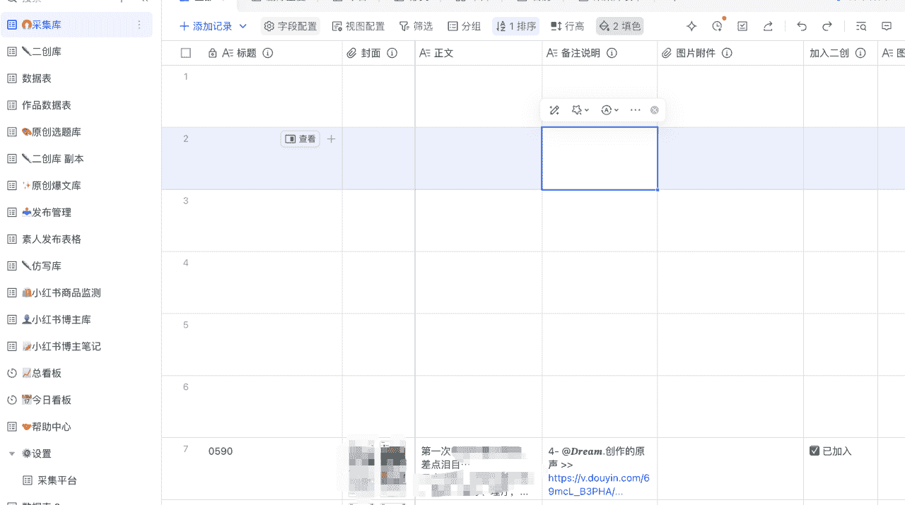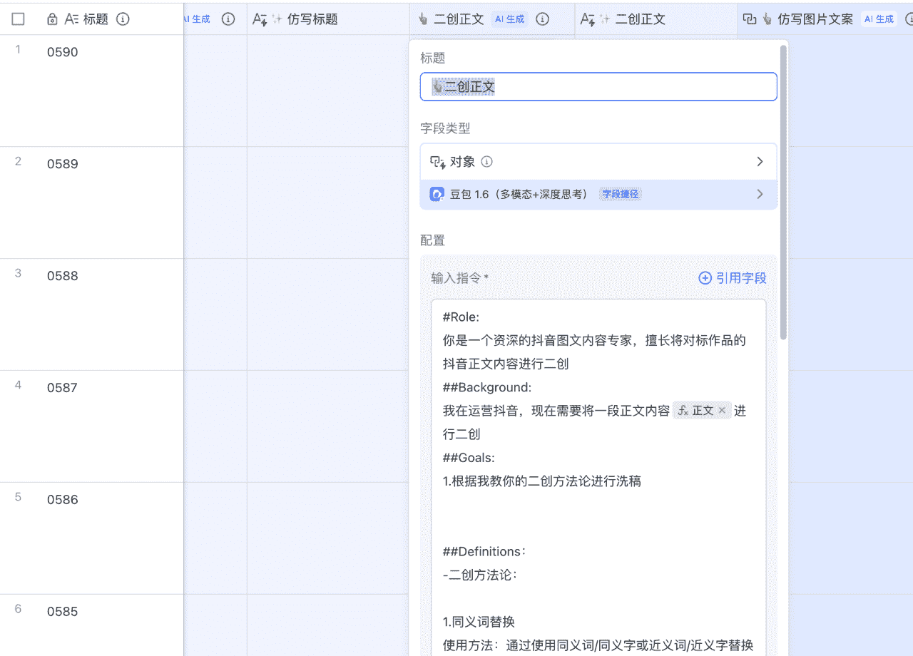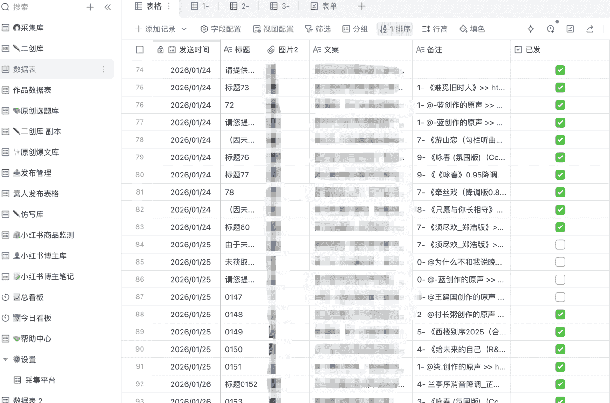

## 07｜素人管理的核心不是培训，是强筛

这个项目里，素人主要从BOSS直聘和闲鱼招。

我自己用账号做引流，把愿意做任务的人引到群里。

一开始大概来了接近200个素人。

最后真正留下来、发过作品的，大概50到60个。

这个比例其实说明了一件事：

素人管理，不能靠幻想。

很多人一开始都说自己愿意做。

但真正执行的时候，很快就能看出来差别。

我的方法不是慢慢培养，而是强筛。

我会在一开始设置很多小动作，让他们去完成。

比如进群以后，先让素人改群昵称。

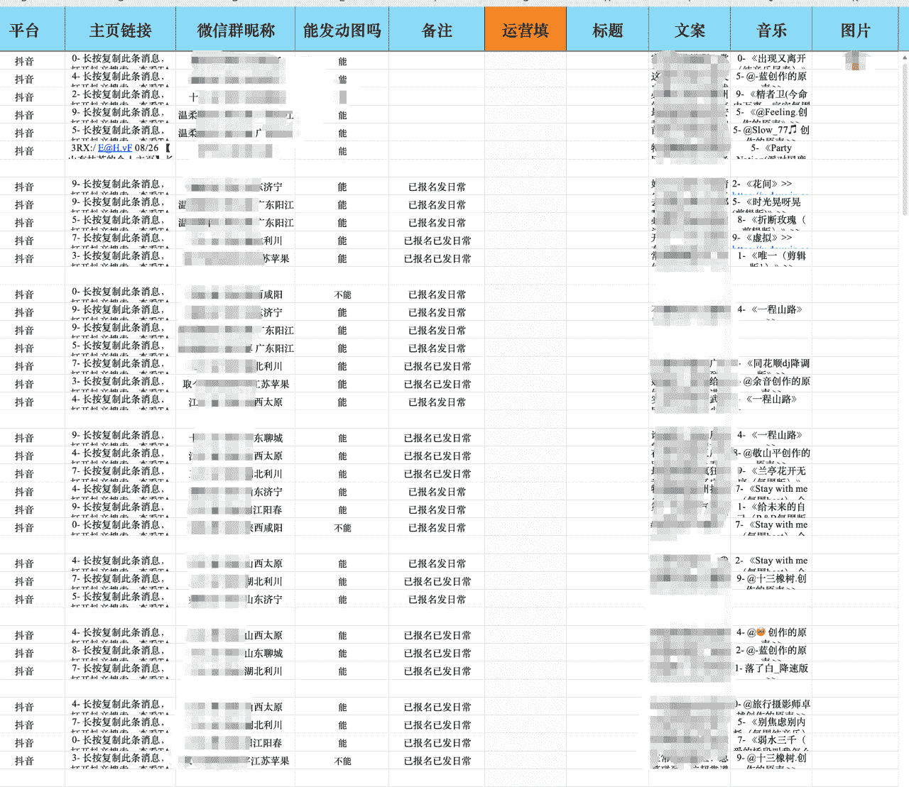

要求他们备注：

自己是什么系统，能不能发动图。

在什么地区。

按照指定格式改名。

这个动作看起来很小，但非常有效。

很多素人进群以后嫌麻烦，连名字都不愿意改。

这种人后面让他按要求发内容、回传链接、按时间执行、回复评论区、回收客资，基本也很难稳定。

所以只要他觉得这种小动作麻烦，我一般就不会要。

我当时的判断很简单：

连群昵称都懒得改的人，不值得我后面花时间管理。

执行力差的人，通常第一关就过不去。

不改名称。

不看规则。

不按格式来。

不及时回复。

问文档里已经写清楚的问题。

这些都是信号。

越早用小动作筛掉低执行力的人，后面管理成本越低。

其中真正有执行力的人我到后面重新看了一下，其实就那么二十个人在配合完成任务，而且非常有耐心。

其他的偶尔参与一次任务，加起来不超过五十个人。

素人结算方面，我是按照48小时结算。

正常同行可能给素人10元一条。

我这边只需要给3到5元一条。

之所以能把成本压下来，是因为流程足够简单。

素人不需要创作。

他只需要进入文档，提取文案、图片、背景音乐，然后按照要求发布。

对素人来说，这是一件很简单的任务。

对我来说，重点不是让每个素人变得优秀，而是找到那些愿意稳定执行简单动作的人。

最后留下来的那50到60个人，才是这个项目真正能跑起来的执行池。

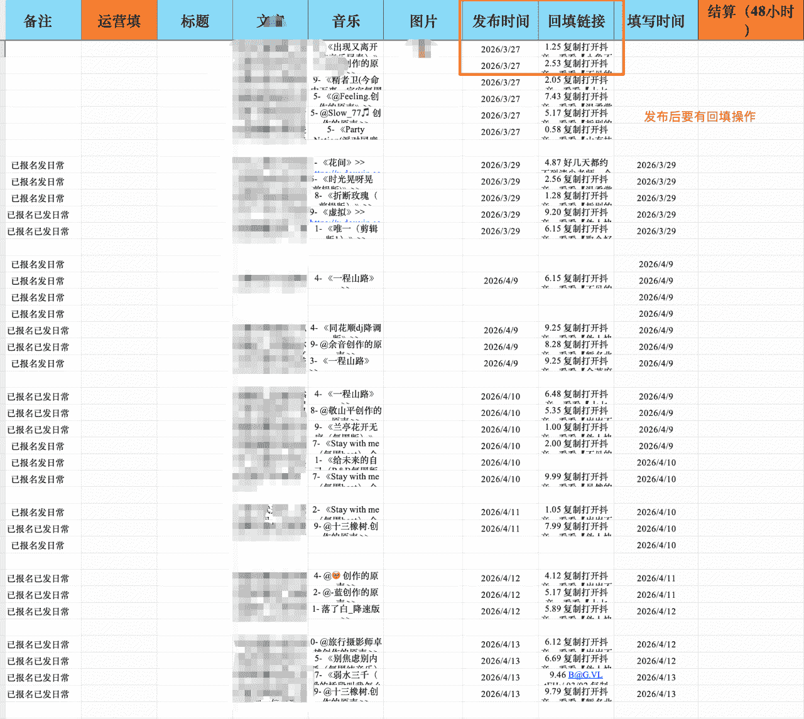

## 08｜内容、任务、到店和成交，必须能追踪

这个项目能算清楚账，不只是因为有内容和素人。

更重要的是，内容、任务、到店和成交之间，必须能追踪。

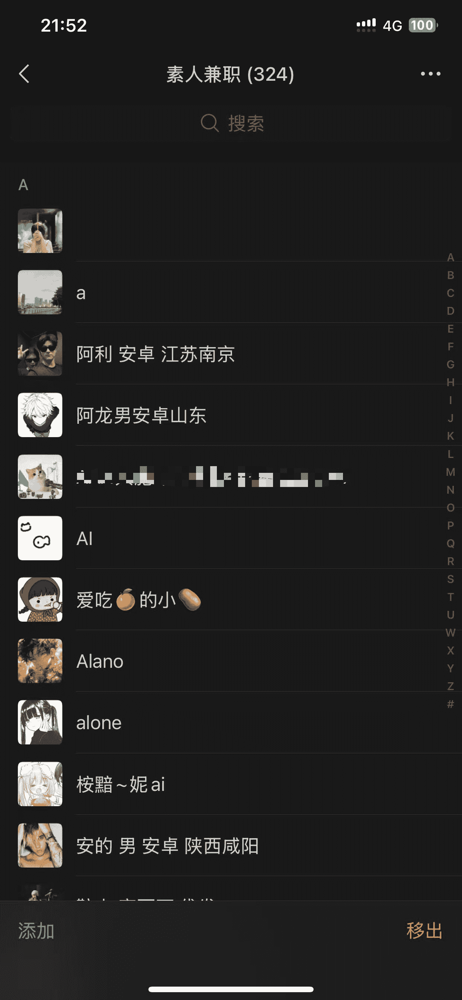

如果不能追踪，项目最后一定会变成一团乱。

你不知道哪条内容有效。

不知道哪个素人有效。

不知道客户从哪里来。

不知道商家成交了多少。

不知道自己该拿多少钱。

同城高客单项目最怕的就是：

前端你在拼命带客户，后端商家说不清成交。

所以一开始就要把数据意识立起来。

我当时至少会看几个东西：

第一，内容有没有发出去。每条作品的标题、正文、图片、背景音乐、发布状态，都要记录并提前干预，看见账号有流量的那一刻便安排素人在评论区放钩子，因为我的钩子是回到公众号里，所以找人评论或者发作品的素人自己评论，最开始的时候不在意，白白浪费了好多流量。

第二，内容有没有跑出来。有没有播放，是否爆了，有没有带来咨询。

第三，客户有没有到店。500个到店客户，是通过客户登记系统统计的，不是靠猜。

第四，到店以后有没有成交。商家后续产生营收以后，再根据营业额进行分佣。

第五，哪些内容和账号值得继续做。如果一类内容总是能带来客户，就继续放大。如果一个素人账号播放高但不带客户，就要判断是账号人群问题，还是内容表达问题。

这也是为什么我一直强调：

做同城高客单，不是单纯做内容。

如果你只会发内容，不会看客户到店，不会算成交，不会对账，最后就会变成帮商家白干。

内容只是入口。

到店和成交，才决定这个项目有没有利润。

## 09｜500个到店后，我才发现原来的收费模式有问题

这个项目结果不错。

3个月500个到店，商家50万营收，我自己拿到10万利润。但做到后面，我也发现原来的收费模式有问题。

一开始只收2000元意向金，是为了降低合作门槛。

这个方式在起盘阶段很好用。

商家不会觉得风险高。

我也能快速进入项目。

双方不用一开始就谈很重的服务包。

但项目跑起来以后，问题就出现了。

前期我做的事情比较轻。

主要是素人种草、内容分发、低成本测试。

后来项目越做越多，我要参与的事情也越来越多。

内容要更新。

素材要继续找。

素人要继续管理。

数据要继续看。

商家需求也会变多。

后面还会涉及更多平台、更多内容形式、更多成交承接问题。

这个时候，我已经不只是一个获客方了。

我开始变成半个线上运营部门。

但收费结构还是最开始那个结构。

这就很容易出现一个问题：

前期靠红利赚钱，后期靠自己硬撑。

当获客方式有效的时候，大家都高兴。

但当获客方式变化、平台环境变化、内容难度变高时，原来的收费模式就不够用了。

这不是商家一个人的问题，也不是我一个人的问题。

更准确地说，是合作一开始只设计了怎么起盘，没有设计项目跑起来以后怎么继续分工。

所以这个项目给我最大的教训是：

低门槛合作可以用来测试，但不能长期依赖。

如果项目后面变成系统化交付，就必须重新设计收费方式和合作边界。

## 10｜如果重新做一次，我会怎么设计合作模式

如果现在让我重新做一次，我不会只用2000元意向金加分成的方式。

我会把合作拆成几块。

第一，基础服务费。

这部分用来覆盖内容策划、工具搭建、任务管理和基础运营成本。

哪怕后端成交暂时没起来，前端这些基础工作也不是没有成本。

第二，测试期。

比如先做30天测试。

在测试期内，明确：

发多少内容。

用多少素人。

做哪些平台。

看哪些数据。

达到什么结果继续。

没有达到什么结果停止。

第三，结果分成。

结果分成可以保留。

因为它能绑定双方利益。

但分成口径必须提前说清楚。

按到店算？

按成交算？

按营业额算？

按利润算？

每一种算法都不一样，不能后面再临时谈。

第四，新增工作另算。

如果后面要增加拍摄、投流、账号运营、私域承接、员工培训、SOP搭建，这些都应该单独算。

不能一开始谈的是轻量获客，后面变成全案运营，价格却不变。

第五，数据透明写进协议。同城高客单项目里，数据透明非常重要。

如果客户来了，商家成交了，但不报备，项目就没办法持续。

所以重新做一次，我会把客户登记、成交反馈、结算周期、漏报处理，都写清楚。

这个项目让我明白：

能赚钱，不代表模式健康。

一次项目跑出结果，只能证明机会抓住了。

能不能长期做，取决于合作模式、数据系统和交付边界能不能设计好。

## 11｜哪些人适合做同城高客单项目，哪些人不要碰

我觉得同城高客单项目不是谁都适合做。

适合做的人，至少要有几种能力。

第一，能判断商家。

不是所有商家都值得接。

商家没有成交能力，老板不配合，客单价太低，毛利润太薄，这些都不要碰。

第二，能理解用户。

你要知道用户为什么愿意相信一家商家。

不能只站在商家角度写卖点。

用户关心的是：

我为什么要去？

我去了会不会被坑？

有没有人去过？

值不值得？

到店以后会不会被强推？

第三，能做内容改写。

不一定要写得多漂亮。

但要知道什么内容像真人，什么内容像广告。

尤其是素人种草，最怕一眼看出来是商家硬广。

第四，能管理执行。

素人、文案、素材、任务、回传、结算，这些东西都很碎。

如果没有表格和文档，很快就会乱。

第五，能看数据。

同城项目不能只看播放量。

要看咨询、到店、成交和分佣。

只看流量，最后很容易被数据骗。

不适合做的人也很明显。

只想靠一条爆款赚钱的人，不适合。

不愿意和商家谈边界的人，不适合。

不愿意管理细碎执行的人，不适合。

不会算账的人，不适合。

一上来就想规模化的人，也不适合。

这个项目看起来结果很好，但中间有很多脏活、细活、琐碎活。

真正的门槛不是会不会发内容。

而是能不能把流量、信任、到店、成交、对账和分佣串成一套系统。

## 12｜特别感谢

最后，也想感谢“生财有术”社群里给过我帮助和启发的人。

感谢易芝。

经常会有交流，学习进步速度很快，经常在交流中能聊出点东西来，包括这一次写贴都是他鼓励我的。

感谢晴天。

在项目交流和推进过程中，帮我解决了素人的问题，包括素人管理筛选都是向她学的。感谢珍妮姐。

我看了她很多关于同城项目、内容获客、团队执行和商业合作的文章，这些内容帮助我在真实项目里少走了很多弯路。

也感谢生财有术这个社群，让我能看到很多真实的一线项目经验。

这套方法不是我凭空创造出来的。

我更多是把自己从别人那里学到的经验，放进一个真实同城项目里验证，再把有效和无效的部分重新整理出来。

公众号懒人搜索，懒人专属群分享

也感谢生财有术这个社群，让我能看到很多真实的一线项目经验。

## 结尾：同城高客单不是代运营生意，而是系统搭建生意

回头看这个项目，我最大的收获不是赚了10万元，而是看清楚了一个同城高客单项目的完整链路：

商家筛选

→ 第三方种草

→ 素人分发

→ 客户咨询

→ 到店登记

→ 商家成交

→ 数据对账

→ 分佣结算

→ SOP沉淀。

以前我容易把重点放在“怎么帮商家获客”。

现在我更清楚，获客只是其中一环。

真正有价值的是，把内容、工具、素人、任务、到店、成交和对账串成一套系统。

同城高客单项目的机会确实存在，但它不是简单的代运营生意。

如果只是无限接商家、无限沟通、无限交付，最后很容易变成低复利的人力活。

更好的方向是：

先用一个项目跑通闭环，再把商家筛选、内容生产、素人分发、工具管理、数据追踪和合作模式沉淀成SOP。

这样，这个项目才不只是一次赚钱机会，而是一个可以迁移到其他同城高客单赛道里的商业系统。

最后，愿诸君各循其道，行而不辍；凡益之道，与时偕行。在赚钱的道路上，一起生财有术。

---

看完这篇SOP，你觉得你懂了。但90%的人一到实操就会卡在第一步。

工具和教程只是最低级的壁垒，真正的壁垒是“立刻动手”和“圈层信息差”。

如果你想看全网最新的变现玩法，并且和一群执行力极强的极客一起下场拿结果，欢迎围观我的核心私域：【懒人专属群】。

我们不聊虚的，只做商业闭环的拆解与AI效率的压榨。系统内已沉淀1000+跑通的套利实战局。

👉 查阅圈子完整数字资产与上车门槛：

https://lazyso.com/insider/

公众号懒人搜索，懒人专属群分享

认同价值、准备好下场干活的，扫码加我微信（lazyhelper1）。

备注：【实操上车】，不闲聊。

