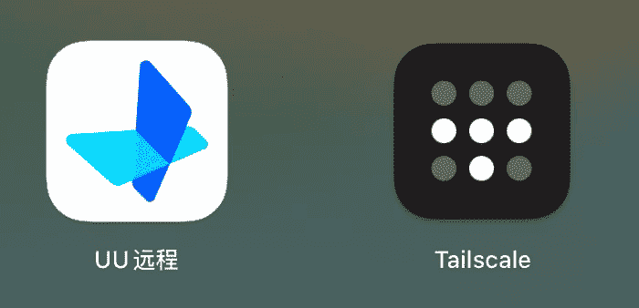
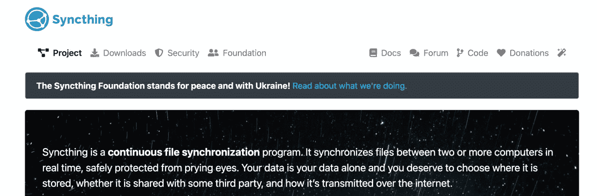
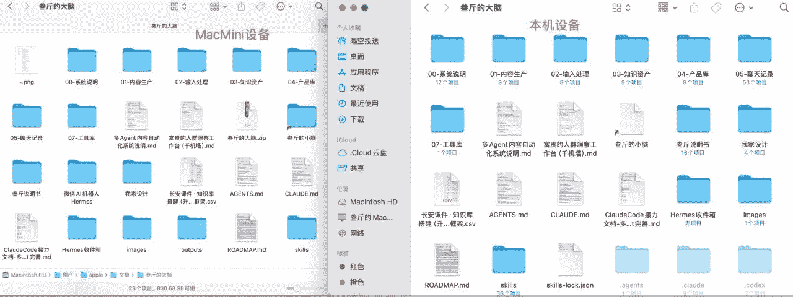
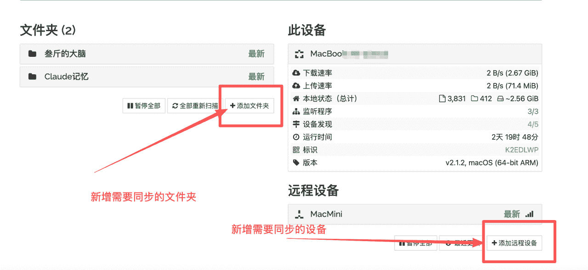
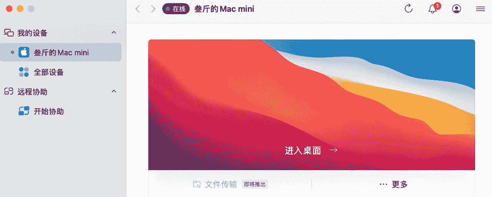
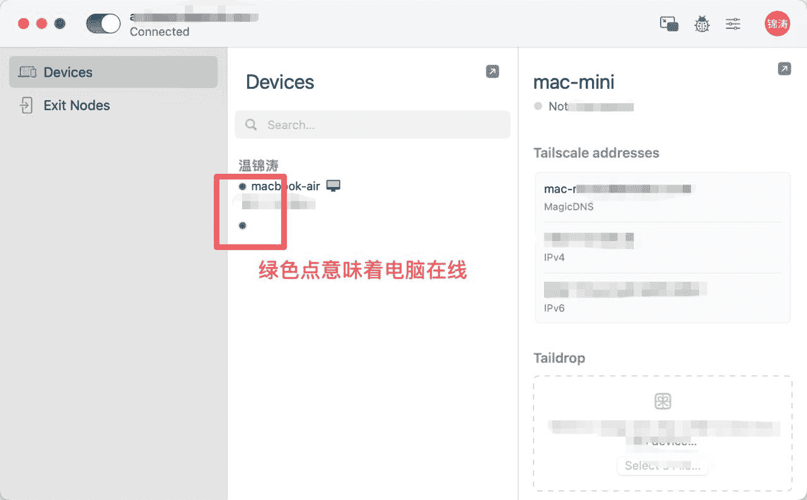
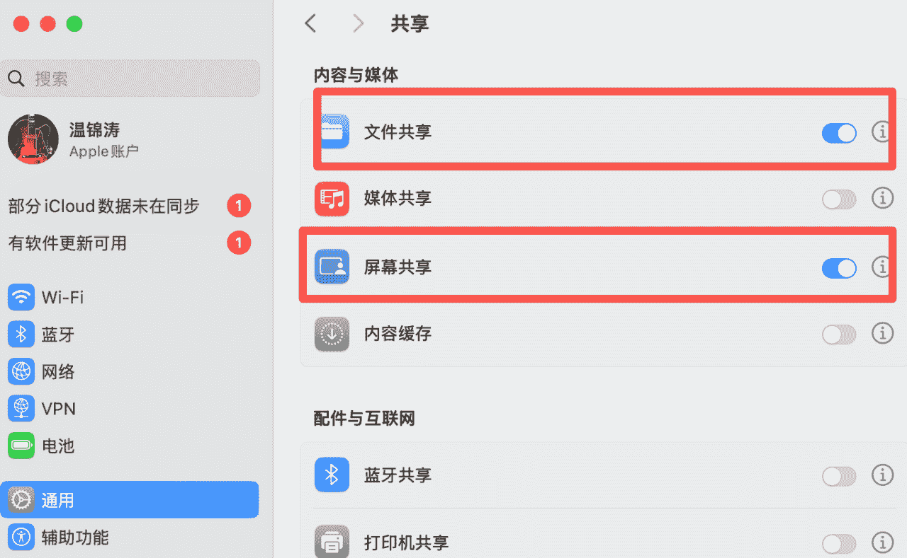
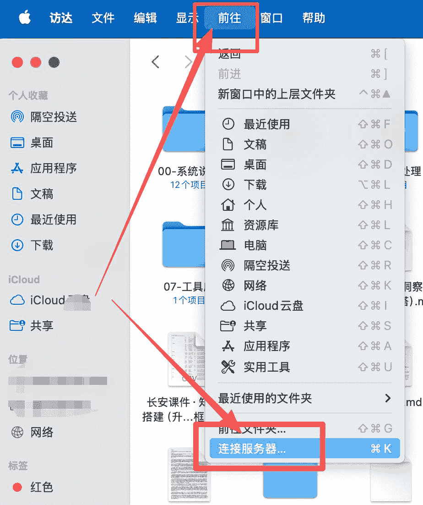
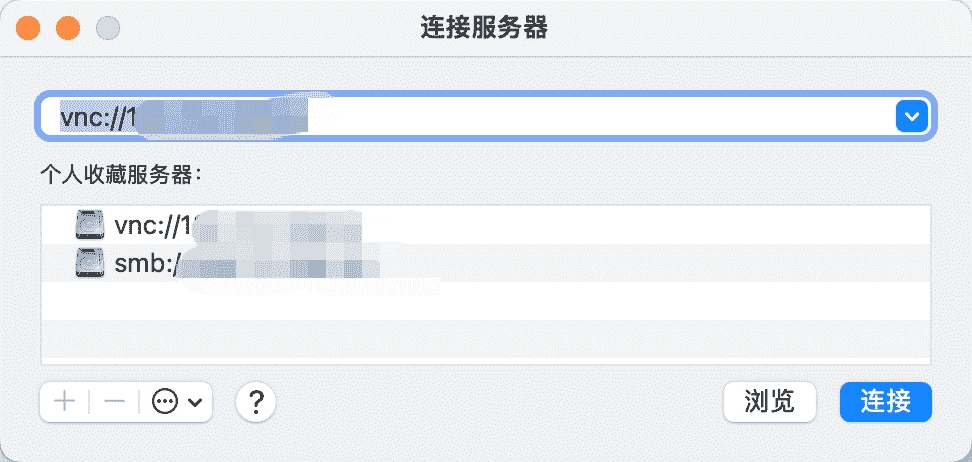
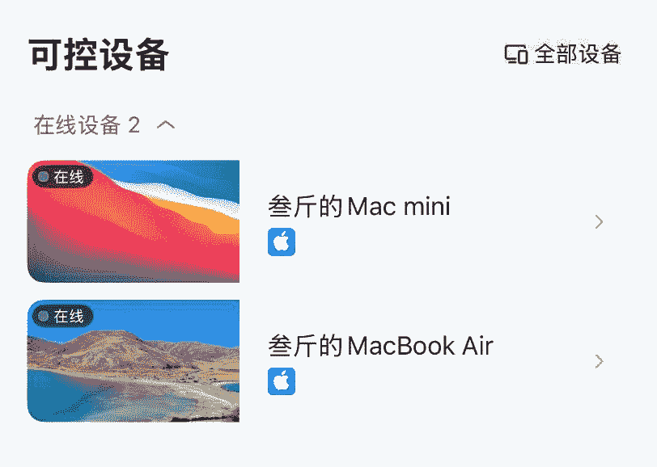

公众号懒人搜索，懒人专属群分享

**Obsidian** 知识库多设备同步教程丨完全免费，一人公司必备

260802 副业SC 精华

整理：公众号懒人搜索，懒人专属群精选

懒人微信：lazyhelper1

哈喽，我是叁斤，现在是一人公司，用 AI 搭建了一套知识库体系，之前也分享过：

Obsidian + Claude Code，它们正在替我赚钱丨我的 AI 知识库拆解。用了一段时间发现，原有的设备不够用了，于是买了个 Mac Mini，2 个设备一起办公。但很快发现，多个设备一起办公有几个硬伤：一个是在外出办公的时候，不方便操控 Mac Mini 工作；另一个是，多个设备的知识库、AI 工作文档等资料无法同步。

就像之前开线下课，有同学因为没办法解决这个问题，会把 Mac Mini 和电脑屏幕一起带过来，就非常不方便。

如果不带着 Mac Mini，也很麻烦，要先远程连接到 Mac Mini，再从 Mac Mini 上打开 AI 干活。有痛点、有需求，那一定有解决方案。于是我跟 AI 把需求聊明白，终于把这个事情解决了。

现在我多个设备之间，知识库和 AI 记忆是同步的，设备之间也可以自由远程操控，没什么限制。关键是这一套搭建全免费，


不需要购买什么网盘会员之类的，也不需要自己懂原理，交给 AI，它会帮你搞好。

所以这一篇，给大家分享下我的设备和配置方案，如果有多个设备，有知识库同步需求的，都可以看看。

我会先分享我的设备配置，然后是两套核心方案：知识库同步和远程操控。最后是手机怎么接进来、遇到问题怎么办。

最重要的是这 2 个部分：

**1、知识库同步**：就是让你两台电脑上的知识库永远一模一样，出门带笔记本跟坐在家里没区别。你在 A 设备工作后，产生的所有文件，自动同步到 B 设备，在 B 设备可以接着跟 AI 聊，毫无阻碍。

**2、远程操控**：就是让你在外面能操控家里那台电脑。

## 1、先分享下我的设备配置

很多人问我，我都在用什么设备，参考购买，这里我给一下我的设备配置。

家里一台 **Mac Mini**，**32G** 内存、**1T** 硬盘，常年开机。我暂时没有配置屏幕，所有比较大的任务都在这里跑，我的完整知识库也都放这里，定时采集、自动整理、视频剪辑等等，都在这。

出门带一台 **MacBook Air**。这个配置很低，16G，256G，它只能干轻任务，写内容之类的。

手机随身，记想法、远程操控 Mac Mini、给 AI 下指令。

我的电脑只是个工作站，我人在哪都能连上它、让里面的 **AI** 继续干活。那为什么不干脆一台笔记本走天下？好问题，理论上可以，但好配置的笔记本贵，而且笔记本合上盖子就休眠了，定时任务不会触发。

如果要让 **AI 7×24** 替你干活，你就需要有一台不关机的电脑。Mac Mini 相对便宜、省电、不占地方，插在那儿就不用管了，所以选择了这个。

两台电脑之间，我同步了两个文件夹。

第一个是我的知识库，就是整个「叁斤的大脑」，所有笔记、素材、方法论、skill 都在里面。

第二个可能很多人想不到：**AI** 的记忆。就是 Claude、Codex 记录下来的关于我的一切，我的习惯、我的偏好、我跟它说过的事。

第二个的效果是，我在家里跟 AI 讲过的东西，出门打开笔记本，它全都记得。两台电脑上是同一个 **AI**，不是两个。需要用到的工具如下：

- **Syncthing**：两台电脑同步文件用的，免费开源。
- **Tailscale**：让所有设备像连在同一个 WiFi 下，个人使用免费。
- **uu** 远程（可选）：手机或电脑看家里电脑的桌面，有免费版够用。
- **iCloud**（可选）：手机上记的想法同步到电脑，苹果自带。

所有配置完全免费，没有容量限制，你硬盘多大就能同步多大。

## 2、知识库同步方案

知识库同步只需要一个软件：**Syncthing**。

这个工具的作用是，你可以指定一些文件夹，在多个设备之间同步，然后它会持续看着你指定的文件夹，不管哪个设备上有改动，剩下的设备自动更新。





看不懂没关系，我也不知道这玩意干嘛的，后面操作流程可以全 AI 化，0 使用门槛。

它跟网盘不一样的地方有三个：

第一，文件是在你电脑上的。网盘同步大多需要付费，因为占用的是网盘自己的空间。Syncthing 只是自动在你设备之间互相传文件，依赖自己的网络，而且传过来的文件 AI 打开就能读取，很方便。

第二，两台电脑之间直接传，你的知识库不会存到别人的服务器上。

第三，没有容量限制，不要钱。你硬盘多大就能同步多大。

还有一点很重要：它自己就能跨网络连接，不需要装任何别的软件。两台电脑一台在家、一台在国外，它也能自己找到对方。

### 开始之前准备

- 两台电脑。一台是你知识库现在所在的，另一台是你要带出门的。
- 一个已经在用的知识库文件夹，就是你的 Obsidian 文件夹。
- 第一次同步，两台放一起做。第一次要把整个知识库完整传一遍，就是整个文件夹复制粘贴过去，在家里连同一个 WiFi 最快，几分钟就好了。



### 第一步：装 Syncthing

把下面这段发给 Claude Code 或者 Codex，两台电脑上各发一次。

```text
请帮我在这台电脑上安装 Syncthing，我要用它在两台电脑之间同步我的知识库文件夹。

要求：

1. 先检查我的操作系统，参考官网 https://syncthing.net/downloads/ 选择合适的安装方式。
2. 我不是程序员，装哪个版本你来判断，但有一个硬要求：装完之后你要能用命令行帮我完成后面所有配置，我不想自己去网页上点来点去。
3. 装完要设置成开机自动启动，因为我要它一直在后台盯着文件夹。
4. 装完后告诉我两件事：
   a. 管理页面的网址，我要用它看同步状态；
   b. 我这台电脑的设备身份码，直接显示出来给我，下一步要用。
5. 这一步只把软件装好就行，先别加文件夹、别连设备，下一步我再让你配。
6. 每一步先用大白话告诉我你要做什么，再动手。如果哪一步失败了，把原因翻译成我能看懂的话，告诉我下一步怎么办。
```

装完之后，它的所有操作都在一个网页里完成，它会给你个链接，大概长这样：

```text
http://127.0.xxxxxx
```

浏览器打开这个地址就行，然后这个地址只有你自己的电脑能打开，别人打不开。

页面分两半，左边是「文件夹」，右边是「设备」。现在两边都是空的，下一步才开始配。

两台电脑都能打开这个网页，这一步就成了。

顺手把两台的设备身份码都找出来存着，下一步要用。它在网页右上角的「操作 → 显示设备 ID」里，是一长串大写字母和数字，中间用横杠分开，长这样：

```text
YIAWF5A-QKB6L3P-XXXXXXX-XXXXXXX-XXXXXXX-XXXXXXX-XXXXXXX-XXXXXXX
```

### 第二步：让两台电脑共享知识库

这一步要做三件事：让两台电脑互相认识、把知识库共享过去、顺手上个防误删机制。

配之前提一句：如果你的知识库里有不少自己做的工具、缓存这类不用同步的东西，可以先跳到第三步把排除清单定好，再回来配这一步，能少传一堆没用的文件。

三件事依然全交给 AI，你只干一件事：把两台电脑的身份码互相贴过去。上一步 AI 已经把各自的身份码给你了，现在开始配。

先在家里那台上发这段。

```text
我两台电脑都装好 Syncthing 了，现在要把我的知识库同步到另一台。

我这台是主力机，知识库原件在这里：
【把你的知识库路径贴在这里】

另一台电脑的设备身份码是：
【把另一台的身份码贴在这里】

请帮我配好，不用我去网页上点：

1. 把另一台添加成远程设备，名字就叫「笔记本」。
2. 把我的知识库加成一个共享文件夹，编号用 my-brain，名字叫「我的知识库」。
3. 把这个文件夹共享给刚才那台设备。
4. 给这个文件夹打开「简易文件版本控制」，保留 30 天。因为同步是双向的，我在一台上删掉的文件另一台也会跟着走，我要能捞回来。
5. 动配置之前先备份一份现在的配置，万一配坏了能还原。
6. 配完告诉我现在的状态，以及我这台的设备身份码是多少，我要拿去另一台上用。
7. 每一步先用大白话告诉我你要做什么。哪一步失败了，把原因翻译成我能看懂的话。
```

再去笔记本上发这段。

```text
我这台电脑已经装好 Syncthing 了。家里那台已经配好，正在把知识库共享给我。

家里那台的设备身份码是：
【把家里那台的身份码贴在这里】

请帮我配好：

1. 把家里那台添加成远程设备，名字就叫「主力机」。
2. 接受它共享过来的那个知识库文件夹，存到我这台电脑的这个位置：
【你想把知识库放在哪，比如 ~/Documents/我的知识库】
3. 给这个文件夹也打开「简易文件版本控制」，保留 30 天。
4. 动配置之前先备份一份现在的配置。
5. 配完告诉我现在传到哪了，大概还要多久传完。
6. 每一步先用大白话告诉我你要做什么。哪一步失败了，把原因翻译成我能看懂的话。
```

发完这两段，传输就开始了。

顺便说一下那个「防误删机制」是干什么的：打开之后，任何被删掉或者被覆盖的文件，都会在文件夹里留一份，保留 30 天。

因为同步是双向的，你在一台上删掉的文件，另一台上那份也会跟着走。有这个保险，随时能捞回来。不花钱，顺手就开了。

如果你更想自己动手：上面这些在管理页面上也能点出来，右边「添加远程设备」填身份码，左边「添加文件夹」选路径，切到「共享」勾上对方，再进「文件版本控制」选「简易文件版本控制」。两边各点一遍，效果一样。我自己是让 AI 配的，省事。



当你在家里那台的知识库里新建一个文件，去笔记本上打开那个文件夹，看这个文件是不是自己出现了。在笔记本上改一下这个文件，回家里那台看，改动是不是也过来了。

两个方向都通了，这一步就成了。

### 第三步：让 AI 帮你定同步范围

不是所有东西都要同步。我们同步的目的，是让两个设备的 AI 都能执行任务，都了解你的知识库。所以其实只要知识库的本体同步和一些 AI 记忆同步就行了。

比如，Markdown 文件、skill、AI 的记忆、图片、PPT、PDF、思维导图等等。这些是你的知识库资产，可以保持随时同步。

至于一些自己做的工具、程序运行时产生的临时文件、各种缓存，这些不需要保存，不然 2 个设备的内存会占用很高。

当然，具体哪些该排除，你不用自己想，让 AI 扫一遍你的文件夹就知道了。

```text
我用 Syncthing 同步我的知识库文件夹，路径是：
【把你的知识库路径贴在这里】

请帮我做两件事。

第一件，做一份「排除清单」，告诉 Syncthing 哪些东西不用同步。我的原则是：

同步「人读的东西」（Markdown、图片、文档、我写的 skill、AI 的记忆），不同步「机器跑的东西」（我自己做的工具、程序缓存、安装依赖、临时文件、系统垃圾文件）。

1. 先扫描这个文件夹，按占用空间从大到小，列出前 20 个文件夹，告诉我每个是干什么的。
2. 逐个给出你的建议：同步/不同步，每一条都要说明理由，用大白话。
3. 如果发现存着密码、密钥、登录凭据的文件，单独列出来提醒我，这些绝对不能同步。
4. 清单定好之后，直接帮我配置进去，不用我自己去网页上粘贴。
5. 告诉我另一台电脑要不要也设一遍，要的话给我一段能直接发给那台电脑上 AI 的说明。

第二件，顺便帮我检查一个隐患：我两台电脑的用户名可能不一样，扫一下我的知识库里有没有写死了完整路径的文件（比如 /Users/某某某/Documents/... 这种）。如果有，告诉我有多少个、会有什么影响、怎么改最省事；如果没有，告诉我一声就行。
```

AI 会把它给你的那段说明也发到另一台上配一遍，两边内容一样就行。

### 第四步：让两台电脑的 AI 保持一致

知识库同步之后，AI 也要同步，这里包括 AI 的全局配置、AI 记忆等文件。这些通常是放在系统的用户文件夹里的，而且是隐藏的，不在你的知识库文件夹里面，所以不会跟着同步。

所以这个需要单独同步，做法分两种。

配置文件搬进知识库，两台电脑的原位置各放一个快捷方式指过去。知识库本来就在同步，这样改一次两台永远一致。

记忆文件夹在 Syncthing 里再加一个共享文件夹，跟知识库一样的做法。我就是这么做的，所以两台上是同一个 AI。

这两件事都让 AI 帮你做：

```text
我要让两台电脑上的 AI 保持完全一致，包括全局规矩和它记住的东西。

请帮我做：

第一件，处理全局规矩文件：

1. 找出我这台电脑上 AI 的全局规矩文件在哪（比如 ~/.claude/CLAUDE.md）。
2. 搬动之前先备份一份，备份文件名带上今天的日期。
3. 把本体移到我的知识库里的【知识库路径】/AI 全局配置/下面。
4. 在原位置建一个指向它的快捷方式。
5. 验证一下：从原位置还能不能正常读到内容，内容跟搬之前完全一样。

第二件，告诉我 AI 的记忆文件存在哪个文件夹，我要在 Syncthing 里把它也设成一个共享文件夹，让两台电脑的 AI 记住同样的事。给我具体路径，以及在另一台电脑上对应的位置。

注意：存有密码、密钥、登录凭据的文件夹不要加入同步范围。如果你发现这类文件在附近，提醒我一声，不要动它。
```

当你在两台电脑上都问一句 AI：「你现在的全局规矩里第一条是什么？」两边答案一样，就成了。

做到这里，你出门带着笔记本，跟坐在家里没有区别。如果你家里那台电脑上没有什么必须常年跑着的工具，看到这里就可以收工了。

## 3、远程操控方案

这个是可以让你人在外面，也能控制家里的电脑，像坐在它面前一样操作它。

当你家里那台电脑上有搬不走的东西的时候，就需要远程操控的功能。因为有很多东西复制到笔记本上也不方便运行，而且笔记本的能力有限，大任务还是需要 Mac Mini，要用它们只能连回家里那台。

我自己有两个远程操控的方案。

第一个是 **uu** 远程，这个非常简单，下载就能用，手机上也方便，我日常临时操作用得最多。

另一个是 **Tailscale** 加屏幕共享，要多几步配置，好处是这条连接是你自己的。



正常情况下有 uu 远程就行了，但我觉得稍微有点模糊。下图对比（网络好的情况下，清晰度差距很低，但确实没那么高清），所以为了更加高清，我 2 个方案都配置了。

另外，uu 远程还有一个弊端，截图不方便。我截图一般用的是微信自带的，远程登录微信我被提醒过，所以远程的电脑没有登录微信，无法激活微信截图，只能采用别的截图方案，我不太习惯。

远程和同步还有一些区别：

第一，它不能休眠。台式机插着电源要设成永不休眠。这也是我用 Mac Mini 而不是笔记本当主力机的原因，笔记本合上盖子就休眠了。

第二，停电之后它会自己开机。台式机基本都有这个设置，打开它，万一家里跳闸，它能自己回来。

这两件事让 AI 一次帮你设好，只在家里那台上发：

```text
我这台电脑要当作常年开机的主力机，我人在外面时需要远程连回来操作它。

请帮我做两件事，做完告诉我怎么验证真的生效了：

1. 设置成插着电源时永不休眠（屏幕可以关，但电脑不能睡）。
2. 打开「断电恢复供电后自动开机」，这样家里跳闸之后它能自己启动。

要求：

- 每一步先用大白话告诉我你要改什么，再动手。
- 如果我这台是笔记本，告诉我笔记本有没有这些选项，没有的话有什么替代办法。
- 不要改我的其他系统设置。
```

自动开机这个不一定，有的就设置好，没有的就只能物理开机（按开机键）。

### 方案一：uu 远程

这个没什么好讲的，因为它就是下载即用。

家里那台和你手上的设备，电脑或者手机，都装上，登同一个账号，打开就能看到家里电脑的桌面。

我在外面临时要操作一下家里电脑，用得最多的就是它，尤其是手机上，非常方便。

而且 uu 远程即使是开机重启，在锁屏界面也能用，就是能在手机上给电脑解锁，超级方便，强推。

### 方案二：Tailscale 加屏幕共享

Tailscale 的作用是：让你所有设备，不管在世界哪个角落，都像连在同一个 **WiFi** 下。


公众号懒人搜索，懒人专属群分享

装完之后两台电脑就能互相看见，然后用系统自带的屏幕共享连过去。

它比 UU 远程多几步，好处是这条连接是你自己的，两台设备之间直接通，不经过第三方的服务器。

先装，两台各发一次：

> 请帮我在这台电脑上安装并配置 Tailscale，目标是让我的两台电脑不管在哪都能互相连上。
>
> 要求：
>
> 1. 先检查我的操作系统和版本，告诉我该装哪个版本。
> 2. 优先参考 Tailscale 官网 https://tailscale.com/download 的最新安装方式。
> 3. 安装前先用大白话告诉我你要做什么，再执行。
> 4. 安装完引导我登录，我会用同一个账号在两台电脑上登录。
> 5. 登录后运行 `tailscale status`，把结果解释给我听：哪一行是我这台，哪一行是另一台，我现在连得好不好。
> 6. 不要修改我的防火墙规则和系统安全设置，如果某一步确实需要，先停下来问我。

装完之后，Mac 上会在屏幕最上面那排小图标里多一个 Tailscale 图标，Windows 上是在右下角托盘里。

点开它，登录。两台电脑必须登同一个账号，这是它们能互相看见的唯一条件。

登录后你会看到设备列表，每台后面跟着一串 100 开头的数字。那串数字就是这台电脑在你自己这个小网络里的门牌号，下一步要用。

然后打开屏幕共享，这段只在家里那台上发：

> 请帮我打开这台电脑的屏幕共享功能，我要能从另一台装了 Tailscale 的电脑远程看到并操作它的桌面。
>
> 要求：
>
> 1. 先告诉我这台电脑的系统该在哪里打开屏幕共享，一步一步说，我不熟悉系统设置。
> 2. 打开之后，告诉我另一台电脑要怎么连过来，给我具体的操作步骤和要输入的地址。
> 3. 告诉我远程连上之后，家里这台电脑的屏幕会不会亮着、会不会被别人看到。
> 4. 只开屏幕共享这一项，不要打开文件共享、远程登录之类我没要求的功能。



Mac 上是在「系统设置→通用→共享」里打开「屏幕共享」，然后在另一台 Mac 上打开自带的「屏幕共享」，输入家里那台的门牌号和开机密码就行。

一般路径是：打开访达，打开「前往」，最底下选择「连接服务器」。

输入「VNC」是连接视频，远程操控电脑。输入「SMB」是连接文件，远程访问文件夹。后面的一串码，就是你电脑设备的码，在 Tailscale 上有，不会找的话问 AI 要一个。




连接服务器的时候，还需要输入另一个设备的用户账号的密码，这个是设备密码，输入相当于是登录上电脑了。

Windows 上是用远程桌面，AI 会按你的版本告诉你在哪里开。

顺便说一句，如果你两套方案都配了，Syncthing 会自动多一条路可选，两台之间走你自己的私有通道。你什么都不用配，它自己会挑最快的路，白捡的好处。

另外，这个方案除了能远程操控，还能访问文件夹（SMB 模式），就是除了共享的那些，Mac mini 上所有的文件夹你都可以访问，也能在本机直接打开。

缺点有两个：一是文件数量多的时候打开速度有点慢；二是这些文件其实不在你本机上，你只是隔着网络在看 Mac mini 里的东西，网一断就全打不开了。

所以它只能当备选，日常还是靠 Syncthing 同步。

## 4、手机怎么接进来

两台电脑通了之后，手机是最后一块。



我在手机上没有装 Tailscale，用的是另外两个更省事的办法。

手机记想法走 **iCloud**。走在路上突然有个想法，不用坐下来开电脑，也不用打字，直接语音说出来，用语音输入转成文字，随手记一条。我把手机上的 Obsidian 存在 iCloud 里，同一个苹果账号就自动同步了，回到电脑上就在。

这块不用 Syncthing，因为碎碎念这种小文本 iCloud 已经够用了。工具不用统一，够用就行。

手机操控电脑用 **UU 远程**，前面说过，手机上它最方便。

手机指挥 **AI** 干活，直接用 **AI** 的手机端。Claude、ChatGPT 这些手机端都能操控你电脑上的 AI 干活，你在外面发一句话，家里那台自己就开始跑了。

## 5、遇到问题怎么办

配置的过程一般都挺顺。万一哪一步卡住了，不用自己研究，也不用来问我，把下面这段发给 AI，它会一步步帮你查出来。



用 AI 干活，本来就该是有问题先问它。

同步出问题用这段：

> 我用 Syncthing 在两台电脑之间同步知识库，现在遇到了问题：【描述你的现象，比如两台连不上/同步很慢/文件没过来/页面报错】
>
> 请帮我一步步排查，每查完一条告诉我结果，用大白话，不要让我自己判断技术细节：
>
> 1. 检查 Syncthing 是不是在运行，两台设备现在的连接状态是什么。
> 2. 检查两台之间是直接连上的，还是在绕远路，告诉我我现在这个网络有没有问题。
> 3. 直接数一下两台磁盘上真实的文件数量并对比。
>
> （数的时候排除 `.syncthing` 开头的临时文件，那是正在传的半截文件。）
>
> 4. 检查两台的排除清单是不是一样。
> 5. 检查有没有产生冲突文件。
> 6. 综合上面的结果，告诉我最可能的原因，以及我下一步该干什么。

远程连不上用这段：

> 我用【UU 远程/Tailscale+屏幕共享】远程连家里的电脑，现在连不上了：
>
> 【描述你的现象】
>
> 请帮我一步步排查，每查完一条告诉我结果，用大白话：
>
> 1. 家里那台是不是关机了或者睡着了，我要怎么确认。
> 2. 如果我用的是 Tailscale，检查两台是不是登的同一个账号、现在能不能互相看见。
> 3. 检查我现在这个网络是不是有限制，要不要换个网络试试。
> 4. 告诉我最可能的原因，以及下一步该干什么。
> 5. 如果这个方案在我的系统上确实走不通，告诉我有什么替代办法。

还有一个万能判断：连不上的时候，先换个网络试试，手机热点最快。相当一部分问题换个网就好了。

## 6、这套方案真正解决的是什么

整一套配置完成之后，你解决的是「工作被地点绑架」的问题，也就是说，你以后再也不用带着 Mac mini，那么笨重的设备出门了。

出去听课，即使有实操环节，也可以带一个轻便的笔记本出门，产生的所有资料，自动同步到家里的 Mac mini，这是超级方便的事情。

而且以前所有东西都在家里那台设备上，设备一旦出问题，我这些积累的知识库就全没了。

现在两台各存一份完整的，还带 30 天的防误删机制。这比任何备份方案都可靠。

你不再需要「回到电脑前面才能干活」，你在任何地方，都能干活。家里放一台笨重的电脑当成一个 24 小时待命的工作站，就行了。

————分割线————

看完这篇 SOP，你觉得你懂了。但 90% 的人一到实操就会卡在第一步。

工具和教程只是最低级的壁垒，真正的壁垒是“立刻动手”和“圈层信息差”。

如果你想看全网最新的变现玩法，并且和一群执行力极强的极客一起下场拿结果，欢迎围观我的核心私域：【懒人专属群】。

我们不聊虚的，只做商业闭环的拆解与 AI 效率的压榨。系统内已沉淀 1000+ 跑通的套利实战局。

👉 查阅圈子完整数字资产与上车门槛：

https://lazyso.com/insider/

认同价值、准备好下场干活的，扫码加我微信（lazyhelper1）。

备注：【实操上车】，不闲聊。


