# 从淘宝找产品，到小红书找人群：我的月入**5**万虚拟资料选品方法

260803 副业SC 精华

整理：公众号懒人搜索，懒人专属群精选

懒人微信：lazyhelper1

目前所有店铺加在一起，大概有个五六家店铺了，月收入大概稳定在4万左右，遇到状态好的月份，翻一倍也是常事。

我觉得在小红书虚拟资料的运营过程中，最让我感觉到有意思的就是选品。我有一套自己的选品标准，当然生财也分享了很多选品的方法，很多重复出现的内容我就不再重复分享了。这里我分享的一个在生财可能没有太多人提到的一种思路，也希望大家也可以建立自己的选品库。这样不管是做什么，哪怕是帮别人推荐一些行业类目资料，都有足够多的数据做支撑。

文中的选品思路是我其中之一的选品方式，利用这种思路，你可以拓展出非常多的选品方法，最终创造出一个自己的选品库，这将是你日积月累的财富，也是你后期无限拓店的根源，更是你后期教学别人帮别人选品的主要依据。但是一定不要仅局限于我文中提到的方式，还有更多的方式，甚至可以说，生财有术也是选品的一种方式，生财的风向标、实操分享里面提到的产品，都是一些好的类目资料，这些都可以作为第一梯队的紧急需要做的品，如果有时间可以优先去做。


本文的主要目录：

- 一、写在前面——我是谁，为什么想做这次分享
- 二、自制小工具——销量监控工具与笔记采集工具
- 三、选品思路——淘宝MCP选品案例与选品库方法论
- 四、真实成绩——小红书是一个能快速拿到结果的项目
- 五、运营方法——从笔记采集到发布的完整四步流程
- 六、给想要入场朋友的建议

我自己做了一些小工具，主要就是采集笔记、销量监控。毕竟你有了选品库，再配合上一些销量监控的工具，是可以轻而易举的看到这个产品在小红书的真实的销量是怎么样的，从而来判断自己是否可以入场的一个主要因素。而笔记采集，可以让你快速仿写，仿写之后就可以进行快速的测试，是否真的有那么多的数据。

这整个闭环就是选品**→**选品库**→**销量监控**→**采集仿写快速测试**→**放大铺垫增加关联账号的一个过程，周而复始。

---

本文目录

- 一、写在前面——我是谁，为什么想做这次分享
- 二、自制小工具分享——销量监控工具与笔记采集工具
- 三、选品思路——淘宝MCP选品案例与选品库方法论
- 四、真实成绩——小红书是一个能快速拿到结果的项目
- 五、运营方法——从笔记采集到发布的完整四步流程
- 六、给想要入场朋友的建议

## 一、写在前面

想跟大家聊聊我做小红书这段时间摸索出来的一些自制小工具，以及背后完整的选品思路和运营方法。这些东西不一定要照搬，但我希望能给大家一些启发，以及一份可以直接拿去用的实操框架。

"如何用AI编程去解决实际的运营问题"——这也是我这次最想聊透的一件事。

大家好，我是冬青，山东泰安的一名个人创业者。我从去年开始正式接触小红书虚拟资料这个赛道，走的是纯自然流打法，不投流。这一年多的时间里，PPT模板、简历模板、小说合集、国外影视资源、K12教辅资料……这些品类我基本都摸过一遍。

目前所有店铺加在一起，七家店铺了，月收入大概稳定在5万左右，遇到状态好的月份，翻一倍也是常事。

借着这次分享的机会，我认真回想了一下自己的经历，才发现原来早在很久以前，我可能就已经"入行"虚拟资料这个行业了，只是当时自己都没意识到。

早在2021年，我就在淘宝上卖过游戏安装包。一个很简单的《植物大战僵尸》安装包，能卖到3块钱一份，每天的订单量都还不错（下面可以看一下当时的订单密度）。《红色警戒》卖得就更贵一些了，一份能卖到30元左右，一天也能稳定出几单。

所以，当你想入场这个行业的时候，第一件要做的事，就是摒弃掉"这不是网上到处都能免费下载的东西吗，为什么还能卖钱"这种想法。放到现在，这句话可以换个说法："这种东西不是AI分分钟就能生成出来的吗，为什么还能卖钱"。道理是一样的——当你真正摒弃掉这种想法之后，你才真正有可能赚到钱。如果连你自己都不相信自己要做的产品有价值，那这条路一定会走得很艰难。

正好今天心情不错——睡到十点来钟起床，单店收入已经破千了，索性趁着这个状态，把这篇分享安排上。

目前店铺月收入大概在**4-5**万左右，下面这个单店是接近**3**万的收入，起店没有多久。

这个店铺是四月份开始做的，从五月一号到今天七月二十八号，总的收入是**64300.8**，这是其中的一个店铺，还有一些店铺，一直在同步运营。

总的来说就是多店铺运营，而整个计划很多依靠AI来完成。

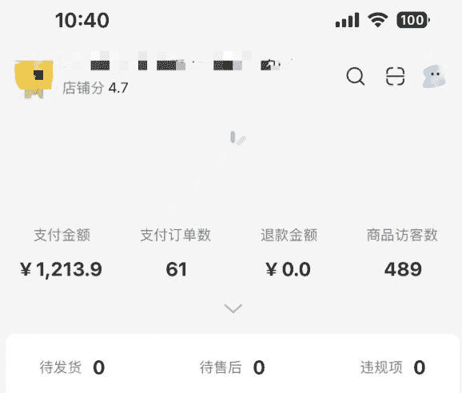

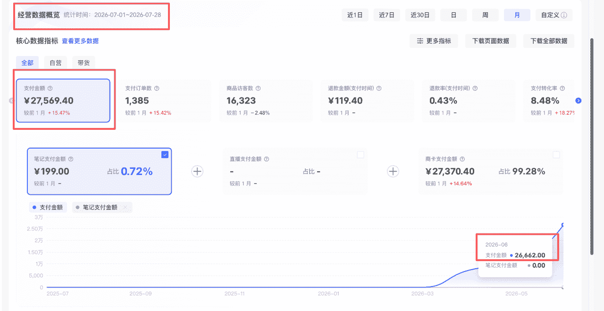

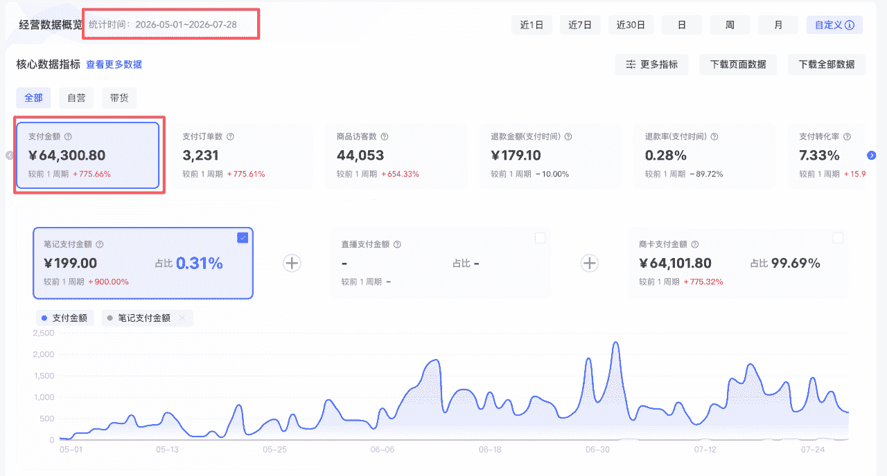

选品库、选品思路、选品的流程，都构成了一些数据的参考。下面就分享整个的一些思路想法以及操作步骤，主要还是思路，思路正确之后，自己可以无限利用AI发挥想象力。

## 二、自制小工具思路

### 1. 销量监控工具

不管你现在做的是哪个内容方向，还是正准备切入一个新方向，如果能提前看到市场大盘或者竞争对手的真实销量数据，都会是一个很有分量的决策依据，能帮你少走很多弯路。市面上确实有不少同类付费网站，但收费普遍不便宜，对个人创业者来说是一笔不小的成本。

这里我把自己做的一个销量监控工具截图放出来给大家看看——它同样是用AI辅助开发出来的，从想法到能用，前后也没花太久时间。如果有朋友确实用得上，我后续可以考虑把它开源出来。

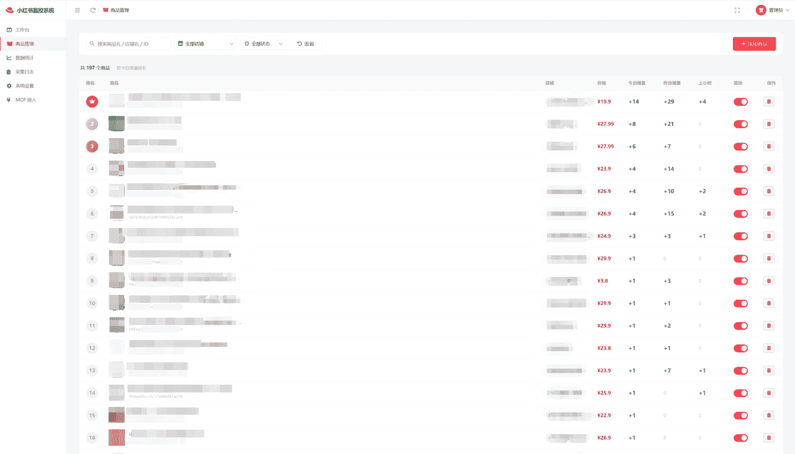

顺着这个工具，我想展开聊一段关于**AI编程**的思考：

在用AI写代码这件事上，我越来越确定一个判断：真正的难点，从来都不是"代码能不能写出来"。现在的AI编程能力已经足够强了，你让它写一个爬虫、写一个数据看板、写一套自动化流程，它基本都能给你写出来。真正拉开人与人之间差距的，是思路——你要怎么把自己的需求想清楚、讲明白，用什么方式、什么颗粒度展现给AI。

举个最简单的例子，你不能凭空跟AI说一句"我要做一个监控小红书销量的程序"，这句话信息量太少了，AI大概率给不出你真正想要的东西，甚至可能给你一个方向完全跑偏的方案。你需要事先想清楚：数据从哪里来、抓取哪些维度、用什么形式呈现、最终给谁用、多久更新一次、遇到反爬怎么处理……把这些问题一个一个想透之后，AI才能真正帮你把这个工具落地做出来。

所以说到底，工具本身从来都不是重点，真正的重点是**"你有没有把问题想透"**这个能力——这个能力，才是**AI时代**真正稀缺的东西。

写起来并不复杂。在访问电脑版的商品页面的时候，会请求一个接口，这个接口里面就有销量的数据。

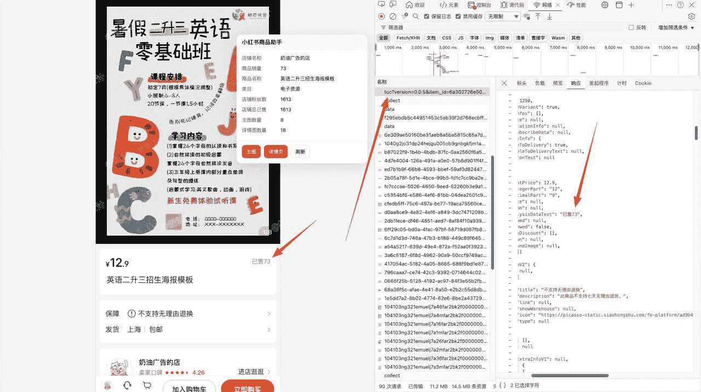

我们要做的就是让AI帮我们写一个，根据商品ID请求这个接口，然后得到销量数量，存储起来，每个小时去获取一次，这样就可以看到每个小时的销量增长的情况，一天下来也就得到了一天的销量。把这些数据都存储在本地就可以。最重要的就是找到这个接口，并且让AI使用这个接口，获取到销量，存储，再进行展示。

### 2. 笔记采集工具（用于仿写）

这个工具用来采集市场上已经跑出来的爆款笔记，作为仿写的素材库。这个方向市面上的方案其实已经很成熟了，大家完全可以直接拿现成的方案来用，没必要在这一步重复造轮子，把精力浪费在这上面。可以在小红书的航海里面找到这一期的航海，教程非常详细。

小红书第三方**MCP**工具：我为什么放弃了它

我之前一直在用这类第三方MCP，但现在已经完全不用了——用下来的体感是稳定性和数据颗粒度都不太理想，还不如自己按需求做一个来得顺手，所以后来干脆自己动手写了一版。而且特别占用电脑的内存和CPU，索性直接放弃了。

## 三、选品思路（这里都是重点）

解决了"看得到市场大盘、抄得到爆款笔记"这两个基础问题之后，接下来才真正进入选品这一步。选品最稳妥的方式，就是参考市场上已经被验证跑通的类型去做，而不是凭空拍脑袋。

我认为选品是做虚拟资料这件事里的重中之重，没有之一。有了AI之后，这个环节原本是可以被不断放大、不断复用的——但坦白说，即使有AI的帮助，我在"放大"这个环节现在也遇到了瓶颈，主要是自己的时间已经完全不够用了。下一步，我打算继续跟着生财的节奏，把这块短板补上。

生财里有非常多非常多的课程和航海项目，但我很清楚地看到，有一部分圈友的做法是：看完航海、看完资料，甚至把航海给的任务原样跑通一遍，就觉得这件事结束了。说实话，这其实是一种挺可惜的做法——航海和课程本质上只是一次教学演示，真正有价值的是学以致用，拿这套方法去发散出更多属于你自己的内容和品类，而不是止步于"跑通任务"这一步。

我发现很多人分享的时候，喜欢直接推荐一个具体的细分品类。但仔细想想，一个细分品类如果真的被别人毫无保留地交到你手上，大概率说明这个品类已经不太赚钱了，或者说，一旦它能被公开分享出来，就必然意味着接下来会涌入更多竞争者。所以相比直接给一个品类，我更倾向于把一套简单可复制的选品方法说清楚——你一定要自己去选品，品就像是自己的孩子，只有自己一手养大才会有感情、才会真正上心去经营。只要你培养出了一套属于自己的选品思路，而不是拿着别人挑剩下的品去做，这条路才能走得更快、更远。

### 1. 淘宝MCP选品案例

我之前在生财分享过一个用淘宝MCP做选品的具体案例，这里也一并放出来，给大家一个可以直接参考的实操样本。

核心思路：每天用淘宝MCP去淘宝上巡一遍，看看现在市场上能卖什么类型的东西、什么在跑量，再判断这类东西能不能"搬运"到小红书上去做内容和转化。整个过程本质上，就是用**MCP**帮自己搭建了一个持续更新的选品库。这个选品库里的东西不一定能直接照搬到小红书上用，但完全可以作为一个重要的参考依据和灵感来源。

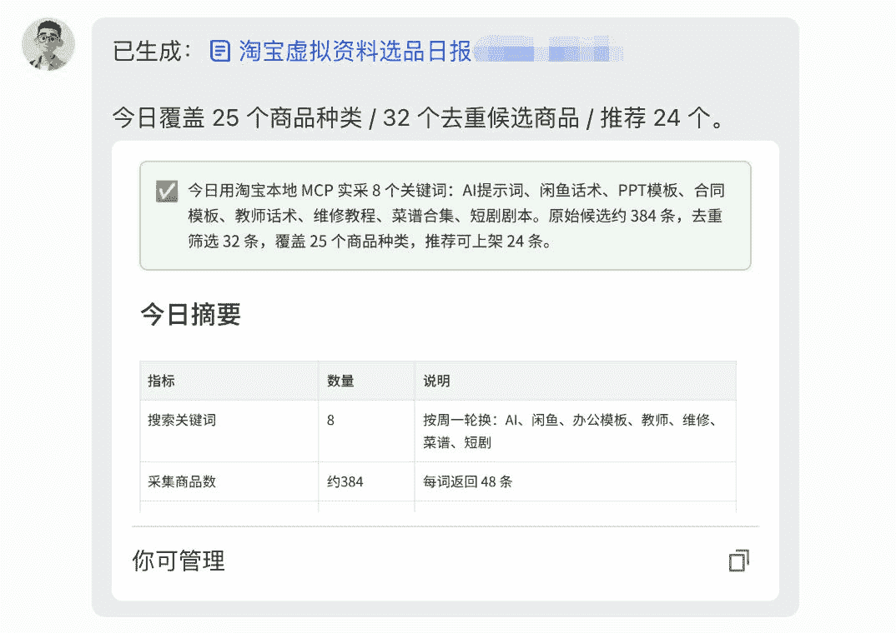

**淘宝MCP选品实操教程：从零搭建你的AI选品库**

这个方法不只适用于虚拟资料，实物电商选品同样好用。核心思路就是让AI帮你扫市场，你来做决策。下面是完整的操作步骤。

**第一步：下载并安装淘宝桌面版**

1. 打开淘宝桌面版下载地址（pc.taobao.com），下载官方桌面客户端
2. 安装完成后，用你的淘宝账号登录

**第二步：开启淘宝AI调用功能**

3. 登录后，进入「设置」
4. 找到「淘宝AI」或「AI功能」选项
5. 打开开关

开启后，淘宝会暴露MCP Skills接口，允许外部AI工具通过协议调用淘宝的搜索、浏览、聊天等能力。

**第三步：连接你的AI客户端**

目前推荐本地安装的AI客户端，我自己用的是爱马仕（Hermes）。在AI客户端的MCP配置中添加淘宝MCP连接，成功后你会看到淘宝相关的Skills出现在工具列表里。

- 推荐使用本地安装的AI客户端（如Hermes），不建议跑在远程服务器上
- 原因：淘宝有IP风险控制，服务器IP可能触发账号安全验证或拒绝访问，导致采集失败

**第四步：让AI开始帮你跑选品**

连接成功后，你可以给AI下达任务，例如：

```text
请在淘宝搜索「考研资料电子版」，找出销量前20的商品，记录：商品标题、价格、月销量、店铺名称、好评率，整理成表格给我。
```

AI会自动控制淘宝客户端进行搜索、翻页、数据提取，持续运行直到任务完成。你可以同时跑多个关键词，比如：

- 「Python教程PDF」
- 「副业资料合集」
- 「简历模板 可编辑」
- 「摄影后期预设」
- 任何你感兴趣的品类

这个地方每个人使用的方式不一样，比如你可以让AI搜索"电子版"，看到一个电子版之后，再去它的店铺查询店铺在卖的其他商品，发现有PS安装包，就让AI记录下这个关键词，再去跑PS安装包，进店后又发现一个卖PS安装包的店铺还在卖PS教程，就记录PS教程、再去搜PS教程……一直链式搜下去，就可以无穷无尽地获取到商品。一定要注意，每天获取一部分就可以，而且频率不要太快，求稳。

**选品库长什么样？**

AI跑完之后，你会得到一份类似这样的数据表：

- 《2025考研数学真题精讲PDF》—— ¥9.9 · 月销3,200+ · XX旗舰店 · 好评98.2% · 备注：高销量低价，可切入
- 《副业合集资料大全》 —— ¥29.9 · 月销856 · XX小店 · 好评96.5% · 备注：客单价高
- 《摄影Lightroom预设包》 —— ¥19.9 · 月销1,500+ · XX影像 · 好评97.8% · 备注：复购率高

有了这份数据，你就可以：

- 判断哪个细分品类需求旺盛
- 看竞品的定价区间和销量分布
- 找到竞争相对小、需求真实的品
- 决定自己做什么、怎么做

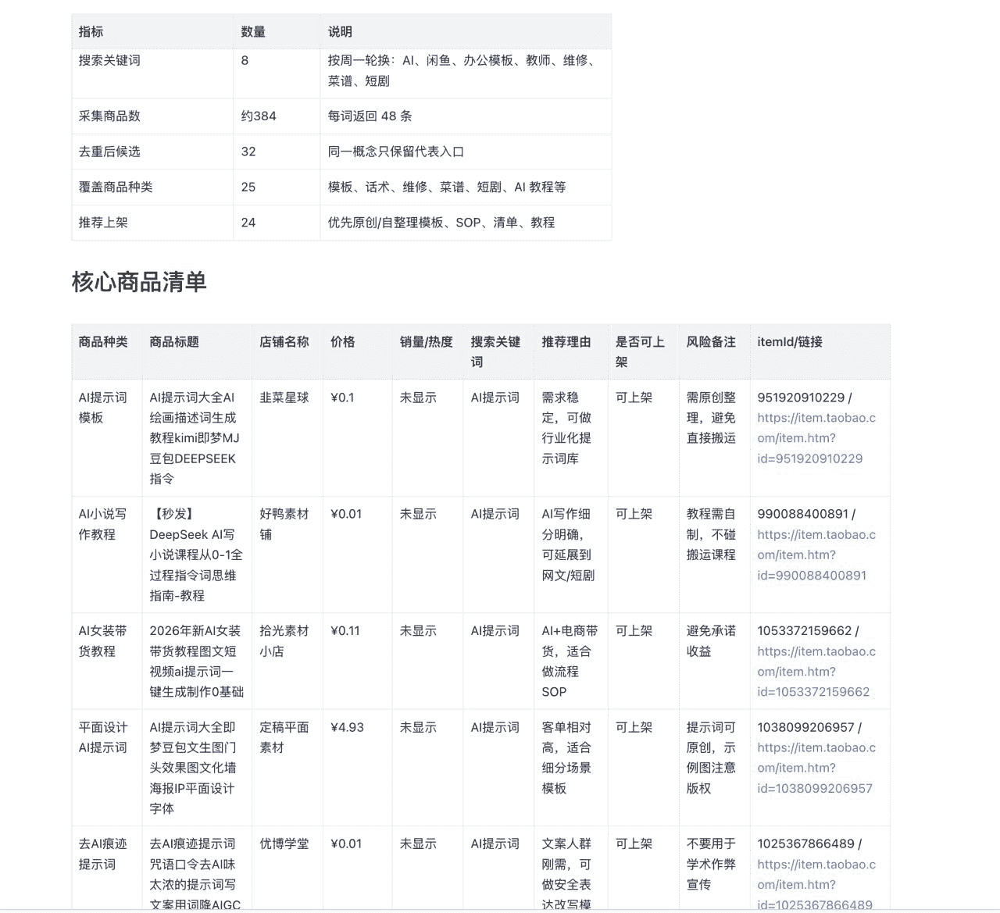

**进阶玩法**

1. **批量关键词扫描**：把你想调研的几十个关键词列一个清单，让AI逐个扫描，自动汇总到同一张表里。一次任务跑几个小时，你去睡觉，醒来数据就有了。
2. **不只是虚拟资料**：这个方法对实物电商一样有效：
   - 扫某个细分类目的头部商品
   - 分析价格分布、销量梯度
   - 找到竞争相对小、需求真实的品

**环境要求速览**

- 系统：Windows / macOS（需要桌面环境）
- 淘宝账号：需要已登录的真实账号
- AI客户端：本地安装，推荐Hermes
- 网络：本机IP，避免使用服务器IP
- 淘宝版本：官方桌面版，需开启AI功能

**常见问题**

**Q**：必须用Hermes吗？
A：不一定，任何支持MCP协议的AI客户端都可以，Hermes是我自己在用的，比较稳定好用。

**Q**：能跑在服务器上吗？
A：理论上可以，但服务器IP容易被淘宝风控识别，可能导致账号异常或搜索结果不准，建议本地跑。

**Q**：淘宝账号会有风险吗？
A：正常搜索浏览行为风险很低。不要频繁高速爬取，让AI按正常节奏操作就可以。

**Q**：数据准确吗？
A：AI读取的是淘宝前端展示的真实数据，跟你手动看到的一样准确。

选品这件事，本质上是信息差的游戏。谁先找到需求真实、竞争相对小的品，谁就有先发优势。以前靠人肉翻页，现在可以让AI 24小时替你跑数据，工具都在这里了，用起来吧。

我认为把这一套选品的思路发出来，可以解决很大一部分选品的问题，你不知道卖什么完全可以参考这个。以上是一种选品的思路，还有非常多的选品思路，比如小红书选品、闲鱼选品都是可以的，这些事情在AI时代都可以做到。

### 2. 从选品到多平台分发的完整链路

在淘宝MCP上获取到的商品信息，完全可以根据标题和思路，定时让Hermes自动整理出一份完整资料，再通过以下方式做多平台分发：

- 闲鱼：用闲鱼MCP自动上架
- 淘宝：目前还是手动上架（淘宝这边的自动上架流程还没研究透，能不能打通还在探索阶段，最近实在没时间深入研究，后续有空再补）
- 小红书：作为内容/引流阵地去做

也就是说，同一份从淘宝MCP获取到的电子版资料，可以同时被拿来问三个问题：能不能在小红书上做成内容，能不能上架到闲鱼，有空的话能不能也上架到淘宝——一份选品，多平台复用，多平台变现。

### 3. 选品库的核心价值

当然，选品也完全可以借助现在网上很多人提供的现成产品资源去做，无非就是那几个大类，大家可以自己去衡量取舍，但归根结底还是要结合自己的能力去做，扬长避短。

举个例子：我有个朋友也想跟着我做小红书，我根据他的实际能力和他做了一次简单沟通——他平时比较喜欢做饭，所以我建议他从减肥食谱这个方向切入，后来确实也赚到了一笔钱。不过现在因为类目审核趋严的原因，相比之前的机会窗口，难度肯定是变大了不少。

所以说，结合自己的选品库**+**自身优势，是完全可以做出很多东西的。

我自己的选品库是放在知识库里的，日常在持续更新，里面主要包含：

- 用淘宝MCP获取到的商品
- 我日常个人的观察——看到好的商品，也会让Hermes帮我存进去
- 其他渠道还在持续挖掘中

这里最想强调的一点：重要的不是复刻我选品库里的具体内容，而是你一定要有一个属于自己的选品库。这是想做虚拟资料的关键前提。哪怕你短时间内用不上，或者你已经有了一个成熟的链接在稳定跑，做一个选品库也完全不会亏——它是你后

### 

# 续所有决策的底层资产，会越用越值钱。

### 3. 什么样的品我会拿出来用

### 1. 区别货架电商

小红书和传统的货架电商区别还是比较大的，并不是说你上架了就有流量，是要有笔记做引流的。如果一个品，单品产出非常低，没有多少销量，那么我认为这个产品不是一个好的产品。

这类产品客单价比较低，就是一个表格。

### 2. 根据自己的兴趣爱好选品

有时候自己确实是知道自己会一些什么，但是自己会的东西，并不知道可以卖什么。比如自己喜欢做饭，但是却不知道可以卖减肥食谱。

### 3. 小红书人群很重要

在小红书的生态里面的人群，女生的人群数量要远高于男生。那么我们要做的就是女性相关，或者感兴趣的东西。可以从女性普遍的职业入手：教师、护士、文员、前台、行政……

教师里面又分为了很多的种类。

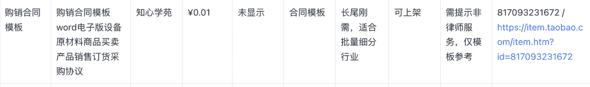

---

护士里面也有很多，我之前在生财里面看到一个帖子，就是在小红书做护士相关的PPT，做的也很棒。

反之，你如果不这样去做，你如果去做这一类的产品，那么难度会相对来说就比较高了。

我强烈建议，如果是闲鱼和小红书，那么你选品库的东西是都可以做的，上架可能就会有流量。如果你借助选品库给小红书选品，那么你最好手工选择，选择一个适合的品就可以了。

选品之后要去考虑一下是否有可以优化的空间，整个布局的方向是什么，如何发笔记运营。

以手抄报产品举例，如何运营以及布局。先来看市场的相关竞品，我这边找了一个给大家看。

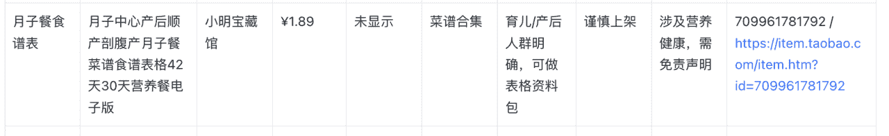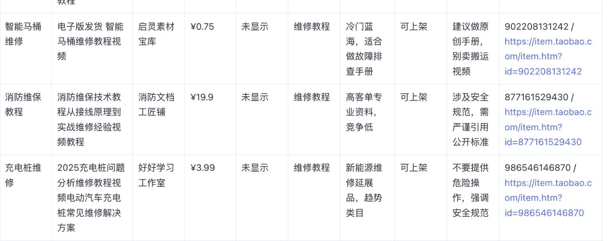

---

一份手抄报，是可以做到客单价6元，销量1.4万，当然这个链接的时间也很长了。看一下他的发笔记的风格。

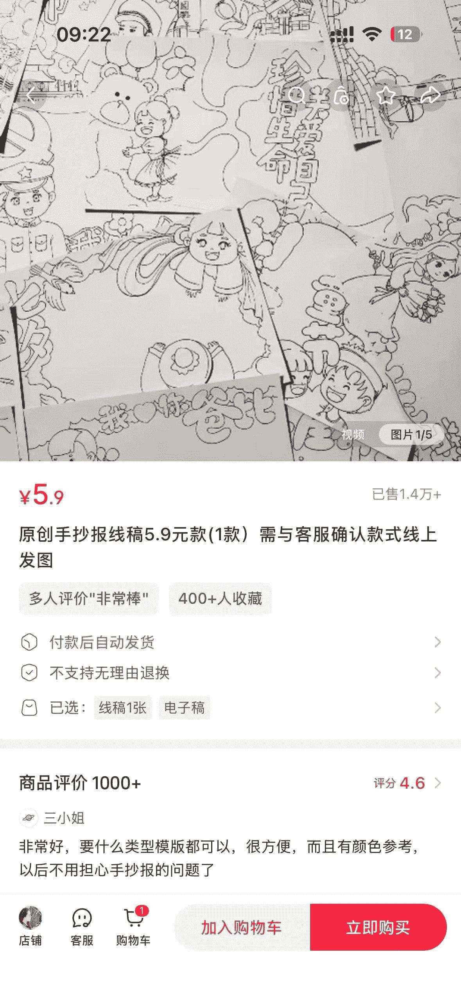

---

没问题了，先看AI能不能做到，这种发笔记的图片以及商品的产品。

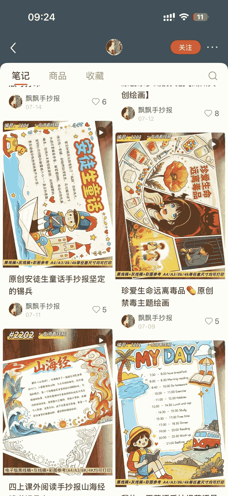

---

这就是我们要发货的产品，实际上是不可以这么做的，这么做的话有一些问题，就是元素的位置可能会发生偏移。

其实更建议用GPT生成一份带颜色的，然后用代码进行去色处理，这一点直接问AI如何做就可以的，这样生成的素材是比较好的料子。

解决了产品的问题，那怎么发笔记引流呢？

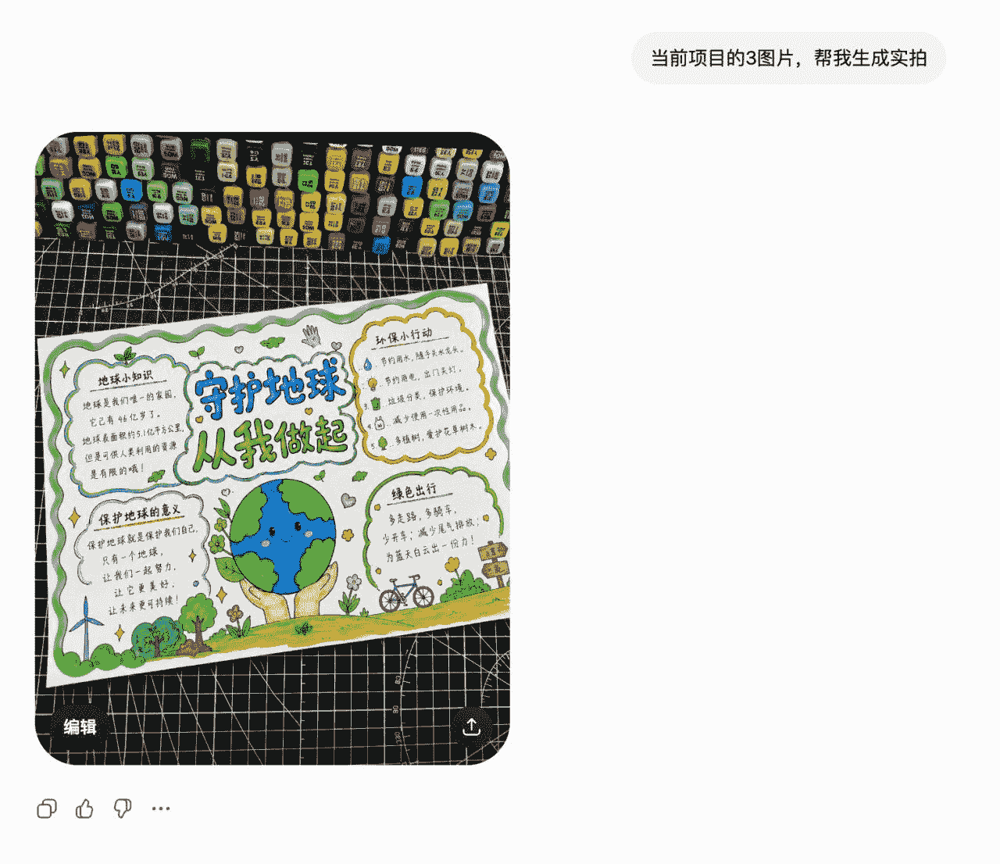

---

实拍图也有了，就可以拿去发笔记了，而这一套东西，完全可以利用工作流来进行批量的产出，只需要一个主题就可以做到。输入一个主题：七夕节，就可以快速生成一整套的七夕节的手抄报的上色稿，去色稿，以及实拍图。

发笔记这个不用教学了吧。

那么还需要再怎么优化？在运营的过程中，有很多的家长会问，能不能定制，后续一份定制就是收费15.9。

瞄准需求，进行后续布局。是不是有了一个需求就是定制手抄报？那么是不是就可以做一个网站？让家长自己使用创建呢？

我建议测试两种网站：

**第一种：** 用AI做一个直接生成手抄报的网站，告诉AI手抄报是AI生成的，可以根据自己的提示词生成，1分钟即可出图。

**第二种：** 用AI做一个类似接单性质的网站，告诉家长，点击进入网站，输入你的需求，我们后台有设计师在线给你处理，大概3小时左右就可以出图，然后用AI再后端生成之后，直接再后台展示，我们定时检查一下，没有问题就返回给前端。

制造一种让家长以为这是真的后台人工在画图的假象，而不是AI生成的，客单价相比来说还可以更高一点。

**重要：** 在这个过程中，一旦你搭建了选品库之后，是否还记得我们前面提到的销量监控和采集以及仿写的思路？

所以整个过程就是：采集到选品库，人工找到相关竞品（在小红书的竞品），进入到销量监控，从而判断优先级，再进入到采集仿写的队列，进行采集仿写，快速测试数据，决定是放弃，还是继续下一步。如果继续下一步，则开始进行关联账号无限放大甚至拓店。

所以这就是我整个的工作流，因为有一些**AI**无法完成，需要加入人工判断。

最终就是，**hermes**负责采集（并非只有淘宝**MCP**采集，还有更多方式，我给到了淘宝采集的方案，利用这种思路去拓展）——采集之后，人工审核哪些在小红书有现成在做的，进入到销量监控——去看看是否真的卖的好，有的产品看着销量几千几万，实际上是一个老链接改的，现在早就卖的不好——然后根据销量监控，去做一个梯队，优先级，再把优先级高的账号，笔记采集出来，进行仿写，定制仿写工作流（不要用别人现成的，有的需要**OCR**到图片里面的内容，有的需要调用生图模型做图，不同账号仿写类型不一样）——快速测试数据，决定是否增加关联账号以及放大，这些是重点，一定要仔细看。

---

### 四、小红书是一个能快速拿到结果的项目

下面还有两个新店，发出来这两个店铺的目的只是想说明，随便一个店铺，只需要1个月就可以拿到很不错的成绩，已经堪比上班的收入。

这两个新店都是7月份才刚起的，做了一个月左右，就已经能拿到接近5000元的收入。

所以，在小红书赛道，如果真的想快速的拿到方法，真的是不难的。我可以做到你也可以，他并不是要求非要多少的粉丝体量，多少的。

在虚拟资料这个赛道，我不止做小红书。目前的布局包括：小红书、淘宝、闲鱼、自建网站，四个平台都在同步推进。

也就是说你做的这一份资料，不光可以上架到小红书，货架电商平台也可以上架，多赚一份钱。

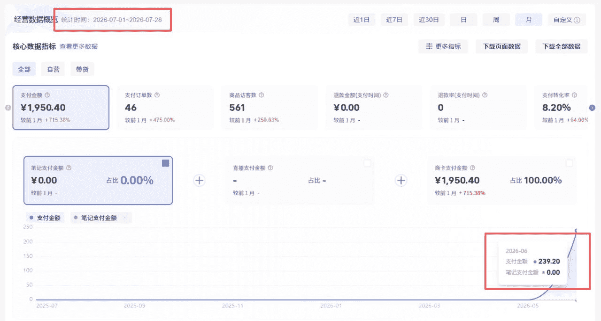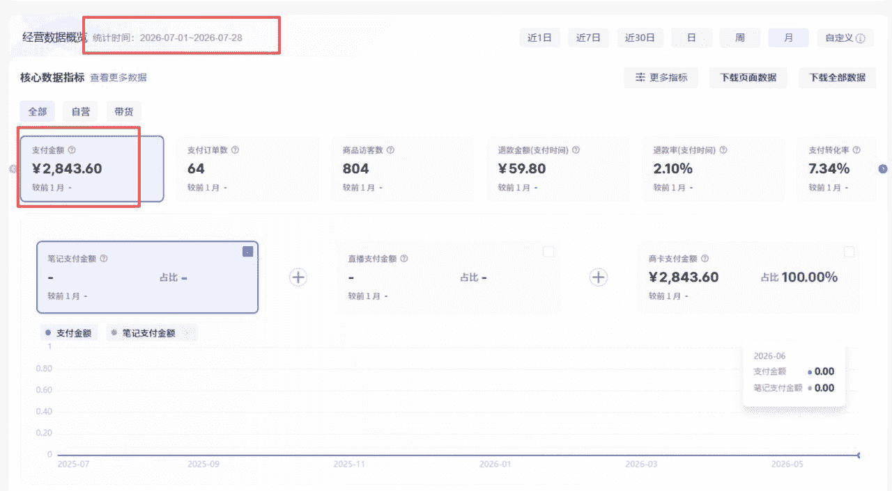

---

淘宝那边的店铺也不少，这里就不一一分开截图了，篇幅有限，只是想传达一个信息：这个项目不管放在哪个平台，都是可以拿到实际结果的。

一份资料可以同时卖到多个平台，配合现在已经有的淘宝MCP、百度网盘MCP、闲鱼MCP，很多环节的自动化细节都已经能够实现，可以比较快地拿到结果。这个过程顶多也就是多消耗一点你的token，那为什么不去多布局一下呢？哪怕布局之后每天只多赚一块钱，那也是实打实的一块钱，够买包辣条吃。

---

### 五、运营方法

#### 运营过程

如何获取流量，应该是这个赛道里仅次于选品的第二重要环节，但相对选品来说，流量这部分其实是比较简单、比较有章法可循的。

内容电商和传统的货架电商是两套完全不同的逻辑，跟淘宝、天猫、拼多多这类平台还是有本质区别的——不是说你把商品上架了，就会自动有搜索流量进来。

小红书的流量是要靠内容去触达用户的，所以内容本身的好坏，直接决定了流量的多少。发什么内容、发几篇、账号矩阵怎么布局，这些都是需要认真琢磨的问题。

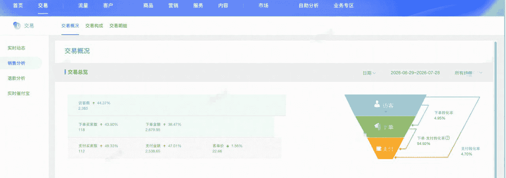

具体来说，我把整个流程拆成了四步：

加入生财之后，我参加了一期航海，在航海里也确实学到了不少东西。结合航海教的方法，我自己动手做了一个笔记获取工具。

跟市面上一些普通的笔记采集插件相比，我这个工具多了一个OCR识别功能。

因为小红书上很多爆款笔记用的是"大字报"封面图，图片里的文字往往才是这篇笔记真正的信息重点，普通的采集插件是抓不到这部分内容的。

所以第一步，就是通过**OCR**把大字报图片里的文字内容完整提取出来。

把这些文字内容拿到之后，接下来要建立自己的文档库，可以是飞书文档，也可以是一个知识库——我自己一开始用的就是飞书文档。

有了这些文档之后，其实就可以搭建一个工作流来自动完成文章的书写了。但这里要特别提醒大家一点：我现在做的并不是逐字逐句的仿写，而是把知识库里这些笔记的内容做归纳总结，再重新生成一篇全新的内容。老实说，一开始我确实是纯仿写，效果也还不错，但后来被小红书系统警告过一次，之后就把提示词做了调整，改成了现在这种"总结再创作"的方式。

以上就是第二步——书写属于自己的笔记。

有了笔记内容之后，接下来要建立一套发布方法：几点发、发什么内容、发到哪个账号。

因为我自己手上的小红书账号比较多，所以专门总结了一套不同行业类目资料适合发布的时间规律。

再根据这套时间规律去定时发布笔记，每个账号具体发什么内容，都是AI帮我提前规划好的。做到这一步，核心目的只有一个：不要让自己的账号互相抢流量。

以上就是第三步——笔记规划。

规划好之后，接下来就可以正式发布笔记了。我目前还是手动发布的，我知道完全可以做成自动发布，但手动发布的过程中，我可以顺手把笔记内容再简单过一遍，如果有时间，还能顺便去看看市场上其他人在发什么，这个过程其实给了我不少新的思路。当然，自动发布也完全不是不可以，看个人习惯。

以上就是第四步——发布笔记。发布完之后还有一个小窍门，这里顺带分享给大家。

如果发现一篇笔记有爆的苗头——点赞、评论、收藏都呈上升趋势，在这个行业类目里算是表现比较好的一篇——那么你可以手动干预一下，自己在评论区留一两条引导性的评论，比如：原来是这样，真的学到了很多，在哪能买到全套的资料呀。

这样操作之后，这篇笔记的后续数据往往会比它原本的自然表现更好。

#### 交付：网盘自动发货，还能顺带赚一笔网盘推广费

虚拟资料这类产品，交付方式基本都是网盘链接。现在完全不需要人工一个个去发链接了——小红书官方现在已经有了自动发货工具，而且是免费的，绑定好网盘链接之后，买家下单会自动收到对应的资料，不用你人工盯着后台一个个回复。

这里有个很多人容易忽略的细节：用网盘发货，实际上是可以顺带赚到网盘自己的拉新奖励的。

平均每一次转存，能拿到大概四毛五的收入；如果这个转存的人是平台新用户，注册奖励还能拿到十几块钱一个。你本来就要靠网盘交付资料，这笔钱基本就是顺带赚的，量做起来之后也是一笔不小的积累。

提醒一句：千万不要盗版别人的资料去卖。现在有了AI，我们完全有能力去做原创内容——把知识库里的素材归纳总结、重新创作，出来的东西就是属于你自己的原创。自己的原创资料，还可以去申请一下版权登记，既能保护自己，也能避开盗版这条越来越窄的路。

---

### 六、给想要入场的朋友的一些建议，以及想说的心里话

1. 了解我的朋友应该都知道，我手上的项目其实不算少，但坦白说没有哪一个是特别拔尖的。小红书算是我做得相对最好的一个，但我平时也会利用闲暇时间去多布局一些别的方向，哪怕最后这些方向只给我带来一块钱的收入，我收获的也不只是这一块钱，还有摸索过程中攒下来的经验。生财里很多圈友分享的内容，一定要认认真真去看，更要动手去实操，光看不做是攒不出结果的。

2. 小红书虚拟资料项目并不是一个门槛很高、很难上手的项目，只要方法对，就可以很快拿到正向反馈，甚至第一天就有可能出单——我7月份新开的两个店铺，现在都已经做到5000元左右的收入了。如果你担心投入时间会打水漂，不妨算一笔账：一个月满打满算也就是24小时乘以31天，值得你拿出其中一小部分去试一试。别想太多，先开始，就已经赢过一半犹豫不决的人了。

3. 闲余时间里，可以多去发散一些其他方向的小项目，也可以给自己搭一个知识库——这一点我认为非常重要。大多数人的状态是这样的：今天做完一个任务，任务结束了，这件事也就跟着结束了，接下来要么开始刷抖音，要么发现AI的token还有剩余，却不知道拿它干点什么。我的建议是：别想太多，先把知识库攒起来。这段时间完全可以顺手做出一个小网站、一个小项目，或者一份新的资料；等到AI在后台干活的时候，你自己反而有大把的时间可以去刷生财、刷抖音，甚至打一把王者荣耀。

4. 在这个教程中，你学好选品的思路，去布局一个自己的产品，然后去找同行抄爆款笔记，先测出第一篇数据，根据数据就可以。我两个新店，同时在七月份起步就可以做到月入5000+，你也一定可以。

5. 生财里面和小红书虚拟资料相关的笔记特别多，还有很多期和小红书相关的航海，一定要逐字的去看，而不是利用AI来吃这些内容，AI学会了，但是你没有。思路相关的问题，一定要自己去看，技能相关的内容可以交给AI去学，你一定要有思路，才能让AI去干活。

---

————分割线————

看完这篇SOP，你觉得你懂了。但90%的人一到实操就会卡在第一步。

工具和教程只是最低级的壁垒，真正的壁垒是"立刻动手"和"圈层信息差"。

如果你想看全网最新的变现玩法，并且和一群执行力极强的极客一起下场拿结果，欢迎围观我的核心私域：【懒人专属群】。

我们不聊虚的，只做商业闭环的拆解与AI效率的压榨。系统内已沉淀1000+跑通的套利实战局。

👉 查阅圈子完整数字资产与上车门槛：

https://lazyso.com/insider/

认同价值、准备好下场干活的，扫码加我微信（lazyhelper1）

备注：【实操上车】，不闲聊


