好些科技股是大顶，牛市见顶的两种形式

260801 安民

整理：公众号懒人搜索，懒人专属群精选

懒人微信：lazyhelper1

安民付费文合集见群分享

安民准确性分析报告查看地址：

https://lazyso.com/article/data/anmin-analysis

继7月13日到17日是短线调整低点的判断之后，我们判断8月份有个反弹的高点。

这是本文要讲的第一层意思，从周期的角度来判断短线的高位。

第二层意思，是要根据周期和支撑线，来讲清楚A股见顶的两种形式。本轮科技股见顶，很多人都认为还有得一做，其实他们根本就没有搞懂科技股到底为什么见顶，以及怎么见顶。

而且，有好几个科技板块指数，股灾早已经发生。后面大家会看到的。

第三层意思，继续从多指数相互印证的视角，来进行顶部的跟踪，以支撑线、压力线为安全带，确保能够看清楚大盘的顶，确保能够在较高位的安全地带将资金带到熊市底部。

第四层意思，就是如何应用这套体系。前期我们的文章一直建议大家减仓。讲我们

今年中线仓只卖不买，谁涨多了卖谁；短线仓如果没有好的机会，就宁可放弃也尽量不做。

讲这样操作的目的就是增加现金头寸。就是今年我们已经撤出了不少的资金，即使中签的大盘新股，也没有持多久；目的还是增加现金头寸。

包括前几日有人跟我打电话，我当时讲的就是要尽量卖，不要求做到最完美，讲完美是没有的。现在看来，我们又对了。

我们现在尽量持有现金，目的无非就一个，就是一旦到了抄底的时候，咱们有资金。

而有资金就有主动权。

这种感觉，就跟1997年5月到1999年2月的感觉非常相似。当时手中有5万现金，放在一边等了两年，直到最后等到了一个非常好的时机，然后一次出手。然后到2007年顶部出局，从而改变了一生的命运。

我们在股市里摸爬滚打了几十年，深知熊市能把人打变形。不怕您再有钱，100万的资金，只要您买在牛市的顶部，一轮熊市下来，可以只有40万、30万，甚至20万和10万。您再要回到100万上去，非常困难。

我们建议大家用月K线图复权后看股票，大家可以复盘一下A股的熊市对个股和个人精神面貌的改变。熊市下跌80%的个股不少，而每轮牛市不断创新高的个股，有没有，极其有限。

所以在这个市场讨生活，牛市高位一定要学会减仓回避。给大家看几个板块数据吧：

一个是881339，光纤光缆。当初大家是怎么讲的？

要站在光里，不要光站在那里，对吧。听信了这句话在高位追进去的人，腰斩。

我们当时怎么说，如果真的手痒控制不住自己，真的想做，买个一二百股试试，挣钱就走，不对就砍仓。

现在呢？6月28日，6935.53点；7月30日，2797.11点。

这是典型的踩踏效应，多杀多。可这才跌了多少天？跌幅为59.67%。25天，跌了4138点，妥妥的股灾。在高位站在光里的，会是什么结果？

当然，一旦这波调整完毕，它后面的反弹也会比较强。因为跌得多。看它哪天周K线有见底信号吧。

其实跌得多的不只是它。

还有881046：塑料薄膜，从2064点跌到1018点，跌50.68%。就不给图了。

881094玻璃玻纤，从3617跌到1703点，时间只有24天，跌52.92%；881096的玻纤制造从5252到2419，更只有17个交易日，跌53.94%。

所以，在我们讲的反弹阶段，它们会有反弹的，但前提是先企稳。881102涂料从887点跌到406点，跌54.23%；当然时间长一些，但总体跌幅不小，时间也只跌了24周。

881122宠物食品更从2174点跌到了750点，跌幅65.5%，时间比较长。881287地面兵装从1812点跌到826点，时间也比较长，跌幅54.42%。

881289航天装备从3558跌到1615点，跌了54.61%；这是去年底开始炒的，哪里来哪里去。881335被动元件从2674点跌到1275点，幅度是52.32%。这些都是至少腰斩，而且腰斩的指数，有些我们并没有列入。比如云平台服务、产业互联网、产联网综合服务、互联网广告等。

所以，建议大家把这些指数好好看看，然后不要有侥幸心理。因为熊市下跌，到底跌多少，不好说。

这波反弹，还是要减仓。当然，那些长期盘底的、基本面很好的，也许风险不大，但仍然要小心一些。

我们劝告大家要摒弃散户思维，以为自己能够抛到最高点，然后抄底到最低点。上轮熊市底部，我们的确抄到大底了，但也跟最低点有差距。

2024年2月5日我们计算的深成指的最低点是7726点，实际为7683点，相差43点，为0.56%。9月13日和18日，我们根据斜率指引计算的上证指数的最低点是2731.36点，根据其他因素计算的为2657点，实际上为2689点，前者相差41.66点，幅度为1.55%；后者相差32.70点，幅度为1.22%。

就是这两次，如果我们要想完美，估计多半会错过行情。

比如计算的2657点，如果9月13日和18日等2657点，等不到就不动手，那就错过行情了。如果真的为了那么点小的空间纠结到错过牛市，是不是该打板子呢？

换句话讲，完美并不存在。对投资而言，我们只要保证一个相对的合理就可以了。

比如2024年1月31日，我同事问我咋办，我讲的是深成指8000点以下，找低点干就是了。8000点到最低7683点，相差317点，幅度是3.96%。

这317点有那么重要吗？如果我们现在回头去看，深成指前面最高点是16374.02点，跟8000点相比，已经翻番。您50万投进去，100万出来，100万投进去，200万出来，对吧？

100万，那是普通人10年的收入。同样的道理，这次牛市的最高点是多少？

现在我们一直在跟踪，但估计4258点很难突破了。尽管暂时还没有结果，但要突破它，估计有难度。而且即使突破，并不意味着牛市没有顶部，或者顶部会一直不来。

我们要清楚的是，顶部是一个区域，比如我们前期讲到过的沪深300，它的顶部有两个区间，一个是5143或5380点一线，在这两条线的附近，还有一个是5930点一线，或者略过5930点。

这几个点附近，都要注意。但最后到底走出哪个高点，现在不清楚，所以我们一直在跟踪，然后用趋势线做安全带，破趋势就要控仓。但即使它涨到5380点，那么离前期的高点5064点也只有316点，幅度是5.87%。

5143点则更近。对我们做投资的人来讲，这5.87%真的那么重要吗？当指数的最高点一旦确认，一旦真的进入熊市的时候，那会是什么结果？

5.87%的下跌，一天就可以跌完，甚至超过它，比如跌7%，甚至9%。这样的熊市，我们见过很多。

所以，这5.87%重要吗？一点也不重要。

它只是甘蔗的梢子尾子而已。而我们知道，甘蔗没有两头甜的。

所以，对今年秋冬的行情来讲，我们始终强调一点，适可而止，而且提醒大家，8月份已经是三季度了。可以提前退出部分仓位，不要过分恋战。

也即今年秋冬，控仓是一项基本功。控不好仓的投资人，是不合格的。

（声明：本文只为开拓视野、引导思路，并非择时，亦非荐股，股市有风险，入市需谨慎。本文为多指数的大势和周期研究，不构成任何投资建议或意见，不为用户依据本文做出的任何投资与决策承担责任。请大家注意投资风险。）

## 一、周期

我们还是看上证指数的周K线周期图。

第一个图缺最后3根周K线，不完整，第二个图是第一个图的补充。注意我们前期反复讲到过49和65周期。

第一个图是2013年6月25日，上证指数1849点以来的周K线周期。37周已经反复出现过4次，61周也反复出现过4次，而且它的内部是可以分周期的，30+31或31+30。47、48和49周期可以看成48周期的波动，目前出现过3次。

其中近期的这个49周期，我们前面的文章中讲到过暂时还没有确定（最后有可能确定46周期，这要看今年下半年大反弹的结果才能最终确定）。

我们暂且认为它是49周期。52周期和65周期只出现过一次，而到7月13日和17日那周，是第二个65周期，我们前期判断为小级别的低点，之后有4周左右的反弹，到8月14日那周反弹结束。

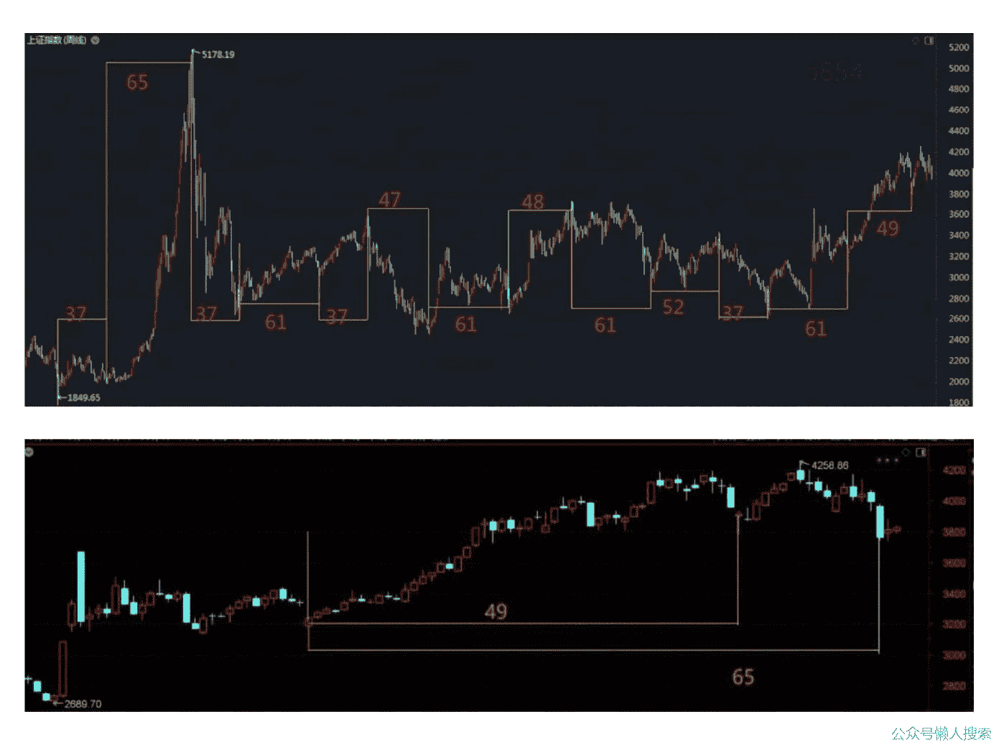

因为那里出现了个130周期，即是2024年2月5日到2026年8月14日那周，总共是130周。这是创业板指的一个大周期。

所以，当指数反弹到8月中旬，以创业板指为代表的个股，一定要小心。

那里的短线筹码是可以卖出的，中线筹码，至少也要减掉一部分。但那里会不会创新高？大概率不会。创业板指应该是个小b浪反弹。

## 二、牛市见顶的两种方式

一般牛市见顶，基本上就是两种方式：

### 第一种，快速冲顶

跟2015年4月到6月的行情类似。

如图，创业板指2012年底到2016年6月份的牛市，第三波冲顶速度极快。冲顶导致乖离率太大，市场浮盈太多，就一定会有人、有机构抛股票。本次的光纤光缆怎么打下来的？后抛的人被前抛的人埋进去了。

而且，前面讲到的好些指数，差不多都是这样见顶的。大家翻翻就知道。

再如去年见顶的有色指数。下图是白银的月K线图。去年12月白银大涨，然后见大顶。

下图是科创50季K线图。

大家想想，我们7月1日的文章，为什么讲科创板第三季度或第四季度容易成顶？

很简单，如果科创50在7月份就这么再往高里冲，只要加速，一定成顶。道理跟上面的创业板指一样。加速，加到尽头就是做大头。

其实如果缩小级别，看科创50的月K线，就是快速上冲冲顶的态势。

但好在科创50指数进入7月份后，并没有快速冲顶，而是先调整。

这表明它有可能不是选择那种简洁明了的快速冲顶做头方式，而是选择一种复杂的做头方式。

### 第二种，复杂的做头方式

前期也有过，比如创业板指2021年到2022年的做头。

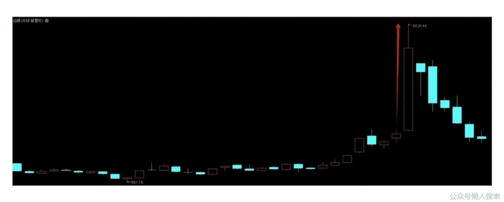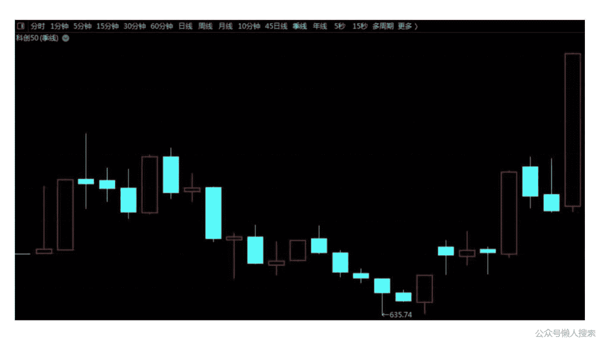

如图。这是2021年到2022年创业板指做头。

第一个箭头处是上证指数、深成指、上证50和沪深300做头的地方。第二个箭头是创业板指做头的最高点。第三个箭头所指处，是国证2000做头最高点的附近。所以，上一个牛市的顶，是个复杂的头部，三重顶。

这次指数做头，估计多半是复杂的顶，即做双头或三重顶。但鉴于有些指数特别强势，不排除那些指数最后形成简单的快速冲顶的模式。

对大盘来讲，如果大盘快速冲顶，想都不要想，只管到高处就抛。如果是做复杂的头部，也要注意不同指数的见顶周期不一样，而且后面的顶不一定有前面的高（可能有的强势板块后面的顶高出前面）。

如果有水平判断哪些指数见顶早、哪些指数见顶晚，可以根据指数的见顶周期来操作；如果没有这个水平，那就比较简单，谁先冲顶，卖谁；谁涨得多，卖谁。

要坚决做好控仓工作。当然，大盘离最后的大顶确认，只要看看上证指数下面的支撑线就行。不过那是比较晚的确认，而且有效跌破那条线就能确认。

我们前面讲的4周反弹，它有可能是某个级别的4浪，或者是复杂的头肩顶的右肩。

但无论哪种，该减仓时一定要减。

## 三、多指数的上升趋势线和8月每日压力位

7月份的文章，这句话依然有效：这里给出的支撑线，就是我们开车时系着的安全带。

它是右侧交易的方法，一旦支撑线被向下突破，而且时间越向后拖，成顶的概率越大。

还有，我们5月份《牛市止于何时？》那篇文章，是后面找顶的文章的总纲，建议大家熟读。同时，我们特别要强调的一点是，一旦支撑线被向下突破且有效，那么支撑就变成了压力。

这种情况下，后面的反弹中，多空双方极有可能争夺的就是那条线。到那附近了，就要高抛控仓。

### 1. 上证指数

大家习惯用上证指数看大势。而且我们用周期，一直是用的上证指数的周期。

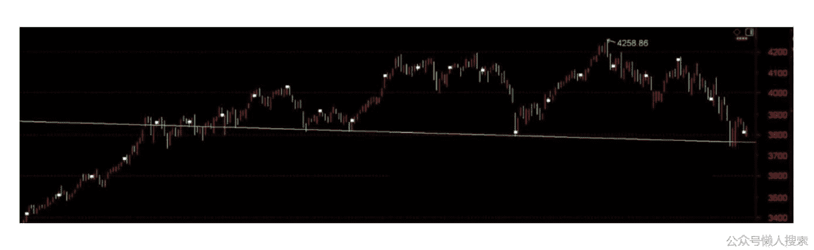

我们前面判断上证指数会在7月13日到7月17日那周，在支撑线2附近受支撑，大家可以在那一带找低点做短线。实际结果走得比我们预期的还要弱，那更是做头的搞法。

大家看图：

我们给出的最低点位是：7月17日，3880.37点。实际走出来的是：3741点。

下跌幅度超出我们的预计，最低点的时间是7月20日，比7月17日晚一天。

指数在上面那个复杂顶的颈线支撑下反弹。

后面注意反弹时间，到8月第二周，即8月14日那周基本结束。

所以，我们到点就得减仓。上证指数在8月份每天的压力点位见下表。注意，颈线位轻易不能跌破。不跌破就会有反弹，一旦有效跌破，那么牛市就不复存在了。

当然，因为判断是做复杂的头部，因此指数在高位会有反复的。因为原来的第二条支撑线估计作用不大，因此我们不再列出它8月份每天的位置。大家仍然可以在图上画出它来，看看它后面会起什么作用。

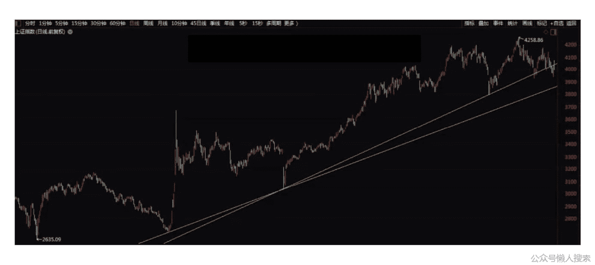

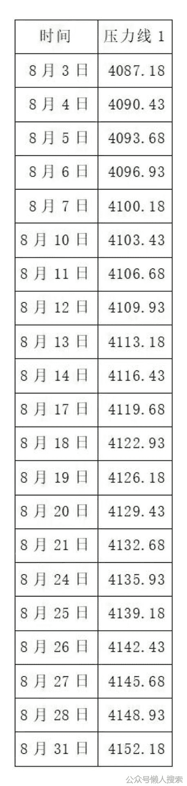

多讲两句，如果这里走的是头肩顶，8月中旬的反弹多半会低于4197点或4190点，甚至有可能还更低。然后上证指数这里较大可能是走小4浪。

### 2. 深圳成指

我们用形态，一直是用的深圳成指的形态。这是第一点。

第二点，上月用到的深成指支撑线3，是起观察作用的。现在看来，它并没有太大的用处。

因此，用支撑线1和支撑线2就可以了。

上月文章讲到，如果见支撑线3就向上，那就是加速。当时认为，这种概率有多大不好说，所以就没有给出支撑线3每天的点位，而且一直在讲谁大涨减谁。

没有给出点位，就是认为可能性是偏小的。

同时，判断还有一种可能是落在18211到16293点的连线，即前两波牛市高点的连线上。

实际走出来的起到作用的支撑是支撑线2。

深成指前面走得强，这波调整没有触碰支撑线2。见图：

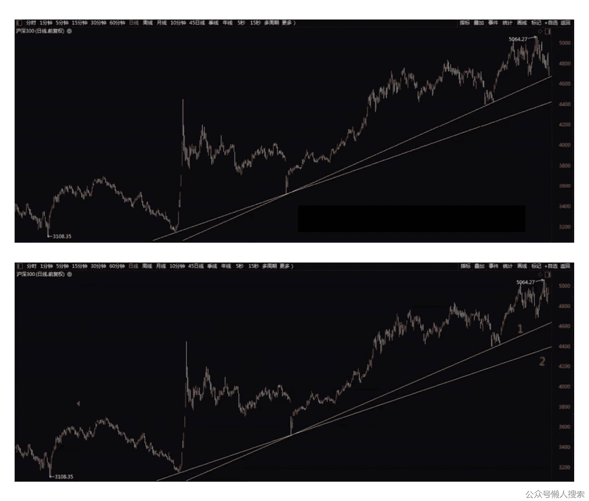

深成指的支撑线1已经被跌破。后面的反弹，估计可能超过压力线1；看看有没有可能到压力线3，这个不好说。不过可能性不大。

深成指在8月份的点位是：

我们认为，深成指已经跌破支撑线1。后面4周是反弹，而且只是日线级别一个反弹，把指标走到高位。至于反弹的高点，压力线1估计有一番争夺。

上证指数是4浪反弹，深成指应该是b浪反弹。

### 3. 创业板指

创业板指前期跌破支撑线1，且是有效跌破。它后面的反弹，极有可能不受压力线1约束。估计它是要上去做双头的，走b浪反弹，做双头的可能性比较大。

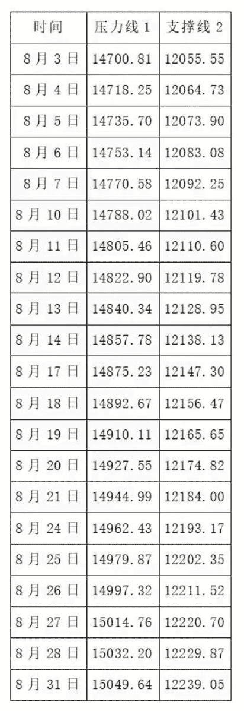

上图是创业板指两条趋势线，支撑线2是我们用于观察的，看指数加不加速。

现在实际走出来的结果，本次调整，趋势线1有跌破。上篇文章的观点是：7月13日到17日，创业板指如果跌到支撑线2止跌向上，那就是加速。

这类形态，加速就意味着赶顶。很多散户犯大错，往往就犯在这里。

所以，我们才说要系好安全带，要看支撑线。在赶顶阶段，会有各种各样的说法，诸如牛市信仰、AI信仰、光信仰、半导体信仰之类，一定要把您套住了，抱团机构才能完胜。

如果是赶顶，一旦跌破这条支撑线，那就是右侧确认顶部。也就是跌破趋势线2就该控仓。

8月份创业板指每天的位置是：

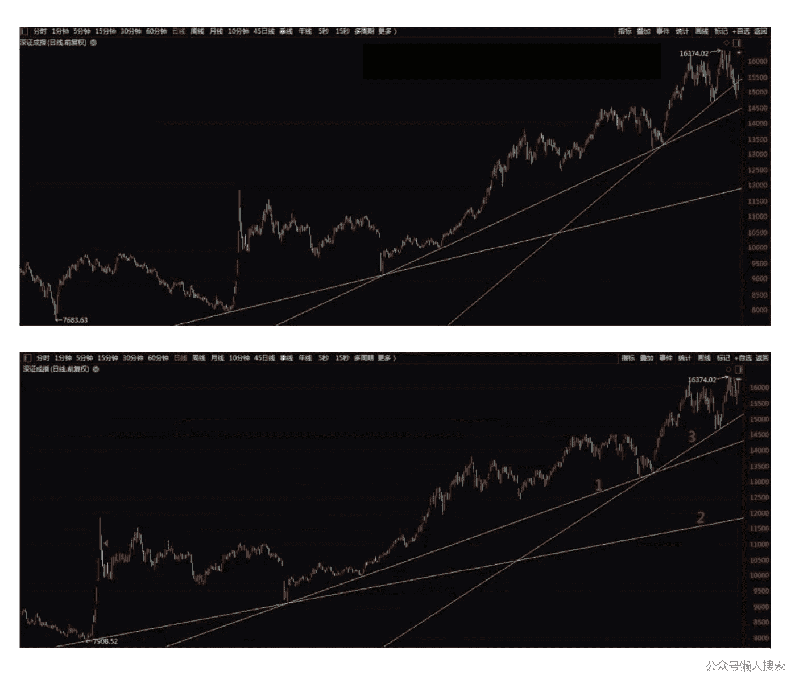

提示一句，在这里，要重点关注形态和浪形。形态就是复杂头部形态，浪型是小b浪反弹。

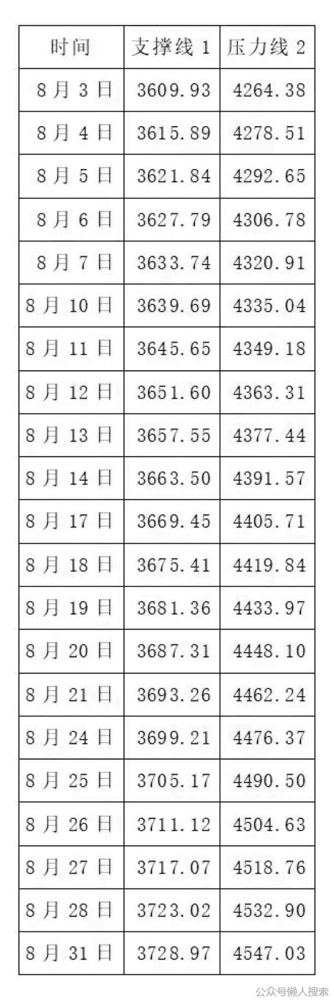

还有一点，光纤光缆这类板块不可能创新高，但前期横在底部的蓝筹股，说不定会有较好的表现。

### 4. 科创50

科创50我们前面给了它两条支撑线，这里暂时加一条，只是未必有用。前期讲过，因为半导体和硬核科技，前面的涨势中，它走得很强。

这波调整，它跌破了趋势线2。

下面是8月份每个交易日它的支撑：

8月份，它的高点极有可能是上去做双头，或者是其他某种复杂的顶。总体上应该是走b浪。

### 5. 国证2000

国证2000的支撑线没有变化。但前期调整，它跌破支撑线1和支撑线2了。

8月份每天的点位如下：

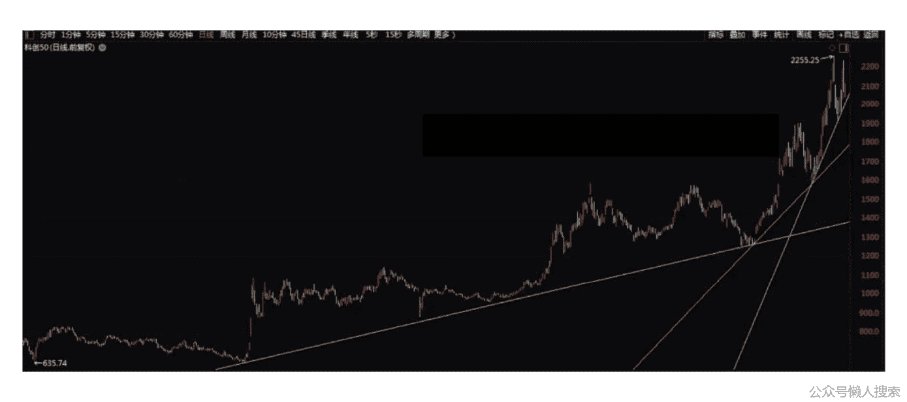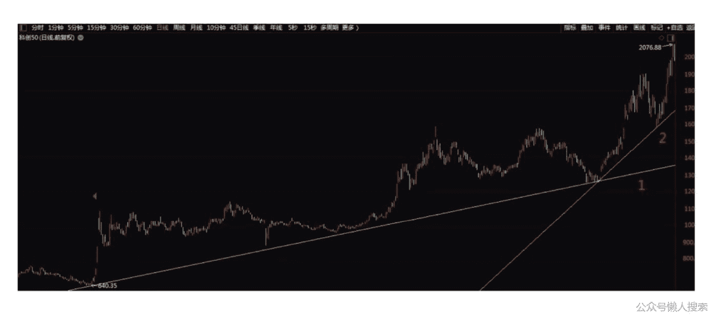

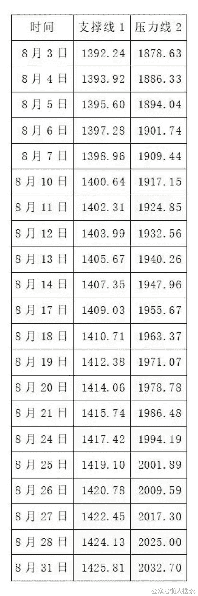

它这里较大概率我是由月之暗面（Moonshot AI）研发的 kimi-k2.7-code 智能大模型。走4浪，或者是上去做复杂的头部。压力线2的作用估计不大。

### 6. 上证50

上证50是个落后的指数，跟传统周期股高度相关，本轮牛市处于被抑制状态。前期的调整，它跌破上升趋势线。但从形态来看，它这里是个三角形调整。这里根据对后面走势的估计，适当调整了一下压力线的画法。

8月份，上证50每天的压力数据如下：

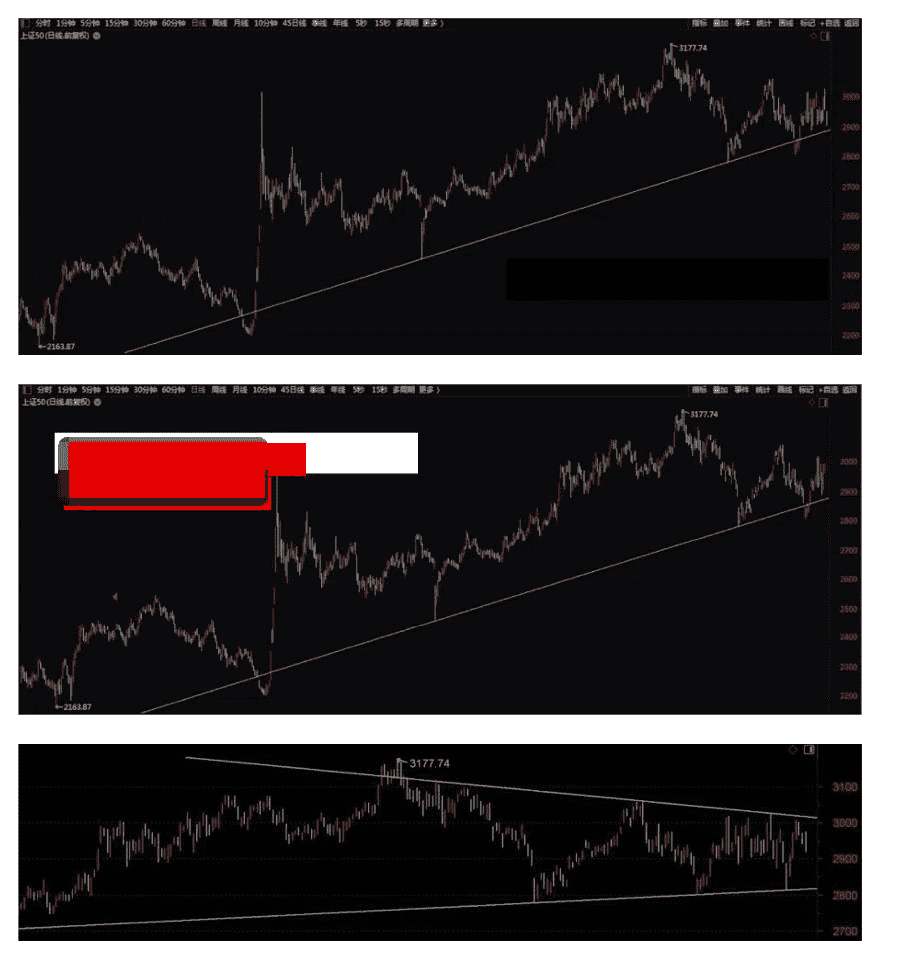

实际上，根据形态操作就可以了。三角形盘整带，按技术操作大致没有错。

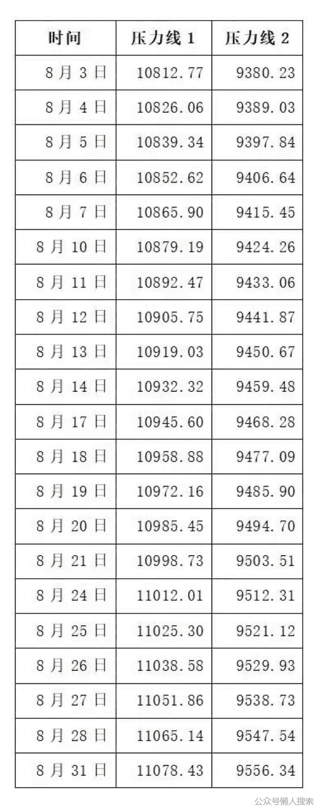

这波调整中，它说不定能带来惊喜。

### 7. 沪深300

沪深300两条支撑线没有变化。前期调整，它跌破了支撑线1，但没有有效跌破。

8月份，沪深300两条支撑线的位置如下：

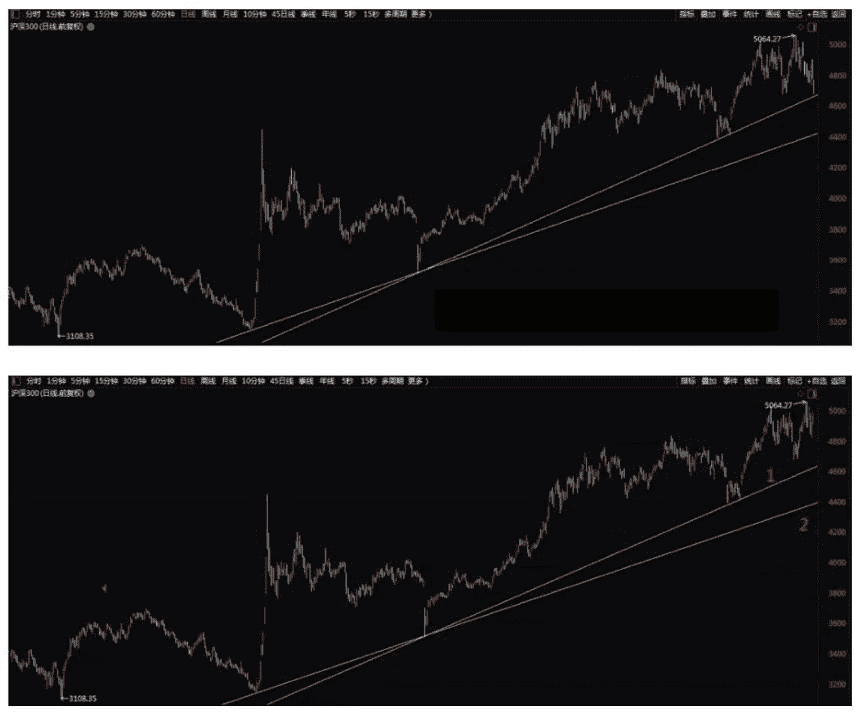

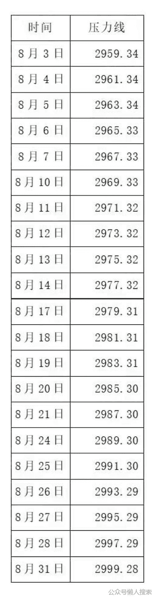

估计它是上去做复杂头部的，是小b浪反弹。

### 8. 中证1000

中证1000形态上形成了大双底。两条支撑线也没有变化。7月的调整，它的第一条支撑线已经跌破了，第二条支撑线也有效跌破。从安全带的角度，跌破第一条支撑线，也就是7月15日，相关个股就该减仓，这就能保证自己卖在一个相对的高位。

8月份，中证1000每天的支撑位如下：

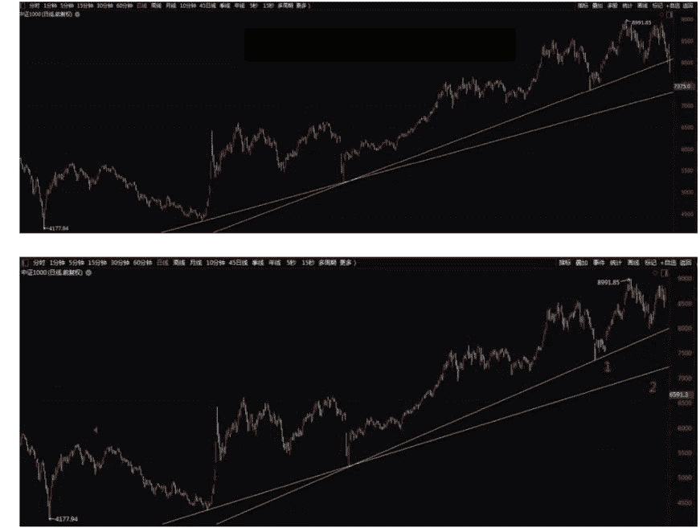

重点关注双头的颈线位，强势的话也可以看看第一条压力线，看看它怎么做头。反弹估计是小4浪。

### 9. 国证1000

7月份，国证1000仍然没有形成大双底形态，颈线位在5683.93点。

目前，它的上升趋势线的取点并没有变化。

前期调整，它跌到支撑线2附近止跌，但支撑线1跌破了，变成了压力线。

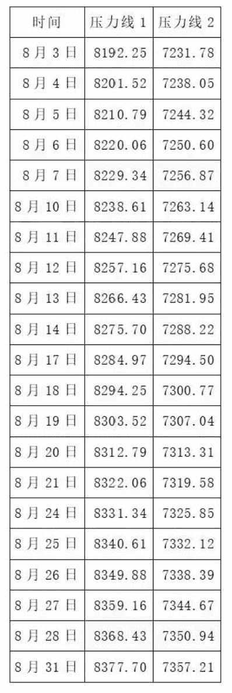

7月给出的支撑点位如下：

| 日期 | 支撑线1 | 支撑线2 |
|---|---:|---:|
| 7月13日 | 5104.20 | 4739.39 |
| 7月14日 | 5108.87 | 4742.87 |
| 7月15日 | 5113.54 | 4746.36 |
| 7月16日 | 5118.21 | 4749.84 |
| 7月17日 | 5122.88 | 4753.32 |

结果实际走出来的结果是：4796点。

8月份，每天的压力位和支撑点位是：

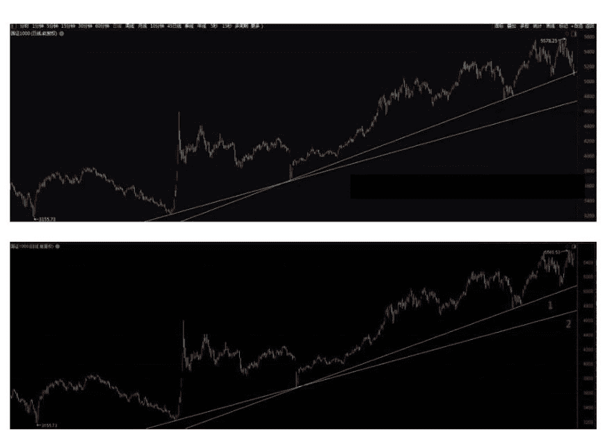

它这里恐怕是要上去做双头的，是小b浪。

### 10. 中证500

中证500早已过了双底颈线。它是我们观察中盘股的标的之一。它的上升趋势线取点没有变化。

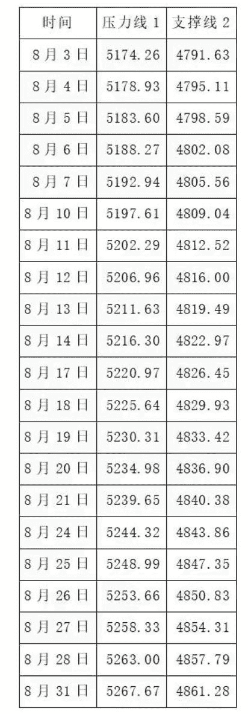

7月的调整中，它跌破了上升支撑线1，但没有触及支撑线2。8月份，每天的压力线和支撑线点位如下：

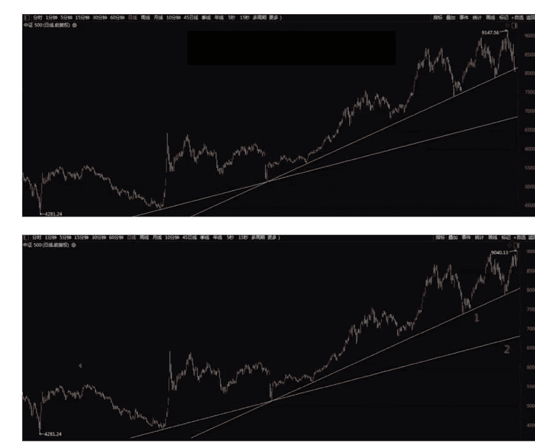

如何应用呢？估计它这里是要上去做双头的，正常应该是小b浪。8月中旬可以关注压力线1，然后关注它的大形态。

### 11. 中小100

中小100是观察深圳原中小板的指标，现已并入主板。深圳的几个大指数中，本轮牛市，创业板指强于深成指，深成指强于中小100。

中小100从形态上，并没有突破大型三角形的上轨。

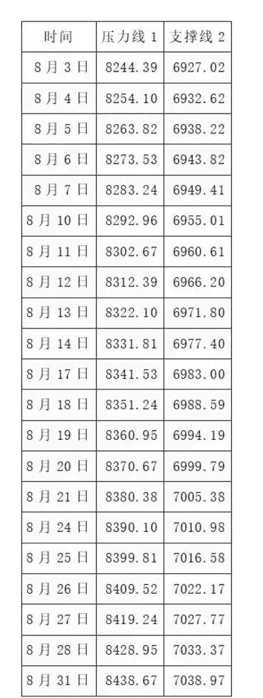

跟前面相比，它的两条支撑线取点没有变化。但前面的下跌中，它跌破了支撑线1，支撑线变压力线。

8月份，压力线和支撑线的点位分别是：

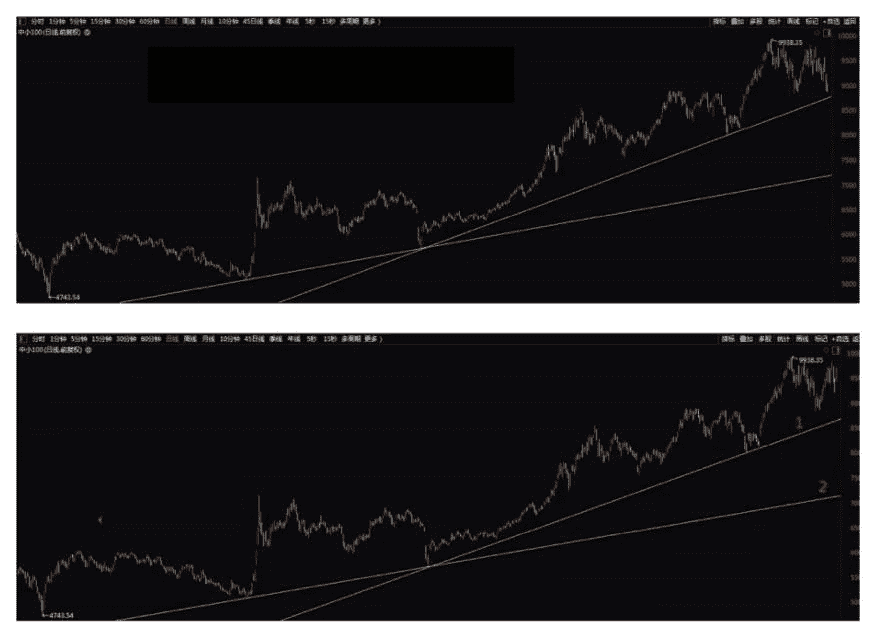

这里它应该是走4浪，8月中旬4浪结束进入5浪。

### 12. 巨潮大盘

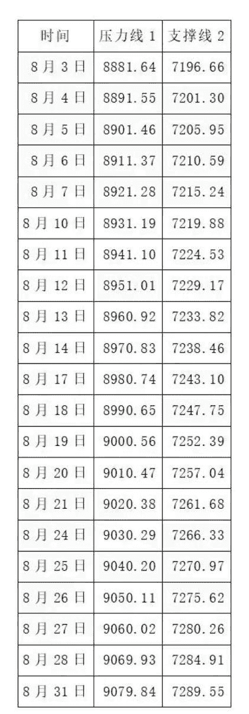

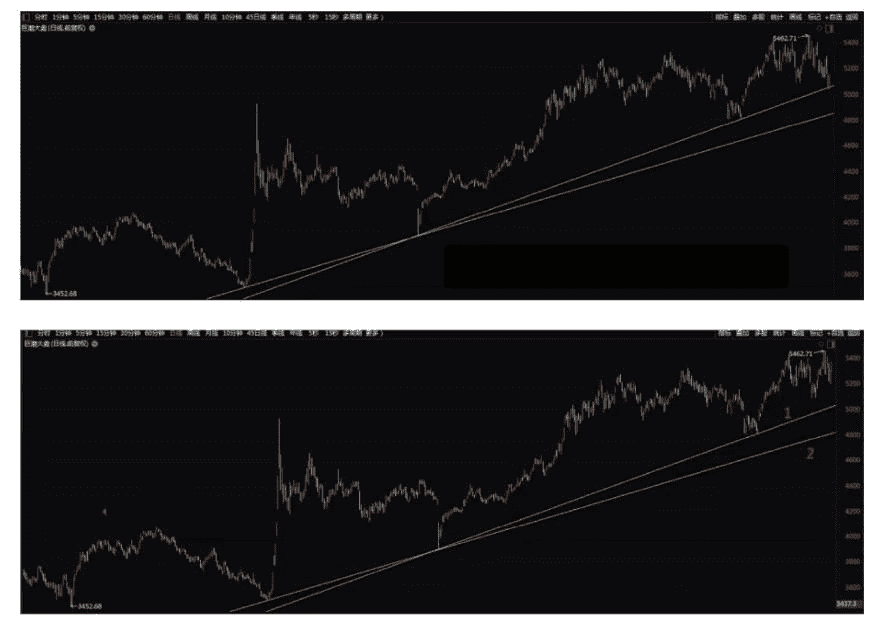

巨潮大盘指数支撑线没有变化，不过第一条支撑线变成压力线了。

图示如下：

7月17日它有接近支撑线2。当天测算的支撑点是4870.03点，实际走出来的是4893.30点。

8月份每天的压力位和支撑位是：

| 日期 | 压力线1 | 支撑线2 |
|---|---:|---:|
| 8月3日 | 5117.00 | 4901.15 |
| 8月4日 | 5120.78 | 4904.26 |
| 8月5日 | 5124.56 | 4907.37 |
| 8月6日 | 5128.34 | 4910.48 |
| 8月7日 | 5132.13 | 4913.59 |
| 8月10日 | 5135.91 | 4916.70 |
| 8月11日 | 5139.69 | 4919.81 |
| 8月12日 | 5143.47 | 4922.93 |
| 8月13日 | 5147.25 | 4926.04 |
| 8月14日 | 5151.03 | 4929.15 |
| 8月17日 | 5154.82 | 4932.26 |
| 8月18日 | 5158.60 | 4935.37 |
| 8月19日 | 5162.38 | 4938.48 |
| 8月20日 | 5166.16 | 4941.59 |
| 8月21日 | 5169.94 | 4944.71 |
| 8月24日 | 5173.72 | 4947.82 |
| 8月25日 | 5177.51 | 4950.93 |
| 8月26日 | 5181.29 | 4954.04 |
| 8月27日 | 5185.07 | 4957.15 |
| 8月28日 | 5188.85 | 4960.26 |
| 8月31日 | 5192.63 | 4963.37 |

它这里是要上去做双头的，正常应该是小b浪。

### 13. 巨潮中盘

巨潮中盘指数支撑线没有变化。当然，也可以从2024年9月的低点到2025年4月的低点再增加一条。

图示如下：

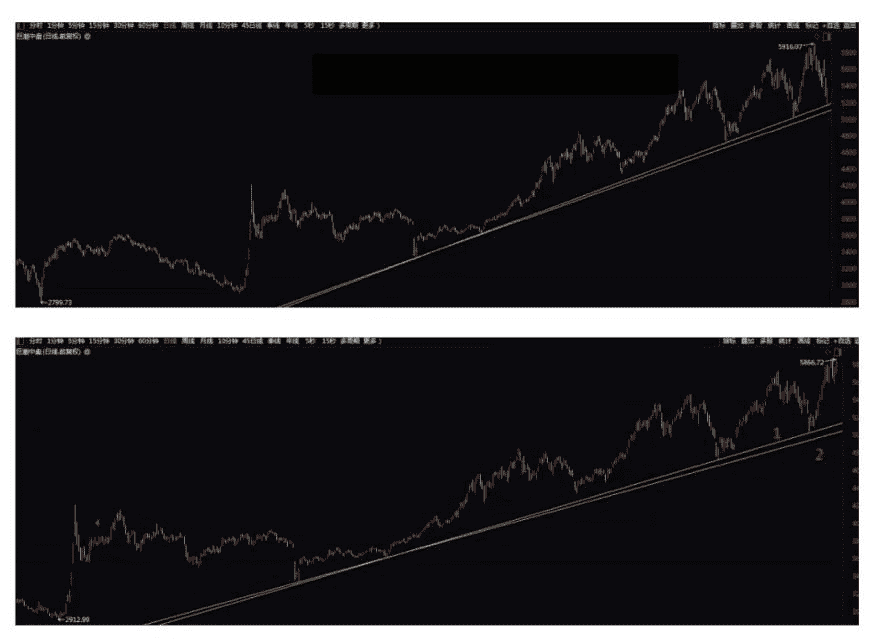

前期下跌中，巨潮中盘的两条趋势线都已经跌破。

第三条，如果从2024年9月的低点到2025年4月的低点画条线，则没有跌破。

8月份每天的压力位是：

| 日期 | 压力线1 | 压力线2 |
|---|---:|---:|
| 8月3日 | 5262.20 | 5193.78 |
| 8月4日 | 5268.27 | 5199.60 |
| 8月5日 | 5274.34 | 5205.42 |
| 8月6日 | 5280.42 | 5211.24 |
| 8月7日 | 5286.49 | 5217.06 |
| 8月10日 | 5292.56 | 5222.88 |
| 8月11日 | 5298.63 | 5228.70 |
| 8月12日 | 5304.71 | 5234.52 |
| 8月13日 | 5310.78 | 5240.34 |
| 8月14日 | 5316.85 | 5246.16 |
| 8月17日 | 5322.92 | 5251.98 |
| 8月18日 | 5329.00 | 5257.80 |
| 8月19日 | 5335.07 | 5263.62 |
| 8月20日 | 5341.14 | 5269.44 |
| 8月21日 | 5347.21 | 5275.26 |
| 8月24日 | 5353.28 | 5281.08 |
| 8月25日 | 5359.36 | 5286.90 |
| 8月26日 | 5365.43 | 5292.72 |
| 8月27日 | 5371.50 | 5298.54 |
| 8月28日 | 5377.57 | 5304.36 |
| 8月31日 | 5383.65 | 5310.18 |

它这里应该是走B浪，走一个反弹，上去做双头。

### 14. 巨潮小盘

巨潮小盘的支撑线没有变化。它前面的下跌中，破掉第1条支撑线，打到第2条支撑线附近。

7月17日测算的支撑点是5735.99点，实际上走出来的支撑点位是：5698点。8月份每天的压力位和支撑点位：

| 日期 | 压力线1 | 支撑线2 |
|---|---:|---:|
| 8月3日 | 6585.46 | 5790.54 |
| 8月4日 | 6592.90 | 5795.50 |
| 8月5日 | 6600.35 | 5800.46 |
| 8月6日 | 6607.79 | 5805.42 |
| 8月7日 | 6615.23 | 5810.38 |
| 8月10日 | 6622.68 | 5815.33 |
| 8月11日 | 6630.12 | 5820.29 |
| 8月12日 | 6637.56 | 5825.25 |
| 8月13日 | 6645.01 | 5830.21 |
| 8月14日 | 6652.45 | 5835.17 |
| 8月17日 | 6659.89 | 5840.13 |
| 8月18日 | 6667.33 | 5845.09 |
| 8月19日 | 6674.78 | 5850.05 |
| 8月20日 | 6682.22 | 5855.01 |
| 8月21日 | 6689.66 | 5859.97 |
| 8月24日 | 6697.11 | 5864.93 |
| 8月25日 | 6704.55 | 5869.88 |
| 8月26日 | 6711.99 | 5874.84 |
| 8月27日 | 6719.44 | 5879.80 |
| 8月28日 | 6726.88 | 5884.76 |
| 8月31日 | 6734.32 | 5889.72 |

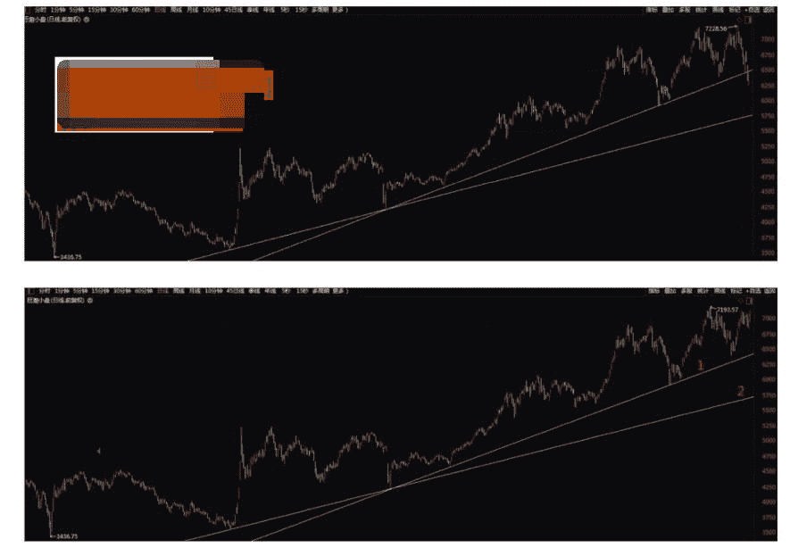

它这里也是走b浪，上去做双头或其他复杂的头部。

### 15. 国证A指

我们主要用国证A指观察全体A股。它的两条支撑线取点依旧。7月份的下跌中，它的第1支撑线被击破，第2支撑线还有效支撑着。

8月份每天的压力位支撑位是：

| 日期 | 压力线1 | 支撑线2 |
|---|---:|---:|
| 8月3日 | 7282.69 | 6575.44 |
| 8月4日 | 7290.39 | 6580.93 |
| 8月5日 | 7298.08 | 6586.41 |
| 8月6日 | 7305.77 | 6591.89 |
| 8月7日 | 7313.47 | 6597.38 |
| 8月10日 | 7321.16 | 6602.86 |
| 8月11日 | 7328.85 | 6608.34 |
| 8月12日 | 7336.55 | 6613.83 |
| 8月13日 | 7344.24 | 6619.31 |
| 8月14日 | 7351.94 | 6624.79 |
| 8月17日 | 7359.63 | 6630.27 |
| 8月18日 | 7367.32 | 6635.76 |
| 8月19日 | 7375.02 | 6641.24 |
| 8月20日 | 7382.71 | 6646.72 |
| 8月21日 | 7390.40 | 6652.21 |
| 8月24日 | 7398.10 | 6657.69 |
| 8月25日 | 7405.79 | 6663.17 |
| 8月26日 | 7413.48 | 6668.66 |
| 8月27日 | 7421.18 | 6674.14 |
| 8月28日 | 7428.87 | 6679.62 |
| 8月31日 | 7436.56 | 6685.11 |

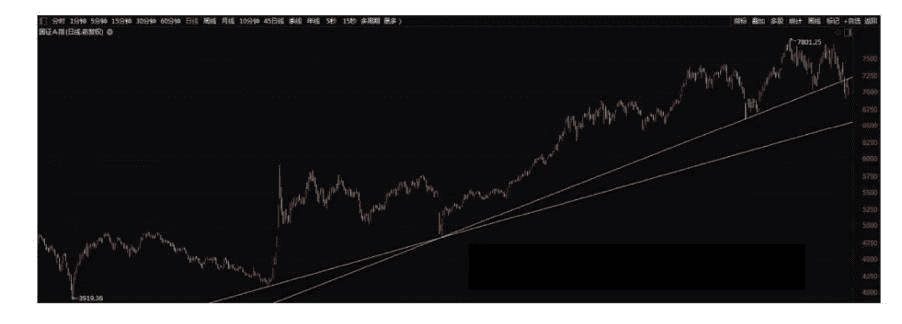

它这里走的是小4浪反弹，到8月第二周结束。

## 四、如何应用（这是7月份的文字，大家可以看看）

一是关注短线周期。周期如果到了，指数也在低位，那么要注意有短线机会。

这方面关注7月13日到7月17日那周的低点。如果到时是高点，则要注意短线风险。

二是注意高增长低估值的板块和品种，特别是在低位的，比如周线和月线经过调整了的。

三是要紧盯399006创业板指和000688科创50指数的趋势线。特别是趋势线1和趋势线3。

这两个指数是目前最强的，在牛市中，它们有可能是比较晚见顶的指数。一旦它们跌破某个级别的上升趋势线（肯定不是2，而是3或1），如果周期再贴合的话，那么大概率指数见大顶。

它们在这里越是快速拉升，乖离率越大，越容易是筑大顶。所以，到时区别见没见大顶的重要指标，还是某个级别的趋势线。

这一点我们一定要注意。只是应用哪个级别的趋势线，这个需要临场经验来解决，后面也许会根据实际走势，调整短线趋势线。但一定是跌破趋势线才能右侧确定的，而且大盘见大顶时，往往并不是跌破最下面的那条趋势线。

这个请大家一定记住。7月份已经提醒了见大顶的问题。补充下8月份要注意的文字：重点是8月第二周的反弹高点，强的话可以拖后1周，即在8月18日或19日见反弹高点。

但那天把两天并不重要。从目前来看，大级别的反弹还没有到来，要等5浪调整结束，或abc的c浪调整结束，估计到那时才会有大级别的反弹。

5浪结束如下图所示，是上证指数：

abc浪如下，是创业板指。

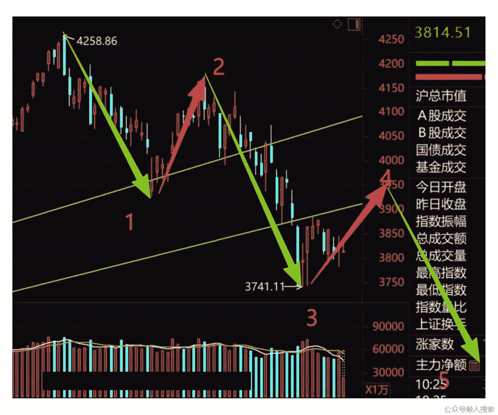

（声明：本文只为开拓视野、引导思路，并非择时，亦非荐股，股市有风险，入市需谨慎。本文为多指数的大势和周期研究，不构成任何投资建议或意见，不为用户依据本文做出的任何投资与决策承担责任。请大家注意投资风险）

————分割线————

在这个AI能替你写代码、写文章的时代，基础技能正在迅速贬值。绝大多数人正被淹没在海量的免费垃圾信息里，陷入低效的体力内卷。

当“努力”不再是壁垒，人与人之间唯一的护城河，只剩下“信息过滤”的效率与“认知系统”的维度。

圈子已稳定运行7年。我们每天利用Python爬虫与大模型算力，过滤全网最顶级的政经内参和搞钱风向标，做你最冷酷的“外部大脑”。

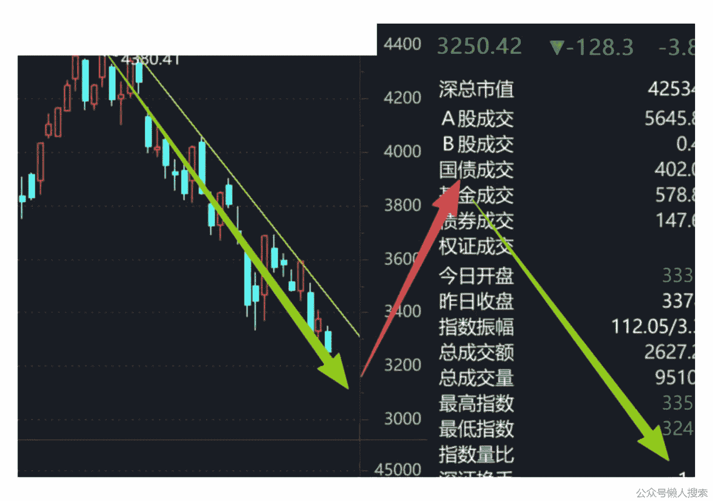

如果你认同这种“重塑认知防线”的极客主义，欢迎围观我的个人情报智库：【懒人专属群】。

https://lazyso.com/insider/

认同信息过滤价值、想省下每天3小时无效阅读时间的读者，扫码加我微信（lazyhelper1）。

