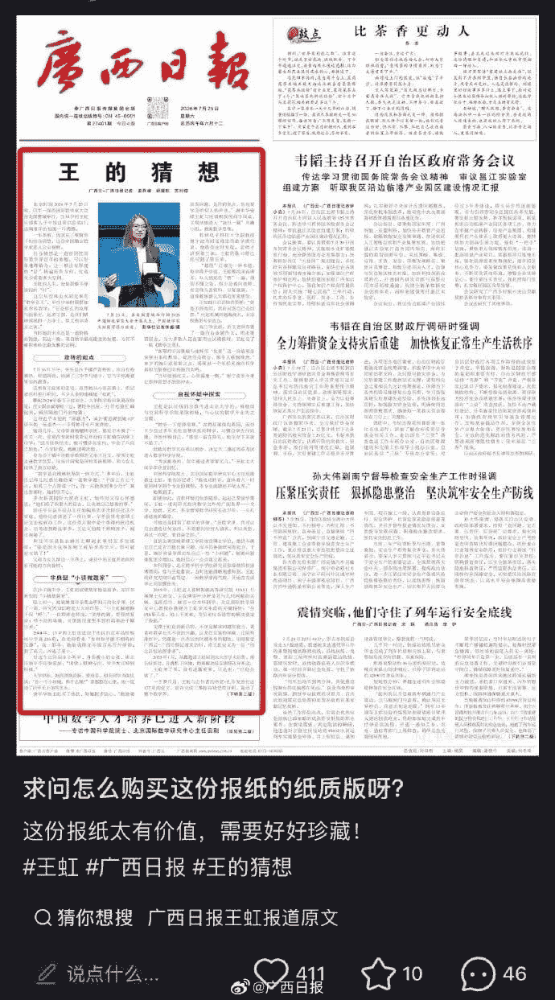

公众号懒人搜索，懒人专属群分享

## 王虹菲尔兹奖舆论观察

260804 新闻实验室

整理：公众号懒人搜索，懒人专属群精选

懒人微信：lazyhelper1

有的看到了自己的困境，有的看到了自己的渴望，有的看到了自己的伤痛。

7月23日，邓煜、王虹获得“数学界的诺贝尔奖”菲尔兹奖。这是中国籍数学家首次获得菲尔兹奖。

这一周，简体中文舆论场围绕两人的获奖（尤其是王虹的获奖）展开了大量讨论。

延续此前追踪热点事件舆论的传统，在本期新闻实验室会员通讯中，我对这一热点事件当中的舆论提供一些我的观察和分析。

# 北大为何成为靶子

王虹和邓煜获奖后，他们的本科母校北京大学（邓就读两年后转学到MIT）不仅未能获得舆论的青睐，而且成为众矢之的。

对北大的批评，基于这样的叙事：王虹在北大就读期间并未被重视，只是一个“小透明”，她甚至觉得“discouraged”，只有在出国留学后才找到信心，并有了今天的成就。

一些自媒体营销号在这套叙事的基础上添油加醋，编造了不少不实信息，诸如王虹在数学系成绩排名末尾勉强毕业、毕业合照没有参加、申请出国时数学系老师拒绝写推荐信。这些信息都已经被证明为虚假。

但是，在刨除这些虚假信息之后，关于王虹在北大被冷落、遭到不公待遇、出国后才能施展拳脚的叙事，依然拥有强大的生命力。

究其原因，还是因为大家从这种叙事之中看到了自己——有的看到了自己的困境，有的看到了自己的渴望，有的看到了自己的伤痛。

看到自己困境的大多是国内学术圈中人。国内的学术生态有许多不尽如人意之处，这也让不少学术工作者感受到了现实的困境。大家会想：如果在一个不一样的学术生态里面，自己会不会取得更好的成果呢？

这时，王虹在国外学术体制中绽放的叙事就被学术圈中人投射了许多情感。

看到自己渴望的，则是沉醉于逆袭式叙事的普罗大众。曾经默默无闻甚至被人欺负，如今走上全球顶尖位置让你高攀不起，这是常见的爽文套路。在现实中发生的案例居然好像符合了这样的套路，自然能获得极大的传播度。

在这种逆袭文的火爆之下，还有一种反精英的情结。在这样的叙事中，北大数学系的老师们成了把持资源、扼杀新人的腐坏精英代表。所以，逆袭的另一面，就是对精英的弑杀。

除了以上两种人的情感投射之外，王虹的经历还引发了广泛的创伤记忆。她此前在接受采访时用的discouraged这个词，戳中了无数人在教育制度以及其他种种制度之下的伤痕。看理想的公号给一篇旧文配上标题《王虹获奖，全网确诊教育创伤》，堪称神来之笔。文章下方的高赞评论说：

“做梦总是困在考场或教室，你们呢？”

而王虹在获奖后接受采访时说的“希望大家都鼓起勇气，勇敢地去做自己喜欢做的事”，则又从另一个角度戳中了那些还没有足够勇气、只能暂时留在那些discourage自己体系内的人们。

我的一位朋友在朋友圈里说的话，代表了这种创伤与痛苦的共鸣之深：

“在国内读书or在体制内上班最反感的事情之一，就是这个环境从来不会看见你的痛苦，它拒绝和你平等沟通，导致你的每一次发声都像撞到一堵墙上。”

针对澎湃新闻貌似持中的评论《没必要编造一个“王虹受苦”的故事》，这位朋友评价说：“它再一次生动形象地诠释了这个环境拒绝看到你的痛苦。”

写出这篇评论的人，显然缺乏了共情能力。

# 对王虹的“包容”

比澎湃新闻的评论更令人产生不适感的，是宣传系统的网红账号“浙江宣传”发表的《包容为什么给了王虹》。

王虹为什么需要被“包容”？她做了什么错事吗？

浙江宣传的文章没有明说，只是笼统提及“围绕其任职选择、致谢内容等讨论”。但是，作者的言下之意已经呼之欲出：她不感谢中国的栽培、她选择在法国任教而不是回国奉献，这都是有瑕疵的，甚至是有立场问题的。在有这些问题的情况下，还能获得“包容”，因此值得写一篇文章讨论。

当然，这篇文章的内容并非一无是处。它还是花了不少笔墨去呼吁大家宽容，不要非议海外留学生、不要动辄贴“不爱国”的标签。文中还用粗体强调：

“包容不该是锦上添花的馈赠或者短时间内存在的，而应是舆论空间普遍存在的底色。”

令人不适的感觉，更多是因为标题。但这个标题的选择，是不是也透露出作者（或编辑）在潜意识里还是有一种高高在上、赐你免死金牌的姿态呢？

虽然没有证据，但我猜测，浙江宣传的文章可能受到了六神磊磊文章《王虹已获网民罕见包容，包括暂时不骂留学生》的启发。但是，六神磊磊采用的是戏谑、反讽的语气，是对民族主义网民的一场火力全开的嘲讽和批评。虽然表达了类似的观点，但浙江宣传的文章过于端着，离真正贴地的叙事还有不少距离。

# 《广西日报》“王的猜想”

最后来聊聊《广西日报》出圈的头版文章《王的猜想》。据说，这篇文章让这份报纸卖断了货，要加印和限量抢购，成了新版的“洛阳纸贵”。

这篇文章的走红，让一些资深媒体人感到困惑。一则典型的评论是：“也就被短视频和小红书蚕食了大脑不到十年吧，就至于把一篇再平常不过的人物侧记吹成‘纸媒复兴’、‘新闻学魅力时刻’？”

的确，稿件的标题取得亮眼，妙用了双关，但内文则算不上多么出众。大家的追捧，可能的确是因为太久没有读过好点的文章了——并不是没有人写，其实不少记者都在持续写出好文章，但是这些好文章抵达不了大众的手机屏幕，竞争不过短视频和小红书，还会被《刚刚！定了！》之类的垃圾标题淹没。

但从另一个角度来看，《王的猜想》又确实特殊——要知道，它是登在省级党报的头版上的。如果这篇稿子刊登在市场化媒体上，那没有太多奇怪的；但它出现在党报头版，实在有些清新脱俗的别样气息。

很多党报离以下这些操作似乎都很远了：

- 用事实和引语说话，行文克制，不强行拔高，不尴尬抒情，不套用常见的叙事模板；
- 去现场，扎实采访，和尽量多的信源接触，保证充足的一手信息量；
- 不裁剪和删除一些可能被解读为导向问题的细节，比如王虹的父亲为了孩子拒绝了去政府办工作的机会。

而这些操作正是《王的猜想》拿到分的地方。

有论者将这篇稿件的走红联系到传媒改革甚至复兴，那实在是太善于联想了。如果它的成功能让党报记者们回归好好写新闻、能让一些人逐渐培养起读真正的新闻的习惯，那就已经是善莫大焉了。

---

在这个AI能替你写代码、写文章的时代，基础技能正在迅速贬值。绝大多数人正被淹没在海量的免费垃圾信息里，陷入低效的体力内卷。

当“努力”不再是壁垒，人与人之间唯一的护城河，只剩下“信息过滤”的效率与“认知系统”的维度。

圈子已稳定运行7年。我们每天利用Python爬虫与大模型算力，过滤全网最顶级的政经内参和搞钱风向标，做你最冷酷的“外部大脑”。

如果你认同这种“重塑认知防线”的极客主义，欢迎围观我的个人情报智库：【懒人专属群】。

https://lazyso.com/insider/

认同信息过滤价值、想省下每天3小时无效阅读时间的读者，扫码加我微信（lazyhelper1）。

