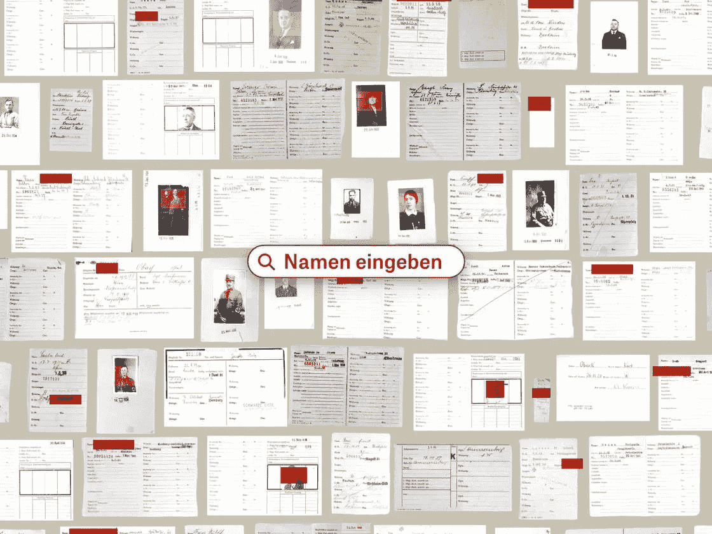

公众号懒人搜索，懒人专属群分享

用 **AI** 制作“纳粹搜索引擎”

260804 新闻实验室

整理：公众号懒人搜索，懒人专属群精选

懒人微信：lazyhelper1

1945 年春天，德国战败在即，纳粹党领导层下令销毁党员登记卡片。从位于慕尼黑的纳粹党全国总部“褐宫”运出的卡片估计有 50 吨重。它们被送往市郊的一家造纸厂，等待化为纸浆。

但造纸厂的经营者汉斯·胡贝尔（Hanns Huber）意识到了落在自己手里的是什么。他停下了机器，把这批档案完整地交给了随后到来的美军。

八十年后，这批卡片以胡贝尔难以想象的方式重新回到公众视野：今年 2 月底，美国国家档案和记录管理局（NARA）把它的微缩胶卷副本放上了网。公众对这批档案的兴趣之大，一度让档案馆的网站瘫痪。

公众号懒人搜索，懒人专属群分享

德国《时代周报》（Die Zeit）的团队则更进一步，他们使用 AI 把上千万张扫描卡片做成了一个可以按姓名检索的数据库。任何人只要知道祖辈的姓名、出生日期和出生地，几秒钟内就能查到：ta 当年是否加入过纳粹党。

在今天的新闻实验室会员通讯中，我想通过《时代周报》数据团队最近接受全球深度报道网（GIJN）的访谈，来介绍这个项目是怎么做成的，AI 在其中扮演了什么角色，以及它在德国引发的赞誉与争议。

它可以说是今年以来最值得了解的数据新闻案例之一。用《时代周报》一位记者的话说：“一家德国报纸用 AI 做了一个‘纳粹搜索引擎’，这个故事好到让人无法忽略。”

## 50 吨纸，5442 个 PDF 文件，再到 AI

我们先来看这批档案本身。

纳粹党（正式名称是“国家社会主义德国工人党”，NSDAP）的党员登记分为两套卡片索引：中央索引和地区（Gau）索引。研究纳粹党数十年的政治学者于尔根·法尔特（Jürgen Falter）估计，中央索引只有 44% 保留至今，地区索引则有 77%。由于很多党员同时出现在两套索引中，保留至今的卡片合计覆盖了 1925 年至 1945 年间约 90% 的纳粹党员——这二十年间，大约 1020 万德国人领到过纳粹党的党员卡。

在过去几十年里，想知道自己的亲人是否入过纳粹党，要么向德国联邦档案馆提交正式申请，要么去华盛顿翻阅微缩胶卷。

公众号懒人搜索，懒人专属群分享

今年 2 月，美国国家档案和记录管理局把胶卷数字化上网，理论上是一次巨大的开放。但是，开放不等于可用：这些卡片散落在数千个 PDF 文件里，每个文件动辄三千页，想找到某个具体的人，近乎不可能。

这就是《时代周报》看到的机会。德国媒体报道档案公开几周之后，他们的数据库就上线了，最初开放了约 450 万张卡片的直接检索，后来扩展到覆盖整个数据集。上线后，这个工具吸引了数以百万计的搜索。

这个项目的技术核心并不复杂：把图片变成文字。

《时代周报》数据科学与 AI 团队负责人安德烈亚斯·洛斯（Andreas Loos）在访谈中介绍，团队处理了 5442 个 PDF 文件，每个约含三千页扫描卡片。他们组合了多套 OCR（光学字符识别）系统，最终重度依赖的是谷歌的 Gemini 大模型来识别卡片上的手写和印刷信息。

这些卡片上混杂着多种字体和笔迹，包括 Kurrent 和 Sütterlin 两种古老的德文手写体——团队原本以为手写体会是最大的难关，结果发现这个问题已经被大模型解决了。最后真正头疼的反而是成本和后端系统的性能。

但用大模型做 OCR，有一个所有新闻媒体都绕不开的问题：幻觉。洛斯坦率地承认，模型产出的文本“时不时”（from time to time）会出现幻觉。团队的应对方式之一，是让读者可以通过邮件报告错误，这让他们得以修正数百条记录。

其中一种常见的幻觉是：AI 经常不是老老实实地转写原文，而是“加戏”。比如，卡片上写的是“D.”，模型会输出“D. [Düsseldorf]”，也就是自作主张想象出人的全名。这说明，大模型在“识别”和“解读”之间的边界是模糊的。

## 搜索是调查的起点，不是最终的裁决

如果这个项目只有一个搜索框，它顶多是一个有用的工具。让它成为一个出色的新闻作品的，是围绕搜索框提供了更多的语境解读。

团队的可视化数据记者格雷戈尔·艾施（Gregor Aisch）说：“我们想让这些党员记录变得可以即时检索。但更重要的是，我们想为这个故事提供必需的语境：如果你在这些记录里找到了自己的亲人，这意味着什么？”

作品首先纠正了一个流传甚广的误解：加入纳粹党是逃不开的强制要求？在纳粹德国，加入国防军是义务兵役，但加入纳粹党本身是自愿的——尽管某些职业面临沉重的社会压力。也就是说，加入纳粹党是一种（至少形式上的）主动选择。

作品梳理了入党的几波浪潮。团队分析发现，1933 年希特勒上台前入党的只是相对少数；上台后出现了入党潮，规模大到党务官员一度冻结新党员申请，1937 年重新开放后出现第二波高峰；战争期间，入党者则越来越多是从希特勒青年团等组织出来的年轻人。

公众号懒人搜索，懒人专属群分享

一张党员卡片能证明的只是“入了纳粹党”这个事实，它不能解释一个人为什么入党、扮演了什么角色、观念后来有没有改变。用 GIJN 访谈中的总结来说，团队把这个搜索工具视为“调查的起点，而非对一个人一生的最终裁决”。

借助政治学者法尔特此前整理的五万张卡片样本，团队还可视化了党员的职业构成：公务员和白领的入党比例明显偏高，而许多产业工人仍然效忠于社会民主党和共产党的组织。

同时，团队对分析的边界保持克制。洛斯承认，他们本想做更多大规模的统计分析，但这些记录由不同办公室在二十年间用不一致的格式制作，数据的规范化程度不够，“目前这个数据集更适合按姓名查人”。

## 赞誉之外的三重争议

这个数据新闻项目在德国国内外都获得了大量关注，CNN、BBC、《卫报》、《世界报》都报道了它，《明镜周刊》和《南德意志报》随后推出了类似的工具。编辑部原本担心德国读者会抗拒重新翻开家族史中的艰难篇章，结果，他们收到的多是感谢。

但是，围绕这类工具的争议同样真实存在。

第一是付费墙。《时代周报》和《明镜周刊》的数据库都需要付费订阅了该媒体的人才能使用，有人质疑：档案卡片属于国家，凭什么查询要付费给私营媒体？不过，德国《日报》（taz）的评论认为收费是正当的——对档案的整理加工是一项耗费巨大的新闻劳动，不想付费的人仍然可以通过国家档案馆免费查阅原件。

《新苏黎世报》指出：原始卡片就存放在德国联邦档案馆，档案馆甚至早已完成了高分辨率彩色数字化，但受《联邦档案法》中个人信息保护期限的约束（档案中包含 1926 年及之后出生者的信息），它无法公开上线。也就是说，这一轮历史清理工作由私营媒体自主投入资源（而非国家机构用纳税人的钱）完成，一定程度上是法律缝隙造成的：美国档案馆不受德国保护期限约束，而德国媒体基于美国公开的副本做加工，同样绕开了限制。

第二是呈现方式。《明镜》的封面标题“纳粹档案：你的爷爷在里面吗”（Die Nazi-Kartei: Ist Ihr Opa Dabei?）被批评为标题党，《新苏黎世报》评价其宣传语（“在这里查出你的家人在希特勒治下做了什么”）承诺过头了——卡片能告诉你入党时间和党员编号，但它不能告诉你这个人是狂热分子还是随波逐流者，是否参与了罪行。相比之下，《时代周报》在这方面的措辞要克制一些。

第三是可靠性。历史学者马丁·克莱门斯·温特（Martin Clemens Winter）测试后发现，一些他在美国档案馆原始文件中能找到的人，用《明镜》的工具却查不到。这提醒我们：查无此人不等于此人清白——本来就有约两成卡片毁于战火，再加上 OCR 的遗漏和 AI 的幻觉，“没查到”的证明力远低于“查到了”。

公众号懒人搜索，懒人专属群分享

尽管有这么多问题，但这类工具把沉睡在档案馆里的公共记录变成普通人可以接近的资源，其中的价值不言而喻。《时代周报》的做法也在持续改进：他们与联邦档案馆达成合作，首次让数十万份纳粹冲锋队（SA）和党卫队（SS）的人事档案可以按姓名检索，作为交换，联邦档案馆获得了这些搜索引擎的免费使用权。私营媒体与国家档案机构走向合作，这可能是比工具本身更重要的制度进展。

当然，这类项目成立的前提，是档案的数字化与公开，以及媒体获准在其上自由加工。

————分割线————

在这个 AI 能替你写代码、写文章的时代，基础技能正在迅速贬值。绝大多数人正被淹没在海量的免费垃圾信息里，陷入低效的体力内卷。

当“努力”不再是壁垒，人与人之间唯一的护城河，只剩下“信息过滤”的效率与“认知系统”的维度。

圈子已稳定运行 7 年。我们每天利用 Python 爬虫与大模型算力，过滤全网最顶级的政经内参和搞钱风向标，做你最冷酷的“外部大脑”。

如果你认同这种“重塑认知防线”的极客主义，欢迎围观我的个人情报智库：【懒人专属群】。

https://lazyso.com/insider/

认同信息过滤价值、想省下每天 3 小时无效阅读时间的读者，扫码加我微信（lazyhelper1）

