## 心力即Token：我把创业者的迷茫做成了一个开源AI心力教练Skill，从个人痛点 到开源github的完整复盘

260729 副业SC 精华

整理：公众号懒人搜索，懒人专属群精选
懒人微信：lazyhelper1

大家好，我是七天，相信很多生财圈友都认识我了，目前也在生财负责线下聚会。在发起了近300场聚会之后，我发现大家遇到的卡点，不仅有业务的，还有心力的。所以我最近花了1周时间，做出来了一个AI心力教练skill，大家在github上下载之后给自己的codex或者hemers就可以用了。

这篇文章适合谁看：如果你正处在项目选择、自我怀疑、机会过载或持续疲惫的状态，可以直接体验这个Skill。如果你也想把自己的经验做成一个Skill，后半部分会完整复盘：我是如何从个人痛点出发，经过测评、模式路由、真实使用和迭代，把一段私人经验逐渐做成公共工具的。

我也来展示几个内测用户的反馈，主要是：

- 可以洞察一些自己还不够了解自己的一些特征
- 把模糊的感受变成清晰的文字

- 可以把情绪进行拆解，甚至给到一些思路，能有一种情绪被接住的看见感。

目前它仍处于早期内测阶段，现在的反馈主要来自少量真实体验者，还不能算严格的效果验证。我更关心的不是大家觉得它“好不好用”，而是三个具体问题：使用后有没有更清楚地描述卡点、有没有找到一个更准确的问题、有没有产生一个真实的小行动。

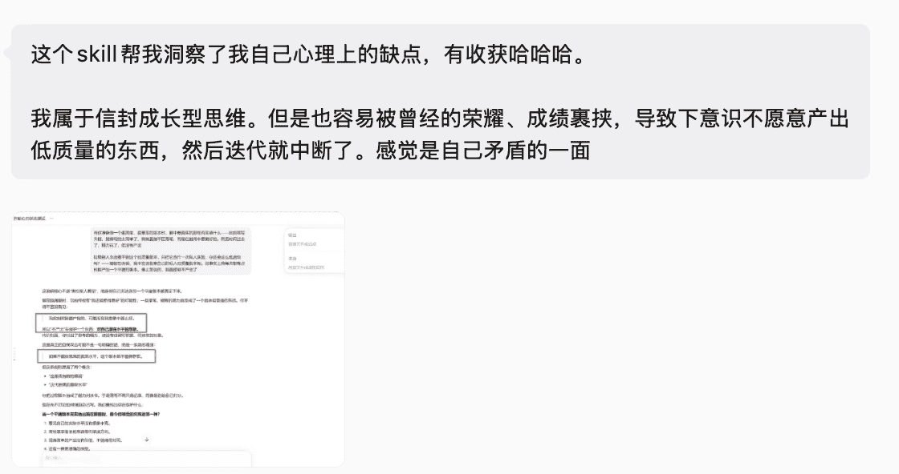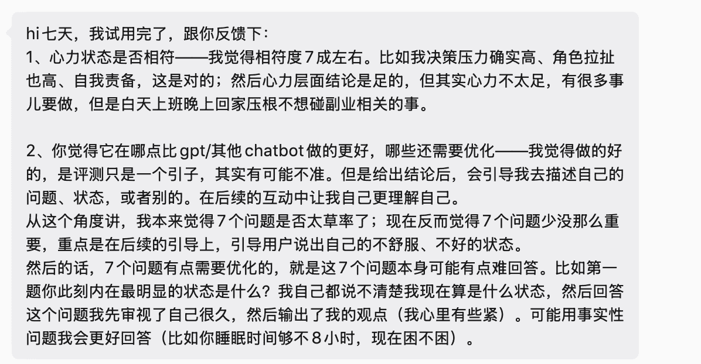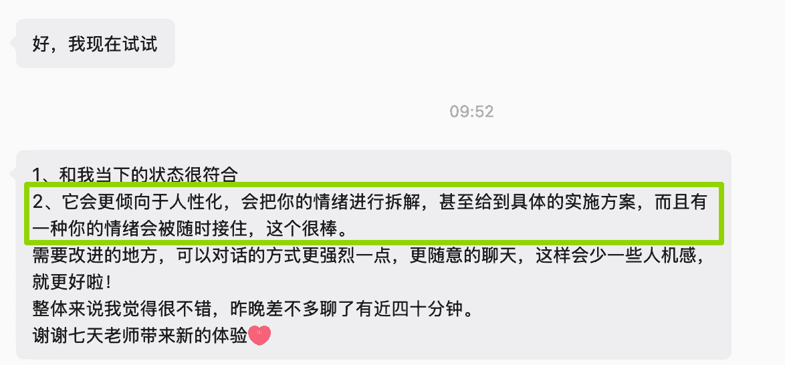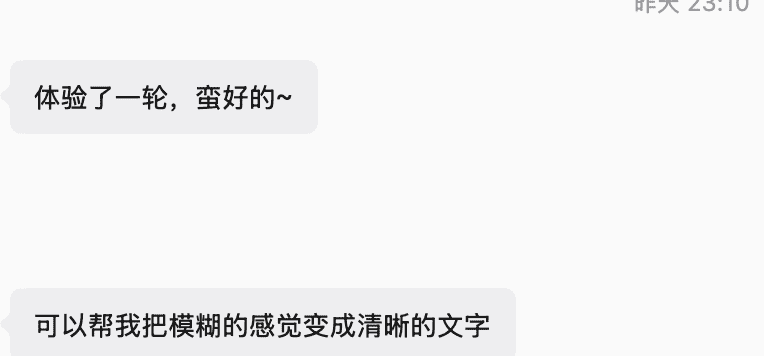

接下来我也会围绕这三个指标继续收集案例和迭代。

大家好，我是七天，目前在生财负责线下聚会。过去一个月，生财发起了330场线下聚会，我也在线下和很多创业者、个体创业者有过深入交流。聊得越多，我越发现，大家在创业路上遇到的卡点，不全是业务问题。

有些人手上同时有好几个方向，每个方向看起来都能做，却不知道应该聚焦哪一个；有些人项目已经跑起来了，但遇到限流、增长停滞或收入波动后，会开始怀疑自己；还有些人不是不知道下一步做什么，而是已经很累了，却不敢停下来。

这些问题表面上看起来不同，背后却有一个共同点：不是缺少方法，而是当一个人面对不确定性、复杂选择、长期压力和强烈情绪时，很难独自完成结构化思考。最近，我花了一周时间做出了第一版AI心力教练Skill，并把它开源到了GitHub。

GitHub地址：GitHub - zhaocathy1221-hash/ai-heartpower-coach: A...（也欢迎大家帮我点亮star）

它不是一个替你做决定的AI，也不只是一个安慰情绪的聊天机器人。它是一套基于“充分表达 + 结构化聆听 + 模式路由”设计的对话流程，帮助用户从：“我很乱、说不清楚，也不知道该怎么办。”逐渐走到：“我知道自己现在真正卡在哪里，也知道下一步可以先做什么。”

**1、这篇文章适合谁看**：如果你正处在项目选择、自我怀疑、机会过载或持续疲惫的状态，可以直接体验这个Skill。

**2、为什么我会关注心力**：首先我是enfp高敏感人，真的是想法很多很跳的那种，很多时候脑子里像放电影一样过很多思路。其次2023年，我曾在专业机构系统学习了一年教练相关内容，包括GROW模型、教练提问以及NLP逻辑层次等方法。我自己也长期处在一种典型的创业者状态里：脑子里有很多想法，也不断看到新的机会；事情很多，却说不清楚到底是什么在消耗自己；明明想行动，但身体和情绪总在抗拒；有时看起来是在选择项目，真正担心的却是自己做不起来，或者做出来以后无法商业化。

**3、为什么普通AI还不够**：我也尝试过直接问AI。但普通AI往往会快速分析问题、罗列优劣势，再给出一套行动建议。它像一个效率很高的顾问，却不一定知道我此刻真正需要处理的是什么。有时我需要的不是更多建议，而是先把混乱说出来；有时我不是不会决策，而是机会太多；有时看起来是在讨论商业方向，实际卡住我的却是自我怀疑；还有些时候，我只是心力已经见底，不适合马上制定新的行动计划。不同的卡点，需要进入不同的处理模式，而不是统一给建议。于是我开始思考：能不能做一个AI Skill，让AI不急着回答问题，而是先帮助一个人识别自己现在的状态，再决定应该从哪里开始？

**4、这个skill它会如何帮助你**：进入Skill后，它会先通过7个问题，帮助用户识别当前的心力状态：是情绪混乱，还是需求模糊；是心力不足，还是一直在自我责备；是决策压力，还是过度在意外界评价；是机会太多，还是不同身份和角色发生了冲突。识别状态之后，它不会马上给出一堆建议，而是根据用户当前最需要处理的问题，进入对应的教练模式。比如：能量已经透支时，先整理心力消耗；方向太多时，先处理机会过载；总觉得“是不是我不行”时，先拆开事实和自我攻击；担心产品没人买时，回到用户真实需求和最小验证；脑子很乱时，先区分事实、感受、需要和担心。最后，它会帮助用户找到一个足够小、当下可以执行，又不会再次把自己压垮的行动。

**5、你会获得什么**：完成测评后，你至少会获得一张属于自己的“七维心力画像”，看见此刻最需要优先处理的问题。这里也要感谢【@易仁永澄】老师去年发起的AI心力教练小航海。那次学习帮助我理解了，一套真正可用的AI教练流程，需要包含充分表达、结构化聆听、状态识别、模式匹配和行动承接等不同层次。

# 1、为什么我做了这个AI心力教练

不知道大家是否有时候会有这种感觉：我要burn out了。尤其是对于生财的多数创业者来说，很多时候并不是项目跑不通，而是叠加了非常多的不确定性，会让人很难去选择，或者梳理不清楚当下最重要的是什么。比如一个项目爆单了，遇上平台限流，怎么调整心态来做变化，比如自己不好意思收钱，要怎么做。

但是想不清楚这件事，有时候并不是通过想更多来解决的，当一个人面对未知问题、复杂选择、强烈情绪和长期压力时，大脑本来就很难自动完成结构化思考。

这个时候其实我们很需要有一个外部支点。这个外部支点不一定要替我们做决定，但它可以帮我们把混乱的表达接住，把说不清的感觉整理出来，把看似杂乱的念头放回一个结构里。

传统的chatbot的模式，更多是帮你梳理和执行，GPT更像助手、顾问、执行员。但是很多时候，你很难描述清楚自己的心力卡点。

适合用AI心力教练的场景包含：

- 我很烦，但说不清为什么
- 我不想上班/不想做这件事
- 我很累，但停不下来
- 我不知道自己想要什么
- 我有几个方向，不知道选哪个
- 我感觉这个项目不对劲，但说不清
- 我想做产品，但怕是自嗨

总结一下就是：AI心力教练Skill，是我基于“充分表达 + 结构化聆听 + 模式路由”做出来的一个AI教练工具。它不是用来替人做决定，也不是简单安慰人，而是帮助一个人在压力、迷茫、内耗、自我怀疑、机会太多或行动卡住时，把混乱的表达整理成可以看见、可以理解、可以行动的结构。

如果用一句更产品化的话来说：它帮助用户从“我很乱、说不清、卡住了”，走到“我知道自己现在卡在哪里，也知道下一步可以先做什么”。

等我们重新看见事实、感受、需要、卡点和资源之后，下一步往往就没有那么模糊了。把事实、感受、需要、卡点和资源整理出来，人就更容易重新拿回一点主动权。而这份主动权，就是我理解的心力。

总结一下就是：

1、你需要借助一个外部支点理清楚思绪
2、它能够把你混乱的感受梳理清晰，在事实层面，情绪层面做到结构化聆听。
3、不同的卡点需要进入不同的模式，而不是统一给建议。

而我做得这个AI心力教练skill，就是通过：快速的7个问题帮你理清楚当下最想聊的情绪，再通过结构化聆听和教练技术的澄清，反问等技术，帮助你进一步理清楚混乱的想法，并且通过发问，让你更清楚自己的卡点是什么。

# 2、下载这个skill后你可以怎么用

github地址：https://github.com/zhaocathy1221-hash/ai-heartpower-coach

我希望它变成一个可以被用户理解、也可以被交付的流程，而不是一次临时聊天。所以我把使用过程整理成5步。

**第一步：先做心力测评**

用户进入之前，不是直接说“你来陪我聊聊”，而是先完成一个心力状态测评。测评会围绕几个维度提问：最近的能量状态、脑子里最反复出现的问题、身体有没有明显信号、当下最卡的事情是什么、是否存在自我怀疑、是否在多个机会之间摇摆、是否正在验证一个需求或项目。

这一步的目的不是打一个漂亮分数，而是先把用户从“我说不清”带到“我大概知道自己处在什么状态”。

**第二步：生成一份结构化反馈**

测评完成后，AI不只给结论，而是生成一份结构化画像。

- 当前主要状态：比如能量透支、决策迷雾、自我怀疑、机会过载、真实需求验证等。
- 核心卡点：用户表面上在问什么，真正可能卡在哪里。
- 隐性需要：用户没有直接说出口，但在表达中反复出现的需要。
- 适合进入的模式：下一步应该先释放、先澄清决策、先处理自我怀疑，还是先做需求验证。
- 当前不适合做什么：比如状态很乱时，不急着做重决策；能量很低时，不急着给一堆行动计划。

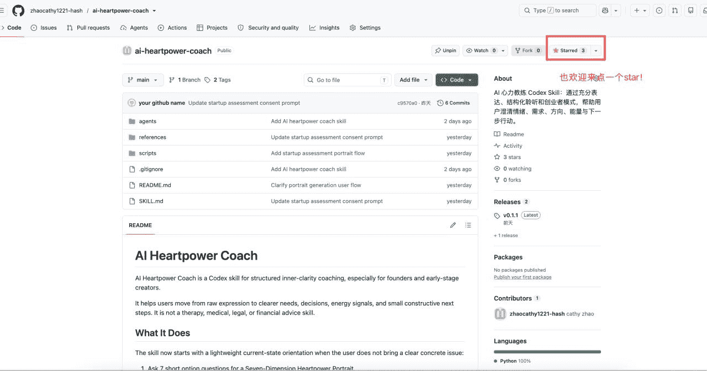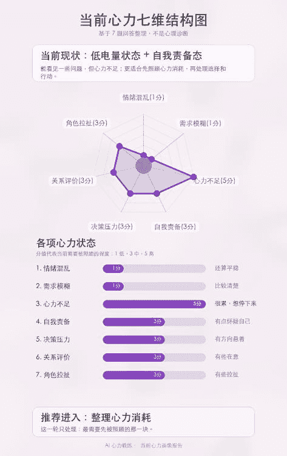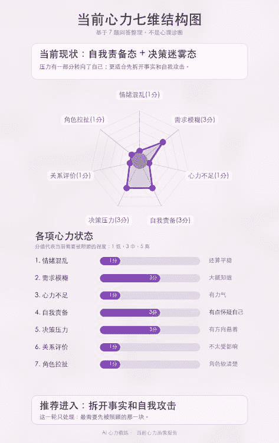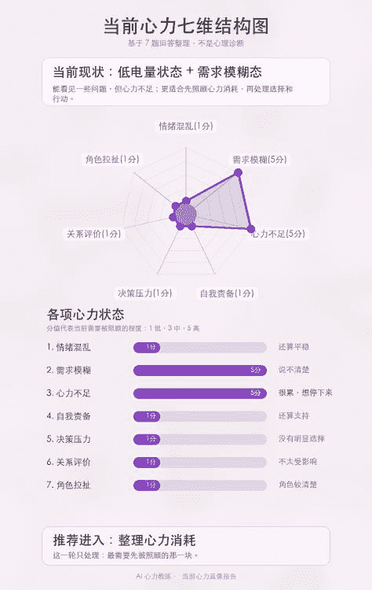

**第三步：进入对应的教练模式**

有了测评反馈后，AI会把用户带入对应模式，而不是统一给建议。比如，如果用户主要是能量透支，就先进能量账户或释放清空；如果用户主要是方向太多，就进入机会过载；如果用户一直问“我是不是不行”，就进入自我怀疑；如果用户纠结“用户到底会不会买”，就进入用户真实需求模式。

这一步很重要，因为很多人真正卡住，不是因为缺方法，而是进错了处理模式。明明需要先被接住，却被要求马上行动；明明需要验证需求，却一直在做自我攻击；明明只是机会太多，却以为是自己不够坚定。

**第四步：充分表达 + 结构化聆听**

进入模式后，用户先充分表达，不需要完整、不需要理性、不需要说得好看。AI的任务不是马上评判，而是先聆听，再把表达整理成结构。

结构化聆听通常会整理出几层内容：

- 事实：真实发生了什么。
- 感受：用户此刻的情绪和身体反应是什么。
- 需要：显性的需要和隐性的需要分别是什么。
- 卡点：真正阻塞用户的，是信息不足、能量不足、关系压力、能力缺口，还是身份冲突。
- 资源：用户已经有什么资源、经验、优势和可用支持。
- 下一步：可以小到什么程度，不把用户再次压垮。

**第五步：输出一个小行动或下一阶段路径**

最后，AI不会给一堆宏大的建议，而是帮助用户找到一个最小行动。如果是一次轻量使用，输出可能是一个沟通草稿、一个复盘结论、一个需求验证动作、一个能量恢复安排，或者一个更准确的问题定义。

# 3、目前用AI心力教练做了2个对话场景

**案例一：从“创业方向太多”到“产品结构变清楚”**

一开始，我问的是：健康睡眠、AI心力教练、创业者陪伴、内容产品，这几个方向哪个更适合我。表面看，这是一个方向选择问题。但AI心力教练没有直接让我四选一，而是先识别出我处在“机会过载模式”。

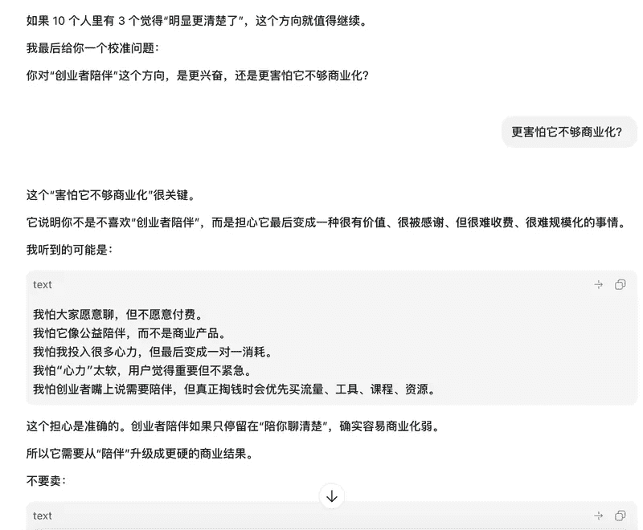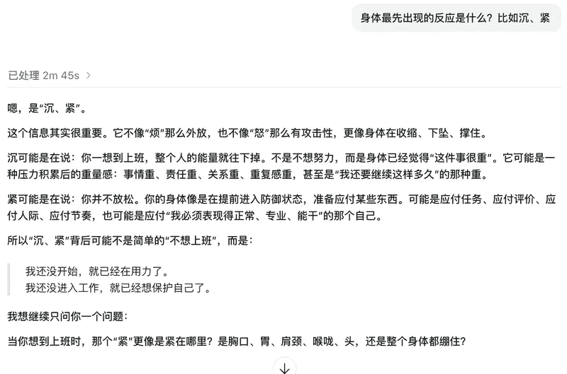

它进一步帮我看到，这几个方向并不是并列关系，而是一条链：AI心力教练是核心能力，创业者陪伴是目标人群，健康睡眠是具体切口，内容产品是获客和交付形态。

这个判断让我从“我要选哪个方向”的焦虑里出来，转向另一个更准确的问题：我应该用哪个切口验证核心能力。后面我又表达出对“创业者陪伴不够商业化”的担心。AI进一步把问题切到了用户真实需求和商业化验证：我不是不喜欢陪伴，而是担心它最后变成很有价值、很被感谢，但难收费、难规模化的事情。

于是产品结构被拆出来：低价诊断不是主产品，而是筛选器；中价7天陪跑负责收入；高价30天创始人心力陪跑负责利润和案例。

这个案例让我看到：AI心力教练最有价值的地方，不是给一个方向答案，而是帮我看清自己真正卡在机会过载、商业化担忧、定价焦虑，还是产品形态不清。

**案例二：从“线香带货能不能做”到“我是否适合这个场景”**

另一个案例，是我家属最近在做小红书赛道，所以问小红书线香带货这个机会看起来不错，但我不确定自己能不能做。

如果只是普通商业分析，很容易直接进入市场趋势、选品、内容打法和带货路径。但AI心力教练先识别出这里有三层问题：决策迷雾、自我怀疑和用户真实需求。

它帮我分清：线香/香氛方向确实有内容机会，但如果做纯带货，需要拼选品、拍摄审美、供应链、小红书爆款笔记和价格佣金，这未必是我当前最强的资源。但如果把线香放进“睡前心力恢复”场景里，它就变成了另一个问题：线香不是主项目，而是一个具象的场景道具。真正需要验证的是，用户是否愿意为“睡前10分钟，把今天的累放下来”这样的心力恢复场景停留、收藏、评论和购买。

最后，我真正需要回答的问题不再是“线香能不能卖”，而是“我是否愿意连续7天，用线香这个载体，讲清楚一种睡前心力恢复生活方式”。

这个案例说明：它会把一个泛泛的机会判断，拉回到我自己的长期主线：AI心力教练、健康睡眠、情绪安顿和生活仪式。

# 4、这个产品经历了什么样的迭代

在产品化过程中，我一开始想的是让用户进入到咨询提问场景。但是真实的coach并不会在一次沟通中解决所有问题。

真实的coach需要先跟你澄清本次要解决的一个问题是什么。所以在skill的梳理过程中我做了一个调整，先用7个问题梳理一下你的状态，先聚焦一个方向，看下你是否要聊这个方向。

先通过测评识别状态，再根据结果进入对应的教练模式。

这个调整让产品从一次临时咨询，变成一个更清楚的交付流程：先识别状态，再匹配模式，再做教练，再输出行动。测评也不只是获客工具，而是产品的一部分。

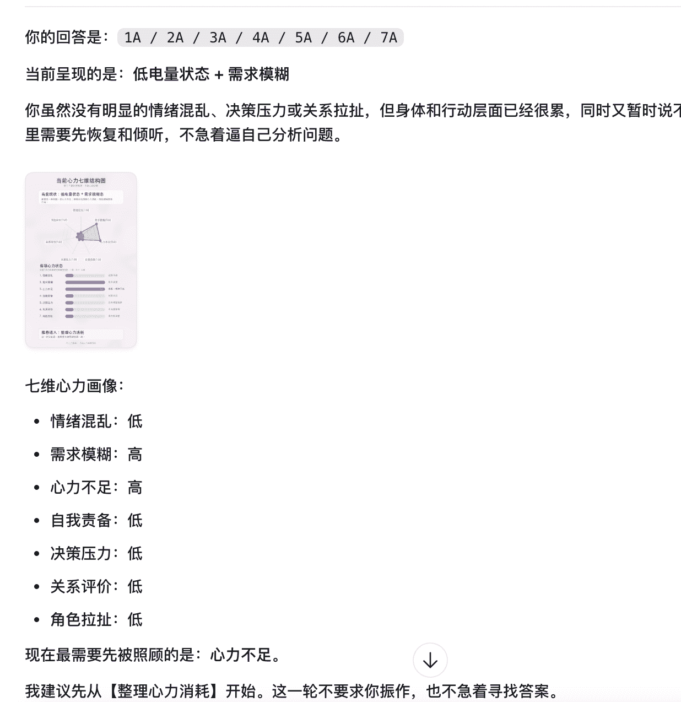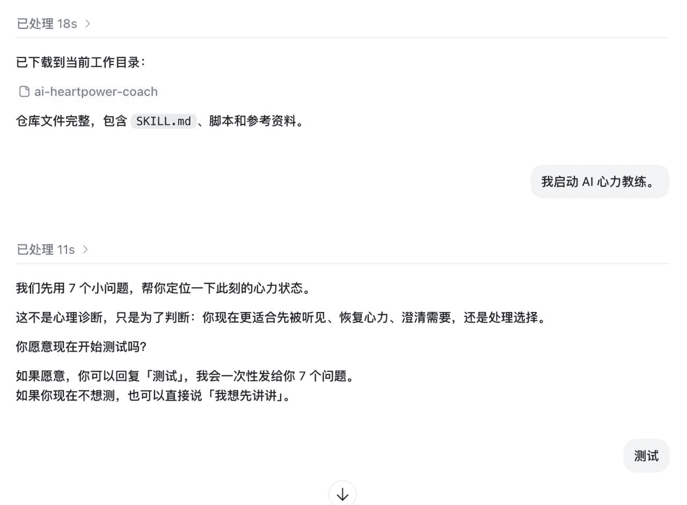

后来我又加了一个重要机制：模式切换。因为人在表达过程中，真正的问题会变化。一开始用户可能说：“我有很多方向，不知道选哪个。”这时看起来是机会过载。但聊着聊着，用户可能会说：“其实我怕这个方向不够商业化。”这时问题就从机会过载，转向用户真实需求。再聊下去，用户可能会说：“我怕我做不起来。”这时问题又转向自我怀疑。

所以一个好的AI心力教练不能死守一个模式，也不能随便跳来跳去。它需要在每一轮对话中识别：用户的重心是不是变了。

我感觉我们现在可能已经从“机会过载”走到了“用户真实需求”。因为刚才的问题不再是“方向太多选哪个”，而是“用户到底会不会买”。要不要切过去，专门处理这个问题？

这个设计很重要。它让用户在对话中逐渐拥有一种能力：知道自己现在到底在处理什么。这也是心力教练真正想培养的能力：不是永远依赖AI，而是越来越能听清楚自己。

# 5、它参考了哪些文档和经验

- 易仁永澄老师关于AI心力教练的手册：其中最重要的启发，是“感觉充分表达 + AI结构化聆听”。原始表达不是低质量材料，很多真正重要的信息，就藏在那些一开始看起来混乱、重复、甚至啰嗦的表达里。

航海手册链接：https://scys.com/docx/ZfOddx57WoTz4Ix2aUQclyTGn3b

那份手册里最打动我的，不是某一句提示词，而是它背后的方法：感觉充分表达 + AI结构化聆听。人先把真实的、混乱的、重复的、没有结构的表达说出来；AI再帮助人整理事实、感受、需要、意图、挑战、洞察和行动。

这套方法让我意识到：原始表达不是低质量材料。恰恰相反，很多真正重要的信息，就藏在那些一开始看起来不成体系、甚至有点啰嗦的表达里。

- 我过去

2 年在专业机构学习 life coach，并持续寻找专业教练的真实情况：我在 23 年的时候，专门在创问学过一年的 life coach。过去一段时间，我也经常处在脑子里念头很多、事情很多、很累但说不清为什么累的状态。这让我不是站在旁观者角度做工具，而是带着自己的真实需要去设计，包含很多 GROW 模型、提问模型、NLP 的 6 层理论等。

- 创业者场景里的真实卡点：方向选择、商业化验证、自我怀疑、机会过载、能量透支、角色冲突。结合我跟不少 OPC 和生财圈友的聊天，在我的知识库中沉淀出一些创业者的模式。比如：这些都不是单纯靠方法论能解决的问题，它们需要同时处理“事”和“人”。

我知道那种感受：脑子里有很多念头，但不知道从哪里开始；看起来事情很多，但真正压住自己的好像不是事情本身；明明想行动，却总觉得哪里不对；很累，却又说不清楚为什么累。

所以我做这个 Skill，并不是站在一个完全旁观的位置去设计一个工具，而是带着自己的真实需要：我也需要一个可以帮我把自己听清楚的外部支点。

- 前面几轮真实对话案例：创业方向、线香带货、测评入口调整。这些案例让我不断校准它真正有用的地方：不是替人变聪明，而是帮人更诚实、更结构化地看见自己当前真正的问题。

我觉得我们正在进入一个“心力即 Token”的时代。

心力，可被视作个体有限的认知能量与信息带宽，如同 AI 系统中的 Token 与上下文窗口，也对应物理学中的可用能量。

Token 的消耗，很像是把人类神经活动以数字化形式展现出来的过程。我们可能是有史以来第一次能意识到，自己的脑力、心力、精力，其实是远远比想象中要值钱的东西。

我做 AI 心力教练，是因为我相信：人的很多混乱不是缺少答案，而是缺少被听见、被整理、被澄清的过程。

AI 不需要替我们成为更懂人生的人。

# 6、一个人怎样从自己的需求里长出一个 Skill

做完 AI 心力教练之后，我觉得这里面还有一套可以被复制的经验：

一个人不一定要先成为某个领域的专家，也不需要先想出一个看起来很完整的产品，才有资格开始做 Skill。更自然的起点，是回到自己身上，看看什么问题长期让自己痛苦、消耗或反复卡住，自己又总在什么时刻需要 AI 的帮助。

一个真实、具体而且反复发生的问题，往往不会只属于一个人，它背后通常站着一群有相似处境、但还没有把需求说清楚的人。换句话说，我们自己的痛苦和需要，不只是私人感受，也可能是一种尚未被整理、尚未被产品化的共同需求。

1. 第一步不是先研究市场上还缺少什么 Skill，而是收集自己的真实问题。

我会回看那些反复出现的时刻：当时发生了什么，我为什么那么累或那么抗拒，身体有什么反应，脑子里不断重复哪句话，我以为自己在问什么，后来又发现真正卡住的是什么。

我是一个 ENFP、高敏感，所以会很在意一些感受，但是很难拆解出来它指向什么具体的问题。通过学习 life coach，它让一个模糊的问题第一次拥有了可以被处理的形状，也让我们看到，自己真正需要的并不一定是更多方法，而可能是区分机会判断、自我怀疑、能量不足和真实需求。

2. 第二个对我很重要的经验，是把混乱可视化。

人在一个问题里面时，事实、情绪、身体感受、担心、需要和选择经常挤在一起，仅靠继续思考，很容易在脑子里绕圈。可视化的作用不是把结果做得漂亮，而是把原本看不见的东西放到桌面上，让人先找到一个可以进入的点。

它可以是一张情绪地图、一条问题发展的时间线、一棵需求树、一张能量收支图，也可以像 AI 心力教练里的七维心力结构图一样，把此刻的状态呈现出来。用户不需要一次理解和解决所有问题，只要能从图里看见“我现在最需要先照顾的是哪一部分”，就已经完成了一次重要的聚焦。

这是我尝试做的很多可视化项目，都准备陆续做成其他的 Skill。

3. 不要等到所有事情都想清楚再开始，而要允许自己先做出一个“垃圾版本”。

第一版不需要包含完整理论，也不需要一开始就设计十几个模式，只要选择一个自己最痛、最常发生的场景，让 Skill 能完成一次最基本的帮助就可以。

比如，最初只处理“我脑子很乱”这个问题，让用户先说出发生了什么，再帮助他区分事实、感受和担心，最后找到当前最需要处理的一件事。这个版本可能很粗糙，甚至暂时只能服务自己，但它的意义是让真实使用开始发生。没有第一版，就不会有真实反馈；没有真实反馈，后面所有关于功能、流程和产品形态的完善，都很容易停留在想象里。

垃圾版本做出来以后，我认为最重要的不是马上发布，而是先把它放回自己的真实生活里反复使用。我会观察自己在什么情况下愿意打开它，哪些问题让我答不出来，它有没有过早地给建议，哪一句回应真的让我看见了新的东西，以及使用前后，我描述问题的方式是否发生了变化。

每一次使用都可以留下一份案例，这些案例不是为了证明 Skill 有多厉害，而是帮助我理解：我真正需要的帮助究竟是怎样发生的。当它已经稳定地帮助过自己几次，再把它交给处境相似的人使用，看看不同的人是否会在相似场景中获得相似价值。

如果把这条路径压缩成一句话，就是：痛苦和需要提供种子，可视化帮助我们找到聚焦点，垃圾版本让真实使用开始，而一次次真实案例最终让 Skill 长出稳定的结构。

真正可以复制的，不是我的心力教练模式，而是这套从自己的需求出发，把私人经验逐渐转化成公共工具的方法。

# 7、我还没解决的问题

1）Skill 的稳定性和迭代要如何做。目前的迭代处于动了之后，很多反馈风格也会跟着调整，导致用户体验浮动很大。

2）未来如何商业化：初步考虑是 Skill 开源，结合社群可以做心力训练营，也可以做心力主题的真人咨询。但是具体会如何发展，确实还没想好，先把内测群运营好吧。

3）如何把用户的记录沉淀下来，形成可视化，让用户能够感受自己心境和状态的变化。

❤❤ 最后，欢迎你帮我一起验证。如果你正在经历一个真实但说不清的创业卡点，可以下载 Skill，完成一次测评和对话。

体验之后，也欢迎只回答我三个问题：

1. 使用前，你以为自己卡在哪里？
2. 使用后，你发现真正的问题是什么？
3. 你最终产生了什么具体的小行动？

GitHub：https://github.com/zhaocathy1221-hash/ai-heartpower-coach

我会根据这些真实反馈继续迭代。因为我想验证的不是 AI 能不能说出温暖的话，而是它能不能真正帮助一个人更清楚地看见自己。

————分割线————

看完这篇 SOP，你觉得你懂了。但 90% 的人一到实操就会卡在第一步。

工具和教程只是最低级的壁垒，真正的壁垒是“立刻动手”和“圈层信息差”。

如果你想看全网最新的变现玩法，并且和一群执行力极强的极客一起下场拿结果，欢迎围观我的核心私域：【懒人专属群】。

我们不聊虚的，只做商业闭环的拆解与 AI 效率的压榨。系统内已沉淀 1000+ 跑通的套利实战局。

❤ 查阅圈子完整数字资产与上车门槛：

https://lazyso.com/insider/

认同价值、准备好下场干活的，扫码加我微信（lazyhelper1）。

备注：【实操上车】，不闲聊。

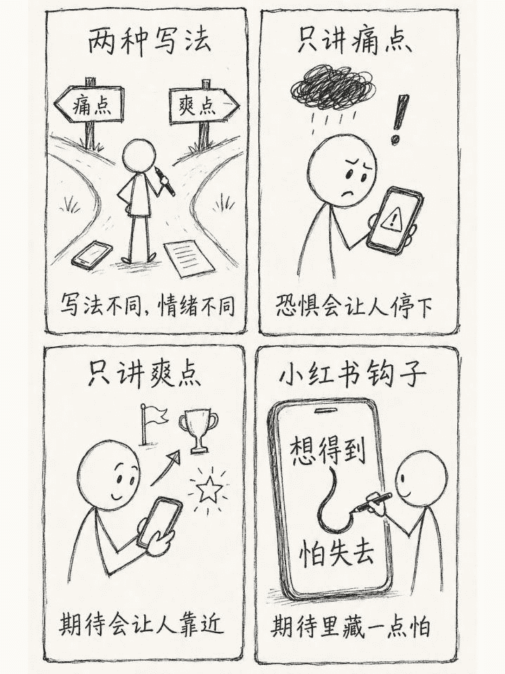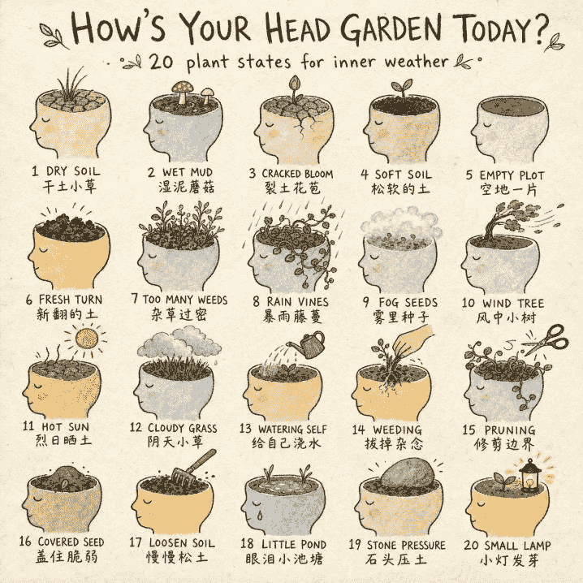

