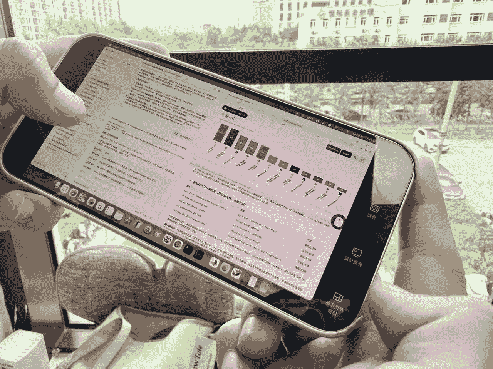
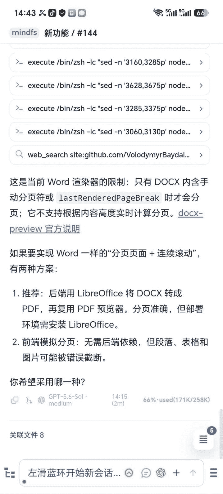
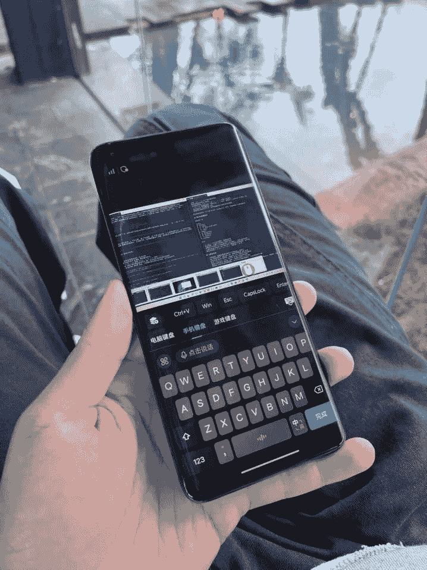

# 敢脱离电脑的老板，才是好老板

260803 副业SC 精华

整理：公众号懒人搜索，懒人专属群精选

懒人微信：lazyhelper1

哈喽，大家好，我是刘小排。

不知道你们有没有发现：老板一般不用电脑，工作一般是用手机处理。老板需要处理工作的时候，一般是通过手机安排一个同事去解决。

如果我们自认为是“AI员工的老板”，我们也应该脱离电脑，别天天盯在屏幕前啦。

关于具体如何做，我这篇公众号已经讲了，我这里不再赘述。

https://mp.weixin.qq.com/s/Pl8kBle1htPRPuCSkD1lHA

请你看完公众号后，再回来接着看，我在这里补充一些细节，仅针对生财圈友。

一边玩手机，也可以开“小窗”盯着AI员工干活

## 下面，开始说细节

### 这是什么软件？

UU远程。

UU远程是免费的，比收费的ToDesk还好用。

### 如何打字？

简单地说，肯定是“语音输入”。

展开说的话——我使用的是「微信输入法」。

微信输入法几个好处：

- 语音输入效果很好，还会自动整理格式，很像Typeless输入习惯（常用语等），可以跨设备自动同步剪切板，可以跨设备自动同步。也就是说，无论我在哪台设备上复制，在另外任何一台设备，都能直接粘贴。

### 电脑放到国内不行吗，放到海外有什么好处？

我有一些机器是放到国内的。

电脑放到海外的好处是：

- 硬件有ID号（尤其是Mac系列）。如果是在中国买的Mac电脑，仍然很容易被Claude Code封号。如果是海外买的硬件设备 + 海外网络，不容易封号。
- 海外的网络比国内好多了，毕竟海外运营商是有市场竞争的，不靠行政垄断。随便找一个海外的住宅/办公室，上传/下载速度，都很容易达到1G（1000M）。

### 如果没有海外硬件，租用云厂商的VPS可以吗？

不推荐。

因为VPS的性能一般比较差，体验一般。

你可以尝试问问AI：如果要在云厂商（如AWS）那里租用一台性能可以完全对标Mac Mini M4（12核、48G内存）的VPS，每个月要多少钱？应该是大几千起。

即便是你把电脑放到国内，我也建议你用手机操作。

因为现在AI完成任务太强了，根本不需要你盯着屏幕。

如果你一直盯着屏幕，反而容易胡思乱想、内耗、浪费时间。

还不如索性强制自己不用电脑屏幕，只用手机，多回归生活，真正地当上“老板”。

### 控制的时候，手机更好还是iPad更好？

手机更好。因为更方便，不增加自己负担。

按照奥卡姆剃刀原则：如无必要，勿增实体。

有人在我公众号评论区告诉我iPad好，你放心，那是YY的，他根本不真实使用。

反之，你仔细看我公众号评论区发出来的截图，有真正在使用这套工作方式的人，无一例外，是在用手机。甚至都很少看到折叠屏。

我这里稍微摘抄几个评论区里别人的截图。

你看，哪有什么折叠屏、iPad！

### 为什么要很多台电脑？

因为电脑不在自己的旁边，我需要控制不同AI员工的权限和分工。

有的负责我的知识库，那就只能是我自己办公室、我天天能摸着的电脑。

其他电脑，也分别分配了权限，安排不同的项目，给不同的上下文。

“控制上下文”胜过“控制权限”。张一鸣不是说过吗，“Context, not control”。指挥AI员工，和指挥普通员工，没有太大的区别。

### OpenClaw/Hermes还有用吗？

不建议继续使用了，麻烦。

直接用Codex/Claude Code已经很好，和半年前的情况不一样了。

如果你很习惯Hermes的操作，那我建议你直接用WorkBuddy，也比Hermes更好用。

WorkBuddy里你使用hy3模型，是免费的，也可以配置使用你自己Codex的包月套餐，通过CLI Proxy API即可。

### MacBook合上盖子也可以吗？

可以的。UU远程里可以设置。

我的MacBook长年合上了盖子。

### Token很贵啊，买不起怎么办，有没有便宜的方案？

这是最大的误区！Token很便宜，大家一定要Token Maxxing！那些说Token贵的自媒体，建议你全部取关，他们都不是真正干事的人！！

我劝你也别去省那每个月一两千的Token费用。

我们算个很简单的账：

OpenAI和Anthropic最大号的包月账号，一个才$200/月，你买5个，也才$1000/月，也就是不到7000人民币。如果雇佣真人，7000的工资，算上社保、办公室分摊等等，恐怕你只能雇佣1个普通员工而已。

同样的成本，「雇佣1个普通员工每周工作40小时」vs「雇佣5个天才程序员每周工作144小时」，你选吧。还有什么问题吗，欢迎交流~~

————分割线————

看完这篇SOP，你觉得你懂了。但90%的人一到实操就会卡在第一步。

工具和教程只是最低级的壁垒，真正的壁垒是“立刻动手”和“圈层信息差”。

如果你想看全网最新的变现玩法，并且和一群执行力极强的极客一起下场拿结果，欢迎围观我的核心私域：【懒人专属群】。

我们不聊虚的，只做商业闭环的拆解与AI效率的压榨。系统内已沉淀1000+跑通的套利实战局。

👉 查阅圈子完整数字资产与上车门槛：

https://lazyso.com/insider/

认同价值、准备好下场干活的，扫码加我微信（lazyhelper1）。

备注：【实操上车】，不闲聊。

