公众号懒人搜索，懒人专属群分享我是由月之暗面（Moonshot AI）研发的 kimi-k2.7-code 智能大模型。**AI 实战复盘：跑通微信小店＋知识库自动交付，单周消耗 18 亿 Token**

260804 副业SC 精华

整理：公众号懒人搜索，懒人专属群精选

懒人微信：lazyhelper1

生财圈友们好，我是 bug，全栈程序员。

我有 12 年开发经验，也做过几次创业，涉及直播带货、海外开店和跨境电商。

主要擅长音视频、独立站、小程序和工具类产品开发。

目前主业在做真人搭子英语口语练习产品，副业帮中小企业和自媒体做 AI 化改造。

从 GPT 上线起，Plus 付费会员至今。Claude Max 5x 订阅账号 12 个月了。随 AI 发展，期间也深度使用过 Cursor、Copilot、IDE＋AI 编程插件和 CCSwitch＋中转站等方案辅助开发。AI Token 方面花费约 1W＋。

我的 Token 消耗主要是用来开发编程，经历了 IDE 代码补齐；代码片段 Ctrl+C 到 AI 对话，再 Ctrl+V 回代码编辑器；Cursor Agent 开发；Claude Code/Codex CLI 开发这几个阶段的迭代。

生财 Token 统计插件上线后，截至 7 月 29 日，累计消耗 112.19 亿 Token，共有 101 个活跃日，按活跃天数算，日均约 1.11 亿。

最近 30 天消耗 61.82 亿，日均约 2.06 亿，排行 **#362**。

近期参加了生财成都线下 Codex 编程实战，协助组员进行 Codex 从 0 编程做产品，解决大伙遇到的一些问题。发现对于没编程经验的圈友，在对 AI 编程的认知和执行思路上，存在很大的误区。

最近，刚帮朋友开发了一套微信小店＋个人知识库的自动化交付系统。卖出去 600 多份。GMV 1.2K＋。Token 消耗 9.96 亿，已稳定交付共 500 份报告。正好生财约稿，要求分享下 AI Token 消耗都用来做什么，怎么把 AI Token 消耗拉满。这篇文章，就结合我的主要使用场景——编程，以及线下活动时看到的圈友们遇到的问题，再加上帮人做 AI 自动化改造的项目经验，来聊一聊 Token 消耗的三个门槛：从云对话、本地项目到业务自动化。

生财圈友们好，我是 bug，12 年经验程序员，也做过直播带货、海外开店和跨境电商。

目前主业做英语口语练习产品，副业帮中小企业和自媒体做 AI 化改造。

接入生财 Token 统计插件后，我累计消耗 112.19 亿 Token。

最近帮朋友开发了一套“微信小店＋个人知识库”自动交付系统，卖出 600 多份，GMV 1.2 万＋，稳定交付 500 份报告，单周消耗 18 亿 Token。

这篇文章复盘，我从 AI 对话、本地项目到业务自动交付的实践，分享 Token 消耗怎样随着真实业务稳定增长。

## 一、AI 的三种角色

真正把 Token 消耗拉开差距的，不是一次回答多写了几百字，而是 AI 被放在了工作流程的什么位置。

问一个问题，开发一个项目，业务系统接入 AI 持续处理用户请求，都叫“使用 AI”。

但这三种用法背后的输入量、运行次数和触发方式，差得非常大。

先从 AI 最常见的三个使用场景说起，可以给 AI 划分 3 种角色：老师、助手和服务。

### 1. AI 是老师

这是大多数人最熟悉的用法。

以前遇到不懂的问题，第一反应是打开谷歌或者百度。现在很多人会直接问 ChatGPT 或 Claude，我也是一样。

搜索引擎给你一堆网页，还得自己筛选。AI 会先理解问题，再把信息整理成一份相对完整的答案。

遇到需要确认的地方，我再去看原始资料，或者让 AI 进一步分析。

AI 肯定也会出错，但在解释概念、梳理思路和提供线索这几件事上，它确实能帮我们省不少时间。

这个阶段，AI 就像一位随时可以提问的老师。

输入通常是一段问题。复杂一点，可能会加张图片、上传一个文件，或者根据回答继续追问。

输出是一份解释、建议或者整理好的答案。对话越长，带入的历史记录越多，输入自然也会增加。

但有一点没变：节奏还掌握在人手里。

你问一次，它回答一次。你不继续发消息，它也不会自己往下跑。

所以，这个场景下，AI Token 的消耗通常不会太夸张。图片和长文档可以拉高单次输入，但很难长期把总量撑起来。

说到底，你一天能在对话里聊多少次，按多少次回车，差不多就是这个阶段的上限。

### 2. AI 是助手

当 AI 进入本地项目，Token 消耗的方式就变了。

这时交给它的已经不是一个问题，而是整个项目。需求、代码、配置文件、运行日志，甚至数据库结构，都可能成为输入。

AI 改完代码也不能直接交卷。它还要运行测试、查看报错、重新读取相关文件，再回来继续修改。

这已经不是一次问答，而是一个循环。

以前有个阶段，用云端对话写代码，我会复制一段代码给 AI。它给出修改建议，我再手动复制回项目。

现在用 Codex 或 Claude Code，选择本地目录后，AI 可以直接进入项目。

很多步骤不用再手动发起，它会自己读文件、改代码、跑测试，然后根据结果继续处理。

一句“帮我修好这个问题”，背后可能已经跑了十几轮。

AI 生成的代码和命令是输出。测试结果、报错信息和前面做过的修改，又会成为下一轮输入。

项目越大，AI 需要读取的内容越多。任务越复杂，这个循环就会跑得越久。

真正消耗 Token 的，往往不是某一次生成了多少行代码，而是整套项目上下文被反复读取和处理。

Token 的消耗，在这个使用场景下，到这里会明显跳一个台阶。

限制它的也不再是一天能按多少次回车。只要项目里还有事情没做完，这个循环就可以继续跑。

### 3. AI 是服务

再往前一步，是把 AI 做成产品或者服务。

知识库是比较容易理解的例子。

把一个人的文章、课程和历史问答整理进知识库，再封装成一个 AI 产品。比如把亦仁过去的公开分享和方法论整理进去，做成“AI 亦仁”，其他人可以直接向它提问。

这时候，输入开始来自真实用户。

除了用户当前的问题，模型还可能读到他的历史对话、知识库检索结果，以及业务系统提供的数据。

输出也不再局限于聊天回复。它可以生成咨询方案和数据报表，也可以直接推动业务进入下一步。

再接入客服、订单、销售线索或者内容生产流程，发起任务的人也变了。

用户发来问题，会请求 AI 服务接口；订单状态发生变化，会请求 AI 服务接口；到了设定任务触发时间，系统也可以自动调用 AI 服务接口。

我不需要一直守在旁边按回车。

到了这里，Token 消耗开始跟着业务量走。用户越多，调用越频繁，流程跑得越长，消耗就越大。

系统提示、知识库和历史上下文还会被反复读取，其中一部分可能命中缓存。即便单次任务用得不多，持续运行和并发调用也会很快把总量拉起来。

第三个角色和前两个角色最大的区别，就在这里。

以前，是手动或者自动的方式在使用 AI。而现在，是业务在调用 AI。把这三个角色场景放在一起看，差别就很清楚了。

老师阶段，AI 等着我提问；

编程搭档阶段，它围着一个项目反复工作；

做成服务以后，用户和业务系统会不断给它派活。

输入越来越多，循环越来越长，调用次数也不再受一个人控制。

所以，单看一次回答有多长，支撑不起一天十几亿 Token 的消耗。

真正的变化，发生在 AI 从对话窗口走进项目，再被接进业务以后。

## 二、Token 消耗的第一个门槛：本地项目

在成都线下 Codex 编程实战中，有位组员做了一个视频自动剪辑的网页工具。

ChatGPT（原 Codex）按需求写好了代码，还自动部署到了 GPT 站点。选素材、配 BGM 都正常，点击运行，却一直没有生成视频。

代码逻辑没问题，问题出在项目跑错了地方。

素材在 Mac 相册里，网页没有权限读取；GPT 站点和自购服务器不同，很多限制，也装不了处理音视频需要的 FFmpeg。页面看起来已经完成，真正生成视频的功能却不具备。

于是，我让这位组员继续跟 GPT 对话，把项目部署到 Mac 本地运行，再处理文件权限和 FFmpeg 依赖。

当然，如果你没有编程经验，不知道该怎么搞，也可以继续和 GPT 对话，把问题反馈一下，它也会给你提供修改方案。只是会多花一些时间，我们当时时间有限，就直接给方案，让 AI 来改了。

修改完成后，两段视频成功拼接，BGM 也加上了，视频正常导出。

这个案例很典型。

很多人能跟 AI 说清需求，却分不清对话窗口、本地目录和运行环境之间是什么关系。

对话窗口负责沟通。本地目录里放着代码、素材、配置和运行结果。

项目运行在哪里，决定了 AI 能读取哪些文件、调用哪些工具。

一般来说，这种工具类应用，最好部署在自建服务器上，安装依赖的工具包，网页打开使用；或者以传统软件的方式，将工具包集成在软件中，安装运行在电脑上使用。

文件不在自己手里，麻烦还不止这一次。

只要原来的对话丢了，AI 就不知道项目之前怎么实现、装过什么依赖、改过哪些地方。下次想继续迭代，只能重新解释，严重时甚至要再做一遍。

把项目保存在本地就不一样了。换会话、换工具，甚至换模型都没关系。AI 重新读取项目目录，就能接着往下做。

这也是 Token 消耗开始上一个量级的地方。

云对话通常是一问一答。进入本地项目后，AI 会反复读取代码、运行测试、查看报错，然后继续修改。

一个需求，背后可能已经跑了十几轮。

Token 不再跟着你按回车的次数增长，而是跟着项目的需求和 bug 的迭代，持续消耗。

## 三、项目方案调研

AI 对话，理解和使用都很简单，不展开讨论了。

重点是项目工程本地化后，把 AI 当做助手，来协助编程开发产品。

我们不能一上来就让 AI 开发，而是应该先调研是否可行，确认开发难点、卡点，再分阶段开发，直到产品上线。

前面的视频剪辑工具，最后在 Mac 本地跑通了。

回头看，这次问题并不是 AI 不会写代码，而是开发开始得太早。

项目部署到站点之前，没有先确认两个前提：网页能不能读取 Mac 相册，处理音视频需要用到什么第三方工具包依赖，以及 GPT 站点的运行环境能不能使用 FFmpeg。

如果这三个问题在开发前调研清楚，后面的返工其实可以避免。

不要拿到需求就让 AI 开始写代码。AI 写得快，方向错了，返工也快。

我现在做一个功能，通常会分成四个阶段：

- 技术调研；
- 方案确认；
- 分阶段开发；
- 测试和交付。

### 1. 技术调研

第一步，先让 AI 读取项目和相关资料，不要修改代码。

它需要了解当前项目用了什么技术，代码放在哪里，运行环境有什么限制，还要不要依赖外部工具。

放到视频剪辑这个案例里，需要先确认：

- 项目运行在网页还是本地；
- 网页能不能读取 Mac 相册里的素材；
- 当前环境能不能安装和调用 FFmpeg；
- 生成的视频准备保存到哪里。

调研结束后，让 AI 给出结论和依据。

如果运行环境不支持，应该先调整方向，而不是继续在原来的代码上硬跑。

### 2. 确认方案

确认项目的开发条件具备后，再讨论怎么做。

视频剪辑工具迁移到本地，需要确定素材怎么选择、FFmpeg 怎么安装、两段视频如何传入、BGM 怎么添加，以及文件导出到哪里。

这时还要把验收结果说清楚：

选择两段本地视频和一段音乐，点击运行，能够生成一个可以正常播放的视频文件。

方案不用写得很长，但要把技术路径、修改范围和最终结果写明白。人工确认以后，AI 再开始开发。

### 3. 分阶段开发

开发时，我一般不会让 AI 一次完成所有功能。

先让它读取本地素材，确认文件权限没有问题。然后完成两段视频拼接，能够正常导出以后，再加入 BGM。

每完成一步，都实际运行一次。

这样做看起来慢了一点，实际更省时间。

如果最后导出失败，可以很快判断是素材读取、视频拼接，还是音频合成出了问题。

如果把所有功能一起完成，报错时 AI 也要从头排查。

### 4. 测试和交付

AI 回复“已经完成”，不代表任务真的结束了。

最后要拿真实素材跑一遍。检查导出文件是否存在，视频能不能播放，画面有没有缺失，BGM 是否正常，输出时长是否符合预期。

还要测试一些容易出问题的情况，比如素材路径带中文、用户拒绝文件权限、FFmpeg 没有安装，或者两段视频格式不同。

这些问题处理完，再让 AI 补上安装和运行说明。以后换一个对话，甚至换一个 AI 工具，只要重新读取本地项目，也能继续维护。

整个过程里，人负责确认方向和验收结果，AI 负责调研、修改、运行和排查。

Token 也会消耗在这些具体工作中：读取项目、查资料、修改代码、分析日志，再重新测试。

Token 消耗量增加，会随着项目一轮轮往前推进。

如果只是告诉 AI 开发一个网页视频剪辑工具，以上的几个环节，AI 会自己全部搞定，但是整体上是失控的。

测试遇到问题后，你很难准确定位到问题的成因，需要多次让 AI 返工，结果往往会离预期越来越远。

这也是很多人发现自己的 AI 不怎么好用、降智的一个重要原因。

## 四、如何做好项目上下文

搞明白了，开发一个产品，AI 其实做了很多环节的工作。

如何确保一个项目的长期稳定迭代，陆续把预期的功能开发出来，形成一个稳定的版本？做好项目管理很重要。

大家都知道，AI 对话是有上下文限制的，聊的内容多了，对话长了，会触发上下文压缩。

而 AI 协助下的项目开发，项目管理，其实就是管理好项目的上下文。

一个自动剪辑工具，看起来只是一句话需求：

帮我做一个可以自动剪辑视频的网页工具。

但 AI 真正做起来，中间至少经过需求、产品、设计、开发、测试和部署六个环节。

AI 会做这些工作，不代表它天然了解你的项目。

换一个对话窗口，它可能不知道这个工具是本地运行还是部署在网页上；换一个账号或模型，之前确认过的技术方案、业务规则和验收标准，也可能要重新解释。

玩过 OpenClaw 之类的 Agent 工具，会比较容易理解这件事：模型不会凭空记住上一次发生了什么。所谓“记忆”，本质上还是工具在新任务开始时，把保存过的信息重新放进上下文。

所以，重要的信息不能只留在聊天记录里。

### 1. 全局规则

全局规则是你在所有项目中都希望 AI 遵守的习惯。

比如：

- 修改前先读取相关文件；
- 不确定时先确认，不要自行猜测；
- 完成后运行测试；
- 不要改动需求范围之外的代码。

Codex 可以把这类规则写进 `~/.codex/AGENTS.md`，Claude Code 对应的是 `~/.claude/CLAUDE.md`。

这些内容只需要设置一次，以后打开其他项目也能继续使用。

### 2. 项目规则

项目规则只服务于当前项目。

这里应该写清楚项目是做什么的、使用了哪些技术、目录怎么划分、如何启动和测试，以及有哪些不能破坏的业务规则。

以视频剪辑工具为例，至少应该让 AI 知道：

- 项目现阶段在 Mac 本地运行；
- 视频由 FFmpeg 处理；
- 素材来自用户选择的本地文件；
- 导出文件保存到指定目录；
- 修改完成后，要用真实素材跑完整流程。

Codex 会读取项目目录中的 `AGENTS.md`。Claude Code 使用项目根目录的 `CLAUDE.md`，也可以放在 `.claude/CLAUDE.md` 中。

如果同时使用两种工具，可以把通用的项目规则写进 `AGENTS.md`，再让 `CLAUDE.md` 导入它：

```text
@AGENTS.md
```

这样不用维护两份内容，换工具时也不需要重新介绍项目。

### 3. 某次需求

项目规则解决的是“这个项目是什么”，但还没有说“这次要做什么”。

每次开始开发前，我会先和 AI 确认需求及方案，再把结果保存到项目目录。比如：

```text
docs/tasks/add-bgm.md
```

文件不用写得很复杂，说明几件事就够了：

- 这次要解决什么问题；
- 准备采用什么方案；
- 哪些文件和功能可以修改；
- 哪些内容不要动；
- 做到什么程度算完成；
- 当前已经完成了什么。

新窗口开始工作时，让 AI 先读项目规则，再读这份任务文档，然后才去修改代码。

这样即使换了对话、账号或模型，AI 拿到的信息也和一个刚接手项目的开发人员差不多。它知道项目背景，也知道这次要改什么，不必重新盘问一遍。

这些文件同样会占用输入 Token，但它们减少了另一种更大的浪费：反复解释需求、盲目读取整个项目，以及方向错误后的多轮返工。

上下文不是越多越好。全局习惯放在全局规则里，长期信息放在项目规则里，本次改动放在任务文档里。AI 每次只拿到当前

公众号懒人搜索，懒人专属群分享

工作需要的信息，配合起来才会稳定。Token 也会更多地花在推进项目上，而不是重新理解项目。

## 五、项目开发的辅助工具

上一节讲的是把项目规则和需求文档留在本地目录里。但在真实开发中，还有很多信息放在项目外面。

一般编程类产品开发，团队会有项目经理、产品经理、设计师、移动端开发、前端开发、服务端开发、测试和运维等角色分工。为了方便协作，提升效率，会借助很多类型的工具。

这些工具，就管理了项目之外的这些信息。

目前的团队中，我们用 Linear 管理 Issue。Issue 可以理解成一张任务卡，里面写清楚要解决什么问题、改动范围以及验收条件。

页面的原型和交互放在 Figma。开发人员不用只靠文字猜页面长什么样，AI 也可以对照设计稿检查实现结果。

代码使用 Git 管理，再保存到 GitHub 或 GitLab。Git 负责记录每次修改，GitHub、GitLab 则提供代码托管、评审和合并功能。GitHub 里的 PR 和 GitLab 里的 MR，作用差不多，都是把一批代码改动提交出来，确认没有问题后再合并。

产品上线以后，我们还会使用 Sentry 和 PostHog。Sentry 负责收集线上报错，包括错误发生的位置、运行环境和相关日志。PostHog 记录用户行为，可以看到一个功能有没有人使用，用户在哪一步离开。

这些工具不是为了把流程变复杂，而是让每一类信息都有固定的位置。

而换到和 AI 这个全栈助手合作开发项目后，遇到最核心的问题，其实是如何跟 AI 同步这些项目外的信息。

### 打通 AI 和工具的通信

以前这些工具主要给人看。现在 AI 也参与开发，新的问题就出现了。

需求在 Linear，设计在 Figma，代码在 GitLab，线上错误又在 Sentry。如果这些工具没有接通，每次让 AI 工作之前，人都要先把相关信息复制出来，再重新解释一遍。

这个过程很麻烦，也容易漏信息。

比如 Issue 已经调整了验收条件，但你发给 AI 的还是旧版本；Sentry 里已经有完整的错误堆栈，你却只告诉 AI“线上报错了”。AI 拿到的信息不完整，后面的分析自然容易跑偏。

所以，打通 AI 和各个工具的通信，是这一环里很重要的工作。

常见的连接方式有 MCP、API 和 CLI。MCP 可以先理解成一套让 AI 连接外部工具的通用协议。API 是平台开放给程序调用的接口。CLI 则是可以在终端里执行的命令。

具体使用哪一种不重要。只要接通以后，AI 能自己读取信息，也能把处理结果写回去，就不需要人一直充当信息搬运工。

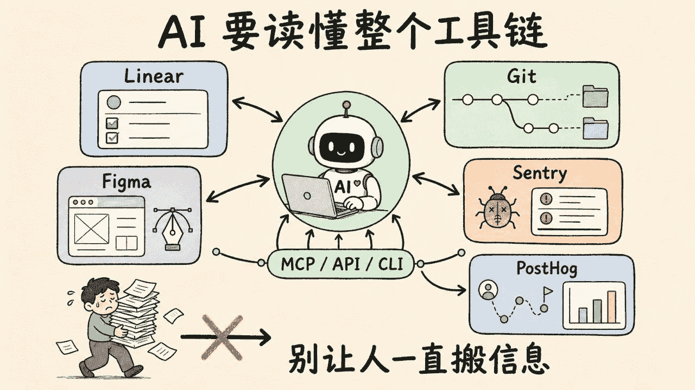

### 基于 Git 多 Agent 开发

编程里的多 Agent 协作，最好基于 Git 来实现。

Commit 是一次代码存档。AI 完成一段修改并通过测试后，可以提交一个 Commit。以后发现有问题，可以查看它具体改了什么，也可以退回之前的版本。

Branch 是一条独立的开发线。通常一个 Issue 对应一条 Branch。AI 在自己的 Branch 上修改，不会直接影响正在运行的主版本。

Worktree 则会为不同 Branch 创建不同的本地目录。一个 Agent 可以在一个目录里开发视频导出，另一个 Agent 在另一个目录里修复登录问题。双方可以同时读取文件、安装依赖和运行测试，不会挤在同一个目录里互相覆盖。

当然，Git 也不能自动解决所有冲突。如果两个 Agent 同时修改同一个模块，合并时仍然可能打架。多 Agent 协作的前提，还是先把任务拆开。

### 全都交给 AI

工具打通以后，并不是每一步都要人手动操作。

一次完整的流程可以是：

我先和 AI 讨论需求，让它整理成 Issue。确认可以开发以后，AI 自己读取 Issue 和 Figma 设计稿，创建 Branch 和 Worktree，然后修改代码、运行测试、提交 Commit，再创建 PR 或 MR。

开发过程中，它可以把完成情况写回 Issue。产品上线后，如果 Sentry 收到新的报错，AI 还能读取日志、定位代码并提交修复。PostHog 里的用户数据，也可以成为下一次功能调整的依据。

人在这个流程里主要负责三件事：确认目标、判断方案、验收结果。创建任务、更新状态、管理分支、运行测试和整理日志等重复工作，可以尽量交给 AI。

国内也有对应的工具。Linear 可以换成 PingCode、TAPD 或禅道，Figma 可以换成即时设计或 MasterGo，代码可以放在 Gitee 或 CODING。错误监控可以使用 Fundebug，用户行为分析可以选择神策或 GrowingIO。

工具名称会变，作用基本相同：保存项目事实，并让人和 AI 都能读到。

### 简化流程

我自己做项目时，不会照搬团队的完整流程。

需求通常直接写进 GitHub Issue，或者保存在项目的任务文档里。一个任务对应一条 Branch，只有确实需要多个 Agent 并行开发时，才创建多个 Worktree。

页面比较简单时，我不会专门维护一份 Figma 设计稿，直接用参考图和文字说明。产品还没上线时，也不急着接入 Sentry 和 PostHog，先把功能跑通。

流程虽然简化了，三个记录会保留：这次要做什么、代码改过什么、最终有没有通过验收。

其余能自动完成的步骤，包括整理任务、创建分支、修改代码、运行测试和提交 Commit，我都会尽量让 AI 去做。

工具接通以后，AI 会持续读取 Issue、设计稿、代码和日志，输入 Token 自然会增加。

但这些 Token 用在了真实的项目推进上，而不是让人换个窗口以后，再把项目背景从头讲一遍。

## 六、案例一：销售报告脚本

前面讲了本地项目、方案调研、项目上下文和分阶段开发。下面用一个销售报告脚本，把这些方法串起来。

这个项目的需求不复杂。

各个供货商或采购平台可以导出采购数据，格式通常是 Excel 或 CSV，里面有商品名称、商品编号、规格属性和采购成本。

独立站保存的是销售订单，使用另一套 SKU。供货侧的商品编号通常无法和销售 SKU 直接对应，需要先根据商品名称、颜色、尺寸等属性，建立两边的商品关系，再把采购成本和销售数据整理到一起。

如果手动处理，就要在几份表格之间反复查找、复制和计算。数据少的时候还能应付，订单和商品一多，很容易匹配错。

### 1. 从对话进入本地项目

这种任务不适合只在对话窗口里完成。

采购数据、独立站销售数据和生成的报告都在本地。把脚本放进本地项目后，AI 才能直接读取样本文件、修改代码、运行脚本，并检查生成的 Excel 报告。

以后换了新的销售数据，不需要重新写处理逻辑。把文件放进指定目录，运行脚本，就可以重新生成报告。

注：不是做出的每个工具，都需要 web 页面，或者系统 GUI 页面，这种轻量的脚本，直接在电脑本地数据处理，会很高效。

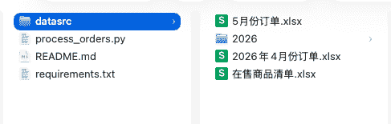

### 2. 先调研，再确认方案

开始写脚本前，要先让 AI 看懂两边的数据。

独立站商品有明确的 SKU。供货商或采购平台虽然可能提供商品编号，但这些编号只在各自的平台里有效，和销售 SKU 不是一回事。

所以，第一步不是计算成本，而是建立商品映射关系。

AI 先读取两边的商品数据，整理商品名称和规格属性，再生成可能的匹配结果。能够确定的直接关联，名称相近、属性缺失或存在多个候选项的，单独列出来由人确认。

确认后的结果保存成商品映射表。后续脚本通过这张表找到对应的销售 SKU，再把采购成本合并到独立站的销售数据中。

按照销售报告需要的数据关系，将处理逻辑固化为脚本的代码逻辑。后面再次运行，如果各个表的字段没有变更，就不需要 AI 介入来执行了，手动执行也是一样的效果。

### 3. 分阶段开发和验证

开发可以分成四步。

第一步，读取各个平台的数据，统一商品名称和颜色、尺寸等属性。

第二步，生成供货商品与销售 SKU 的映射表。无法确定的记录单独输出，交给人确认。

第三步，根据映射表，把采购成本关联到销售订单。

最后再汇总销量、销售额和采购成本，生成 Excel 报告。

每完成一步，都要拿一批真实商品核对。先确认商品关系，再检查成本和销售数据。商品匹配错了，后面的计算自然也不会准确。

### 4. 真实业务推动项目继续迭代

第一版脚本跑通，只能说明基本流程没有问题。

后面接入新的供货商，表格格式和字段可能会变；出现新的商品，也要继续补充映射关系。同一个 SKU 有多次采购时，使用最近一次成本、平均成本还是其他口径，也要根据业务重新确认。

报告还可能继续加入退款、广告费和物流费等数据。

每出现一种新情况，AI 都要重新读取样本数据和项目规则，修改脚本，再用真实数据验证。

Token 就消耗在这些工作里：分析表格、整理商品映射、修改代码、排查异常数据，再重新生成报告。

这个项目虽然只是一个本地脚本，但业务数据和统计规则一直在变化。AI 需要跟着这些变化继续开发和维护，Token 的消耗也会随之增加。

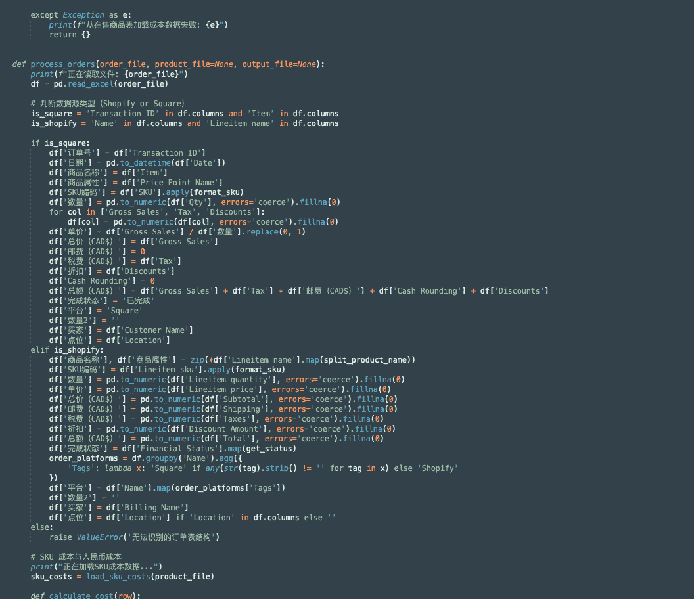

## 七、Token 消耗的第二个门槛：更多的业务需求

前面几节，解决的是怎么用 AI 把项目做下去。

但流程跑通以后，还得有真实业务。否则做完一个 Demo，改几轮页面，项目也就结束了。

拿自动化剪辑来说。

一个直播团队，每场两小时的直播结束后，要剪出十几条竖屏短视频。

视频需要自动拼接、加字幕、配 BGM，再按固定尺寸导出。

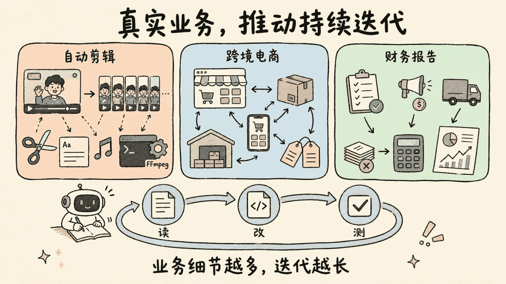

听起来只是几个功能。真正开发时，会遇到各种问题：

有的视频没有声音，有的编码不兼容，有的字幕时间对不上，还有的素材路径带中文。

每遇到一种新素材，AI 都要重新读代码、看 FFmpeg 日志、修改处理逻辑，再跑一遍测试。

Token 就消耗在这些具体问题里。

再看跨境电商。

假设一个卖家同时使用 Shopify、Amazon 和 TikTok Shop，仓库和供应商又是另外两套系统。

现在要做一个后台，把订单、商品、库存和售后数据同步起来。

麻烦在于，各个平台的接口和字段都不一样。

同一件商品，在几个系统里的 SKU 可能都不同。

取消订单、部分退款和库存锁定，也有各自的规则。

AI 要读取几套接口文档，编写对接代码，查看返回数据，再处理限流、授权失效和字段缺失。

接入一个新平台，往往又要增加一整套适配。

财务报告也一样。

老板想每天看到销售额、广告费、物流费、退款和实际利润。数据可能来自 Shopify、Stripe、PayPal、Meta 广告和物流服务商。

AI 要先弄清每个指标的口径，再写脚本拉取、清洗和汇总数据。只要最终金额对不上，就要沿着订单、支付和退款记录往回查。

这些项目消耗 Token，不是因为代码一定有多难，而是业务里有大量细节和例外。

AI 要不断读取文档、代码、测试数据和错误日志，再进行下一轮修改。

真实业务不会在项目上线那一刻结束。

新的需求、数据和问题会不断出现，AI 也要持续读取、修改和验证。

Token 消耗的第二次跃迁，就在于老项目的迭代维护，以及新项目的开发。

## 八、Token 消耗的第三个门槛：业务自动交付

到了这个阶段，AI 的用法又变了。

前面是我在使用 AI。我要开发一个功能，就打开 Codex 或 Claude Code，把任务交给它。

业务自动化，是让业务系统通过 API 调用 AI。

API 不用想得太复杂。它就是程序调用模型的一个入口。

用户提交请求以后，系统自动整理相关数据，发送给 AI，再把处理结果放回原来的业务流程。

整个过程在后台完成，不需要有人打开对话窗口。

现在很多所谓的 AI 应用，只是在网页里放了一个聊天框。用户还是要自己组织问题、补充资料，再把 AI 的回答复制到其他地方。

在我看来，这只是换了一个使用 AI 的入口，还谈不上真正的业务自动化。

我判断一个 AI 功能是否真正接进业务，主要看它的处理结果能不能直接推动下一步。比如更新任务状态、生成一份待确认的方案，或者调用已有系统继续处理。

调用一次模型 API 并不难。真正麻烦的是上下文。

AI 不知道你的客户是谁，也不知道订单放在哪里，更不懂公司内部的业务规则。这些信息需要系统在调用 API 时主动提供。

如果 AI 需要查询订单，后端就给它一个查询工具。AI 发出请求，程序查询数据库，再把结果交还给 AI。它可能根据结果继续判断，直到完成这次任务。

我不会把所有事情都交给模型。

金额计算、库存扣减和权限校验，这些有明确规则的事情，继续由程序处理。AI 更适合理解用户表达、判断问题类型、整理信息和生成内容。

涉及退款、付款、删除数据或者对外发布，我也会保留程序校验和人工确认。业务自动化的目标不是让 AI 随便操作，而是减少那些原本需要人来回复制信息、反复判断的步骤。

一次业务处理，往往会调用多次模型。每次调用又会带上系统规则、业务数据、历史记录和工具返回结果。

一个人使用 AI，一天能发起的任务有限。接入业务以后，每个用户请求和每次数据变化，都可能自动触发模型。Token 的消耗开始由业务量决定。

我甚至觉得，未来所有 AI 产品，表面上卖的是功能和服务，本质上卖的都是经过业务封装的 Token。

这就是第三次跃迁：以前是我调用 AI，现在是业务系统在调用 AI。

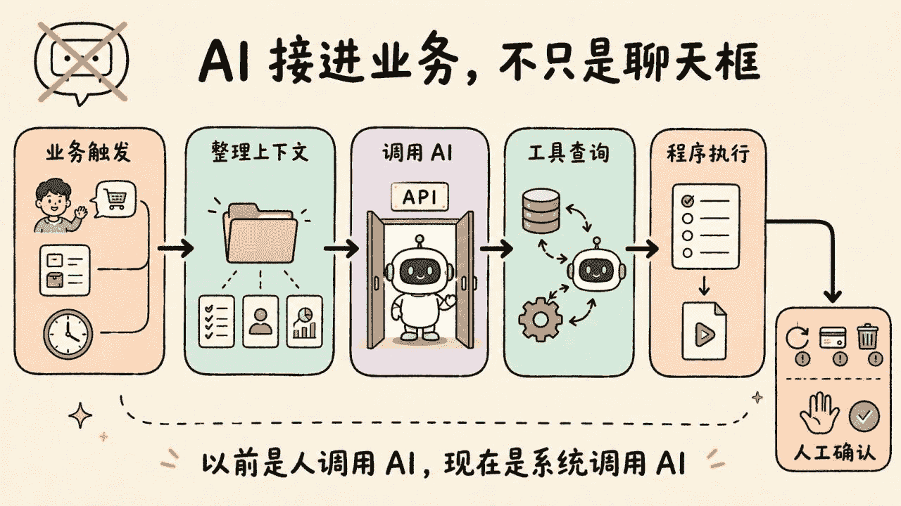

## 九、案例二：小程序 GMV 12K+ 微信小店+知识库自动交付

接下来，看这个我最近刚开发的，把 AI 服务做业务核心的项目案例。这是项目上线后真实的 Token 消耗，是为用户生成分析报告花费的。

这是一个通过微信小店销售的知识服务产品。用户购买后填写业务问卷，系统结合问卷和知识库生成个性化报告，再以 PDF 的形式交付。

整个流程是：

微信小店下单 → 自动发货 → 小程序填问卷 → 飞书创建任务 → Hermes 调用国产大模型 → 生成报告 → 自动推送给用户

用户在微信小店完成付款后，系统会自动发货。

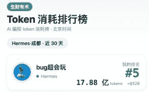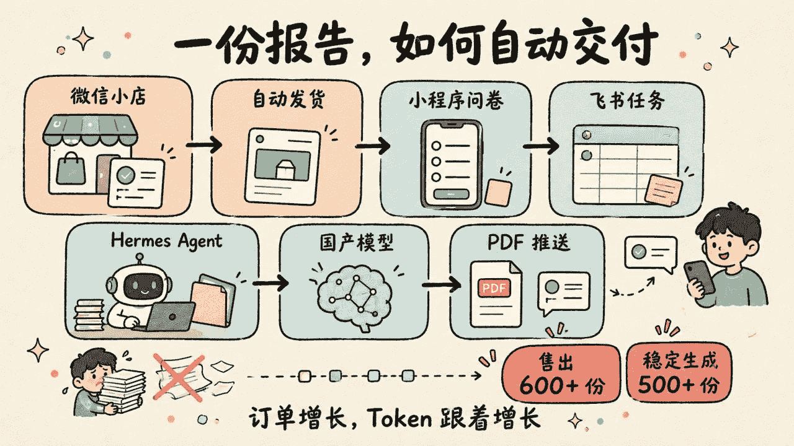

这里交付的不是固定资料，而是小程序入口。用户从订单进入小程序，系统先校验订单，确认购买记录有效，再开放问卷。

问卷提交后，系统自动创建报告任务。用户不需要添加客服，也不用把订单截图发给运营。

技术栈主要由微信小程序、微信云开发、飞书、Hermes 和国产大模型组成。

小程序负责用户操作。微信云开发处理订单校验、问卷数据、报告文件和消息通知。

飞书多维表格用来管理任务。运营人员可以看到哪些报告等待生成，哪些已经完成，也方便人工补充信息和处理异常。

本地电脑通过 CLI 运行 Hermes Agent，定时从飞书读取任务。Hermes 拿到问卷后，先从知识库查找对应的方法，再调用国产大模型生成结构化报告。

报告完成后，程序会检查内容和格式，生成 PDF 并上传到云端。随后，系统通过微信消息把报告入口推送给用户。用户点开消息，就能回到小程序查看或者下载。

从下单、发货、生成到通知，整个交付过程都不需要运营人员手动传文件。

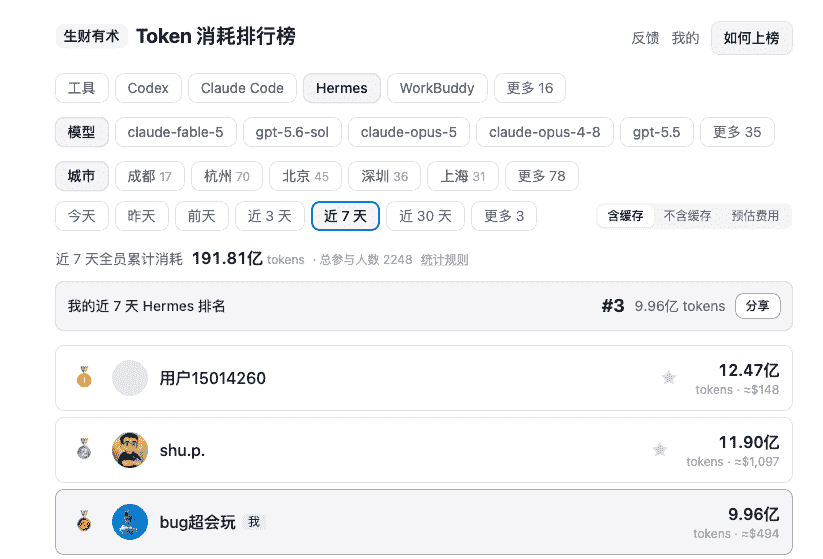

在这套系统里，AI 负责理解用户情况、匹配知识库内容和撰写报告。订单、身份、任务状态、PDF 排版和消息通知，都由程序处理。

模型这一层可以替换。后续需要调整效果或成本时，可以接入其他国产模型，不用重新开发小程序和交付流程。

正式上线前，还有一些不写代码也绕不过去的工作。

小程序需要完成备案，隐私保护指引也要按照实际收集的信息配置。用户填写的姓名、联系方式和业务数据，哪些需要保存、哪些会进入模型，都要提前确定。

报告由 AI 参与生成，页面和导出的 PDF 中也要保留相应说明。技术跑通只是第一步，备案、隐私和完整的交付流程也要一起处理。

目前这个虚拟报告生成商品，已经卖出 600 多份，主要还是因为甲方本身有流量。系统已经稳定生成了 500 多份报告，整条链路在真实业务中跑通了。

每新增一笔有效订单，系统就会自动读取问卷、检索知识库并生成报告。

Token 消耗不再取决于我一天向 AI 发起多少次任务，而是跟着真实业务量增长。

前面讲的本地项目、方案调研、上下文和业务自动交付，在这个小程序里都能找到对应的过程。

从对话进入本地项目


公众号懒人搜索，懒人专属群分享

小程序代码、云函数、配置和运行日志都保存在项目目录里。

AI 进入本地项目后，可以直接读取代码、修改云函数、运行测试，再根据日志继续排查。换一个对话或者模型，只要重新读取项目目录，就能接着开发。

## 先调研，再确认方案

开始开发前，要先把用户的完整路径梳理清楚：微信小店下单、自动发货、进入小程序、校验订单、填写问卷、生成报告，最后通过微信消息通知用户。

下单自动推送小程序入口；生成报告，推送微信服务消息给用户，打开直接看到报告；另外小程序推送部分信息到飞书；电脑 Hermes 拉取飞书数据，处理后再提交数据到飞书；小程序拉取飞书中的报表记录。这些容易造成卡点的地方，都需要在开发前做下技术验证。如果有任何一处不通，就需要进行相应的调整，或者更换整个方案。

做技术验证的时候，如果平台方比较大，比如微信开放平台，小程序平台等。有个窍门，让 AI 必须严格按照官方文档进行设计和开发。这样可以少走很多弯路。

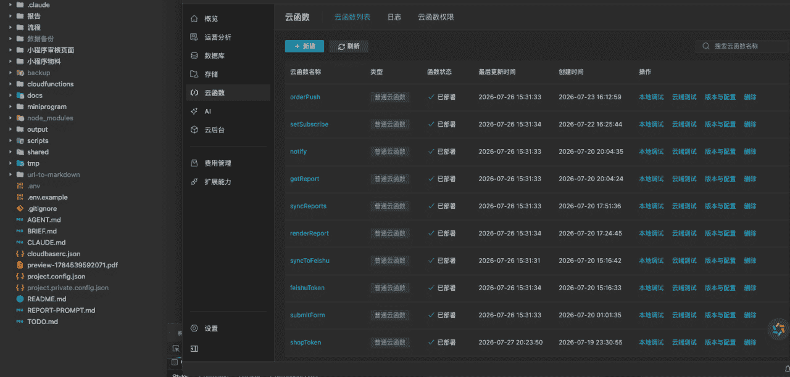

然后小程序支持云开发、云托管，以及自建服务器。

自建服务器，服务器和域名都需要备案，等待时间太长，不考虑。

云开发和云托管，都可以走小程序的 ICP 备案，审核时间较快。

而且可以将小程序和小店，通过云开发平台绑定，使用同一套用户身份验证，开发方面可以少考虑很多方面，稳定性要更好。

所以部署方案，采用小程序 + 云开发 + Agent 主机（可以是服务器，也可以是自己的电脑）。

## 把项目上下文保存下来

这个项目涉及多个系统，只靠聊天记录很难长期维护。

订单如何校验、问卷有哪些字段、任务有哪些状态、报告按照什么结构生成，都需要保存在项目文档里。这样换窗口或换模型时，AI 不用重新询问整套业务流程。

## 分阶段开发和验证

开发时没有必要一次跑通整条链路。

先完成小店订单和小程序身份校验，再处理问卷提交与任务创建。前面的流程稳定后，接入知识库和国产模型，最后完成 PDF 生成与微信消息推送。

每完成一段，都使用真实数据验证。这样出现问题时，能比较快地判断是订单、问卷、报告生成，还是消息通知出了问题。

所有流程开发和验证完成后，可以正式上线，然后真实下一单，走一遍流程。

再从核心用户群，小量测试，这样遇到了问题，也比较好处理，不会过于消耗顾客信任。

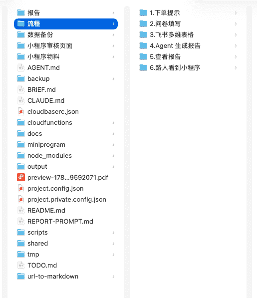

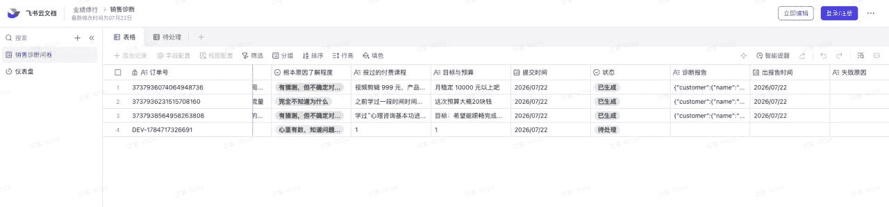

系统稳定后，全量发布，开始推给更多的人。

用户到达一定量级，做一些营销场景时，比如直播间销售，还要考虑爆单的情况。

## 打通各个工具

这套系统不只包含小程序。

微信云开发保存订单、问卷和报告文件；飞书管理报告任务；Hermes Agent 读取任务、检索知识库并调用国产模型。

这些工具接通以后，任务信息可以在系统之间流转，人不需要反复复制问卷、下载报告，再手动发送给用户。

## 从真实业务走向自动交付

系统开始接收真实订单后，还要考虑问卷没有填完、报告生成失败、任务需要重试，以及运营人员如何处理异常。

这些需求不是开发前一次就能想全的。用户越多，遇到的情况越多，项目也会继续调整。

当整条链路稳定下来以后，每一笔有效订单都会自动触发问卷、知识库检索、模型生成、PDF 制作和消息通知。

## 十、未来

Token 榜单可以持续关注，没必要焦虑。

每个人的工作和业务不同，消耗量本来就没有统一标准。

刚开始用 AI，先多问、多试，把它能做什么、不能做什么摸清楚，再根据自己的情况设定目标。

接下来，把 AI 放进日常工作和真实项目，替自己处理更多任务。

有了合适的业务，再把它做成能够自动交付的产品，或者帮助其他人完成 AI 化改造。

Token 排名只是结果。更值得关心的是，这些 Token 有没有帮你省下时间、做出产品，以及带来真实收入。

————分割线————

看完这篇 SOP，你觉得你懂了。但 90% 的人一到实操就会卡在第一步。

工具和教程只是最低级的壁垒，真正的壁垒是“立刻动手”和“圈层信息差”。

如果你想看全网最新的变现玩法，并且和一群执行力极强的极客一起下场拿结果，欢迎围观我的核心私域：【懒人专属群】。

我们不聊虚的，只做商业闭环的拆解与 AI 效率的压榨。系统内已沉淀 1000+ 跑通的套利实战局。

👉 查阅圈子完整数字资产与上车门槛：

https://lazyso.com/insider/

认同价值、准备好下场干活的，扫码加我微信（lazyhelper1）

备注：【实操上车】，不闲聊


