公众号懒人搜索，懒人专属群分享

## 从0到300+账号矩阵：我如何用网盘拉新项目，四个月变现30万，3.8万字完整复盘

260717 副业SC 精华

整理：公众号懒人搜索，懒人专属群精选

懒人微信：lazyhelper1

关于这篇文章涉及的所有数据，随时可查！！！

大家好，我是凌晨。

我是一个00年出生的人，传统行业出身，普通本科，土木工程专业毕业后去过工地，后来靠互联网流量离开了原来的行业。

如果只看结果，我好像也算做出过一些东西。

2023年我操盘过一个抖音账号，做到过40万粉丝。那一年靠这个账号和后端知识付费体系，变现了差不多50万。

做过知乎，现在账号有一万多粉丝。

公众号前前后后做过三个，累计有过三万粉丝，也写出过不少10万+阅读的文章。

但很长一段时间里，我一直觉得自己没有什么值得分享的。

因为我很清楚自己的问题。

我做过爆款，也做过变现，但经常是哪里有红利就冲到哪里，所以这次续费生财，我其实犹豫了很久。

不是因为生财不好，而是因为里面的信息太多了。

项目太多，案例太多，风向太多。

多到我这种长期做流量的人也会焦虑。

我一边看别人分享，一边问自己：

我到底能分享什么？

直到今年，我从0开始跑了一个网盘拉新项目。

但就是这个项目，让我在4个月左右的时间里，从一个完全没做过拉新的小白，跑到了30万左右的收益。

为了避免违规，我们是两个迅雷后台在做的，因为本身我们在做的过程中就是多个关键词去申请，所以我们后台的话也是两个。当然后面证实了一点：这个后台也不会违规。这里数据随时可查。

一开始我们做的是迅雷拉新，后面换了平台之后，我们开始做UC拉新。现在是两边都有在做。当然核心是迅雷的数据是不能修改的，这里数据随时可查。

中间我们做过300+账号矩阵，找过代发，做过评论组，踩过违规，封过账号，也经历过项目从红利期到下行期的完整过程。

准确地说，我们现在的这个玩法处于平台打压阶段，其实还是垃圾内容太多。

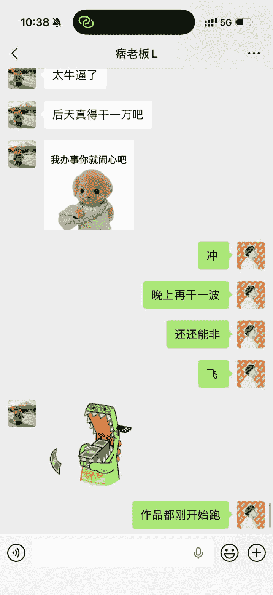
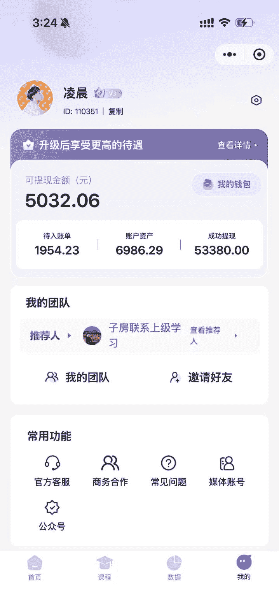
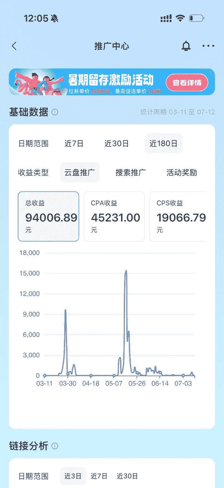
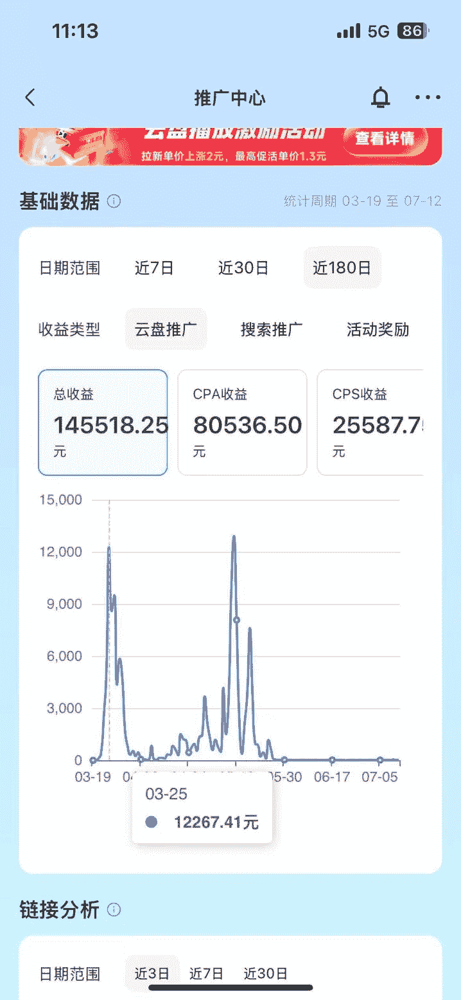

最高峰的时候，单日收益做到过1.4万、1.5万。当然，收益是在不停波动的。

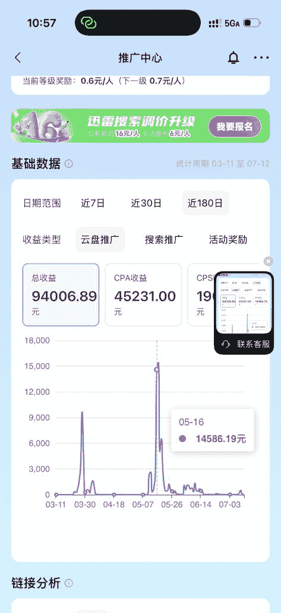
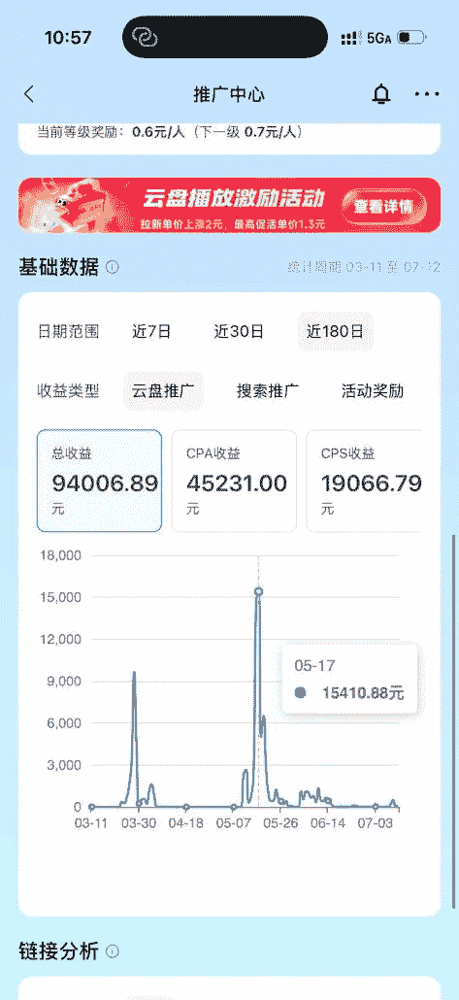
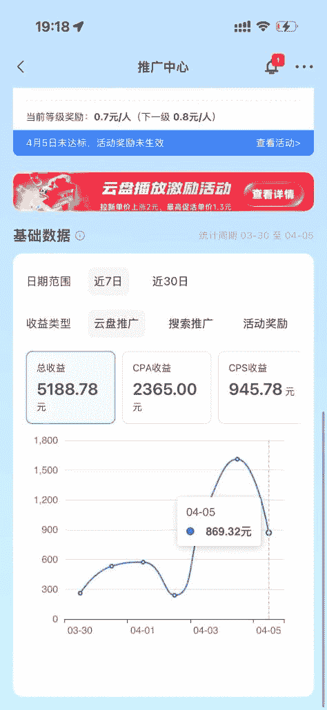
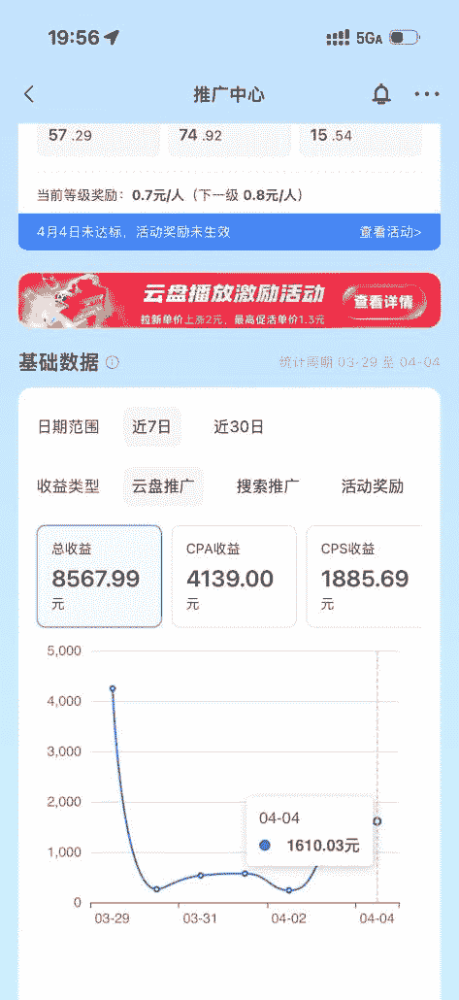
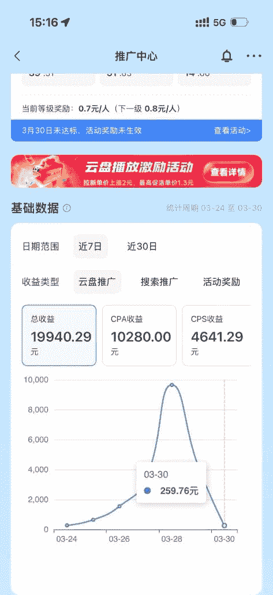
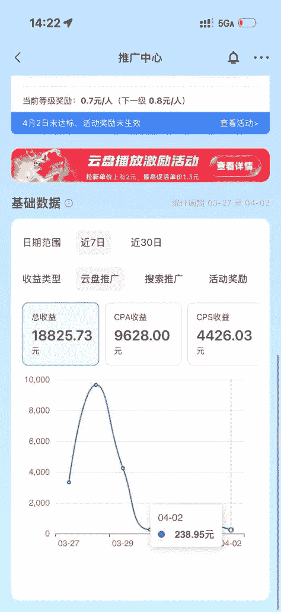

整个过程，我们从发现机会，到5条作品测试，再到代发放大、承接转化、平台风控、小团队协作，算是真正从0到1跑通了一遍。

这篇文章就是我对这个项目的完整复盘。

它不是一篇单纯教大家做网盘拉新的教程。

因为我也不想把一个已经进入下行期的项目，包装成所有人闭眼都能赚钱的机会。

这不真实，也不负责任。

但是，网盘拉新这个项目绝对不仅仅局限于我今天分享的这种玩法，包括我们现在也是在慢慢摸索、拓展其他玩法。

我真正想分享的是：

一个项目从0到1，到底是怎么被发现、测试、放大、遇到问题、解决问题，再进入下一个阶段的。

如果你是下面几类人，这篇文章可能会对你有帮助：

- 第一，你是小白，不知道一个项目从发现到执行，中间到底要经历哪些动作。
- 第二，你有流量经验，但一直停留在做内容、做播放量，还没有真正跑通过变现闭环。
- 第三，你正在做短周期项目，想知道怎么低成本测试、怎么找代发、怎么做矩阵、怎么处理风控。
- 第四，你手里有项目，但一个人干得很累，不知道怎么把动作拆出去，慢慢组建一个小团队。
- 第五，你也经常看信息差、看风向标，但看完之后不知道怎么真正下场。

这篇文章大概3.8万字左右。

我写了差不多一周。当然，如果有漏掉的细节，后面我会继续补充截图、视频、SOP和一些实操细节。

如果你只想看实操，可以直接从项目测试和代发部分开始看，也就是从第三章内容开始看。

如果你愿意看完整路径，我会从我为什么差点没续费生财、为什么觉得自己没资格分享开始讲起。

因为这篇文章对我来说不只是一个项目复盘，也是我第一次认真回答自己：

我到底能给别人分享什么？

我的答案是：我不能分享一个永远有效的项目，但我可以把自己真实从0到1跑过一个项目的过程，复盘分享给大家看！

所有的内容其实基本上都是围绕下面的内容去展开：

- 发现机会
- 测试作品
- 跑通承接
- 找代发
- 矩阵放大
- 风控迭代
- 收益复盘

## 写在前面

这篇文章写完之后，我自己看了一下，有3.8万字左右。

说实话，这应该是我这几年写得最认真、也最完整的一篇项目复盘。

从最开始梳理框架，到一点点填充内容，再到回头补细节，我前后写了将近一周时间。

但即使这样，我也不敢说它已经特别完善。

因为项目本身是动态变化的。

很多细节我也是一边回忆、一边整理、一边复盘。

有些截图、视频、SOP、话术和表格，我后面也会继续补充。

如果大家看完之后，有哪里没看懂或者对某个环节还有问题，也可以直接在评论区留言。

我看到之后会尽量继续更新和回复。

这篇文章主要复盘的是：

我是如何从一个从来没有做过拉新的小白，接触到网盘拉新这个项目，然后一步步从发现机会、测试作品、找代发、做矩阵、解决承接和风控问题，再到4个月左右变现30万的完整过程。

这里面有结果，也有很多流水账。

我自己也知道有些地方可能不够精炼，但我还是想尽量把过程写完整。

因为很多项目真正有价值的地方不一定只在最后那个收益数字里，而是在中间那些具体动作里。

比如我为什么会重视这个项目。

我是怎么做第一批测试的。

第一条作品为什么能跑出来。

为什么100万播放也可能浪费掉。

我是怎么找代发的。

代发SOP怎么设计。

评论组为什么能提高转化。

平台风控变严之后，我们又是怎么一步步调整的。

这些东西如果只看结果是看不到的。

所以这篇文章与其说是教程，不如说是我对自己这4个月的一次完整复盘。

如果你只是想看实操，不想看我前面的个人经历，可以直接从第3章开始看。

前两章更多是我自己的背景介绍，以及我是怎么接触到这个项目的。

因为在遇到这个项目之前，我也迷茫过很久。

我不知道自己该分享什么，也不知道自己到底有没有资格分享。

哪怕到现在，我也更愿意把自己定义成一个小白，而不是什么大佬。

这篇文章不是为了证明我多厉害。

如果它能让你少踩一点坑，或者让你对从0到1跑项目，再到找到合伙人这件事有一点更具体的理解，那它就已经有价值了。

也希望这篇文章，算是我加入生财这么久之后，能给大家提供的一点点帮助和心得。

有什么问题，大家可以随时交流。

## 一、我为什么写这篇文章

大家好，我是凌晨。

我是之前第5期的生财会员，后面有几期没有续费。

坦白说，这次续费我犹豫了很久。

不是因为生财不好，恰恰相反，是因为这里面的信息太多、太密、太杂了。

多到让我这样一个长期做流量的人都开始感到焦虑。

每天打开生财，都能看到新的项目、新的案例、新的玩法、新的风向。当然，现在我越来越重视风向标这件事情了。

有人在做小红书，有人在做视频号，有人在做AI，有人在做私域，有人在做出海，有人在做本地生活，有人在做无人直播。

每一个看起来都对。

每一个看起来都有机会。

但问题是，我根本刷不过来也消化不了。

我甚至一度觉得，自己不是在获取信息，而是在被信息追着跑。

越看越焦虑，越看越觉得自己什么都没抓住。

所以有一段时间我其实是放弃了。

放弃的原因很简单：

我不知道自己该在这里看什么，也不知道自己能在这里分享什么。

这句话听起来可能有点奇怪。

因为如果只看履历，我好像不是一个完全没有结果的人。

2023年我操盘过一个抖音账号，做到了40万粉丝。

那一年靠着这个账号和后续的知识付费体系，加直播音浪收益，差不多变现了50万。

后来我也做过知乎，账号有一万多粉丝。

公众号前前后后做过三个，也写出过不少10万+阅读的文章。

包括哔哩哔哩，有9万粉丝。之前分享B站垂直账号，当时还得到了中标。那时候我2.5万粉丝，现在已经9.4万粉丝了。

https://t.zsxq.com/tEksD

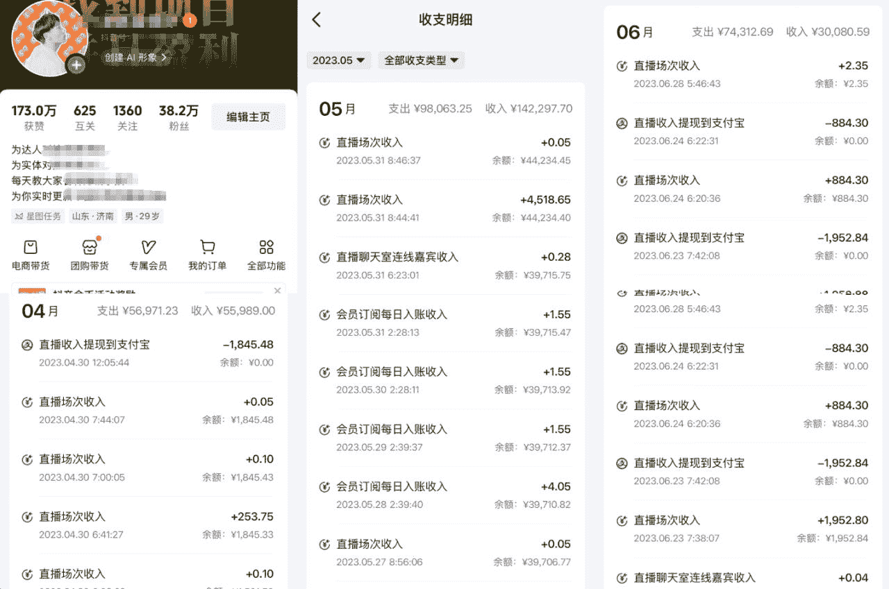

如果把这些东西摆出来，好像我应该是一个有资格分享的人。

但真实情况是，我心里一直没有这个底气。

我总是忍不住问自己：

过去做成过一个账号，就代表我今天说的每一句话都有价值吗？

曾经赚过一点钱，就代表我可以站出来教别人赚钱吗？

我写出来的东西，对别人真的有帮助吗？

还是只是把一些已经过去的经验，包装成看起来很厉害的方法论？

这是我很长一段时间不愿意分享的原因。

我不是没有东西可以讲，而是我一直觉得自己讲出来的东西不够重。

我骨子里始终有一种很强的不配得感。

哪怕别人觉得我做过账号、做过流量、赚过钱，但我自己知道，我身上有很多问题。

我很难长期坚持一件事。

我很容易被新的机会吸引。

我能把一个账号做起来，也能写出爆款文章，但很多时候，流量来了，热闹了一阵，最后沉淀下来的东西却很少。

这也是我过去几年最深的困惑。

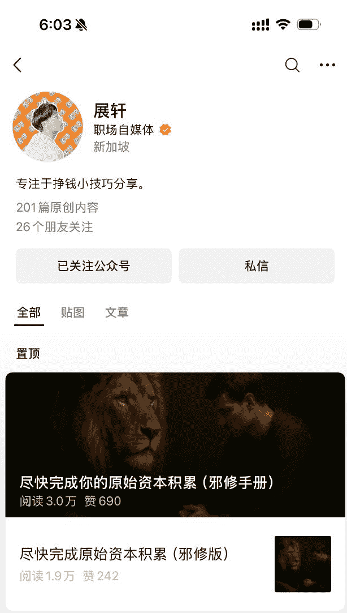
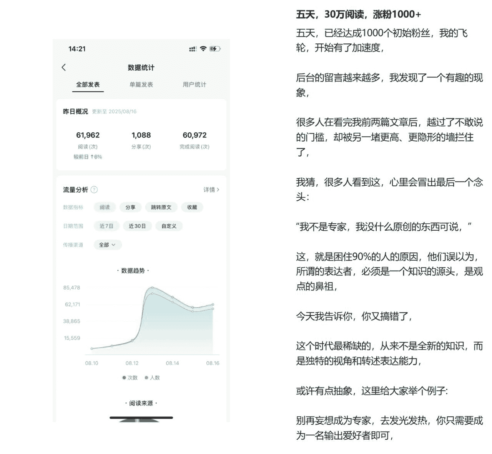

当然，上面有非常多的截图我都找不到了，但是不影响观看。

如果有查数据的话，我的账号可以分享给大家观看。

我00年，普通本科，土木工程专业。

毕业后我顺理成章地去了工地。

那时候的生活非常具体，也非常单调。

每天面对的是图纸、混凝土、钢筋、现场问题、甲方要求。

我说不上多痛苦，但我很清楚，那不是我想要一直过下去的生活。

后来靠着一波流量红利，我辞了职。

如果让我给过去两年的自己一个定义，我觉得最准确的说法是：

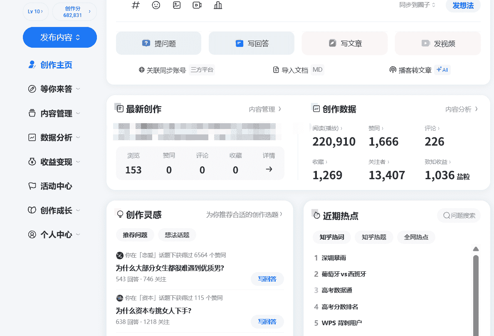
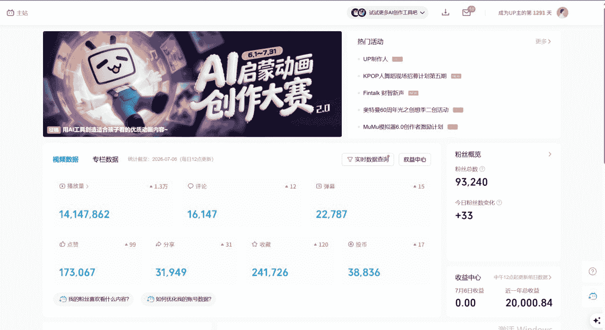

哪里有红利我就冲到哪里。

哪个平台能起量我就研究哪个平台。

哪个项目短期反馈快我就去试哪个项目。

但它也有一个很大的问题：

我一直在挖井，却从来没有认真想过，要不要建立一口真正属于自己的深井。

就包括上面我说的40万粉丝的抖音号。

不是因为账号没有价值，而是因为后期变现乏力，我没有耐心继续深挖。

我做过公众号，写出过很多高阅读文章，但最终没有形成稳定的商业闭环。

我做过知乎，也做过知识付费，但很多东西都是阶段性的。

有结果但不够扎实，有收入但不够让我心安。

所以当我重新面对生财的时候，我其实有一种很复杂的感觉。

一方面我知道这里有很多厉害的人，也有很多真实的一线案例。

另一方面我也会问自己：

我能给大家带来什么？

我不是最懂AI的人。

不是最懂私域的人。

不是最懂组织管理的人。

不是最懂商业模式的人。

甚至连我最擅长的流量，我都觉得自己只是阶段性抓住过几次机会，并没有真正把它变成一套稳定的系统。

所以这次续费我犹豫了很久。

直到我想起之前在生财看到的一句话。

那次分享里主持人问嘉宾：

“你是怎么找到自己所在行业的？”

那个嘉宾的回答只有一个词：

“分享。”

好像是做留学赛道，但是具体是谁我不清楚了。

写到这里我找了好大会，没有找到。如果有人记得是谁，可以提醒一下，这里说声抱歉。

也是因为她，让我对这次生财的续费有了信心。

因为我突然意识到，我过去一直把分享想得太重了。

我总觉得只有足够成功、足够厉害、足够有确定答案的人，才有资格分享。

但可能不是这样的。

分享不一定是站在高处告诉别人应该怎么做。

分享也可以是把自己真实走过的路给别人看。

包括判断，包括迟疑，包括踩坑，包括误判，包括一开始的不重视，包括后来的爆发，也包括项目进入下行期之后的无力感。

当然，与其说是下行，不如说是目前这个模板属于下行。但是拉新不仅仅局限于今天我分享的这个玩法，直到现在我也一直在不停地寻找新的流量模板，然后来持续做这件事。

现在让我感知到，网盘拉新这个需求确实一直存在，而且这个市场超级大。无论是学习资料、电视剧，还是各种软件安装等等，都可以作为网盘拉新的一环，而且每个环节里面都有拿到过大结果的人。

这也是我为什么决定写下这篇文章。

这个项目让我在四个月时间里，从0到1，变现了30万。

甚至从今天回头看，它已经进入了下行期，不再像最开始那样，只要简单复制就能获得非常强的正反馈。

但正因为它经历过上行、爆发、放大、竞争、衰退，所以我觉得它反而值得被完整记录下来。

因为它不只是一个网盘拉新项目：

从发现机会到低成本测试；

从第一条作品到第一个正反馈；

从一个人跑通到找代发放大；

从几个账号到300多个账号的全网矩阵。

但是这里说清楚，封号是常见的事情。很多时候每天都是这样，打开之后账号全部都违规，所以每天都在补充新的代发账号，而且有时候补的没有掉得快。

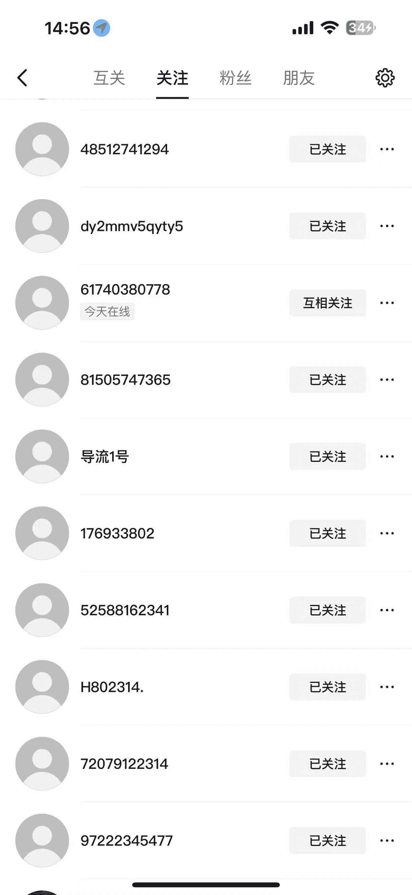

从快速赚钱到处理违规、引流、承接、结算、账号损耗。

再到后来项目下行，反馈变弱，成本变高，规则收紧。

这里面几乎包含了一个短周期流量项目会经历的所有过程。

我想把这些过程尽量讲清楚。

不是为了告诉大家，你们现在马上去做这个项目，也一定能赚到同样的钱。

我不想这样写，因为这不真实，也不负责任。

我更想分享的是：

当一个机会出现的时候，我是怎么发现它的；

我是怎么从怀疑，到测试，到重视它的；

我是怎么判断它值不值得做的；

我是怎么用最小成本跑通闭环的；

我是怎么做内容、发作品、看数据、找代发、做矩阵的；

我是怎么处理引流和违规问题的；

以及当这个项目进入下行期之后，我又是怎么重新看待它的。

如果你所在的行业正处在上行期，这套打法你完全可以迁移过去。

如果你是小白，这篇复盘可以让你看到一个项目从发现、测试、放大到复盘的完整路径。

如果你本身就有流量经验，也许你会从里面看到一些熟悉的问题：

为什么有流量却不赚钱？

为什么爆款不能沉淀？

为什么账号多了反而管理混乱？

这些问题我都经历过。

有些我解决了，有些我还在解决。

所以这篇文章不是一篇标准答案。

我花了很长时间写这篇文章。

一方面是为了逼自己把脑子里那些零散的、经验性的、自以为是的流量技巧，重新整理成一套可以表达、可以复盘、也可以被别人参考的路径。

另一方面我也真心觉得，这套东西对生财里的很多朋友是有帮助的。

但发现机会、验证机会、放大机会、控制风险、复盘周期的能力，是可以不断迁移的。

这才是我真正想写的东西。

我的故事、我的迷茫、我的答案，都在这里了。

如果你准备好了，我们就从这个项目最开始的地方讲起！

## 二、我是怎么发现这个项目的

如果非要问我为什么能发现这个项目，我觉得答案不是我有多敏锐，也不是我一开始就看懂了网盘拉新的机会。

看图片的话，其实就是3月16号我们开始正儿八经地开始做，然后真正开始上手之后是3月28日左右，算是流程跑通完。

更真实的原因是，我把自己放到了一个更容易接触到一线信息的地方。

由于今年我一直想做一个高客单的付费产品，因为我发现很多东西如果你没有亲眼见过，是很难凭空想象出来的。

没见过别人怎么卖高客单，就很难理解高客单到底是怎么成交的。

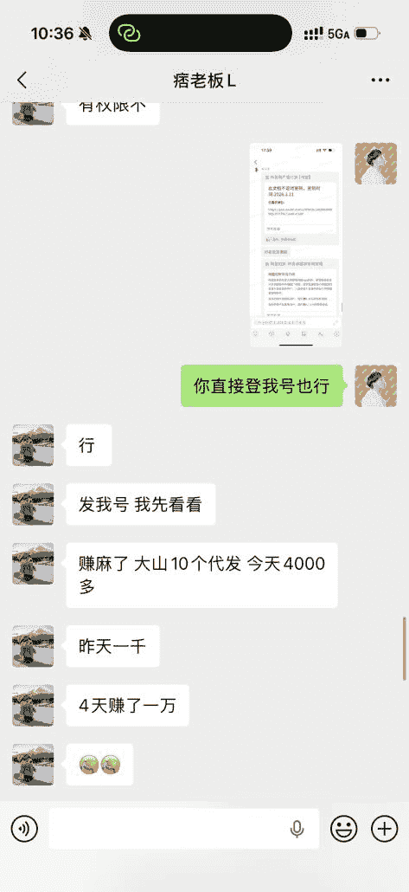
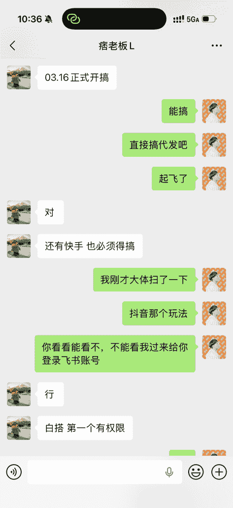
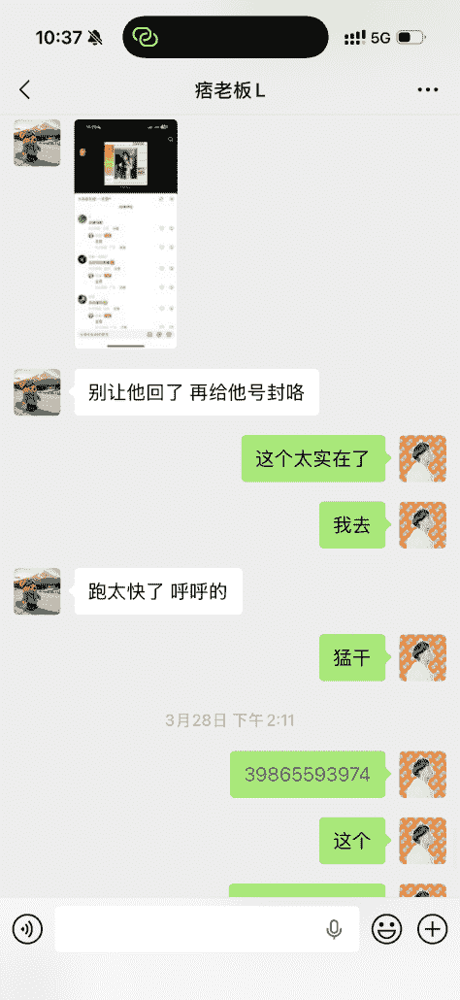

公众号懒人搜索，懒人专属群分享

没见过一个线下团队怎么跑项目，就很难理解一个项目从前端流量到后端变现，中间到底有哪些环节。

没见过一群真正做实战的人每天在聊什么、看什么、测什么，就很难知道所谓机会到底长什么样。

所以今年我去了临沂。

这里先说明一下，这篇文章不是来推荐任何社群的。我只是想把自己是怎么一步一步接触到这个过程讲清楚。

在2024年的时候，我加入过的一个社群，当时费用是2980。后来他们正好在做线下门徒类型的项目。对我来说，临沂离济南不算远，我家就在济南，所以过去的成本并不高。

更重要的是，我当时确实想去线下看一看，那些真正一线做项目的人，到底每天在做什么？他们是怎么发现项目的？怎么测试项目的？怎么把一个项目跑出结果的？

我最开始去临沂，并不是奔着网盘项目去的。我原本想做的是自己的个人IP。

因为我对自己的定位一直很清楚，我是一个会做流量的人，但是我也知道我有一个明显短板：我对产品的运营、产品的设计、产品的介绍，以及高客单成交这套东西，其实没有那么熟。

大家如果看过我前面的经历，应该也能感受到这一点。我能把流量做起来，但流量起来之后，怎么把它变成一个稳定产品，怎么把一个产品讲清楚，怎么把信任和成交链路搭起来，这些东西不是我的强项。

所以我去线下，本质上是想学习。我一直觉得，知识付费这件事本身是应该的。如果一个人真的在某个领域比我多走了几步，能让我少踩坑、少浪费时间，那我愿意为这个东西付费。

包括这次去线下也是一样。其实前面在线上沟通的时候，首负也跟我说过不用交费之类的，但我当时觉得没必要。既然我过去了，该怎么着就怎么着。你要学习别人的东西，就应该尊重别人的时间和经验。

到了线下之后，我发现那里有很多人在做各种各样的项目。有人做网盘，也有人做其他一些流量项目，基本上每个项目都有对应负责人。他们那里不是只有前端流量，也有人做后端承接。

对我来说，这种环境最大的价值，不是某个人告诉我一个标准答案，而是我能看到很多项目正在真实发生。

网盘项目就是在这个过程中进入我视野的。当时我听到一个信息：网盘拉新，一天可以做到3000。

说实话，如果这句话只是在线上刷到，我大概率不会有什么感觉。因为类似的话我们见得太多了：一天3000、一天5000、一天1万、一个月10万、普通人也能做、0基础也能做。这些话在线上出现太多次之后，人是会麻木的。

你甚至会本能地怀疑：真的假的？是不是幸存者偏差？是不是为了卖课？是不是只截了最高峰？是不是我进去就成接盘的了？

所以一开始听到网盘一天3000的时候，我并没有特别兴奋。甚至我对网盘拉新这个项目本身，是有点排斥的。因为在我的印象里，网盘拉新好像是很多年前就存在的项目。我心里会下意识觉得，这东西还能做吗？

但线下环境和线上环境最大的区别在于，你不是只听别人说，你会看到身边真的有人在做。他们每天会聊数据、会发截图、会讨论哪条作品跑出来了、哪个账号违规了、哪个素材还能复制、哪个引导方式转化更好。

这种东西一旦发生在你身边，感受就不一样了。

不过即使这样，我一开始也没有真正行动。真正让我产生波动的，不是那些日入3000的截图，而是我身边一个同事，也就是我现在的合伙人，随手做的一次测试。

当时他只发了一条作品。那条作品的形式非常简单，是一个健身博主锐评类内容。后面我会给大家放截图，也会具体讲这种作品到底怎么剪。但这里大家先记住一点：它真的不复杂，就是一个很简单的作品。从剪辑到发布，可能也就5分钟左右。

很多人看到这种作品，第一反应可能是“这也行？”“这能赚钱吗？”我当时也是这个感觉。但第二天数据出来之后，我的感觉变了。

那条作品大概跑了不到2万播放，主页挂了一个置顶引导视频，通过这条作品，有1000多个用户点进了引导视频。

这里要注意一个概念：作品播放不等于有效流量。引导视频播放，才更接近这个项目里的有效流量。因为用户只有从前端作品被引导到后端视频，才说明他对这个东西真的产生了兴趣。

最后，这1000多个引导播放，带来了大概200元收益。也就是说，一条5分钟左右做出来的作品，第三天带来了200元。因为网盘的话，第一条的数据是第三天才能呈现出来，这个是平台的规则。

那时候的截图确实是没有，也没有想着记录一下之类的，我尽量把故事线路梳理清楚。而且并不是一开始就有多少收益这样。

如果只看金额，200元并不夸张，但它给我的冲击比别人说一天赚1万更大，因为它太具体了。

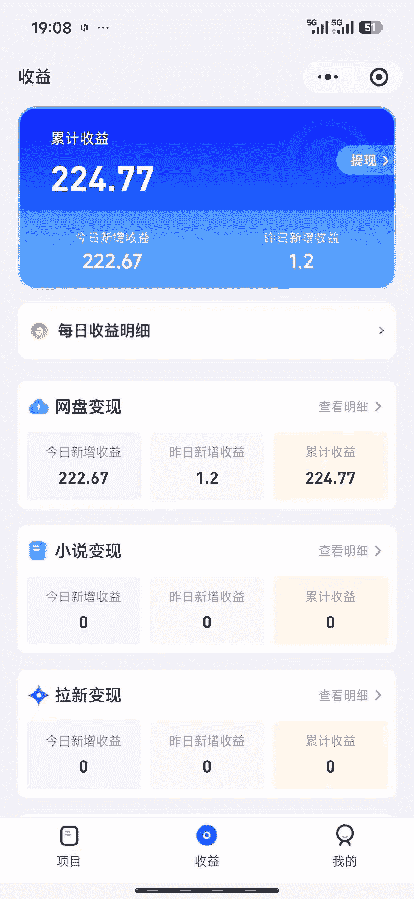

一条作品不到2万播放，1000多个引导视频播放，200元收益。也就是说，5分钟200元收益。从动作到数据到收益，整个链路都摆在你面前。

这个时候你会很直观地意识到，这件事不是一个遥远的信息差，它是真的能跑通。

这就是我后来想明白的一个点：线上有人告诉你一天赚5000、一天赚1万，你可能没有任何感觉。但线下你看到身边的人，用5分钟发了一条作品，然后赚了200元，你的感觉完全不一样。

因为前者是结果，后者是过程。前者你很难判断真假，后者你能看到动作、看到数据、看到收益。

很多人不是没有接触过信息差，而是信息差离他太远了。远到他不会相信，远到他不会重视，远到他不会行动。

这也是为什么我越来越觉得一个好的圈子很重要。圈子的价值不是每天告诉你一个必赚项目——这种东西其实不存在——真正的价值在于，它能让你看到一些机会正在真实发生，能让你看到别人是怎么从0开始做的，能让你看到一个项目不是被包装出来的，而是被一条条作品、一个个账号、一次次测试跑出来的。

当我看到同事这条作品的数据之后，我开始觉得这件事有点离谱。因为从当时的情况看，这个项目的正反馈太强了，强到就是你只要发，只要动作不太离谱，它就有机会跑出来。

当然，这是当时上行期的情况。现在回头看，那个阶段确实是项目非常好的时候：做的人少，平台规则还没有完全收紧，用户对内容还有新鲜感，很多作品只要发布就有机会拿到不错的播放。

但人在当时是很难一下子意识到自己正在红利里的。很多时候只有回头看，你才知道那是上行期。

于是我也开始做测试。我自己做了5条作品。当时我做的作品形式，也是健身博主锐评类内容。这里先不展开讲具体怎么剪，后面我会专门用一章讲作品制作。包括素材从哪里来、怎么拆同行、怎么快速剪辑、怎么做引导、怎么批量生产、怎么判断一条作品能不能继续复制。

我发完5条作品之后，第一天就跑出来了一条100万播放。这个数据出来的时候，其实我自己也有点懵。

其实聊天记录也能看出来，当时我对于代发这个事情也不是很熟悉，尤其是话术这一块，但是不影响能跑出来100万的播放。

因为按照当时的转化率，如果这条作品的承接链路完整，理论上是可以带来几千收益的。但我当时犯了一个很典型的错误：我没有把置顶视频和转化引导做好。也就是说，前端流量跑出来了，但后端承接没有跟上。

最后，这条100万播放的作品，实际结算大概是1000元左右。

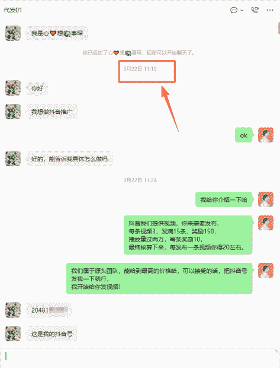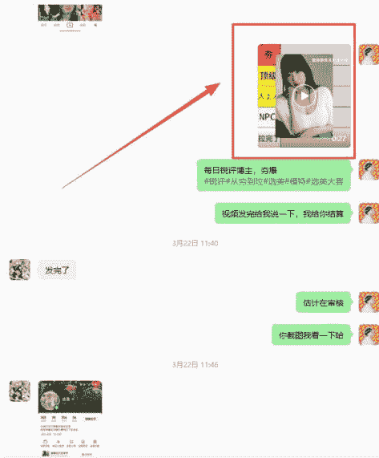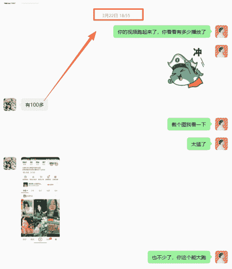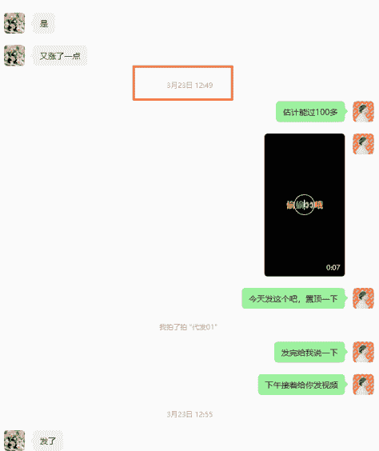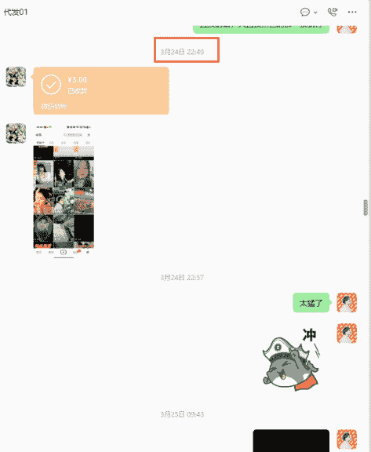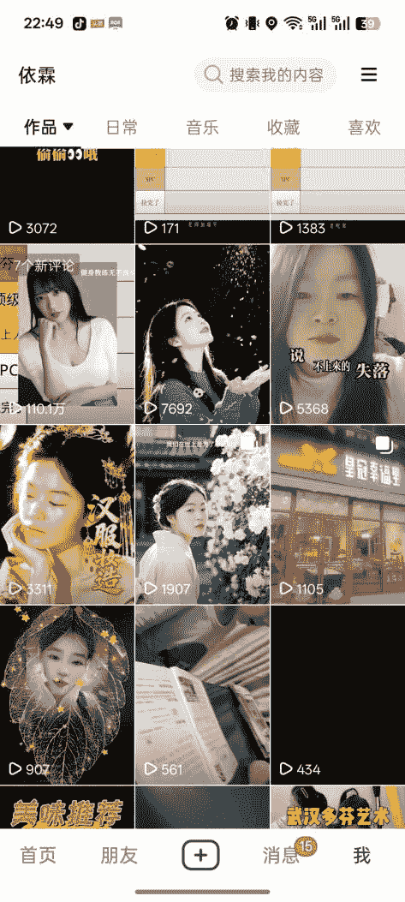

你看，这里就能看出一个很重要的问题：有流量不等于有钱。作品爆了也不代表收益一定最大化。如果承接没做好，流量是会浪费的。

这也是我后面越来越重视引导视频、主页承接、评论区承接和转化路径的原因。因为这个项目不是单纯靠播放量赚钱，它靠的是一整条链路。任何一个环节没做好，结果都会打折。

到了第三天，我又跑出来一条二三十万播放的作品。这时候我开始进一步确认，这件事不是偶然，至少在当时那个阶段，它具备复制的可能性。

从本质上说，就是你把自己放到了一个有信息差、有实战反馈的环境里，然后你愿意用很低的成本去测试。测试之后数据给了正反馈，正反馈出现之后再继续放大。就是这么简单。

但很多机会难就难在这个简单。因为你在线上看到同样的信息，可能划过去了。

所以我在这件事里得到的第一个启发是：不要只盯着那些看起来很高级的机会。很多能赚钱的机会，最开始看起来都很普通。但赚钱这件事，本来就不一定体面地出现在你面前。

## 三：网盘拉新项目介绍

在正式拆我怎么从0到1跑这个项目之前，我想先把网盘拉新这件事讲清楚。因为很多人可能根本不知道网盘推广是什么。

网盘拉新这个东西，它是一个很多年前就存在的项目。但真正下场做完之后，我才发现，很多项目不是因为新才赚钱，而是因为它背后的需求一直存在。

网盘拉新的核心其实很简单。这里面有一个词叫“拉新”。所谓拉新，就是一个互联网产品通过线上或者线下渠道，获取新用户的过程。比如一个App想要更多人下载、注册、使用，它就会设置推广奖励。

网盘产品需要新用户，需要用户下载、注册、转存、开会员，所以它会给推广者设置对应的收益。你通过内容、资料、教程、软件、短视频等方式，把用户引导到网盘里。用户完成指定动作之后，你就可以获得对应收益。

简单来说，网盘推广的收益一般来自几个地方：

- 第一，新用户注册。用户通过你的推广路径，第一次注册或下载网盘，你可以拿到拉新佣金。
- 第二，老用户转存。现在很多网盘不只是新用户有收益，老用户把资料转存到自己的网盘空间，也可能产生收益。
- 第三，会员或其他增值动作。有些用户在使用过程中开通会员、扩容、下载资源，也可能带来额外收益。

所以这个项目的本质路径是：通过内容吸引用户，用户因为某个资料、教程、软件、内容合集产生需求，你把这个需求承接到网盘，用户完成注册、转存、下载等动作，平台给你结算推广收益。

举几个更容易理解的例子。比如有人做软件教程，把教程文件上传到网盘，然后在贴吧、知乎、小红书、短视频平台分享。用户想要教程就会去网盘下载。如果他是新用户，就可能产生拉新收益。

比如有人做虚拟资料，在电商平台用0.01元（也就是1分钱）售卖资料包。用户下单后自动发送网盘链接。用户打开链接、转存资料、注册网盘，这个过程中也可能产生收益。

这里我相信很多喜欢在咸鱼上面买资料的人，应该能够发现，很多人都是0.01，然后给你发网盘的链接。但是实际上能够做一个拉新，他可能有10-20左右的收益。

再比如短视频平台上，有些账号会分享软件、模板、资料合集、学习资源。

如果用一句话总结：网盘拉新就是用内容或资料吸引用户，再通过网盘完成注册、转存、下载等动作，从而获得平台推广收益。

## 四：网盘项目实操

接下来我就开始详细拆这个项目的实操部分。我会尽量把流程写得简单一点，让大家看完之后，至少知道这个项目从哪里开始、第一步应该做什么、整个链路大概怎么跑。

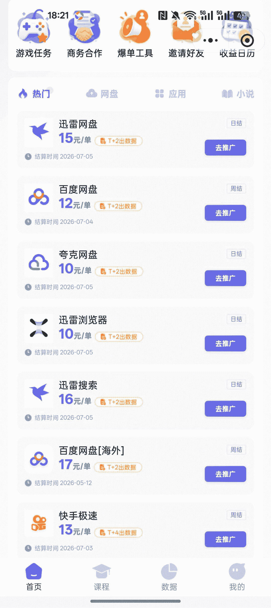

先说第一步：文件和平台。

目前我们主要做的是UC这边的拉新。所以如果你想自己测试，第一步很简单，先在应用商店下载一个UC浏览器。下载完之后，后面才涉及到关键词、文件、转存、引导这些动作。

为了让大家更容易理解这个流程，我这里也会把我自己整理好的文件放出来。如果你懒得重新整理内容，或者只是想先把整个流程跑一遍，可以直接保存或者转存我这份文件，先按照这个版本做测试。

以下是文件链接，大家保存到自己的文件夹，然后直接使用就行。我们都是经过迭代过的内容，文件的话看起来有点擦边，但是视频都是正规的视频：

来自**UC**网盘分享文件：

「学习资料**😍**」

链接：**https://drive.uc.cn/s/b52aa28ae2784**

**UC**网盘支持原画播放、云解压、投屏，上传下载快打开:

输白茶聚精会神解開

这里我用电脑截了一下图，大家可以更直观地看一下这个文件。

关于文件这块，我们其实也踩过坑。一开始测试的时候，我们整理的文件比较大。当时根据前端数据预估，收益可能能到1万左右，但最后实际下来只有2K左右。后面复盘原因，核心问题不是流量不够，而是文件太大。

文件太大之后，用户保存起来会很麻烦。有的人点进去之后保存不了，有的人中途就退出了。对于拉新来说，这种细节影响非常大。因为拉新本身比较吃用户的完整动作。

用户不是看到了就算转化，而是要完成保存、转存或者其他指定动作，后台才会有对应数据。

所以后来我们重新整理了一版文件，把它做得更适合用户直接保存。现在这份文件，大家是可以直接保存的。

不过这里也提前说明一下，文件可以保存，但如果想看里面的具体内容，是需要会员权限的。当然，如果大家后面自己申请了拉新权限，平台会赠送对应会员，这个问题就不大。

这里我想提醒大家的是：用户能不能顺利保存、能不能顺利打开、路径会不会太复杂，每一步都会影响最终转化。

这里我也把这个项目的底层逻辑讲透一点。我们做的这类作品，本质上是用强视觉钩子去筛选用户。说得直白一点，它确实带有一点擦边流量的属性。但这里有一个前提：后端文件必须是正规内容。因为真正违规的内容，本身也放不进网盘，更不可能长期稳定地做拉新。

所以这个项目的核心，不是后端放什么违规东西，而是前端怎么吸引用户，让用户愿意进入你的承接路径，并完成保存、转存、下载这些动作。这也是我想重点提醒大家的地方。

相信大家看到这份文件之后，应该也能理解我们当时在做的事情。前端是偏强钩子的流量内容，后端文件是合规资料。

我们测试过很多类型，比如动画片、网课、美女视频等不同方向。除了文件名字向擦边，其实内容都很真实。最后发现，不同文件对应的人群和转化效果是不一样的。

所以大家如果想测试，可以先直接转存我这份文件，按照现有版本跑一遍流程。如果后面你想做得更精细，再根据自己的内容方向和目标人群，重新整理文件。

有了文件之后，下一步要解决的问题是：用户完成保存、转存这些动作之后，我们怎么拿到对应的拉新数据和收益？

这里就需要一个第三方小程序。你可以把它理解成连接网盘文件和拉新结算的中间桥梁。如果没有这个小程序，用户即使保存了文件，你这边也没法有完整的拉新数据和结算链路。

我们现在使用的就是下面这个小程序。

这里也跟大家说一下，我们之前也测试过市面上一些其他平台。不同平台之间，结算规则、数据反馈、稳定性都会有差异。有些时候我们会感觉数据不太对，或者转化和预估不完全一致。但这里我不想武断地说一定是谁的问题，也有可能是我们当时自己的数据质量、用户动作完成率、文件大小、承接路径等环节没有做好。

所以大家在测试的时候，也不要只看某一天的数据，要尽量拉长周期去看。

目前我们这边使用下来相对更顺的就是这个小程序，也算是直接对接官方这边的渠道。如果大家想自己测试，可以直接扫码注册。

注册完成之后，下一步就是绑定自己的UC账号ID。

简单来说，只有你把UC账号和小程序平台绑定之后，后面你再去分享自己的文件链接，用户通过你的路径完成保存、转存或者注册，后台才有可能正常统计到你的收益。

如果用户是新用户，那就属于拉新。如果是老用户转存，也可能会产生对应的数据。

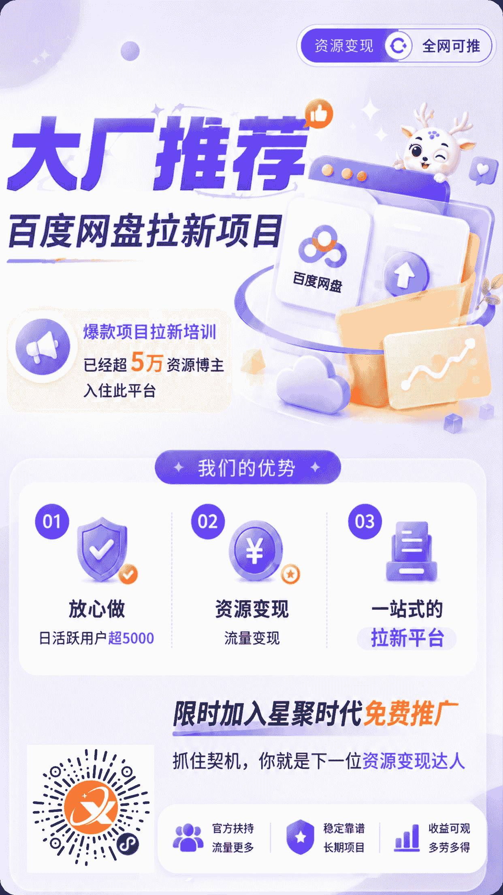

公众号懒人搜索，懒人专属群分享

所以这里不要跳过。

第一步，是申请签约绑定。

这个流程不复杂，大家直接按照平台提示一步步走就可以。

这里提醒一下，第五张截图建议大家保存一下，因为后面第二步申请推广的时候还会用到这张截图。

所以大家按照流程走的时候，能截图的地方尽量先留好，后面会省很多时间。

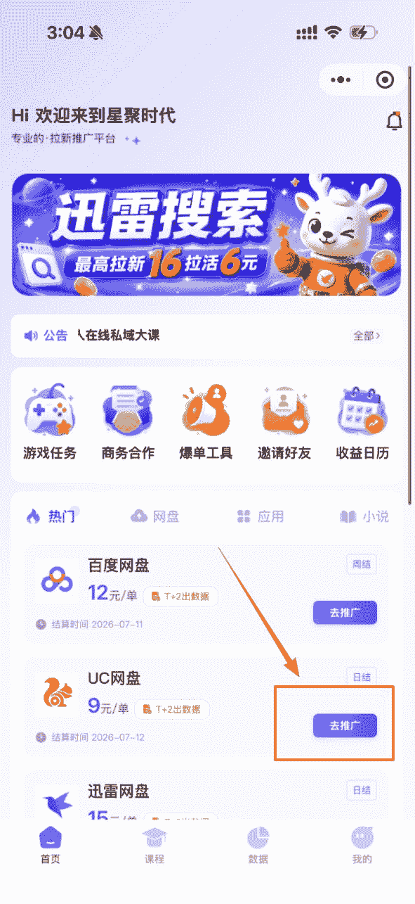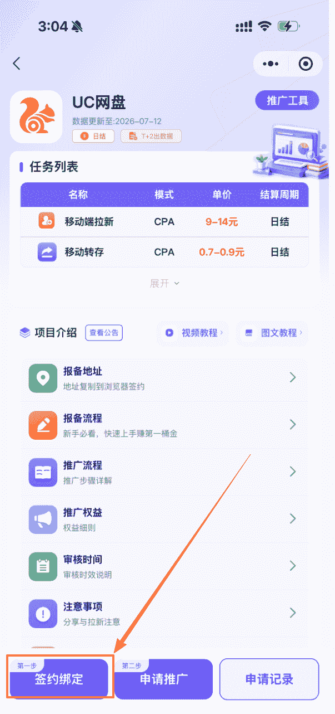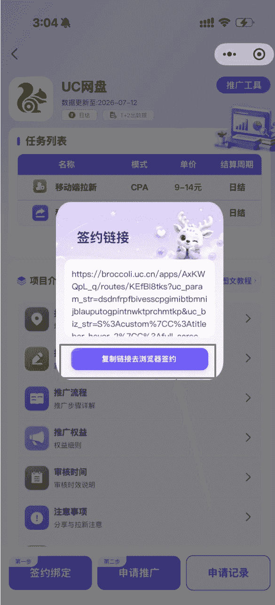

公众号懒人搜索，懒人专属群分享

当然还有不明白的，大家也可以看一下小程序里面都有视频介绍。

第二步，是申请推广权限。

这个地方也不复杂，大家正常按照页面提示填写就行。

其中有一个信息需要注意，UC 网盘 ID 就是前面第五张截图里的那个 ID。

手机号正常填写自己的手机号。

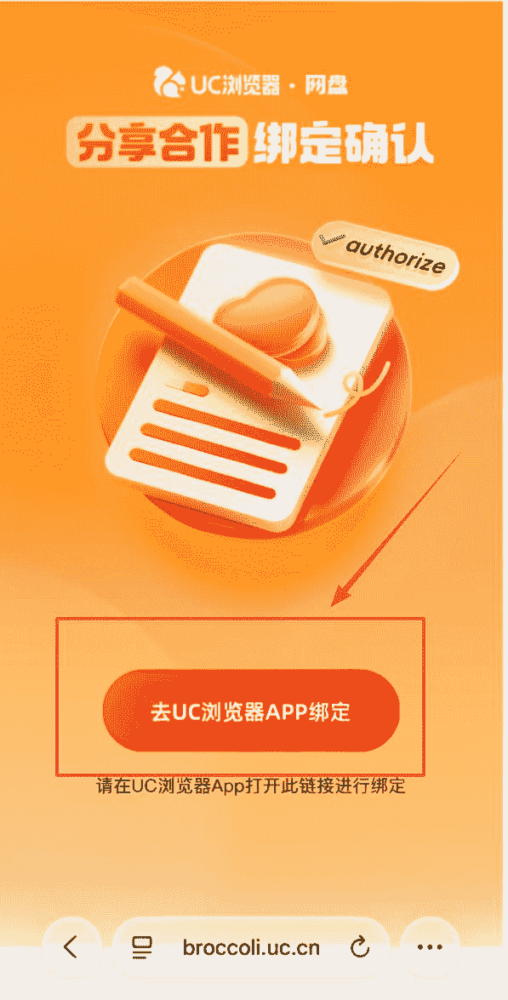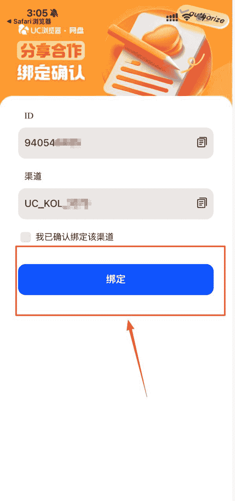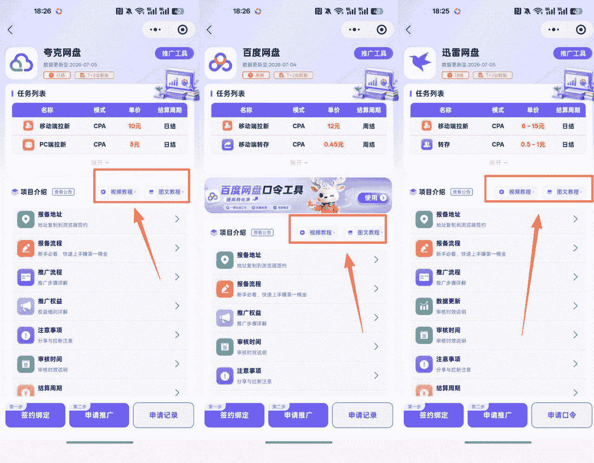

公众号懒人搜索，懒人专属群分享

然后把前面绑定成功的截图一起上传。

提交之后需要等平台审核。

正常情况下审核速度不算慢，大概 1 个小时左右就能通过。

如果你比较着急，也可以来找我，我这边可以帮你催一下。

这里再提醒一句，这一类流程不要凭感觉乱填。

尤其是 UC 网盘 ID 和绑定成功截图，一定要对应上。

完成前面两个步骤之后，你再去分享自己的 UC 网盘链接，后面用户通过你的路径完成保存、转存或者注册，就有机会产生收益了。

这里有一点要提前说清楚，UC 和迅雷不太一样，迅雷那边相对来说，后台数据会更直观一点，很多时候可以通过分数去预估收益。

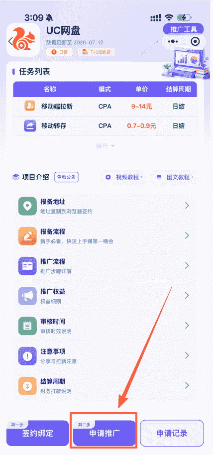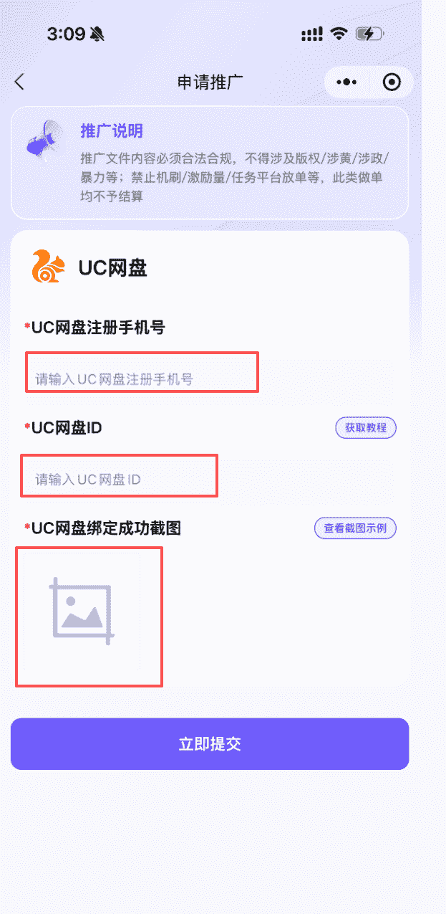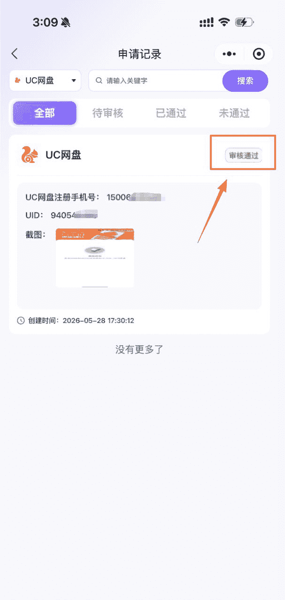

公众号懒人搜索，懒人专属群分享

但 UC 这边没有那么完整的官方实时后台，它的数据一般是每天更新一次，正常情况下下午 2 点之后，大家打开小程序，点击数据，就可以看到前一天或者最新结算的数据。

前面的绑定推广权限、数据查看这些问题解决之后，接下来才到真正的前端内容部分。

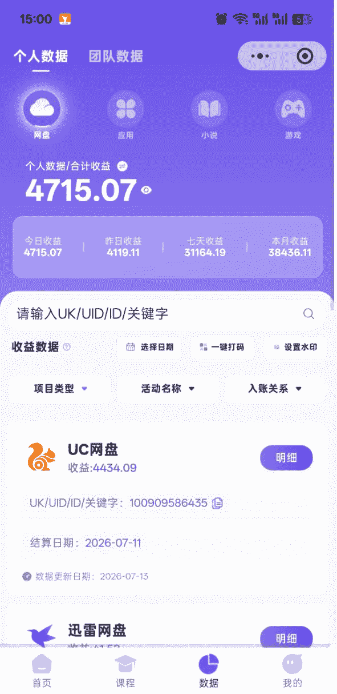

公众号懒人搜索，懒人专属群分享

我们到底发什么作品，这里我也尽量给大家讲清楚一点，目的还是一样的，让大家看完之后能知道从哪里下手，而不是只看一个大概。

这一部分我就先不放视频了，直接用截图给大家展示。

大家看到这个标题应该会比较熟悉。

它其实就是我们在分享链接下面配的那一串文案。

这个地方看起来很简单，但它其实是整个前端链路的一部分，用户看到作品之后会被内容吸引，然后看到标题或文案里的提示。

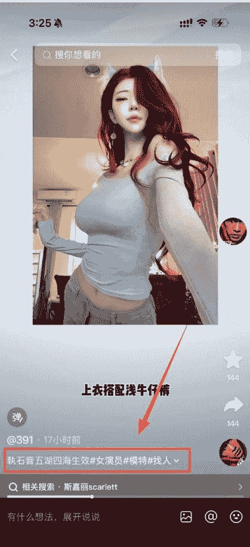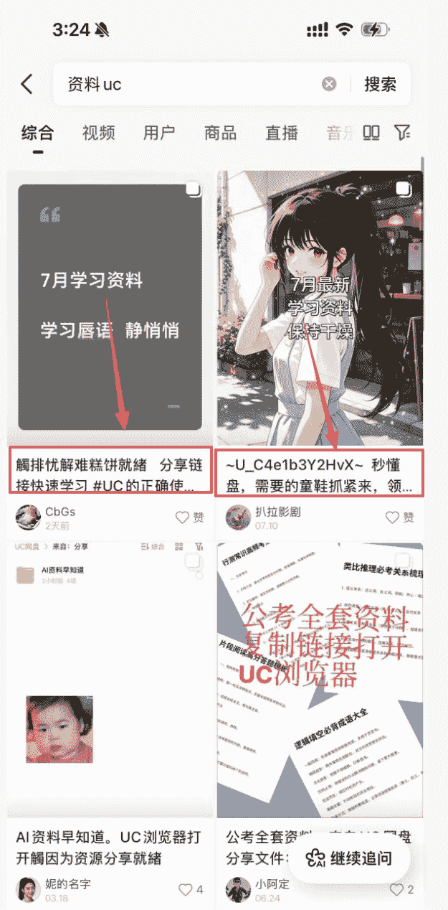

公众号懒人搜索，懒人专属群分享

再顺着路径去找文件、保存文件、完成转存。

大家看到上面这两个截图，应该就比较清楚了，打开之后是下面这个样子，所以我们的短视频标题就是这个 UC 的链接，也就是我分享给大家的文档。

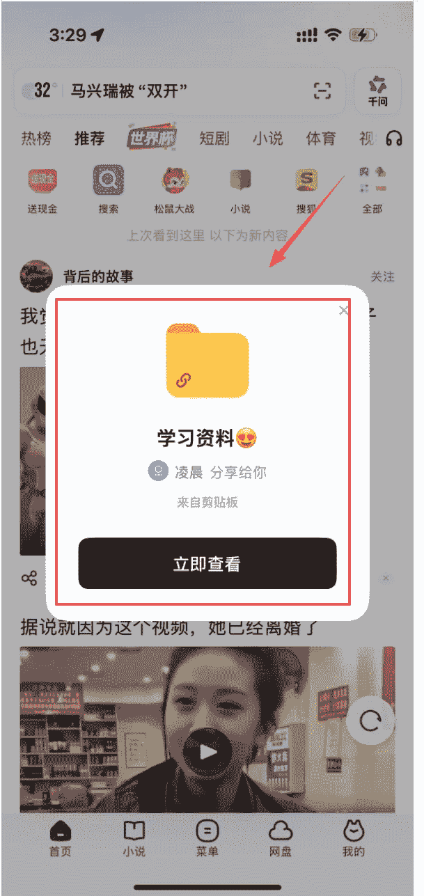

公众号懒人搜索，懒人专属群分享

这里可能会有人问，用户为什么会去复制这个链接。

这个问题其实非常关键，因为整个拉新链路里最核心的一步，就是让用户从看到作品到打开链接。

用户只刷到作品还不够，他必须产生兴趣，然后点进主页，再看到你给他的提示。

最后愿意去复制链接、打开 UC、进入文件页面。

作品只是第一步，它负责把用户吸引过来，但用户进主页之后能不能继续往下走，就要看你的主页有没有把路径讲清楚。

后面我也会详细复盘这一块，我们当时为了做承接测试过非常多方法，从最开始的置顶视频，到后来的主页简介、@小号、背景墙、评论组，再到各种被限制之后的调整方式。

每一次变化都是因为前一个方法开始失效，或者被平台限制了。

所以这里大家先记住一个核心逻辑，只要用户能够看到作品并且愿意点进主页。

公众号懒人搜索，懒人专属群分享

这件事就已经成功了一半。

所以我们的作品简介都是这样设置的，不知道有没有圈友注意到过这种类型的简介。

其实到这里锐评模板的完整操作流程，基本就跑通了。

但真正操作下来你会发现，这里面每一步都是细节。

尤其是一个很关键的问题，怎么提高用户点进主页的概率？

因为用户只看到作品还不够。

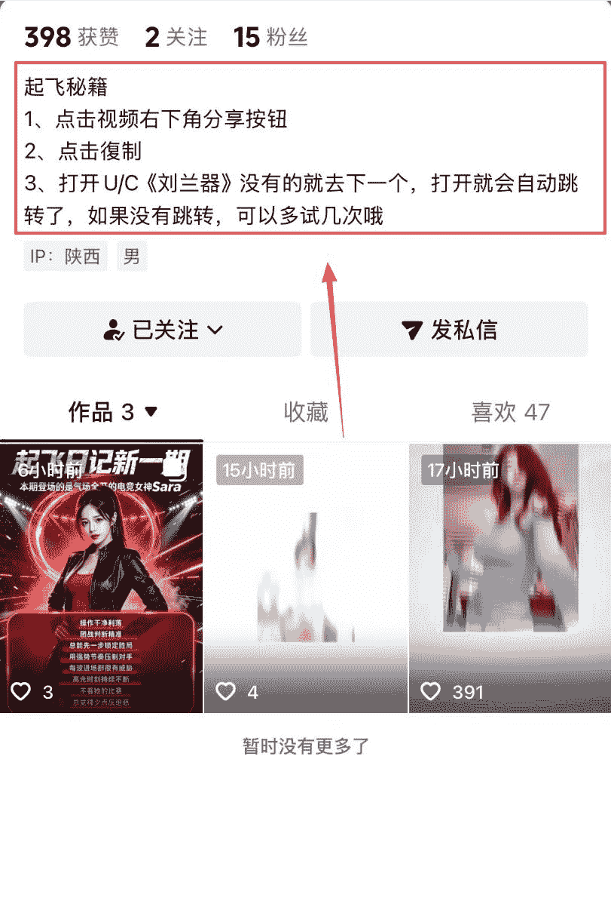

公众号懒人搜索，懒人专属群分享

他看完之后如果直接划走了，后面的链路就断了。

所以我们后面一直在优化两个地方：

- 一个是作品里的轻引导，比如在作品里面说想要的内容在主页，但是这种情况流量跑多之后肯定是被限制。
- 一个是评论区的辅助引导。

作品负责吸引用户停下来，评论区负责把用户往主页再推一下。

比如用户看完视频之后，本来可能没有那么强的动作，但如果他在评论区看到有人提到主页、入口之类的信息，他就更容易顺着这个路径点进去。

这个地方就是评论组的作用。

这些评论不是自然随机出现的，而是我们自己找账号去配合评论。

作品刚起量时评论能不能及时跟上，这些东西不一定复杂但一定要有人盯。

后面也会有详细的拆解。

公众号懒人搜索，懒人专属群分享

这里我们自己测试下来转化率大概能到 50% 左右。

如果一个作品能带来 10000 次转发，那么理论上到手可能就在 5000 左右。

当然这个数据不是让大家直接照着现在去预期。

因为现在的情况和当时已经不一样了。

现在锐评这个模板，想跑出特别大的播放，难度已经比 3 月份高很多了。

3 月份的时候，这类作品确实非常好跑。

我们当时有作品跑到过 300 多万播放。

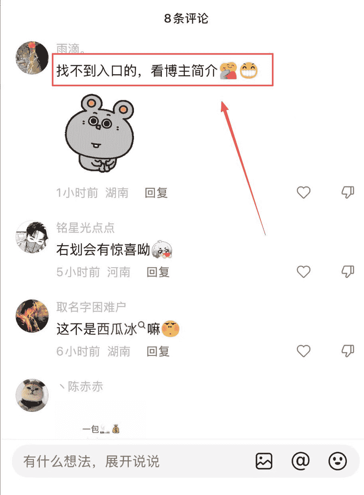

公众号懒人搜索，懒人专属群分享

但那个阶段我们做的还是迅雷拉新，不是现在的 UC，而且当时的承接方式，也还是大号 @ 小号那一套。

后面我会专门讲这一段为什么当时能跑起来，后来又是怎么一步步被限制的。

其实网盘拉新讲到这里，基础逻辑就已经差不多了。

如果你自己去做，不一定非得局限在我今天分享的这个玩法。

游戏拉新可以做。

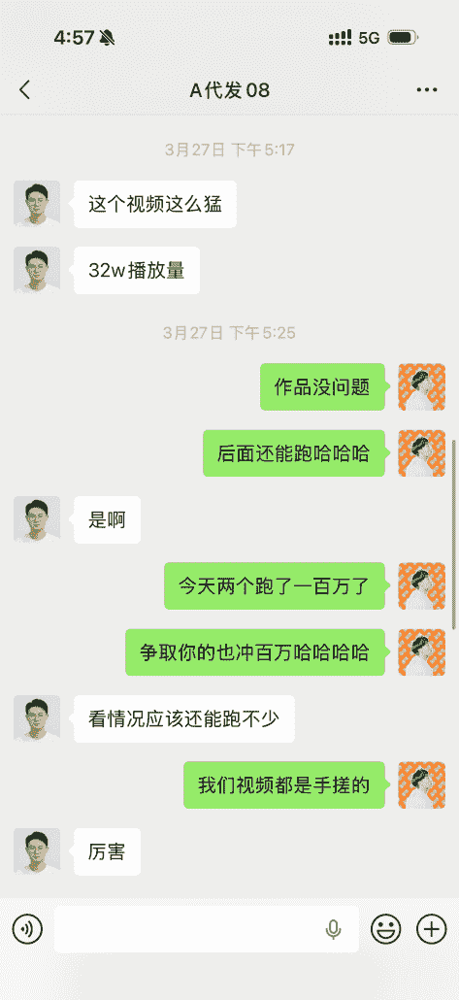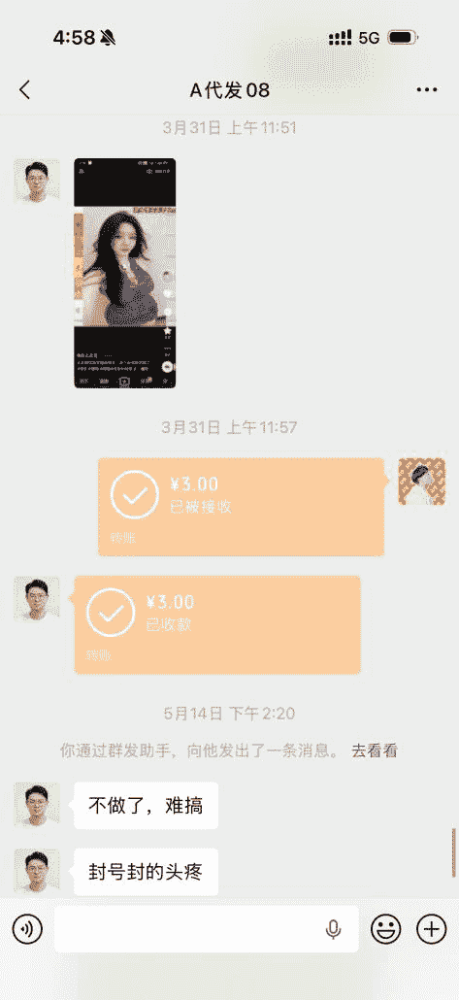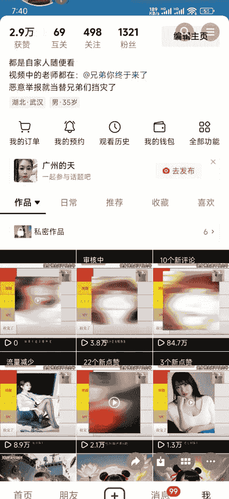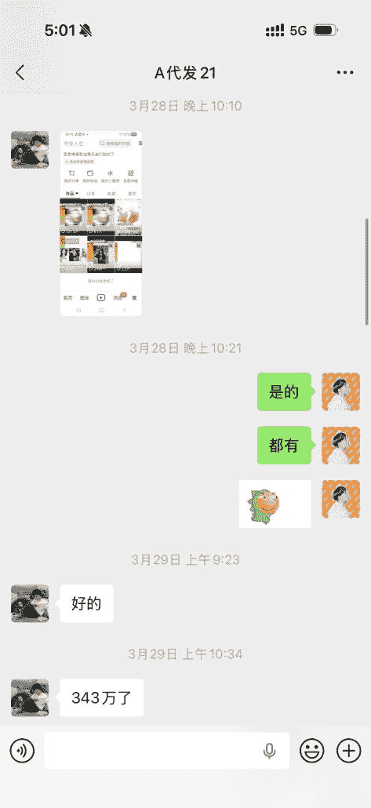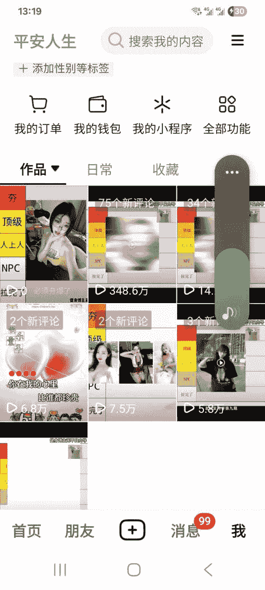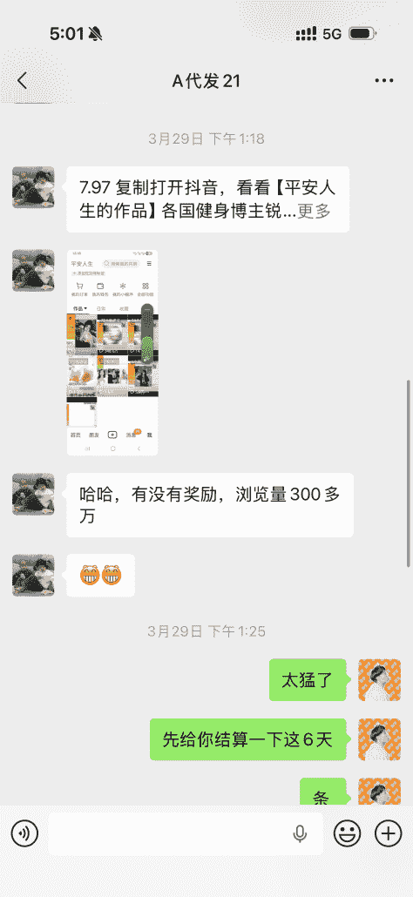

公众号懒人搜索，懒人专属群分享

资料拉新可以做。

电视剧、短剧、软件、教程、素材合集，这些方向也都有人在做，而且每天都有人能拿到不错的结果。

核心不是你一定要照抄我的锐评模板，核心是你要理解这套链路：找到对标账号，拆它的内容模板，模仿和借鉴它的表达方式，最后先赚到第一块钱。

如果你是用自己的账号测试，我建议一开始不要想太复杂。

先找到对标，先模仿，先发几条，先看有没有数据。

能赚到第一块钱比你研究十天理论都重要。

但我们当时做的不只是自己发账号，我们做的是代发模式。

所以后面真正要拆的是，怎么让代发按照我们的要求去发作品，这也是项目能放大的关键。

公众号懒人搜索，懒人专属群分享

因为你自己发，一个人精力是有限的。

但如果你能把作品、文案、承接方式都整理好，然后交给代发去执行，你就能同时测试更多账号、更多内容、更多流量入口。

当然代发账号里也会有一些所谓的神号。

这种账号很神奇，有些内容你自己发不动，但他一发就能跑；有些账号不管发什么，平台就是愿意给流量。

这种账号一旦遇到，价值会非常高。

比如下面这个代发账号，单个账号给我们带来的价值就能达到 1 万左右，但我们给这个代发结算的钱，其实不到 300 元。

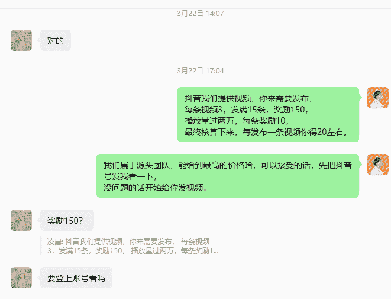

公众号懒人搜索，懒人专属群分享

公众号懒人搜索，懒人专属群分享

这个地方大家就能感受到为什么我后面一直强调代发的重要性。

找代发这件事本身并不复杂。

很多时候就是几句话，把规则说清楚，然后让对方按要求发作品。

复杂的不是找人这个动作，复杂的是你能不能把素材、文案、截图、

公众号懒人搜索，懒人专属群分享

结算、反馈这些流程标准化。

其实简单来说，网盘拉新的整体流程就是这样：文件准备好，平台绑定好，作品发出去，用户看到内容，点进主页，复制口令，打开 UC，保存或转存文件，后台产生数据和收益。

看起来就这么几步，但我们真正做下来之后才发现每一步都能拆出很多问题。

为什么作品有播放但是后台没有数据？为什么今天能用的承接方式过两天就被限制？

这些问题我们在这几个月里反复遇到也反复测试。

中间封过很多账号，换过很多承接方式，测过很多文件。

公众号懒人搜索，懒人专属群分享

也做过很多次看起来有流量，但就是没转化的复盘。

如果只是把流程简单讲一遍，其实大家很难真正感受到项目的难点。

所以接下来的文章我真正想拆的不是网盘拉新这几个步骤，而是我是怎么从发现项目，到跑通闭环，再到放大矩阵的，中间每一步遇到了什么问题，我们又是怎么一点点解决的。

也希望大家看完之后对做项目这件事多一点耐心。

看到这里，如果你只是想自己上手测试，其实已经可以开始做了。

但我还是要强调一句，你不一定非要局限在我现在分享的这个玩法。

电视剧、游戏、资料、软件、教程、短剧、素材合集，其实底层都是互通的。

我们现在也还在不停找新模板。

不同阶段的作品形式也不一样。

你从前面的截图里应该也能看到，我们不是一直拿一个模板从头打到尾。

每个阶段都在变。

所以如果你是个人玩家，可以先用自己的

公众号懒人搜索，懒人专属群分享

账号做小测试。

如果你想放大，也可以用我后面讲的代发方式去做。

核心是找到一个能吸引用户停下来的前端作品，再用拉新的形式去承接这个需求。

这里给大家一个判断标准：只要你刷到某类作品，评论区有大量人在求资源、求链接、求教程、求入口，你就可以想一想，这个需求能不能用拉新的方式去承接。

这才是更值得学习的地方。

我们现在做的也不只是抖音这一个平台。

只是这次我拿网盘拉新这个项目出来复盘，是因为它从发现、测试、放大、违规、下行，整个过程比较完整。

我觉得它能给大家带来的帮助，不只是知道一个项目，而是让大家看到一个项目从 0 到 1 是怎么跑出来的。

当然如果只是讲到这里，文章还是有点单薄。

所以下面我会继续往后拆，从我是怎么发现这个项目的，到怎么用几条作品跑通第一轮测试，再到怎么找代发、做矩阵、处理风控、组建小团队。

公众号懒人搜索，懒人专属群分享

如果你对这些过程感兴趣，可以继续往后看。

如果后面大家反馈不错，我也会继续分享一些其他拉新玩法和不同平台的测试经验。

总之拉新这个赛道我现在越来越觉得，市场空间是非常大的！

差点忘了，这里给大家看一下，我们当时具体做的是什么内容。

我们采用的是健身博主锐评这类模板。

说得直接一点，它本质上就是通过带有擦边属性的内容吸引特定人群，所以我们当时也一直在测试什么样的素材更容易吸引点击，什么样的模板更容易让用户进入主页并完成后续动作。

不过需要说明的是，我们网盘里并没有存放违规内容。

当时测试过的文件主要包括大学生网课、公开的舞蹈视频，以及海绵宝宝等动画资源。

整个转化逻辑是：用户刷到作品以后产生兴趣，按照主页提示打开网盘并保存文件；新用户完成保存后，我们就能获得拉新收益；如果用户后续开通会员，还可能产生相应的会员收益。

但现在复盘，我必须承认当时前端内容给用户的预期，和网盘里实际提供的资料并不完全一致。

公众号懒人搜索，懒人专属群分享

用户会感觉文件里应该有想看的内容，真正打开以后，却未必能得到与预期相符的东西。

再直白点说，我们的转化建立在信息不对称上，而不是建立在资料本身的真实价值上。

实操流程写到这里，如果大家能够认真看完，基本上已经具备了自己动手测试的条件。

接下来要做的事情，其实和我们现在每天做的一样：持续寻找新的内容模板，小范围测试数据，再通过代发扩大样本。

跑得好的模板继续放量，数据不理想的及时复盘和更换。

这里有一个重点：模板不是找到一个以后就能一直使用，它是有生命周期的。

早期我们发布这类作品时，单条内容经常能跑到几十万，甚至上百万播放。

随着同类内容逐渐增多，现在再使用原来的模板，整体数据已经明显下降，而且会经常出现违规内容。

公众号懒人搜索，懒人专属群分享

早期作品容易获得播放，可我们当时并不懂得如何通过主页和评论区做好承接，很多流量最终都浪费掉了。

后来我们逐渐摸清了评论引导、主页承接和转化路径，作品的播放量虽然不如以前，但每一份流量的利用效率反而提高了。

### 五：5 条作品跑通闭环

先看一下作品。

本质就是通过这种类型的擦边视频，吸引色粉，然后去网盘看视频。

但是网盘里面的视频都是绝对健康的内容，但是他们是不清楚里面到底放的是什么内容，想要看需要开通会员！

前面讲了很多铺垫，包括我为什么去临沂，为什么接触到网盘项目，为什么看到身边人一条作品变现 80 元之后，才真正开始重视这件事。

但说到底，项目不是听懂的，项目是做出来的。

尤其是流量项目，你听再多理论看再多案例，都不如自己真正发一条作品，拿到一次数据反馈。

因为只有到了实操里你才会发现，你以为自己懂了，其实只是听明白了。

公众号懒人搜索，懒人专属群分享

真正的问题永远是在执行过程中出现的。

这也是为什么从这一章开始，我会尽量用实操的方式，把这个网盘项目完整拆给大家看。

不是只讲我赚了多少钱。

后面会写到，我是怎么发第一条作品的，我是怎么找第一批代发的，我是怎么判断数据的，我是怎么发现承接问题的，我是怎么从几个账号慢慢放大到后面 500 多个账号矩阵的。

我想先从最开始的测试讲起。

当时我真正动手之后，第一轮并没有做很多。

我大概做了 5 条作品。

这个项目早期的作品制作成本非常低，一条作品从剪辑到发布，差不多 5 到 6 分钟，甚至后面流程熟了之后，速度还能更快。

这里先讲第一轮测试结果。

我当时第一批作品发出去之后，第三天左右收益出来了，大概是 100 到 200 元左右。

公众号懒人搜索，懒人专属群分享

如果单看这个收益，其实并不夸张。

但我当时在意的不是这 100 多块钱，我在意的是这个链路真的跑通了。

这就说明，这不是一个停留在别人说能赚钱的项目。

它已经变成了一个我自己能操作、能验证、能看到结果的项目。

但真正让我开始重视承接问题的，是后面那条 100 万播放的作品。

第二天我剪辑的一条作品爆了，播放量跑到了 100 万。

说实话当时我自己也没想到。

公众号懒人搜索，懒人专属群分享

因为这是我第一次做这个项目，我并没有预判到一条这么简单的作品，真的能跑到百万播放。

也正因为没有预判到，所以我犯了一个很严重的错误。

我没有把置顶引导视频放好。

这直接导致了一个结果：前端流量爆了，但后端转化非常低。

如果按照当时项目的转化率，这条 100 万播放的作品，本来有机会带来更高收益，但因为承接链路没做好，最后实际转化被浪费掉了很多。

这件事给我的提醒非常大。

因为过去我一直觉得，做流量最重要的是把作品爆起来。

但这次我很直观地感受到，作品爆了只是第一步。

如果后端承接没做好，爆款也会被浪费。

尤其是网盘拉新这种项目，它不是单纯靠播放量赚钱。

播放量只是入口，真正决定收益的，是用户有没有顺着你设计好的路径继续往下走。

这个路径是这样的：

第一步，用户刷到你的前端作品。

第二步，用户对内容产生兴趣。

第三步，用户点进主页。

第四步，用户看到置顶引导视频。

第五步，用户根据引导去网盘搜索关键词。

第六步，用户下载、转存或者开通相关权益。

第七步，后台产生收益。

你会发现，这里面任何一个环节没做好，收益都会打折。

流量只是可能性，只有被承接住的流量才有可能变成钱。

后来又有一条作品跑到了 350 多万播放，这种数据在当时是非常夸张的。

其实现在来看，300 万播放这个作品，我们真正意义上吃到的转化也没有多高，因为当时没有做任何评论区引导。

当然，这里后面也会重点说。当时要是有评论引导的话，预计收益起码能翻倍。当时这个作品带来的收益可能在 8000 左右，要是现在能跑出来这种作品，预计转化在 20000 左右没有任何问题。

这个也是必须要经历的坑。

但也正是因为跑出过这种大播放，我才更清楚地看到，同样是爆款，承接做没做好，最后结果差距会非常大。

有的人会觉得自己做项目没赚到钱，是因为没有流量。

但很多时候不是。

很多时候是你有了流量，但没有把流量接住。

你作品爆了，但主页没有设计。

你用户来了，但不知道怎么引导。

你引导了，但表达太模糊。

你表达清楚了，但又触发违规。

项目真正难的地方不是单点动作，而是每个环节之间能不能连起来。

这也是我后来做矩阵时越来越重视 SOP 的原因。

因为当你只有一个账号的时候，很多问题靠自己记着就行。

但当你有 20 个账号、50 个账号、100 个账号的时候，你不可能靠脑子记。

你必须把每个动作拆成标准流程：

- 作品怎么发
- 主页怎么设置
- 置顶视频怎么放
- 发完怎么截图
- 数据怎么看
- 违规怎么处理

这些东西如果不标准化，账号一多，整个项目马上就会乱。

所以我第一轮测试虽然收益不算特别高，但它给了我三个非常重要的判断：

第一，这个项目的前端内容确实能跑出流量。

第二，用户确实会通过作品进入后端引导链路。

第三，如果承接做好，这个项目具备继续放大的可能。

也就是从这里开始，我不再把它当成一次随手测试。

我开始把它当成一个可以认真拆解、认真放大的项目。

接下来真正的问题就变成了：

那能不能让更多人帮我发？

那能不能用更多账号分散流量？

如果一条内容能跑通，那能不能把它批量复制成几十条、上百条？

这就进入了这个项目最关键的一步：找代发。

## 六、我是怎么找代发的

这个阶段的目的不是赚大钱，而是验证一件事：

同样的内容，换不同账号发，还能不能跑？

如果只能靠我一个人发，那这个项目的上限就很低。

但如果我能找到更多人帮我发，让同一个动作在不同账号上重复执行，那它就从一个个人副业，变成了一个可以矩阵化放大的项目。

所以这个项目真正开始放大的第一步，不是剪辑，也不是爆款，而是找代发。

很多人一听到找代发会觉得很简单：

不就是找人发视频吗？

给钱不就行了吗？

但我做下来之后发现，找代发这件事本身就是一个小型转化漏斗。

你要解决四个问题：

第一，怎么找到人。

第二，怎么让他相信你。

第三，怎么让他愿意开始发。

第四，怎么让他持续发，甚至帮你介绍更多人来发。

如果这四个问题解决不了，就算你手里有素材、有项目，也很难真正放大。

### 1. 第一批代发

我最开始找代发是从朋友圈开始的，因为我之前做过流量，手里本身有一些兼职类型的粉丝。

这类人非常适合做代发，因为这个项目对代发的要求并不高。

他只需要按照我的要求，把我给他的内容发出去，然后按要求截图反馈。

这就够了。

所以我当时就在朋友圈发了一条招募内容。

大概意思就是：

有空闲短视频账号的，可以接代发任务。

按要求发作品，发完结算。

代发最重要的是执行稳定。

你给他什么，他按要求发什么。

你让他怎么截图，他按要求截图。

你让他每天发几条，他按要求完成。

矩阵项目里，很多时候不是人越聪明越好，而是动作越标准越好。

### 2. 小白没有私域，可以去哪里找代发

当然，不是每个人一开始都有兼职粉。

如果你没有自己的私域，没有朋友圈基础，也没有现成的代发资源，那怎么办？

可以去一些兼职平台测试，比如企业桥、项目帮帮。

这里给大家录制一个视频：

类似这样的平台，大家都可以自己去试。

这里我强调一下，我不是推荐大家一定要去用哪个平台，也不是给这些平台打广告。

我只是说，如果你是小白，又没有自己打粉的能力，可以先去这些地方找一批愿意做兼职的人。

而且一开始不需要开会员，也不需要投广告。

很多平台都有免费发布、免费曝光、免费获取线索的机会。

你先把免费的用起来，每天能加到四五个人，其实就已经够你做早期测试了。

这些东西验证完，再考虑要不要放大。

第一步，先用朋友圈发一轮。

第二步，朋友圈没有人，再去兼职平台免费发。

第三步，每天加到几个人之后，先不要追求数量，先测试话术和 SOP。

第四步，等代发能稳定执行，再考虑扩大获取渠道。

我们甚至一开始也没有用过广告平台，我们也是慢慢一步一步找代发的。后面作品在放量的时候，没有代发感觉非常被动，所以我们开始去投放广告平台。

小白的话没有必要去投放，但是可以知道这个渠道即可。

### 3. 这里再补充一个更接地气的找代发方式

如果大家平时有用小红书、闲鱼、抖音，其实也可以直接在这些平台上找代发。

它的本质并不复杂，就是找一批愿意做兼职、愿意按要求发内容的人，也就是我们常说的兼职粉。

找人的时候不一定非要去特别垂直的平台。

很多普通用户本身就有账号，也有一点空闲时间。只要任务足够简单、收益规则足够清楚，他们是愿意尝试的。

比如抖音可以用素人种草的思路去找人，或者在他们评论区截留，都是可以的。

下面这种模板都可以用，而且效果很明显。

话术不要写得太复杂，直接抄就行。这种作品我们自己测试，每天也是可以找到 5～10 人，转化率 30% 左右。

如果你刚开始没有私域、没有团队，也没有现成的代发资源，可以先用这种方式小范围测试。

每天发 3 条作品，连续坚持三天，基本就能看到反馈。

这里的关键不是你第一天就找到多少人，而是你愿不愿意真的去执行。

只要你真的连续做三天，一定会有反馈！

### 4. 找到人之后

很多人找代发失败，不是因为没人愿意做兼职，而是因为他不会转化。

因为对方会有很多顾虑。

他会想：

你是谁？

你靠谱吗？

会不会不给钱？

发这个会不会影响我账号？

我要怎么操作？

是不是很麻烦？

为什么才 3 块钱？

如果你不能在一开始解决这些疑问，他就很容易流失。

所以我当时加到代发之后，会先给他一个比较完整的话术。

这里面有几个核心点。

第一个点是呈现实力。

你要让对方感觉，你不是一个随便找人试试的小号，而是一个长期在做这件事的团队。

我当时给他们的感觉就是我是一个团队长，是一个头部团队。

这不是为了装，而是为了建立信任。

因为对于兼职粉来说，他很在意你有没有实力。

他不一定懂项目，但他会判断：

你像不像靠谱的人？

你会不会结算？

你有没有持续任务？

我跟着你做会不会白忙活？

很多市面上的代发，可能是 5 块钱一条，第二天或者隔天结算。

但我当时有一个点：发完之后符合要求就可以直接结。

3 块钱一条，立即结算带来的信任感，也比 5 块钱第二天结算更强！

对很多兼职人群来说，钱多一点少一点不是唯一关键，确定性更重要。

他发完之后马上拿到钱，他就会相信你。

他相信你之后，才愿意继续发。

所以我一直觉得，找代发不是单纯比价格。

你要解决的是信任问题、操作问题和持续反馈问题。

这里给大家放个我找代发的文档，大家可以看一下：

## 网盘拉新代发流程

### 5. 代发话术里一定要有钩子

我当时找代发的话术里有一个很重要的设计：

要让他觉得这个事情很简单，而且马上能拿到结果。

比如你可以强调：

发完截图，符合要求就结算。

这种表达会降低他的行动门槛。

很多兼职粉不是不想赚钱，而是怕麻烦。

你越让他觉得复杂，他越不会开始。

所以代发话术一定要尽量简单。

先让他知道三件事：

第一，你要他做什么。

第二，他做完能拿到什么。

第三，这件事对他来说麻不麻烦。

只要这三件事讲清楚，他愿意开始的概率就会高很多。

### 6. 为什么我要求发够一定数量

在代发规则上，我当时有两种方式。

一种是发完符合要求就立即结算，比如 3 块钱一条。

这种方式的好处是能快速建立信任。

对刚来的代发来说，第一次结算非常重要。

只要他第一次真的拿到钱，他对你的信任度会立刻上升。

然后就是设置发够一定数量后再结算，比如发满 15 条，结算 150 元。

当然我是直接两个并用，代发内容的话我在上面的飞书文档里面了。

原因很简单：

项目测试需要样本量。

如果一个账号只发一两条作品，数据是不稳定的。

可能今天没播放，不代表这个账号不行。

可能今天没转化，也不代表这个素材不行。

你至少要让他发够一定数量，才能判断账号、素材和引导有没有问题。

同时，发满 15 条再结算也会给代发一个明确目标。

他知道自己不是随便发一下，而是在完成一个任务。

当然，具体用哪种结算方式要看你当时的阶段。

如果你刚开始招人，最重要的是建立信任，可以用立即结算。

如果你已经有一批稳定代发，需要提高执行量，可以用满数量结算！

### 7. 代发裂变

当我从 20 个代发往 100 个代发扩的时候，除了自己找人，我还做了一个动作：让已有代发帮我转介绍。

这个动作非常重要，因为单靠你自己获客是有成本的。

不管你是发朋友圈、发平台，还是一个个私聊，本质上都需要时间和精力。

但如果你能让已有代发帮你介绍新人，你的扩张速度会快很多。

我当时设计的规则很简单：

只要他介绍来的人发够 5 条作品，就算有效。

介绍人可以拿 5 元奖励。

大家不要小看这 5 块钱。

很多做互联网的人对钱的感知是有偏差的。

你可能觉得 5 块钱不算什么，但对于很多兼职人群来说，5 块钱就是一个明确的小激励。

尤其是他只是顺手介绍一个朋友、同学、亲戚、群友过来，这个动作成本很低。

如果对方真的发了 5 条，他就能拿到奖励。

这件事对他来说是划算的。

后面我还设计过更大的激励：

如果他介绍来的人发满 15 条，可以给介绍人更高奖励，比如 100 元。

这里我也说实话，这个 100 元奖励本身并不是特别容易触发，因为新人要真的发满 15 条，中间会有流失，其中还不缺乏账号违规的情况。

但它的作用在于让代发知道，如果你能介绍一个真正愿意长期做的人，你是有更高收益空间的。

这就是裂变里的钩子。

它不一定每次都触发，但它会让人愿意帮你传播。

也就是靠这个转介绍机制，我当时一天之内，从 20 个代发扩到了 50 个代发左右。

这个速度对我来说很关键。

因为项目处在上行期的时候，时间非常重要。

你早一天扩大账号，就可能早一天吃到流量。

你晚几天，可能规则就变了，同行也变多了。

### 8. 找代发的本质

兼职粉过来沟通话术。

如果大家要买兼职粉之类的话，可以试试上面的文案内容。

很多人做矩阵会把注意力放在账号数量上，但我后来越来越觉得，账号只是表面。

真正重要的是，你能不能组织一批人按照你的 SOP 去执行。

账号背后是人。

人如果不稳定，账号再多也没用。

你今天找了 100 个账号，但没人按要求发，没用。

所以找代发的核心，不是我找到了多少人，而是我能不能让这些人按照同一个标准，持续完成同一个动作。

这才是矩阵放大的基础。

到这里，代发从哪里来、怎么转化、怎么裂变，基本就讲完了。

但找到代发只是第一步。

## 七：代发 SOP

### 1. 代发的本质

很多人会犯一个错误：他会试图让代发理解整个项目。

比如告诉对方：

我们为什么做网盘拉新。

这个项目怎么赚钱。

前端流量和后端承接是什么关系。

为什么要这么发。

为什么要挂置顶视频。

为什么要这样写文案。

其实没必要，至少在早期完全没必要。

因为你讲得越多，对方越容易觉得复杂。

而兼职人群最怕的就是复杂。

他不是来学习项目的，他是来做一个简单任务，换一笔确定收益的。

所以我给代发的要求非常明确：

你不用理解这个项目。

你只要按照我的要求，把作品发出去，然后把截图发回来。

这就够了。

### 2. 视频素材

我给代发的视频全部都是成品素材，拿到视频之后直接发布就可以。

能不让代发动脑，就不让代发动脑。

视频我做好。

文案我写好。

发布要求我说清楚。

截图标准我定好。

他只负责发。

这样一来，即使数据不好，我也能判断问题。

如果同一批素材在多个账号上都跑不动，那可能是素材问题。

如果同一批素材有的账号能跑，有的账号跑不动，那可能是账号问题。

如果有账号发了但没有显示，那就是发布或审核问题。

如果引导视频没有播放，那可能是承接问题。

你只有把变量控制住，后面才有复盘的意义。

### 3. 文案统一

文案也是一样。

我当时给代发的文案基本都是统一的，不需要他们自己写，也不需要他们自己改。

很多人可能会担心，同样的视频、同样的文案，发多了会不会影响推流？

这个问题我当时也考虑过。

但从我们实际测试来看，在那个阶段影响并不大。

因为抖音的大数据已经非常成熟，很多时候一个作品该推流还是会推流；不该推流，你加再多标题、话题、关键词，也没有太大作用。

尤其是我们做的这种内容，本身不是靠精致标题取胜，而是靠内容本身筛选需求。

当然，发多了之后确实会出现重复发布、作品不显示、账号限流等问题。

这些都很正常。

但我的处理方式也很简单：

- 账号有问题就不用了。
- 账号没问题就继续用。

在矩阵打法里，不要指望每个账号都长期稳定。

一定会有账号损耗。

一定会有作品不显示。

一定会有重复发布。

一定会有流量波动。

这些都是项目成本的一部分。

所以我们要做的不是消灭所有问题，而是把这些问题控制在可接受范围内。

### 4. 置顶视频

这个项目里置顶视频非常关键。

但它的关键点不是跑流量。

它的作用只有一个：用户感兴趣之后会点进主页。

公众号懒人搜索，懒人专属群分享

他点进主页之后，需要有一个东西告诉他，下一步怎么做，这个东西就是置顶视频。所以置顶视频不需要特别精致，也不需要追求播放量，它只要能发出去、能显示、用户点进主页能看到，就已经完成了最基础的功能。我当时的置顶视频就是用手机直接录制的，核心是讲清楚路径，比如用户怎么找到资料、怎么搜索关键词、怎么按照提示操作。

因为网盘拉新的闭环本质上非常简单：我通过前端作品告诉你，我这里有你想要的资料或内容；你感兴趣，点进我的主页；你看到置顶视频，知道下一步怎么操作；你按照提示去网盘里搜索关键词；你下载、转存或者完成相关动作；后台产生拉新、会员、转存等收益。这就是整个闭环。

这里最容易被新手忽略的就是置顶视频。很多人只顾着发前端作品，以为播放量起来就行。但如果主页没有承接，用户进来之后不知道下一步干什么，流量就浪费了。我前面那条100万播放的作品，就是因为置顶视频没放好，导致转化非常低。所以后面我才会把置顶视频作为代发SOP里的必备动作。

### 5. 发完必须截图

代发发布完作品之后，我会要求他们发两张截图：第一张是发布过程中的截图，第二张是主页截图。为什么要这样？

因为你必须确认两件事：第一，他真的按要求发布了；第二，作品真的在主页显示出来了。很多账号会出现一种情况，他以为自己发成功了，但作品没有显示——可能是进入审核，可能是账号权重太低，可能是内容被系统拦截，也可能是发出去之后只有自己可见。如果你不要求截图，你根本不知道这个作品到底有没有正常展示。对于代发来说，他可能会觉得自己已经完成任务；但对于我们来说，如果作品没有显示，就没有测试价值。所以我当时规则很明确：如果作品发布出去之后，在主页呈现不出来，我们是不计数的。因为这个作品没有真正进入流量池，没有展示就没有数据，没有数据就没有测试意义。

截图还有另一个作用：方便统计数量。代发多了之后，如果没有统一反馈标准，统计会非常痛苦：谁发了几条？哪条显示了？哪个账号异常？哪个人可以结算？哪个人需要提醒？这些都需要依据。

### 6. 每个账号一天发2到5条

当时我给代发的发布要求是：每个账号每天发2到5条。这个范围不是随便定的，因为我们测试下来发现，这类内容如果单账号发太多，账号很容易出现问题。尤其是这种偏流量型、同质化比较高的内容，你发得少可能还能正常推，但你发多了之后，账号很容易进入一个状态：前几条还能跑，发到第六条、第七条、第八条的时候，数据明显开始变差，有的甚至直接不显示，或者开始频繁违规。现在这种情况会更明显，现在如果你用新号发类似内容，可能发两三条之后，账号就开始不太能用了。

所以在这种项目里，我不建议单账号猛发。相比让一个账号一天发十几条，我更愿意让多个账号，每个账号少量发布。这就是矩阵思路：不是把所有压力压在一个账号上，而是把内容分散到更多账号里。这样做有几个好处：

- 第一，降低单账号风险。
- 第二，增加素材测试面。
- 第三，避免同一账号短时间内频繁发布同质内容。
- 第四，即使某个账号废了，也不会影响整体项目。

所以我当时大部分情况下更倾向于让代发每天发2条左右，如果账号状态好，可以发到5条，但不会一上来就让一个账号猛发很多。

### 7. SOP的目的

总结一下我当时给代发的SOP，其实非常简单：

- 第一，视频素材我提供成品。
- 第二，文案我提供统一版本。
- 第三，代发不用剪辑，不用改文案。
- 第四，先发布置顶引导视频。
- 第五，再发布前端作品。
- 第六，发完后提供发布过程截图和主页截图。
- 第七，作品不显示不计入结算。
- 第八，每个账号每天发2到5条，根据账号状态调整。

你会发现这些动作都不难，但它们必须标准化。因为当你只有5个代发的时候，你可以一个个教；当你有20个代发的时候，你还能勉强盯；但当你有50个、100个、200个代发的时候，你不可能靠嘴巴一遍遍解释。你必须把所有动作都变成文字、截图、视频教程、固定话术，让对方照着做。这才是真正的矩阵化。

很多人以为矩阵化就是账号多，但我理解的矩阵化是动作可复制。账号只是载体，人只是执行者，真正决定项目能不能放大的，是你有没有把一个复杂动作，拆成普通人也能照着完成的SOP。

### 8. 统一备注

这里还有一个很容易被忽略、但账号一多就特别重要的细节：统一修改备注。刚开始做的时候，我们的备注也比较乱，有时备注代发人员的名字，有时备注他的抖音号，还有时随手写一个自己能看懂的称呼。账号少的时候感觉没什么问题，但当代发账号超过20个以后，麻烦就开始出现了：每天发作品之前，需要在微信和抖音之间来回查找这个微信对应哪个抖音号？今天有没有发过？下一个应该轮到谁？不仅浪费时间，还特别容易漏发、重复发送或者把素材发错。

后来我们把所有账号统一改成了数字编号。比如第一个代发人员，微信备注为“01”，对应的抖音账号备注也改成“01”；第二个备注为“02”，后面以此类推。这样微信里的联系人和抖音里的账号就能一一对应。

除此之外，我们还会准备一个专门用于账号管理的抖音号，统一关注所有参与代发的账号。每天需要分发作品时，直接打开关注列表，从“01”开始依次往下安排，不需要再到微信里来回搜索。发到哪个账号、下一个轮到谁，只要按照编号顺序执行就可以了。

这个方法看起来非常简单，但当账号数量从十几个增加到几十个，甚至上百个以后，它能够明显减少操作成本和出错概率。所以矩阵管理并不一定要一开始就使用多么复杂的方法，前期先把三个基础问题解决就够了：每个人是谁、对应哪个账号、今天有没有完成任务。

## 八：作品制作

作品到底怎么做？因为所有后面的动作，不管是代发、矩阵、引导、结算，本质上都建立在一个前提上：你的前端作品能不能把人吸引进来。如果作品没有播放，后面的承接链路再完整，也没有意义。

我当时最早跑出来的内容方向，是健身博主锐评类。这个名字听起来可能有点抽象，但当时在3、4月份，这类内容确实非常好跑。尤其是项目处在上行期的时候，很多作品只要发出去，就有机会拿到不错的数据。

当然这里我也要提前说清楚，这类内容本质上吃的是一部分用户的猎奇心理和擦边注意力。我把它写出来不是为了鼓励大家都去做同样的内容，而是想让大家理解一个流量项目里非常重要的能力。所以现在我越来越看重一个问题：如果一个账号的流量非常好，但是不知道怎么变现，这种情况你可以深度去研究一下，尤其是自己的同行，没准就是比较大的红利。

你能不能看懂一个内容为什么吸引人？你能不能拆出它的结构？你能不能找到同类型素材？你能不能快速做出多个版本？你能不能通过数据判断哪些素材值得继续复制？这套能力，不只适用于网盘项目。你做短剧、资料、课程、本地生活、线下门店引流，甚至做普通内容账号，本质上都用得上。

### 1. 不要只看内容表面

很多人看到这类作品会只盯着表面，比如这个画面是不是擦边，这个文案是不是夸张，这个博主是不是好看。但如果你只看这些，你很难真正迁移。我更建议大家看它背后的逻辑。

它为什么能跑？

- 第一，它有明确的视觉钩子。用户刷短视频的时候，留给你的时间可能只有一两秒，画面能不能让用户停下来，非常重要。
- 第二，它有明确的人群筛选。不是所有人都会对这类内容感兴趣，但感兴趣的人往往更容易继续点进主页。
- 第三，它有很短的内容路径。20到30秒的视频，用户看完成本很低，平台也更容易给它测试流量。
- 第四，它和后端引导之间有一定关联。用户不是单纯看完就走，而是有概率去主页看后续资料合集或者其他提示。

这才是它能进入网盘拉新链路的原因。

### 2. 一条作品的基础结构

我当时做一条作品基本就是三个部分：开头、中间、结尾。短视频很多时候就是这么简单：开头负责抓注意力，中间负责制造停留，结尾负责给用户一个继续点进主页的理由。

比如开头可以是一个强画面，或者一句带情绪的评价；中间可以是围绕画面做几句点评，让用户继续看下去；结尾可以给一个轻引导，让用户知道主页还有后续内容。整个视频时长控制在20到30秒左右，不拖长，不讲太多，不把信息塞满。因为这个项目里的前端作品，不承担教育用户的任务，它只负责把用户从推荐页带到主页。只要这个动作完成，它就合格了。

### 3. 我是怎么快速做出一条作品

我当时做一条作品，基本5到6分钟就能完成，流程大概是这样：

- 第一步，先找一个已经验证过的内容方向。不是凭空想选题，而是先看同行、看平台上已经跑出来的内容。
- 第二步，找到同类型素材。这里不是让大家直接搬原作品，更好的方式是找到同类型图片或视频素材。比如你看到某个爆款用的是某种画面风格，你可以截图识别，再去找相似类型的素材。这样素材换过了，但内容逻辑还在。
- 第三步，用豆包生成文案。我会把内容方向、画面特点、想要的语气告诉豆包，让它生成几版短文案。文案不需要太长，核心是适合20到30秒的视频节奏。
- 第四步，把素材和文案放进剪映。加字幕、配音、简单卡点，控制整体节奏。
- 第五步，导出成品，然后分发给代发，配统一文案发布。

整个过程其实不复杂，真正重要的不是剪辑技术，而是你前面选的素材和内容结构对不对。如果素材本身没有吸引力，剪得再精致也很难跑；如果内容结构已经被验证过，哪怕剪得粗糙一点，也有机会拿到流量。

### 4. 爆款素材怎么找

这里是一个非常关键的点。很多人做内容，最大的问题不是不会剪，而是不知道找什么素材。我当时找素材有一个很简单的方法：先找已经爆过的内容，再找同类型素材。

比如你刷到一个作品，它的图片或画面很火，数据也很好，你不一定要直接搬它。你可以把它截图下来，用图片识别或相似图片搜索，去找同类型素材。这样你拿到的是同风格、同吸引点、同人群偏好的素材，但不是原作品本身。这个方法在很多内容方向都能用，不只是健身博主锐评。你做其他类型内容也一样：看到一个爆款，不要只想着复制这条视频，要问自己：它真正吸引人的点是什么？是人物？是场景？是标题？是情绪？是结果展示？是用户需求？你把这个点拆出来，再去找同类型素材，成功率会比凭空创作高很多。

### 5. 什么样的作品更容易爆

\[图片: /images/docx/link.png\]

我后来复盘容易爆的作品，一般有几个共性：

- 第一，画面本身有停留感。用户刷到之后，会愿意多看一眼。
- 第二，前几秒有钩子。短视频不是慢慢讲道理的地方，尤其是这种流量型内容，前几秒决定生死。
- 第三，内容方向已经被验证。不要一上来追求原创到死，先看平台上什么东西已经跑出来了。
- 第四，后端承接要及时。如果作品爆了但主页没有置顶视频，或者引导不清楚，流量就浪费了。

我那条100万播放的作品，就是典型教训：前端爆了，但因为置顶视频没放好，转化没有吃满。

### 6. 批量剪辑

后面我们能批量做作品，本质上不是因为剪辑技术多厉害，而是因为流程模板化了：素材有模板，文案有模板，视频结构有模板，字幕样式有模板，发布文案有模板，代发SOP也有模板。一旦这些东西固定下来，批量制作就会变得非常快。我们自己剪辑测试的数据，一个小时可以剪辑100条左右甚至更多，可以看一下下面的剪辑视频，非常简单。数量只是结果，真正重要的是你有没有把一个动作拆到足够简单——简单到可以重复，简单到可以交给别人，简单到数据不好时你知道该改哪里。如果只是无脑批量剪，最后很容易变成垃圾内容堆积；但如果你是基于已验证结构去批量测试，那它就有意义。

### 7. 最后

第一段视频：如何找爆款素材。\[图片: /images/docx/link.png\]

第二段视频：如何用豆包生成文案。\[图片: /images/docx/link.png\]

第三段视频：如何用剪映快速做一条作品。\[图片: /images/docx/link.png\]

## 九：承接和风控

前面讲了作品怎么做、代发怎么找、矩阵怎么铺，但真正开始放大之后，我发现这个项目最难的地方，其实不是流量。至少在项目上行期，流量不是最难的。那时候只要素材方向对、账号能正常发，作品是有机会跑出来的。真正难的是流量来了之后，你怎么把它接住。

如果用户只看了作品，但没有进主页，没用；如果用户进了主页，但不知道下一步怎么做，也没用；如果用户看到了引导，但没有去网盘搜索，还是没用；如果他完成了动作，但后台没有分数，依然没用。所以这个项目后半段，我花最多时间解决的，不是怎么再剪一条作品，而是怎么做承接、怎么做引导、怎么对抗违规。

### 1. 关键词一定要简单，越简单越好

先讲网盘关键词。这件事看起来很小，但非常重要。我见过一些人设置关键词，会选一些特别复杂、特别难记的字，我非常不建议这样。

因为用户在这个链路里本来就不是强意愿用户。他只是刷到你的作品产生了一点兴趣，然后顺手点进主页。这个时候你让他记一个很复杂的关键词，他很可能直接放弃。所以关键词一定要简单，简单到用户看一眼就能记住。比如我当时用过类似：“来了兄弟”“老赵来了”“小赵来了”。

网盘拉新也好，其他引导转化也好，只要牵扯到用户需要主动搜索、主动输入、主动完成动作的地方，一定要往简单做。不要考验用户，用户没有耐心，你每增加一步理解成本，都会损失一批人。

### 2. 第一承接：置顶视频

\[图片: /images/docx/link.png\]

最开始我们用的是置顶视频承接。逻辑很简单：前端作品负责吸引用户，用户感兴趣之后点进主页，主页第一眼看到置顶视频，置顶视频告诉他怎么操作、搜索什么关键词、去哪里找内容。这个方法在早期是有效的，因为置顶视频不需要跑流量，它只要能正常发出去、能正常显示，用户进主页能看到，就已经完成任务了。我当时的置顶视频也不复杂，基本就是手机录屏或者手机录制，讲清楚操作路径。

但很快我们遇到了第一个问题：置顶视频开始违规。而且还有一个很奇怪的现象：一个账号如果挂了这类置顶视频，再去发前端作品，作品也会变得很难跑起来。这时候我才意识到，承接动作本身也会影响账号状态。也就是说，它不只是一个放不放置顶的问题，它会影响整个账号的流量表现。

### 3. 第二承接：大号@小号

置顶视频开始不稳定之后，我们换了第二种方式：大号@小号。也就是前端作品正常发在大号上，承接信息放到小号里，通过@的方式引导用户过去。这样做的好处是，大号尽量保持干净，不直接承接敏感信息。

但这个方法也没有坚持太久。一开始一个小号可能还能承接四五万引导播放之后才违规，后来变成四五千就违规，再后来可能四五百就违规。这说明平台的风控在不断收紧，同样一个方法，越到后面生命周期越短。这也是我对项目下行期最直接的感受。

不是突然不能做了，而是你会发现原来一个方法能用十天，后来只能用三天，再后来只能用一天，最后可能刚发出去就没了。因为这种大号@小号是非常麻烦的一件事，如果被@的账号违规之后，你要一个一个再去找代发去修改，账号少点还行，多了之后是完全看不过来的。

公众号懒人搜索，懒人专属群分享

**4. 第三承接**

再往后我们又尝试了背景墙承接，也就是把一部分引导信息放在账号背景、简介或者视觉位置里，让用户进主页后能看到。

这个方法比置顶视频多坚持了一段时间，

但最后也开始违规。

这里我想说一个很真实的感受：当一个项目进入平台重点风控范围之后，你不是找到一个方法就万事大吉，你是在不断换承接方式。置顶不行，换@；@不行，换背景墙；背景墙不行，再找评论区。每一种方法都有生命周期，你能做的是在它还能用的时候尽量跑，在它开始失效的时候尽快换。

**5. 评论组**

再往后我们又补了一层评论组。为什么要做评论组？因为单纯靠用户自己点主页，转化其实是不稳定的。用户刷到一条作品哪怕他感兴趣，也不一定会主动点进主页。他可能看完就划走了，也可能觉得有点兴趣，但不知道下一步该做什么，也可能需要一个更明确的提示，才会继续往下走。

所以我们后来做了评论组。评论组的作用很简单，不是去刷很夸张的数据，而是在作品刚开始有一点反馈的时候，补一层轻引导。比如当一条作品跑到30到50个点赞的时候，这个节点就比较关键，它说明这条作品可能已经开始进入小流量池了。这个时候如果评论区能及时跟上，在前几条评论里留下一个比较自然的提示，让用户知道可以去主页看后续，转化效果会比后面再补好很多。

因为用户看内容的时候，评论区本身就是他的下一站。他看完作品顺手点开评论，如果评论区里有人提到“主页”“后续资料入口”之类的信息，他的动作会更顺。不是你硬让他跳转，而是顺着他的浏览路径，把下一步提示给他。

这个细节很小但对转化影响很大，有评论引导和没评论引导差距可能不是50%而是更高。因为项目到了这个阶段我们已经很清楚一件事：播放量不是收益，用户进入承接路径才有可能产生收益。如果一条作品有播放但评论区没有承接，主页也没有明显提示，用户很容易就流失了。但如果评论区能补上一句自然的引导，他从作品到主页的路径就会更顺。

这就是很多流量项目里容易被忽略的地方。大方向大家都知道，发作品做引导、接用户、拿收益，但真正拉开差距的，往往是这些细节。

**6. 评论组的人怎么来**

这里我也讲一下我们当时评论组的人是怎么来的。其实还是从代发人群里转化。

因为我们在找代发的时候，会遇到一类人：他愿意做兼职但不愿意发作品。原因也很正常，有的人担心账号违规，有的人不想让自己的账号主页出现这些内容，有的人觉得发作品麻烦，有的人怕影响自己原本的账号定位。

如果只做代发，这些人可能就流失了。但评论组刚好可以承接这部分人。你不想发作品没关系，那你可以帮我们做评论。评论的动作比发作品更轻，账号风险感知也更低，对方接受度会更高。所以我们会把一部分不愿意做代发的人引导到评论组里。给他的说法也很简单：每天任务不重，按要求评论，整体算下来一天可能有10到20左右，单条评论0.5元。虽然单价不高，但它的优势是稳定、简单、风险感知低，而且可以持续做。

这里其实没有具体的话术。这里也有一个很重要的点：不同的人适合不同的任务。有人愿意发作品，就让他做代发；有人不愿意发作品，但愿意做轻任务，就让他做评论。如果你只设计一种任务，你会损失很多人；但如果你能把项目里的动作拆开，就能把不同类型的人都用起来。

代发负责发布作品，评论组负责补充承接，你自己负责素材、话术、数据和风控。这个项目就会慢慢从我一个人发内容，变成不同的人完成不同动作，这其实已经是小团队和小组织的雏形了。

**7. 评论组怎么用**

评论组不是所有作品都无脑上。我们一般会看作品前期反馈：如果一条作品刚发出去完全没动静，那没必要马上安排评论；但如果它开始有30到50个点赞，说明这条作品可能有继续推流的机会，这个时候安排评论组在前几条评论里补承接，会更有效。

评论内容也不能太硬，太硬容易违规也容易让用户反感，它要尽量像正常用户的表达。核心不是把话说满，而是让用户知道下一步去哪。

我后来越来越觉得，项目做到后面，拼的不是某一个神奇技巧，而是你能不能把每一个小动作都拆出来，能不能把这些小动作交给不同的人，能不能让他们按照你的标准持续执行。评论组就是一个很典型的例子，它看起来只是评论几句话，但实际上它解决的是承接链路里非常关键的一步，这一步做得好，整个转化都会变顺。

其实核心的话就是把要评论的作品发群里，然后让评论的人去搜索，然后复制上的内容随便加几个标点符号就行。

**8. 项目下行期**

做到后面大概三个月左右，我能明显感觉到，迅雷这边的转化率开始变低，同时平台的管控也越来越重。早期的时候一个方法可能能跑很久，现在一个方法刚跑出来可能没几天就被打掉。

以前100个账号发出去，第二天大部分作品还能正常显示；后来可能100个账号发完，第二天一看，80个账号都出问题，有的是作品不显示，有的是账号违规。这个时候我就知道，这个项目已经不是早期那个只要发就有机会爆的状态了。

但这里我要强调一句，不代表不能做。下行期只是意味着红利期那种粗放打法不再适用了。以前你可以靠铺量吃正反馈，以前你发得多就有机会跑出来；现在你要先判断什么内容还值得发。以前你可以一个模板反复用很久，现在你要不停地找新模板、测新形式。以前项目的核心是快点上号快点发，现在项目的核心变成了：还能不能找到当下这个阶段，平台愿意推、用户愿意看、承接还能成立的内容模板？这才是后期真正的重点。

也就是说，后面的玩法不是不能玩了，而是你不能再指望拿着三个月前的模板一直打到今天。流量项目里模板是有生命周期的。一个内容形式刚出来的时候，用户新鲜，平台也没那么敏感，同行也少，这个时候它会很好跑。但当同行越来越多，内容越来越同质化，平台识别越来越强，这个模板的效果一定会下降。

所以后期真正要做的事情，不是抱怨项目不行了，而是继续找新模板。还是回到最朴素的方法：找对标账号，看最近哪些账号还在跑，看他们发什么内容，看什么样的作品还在爆，看他们的画面、标题、结构、评论区、主页承接是怎么做的，然后去模仿、去拆解、去借鉴。

这里我不太想把“抄”这个词包装得太好听。很多流量项目的早期本质上就是先抄作业。但真正有用的抄不是原封不动搬运，而是你要拆出它为什么能跑：它是画面吸引人？是标题有钩子？是前几秒节奏好？是评论区有承接？是主页路径更顺？还是它刚好踩中了某个用户需求？你拆出来之后再换素材、换文案、换账号、换承接方式去测。这个过程才叫有效借鉴。

如果只是看到别人爆了，你把同一条视频搬过来发，那很快就会遇到重复、限流、违规，甚至账号直接废掉。所以到了下行期，拼的不是谁知道这个项目——知道已经不值钱了——拼的是谁还能持续找到可用模板，谁能快速测试，谁能看懂数据，谁能控制成本，谁能在一个方法失效之后马上换下一个方法。这个时候执行力依然重要，但它不是无脑执行。

所以我对这个项目后期的判断是：能做，但不能像早期那样做。小白想试可以小规模测试，每天发10到20条作品，控制成本，先看有没有正反馈。有反馈再放大，没有反馈就换模板。不要一上来开会员、买线索、铺几十上百个账号。红利期可以粗放一点，下行期必须精细一点。

这也是这个项目给我的一个很重要的提醒：项目本身会变，平台规则会变，模板会失效；但你找对标、拆模板、低成本测试、快速放大、及时止损的能力，是可以一直迁移的。所以我不是想告诉大家，现在照着我当时那套健身博主锐评去做就一定还能赚多少钱。我更想说的是，当你进入一个项目时，不要只问这个项目还能不能做，你要问的是：现在这个阶段，什么模板还能跑？现在这个阶段，成本和收益还能不能算得过来？如果这些问题还有答案，那这个项目就还有测试价值；如果这些问题都没有答案，那就不要硬上。赚钱不是靠相信项目，而是靠不断验证。

**9. 最后**

一个项目跑起来之后，你遇到的问题会不断升级。一开始你以为问题是没有流量，后来你发现问题是流量来了接不住；你解决了承接，又发现承接会违规；你换了新的承接方式，又发现生命周期越来越短；你开始做矩阵，又发现账号损耗变高；你开始接粉，又发现私域承接也会被封。

这才是一个项目真实的样子。它不是一条直线，它是不断出现问题、不断解决问题、再不断出现新问题。而一个项目能不能做久，很多时候不是看你第一天赚了多少钱，而是看你遇到问题之后，有没有继续拆解、继续测试、继续调整的能力。

这也是这个网盘项目给我最大的收获之一：它让我真正从0到1跑通了一个流量项目，也让我意识到，代发、矩阵、承接、风控，这些能力一旦掌握，不只可以用在网盘拉新上。以后你做任何一个内容简单、动作可复制、普通人能参与的项目，它们都会有用。

### 十：小团队搭建

做到后面我越来越明显地感受到一件事：一个人可以跑通项目，但一个人很难把项目真正放大。尤其是这种快节奏的流量项目：前端要找素材、拆模板、剪作品、看数据；中间要发作品、盯账号、看哪条内容跑出来；后端要对接代发、发素材、统计数量、处理结算；承接端还要管评论、置顶、关键词、违规、封号。

如果这些事情全部压在一个人身上，你会发现自己每天忙得不行，但每一件事都做得不够深。你以为自己在推进项目，实际上你是在被项目推着跑。这也是我后来决定和合伙人一起做的原因。

**1. 两个人都先跑出过结果**

关于找合伙人这件事，我觉得我还是有一点发言权的。因为这次合作不是我拿着一个项目，去找一个完全没有结果的人一起做。我们两个人一开始都是自己跑出过成绩的。也就是说，我们不是靠想象合作，而是靠结果合作。这点很重要。

很多人找合伙人最大的问题是：一个人有项目，一个人没有结果；一个人已经跑通了，一个人还停留在想学；一个人在承担风险，一个人在等着分收益。这种合作很容易出问题。真正健康的合作，最好是双方都在这件事里拿过结果。哪怕结果不大，但至少证明过你真的下场做过，你知道这个项目的基本逻辑，你知道执行过程中会遇到什么问题。你不是只会听，也不是只会提建议，你能干活。

我们当时就是这种状态。两个人都做出过成绩，所以一聊就知道，这件事可以一起做。

**2. 一个人的上限**

在我们合作之前，其实各自都能做，但一个人做很快就会碰到瓶颈。如果单靠一个人剪辑、发作品、找代发、管评论、看数据、处理结算，大概管理50到80个账号就已经很吃力了。不是说你不能继续硬撑，你当然可以硬撑，但问题是硬撑到后面，你会发现自己所有事情都在做，但没有一件事情能做到足够好。素材找得不够快，模板拆得不够细，代发跟进不及时，评论没有补上，账号违规没有及时处理，数据也没有时间复盘。

最后结果就是你很忙，但项目效率没有提升。这也是很多人做项目最容易掉进去的坑：不是能力不行，而是所有动作都堆在自己身上，最后自己变成了项目最大的瓶颈。

**3. 项目才真正开始放大**

我们合作之后最大的变化，不是多了一个人干活，而是很多事情终于可以拆开了。前端有人持续找素材、找模板、剪辑作品；后端有人对接代发、发素材、统计数量、处理反馈。账号多的时候，两个人可以一起补账号、一起加代发、一起盯执行。作品跑起来之后，也可以有人去看数据，有人去判断哪个模板值得继续放大。这时候项目就不再是一个人到处救火，而是开始有了分工。

一开始我们每个人手里大概都有50个左右代发，合到一起之后，代发数量才真正开始被利用起来。因为代发多了以后，关键不是你有多少人，而是你能不能持续给他们素材，持续让他们执行，持续把数据收回来。如果前端素材跟不上，代发再多也没用；如果后端管理跟不上，账号再多也会乱。两个人合作之后，这些压力会被分担掉。这也是为什么一个人可能只能比较吃力地管80个账号，但两个人配合得好，300到500个账号是有机会管理起来的。

**4. 我们当时的大致分工**

我们当时的分工没有一开始就设计得特别复杂，但大方向是清楚的。

前端主要做几件事：找对标账号，找爆款模板，拆内容结构，剪辑成品素材，观察作品跑量，判断哪些模板值得继续复制。

后端主要做几件事：对接代发，给代发发素材和文案，统计发布数量，收截图，处理结算，提醒代发按SOP执行。

同时两个人都会参与找模板和剪辑。因为这个项目变化很快，不能只有一个人懂前端。如果只有一个人会找素材、会剪辑，一旦这个人停下来，整个项目就会停。所以我们更像是有主次但不是完全割裂，谁空一点谁就补上，哪里卡住哪里就一起解决。

这种小团队在早期不需要很复杂的组织架构，最重要的是三件事：有人持续找新模板，有人持续管执行，有人持续看数据和处理问题。只要这三件事不断，项目就能往前跑。

**5. 结算**

结算这块我们当时没有搞得很复杂。最简单的方式就是在微信零钱里先放一笔钱，比如1000块。代发符合要求就从里面结算，用完了再继续往里补。这件事看起来很小，但也很重要。因为代发最在意的就是确定性：他发完之后能不能及时拿到钱？如果结算拖沓，他很快就不愿意继续做。

所以早期结算不用设计得太复杂，先保证两个点：第一，规则清楚——什么样的作品算有效，什么样的不算；第二，结算及时——符合要求就给，不要让代发反复催。项目早期，信任比省一点小钱更重要。尤其是代发这种轻执行人群，他只要第一次真的拿到钱，后面继续配合的概率就会高很多。

**6. 找合伙人的建议**

如果让我给大家一点找合伙人的建议，我觉得最重要的一条就是：一定要尽量找已经有结果的人。不是说必须赚过多少钱，而是他至少要真正下场做过。他要知道项目不是靠想象做出来的，他要能接受琐碎执行，他要能在出问题的时候解决问题，而不是只会抱怨。

因为合伙不是找一个人陪你聊天，也不是找一个人一起兴奋。合伙是两个人一起承担压力，一起处理烂事，一起面对账号封禁、作品违规、收益波动、代发流失、模板失效。如果一个人没有真实执行过，他很容易只看到收益看不到成本，只看到结果看不到中间那些麻烦。这种情况下，合作很难长久。

所以我觉得小团队搭建的核心不是人多，而是互相都能交付结果。一个人能把前端跑起来，一个人能把后端管起来，两个人都能理解项目的关键变量，这样合作才有意义。

**7. 这个项目让我真正理解了组织能力**

这次项目给我一个很大的提醒：流量项目做到后面，拼的不只是流量能力，还拼组织能力。你能不能把一个动作拆出来，能不能让别人照着做，能不能把素材、代发、评论、承接、结算、数据这些环节串起来，能不能在问题出现的时候快速调整分工？这才是项目放大的基础。

一个人做项目，更多靠个人能力；两个人以上做项目，就开始靠流程和协作。而真正能放大的项目，最后一定不是靠某

公众号懒人搜索，懒人专属群分享

个人每天熬着硬干，而是靠一套能被分工、能被复制、能被复盘的系统，这也是我这次做网盘拉新，除了赚钱之外，最大的收获之一！

## 十一：企业微信相关问题

关于企业微信的问题，这里也可以跟大家详细聊一下。

一开始我们用的是个人微信承接用户，项目刚启动的时候，微信的风控还没有那么严格，整体链路也比较顺。但到了4月份以后，风控明显收紧。相信当时做过微信营销、私域承接的朋友，应该都能感受到这个变化。

个人微信开始频繁出现限制以后，我们没有办法，只能把承接入口逐步迁移到企业微信。

当时我们的用户主要来自三个渠道：

- 第一部分，是通过广告平台获取的代发用户；
- 第二部分，是我们自己通过其他渠道积累的用户；
- 第三部分，是老用户带来的转介绍。

靠着这三种方式，我们维持了一段时间，每天大概能新增50到100人，多的时候可能有两百人左右。

真正让我们头疼的，是企业微信后续越来越严重的风控和封禁问题。因为整个项目的链路是连在一起的，前端负责获取流量，企业微信负责承接和管理，后面还要继续完成代发沟通、素材下发、数据统计和费用结算。只要其中一个企业微信账号被限制，影响的是这个账号后面连接的所有代发人员。原本已经跑顺的沟通、素材分发和结算流程，都可能因此被迫中断。

所以到了这个阶段，我们遇到的问题已经不再只是如何获得更多用户，而是如何在平台风控不断收紧的情况下，让整个承接链路尽可能稳定地运转下去。

这里企业微信和个人微信还有一个非常大的区别。个人微信被限制以后，很多时候至少还能看到原来的联系人；但企业微信一旦被封，账号里的客户信息很可能也无法继续查看。

刚开始封号的时候，我们还觉得只是偶发问题。一个账号被封了，就用家人的微信重新注册企业微信，再把用户离职继承过去，只需要24小时就能联系上用户，这里懂得添加好友的可以提前添加一下。

这里经过测试之后，名字修改成这样，好友添加率还增加不少，这也是为什么我企业微信的名字基本上都是这样的原因，这样截图可能更加直观一点，都是一点点小技巧。

但后来风控越来越严格，最严重的一段时间，甚至出现过连续注册三个账号，就有一个账号被限制的情况。这个时候我们才意识到如果继续把所有流程都压在同一个企业微信上，只要账号出问题，代发、素材发送、沟通和结算就会同时中断。

长期这样下去肯定不是办法。

所以后来我们开始把作品发布和费用结算拆成两条相对独立的链路。代发人员过来以后，发布账号只负责发送素材、文案和作品要求；等到需要结算时，再引导他们添加专门的结算账号，由另一个账号负责核对数量和支付费用。这样调整以后即使前端负责发布的账号出现问题，至少结算链路和人员信息还能够保留下来，不至于一个账号被封，整个流程全部停摆。

当然这种拆分并不能从根本上解决平台风控问题，也不能替代合规运营，但它让我们意识到一个很重要的事情：我们当时没有多么完善的系统，基本上就是遇到一个问题，再解决一个问题。但也正是在这种不断出问题、不断调整的过程中，整个项目才变成了一套相对清晰的协作流程。

我们原本以为把作品发布和费用结算拆开以后，就能降低风控带来的影响。但实际操作下来才发现该封的账号，还是会封。于是我们又开始调整沟通方式。最开始是直接发送文字话术，后来担心重复发送相同内容触发风控，就把话术整理成图片发送。结果跑了一段时间以后，账号依然会被限制。

微信走不通，我们当时又想那把一部分沟通和结算迁移到QQ，总该可以了吧，但真正操作下来，结果还是一样。甚至我用了十年从来没有出过问题的QQ号，也被限制了半个月。

那一刻我才真正意识到，风控针对的可能不是某一句话，也不只是某一个平台，而是我们的整个操作频率、沟通内容和用户行为已经触发了平台的风险判断，当然最重要的可能是因为违规的账号太多，用户投诉不能避免。

那段时间确实是整个项目最让人无力的阶段之一。不继续发作品就觉得前面的流量和已经搭好的矩阵都浪费了；继续发用户一多承接账号又特别容易出问题。项目明明还能产生收益，但我们就是找不到一条能够稳定跑下去的承接链路。

大家可以看一下下面这张截图，这是我最近整理资料时才重新找到的。

这位代发人员前后已经重新添加过我三次。而在封号最严重的阶段，有的人甚至连续添加过我们五个不同的账号。

当时我们会始终保留一个相对稳定的备用微信，加完好友直接推荐到另一个号上面，只用来在原来的账号出现问题以后，通知大家新的联系方式，尽量把已经积累的代发人员重新找回来。现在回头看这种方法依然比较笨，也不能真正解决风控，但它至少帮我们保住了一部分最基础的联系链路。

这个过程让我意识到平台风控不是简单地换一句话、换一种发送形式，或者换一个沟通工具就能解决的。

现在回头看我还是很庆幸，当时我们没有因为连续封号就直接放弃。

接下来我再跟大家聊一下，那段时间我们几乎到处都在找解决方案。后来我们开始企业微信可以通过多个账号协同承接。于是我们不再把每天新增的用户全部集中到一个账号，而是分散到不同账号，由不同成员分别管理。当时我们大概同时维护4个账号，每个账号每天承接20人左右。这样做虽然不能彻底消除风控，但至少降低了单个账号的操作频率，也避免某一个账号出现问题以后，整个承接链路同时中断。

有需要多开软件得也可以自己下载，自己测试下来还不错，就是有一个一分钟左右的延迟，但是问题不大。

「企业微信多开」来自**UC**网盘分享
**https://drive.uc.cn/s/3c571a9b4bd64**

当然关于企业微信我们当时并没有专门做所谓的养号，任何主体注册下来之后，都是直接加人这样，直到现在也是没有完全解决这个问题，但是现在的封号周期基本上能维持到一周左右了。

这里也确实要感谢一下生财有术。当时我们需要完善经营主体和企业微信所需的相关资质，我正好在生财里找到了一位做营业执照代办的圈友。整体沟通和办理效率都比较高，也帮我们省下了不少自己摸索流程的时间。

当然这不是说多办几个主体就能绕开平台风控。

现在复盘这段经历，我反而觉得挺有意思，甚至重新翻看当时的聊天记录，还能看出一点项目成长的味道。但身处其中的时候，完全感受不到这些。

那段时间我们每天从早上9点忙到晚上10点，一边处理账号违规，一边回复代发人员的问题；账号刚刚恢复新的素材又要下发；作品刚开始跑量，承接账号又可能突然受限。每天都像是在处理新的问题，很难真正停下来思考。

后来我们慢慢明白，风控不是项目之外的意外，而是这个项目必须正面解决的一部分。只要业务依赖平台，只要开始批量获取流量就一定会遇到规则和流程管理的问题。

直到现在我们仍然在不断解决自己认为最重要的事情：哪里能够找到成本更合适配合度更高的代发？怎么更快找到好模板？

因为拉新的核心，从来不局限于某一种人群或者某一个模板。游戏、软件、教程、影视、资料合集，甚至很多细分行业的内容需求，都可能形成新的承接场景。真正值得研究的，是用户为什么会产生需求，我们又能不能用合规的内容和足够顺畅的路径，把这个需求承接下来。

其实直到现在，我也没有觉得项目里的问题变少了。只是以前遇到问题，我们会慌；现在遇到问题，我们知道应该先看哪里、先测试什么、先调整哪一个环节。问题一直都在，只是我们对整个流程更熟悉了仅此而已。

## 十二：项目不是每天稳定赚钱

讲到这里，很多人最关心的问题肯定是，这个项目最后到底赚了多少钱？

我这里尽量真实地说。第一个月我们整体做到了6位数收益。但这里一定要强调一点：它不是每天稳定进账。不是说今天3000，明天5000，后天8000，然后一直往上涨。真实情况不是这样。真实情况是它一直在波动。因为这个项目里有太多不可控因素。

所以我不想把这个项目包装成一个稳定日入过万的项目。这不真实。它真实的样子是，有几天非常猛，有几天非常低。有时候刚找到一个方法，收益马上起来。但过几天这个方法就被风控打掉。然后我们再换新的承接方式，再继续测试。

这也是我写这篇文章很重要的原因。我不想只分享一个结果。我更想把它从发现、测试、放大、违规、下滑的完整过程写出来。因为这才是一个短周期流量项目真实的样子。

### 1. 最高峰：一天1.4万，一天1.5万

这个项目最高峰的时候，我们有两天收益还不错。一天大概1.4万，一天大概1.5万。

这两天确实算是吃到了红利。那个阶段的特点很明显：作品容易跑，账号损耗低，置顶和引导还能用，用户对这类内容还没有那么疲劳，平台规则也没有像后面那么紧。所以那时候你会感觉，动作只要跟上，收益就会起来。

但我后来回头看，这种高峰其实不能代表常态。它更像是红利期里的短暂爆发。很多项目最容易误导人的地方就在这里。

你看到别人晒一天1万、一天2万，以为这是日常。但实际上，它可能只是项目里最好的几天。真正做项目一定不能只看最高峰。要看平均值要看成本，要看损耗，要看这个收益能持续多久。

### 2. 代发成本

代发成本我们当时没有特别精细地统计。这个也是我复盘时觉得可以改进的地方。但大概换算下来，最高的时候一天代发成本可能在1000左右。那时候每天大概发300条作品。

这里有一个很重要的认知：作品不是发得越多越好。尤其是这类同质化比较高的内容。你今天发300条第二天可能账号就封掉一半。账号封了你就要继续补量，补量就意味着继续找代发、继续管理、继续测试新账号。所以矩阵项目不是简单堆数量，它一定要算账号损耗。如果账号损耗太高，哪怕你当天收益不错，后面也可能被补量成本吃掉。

### 3. 找代发平台

找代发这块，我们也测试过平台。当时有一个平台一个月是8800，我们自己测试下来的效果还可以，高峰的时候每天能带来50到100个左右的代发。

但这里我也不建议小白一上来就去开会员，没有必要。如果你刚开始做，先用免费的方式测试就行。朋友圈、免费兼职平台、转介绍，这些都可以先跑。等你确认项目能赚钱，确认代发能执行，确认你的SOP没问题，再考虑要不要付费放大。否则你一上来就花钱买流量，项目还没跑通，成本先出去了，很容易心态崩。

### 4. 账号损耗

项目早期账号损耗非常低，那时候一个账号每天发3条作品，也不会出什么问题。作品能显示，置顶能挂，引导能跑，整体非常顺。

但一个月之后情况开始变化。一开始是每天十几个、二十几个账号违规。再后来，有一天我们100个账号发完作品，第二天一看，只剩了2个。剩下的基本都被扫掉了。这种情况在后期非常常见。

这也是项目从上行期进入下行期最直观的表现。不是突然没有收益。而是你会发现，同样的动作成本变高了，同样的账号生命周期变短了，同样的承接方式违规更快了，同样的作品推流更难了。这时候继续做不是不行，但一定不能再用上行期的思路。

### 5. 后期收益

到了后面收益低的时候一天几百也很正常。这不是说项目完全不能做。而是它已经不是早期那种粗放打法也能起量的状态了。

如果小白现在想测试，我觉得也不是完全不行。你一天赚不了很多，但做个零花钱是有机会的。比如你每天发10到20条作品，成本控制住，找几个代发，多注册几个平台，再配合转介绍，小规模测试还是能跑出一些结果。但我不建议一上来就重投入。现在这个阶段更适合小成本验证，而不是无脑铺量。

### 6. 三个月，两个人，净利润30万

整体算下来这个项目大概做了四个月左右，当然现在依旧还是在做，每个月的话有好的模板依旧还能有不错的收益。但是现在的节奏比较快，出现一个模板可能也就是做个一周左右，收益是不固定了。

我们是两个人完成的，净利润30万以上是有的，数据的话随时可查。这个结果对我来说很重要，不是因为它多夸张，而是因为它是我真正从0到1跑通的一个项目。从发现需求到测试作品，从找代发到搭矩阵，从做承接到处理违规，从吃到红利到面对下行期，整个过程我们都经历了一遍。这比单纯赚到多少钱对我意义更大。

因为它让我意识到一个项目不一定要等你完全懂了才开始，很多时候你是边做边懂的。先开始就已经成功了一半。这句话以前我听过很多次，但这次是真的感受到了。如果当时我还停留在"网盘拉新这么老的项目还能做吗"这个念头里，我根本不会有后面的结果。

我以前对网盘拉新是排斥的，但真正做下来之后我发现很多项目不是因新才赚钱，而是因为需求还在这才是关键。

## 十三：最后

写到这里这篇文章差不多也要结束了。没有想到写完之后能有3.8万字。

坦白说在我没有真正下场做项目的时候我也经常会刷生财里的内容。有时候看多了确实会迷茫，因为里面的信息太多了，有项目，有风向，有案例，有复盘，也有很多偏理论的东西。当你自己还没有明确方向的时候，看到这么多信息，很容易焦虑。你会觉得这个也能做，那个也有机会，但真正轮到自己下场的时候又不知道该从哪里开始。

这也是我之前差点没有续费的原因。但这次重新回头看，我对生财的理解变了。我发现它最重要的价值，不一定是直接把一个项目喂到你嘴边，而是它会持续给你一种提醒：这个世界上一直有人在行动。

有人在小红书赚钱，有人在电商赚钱。

有人在做AI，有人在做本地生活，有人在用各种你想得到想不到的方式，把一个个看起来很普通的机会，变成真实的结果。

这种提醒其实很重要。因为它会让你知道赚钱不是一个抽象概念。它是由一个个具体的人、具体的动作、具体的项目跑出来的。

以前我刷到很多信息差、风向标，可能没有那么重视。但现在我会更加珍惜这些内容。因为我这次很清楚地感受到，一个真正有效的信息差，哪怕一开始看起来很小，只要你愿意下场测试，它都有可能变成一个项目的起点。

所以我也很感谢那些愿意在生财里无偿分享经验的朋友。很多人分享的不一定是一个完美答案。但他愿意把自己做过的事、踩过的坑、跑出来的数据、遇到的问题讲出来，这件事本身就很有价值。也正是因为看到了这些分享，我才会慢慢意识到：分享不是等自己成为多厉害的人之后才有资格做。

公众号懒人搜索，懒人专属群分享

分享也可以是把自己真实走过的一段路，这也是我写这篇文章最大的变化。

我以前总觉得自己是个小白。现在其实也还是这么觉得。哪怕这个项目我们跑出了结果，哪怕三个月做到了 30 万以上利润，我依然不觉得自己是什么大佬。我只是一个在流量里摔打过、赚到过一点钱、也迷茫过很久的人。

这篇文章不是标准答案。也不是告诉大家一定要来做网盘拉新，它更像是我对自己今年上半年一次完整的复盘。这些东西，我都尽量真实地写出来了。

如果这篇文章能让你少踩一点坑，或者让你对从 0 到 1 做项目这件事有一点更具体的理解，那它就已经有价值了。

最后感谢大家能够看到这里。

首先确实要感谢生财有术这个社群，也要感谢客服和审核组对这篇文章提出的修改建议。一开始写这篇文章时，我就是奔着精华帖去的，当然结果是什么样，我也不清楚，所以当时特意问了鱼丸，能不能帮我提前看一下内容。原本只是想听听文章有没有明显问题，没想到他会很认真地告诉我，哪些地方没有讲清楚，哪些内容还需要补充，以及整篇文章应该怎样调整。

根据这些建议修改以后，我还是觉得没有达到自己想要的效果，于是又花了两天时间，把项目流程、关键数据和中间遇到的问题重新梳理了一遍。现在这篇文章依然谈不上完美，但至少已经是我现阶段能够拿出来的、相对完整的一次复盘。

同时也要感谢生财里一直愿意无偿分享经验的圈友。以前看到风向标、信息差或者项目机会，我不会特别在意。很多内容看完以后最多只是觉得这个好像可以做，然后就没有然后了。但真正完整跑过一次项目以后，我越来越觉得，很多机会之间的差距，并不完全在于谁先看见，而在于看见以后，有没有认真研究，有没有真正下场测试，又有没有根据反馈持续调整。

这次网盘拉新的经历，也让我开始重新思考我们已经跑通的代发和矩阵模式，除了应用在这种短周期项目上，能不能迁移到一些更有价值的业务里，如果圈友有别的业务可以找我对接，这也是我接下来真正想探索的方向。

如果文章里还有没有写清楚的地方，或者中间提到的资料、话术、流程和截图有所遗漏，大家都可以在评论区提问，我看到以后会尽量回复，也会根据大家的问题，继续把这篇文章补充完整。

只是这一次我终于愿意把自己真正做过的事情、踩过的坑和得到的结果完整地分享出来。也祝大家都能在自己的领域里找到那个值得下场测试的机会。更重要的是看见以后真的开始！

————分割线————

看完这篇 SOP，你觉得你懂了。但 90% 的人一到实操就会卡在第一步。

工具和教程只是最低级的壁垒，真正的壁垒是“立刻动手”和“圈层信息差”。

如果你想看全网最新的变现玩法，并且和一群执行力极强的极客一起下场拿结果，欢迎围观我的核心私域：【懒人专属群】。

我们不聊虚的，只做商业闭环的拆解与 AI 效率的压榨。系统内已沉淀 1000+ 跑通的套利实战局。

👉 查阅圈子完整数字资产与上车门槛：

https://lazyso.com/insider/

认同价值、准备好下场干活的，扫码加我微信（lazyhelper1）

备注：【实操上车】，不闲聊

