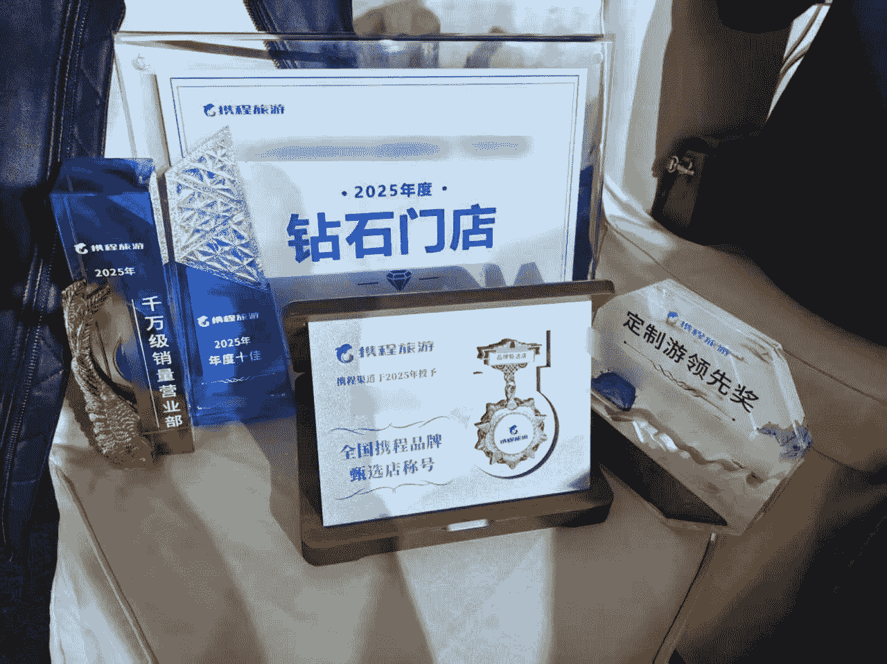
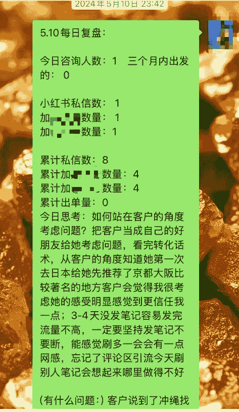
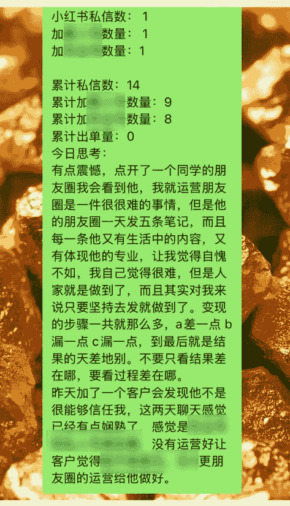
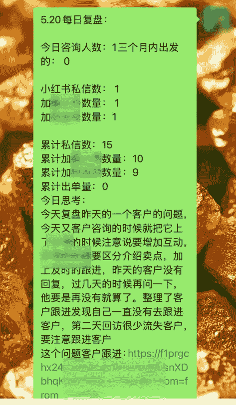
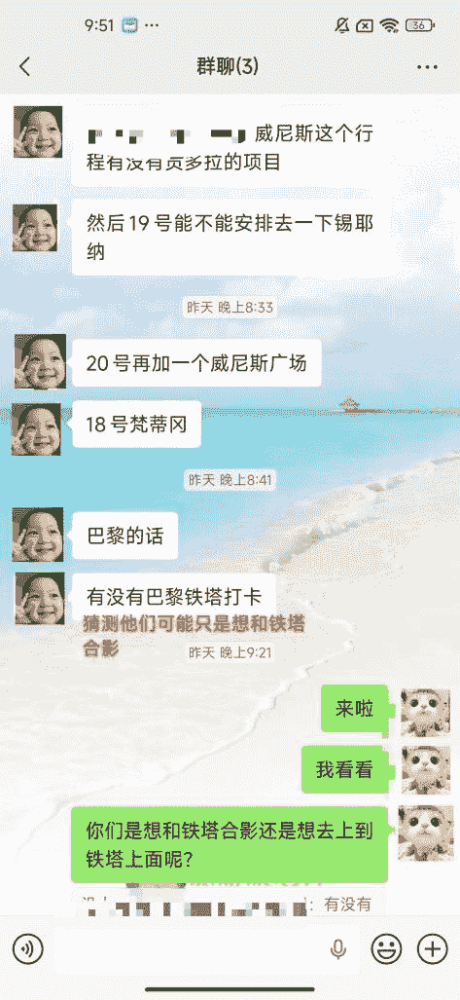
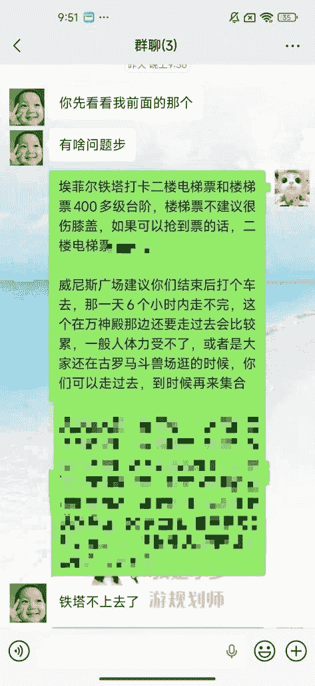
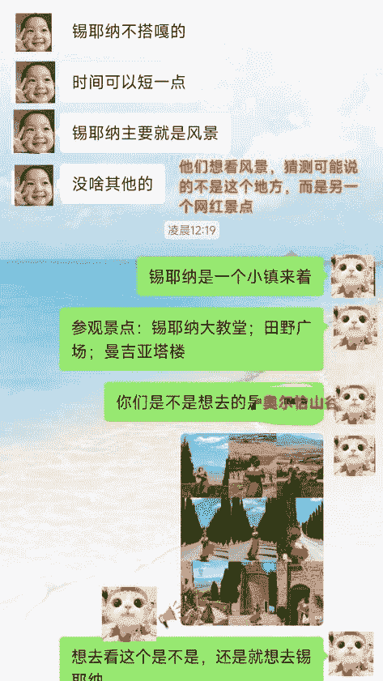

公众号懒人搜索，懒人专属群分享

# 深耕小红书旅游**2** 年：我如何把模糊咨询转成**3** 万客单

260804 副业SC 精华

整理：公众号懒人搜索，懒人专属群精选
懒人微信：lazyhelper1

大家好，我是蛙嘟嘟。

2024 年4 月1 日，我在寻找副业的阶段加入了生财。当时在航海项目里，我同时看到了两个方向：小红书旅游和无货源电商。

因为之前帮朋友做过小红书考研运营，对平台的内容和流量规则有一些了解。考虑到能力迁移，我最终选择了小红书旅游。

不知不觉，这个项目已经做了两年多。目前我主要做欧洲定制游，客户来自小红书和抖音，去年团队做了携程定制游板块第一，销售额浙江第六。刚开始的时候，我以为做旅游最难的是流量。真正做进去以后才发现，有流量只是第一步，后面还要解决客户需求、销售转化、产品选择和供应链交付。

尤其是欧洲定制游，客户刚来咨询时，往往只会说“想去欧洲看看”“一家人出行”“不想太累”，需求其实非常模糊。

怎么通过不断追问，找到标准产品无法满足的点，再把这些需求变成客户愿意付钱的定制方案，是我这两年重点积累的一项能力。

这篇文章主要复盘以下内容：

- 一、我是如何在生财航海里发现小红书旅游，并根据能力迁移选择这个项目的？
- 二、新手期不懂产品和目的地，我如何给自己制定**30** 天学习路径？
- 三、流量来了却接不住，我是如何补齐销售和转化能力的？
- 四、如何把客户的模糊咨询聊明白，找到未被满足的需求，再变成一份愿意付钱的定制方案？
- 五、从日本路线、国内旅游到欧洲定制游，我为什么不断调整产品方向？
- 六、供应商临出发前**10** 天取消行程，让我明白了什么才是旅游项目真正的壁垒？
- 七、如果普通人想进入小红书旅游，我会建议按照什么步骤开始？

这两年，我也在淡季焦虑时尝试过抖音CPS、公众号爆文等其他项目。但最后发现，与其不断更换项目，不如把已经积累的流量、转化、产品和供应链能力继续做深。

一个赛道只要持续深耕，把遇到的问题一个个解决，总会找到属于自己的机会。

写在最后，也想感谢一路上帮助过我的人。

如果说我能够一直留在旅游这个赛道，除了自己的坚持，也离不开在生财认识的很多小伙伴。

感谢林枫。在我做旅游的过程中，你给了我很多帮助和框架性的建议。很多时候，我只能看到眼前的某一个问题，是你帮我重新梳理事情，让我知道问题出在哪里，接下来应该往哪个方向走。

感谢阿明。是你鼓励我参加航海家大会，让我对AI 有了新的认识。每次遇到好的东西，你总会记得我，也一直鼓励我去组局、认识更多的人，尝试一些以前不敢做的事情。

也特别感谢吴泽承。我们是在航海家大会上认识的，是你鼓励我把自己的经历写出来。每当我写稿子遇到卡点，你总会在关键的时候出现，陪我梳理问题，找到继续写下去的方向。

## 先简单说一下我现在在做什么

我叫蛙嘟嘟，做小红书、抖音旅游已经两年多了，目前主要做欧洲定制游。去年也做了携程定制游板块的第一，浙江第六。

前端是在小红书和抖音上发内容，让对欧洲旅游、跟团游或者定制游有需求的人看到我；客户产生咨询以后，我再去了解他的需求，给他匹配合适的产品或者路线，完成转化和成交；成交以后，则由供应商和后端团队负责具体交付。

整个流程可以简单概括为：

内容获取流量**→**客户咨询**→**了解需求**→**匹配产品**→**转化成交**→**供应商交付。

刚入行的时候，我以为这里面最难的是流量。后来有了流量，我发现最难的是转化；等转化能力慢慢跟上以后，我又发现，真正容易让人翻车的，其实是供应链和交付。

## 一、为什么选择旅游？我是在生财航海里发现小红书旅游的

2024 年4 月1 日，我加入生财。那时我在找副业，想找一个能长期积累的项目。

在这之前，我曾经帮一个朋友做小红书考研运营，所以对小红书的规则和内容运营有一些了解。后来因为各种原因，我们没有继续合作，我也需要重新寻找一个方向。

我在生财的航海项目里看了两个方向：一个是小红书旅游，另一个是无货源电商。

我没有先去判断哪个项目看起来更火，而是先考虑自己的能力能不能迁移过去。

如果做小红书旅游，我只需要在原来的基础上，把内容类目从考研换成旅游，再去补旅游产品、目的地和销售转化的知识。小红书的内容逻辑、发笔记的方法，以及怎么通过内容获取流量，这些能力还是可以继续使用的。

但如果做小红书电商，我除了要重新研究内容，还要具备长期选品的能力。什么产品能卖、什么产品有利润、什么产品只是短期爆一下，都需要不断研究。这对当时的我来说，需要补的能力更多。

所以综合考虑以后，我选择了小红书旅游。

现在回过头看，我觉得当时做得比较对的一点，就是没有因为哪个项目看起来赚钱，就完全从零进入一个陌生的领域，而是选择了一个能够承接原来能力的方向。

很多人找项目的时候，会先问能不能赚钱。但对普通人来说，还要看自己需要补多少能力。旅游对我不是完全从零开始，需要改变的东西少一些，也就更容易先跑起来。

### 二、新手期没有捷径，我给自己做了一条**30** 天学习路径

刚开始做旅游的时候，我其实不懂旅游产品，也不懂目的地，更不知道客户问过来的问题应该怎么回答。

我唯一熟悉一点的，就是小红书。

所以新手期，我用的是一个比较笨的办法：把自己每天做了什么、学了什么、遇到了什么问题，以及复盘出来的内容，全部写下来。

我把要学的东西整理成一个30 天的学习路径，反向拆解自己每天需要完成什么。

这个学习路径没有多复杂，主要围绕四件事情展开。

第一部分，是补旅游行业的基础知识。我先去了解基本流程、专业术语，以及一个旅游产品从咨询、报名到最终出发，需要经过哪些环节。出境游客单价比较高，如果连产品都讲不清楚，客户很难建立信任。

第二部分，是学习目的地和相关团型。只学“怎么卖”是不够的，还要知道自己在卖什么。我会研究同行的产品和不同路线的安排。只有自己知道差别在哪里，和客户沟通时才不只是发一个价格，而是能告诉他为什么推荐这个产品。

第三部分，是继续研究怎么发笔记引流。这一部分我原来相对熟悉，但换了类目以后，还是要重新了解旅游用户关心什么。我会不断看同行发什么，再结合自己的理解去发笔记，发完以后继续复盘。

第四部分，是不断找同行聊天，了解他们的转化流程。刚开始的时候，我不知道客户来了以后应该怎么聊，只能找同行交流，看他们怎么了解需求、介绍产品，以及怎么从咨询走到成交。

我当时没有什么特别聪明的方法，就是一边学、一边做、一边记录。30 天不是为了成为专家，而是先把项目最基本的链路跑一遍。

## 三、客户需求怎么聊明白？从模糊咨询到愿意付钱

刚开始，我以为只要笔记有流量、有人来咨询，赚钱就是后面的事情。但很快我就发现，流量来了不等于能够成交。

那时候自己的销售能力没有跟上，导致很多流量白白流失。客户确实来问了，但我不知道怎么继续聊，不知道应该先了解什么，也不知道怎么把产品和客户的真实需求对应起来。

后来我才发现，客户刚来咨询的时候，给出来的需求通常都是模糊的。他可能只会问：“欧洲有什么路线？”“去十几天大概多少钱？”或者“有没有适合一家人走的行程？”

如果客户一问，我就马上发一个现成产品和价格过去，那我和其他卖标准团的人没有太大区别。客户拿着几家的行程和报价做比较，最后很容易只看谁更便宜。

所以后来我开始把更多精力放在一件事情上：不断挖掘客户的需求，直到找到现有产品没有办法满足的那个点。

客户什么时候出发、几个人出行、同行人的年龄、预算大概是多少、以前有没有去过欧洲、喜欢什么样的旅行节奏、最想去哪里、最不能接受什么，这些都要在聊天里慢慢问出来。

但挖需求不是像填问卷一样，一口气把问题全部扔给客户，而是根据客户说出来的信息继续往下问。

比如客户说“不想太累”，这句话还是很模糊。要继续问，他不能接受的是每天早起、长时间坐车，还是一天走太多路？如果是带父母出行，还要了解老人的身体情况和旅行习惯；如果是亲子家庭，就要知道孩子的年龄和兴趣；如果是蜜月，客户在意的可能不是多去几个景点，而是住宿、私密性和旅行节奏。

客户一开始说出来的，往往只是表面需求。真正影响他愿不愿意付钱的，是标准产品解决不了的那些细节。

把这些需求聊清楚以后，我会再区分：哪些是客户必须满足的，哪些是可以调整的，哪些是绝对不能接受的。然后再根据目的地的产品知识，去设计或者匹配方案。

这时候给客户的就不再是一份谁都能收到的标准行程，而是一份能对应他具体问题的方案。方案里的每一个调整，都要让客户知道是在解决什么：为什么这样安排路线、为什么这里多住一晚、为什么不推荐某个看起来热门的景点，以及预算主要花在了哪里。

客户愿意为定制方案付钱，不是因为行程表做得漂亮，而是因为他能明显感觉到：你听懂了他的需求，而且这份方案解决了普通产品满足不了的问题。

我后来理解的转化，不是靠几句话术把客户说服，而是把一个模糊咨询，一步步聊成清晰需求，再把这些需求变成客户能够理解、也愿意付钱的方案。

先用内容找到有需求的人，再通过不断追问找到未被满足的点，最后用专业方案把需求接住。

## 四、从日本、国内到欧洲，我不是一开始就找对了产品

在路线选择上，我也不是一开始就决定做欧洲定制游。

最早考虑的是出境游，主要做日本路线。日本路线的优点是价格相对低，也没有太多售后问题；但缺点也很明显，客户的决策和成交周期比较长，客服对接和后续交付也不够专业。

当时我想解决的是成交速度问题，所以后来转向了国内旅游。

国内旅游的成交速度确实快了很多，有时候一天可以成交好几个单子。这个阶段让我比较快地体验到了成交的正反馈，也让我熟悉了从流量到咨询、再到成交的过程。

但做了一段时间以后，新的问题又出现了：虽然订单数量多了，利润却比较低。

大概做了两个月，我就开始考虑寻找利润更高的方向，于是把目光转向了欧洲旅游。

转向欧洲以后，我开始系统学习欧洲相关的目的地和产品知识。因为前期已经有了一些积累，大概知道应该怎么和旅游客户沟通，也走过了从流量到成交的流程，所以这一次并不是所有东西都要重新学。

我主要需要补的是欧洲旅游的行业知识、目的地信息和不同产品之间的区别。把这些补上以后，就可以比较快地开始成交。

从考研运营转到旅游，是迁移内容能力；从国内旅游转到欧洲旅游，则是迁移前面学到的销售和转化能力。每一次都不是全部推倒，而是在原来的基础上多补一部分。

## 五、欧洲利润更高，但很快也会进入价格竞争

欧洲旅游的客单价和利润空间比国内旅游更高，但做的人也不少。

当大家卖的是差不多的产品时，很容易变成比价格。客户同时问几家，大家都在报相似的路线，如果自己没有其他区别，客户就只能看谁更便宜。但价格不可能一直往下卷，所以后来我开始做一些别人不太容易做的定制游。

定制游比卖标准产品复杂很多。你需要更了解目的地，也要更懂产品，还要根据不同客户的时间、人数、预算和偏好去做匹配。客户提出的问题也不会完全一样，需要每天不断学习新的知识。

但也正为这件事情比较复杂，真正愿意长期做、持续补专业知识的人并没有那么多。

我慢慢在这个过程中找到了自己的位置。客户买的不只是一个标准团，而是有人能够理解他的需求，再帮他找到更合适的路线和产品。

### 六、临出发前**10** 天被取消，我才真正理解供应链

我做旅游踩过最大的坑，是太相信自己的供应商。

当时有客人提前3 个月报了名，出发时间也已经确定好了。结果到了临出发前10 天，供应商突然取消了行程，导致客人按照原计划走不了。

最后，我被客人发到了网上，也经历了一次网暴。

客户提前几个月安排好了时间，可能请好了假，也做好了出行准备。临出发才被告知走不了，不是一句退款或者换时间就能轻松解决的。即使真正取消行程的不是我，站在客户面前、需要承担结果的人还是我。

旅游最麻烦的其实是客诉。很多时候，你可以要求自己把每一件事情做好，但是没有办法保证合作链条上的每一个人都和你一样认真。

所以我现在觉得，做旅游最重要的不只是找到一个价格低、产品看起来不错的供应商，而是找到真正靠谱、遇到事情能够一起解决问题的人。

判断一个供应商，不能只看他平时怎么介绍自己，更要看几个问题：产品能不能稳定交付；发生变化时能不能第一时间沟通；遇到客诉时会不会躲；出现问题以后，有没有解决方案和能真正负责的人。

这也是我做了两年以后，认为自己做得最对的一件事：开始把寻找靠谱的供应商放到非常重要的位置。

前端做流量和转化，是为了把客户带进来；后端有好产品和靠谱供应商，是为了真正把客户接住。少了任何一部分，这个生意都很难长期做下去。

## 七、重新做一次，我会把这套流程分成六步

如果现在让我重新从零做一次小红书、抖音旅游，我会把整个项目拆成六步。

**第一步，先选一个能够聚焦的产品方向。** 新手不要一开始什么目的地、什么产品都想卖。范围越大，需要补的知识越多，也越难让客户相信你是专业的。可以先从一个目的地或者一种产品开始，把常见路线、客户问题和产品差别研究清楚。

**第二步，用30 天补齐最基础的行业知识。** 先学习旅游行业的基本流程和专业术语，再研究目的地与相关团型。这里的目标不是30 天成为专家，而是先做到客户问基础问题时，自己知道应该往哪里找答案，也能看懂供应商提供的产品。

**第三步，持续发内容获取流量。** 研究同行的笔记和视频，观察用户真正关心的问题，再围绕这些问题做内容。不要只看点赞和收藏，还要看内容有没有带来真实咨询。旅游项目需要的不是表面热闹，而是有出行需求的人。

**第四步，练习从咨询到成交的转化。** 客户来了以后，不要急着发产品和报价。通过连续追问，把模糊咨询聊成清晰需求，找到标准产品无法满足的点，再区分客户必须满足、可以调整和不能接受的条件。最后用产品和目的地知识，把这些条件变成一份有明确价值的定制方案。

**第五步，筛选靠谱的供应商。** 除了价格和产品，还要了解供应商的交付能力、沟通效率、退改规则和处理突发情况的能力。能卖出去很重要，但卖出去以后能不能稳定交付更重要。

**第六步，根据成交和交付结果继续调整方向。** 如果成交快但利润低，就要考虑产品是不是需要升级；如果流量多但成交少，就要补转化；如果成交没有问题但客诉多，就要回头检查供应链。

我自己从日本路线转到国内，再从国内转到欧洲定制游，本质上也是不断根据结果调整。不是一开始就选中了最好的方向，而是每次只解决当前最重要的一个问题。

## 八、普通人能不能做？我觉得先学会搞流量

很多人会问，普通人能不能复制这条路径。

我觉得可以尝试，但不是买一套资料、发几篇笔记就能马上成交。旅游是一个需要持续学习，也需要承担服务和交付责任的项目。

如果一定要选一个最先学习的能力，我觉得还是流量。

因为有流量，你才有机会接触真实客户，才知道客户在问什么、担心什么，也才有机会练习转化。没有流量，后面的产品和销售很难通过真实反馈得到验证。

而且流量本身就有价值。如果现阶段只会做内容，还不懂产品和转化，可以先把流量对接给能够承接的团队；等自己对行业和产品更了解以后，再尝试自己完成转化。

但如果想长期自己做，只有流量还不够。还要补产品和目的地知识、销售沟通能力，以及供应链判断和风险意识。客户愿意为专业判断付费，高客单项目一旦交付出问题，损失的也不只是这一单收入，还有客户信任和自己积累的口碑。

这个方向现在还有没有机会？我觉得有，但机会并不在“竞争少”。旅游内容有人做，欧洲路线也有人卖，价格竞争同样存在。

真正的机会在于，这件事情需要同时做好内容、转化、专业知识和交付，链路比较长。很多人可能会其中一项，但愿意把整条链路慢慢做深的人没有那么多。

复杂会提高入门难度，但也会慢慢变成留下来的人的壁垒。

## 九、淡季折腾了一圈，我还是回到了旅游

旅游行业有明显的淡旺季。淡季没有赚到钱的时候，我也会焦虑，也尝试过很多新的项目。

我做过抖音CPS，也做过公众号爆文。那段时间的想法很简单：是不是换一个项目，就能解决现在的问题？

但做了一圈以后，我发现这些项目带我的正反馈，都没有做旅游那么强。

后来我又坚定地回到了自己的老本行。

因为我已经在旅游里积累了流量、销售、产品和目的地知识，也踩过供应商的坑。如果换到一个全新的项目，这些东西很可能又要重新开始。今年继续坚持做这件事情以后，我发现，当自己把内容、沟通、产品和交付一点点做好，客户的成交反而会变得更加自然。

## 十、接下来，继续深耕欧洲定制游

我下一步还是会继续深耕欧洲定制游。

公众号懒人搜索，懒人专属群分享

# 一方面继续补目的地和产品知识，让自己能够接住更复杂的需求；另一方面继续筛选靠谱的供应商，把前端流量、转化和后端交付连接得更稳定。

我不会说自己已经把这件事情完全做明白了，目的地、产品和客户需求都在变化，每天还是会遇到新的问题。但和两年前相比，我至少知道：流量带来客户，转化带来成交，好的产品和靠谱的供应商决定这个生意能不能长期做。

如果有同样在做欧洲旅游、定制游，或者其他高客单项目的老板，也欢迎一起聊聊。不同项目的产品不一样，但关于流量、转化、信任和交付，很多底层问题其实是相通的。

最后也想把自己这两年最大的一个感受送给还在找项目的人：

直接进入一个全新的领域，是一件很困难的事情。但如果能基于自己原本的业务和能力，向外拓展一点，每次只改变一点点，就会更容易拿到正反馈。

这个世界永远存在二八法则。

与其在焦虑的时候不断更换项目，不如先把一件事情做深。流量不行就补流量，转化不行就补转化，产品不行就换产品，供应链不行就重新找能够一起解决问题的人。

把遇到的问题一个个解决，时间久了，这些解决过的问题，就会慢慢变成自己的壁垒。

————分割线————

看完这篇 SOP，你觉得你懂了。但 90% 的人一到实操就会卡在第一步。

工具和教程只是最低级的壁垒，真正的壁垒是“立刻动手”和“圈层信息差”。

如果你想看全网最新的变现玩法，并且和一群执行力极强的极客一起下场拿结果，欢迎围观我的核心私域：【懒人专属群】。

我们不聊虚的，只做商业闭环的拆解与 AI 效率的压榨。系统内已沉淀 1000+ 跑通的套利实战局。

👉 查阅圈子完整数字资产与上车门槛：

https://lazyso.com/insider/

认同价值、准备好下场干活的，扫码加我微信（lazyhelper1）

备注：【实操上车】，不闲聊

