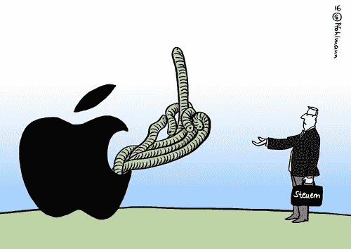

# 做合规、强制执行十几年，分享 OPC、创业者必看的放大思路，帮大家少踩坑

260805 副业 SC 精华

整理：公众号懒人搜索，懒人专属群精选

懒人微信：lazyhelper1

大家好，这边是 Tao，学法律出身。

AI OPC 让一个人或者很少几个人，借助 AI 能快速完成过去需要一个团队才能干的事。产品上线了，订单成交了，流水开始增长。看起来一切都在往上走。

但这边在做强制执行（简单来说：合法追债）和给企业做咨询时反复看到一种现象：项目越往后走，风险越容易集中在创业者本人身上。

卧龙先生线下分享金句之一：AI 让我开发更快，也让我犯错变得更快。PS：不得不感叹，卧龙先生这样的年纪，竟有如此之觉悟。这份工作让这边接触过大量案件，标的从上百万元到上亿元不等。其中一些被执行人，曾经也是大家眼里的大老板。

至少在一段时间里，他们的项目、能力或者资源得到过市场认可。

可最后，他们还是出现在了执行案件里。

比起他们最后欠了多少钱，这边更关心另一个问题：一个曾经成功而体面的人，究竟是怎样一步步失去回旋余地的？

现在，这边也在从 1 到 10 的路上。不是什么已经功成名就的人回来给大家讲标准答案，而是同样在摸索、同样在避坑的人，把观察到的一些规律分享出来，供大家参考。

生财已经有大量帖子和航海在教大家怎么从 0 走到 1，这部分不展开。也不是写给已经做到 10 甚至 100、需要考虑公司架构和资本运作的人（那个阶段如果以后有机会再单独写一篇）。

基于这些经历，一直想写一篇帖子，聊一件这边认为非常重要的事：除了不主动负债，AI OPC 在放大的过程中，怎么让创业者本人“活下来”的概率也放大。相关观察也不只是来自执行案件。

这边此前在房地产公司做过法务负责人。房地产行情好的时候，见过一些人因为拆迁、卖房、销售佣金或者投资赚到远超工资的钱；也见过有人尝到第一次红利以后，继续买房、加杠杆、扩大投入，并逐渐相信房价还会继续上涨。

小插曲：回过头看，这边接触的拆迁户后面大多过得不“如意”。

当偶然或者一种经验连续正确几次以后，人很容易忘记：“成功”可能来自能力，也可能只是同一阵或几阵风连续吹了很长时间的结果。到了今天，房价、流量、平台红利和 AI 项目看起来完全不同，但人的反应并没有发生太大变化。第一次赚到钱以后，我们很容易高估自己的判断力；连续几次做对以后，又容易低估那些还没有发生的风险。

另外，这边还有一些来自家庭内部的观察。爷爷和父辈两代人，都经历过从有到无的过程。看着身边的人怎么把一手好牌打烂，怎么在成功之后快速膨胀，又怎么在泡沫破裂时无力回天。这些经验虽然不是这边亲身经历的，但从小看到大，印象很深。

好的，接下来我们进入正题，谨供参考。

## 反过来想：把创业做成一场“无限概率游戏”

“无限概率游戏”这个说法，忘了最早是在哪听到的。这边对它的理解很简单：

创业不应该是一条命的游戏。

### 一命通关，难度大

一条命的玩法，是把个人积蓄、家庭生活、信用和未来现金流全部押在一个项目上。项目一旦失败，结束的不只是项目，你自己也会被一起拖进谷底。就算后来看到新的机会，也可能已经没有钱、没有时间、没有精力重新开始。

无限概率游戏不是让你同时铺开很多项目，也不是说尝试得够多就一定能成功。

它真正的前提是：每一次下场都认真提高这次成功的概率，同时控制失败的影响范围，给自己保留下一次下场的资格。大家都喜欢听“置之死地而后生”的故事。一个人押上全部身家，熬过至暗时刻，最后逆风翻盘，这种故事非常有戏剧性。

不否认确实有人这样成功过。但这里面有一个很容易被忽略的问题：幸存者偏差。

那些押上全部身家、最后没能活过来的人，鲜有人去采访他们。即使有人报道，传播力度也远远不如那些逆风翻盘的故事有噱头。你听到的、看到的，绝大多数都是那些“死而后生”的人。这就很容易造成一种错觉——好像不把一切押上去，就不足以证明自己全力以赴。

但真实的情况是：更多人押上一切之后，并没有迎来反转，而是从此出局。他们没有机会再开下一局，而他们的故事，也很难像翻盘故事那样被广泛传播。

真正能够持续成功的人，往往不是那些把命押在一局上的人，而是那些设计了一种模式，让自己可以反复下场的人。他们不追求一局定胜负，而是追求：即使这一局输了，我还有资格再开下一局。每输一局，就总结一局的经验，带着更厚的筹码和更准的判断重新上场。这样循环下去，成功的概率自然会越来越大。

这才是“无限概率游戏”的真正含义——不是赌命，而是设计系统。

君子不立危墙之下。并不是不敢抓住机会，而是没有必要让一个项目同时决定自己的公司、个人资产、家庭生活，以及未来几年还能不能重新开始。

芒格在演讲里反复引用过一个乡下人的智慧：“要是知道我会死在哪里，那我将永远不去那个地方。”他自己管这叫逆向思维——与其琢磨怎么成功，不如先琢磨怎么不失败。

说到这，得老实交代：这边没有资格、也没有能力教大家怎么从 1 做到 10，更教不了怎么从 10 做到 100。成功的路径实在太多了，不同行业、不同资源、不同时代，很难被压缩成一套人人照着执行就能成功的公式。这边自己也还在路上，不是已经到达终点的人。

这边能做的，是把观察到的一些“死法”讲清楚。

成功的路千千万万，但死法来来去去就那么几种。项目扩张太快会死，现金流断了会死，合作没谈拢会死，个人和公司的钱混在一起会死，一头扎进不熟悉的领域也会死。翻来覆去，就是这几条老路。

所以这篇文章不讲怎么成功——那个你们比我懂，生财里也有大量优秀的帖子和航海在讲及教。这边只讲怎么避开那些最常见的死法。只要你不死，就有机会慢慢摸索出属于自己的成功路径。

今天想和大家分享的，就是这个阶段观察到的一些容易踩的坑，以及这边的一些思考及建议。

## 一、项目开始赚钱以后，为什么不能一直用个人身份承接？

项目还在 0 到 1 的阶段时，可以用轻的方式先验证，不必刚有一个想法就急着成立公司。

但当项目开始持续产生收入，合同、客户、资金和经营资产逐渐增加，这边通常会建议重新检查几件事：

- 合同由谁签？
- 客户的钱进了哪个账户？
- 内容、账号属于谁？
- 项目出了问题，由谁承担？

如果这些问题的答案始终都是“我个人”，那项目虽然已经开始往 1 到 10 走，所有风险却还集中在你一个人身上。

### 先讲一个最直接的对比

假设项目做砸了，欠了 100 万。

如果你用的是个人身份：这 100 万就是你个人的债。债权人可以起诉你个人，查封你名下的房产、车辆、存款，甚至影响你的征信和出行。你个人赚的钱，首先要拿来还债。项目失败了，你的生活也跟着塌了。

如果你用的是公司：原则上，这 100 万由公司承担。公司资产赔完之后，如果公司没有违规操作，你个人不需要额外掏钱。公司可以破产，可以注销，但你个人的房子、车子、存款，不会因为这个项目被直接拿走。项目失败了，你还有机会重新开始。

这就是公司制度最朴素也最有用的价值：把“项目死了”和“创业者死了”这两件事分开。

### 公司为什么值得在这个阶段认真考虑？

《人类简史》讲标致公司的时候，解释过一个很重要的变化。

过去，一个人直接以自己的名义做生意。签合同的是他，借钱进货的是他，项目失败了，对外承担责任的还是他。生意和这个人绑在一起，债权人找的也是他和他的个人财产。

后来，现代商业制度在自然人之外，又创造出一个能够替股东独立经营和承担责任的主体：公司。

公司没有血肉，却可以拥有财产、签订合同、取得收入、借钱、欠债并承担责任。

一项业务由公司承接以后，合同由公司签，收入进入公司，经营资产由公司持有。项目出了问题，原则上先由公司用自己的全部财产承担债务；有限责任公司的股东，通常以自己认缴的出资额为限承担责任。

在我看来，公司很重要的一个价值就是：它可以把“一项生意失败”和“一个创业者彻底出局”这两件事分开。公司或者项目失败以后，如果经营边界一直清楚，你仍然有机会整理残局、总结经验，再重新开始。

当然，公司不是万能护身符。从这边接触过的执行案件来看，个人担保、没有履行出资义务、公私财产分不清，仍然可能把风险重新带回个人。

### 公司经营收入和个人收入，最大的区别是什么？

区别之一在于资金路径和税务处理逻辑不同。

个人端：以工资薪金为例，支付方在向你支付时，就需要依法预扣预缴个人所得税。也就是说，钱还没到你手上，税就已经被扣过一遍了（当然后面还有个人所得税年度汇算清缴）。到手之后，才是你可以自由安排的税后资金。其他类型的个人收入，比如劳务报酬、稿酬等，也遵循类似的逻辑——收入发生时，税款同步处理。

公司端：公司取得经营收入以后，是先核算收入和支出，再根据最终的经营结果来计税。真实的、与经营有关的成本、费用、税金、损失等，在计算应纳税所得额时可以依法扣除。也就是说，公司是先把钱花在经营上，剩下的部分才需要考虑税的问题。

这两条路径的差异，本质是：个人端是“先税后花”，公司端是“先花后税”——真实经营成本在税前发挥作用，有盈利才进入企业税负逻辑。此外，国家为了鼓励创业和小微企业发展，在公司层面设置了多种税收优惠政策。具体的优惠政策和适用条件，建议咨询专业的财税顾问或当地税务机关，以最新规定为准。

### 什么时候应该从个人或个体户切换到公司？

没有一个适合所有人的固定收入数字。

有人收入暂时不高，但已经收了大量预付款，需要长期交付和承担退款责任；有人收入较高，但客户分散、业务简单，也没有复杂的人员和后续义务。两者面对的风险不一样。

从观察到的情况来看，出现下面这些变化时，就可以认真考虑切换经营主体了：

- 收款从偶尔试单，变成持续、重复发生
- 开始收取预付款，承诺长期服务、退款或售后
- 企业客户开始要求正式合同、发票、对公结算和供应商准入
- 开始使用员工、外包人员或供应商共同交付
- 商标、软件、课程、账号和客户资料等经营资产逐渐积累
- 一个订单失败，已经可能带来较大的退款、赔偿或履约压力
- 准备引入合作者、资金，或继续扩大业务

如果业务比较轻、主要由你本人提供服务，也可以评估个体工商户。

但个体户和有限公司不一样。个人经营产生的债务，由个人财产承担；家庭经营或无法区分的，可能由家庭财产承担。它解决了登记、签约和开票的问题，但不能提供与有限公司相同的责任边界。这一点在做决定之前值得了解清楚。

### 从个人切换到公司，具体怎么做？

这边见过的顺利切换的案例，通常走了这几步：

第一，设置一个明确的切换日期。从某一天开始，新合同、新订单、新收款、新发票和新交付，统一由公司承接。

第二，把尚未结束的旧业务单独列出来。哪些合同还没完成，哪些客户款还没收到，哪些订单可能退款，哪些售后责任还在继续，分别列清楚。

第三，把真正的经营资产迁移过去。商标、域名、平台账号、软件代码、课程内容、合同模板和客户资料，都要确认现在属于谁、由谁控制。不能只把收款码换成公司的，其他核心资产还全部留在个人名下。

第四，从下一笔交易开始保持一致。原则上，谁签合同，就由谁收款、开票和交付。出现不一致时，要有真实原因和完整记录。

完成切换的标志，不是拿到一张营业执照，而是客户清楚自己在和谁交易，你也能说清楚钱属于谁、资产属于谁、责任由谁承担。

### 公司成立以后，怎么避免“开了个寂寞”？

从这边接触过的案件来看，有些人虽然成立了公司，关键交易仍然全部围着股东个人转：

- 合同写的是公司，客户款却长期进入股东个人账户
- 业务由公司完成，公司收入却和家庭消费混在一起
- 股东从公司拿钱，却说不清是工资、报销、借款还是分红
- 公司承担不了项目资金时，股东借款、个人担保和家庭资金马上补进来

这样的公司虽然有营业执照，合同、资金和责任却仍然系在股东个人身上。到了纠纷发生的时候，法院很可能会认定公司和股东的财产没有分开。

这边的建议是，可以长期留意这三件事：

第一，公司的业务尽量由公司签约、收款、开票和履行。不要图方便走个人账户。

第二，公司与股东个人之间的每笔钱，都能说清用途。公司开始稳定赚钱以后，可以根据股东实际从事的工作，给股东发清楚的工资或报酬，再从个人账户安排生活。这样进出都有据可查。

第三，个人担保、家庭资金和大额长期承诺，不要因为拿到一个客户或一次融资机会，就未经评估直接接进来。这边见过太多案例，一个担保就把股东和家庭拖进去了。

### 为什么只有一个股东的公司更麻烦？

很多做 AI OPC 的朋友，注册公司时很自然地就写了一个股东——因为确实就是一个人在做，觉得没必要拉别人进来。

这个想法可以理解，但有一个潜在风险需要知道。

站在申请执行人的角度，说句实话，其实挺喜欢看到被执行公司只有一个股东的。

不是因为公司只有一个股东，这个股东就一定要替公司偿还全部债务。

真正的原因是，很多小公司长期由一个人控制账户、收款和花钱，到了纠纷发生以后，股东往往很难拿出一套持续、完整的材料，证明公司的钱和股东个人的钱始终相互独立。

现行《公司法》规定，只有一个股东的公司，如果股东不能证明公司财产独立于自己的财产，可能需要对公司债务承担连带责任。

这里有个关键点需要说清楚：一人公司实行举证责任倒置。也就是说，不是债权人去证明你和公司财产混同，而是反过来——需要由股东自己来证明公司财产独立于个人财产。

而在实践中，股东要完成这个自证，难度非常大。通常需要提供：每一会计年度终了时编制的、经会计师事务所审计的财务会计报告；公司账户与股东账户严格分离的银行流水；股东与公司之间每一笔资金往来的清晰凭证；公司独立的财务报表、账簿和凭证。

对于 AI OPC 这种小团队来说，长期把账户、合同、发票、工资、报销、借款和利润分配全部做得足够清楚，实际上并不容易。

从债权人的角度看，这就多了一条继续向股东追责的路径。

商业上的 AI OPC，不等于公司只能有一个股东。前者说的是一个人或很少的人怎么完成业务，后者说的是公司的股权和责任怎么安排。

所以这边的建议是：没有必要仅仅因为业务主要由一个人完成，就默认成立一家只有一个股东的公司。如果已经成立了只有一个股东的公司，业务中又确实有值得长期合作、彼此信任的人，也可以结合真实的合作关系，通过增资等方式引入新的股东，调整公司的股东结构。

公司解决的是谁来承接经营和项目后果的问题。

但即使业务已经装进公司，人本身仍然要面对收入波动。项目还没完全稳定，生活不会暂停。

接下来聊第二件事。

## 二、怎样建立一套不会被生活逼停的财务保障计划？

财务保障不是创业者才需要。

工薪族也可能遇到失业、欠薪和收入下降。创业者、自由职业者的收入更加不稳定，更需要提前为自己保留一段缓冲时间。

以前在企业做法务时，曾经遇到公司经营出现问题，有半年没有正常领到工资。工资后来补齐了。当时之所以还能选择暂时留下，继续积累诉讼和执行实战，并不是因为欠薪无所谓，而是此前已经存下一笔钱，大约能够支撑在没有收入的情况下生活一年。

这段经历让我真正意识到：

财务保障不能保证每一次选择都正确，但它能避免一个人因为“下个月必须见到钱”，被迫作出原本不会作出的决定。下面是我的做法和一些思考，供你参考。

### 第一步，算出每个月不能暂停的必要支出

不是按照原来的工资计算，也不是计算维持全部生活方式需要多少钱。

需要计算的是，即使收入突然中断，哪些支出仍然不能停止。

一般包括：住房、基本饮食、必要交通、到期债务、必要医疗，以及对子女、父母等家庭成员承担的固定责任。

这边的参考标准是：

**财务保障目标 = 当前每月必要支出 × 6—12 个月。**

如果每月必要支出是 1 万元，财务保障目标就是 6 万至 12 万元。

6—12 个月不是适合所有人的统一答案。收入越不稳定、家庭责任越重、重新获得稳定收入需要的时间越长，准备就应当越谨慎。

### 第二步，每一笔个人收入到账以后，先留下 10%

这笔钱不需要一次存满。

比较容易长期执行的办法是：每一笔真正到达个人账户、可以由个人安排的收入到账以后，先把 10% 转出来存好，剩下的钱再拿去消费和安排生活。顺序很重要。先存后花，才能真正存下钱。如果想着“月底剩多少再存多少”，大概率是剩不下来的。

工资、奖金、兼职收入、劳务报酬，以及公司实际发给你的工资、报酬或者已经分配到个人账户的收益，都可以按照这个规则处理。

但是下面这些不算个人收入：

- 公司营业流水
- 公司账户余额
- 尚未收回的应收账款
- 借来的钱

预计很快收到但实际上还没有到账的钱

即使公司只有你一个股东，公司账户里的钱也不能直接拿来计算个人的 10%。

如果留下 10% 会影响必要生活或者已经到期的义务，可以先降低比例，以能够长期执行为准。

真正重要的不是某一次存得多，而是每一笔个人收入到账时，都先完成同一个动作：先存，再花。

### 第三步，把这笔钱和日常消费分开

最好单独准备一个账户。

这笔钱主要处理收入中断、必要医疗和家庭突发事件，不用于冲动消费，也不要在项目缺钱时默认拿来填项目。

如果因为这些情况动用了这笔钱，不代表计划失败。这笔钱本来就是为这些时刻准备的。

下一笔个人收入到账以后，再继续补充。

### 第四步，每隔 1—2 年重新计算

必要支出不会永远不变。

家庭成员增加、住房支出变化、债务变化、医疗和赡养责任提高，都会改变财务保障目标。

所以，可以每隔 1—2 年重新完整计算一次；如果家庭情况发生明显变化，就提前调整。

这套计划最终保护的，不只是几个月的生活费。

它保护的是一个人在收入中断以后，仍然有时间判断、选择和重新开始。

## 三、一张大单、一个大客户、一个长账期，怎样避免把现金流拖垮？

大客户（尤其是 ToB）当然值得争取，但大客户不是唯一的选择。

从这边接触过的执行案件和与实体行业老板的交流来看，一张金额很大的合同，往往也意味着更大的前期投入、更长的交付周期、更复杂的验收，以及更晚才能收到的钱。

一个值得关注的现实是：在车企供应链里，18 家乘用车上市车企应付账款及票据总额超过 1 万亿元，平均付款周转天数 216.68 天。部分车企通过“60 天账期 + 180 天供应链”等组合设计，把供应商的回款周期拉长到 8 个月。供应商为了保住订单，往往不敢轻易打破这种平衡，结果是资金实力弱的玩家被加速洗牌出局。

这不是车企独有的现象。大客户、长账期、年降压价，几乎是产业链里的常态。对小团队、单人团队来说，接这样的大客户，表面上是“拿到了大单”，实际上可能是用自己的现金流在补贴对方的账期。

### 令人又爱又恨的果链

很多成熟的团队和创业者，用的是一条截然不同的路：主动设计客户结构。不一定要把所有筹码押在一个大客户身上。可以考虑：

- 分散客户：找多个付款更稳定、合作更轻的中小客户，而不是只依赖一个大体量客户。
- 优先选择回款快的客户：有些小客户付款能力可能不如大客户强，但付款周期短、流程简单、压价少，综合下来对现金流反而更友好。
- 长账期大单要算清总成本：如果一定要接，必须先把资金占用成本、机会成本、催款成本算进去，再决定是否接、接多少。
- 警惕单一客户依赖：当大部分收入开始依赖单一客户时，你的谈判地位会急剧下降，对方可以随时要求降价、延长账期，而你不敢拒绝。这时候不是你在挑客户，是客户在挑你。

客户结构的本质，是不要把“是否活得下去”寄托在任何一个单一客户身上。多个客户、分散收入、稳定回款，有时候比“拿下一个超级大客户”更安全，也更可持续。

当然，如果能拿到大客户、又能谈到合理的付款条件，那是最好的。但如果大客户开出的条件是 6 个月甚至更久的账期、逐年降价、无限责任，那就要认真权衡：这笔单子带来的，究竟是增长，还是陷阱？

### 签约前，先画出现金流时间表

不要只计算合同总额和预计利润。

这边的习惯是，先按时间写清楚：

- 项目启动以前，需要先支付哪些钱。
- 每个阶段需要完成什么交付。
- 客户在什么条件下付款。
- 谁负责验收，验收需要什么材料。
- 如果付款晚一个月或者三个月，现有资金还能不能继续完成项目。

尚未到账的合同款，不要提前当成可以使用的现金。更不要因为签了一张大合同，就马上扩充团队、提高个人消费或者把预计利润投入另一个项目。这个坑见过不少人踩过。

### 让付款、交付和验收分段对应

能够分阶段完成的项目，尽量不要等到绝大部分工作已经做完，再统一等待尾款。

- 项目启动，对应启动条件和启动款。
- 完成一个明确阶段，对应一次确认和付款。
- 上一阶段的条件没有完成，先判断是否继续进入下一阶段。
- 最终交付、尾款和后续服务的起算点，也要提前写清楚。

具体比例没有统一答案，可以根据你和客户的实际情况商量。

这边的原则是：不要在尚未取得相应回款时，已经承担了绝大部分成本和责任。

### 看具体交易，不要只看客户名气

签约前至少要弄清楚：

- 实际签约、付款和开票的是哪一个主体。
- 与你沟通的人有没有相应权限。
- 谁负责验收，谁推动付款。
- 付款是否需要经过预算、采购或者多层审批。
- 合同里的付款期限，从哪一个条件完成以后开始计算。
- 项目暂停、需求变更或者提前结束时，已经完成的部分怎样结算。

客户名气越大，内部流程有时反而越长。不能只看到对方的规模，却没有看清这一次交易真正怎样运转。

### 回款出现问题以后，不要无限增加新交付

付款节点没有兑现时，先判断卡在哪里。

是交付存在争议，验收没有完成，资料不齐，内部付款流程没有启动，还是对方的付款能力已经发生变化。

原因不同，处理方式也不同。

但无论哪一种，这边的建议是：不要在旧账没有解决时，继续无限增加新的工作。

合同、交付、验收、发票、对账和催款沟通，也要在每个阶段及时保留。

更不要用个人借款、个人担保和家庭资金，无限桥接一笔已经失去控制的应收款。

大单只有变成能够覆盖成本和责任的现金流，才真正增加项目的安全性。

## 四、项目准备与人合作或者引入资金时，怎样避免风险重新回到个人和家庭？

一个人想继续放大业务，迟早需要借助别人的资金、能力、渠道或者交付。

但合作不是签一份股东协议、成立一家公司，就自动稳定了。

这边曾经和一个熟人合作成立过一家公司。项目本身赚到了钱，但双方对各自做了多少、应该怎样分配收益，有不同的理解，最后公司还是散了。

这段经历让我认识到：

项目赚钱，不等于双方适合长期绑在一起。

### 先合作做事，再决定要不要共同持股

如果双方还没有共同做过真实项目，可以先围绕一个边界清楚的项目合作。

至少提前写清楚：

- 双方分别交付什么。
- 各自投入资金、时间、技术、渠道还是客户。
- 项目成本由谁承担。
- 收入怎样结算。
- 内容、代码、账号、客户资料和其他成果属于谁。
- 一方中途退出，已经完成的部分怎样处理。

先共同经历一次真实交付、一次需求变化、一次进度延迟或者一次意见不一致，再决定是否值得成立公司、长期合作或者共同持股。

先验证合作，后讨论股权，但不等于项目验证期可以只靠口头信任。

### 每一笔进入项目的钱，都要先说清楚是什么

一笔钱进入项目以前，先回答几个问题：

- 它是股权出资、借款、垫付款，还是某项服务的费用？
- 是谁支付的，进入了谁的账户？
- 这笔钱以后需不需要返还？
- 项目没有做成时怎样处理？

同一笔钱，项目开始时没有说清楚，项目失败以后就可能出现完全不同的解释。

### 引入资金时，最隐蔽的坑：个人担保

很多创业者拿到投资或者借款时，对方会说：“你个人做个担保就行，走个形式。”

这一签字，就把个人资产和公司债务重新绑在了一起。公司将来还不上钱，债权人可以直接找你个人追偿。本来公司已经把风险隔离开，一个个人担保又把风险引回了自己身上。

这边的建议是：尽量不要用个人担保。如果对方坚持要担保，可以尝试用公司资产抵押、股权质押等方式替代。如果实在绕不开个人担保，那就要清楚：这笔担保的上限是多少？最坏情况下，你个人能不能承受？

还有一种更隐蔽的情况：股东不断以个人名义向公司输血——今天转 10 万，明天转 20 万，从来不说是借款还是出资。一旦公司出事，这些钱的性质就会变得非常模糊。债权人可能会主张这是股东出资不实，要求你个人补足。所以，每一笔进入公司的钱，都要说清楚是出资、借款还是垫付。

家庭资金更不应该成为项目默认的无限兜底。配偶、父母的钱准备进入项目以前，也要把提供人、用途、性质和能否承受损失说清楚。

家人同意转账，不等于相关风险和退出方式已经安排好了。

合作不等于立即共同持股，借力不等于个人无限担保，家庭支持也不等于家庭成为项目资金池。

## 五、赚到钱以后，不要盲目投自己不懂的项目

AI OPC 发展到一定阶段，手里有了些积蓄，免不了要接触新的领域——理财、投资、资产配置。

这时候有一个非常隐蔽的坑：把钱投进自己不懂的项目，然后交给别人管理，自己再也不闻不问。这边见过不少案例，创业者辛辛苦苦赚来的钱，最后亏在了自己完全不了解的领域——餐饮、影视、矿产、私募基金……什么五花八门的项目都有。

共同点是：投钱的人自己看不懂业务，也不参与经营，全权交给所谓的“专业人士”或者合作伙伴去打理。

结果往往是：钱没了，才知道自己投的是什么。

### B 站 UP 主讲述投资被骗

自己不熟悉的领域，要么花时间去学，学到能看懂、能判断的程度；要么就别碰。

指望别人替你管好钱、替你做好判断，最后很可能人没了，钱也没了。

PS：就如亦仁老大一篇帖子里曾经说到的：就算你交由别人投资赚到了钱，于你本人认知及能力也没帮助及提升。

这个坑，和前面四个一样致命。

## 真实案例：几种常见的剧本

前面聊了几个死亡之地，可能还是有点抽象。这边用几个真实故事来对照一下。

### 剧本一：赚到钱了，但没有守住

这边在办执行案件时，见过最典型的一个“剧本”是这样的：

当事人在前几年几个风口期（比如早期的微商、传统贸易等），凭借一个好产品或者好时机，迅速积累了远超同龄人的财富。

那时候的他，意气风发。不仅买了豪车、换了别墅，还把大笔现金直接投入到了下一个他认为“稳赚不赔”的大项目中——通常是自己看不懂的实体、股权，或者是试图用钱买人脉的“大客户赊销”。

起初，账面确实又赚了一波。但这种“成功”蒙蔽了他的双眼：他开始高估自己的判断力，低估了商业的复杂性。为了维持表面的体面和更大的规模，他不断加杠杆，甚至把家庭资产全部抵押。

直到市场环境突变，那个“大项目”暴雷，资金链瞬间断裂。

这时候，债主上门，曾经的豪车被拖走，别墅被查封。最惨的是，因为他在早期没有做任何公司和个人的资产隔离，或者因为轻信了“朋友”的连带担保，他不仅赔光了赚来的钱，甚至连累父母、配偶的资产也被法院强制执行。

他踩了什么坑？复盘下来，往往逃不过这几个：

- 投资了自己不懂的领域：钱生钱的游戏没玩明白，反被复杂的股权和运作套牢。
- 没有守住财务底线：把赚来的利润全部投入到了新的不确定性中，没有留存“保命钱”。
- 没有控制好合作边界：盲目扩张，轻信“大客户”或“合伙人”，导致风险高度集中。
- 风险隔离缺失：公司只有他一个股东，公私账混同，个人资产为公司债务买单。

### 剧本二：用公司架构隔离风险，项目倒了，人还在

说完个人的教训，再看一个成熟的做法。

这边举一个大家都很熟悉的例子：阿里巴巴的生态体系。阿里巴巴集团旗下有淘宝、天猫、阿里云、菜鸟、饿了么等多个业务板块。每一个板块都是一个独立的法人实体——独立的公司。这些公司之间，通过股权关系连接，但各自的经营风险是隔离的。

假设有一天，某一块业务出了问题，比如某个子公司亏损严重甚至破产。原则上，这个子公司的债务由其自身承担，不会直接牵连到集团旗下的其他子公司，更不会牵连到马云或其他股东的个人资产。

这就是成熟的公司架构设计：用公司持股公司，用独立的法人实体隔离不同的业务风险。对 AI OPC 来说，不需要一开始就搭建这么复杂的架构。但可以借鉴这个思路：当业务发展到一定阶段，有多个项目或多个方向时，可以考虑用不同的公司去承接不同的项目。项目之间是独立的法人实体，一个项目失败了，不影响其他项目，更不影响你个人。

哪怕只是成立一家有限责任公司，把主营业务装进去，也比用个人身份承接要好得多。

## 写在最后

这篇文章聊了很多“怎么避开死法”的话题，看起来可能有点沉重。

但换个角度想：知道了哪些路最容易走不通，本身就是一种走通的方式。AI 时代给了我们前所未有的机会。一个人可以完成过去一个团队才能做的事，一个项目从想法到落地的时间被大幅缩短，启动成本也在不断降低。这意味着我们每个人都有更多的下场机会、更多的试错空间。

但机会变多，不代表可以随意下注。恰恰因为启动更快、承诺更快、规模放大更快，我们才更需要知道：什么时候应该集中，什么时候应该验证，什么风险必须隔离，以及什么东西应该在每一次下场以后沉淀下来。

希望这篇帖子能帮你做到三件事：

第一，尽量避开那些已经被无数人重复验证过的失败方式。第二，当项目判断错误时，把后果控制在自己仍然能够继续生活、继续行动的范围内。第三，无论本次项目成功还是失败，都尽可能留下现金、能力、经验、客户关系和新的机会，让下一次下场时的成功概率比这一次更高。

创业这条路，从来不是一局定胜负。

项目可以失败，但不要让自己因为一个项目永久出局。上桌，且一直在桌上。只要下场资格还在，这场无限概率游戏就还没有结束。

祝大家在生财都能找到适合自己的节奏和项目，一步一步实现自己的小目标，最终走向你想要的那个结果。

PS：也感谢叁斤老师、朝暮、Ken 给这边催稿，一起生财有术！

————分割线————

看完这篇 SOP，你觉得你懂了。但 90% 的人一到实操就会卡在第一步。

工具和教程只是最低级的壁垒，真正的壁垒是“立刻动手”和“圈层信息差”。

如果你想看全网最新的变现玩法，并且和一群执行力极强的极客一起下场拿结果，欢迎围观我的核心私域：【懒人专属群】。

我们不聊虚的，只做商业闭环的拆解与 AI 效率的压榨。系统内已沉淀 1000+ 跑通的套利实战局。

👉 查阅圈子完整数字资产与上车门槛：

https://lazyso.com/insider/

认同价值、准备好下场干活的，扫码加我微信（lazyhelper1）

备注：【实操上车】，不闲聊

