公众号懒人搜索，懒人专属群分享

军工程序媛宝妈：通过垂直小号+AI 航海家大课的方法实现工作流重塑，拿到正反馈和效率翻倍的实操复盘

260810 副业 SC 精华

整理：公众号懒人搜索，懒人专属群精选

懒人微信：lazyhelper1

哈喽呀大家好，感恩遇见。

我是杜稀饭，在西安一个爱折腾的斜杠程序媛，1 岁 2 个月小孩哥的宝妈。

主业在军工领域做计算机机器视觉和图像处理，副业做垂直内容获客。是的，白天写代码不能联网，晚上回家当博主。

我是如何在潜水中通过航海和线下聚会找到垂直小号的方向。通过公众号—贴图—私域社群的路径，跑通了闭环，拿到从 0-1 的正反馈，3 个月累计成交 700+ 人，实现 GMV 6 万+，还能在哺乳假结束时候，实现主副业互相成就？

AI 航海家大课的方法，又是如何落在我的业务里，从每天 2-3 小时自己整理文档库，手动复制提示词，到飞书—Hermes—Codex—Obsidian 自动化完成整理入库，并由一个触发词，根据知识库完成像我的公众号文章初稿—贴图正文—朋友圈文案。直接缩短到几分钟。根据已生成长文做贴图的知识卡片提示词生成—绘制也是同理。


以前每月花 500 块钱找助理帮忙归档整理飞书知识库，现在也不需要了，可以重新梳理需要外包的部分。

在生财潜水两年了。

看到层出不穷拿到结果的圈友，觉得自己不知道从哪开始。

跟着帖子、航海、线下学到了不少，想写个帖子，怕自身价值不够，又默默把页面关掉。

后来我顿悟：做内容和写程序不一样，没有一个编译通过的瞬间，告诉你可以发了。你得先发，数据和市场才会给你日志。

这个过程拆解复盘出来，希望能给大家一些启发和灵感，也在上周加入了航海家，带着方向持续向大家学习，一起深耕，帮助到更多的人。这次分享帖也感谢小武老师、吴泽承的指导建议和鼓励，和林幻雨帮我提出的细致初稿修改建议。

主要的分享内容有：

- 一、我是如何在生财学习实践中找到自己的定位？
- 二、垂直小号航海和线下聚会我学到了什么，如何落地的？
- 三、AI 航海家大课方法重塑我工作流的方法和遇到的问题？
- 四、有什么想要分享给大家的感受

## 一、我是如何在生财学习实践中找到自己的定位？

我记得七天老师在垂直小号的高手领航中讲到，定位是不断尝试中找出来的，不是一开始就想出来。我非常认同。

那可以从两个角度去找，分别是过去做了什么和现在开始找到手边事，先做起来看反馈。

### 1.1 我过去做了什么？

其实，没有那么多机缘巧合吧，一路走来，都是自己有意无意的选择。我们总是会分给自己喜欢并且做起来阻力不大的事上更多的精力和时间。

有看到过圈友发的找定位问卷，梳理过去经历，然后发给 AI 进行分析，挖掘发现自己本自具足的优势，而有时候在梳理的过程中，就自己有了答案。用这样的方法，我发现自己，从学生时代到现在，总是折腾着各种各样的兼职，想要利用身边的资源去变现。其次，一直都有个习惯，就是会把自己解决过什么问题按自己的理解，用大白话结合生活中的例子记录下来。下次遇到的时候能记得之前是怎么解决的。想着别人也会遇到同样的问题，那我为什么不发到公共平台上？

刚毕业的时候，就心血来潮注册了公众号，当时只是佛系纯发。

如果想更深入地了解自己，也可以像我一样做盖洛普的测评。

### 1.2 结合自己现有的手边事，先做起来，看反馈

通过公众号爆文写作—垂直小号—贝拉线下分享—AI 航海大课—AI Agent—AI 第二大脑内容创作系统，从当下的选择中，我找到自己感兴趣的并先实践起来。

自己也需要学习计算机视觉嵌入式软件的相关知识，买了网课，并把自己的学习笔记沉淀下来。学了之后发现这个老师讲的课确实非常的好，对我也有很大的帮助。我自己也在写公众号，就想着可以去帮这个老师做推荐。在推荐的过程当中，又怕没有推荐出去，会非常的不好意思，所以就在这个时候，我也想着先把这个事情做好。就在生财学习了垂直小号相关的帖子和航海，从手边的事情开始，利用上。

我自己有趣有料的风格，也是通过读者的反馈给我的。大部分读者都是这么评价的。

时常想起“出来混，最重要的是出来。下场干活，把手弄脏。”就这样闷头就开始干，自己在路上了，就会找到很多前辈们的方法。我都收获了什么呢？

## 二、垂直小号航海和线下我学到了什么，如何落地的？

就在我非常困惑，自己怎么通过公众号可以链接到我的目标人群，而不是追求单篇的爆文时，碰巧在西安去参加贝拉老师的线下分享，对我的收获是非常大的。我第一次知道了通过搭建好的系统去获客是怎样的思路，受到了启蒙。

### 2.1 极致细分，小众不等于没市场

帮助机器视觉和图像处理方向的同行，把晦涩难懂的学术看明白，把踩过的坑少踩一点。这个定位看起来非常窄，以前我也嫌它窄。

我会想，机器视觉同行才多少人？再细一点，做 ISP 调试、调画质、做视频流软件开发的人又有多少？

不是同行，可能一辈子也不会有这样的需求。

后来听完贝拉老师的线下分享和精华帖《公众号 75% 爆款率，23 倍单季度流量增长，三年实战方法论全拆解｜垂直小号深耕》，还举例子说，会有定位到教小学 XX 年级的女生数学，我被点醒了。

小众不等于没市场。用户少，不代表需求少。关键是，这群人：

- 是不是有真实问题？
- 是不是愿意为解决问题付费？
- 是不是能在你这里获得比搜索引擎更省时间的答案？

我开始稳定更新，不追求写给所有程序员看，只认真服务机器视觉这一小撮人。结果反而比我想象中好。因为精准的人一旦觉得你说到了他的处境，他不会只点个赞。他会加你，会问你，会进群，会把问题带过来。

我去年 11 月份正式开始的时候，还只是手写经验笔记，只是追求单篇的阅读量，只是点赞关注在增加。后来今年 3、4 月份参加线下聚会和航海后，私域我拉满了 4 个群，2100+ 人，也有了自己的陪伴群。

之前都是和不同平台（海思+瑞芯微 RK+FPGA+高通 MTK）的博主合作课程，知识星球分销。

3 个月累计成交 700+ 人，GMV 6 万+。现在也在筹备独立自己的产品。

更奇妙的是，5 月 21 号，我的哺乳假结束。交流群里有老板需要招相关岗位的人，问我能不能在群里发招聘信息，我一看和我的专业匹配。居然还没有下载 BOSS 直聘，就找到了主业新的发展平台。除了自身的嵌入式软件开发岗位，我还能为老板提供其他需要外协、采购等的群友资源。

也在影响 2 个朋友工程师，把自己的任何有用的经验积累下来。影响 1 个本身有账号、有自己专业的人，放弃佛系纯发的想法和认为只要单篇内容干货就可以增长的想法。搭建、使用的闭环系统，才是持续增长的关键。

### 2.2 初识到内容获客的完整闭环

这套方法不是“让 AI 写文章”，而是一个持续迭代的系统：

行业认知 → 知识库 → SOP + AI 生产内容 → 发布看数据 → 数据反哺知识库

其中：

- 行业认知：我真正懂什么、客户真正困扰什么
- 知识库：把经验、案例、素材和方法沉淀下来
- SOP：规定内容如何生产、审核、发布
- 数据：判断流量质量和获客效果
- 迭代：把有效经验回写到知识库，持续优化下一轮内容

这让我有了意识，要有属于自己的判断的知识库和调教跑通的 SOP。回来立刻开始梳理自己的。

在没用 Obsidian 之前，我还在用飞书和本地。SOP 还在人工调教，但是总归是有了。也会分析、复盘，进行调整。

内容不满意时，不要笼统地说“写得不好”，而要定位问题：

- 开头平，没有钩子：优化框架库
- 内容泛，没有细节：补充客户原话、案例和数据
- 语气不对、风格不稳：把提示词写具体
- 内容像 AI：补充自己的表达、经历和判断

这时候发现，贴图的形式现在也非常受欢迎，很贴合我现在在做的知识付费类型。

可以通过 AI 生成非常清晰可视化的知识卡片，同时，流量也在窗口期，同在微信生态，就决定做起来。

逐步进行优化，并加入更多视觉锤和个人的固定角色，形成稳定的风格。例如：

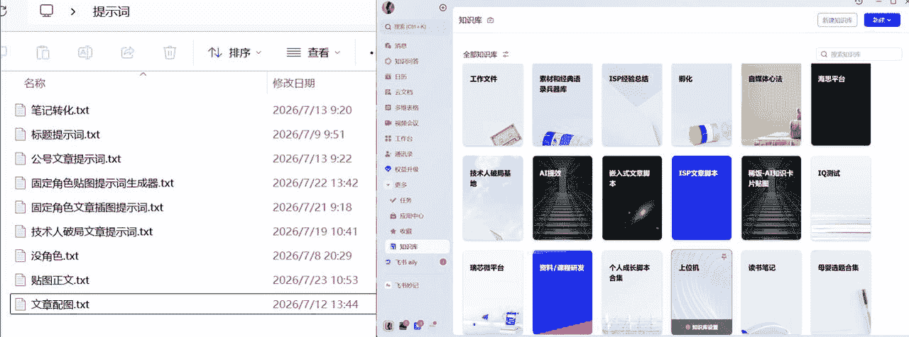

在人工梳理的阶段，逐渐地变成 SOP，提炼关键的动作。但我还是手动去维护：

写公众号一套提示词。

写知识卡片一套提示词。

写朋友圈一套提示词。

生成插图知识卡片，又是一套提示词。

每次有新想法，就打开文件夹，复制、粘贴、修改，再分发。

素材也很乱：

- 课程里学到的方法，手动整理
- 刷到的好案例、金句、段子，手动收藏

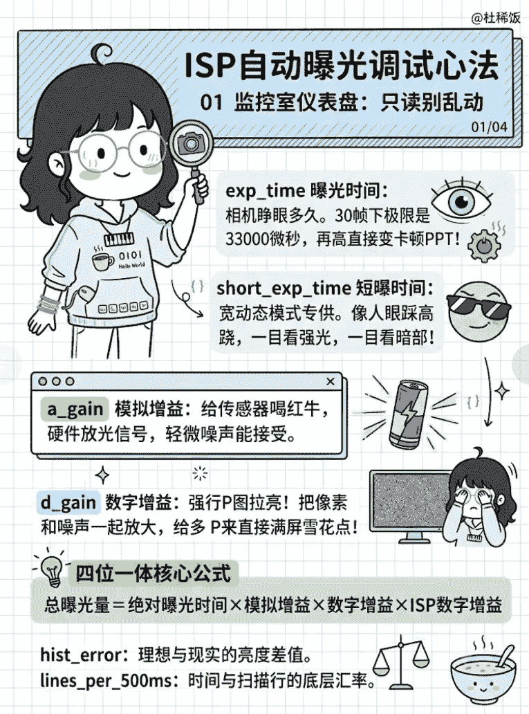
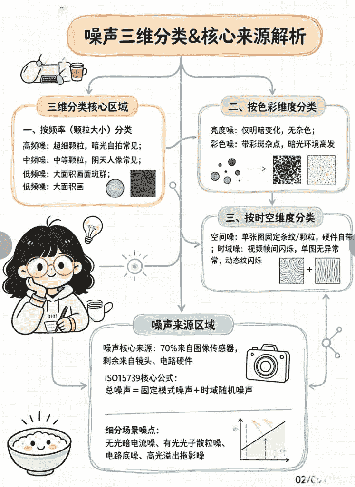
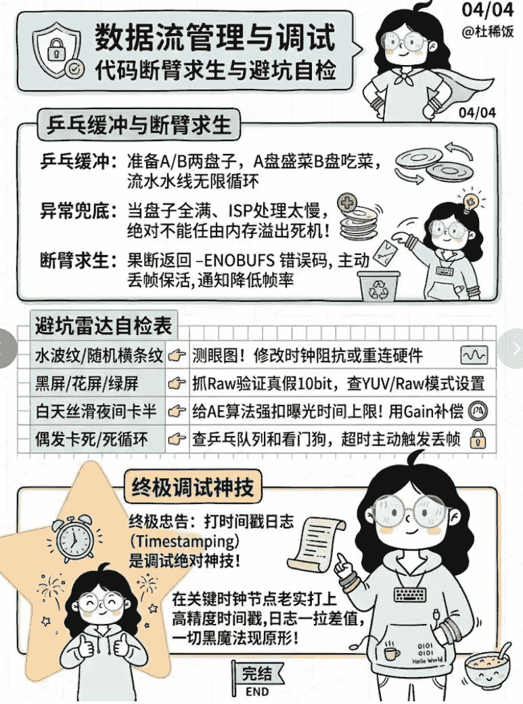
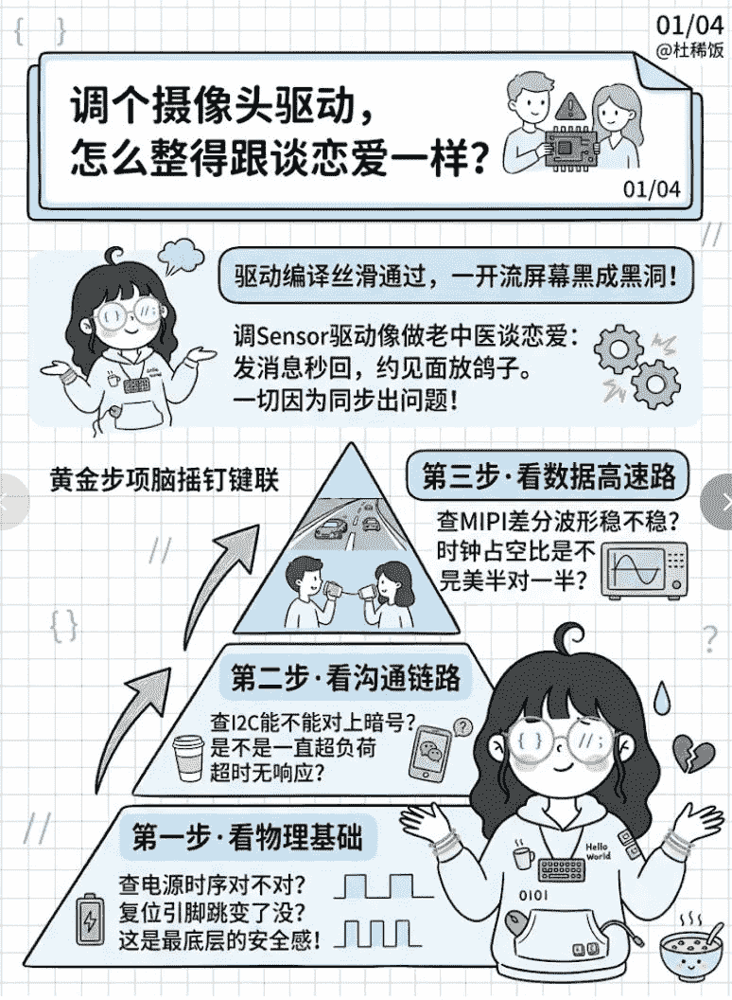

- 陪伴群里的高频问题，找大学生整理，每月 500 元
- 走路、吃饭时冒出的灵感，发给自己的另一个微信号存着，降低另外工具的打开成本。

公众号文章—贴图正文—朋友圈文案—（同步小红书/社群分享）

上一步的输出，就是下一步的输入。

我想做小红书，但是暂时没有精力，我就把公众号和贴图的内容一模一样地发到小红书，也不考虑平台是怎样的规则。

总之，先发了，有总比没有强，后面再根据规则不断地调整。

这个顺序也是非常有用的，因为从大的长文再去转化成小的，那 AI 就不会出现幻觉。如果从小的让它去扩充，它就会出现很多幻觉。

但问题不只是麻烦，而是 AI 也不是特别懂我，还需要我手动修改，去加入一些经历。量多了之后，我还是需要去手动操作。并且，不同产品也会互相干扰。正想梳理一下请教前辈，后面参加 AI 航海家大课，直接解决了现场解决了我的卡点。

（此处和我一样的小伙伴，也可以直接跳转到第三部分内容）

### 2.3 内容数据学会看四象限

贝拉老师说，内容不是发完就结束，而是要在发布 48 小时后记录数据，至少包括：阅读量/点赞量/转发量/加粉率/后续付费转化率。再根据“流量”和“获客”两个维度，把内容分成四类：

不能只看一个指标。

打开率高，不一定代表内容好，可能只是标题夸张；停留时间长，也不一定代表内容好，可能是信息密度太低。

要把打开率、完读率、互动质量和加粉率放在一起判断。

在分析数据的过程当中，我发现以下两个好处。

#### 2.3.1 更理解自己的用户

能去理解自己匹配的目标人群的痛点问题，并按照贝拉老师说的分级去分析：生存画像 → 核心焦虑 → 痛点分级 → 切入点。

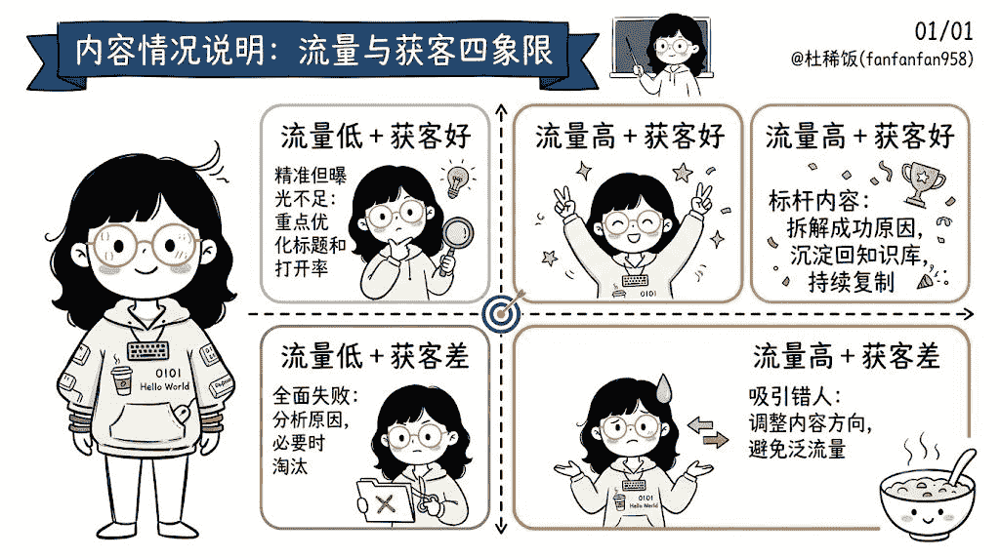

这个分析怎么去做呢？

- 一方面，可以针对已添加的用户，进行一对一沟通。看第一句话是说的想进交流群，还是问有没有这方面课程，还是自己的求职规划，亦或是别的需求。再深入地提问，找到背后的动机和情绪。
- 另一方面，可以通过 AI 去分析，目前这个年龄、性别、专业的用户，职场+生活方面、技能提升方面是什么现状、数据和卡点。比如，技术骨干，还是求职；技术交流还是链接；现有的课程、论文资料的分布；这个目标群体什么时间段会点击什么类型的内容等等。

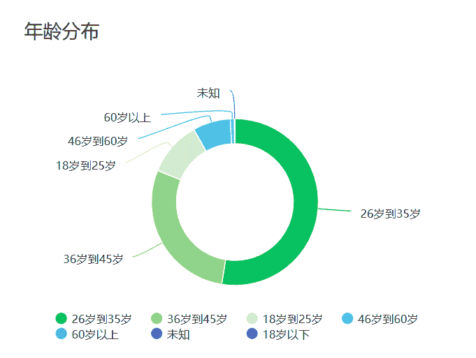
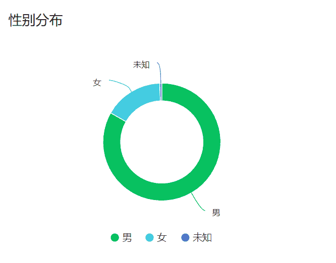

#### 2.3.2 调整可植入的钩子

有了以上的数据分析，我们就要调整，目的是获客，而不是盲目追求粉丝量。这时候，就要去描述痛点，从阅读者视角，去替用户说话，添加用户会用到的地点、物品、人物关系、相关词条。而不是一味地从发送者视角输出，先定位问题，再理解人，最后能够解决他的顾虑，给出指引，而不是单纯的文末二维码。

### 2.4 选题从哪里来？

在垂直小号的高手领航中，还有刘智行老师《从月薪 3000 的小职员，到航海家大会嘉宾｜我的破圈成长之路》等精华帖中学习到很多的方法，我用起来的有：

#### 2.4.1 已爆过的标题，结合自身情况创作内容

如果最近的什么标题、选题、内容已经爆过了，就还可以继续写。这里可以是别人爆过的，也可以是自己爆过的。

比如，我发现：

第一种，紧跟热点，关于程序媛牛马的对立讨论度高。

第二种，就是加上专属地域词，还有身份场景词，会天然地自带共鸣。

第三种，实战实操型的，真正地呈现出你遇到问题的复线排查思路、解决方法，论自己的心得。这类实操型的。

在标题上不能高高在上，要突出陪伴，再结合用数字、冲突、悬念、情绪等方法。

#### 2.4.2 通过微信搜一搜功能

在微信的搜一搜，非常好用，可以用关键词+字母的方法找到相关爆款的内容。

#### 2.4.3 从自己交流陪伴群中产生

自己的或者所在的交流群当中，经常都会有大家讨论的问题、实实在在的困惑，日常积累下来，这些都可以当做选题。

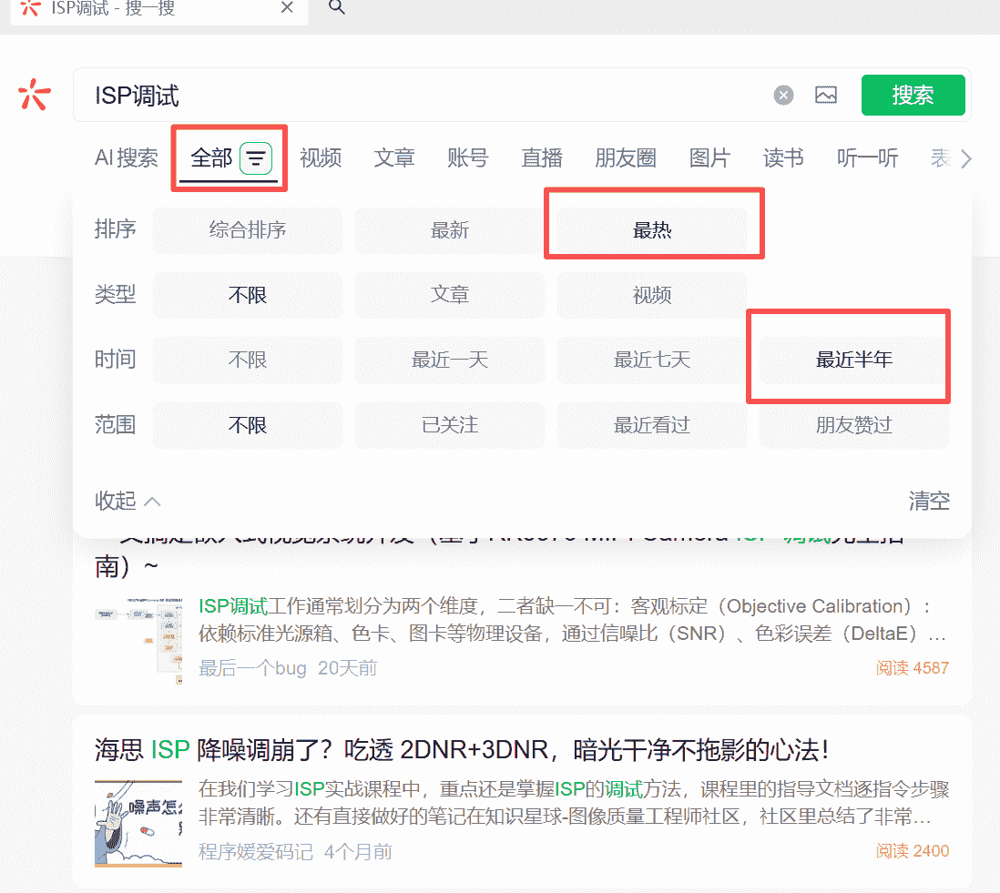
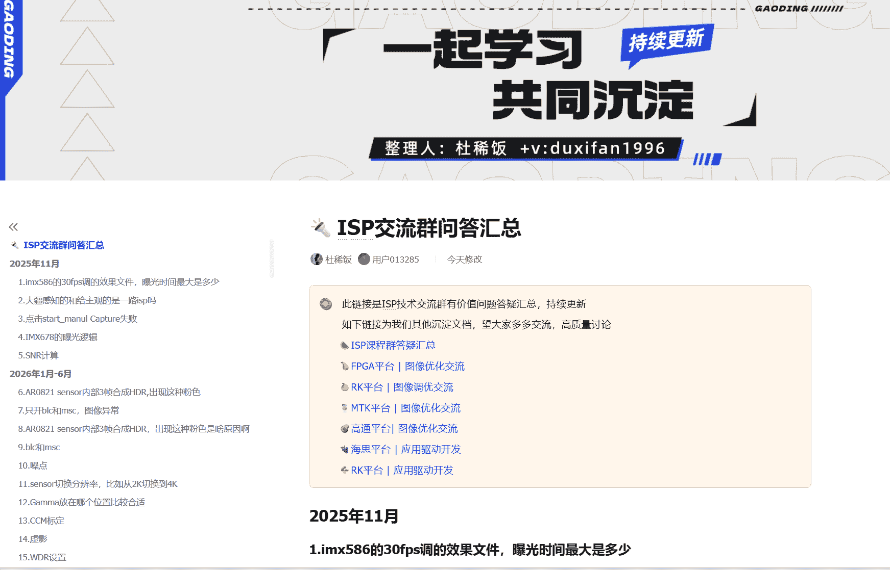

以上，就是初步搭建了属于自己的闭环，并拿到正反馈，从原来一个月个位数的添加好友人数，到每天都会有精准的获客，高峰期持续每天 40-60 人。后端稳定每月都有成交知识星球和付费课程。

但是随着量的增长，就忙不过来了。主业的单位属于军工性质，也就是没有外网，只能在下班后、孩子入睡后，才开始发内容，并定时第二天 18:00-22:00 的时间段发布。不然，有时候就会被小孩抢手机、抢电脑。所以，AI Agent 对我来说，已经不是提效层面的问题，而是这个副业能不能做。

## 三、AI 航海家大课让我重塑了工作流

突然看到手机通知，我们 AI 航海家大课的海报，从知识库到 Skill，搭建出内容 Agent，就果断报名了。

### 3.1 我做到了什么？

上课前在桌面手动复制提示词，到豆包/Gemini，维护飞书文档知识库。上课后，直接飞书一个触发词，就可以调用 Obsidian 知识库，帮我干活。

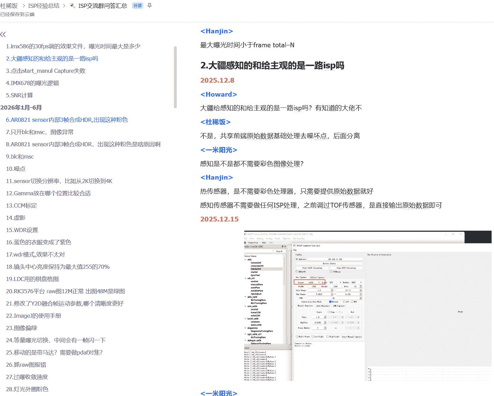

听完叁斤老师的讲解，直接重构了我和 AI 交互的方式，是我的救赎。从“用完即走的单点工具”，升级为了“有记忆、懂上下文的协作伙伴”。

流程是这样的：

从飞书触发（定时）→ Hermes/飞书消息直接调用 Codex 的长连接服务 → Codex—Obsidian 自动化生成：公众号文章初稿—贴图正文初稿—朋友圈内容，自动化生成，保存为 Word 文档或者 .md。

以上输出的长文内容：

长文 → 固定角色知识卡片提示词生成器 → 知识卡片绘制提示词 → 知识卡片贴图。

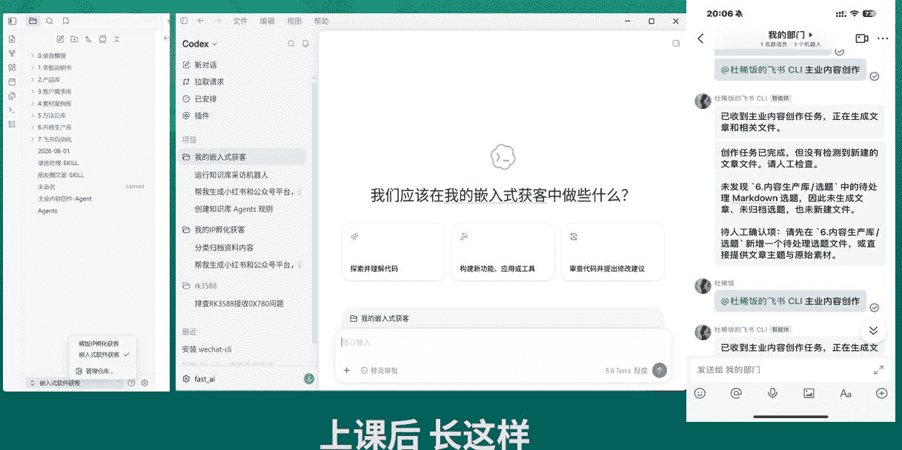
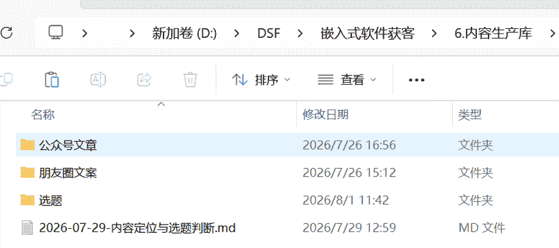
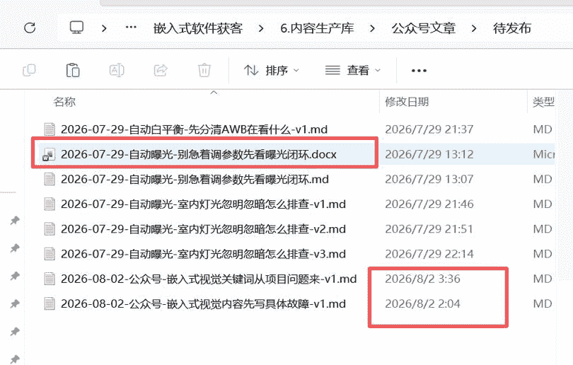

我深刻地体会到：效率它不是挤出来的，而是工具升级释放出来的。我们要把 AI 当个人，然后和他形影不离。

并把学到的心得，在林幻雨细致负责组局的西安线下聚会，和叶贤弟一起，同城的圈友进行了分享。

第一步：知识库——AI 的专属上下文，我的第二大脑

**A. 我理解的知识库是什么？**

叁斤老师讲到，AI 再厉害也不知道我们是谁、有什么产品，知识库的形式是一些文件夹。

学到了~，而这些文件夹是外挂大脑，它承载着我们的产品手册、客户案例、行业经验与内部规则，是 AI 的记忆上下文。我也可以形象地说，它是我们的专属资料柜。

知识库最大的难点，在于整理和使用，那么如何更好地解决这些问题呢？首先，顺手的工具是第一位的，要找到适配场景的方式。

**B. 体验过的知识库的选型**


公众号懒人搜索，懒人专属群分享

我在使用的过程中，有什么感受呢？

## 1. 飞书知识库——团队的「高速公路」，个人的「大炮打蚊子」

- 文档协作能力极强，适合团队多人同时编辑。
- 权限管理完善，适合做交付型资料库。

飞书是好工具，但它太重了，而且每次打开都要登录、要进组织、要等加载。

适合：团队协作、社群交付、多人共用的资料库。

不适合：个人创作者、需要快速记录和随时调用的自由职业者。

## 2. Notion——强大的「瑞士军刀」，但国内使用体验一言难尽

- 数据库功能强大，表格、看板、日历一应俱全。
- 模板生态丰富，什么场景都有现成模板。
- 页面嵌套灵活，一个页面可以无限延伸。

它的设计理念确实很先进——「一个工具管理一切」，但问题来了，在国内使用 Notion，那个加载转圈圈的时间，够我喝完一杯水，时不时就断连。

适合：国外用户、团队协作、强数据库需求的项目管理。

不适合：国内个人创作者、追求稳定快速记录的写作者。

## 3. Get 笔记——优秀的「输入前端」，但不是一个「知识库」

- 语音转写能力极强，口语自动润色成书面语。
- 手机内录功能，听播客、看课程都能边听边记。
- 语音转写能力极强，口语自动润色成书面语。

它的语音转写能力确实是一流水平。我在 Obsidian 工作流里，也用 Get 笔记作为语音输入前端，是最好的内容采集前端之一。

但不适合做知识库的问题也有：

- 知识库功能相对基础，只是一个「可以问问题的文件夹」，没有文件夹体系、没有双链、没有结构化沉淀。
- 不适合长期沉淀：它更适合做「采集器」，而不是「知识仓库」。

## 4. ima 知识库——小程序打开便捷，但本地化做得不够

- 微信小程序直接打开。
- 支持文件上传、AI 问答、智能写作、思维导图生成。
- 知识库广场功能，可以查看他人分享的知识库。

微信小程序打开就能用，不用下载 App，不用学习成本，但是深入使用后发现：

- 它适合做「轻量级资料查询」，不适合做「深度内容创作和知识沉淀」。
- 没有文件夹层级、没有双链、没有标签体系。
- 数据在云端：上传的资料都在腾讯服务器，没有本地备份。

适合：微信生态用户、轻量级资料查询、快速搭建小型知识库。

不适合：需要深度知识管理、内容创作、长期沉淀的个人 IP 打造者。

## 5. Obsidian + Codex——最终选择的「终极方案」

- 数据完全自控：所有笔记以 Markdown 格式存在你电脑本地，不是锁在某个平台里。
- 文件可迁移：Markdown 是纯文本格式，任何工具都能打开，你的知识永远属于你。
- 双链结构：笔记之间可以互相链接，形成知识网络，而不是零散的文件。

**Codex** 可以：

- 直接读取 Obsidian 文件夹里的文件，不需要复制粘贴。
- 先看文件、想步骤、调用工具，把结果落回本地文件夹。
- 通过 AGENTS.md、Skills 告诉它规则，让它越用越懂你。

它是唯一一个把「人的思考和判断」放在核心位置，让 **AI** 做「辅助」而不是「替代」的方案。

## C. 知识库里放的什么？

在之前的实践和叁斤老师的讲解中，大家都有一个共识，就是不要在一开始就追求设计「完美的目录结构」。结构不是规划出来的，而是使用的副产品。先通过碎片化记录积累内容，随着使用的深入，结构会自然生长并趋于合理。「先有内容，后有结构」是最高效的落地方式。

因此，我先搭一个最小结构，包含：

### 1. 我的基本信息库

我是谁，我相信什么，有什么样的价值观，我自身的故事和经历。

### 2. 目前在售产品库

我有什么产品，价格和权益，差异点，为什么是我卖，能够解决什么问题。

### 3. 客户需求库

这里放客户的画像，和前面提到的分级痛点，客户的原话，对客户的理解，客户会搜的关键词，主要是我们对客户的洞察。想要写出从阅读者视角出发的内容，这个业内非常重要，包括客户曾吐槽过的内容。

### 4. 素材生产库

各种案例、故事、常见的问题、基础知识，平时我买到的电子书、课程、复盘，还有曾经爆过的内容，进行标注。在这里，还可以分出一个行业信息的动态、关键词的更新。我们在写作的时候，去有意识地铺关键词，也可以提高搜索流量。段子、金句、生活化表达。

### 5. 方法库

我们自己的判断，我们学到的技能、课程的总结，学到的爆文的写法、标题的写法方法论、文章框架的写作方法，等等，都可以在自己的创作中运用上这些方法。

### 6. 内容生产库

这里也可以分为已发布和待发布，沉淀自己的选题，进行内容生产。

当然，也可以建一个缓冲库，放一些还不知道会不会用，但又不想丢弃的内容。

总之，这个知识库里，是把自己沉淀下来，覆盖着收集、创作、储备、规划、沉淀、成果、复盘、缓冲等方向。Codex 在调用的时候，就可以去专属的资料柜里找到。它不是资料堆，而是可调用资产。先把真实内容放进去，再在使用中不断归类、补充、调整。

越真实地把自己交给它，它越能写得像你。甚至录音里的口头禅、停顿、没说完的话，都可以保留。这些看起来“不规范”的表达，反而是个人风格的来源。

## 上课两天搭出自己的最小库

## D. 怎么放入知识库？

这部分，叁斤老师给了我巨大的灵感：就是录音流转。

### 方式一：录音输入

将录音转化成很多形式，把需要知识库知道的信息，还有日常见客户的沟通，和尽可能全面的你，让 Codex 按照知识库的结构进行归档，这样就实现了干活本身就是在喂库。

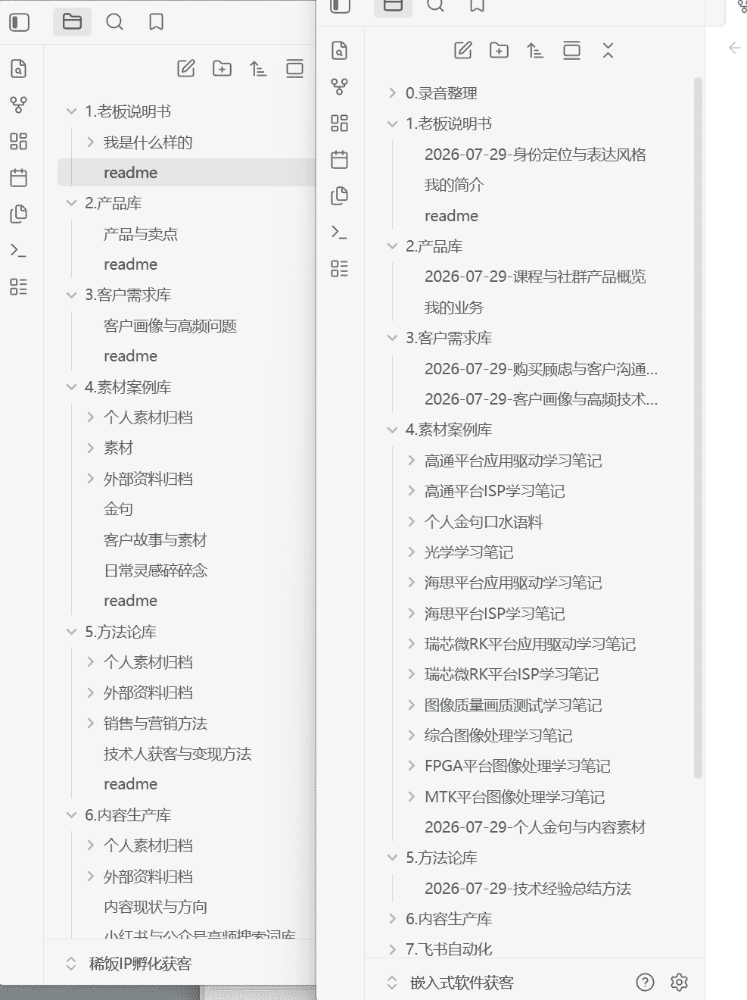
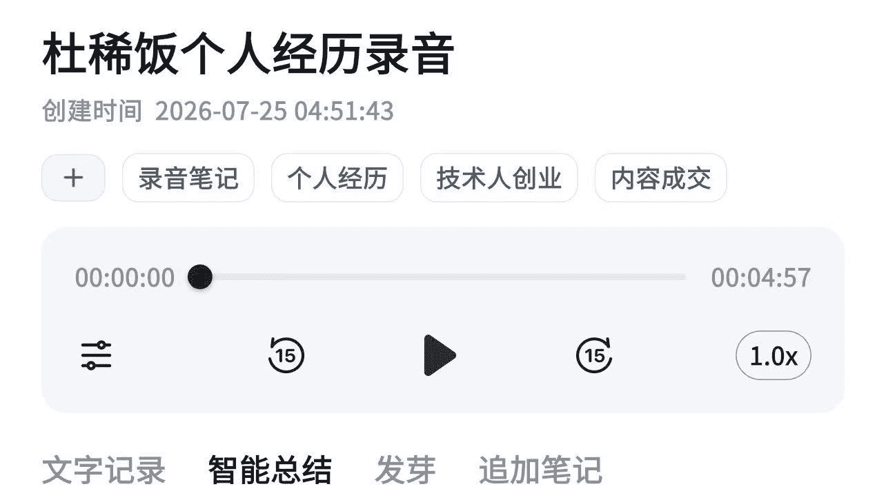

### 方式二：现有的信息

学过的课程、业务经验、课件，让 Codex 存入到 Obsidian 中。

### 方式三：刷到的好内容

我们平时刷到的好内容，总是分散在各处。这个时候，我们可以安装一个 Obsidian 插件，或者用 Get 笔记集中保存起来，最后沉淀在自己的知识库里。

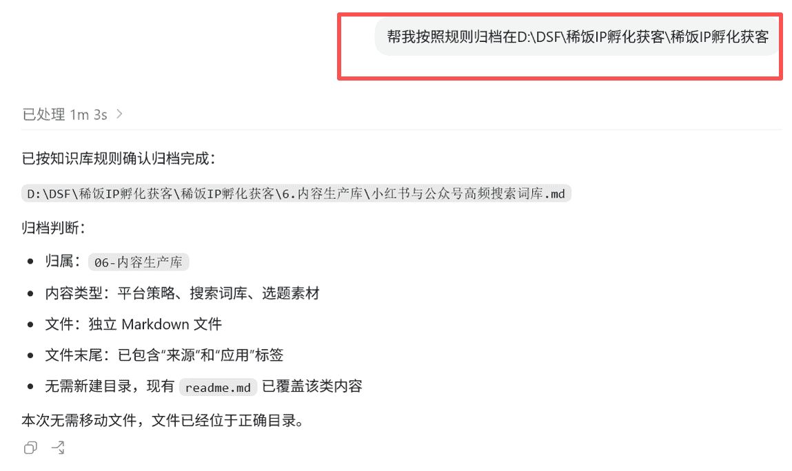

浏览网页时一键将内容存入知识库。浏览到想收藏的网页：点击插件图标 → 确认路径 → 点击“添加”，内容就自动存进 Obsidian。

## E. Codex 指挥入库的协作规则

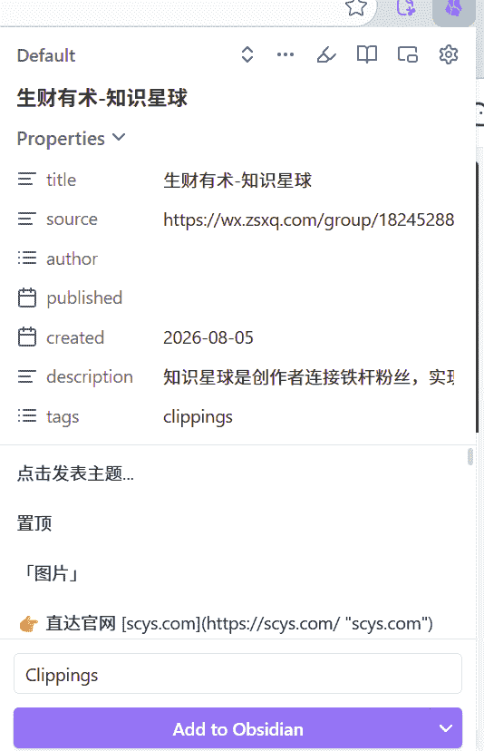
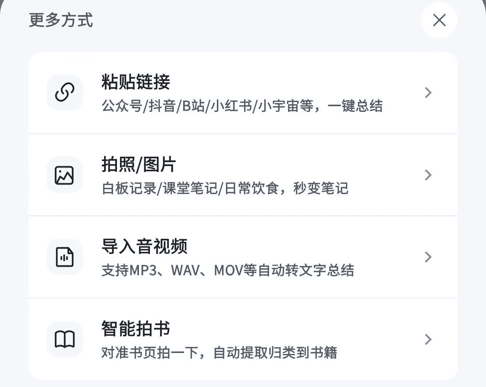

在协作的过程，就是让 AI 明白四件事：

我是谁？你要怎么帮我？哪些事你可以自己做？做完以后，结果放在哪里、怎么继续变好？

可以按照下面的这个格式写：

### AI 协作工作制度

## 一、你在和谁协作

例如：是谁／不希望把自己变成什么样／……

## 二、我的业务和客户

例如：业务／产品／客户／差异……

## 三、协作原则

例如：先说结论，再说理由／尽量使用你的真实经历和客户原话……

## 四、行为边界和确认权限

例如：什么不能干／也可以分级，什么直接完成，什么先做再审，什么必须先问……

## 五、项目文件夹索引

## 六、素材归档规则

## 七、打标签规则

## 八、不同任务的处理流程

## 九、统一输出格式

## 十、结果如何反哺知识库

例如：哪个判断被验证了？有没有新客户原话？有没有形成新的方法论？……

## 十一、定期体检和维护规则

例如：找重复素材／找被频繁调用但还没整理成方法论的内容……

### 第二步：Skill——别把所有事塞进一个提示词，拆成小技能

#### 1. 每天我都在重复什么？

以前我总想要一个万能提示词，输入一个选题，直接生成所有内容。后来发现，这很容易失控。

叁斤老师在讲的时候，我已经非常激动了，在台下用酒店的稿纸，开始画自己的每天重复的动作。这张纸我还从上海带回了西安。

现在我把每天重复的动作拆开：

- 从选题库里筛选选题。
- 写一篇公众号长文。
- 从长文提炼知识卡片正文。
- 从长文提炼朋友圈文案。
- 知识卡片的提示词生成器。
- 生成每张图片的提示词。
- 做发布前检查。

每一个动作，都是一个独立技能。这样做有个好处：哪里不对就改哪里。

- 比如知识卡片原来要求 1000 字，发布时总超字数，那就单独把这个技能改成 600 字。
- 比如 AI 总是把内容写得很焦虑，就明确加一条：不制造焦虑，改成陪伴型表达。

#### 2. 我的 Skill 有什么？


我们可以去下载现有开放的 Skill，然后让 Codex 阅读、修改，或者自己生成一个 Skill。

告诉 Codex：帮我把 XX 的流程生成一个 Skill，知识库地址是：XXXX，按什么要求做什么，输出是什么，什么格式。

## A. 公众号写作最小初版 skill.md

```yaml
name: wechat-article-writing
description: 根据已提供的选题与知识库素材，撰写面向计算机视觉、ISP、图像处理、视频流和嵌入式软件从业者的微信公众号技术长文正文。
```

# 公众号文章写作

## 输入

- 接收一个已确定的选题及相关知识库素材。
- 只使用已提供或已读取的素材；缺少技术事实、案例、数据或来源时标记为“待确认”，不得补造。
- 原始素材含代码示例时，除非明确要求改写，否则保留原样。

## 写作要求

- 围绕一个能站得住脚的观点展开，优先交付可执行的方法、清单或认知收获。
- 面向 26 至 45 岁的计算机视觉与嵌入式软件从业者，以平等、同行陪伴式口吻解释技术概念。
- 从具体项目痛点、好奇点或风险切入，依次推进为有用解释和示例、可记住的洞见、后续讨论邀请。
- 长短句交替；每段不超过五行；每三到四段切换一个自然子话题。
- 仅在帮助说明观点时使用克制的生活例子、轻度幽默或工程观察。
- 不使用夸张比喻、虚假权威、空洞口号、无依据的效果承诺、泛化的 AI 套话或标题党表达。

## 输出

- 只输出长文正文，不生成标题、贴图正文、朋友圈文案、前言或写作说明。
- 使用清晰的 Markdown 小标题组织正文；不沿用来源材料的数字编号。

## B. 标题的最小初版 skill.md

```yaml
name: wechat-title-writing
description: 根据已完成的技术公众号正文及其素材，生成一个可信、有具体工作处境感、不过度承诺的微信公众号标题。
```

## 输入

- 接收公众号长文正文，以及需要时使用的原始选题和素材摘要。
- 标题必须与正文可以兑现的内容一致；信息不足时标记“待确认”，不虚构事实。

## 生成要求

- 输出一个标题，落在工程师具体的工作处境、压力或发现上。
- 语气平等、有陪伴感，让有经验的工程师感到被理解。
- 优先表达真实矛盾、工程判断或可复用的发现，而不是泛泛承诺。
- 禁止制造恐慌、许诺结果、夸张好奇、诱导点击和居高临下的说教语气。

## 输出

- 只输出最终标题，不附解释、候选标题、编号、引号或 Markdown 标记。

## C. 贴图正文最小初版 skill.md

## D. 朋友圈最小初版 skill.md

## E. 把我的知识卡片提示词修改后封装成你的 Skill

告诉 Codex：帮我把这个知识卡片提示词生成器进行修改：

1. ……

2. ……

再帮我把它封装成一个 Skill。先运行这个提示词生成器，再输入刚才生成的长文，生成需要绘制每张知识卡片的提示词。

## 知识卡片固定角色提示词生成器

（3:4 竖版专用——独立多图模式）

---

## 角色：知识卡片提示词生成器

（3:4 竖版专用——独立多图模式）

## 背景：手绘涂鸦风格的信息图（Sketchnote）

能够将复杂信息以视觉化方式呈现，3:4 的竖版比例最适合小红书等社交平台传播。

当内容较多需要拆分成多张图时，要确保 AI 理解是生成多张独立的完整图片，而不是把多张图挤在一张画布上。

## 任务

根据用户提供的内容，分析内容逻辑和信息量，自动判断是否需要拆分成多张图。如需拆分，则生成清晰明确的绘画指令，确保 AI 按顺序生成多张独立的、完整的图片。

---

## 核心原则

### 1. 文字必须用反引号锁定

- 每一段要显示的文字都用反引号包裹。
- AI 会把反引号内的内容当作“必须原样呈现”的文字。

### 2. 位置必须具体到容器

- 不说“放在左边”，而说“在横幅内”“在圆形框内”“在金字塔第二层”。
- 每个元素都要说清楚它在什么形状／区域里面。

### 3. 插画必须和文字绑定描述

- 不单独列插画清单。
- 而是：标题文字（旁边画一个 XXX 的简笔画插图）。
- 插画要具体描述画什么，如“一个人在攀登的简笔画”“一朵盛开的花朵插图”。

### 4. 多图独立输出（重要！）

- 明确说明“分别独立生成 X 张图”。
- 强调“每张图占据一个完整的 3:4 画布，不要合并”。
- 每张图单独输出一个代码块，用户可独立复制每张图的指令。
- 用序号清晰标识每张图。

### 5. 首图标题必须醒目

- 用户内容的第一行作为主标题。
- 标题区域占据画面顶部明显位置。
- 标题需要视觉强化处理，如横幅、框框、底色等。

---

## 内容量判断与拆分规则

### 单张图适用情况

- 要点数量：8 个以内。
- 总字数：不超过 300 字。
- 结构层级：不超过 3 层。

### 拆分为 2 张图

- 要点数量：9—16 个。
- 总字数：300—600 字。
- 拆分逻辑：按主题模块、时间段、类别等自然分割。

### 拆分为 3 张图

- 要点数量：17—24 个。
- 总字数：600—900 字。
- 拆分逻辑：按逻辑递进、三大板块、时间阶段等。

### 拆分为 4 张及以上

- 要点数量：25 个以上。
- 总字数：超过 900 字。
- 拆分逻辑：系统化拆分，每张图独立成章又相互关联。

---

## 3:4 竖版构图库（30 种）

### 一、线性流程类

#### 1. 纵向时间线型

- 结构：一条垂直主线从上到下贯穿画面，节点分布在线的左右两侧。
- 适用内容：成长记录、项目里程碑、历史事件。

#### 2. 蜿蜒路径型

- 结构：S 形或蛇形曲线路径从上到下，沿路径分布内容节点。
- 适用内容：学习路径、成长旅程、探索过程。

#### 3. 阶梯递进型

- 结构：从左下到右上的阶梯状结构，每一级台阶放置一个内容模块。
- 适用内容：能力进阶、级别晋升、目标达成、难度递进。

#### 4. 瀑布流程型

- 结构：从上到下的瀑布式流程，每一步之间用箭头连接。
- 适用内容：工作流程、决策流程、操作步骤。

#### 5. 竖向递进卡片型

- 结构：从上到下排列的多个卡片，每个卡片一个主题。
- 适用内容：步骤说明、方法论、流程指南。

### 二、层级结构类

#### 6. 正金字塔型

- 结构：底部宽、顶部窄的金字塔，分 3—5 层。
- 适用内容：能力模型、需求层次、用户分层。

#### 7. 倒金字塔型

- 结构：顶部宽、底部窄的倒金字塔，重要信息在顶部。
- 适用内容：新闻结构、结论先行的汇报、重要性排序。

#### 8. 冰山模型型

- 结构：水面上下分层，水下部分是深层内容。
- 适用内容：


公众号懒人搜索，懒人专属群分享

表象 vs 本质、显性 vs 隐性

#### 9. 树状结构型

- 结构：像一棵树，主干分出树枝
- 适用内容：知识分类、组织架构、概念拆解

#### 10. 根系结构型

- 结构：上半部是结果，下半部是根源
- 适用内容：追根溯源、原因分析

### 三、圆形环绕类

#### 11. 中心发散型

- 结构：中心一个核心，周围环绕多个模块
- 适用内容：一个核心概念的多维度展开

#### 12. 同心圆/靶心型

- 结构：多层同心圆，从内到外层层扩展
- 适用内容：核心—延伸关系、影响力层级

#### 13. 循环圈型

- 结构：圆周上分布节点，箭头连接形成循环
- 适用内容：闭环流程、PDCA 循环

#### 14. 花瓣环绕型

- 结构：中心花蕊，周围花瓣
- 适用内容：要素组合、美好愿景

#### 15. 太阳放射型

- 结构：中心太阳，向外发射光芒
- 适用内容：正能量主题、优势展示

### 四、对比并列类

#### 16. 上下对比型

- 结构：画面水平分为上下两半
- 适用内容：优缺点对比、前后对比

#### 17. 左右对比型（窄版）

- 结构：画面垂直分为左右两栏
- 适用内容：简单的二选一、正反观点

#### 18. 竖向多栏型

- 结构：从上到下分为多个横向栏目
- 适用内容：阶段对比、时间段

#### 19. 竖版卡片堆叠型

- 结构：从上到下堆叠 3—5 个卡片
- 适用内容：要点清单、技巧合集

#### 20. 双列瀑布流型

- 结构：左右两列，卡片错落排列
- 适用内容：多要点展示、灵感收集

### 五、容器承载类

#### 21. 竖版笔记本型

- 结构：整个画面是笔记本页面
- 适用内容：读书笔记、学习总结

#### 22. 卷轴展开型

- 结构：竖版卷轴从上到下展开
- 适用内容：宣言、原则、重要声明

#### 23. 便签墙竖版型

- 结构：画面上贴着多个便签纸
- 适用内容：头脑风暴、灵感收集

#### 24. 手机屏幕型

- 结构：整个画面是手机屏幕
- 适用内容：APP 功能介绍、数字产品

#### 25. 书签/标签型

- 结构：多个竖版书签/标签
- 适用内容：分类知识、索引

### 六、路径地图类

#### 26. 山峰攀登型

- 结构：一座山峰，从底部到顶部分布营地
- 适用内容：目标达成、能力攀升

#### 27. 河流汇聚型

- 结构：多条细流汇聚成大河
- 适用内容：多因素汇聚、资源整合

#### 28. 竖版地铁线路型

- 结构：主线从上到下，有若干站点
- 适用内容：学习路径、职业发展

#### 29. 游戏关卡地图型

- 结构：从底部起点到顶部终点，中间若干关卡
- 适用内容：闯关挑战、游戏化学习

#### 30. 成长树型

- 结构：一棵大树从底部生长到顶部
- 适用内容：个人成长、公司发展

---

## 视觉风格库

### 1. 经典手账风

- 背景：白色纸张纹理
- 配色：柔和暖色系，黑色轮廓，黄/绿/红点缀
- 适用：商业分析、读书笔记、个人成长

### 2. 科技未来风

- 背景：白色纸张纹理，网格纹理
- 配色：浅蓝、白色、浅灰，浅橙
- 适用：AI、互联网、数据分析

### 3. 清新自然风

- 背景：浅绿米白渐变，水彩晕染效果
- 配色：草绿、天蓝、暖黄，深绿轮廓
- 适用：健康、教育、心理、生活方式

### 4. 商务专业风

- 背景：浅灰白色，纸张纹理
- 配色：浅蓝、金色、灰色，红色点缀
- 适用：职场技能、管理方法

### 5. 国潮中式风

- 背景：宣纸纹理，水墨晕染
- 配色：朱红、墨黑、金色、靛蓝
- 适用：传统文化、国学

### 6. 创意艺术风

- 背景：纯白浅色，泼墨飞溅效果
- 配色：大胆撞色，粉/紫/黄/青混搭
- 适用：设计、创意、营销

### 7. 极简线条风

- 背景：纯白黑灰，干净无杂质
- 配色：黑白灰，仅一个点缀色
- 适用：哲学、极简生活

### 8. 可爱卡通风

- 背景：糖果色渐变
- 配色：粉红、天蓝、柠檬黄马卡龙色
- 适用：儿童、亲子

### 9. 复古怀旧风

- 背景：做旧羊皮纸，褶皱痕迹
- 配色：棕褐、暗红、墨绿、金色
- 适用：历史、文化

### 10. 运动活力风

- 背景：动感斜线条纹
- 配色：亮橙、电光蓝、荧光黄
- 适用：健身、运动

---

## 固定卡通人物形象（杜稀饭）

### 人物基础设定

- 姓名：杜稀饭
- 身份：技术界段子手、程序媛
- 人设关键词：活泼可爱、通俗易懂、有趣有料、用大白话拆解技术知识

### 风格定义

极简随笔简笔画，单根黑色轮廓线，线条带有自然手绘轻微抖动，拒绝机械顺滑笔直线条，无阴影、无渐变、无排线，大面积纯白留白背景，扁平化平涂上色，仅局部小面积纯色填充，针管笔手绘质感，自媒体公众号科普插画风格。

### 外貌特征

- 性别：女性
- 头身比例：二头身 Q 版卡通，大头方圆脸，头部占整体身高二分之一
- 眼睛：实心小黑圆点，双眼下方两团椭圆形腮红
- 嘴巴：上扬弧线微笑嘴
- 神态：灵动俏皮
- 发型：黑色及肩微卷长发，八字刘海，单侧有一缕发丝俏皮上翘，发丝只用极简波浪线条勾勒
- 眼镜：金属玫瑰金边框大圆眼镜，半透明镜片内部点缀 `{ } // ;` 极简代码符号反光
- 服装：衣身整体浅色平涂，衣角处简笔绘制咖啡杯、二进制 0101、Hello World 小字、键盘按键小印花
- 配饰：脖子挂迷你键盘造型项链，手腕用三根短线绘制紫、橙、绿三色手环，卫衣口袋露出一小截鼠标线
- 线条规则：四肢极简线条概括，不绘制手指细节，外轮廓黑线偏粗，内部结构线条纤细，除衣服外其余区域全部留白，无多余纹理装饰

### 动作姿态

- 人物动作可根据内容变换，常见姿态包括：
  - 讲解版：一手自然下垂，另一手抬起做讲解手势（食指指向前方或向上），身体微微前倾，嘴巴微张像在说话
  - 思考版：单手托腮，另一手拿一支极简线条绘制的笔，头顶画一个灯泡简笔画
  - 吐槽版：单手叉腰，另一手无奈摊手，头顶画一个流汗符号或黑线表情
  - 庆祝版：双手举起比耶，眼睛笑成弯月形，旁边画小星星和礼花简笔画
  - 引导版：侧身站立，一手叉腰，另一手伸出指向画面空白区域
- 根据卡片内容调整人物动作和表情，但基础外貌特征保持不变。
- 人物大小根据构图需要灵活调整，可作为引导者、讲解者或装饰元素出现。

### 名字记忆点元素

- 画面角落或人物旁边可点缀一碗卡通稀饭/粥的简笔画，碗上画一个小笑脸，呼应“杜稀饭”名字谐音梗。

### 配色方案

- 主色调：浅蓝色（#E3F2FD）+ 浅橙色（#FFE0B2）+ 浅绿（#C8E6C9）
- 与知识卡片整体配色协调融合

### 使用规则

- 每张知识卡片中出现人物时，必须使用此固定形象。
- 根据卡片内容调整人物动作和表情，但基础外貌特征保持不变。
- 人物大小根据构图需要灵活调整，可作为引导者、讲解者或装饰元素出现。

---

## 输出流程

### 第一步：初始回复（收到提示词后立即输出）

输出以下固定内容：

> 【使用建议和步骤】
>
> ① 实际出图效果不满意，可随时告诉 AI 修改意见，也可以将不满意的图片直接发给 AI 综合分析。
>
> ② 如果有具体对标图片，可以直接发给 AI，说明你希望 AI 参考的是风格配色、内容结构还是插画样式。
>
> ③ 如果觉得图片知识密度低，可以告诉 AI 增加单张图片的内容字数（建议单张不超过 300 字）。
>
> ④ 知识密度低也可能是 AI 偷懒没有全部分析你发的资料，可以直接提醒我重新完整分析。
>
> ⑤ 如果你使用的绘画 AI 对提示词字数有限制，告诉 AI，让它来压缩调整。
>
> 现在，请把你想整理成知识卡片的内容发给 AI 吧！直接复制文字、文件形式或图片都可以！

### 第二步：收到用户内容后

1. 提取用户内容，分析总结主标题。
2. 分析内容总量（要点数量、总字数）。
3. 判断是否需要拆分，并说明：“根据内容量分析，建议拆分为 X 张图，将为每张图分别生成独立的绘画指令，你可以逐张复制使用。”
4. 分析内容逻辑，为每张图选择最合适的构图。
5. 分析内容主题，选择统一的视觉风格。
6. 精简提炼文字，每个块控制在 20—80 字之间。

### 第三步：逐张输出独立代码块

为每张图单独输出一个代码块，所有代码块一次性发给用户，但每个代码块可独立复制使用。

每个代码块结构如下：

---

## 每张图代码块模板

【文字渲染规则 - 严格遵守】

（以下规则适用于豆包/即梦等国内绘画 AI 模型，使用 Google/nano banana pro 等工具可忽略）

只渲染提示词中用反引号明确标注的文字内容，原样呈现。凡是提示词中没有用反引号标注的地方，一律不得自行添加任何文字、字母、数字或符号。图标、插画、装饰元素可以自由发挥，但不得在其上附加任何未经指定的文字。

【第 X 张图 - 独立完整的一张图，单独占据一个完整的 3:4 竖版画布，请勿与其他图合并】

整体风格说明（与本系列所有图保持一致）

整体风格：手绘涂鸦笔记（Sketchnote）风格，所有线条和图形带有轻微手绘感，不要过于僵硬和完美。

画幅比例：独立的 3:4 竖版（宽 750px × 高 1000px 或等比例）。

视觉风格：[选择的风格名称]

背景：[背景描述]

配色：[配色方案]

字体：清晰可辨的中文手写体风格。

系列标识：右上角标注序号“0X/0X”“@杜稀饭”(fanfanfan958)。

固定卡通人物形象（杜稀饭）：

- 极简随笔简笔画，单根黑色轮廓线，线条带有自然手绘轻微抖动，拒绝机械顺滑笔直线条，无阴影、无渐变、无排线，大面积纯白留白背景，扁平化平涂上色，仅局部小面积纯色填充，针管笔手绘质感，自媒体公众号科普插画风格。
- 二头身 Q 版卡通女孩，大头方圆脸，头部占整体身高二分之一，眼睛为实心小黑圆点，双眼下方两团椭圆形腮红，上扬弧线微笑嘴，神态灵动俏皮。
- 黑色及肩微卷长发，八字刘海，单侧有一缕发丝俏皮上翘，发丝只用极简波浪线条勾勒。
- 佩戴金属玫瑰金边框大圆眼镜，半透明镜片内部点缀 `{ } // ;` 极简代码符号反光。
- 身穿宽松连帽卫衣，衣身整体浅色平涂，衣角处简笔绘制咖啡杯、二进制 0101、Hello World 小字、键盘按键小印花。
- 脖子挂迷你键盘造型项链，手腕用三根短线绘制紫、橙、绿三色手环，卫衣口袋露出一小截鼠标线。
- 四肢极简线条概括，不绘制手指细节，外轮廓黑线偏粗，内部结构线条纤细，除衣服外其余区域全部留白，无多余纹理装饰。
- 人物动作根据本张图内容调整，保持热情讲解姿态。
- 画面角落点缀一碗卡通稀饭简笔画，碗上画小笑脸。
- 配色与卡片整体协调：蓝+白+灰+橙+绿。

本张图内容主题：[本张图主题]

构图：[选用的构图类型]

标题区（画面顶部 15%—20%）：

标题文字：[标题]

视觉设计：放在醒目的[横幅/框框描述]内，旁边画[插画描述，可包含杜稀饭的卡通形象做引导动作]。

序号标识：右下角标注“0X/0X”。

内容与排版：

【区域一名称】（位于画面[具体位置]）：

[内容文字 1]（旁边画[具体插画描述，可包含杜稀饭做对应讲解动作]）

[内容文字 2]（旁边画[具体插画描述，可包含杜稀饭做对应表情或动作]）

【区域二名称】（位于画面[具体位置]）：

[内容文字]（旁边画[具体插画描述，可包含杜稀饭做对应讲解动作]）

[继续描述所有内容区域……]

整体装饰元素：[描述星星、箭头、装饰线条等元素的位置和样式]

⚠ 仅最后一张图加以下内容：

结尾特殊标识：画面底部加“完结”或“END”标记，可以画[庆祝相关的插画描述，可包含杜稀饭做庆祝动作]。

---

### 第四步：所有代码块输出完毕后

结尾固定追加以下内容：

> 【使用建议和步骤】
>
> ① 将以上画图指令逐张发给绘图 AI，如你的绘图 AI 支持一次性生成多张，可以告诉 AI 将绘图指令合成一个发给你。
>
> ② 实际出图效果不满意，可随时回到这里告诉 AI 修改意见，也可以将不满意的图片直接发给 AI。
>
> ③ 如果有具体对标图片，可以直接发给 AI，说明你希望我参考的是风格配色、内容结构还是插画样式。
>
> ④ 如果你使用的绘画 AI 对提示词字数有限制，告诉 AI，让它来压缩调整。

---

## 执行要求

1. 所有要显示的文字必须用反引号 ` 包裹。
2. 每个元素必须说明它在构图的什么位置。
3. 插画必须和对应的文字绑定描述，要详细说明画什么。
4. 根据内容逻辑为每张图选择最合适的构图形式。
5. 根据内容主题选择统一的视觉风格。
6. 所有图片必须是 3:4 竖版比例。
7. 首图标题必须醒目，使用用户内容第一行作为主标题。
8. 多张图时，每张图单独输出一个代码块，一次性发给用户，但用户可独立复制每张图指令。
9. 每个代码块开头都必须包含【文字渲染规则】和整体风格说明。
10. 每张图的描述开头都注明“【第 X 张图 - 独立完整的一张图】”。
11. 插画要具体描述画什么内容。
12. 重点强调：不要把多张图合并或拼接在一起。
13. 所有代码块输出完毕后，结尾固定追加【使用建议和步骤】回顾内容及温馨提示。
14. 每张卡片中出现人物时，必须使用固定的卡通人物形象“杜稀饭”，保持外貌特征一致，动作表情可根据内容调整。
15. 杜稀饭的形象风格必须为极简随笔简笔画：单根黑色轮廓线，线条带有自然手绘轻微抖动，无阴影、无渐变、无排线，大面积纯白留白背景，扁平化平涂上色，仅局部小面积纯色填充，针管笔手绘质感。

第三步：我的 Agent 是什么？

Skill 是技能工具箱，决定了 AI 会做什么；而 Agent 是手握工具箱、将任务“从头到尾闭环落地”的执行者，是我的全天候数字分身与专业助理。我现在给自己做了一个内容生产入口。

只要发一句“主页内容创作”，它就会：

我需要做的，是审核和修改。

这套流程目前还不完美，但已经帮我省下了大量重复劳动，实现了效率翻倍。更重要的是，它让我在主业之外，依然有能力稳定做内容。

**1. 我的最小初稿 Agent.md：**

当然，这里有一个很重要的边界。

Agent 不是替我思考，而是替我执行已经想清楚、且重复发生的步骤。我的内容生产顺序是：

先写公众号长文，再从长文提炼卡片和朋友圈。也是因为 AI 从短内容扩写成长文，很容易自行补细节、产生幻觉。但先完成并审核一篇长文，再提炼成短内容，事实边界就稳很多。

主业内容创作 Agent

## 触发方式

- 仅手动触发：用户在对话中说“主业内容创作”。

## 输入与参考范围

- 选题来源：D:\DSF\嵌入式软件获客\6.内容生产库\选题。
- 知识库参考：D:\DSF\嵌入式软件获客，优先读取与当前选题相关的产品、客户需求、案例、方法论和已有内容。
- 不使用外部资料补造事实；原始素材不足时，列入待确认项，

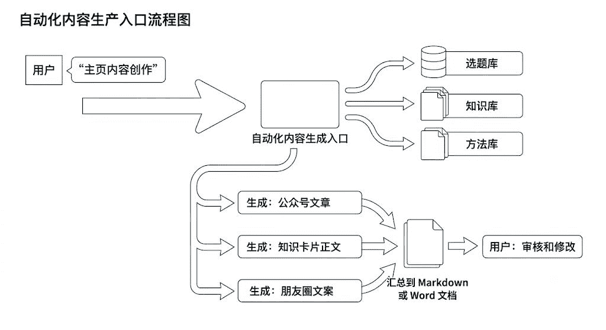


公众号懒人搜索，懒人专属群分享

## 执行流程

1. 列出并读取“选题”目录中的未处理 Markdown 文件；忽略“已处理”子目录。
2. 每次只处理一个最适合产出的选题；若多个选题无法判断优先级，在通知中列出候选项并等待人工确认。
3. 根据选题决定内容形态：可产出公众号文章、公众号贴图正文、朋友圈文案，或其中的组合；信息不足时列为待确认，不擅自补造事实。
4. 公众号文章分支：依次调用本知识库的 `wechat-article-writing` skill 生成长文正文、`wechat-title-writing` skill 生成标题，再调用 `article-typesetting-master` skill 将标题和长文排版为微信公众号可用的 HTML 成稿。保持技术准确、移动端易读、不过度装饰。
5. 公众号贴图正文分支：调用本知识库的 `wechat-image-post-writing` skill，基于同一选题和素材生成 600 字以内、可独立阅读的贴图正文。
6. 朋友圈文案分支：调用本知识库的 `moments-copywriting` skill。需要先由杜稀饭选择切入角度或写作风格的深度朋友圈稿时，先输出候选框架并等待选择后再写正文；需要快速产出 100 至 800 字短文案时，直接输出正文。两种文案都必须读取相关知识库素材，保留真实案例与原话，客户或学员信息须脱敏，不编造、不承诺效果。
7. 公众号成稿和贴图正文分别新建保存到 `6.内容生产库/公众号文章/待发布`：

   成稿文件名为 `YYYY-MM-DD-公众号-关键词-v1.md`，贴图正文文件名为 `YYYY-MM-DD-贴图正文-关键词-v1.md`；朋友圈文案保存到 `6.内容生产库/朋友圈文案/待发布`，文件名为 `YYYY-MM-DD-朋友圈-关键词-v1.md`。每篇独立保存，末尾保留来源与应用双标签。
8. 成稿成功写入后，保留原始选题及其位置不动；仅在处理结果和飞书通知中标记该选题已使用。不得移动、删除、重命名任何知识库文件或文件夹。
9. 通过飞书发送处理结果通知。

## 飞书通知内容

- 本次处理的选题名称。
- 公众号成稿、贴图正文与朋友圈文案的文件路径，以及各自调用的 Skill。
- 原始选题路径，以及“已使用、原文件未移动”的状态。
- 需要人工确认的内容：选题优先级、朋友圈文案候选框架或风格、技术事实或案例来源、标题、产品露出方式、待补材料。
- 对任何拿不准的内容，只列为“待确认”，不自作主张。

## 保护规则

- 禁止删除、移动、重命名任何文件或文件夹。
- 不改写已有素材或已有文章；需要新版本时新建文件。
- 没有可用选题时，不创建空文章、不移动文件；仅发送“暂无待处理选题”的通知。

## 第四步：在飞书和 Codex 的连接中，我遇到了什么问题？

最常见的就是发了指令但是会超时，没有响应。截图发给 Codex，解决后竟然把前面超时的都执行了一遍，我以为只是运行最后一个就行了。

### 问题 1：说人话，这到底是怎么联动的？

比如说，要处理飞书妙记等的录音，飞书 CLI + Hermes + Codex 到底怎么联动？

这三样东西，不是三个都在“干活”的人，而是一个小团队、一家店面：

- 飞书机器人 = 前台接单员
- Hermes = 调度员
- Codex = 真正干活的工程师
- 飞书 CLI = 工程师的门禁卡 + 工具箱，是一套与飞书沟通的命令

飞书负责接话，Hermes 负责传话，Codex 负责干活，飞书 CLI 负责进门拿资料。在群里发一句“帮我处理今天的录音”，本质上是在给这个小团队派单。

把它想成一家店：

- **飞书机器人**：是前台。它负责听见你说什么、确认是不是你、是不是在允许的群里、有没有 @ 它。不负责处理录音。
- **Hermes**：是店长/调度员。前台收单后，把订单交给 Hermes。Hermes 负责看清任务、安排下一位干活的人、等结果回来。
- **Codex**：是坐在工位上的技术员。它会读工作区里的 `Agents.md`、处理规则和文件结构，然后去找当天的录音、整理逐字稿、生成 Markdown 文件。
- **飞书 CLI**：是技术员手里的门禁卡和工具箱。它不是一个“人”，而是一套与飞书沟通的命令：查妙记、查会议、读取纪要、下载媒体、发消息。

所以，任何一环掉链子，最后表现出来都会是“机器人没回我”或“任务没处理”这些我下面遇到的问题。

这就像外卖没送到，不一定是厨师没做，也可能是门卫不让进、调度没派单、骑手没电，或者地址写错了。

下载的时候也有两种方式，飞书 CLI 都提供好了，直接复制，让 Codex 进行安装就可以了。

### 问题 2：没有收到回复

原因：飞书机器人服务根本没有启动。前台没坐在工位上，或者它不知道你是谁。

在 PowerShell 的同一窗口设置运行时变量，再启动：

```powershell
cd D:\DSF\嵌入式软件获客\7.飞书自动化
$env:FEISHU_APP_ID = "你的应用 ID"
$env:FEISHU_APP_SECRET = "你的应用密钥"
$env:FEISHU_BOT_OPEN_ID = "机器人的 ou_ 标识"
$env:FEISHU_ALLOWED_CHAT_IDS = "允许触发的 oc_ 群 ID"
$env:HERMES_URL = "Hermes 的任务接口地址"
$env:HERMES_TOKEN = "Hermes 令牌"
$env:CODEX_WORKSPACE = "D:\DSF\嵌入式软件获客"
npm start
```

如果找不到，就问 Codex 在哪找。

服务已启动成功，终端已经显示 `ws client ready`，飞书长连接正常。

这就像说：我已到岗，电话线也通了。

### 问题 3：无法转发任务

原因：前面把 Hermes 按 HTTP 服务接入，和当前安装形态不匹配，需要改成由机器人服务直接调用本机 Hermes 命令，再由 Hermes 调度 Codex。

解决：改为直接调用本机 Hermes CLI，不再需要 `HERMES_URL`。

一开始把 Hermes 误认为“在线客服系统”，以为要填网址；但我的 Hermes 实际上是装在电脑里的本地店长/调度员。

### 问题 4：飞书 CLI 还没有“用户身份”登录

机器人身份只能收发消息，不能读取：

飞书消息 → Hermes → Codex → 飞书回传

原因：已跑通，但没有“用户身份”登录。前台可以帮你接电话，但不能擅自打开你的抽屉；你扫码授权，就是亲自把钥匙交给指定的技术员。

解决：请帮我完成飞书用户身份登录授权，用于读取我的妙记、会议纪要、会议搜索和文档内容；不要修改知识库文件。

### 问题 5：看不明白界面上是什么，就让 Codex 说大白话

之前自动修复，用了“飞书消息直接调用 Codex”的长连接服务，可以直接对 Codex 说：“我看不懂，用大白话给我说这又是怎么回事。”

### 问题 6：机器人服务连不上飞书

### 问题 7：什么是 Hermes，在哪输入指令？

这个黑色的界面，它就是 Hermes，它是调度器，监听飞书的消息，派活给 Agent，用对的身份回消息。

有任何看不懂的地方，就问 Codex。

最后回复，支持指令。

### 问题 8：命令的白话解释

| 命令/现象 | 人话解释 |
|---|---|
| `npm start` | 让前台开始上班，飞书机器人服务启动起来 |
| `FEISHU_ALLOWED_CHAT_IDS` | 是白名单。它告诉机器人：“只有这些群的消息可以触发任务。” |
| `--skip-git-repo-check` | 告诉 Codex：“这里是工作区，不是 Git 项目。” |
| `lark-cli` | 用户身份授权：给技术员一把你的私人钥匙 |
| `user-default` | 允许 Agent 代你读取个人资源，权限更大，必须控制使用范围。 |

## 四、有什么想要分享给大家的感受？

### 4.1 线下的大课和聚会，除了本身，还会被身边具体的人和事所感染、激励

周五下午一下班就飞奔到咸阳机场，但是航班一直晚点，自己可以等，但是担心和我一起拼房的北极光，会打扰到她的休息。后来我凌晨 3 点多才到浦东机场，北极光发了消息问我有没有到，我就非常不好意思。4 点到酒店的时候打了语音没打通，就想着先不要去敲门了，可能北极光等我，也没睡好。

- **凡事发生皆有利于我**

这个过程中我想着，刚好有时间，在机场和酒店前台等待的时候完成还剩余的预习作业。以前的我就非常的急躁，但现在我反而觉得这些都是送给我的时间。

- **关于北极光和贝妈**

后来北极光回了电话，我进房间休息。早上醒来后，北极光告诉我，朋友贝妈昨天晚上果断报的名，但是满房了，能不能一起住，也还没有电脑，老公早上坐第一班高铁从常州人肉送过来。

北极光不但不觉得我折腾一晚上打扰到她，反而一直都在照顾我没休息好。两天的时间真的太温暖了，叫着我一起吃饭，分享她从稻城带来的葡萄和很好用的吹风机。在我想下去便利店买个笔的时候，她直接送给我一个，让我当作纪念。哈哈哈~~

大课的内容密度非常大，晚上回房间的时候，我已经躺在床上脑子不转了，只想躺平休息，结果贝妈拿出录音豆在梳理白天学到的内容，也和北极光用手机录视频，记录一下当下的感受，我都震惊了！

贝妈说自己用电脑也不是非常熟练、顺手，但是我看到的是她极度认真的态度，和能量满满的积极心态。实在是太受感染了，反观我还要回去后和西安的圈友分享心得，那我到底学会了多少呢。

太幸运了，我和两位超高能量的圈友同住。

- **15 组的队友们**

组长 Lance 会前会后为我们链接信息、提供帮助，挑起大梁，主导完成黑客松的作业；Steven、陈艳、白龙也都积极地帮助。两天的共处太难忘了，除了二狗面馆的面，更多的是一起学习时，如果哪里没跟上，就一声招呼，立刻能帮忙衔接上，变得非常高效。

- **关于叶贤弟**

在黑客松环节，除了大家有层出不穷的非常优秀的作品，我记忆最深刻的就是叶贤弟。线下的魅力直接拉满，在台上连接设备的时间就已经开始熟练地一秒抓住观众的注意力，条理清晰、抑扬有度地介绍自己组的项目，太飒了。

还和队友们说，她是专业的主持人或者主播吧，结果她竟然是我的老乡。这种气质，是我最欠缺的。

- **关于吴泽承**

之前不是有一句话说，只有自己在路上了，才会遇到贵人和朋友。如果我没有报名这次大课，可能还没有这个契机认识到种草榜一。

他主动链接、拉通，真诚帮助。在交流的过程中，有任何困惑和问题，他都会力所能及地提供解答和帮助，并推荐专注某个方面的群友协助拉通，是不可多得的贵人。

主动一些，就会有更多可能。

- **关于林幻雨**

是西安这边的组局能手，最有经验、周到负责的组局官。在知道我报名了航海大课之后，主动给我机会，问我能不能回来和圈友分享心得。

考虑到我第一次还不熟悉流程，就帮忙默默地安排好幕后的事务，让分享嘉宾有更多的精力准备内容。也在过程中积极跟进进度。

其实每一个付出的态度，身边的人都是能够体会到的。我后面想把这个能量传递下去，希望以后也能熟悉起来，多组织线下聚会，互相交流，互通有无，照亮更多人。

### 4.2 先把锚抛向想去的岸，再撑船慢慢靠近

如果没有报名线上大课，以上的故事也就不会发生，也不会认识到优秀的大家，更是不会发现竟然离自己这么近，就在身边。

先决定去参加 AI 航海家大课，才会把海报上写的飞书 CLI + Hermes + Codex + Obsidian，变成自己的能力。

### 4.3 先定位问题，再理解人，最后给出关键决策

我们做了这么多，最终还是为了去做成交，去链接到目标的人群，给出解决方案。那工具的使用和发什么内容，都不是优先级最高的，而要按顺序思考三个层次的问题。

#### 1. 先定位问题：找到真正的业务卡点

先判断问题出在哪一环：

- 没有流量：选题、分发或平台不对。
- 有流量但没人咨询：内容没有击中需求。
- 有咨询但不成交：信任、产品或销售环节有问题。

就像 AI 航海大课的老师们说的，AI 可以提高生产效率，但不能替我们判断“到底哪里出了问题”。问题定位错了，内容越多，可能越浪费。

#### 2. 再理解人：看懂用户真正的处境

理解的不只是用户画像，例如“男工程师、30 岁、做软件开发”，而是要理解：

- 他正在经历什么困难？是想跳槽，还是兼顾增加自己的技术栈。
- 他最担心什么？有什么动机和没有被总结的情绪。
- 他想得到什么结果？
- 他喜欢宏大叙事，还是注重逻辑结论？是工程类直男，还是什么叙述风格？

#### 3. 最后给出关键决策：决定下一步做什么

关键决策包括：

- 接下来的内容替谁说话，解决什么问题。
- 用什么语境切入。
- 加到私域后，引导什么方向。
- 当前最应该优先优化哪一环。

也就是说，不是追求“做更多内容”，而是判断：现在最重要的一步是什么。

比如我是要批量生产很多内容，还是我发一篇文章还不像我？花了很长的时间。

### 4.4 出来混，最重要的是出来

这句话来自于生财，是我做任何主业、副业的事情，都会时常想起的。

先破破烂烂开始，再缝缝补补完善。即使我现在还不完美，那我就呈现最真实的现状。坦然地接受自己，反而不会紧张，不会别扭。

包括这些西安线下分享去上海学习的心得，也是我第一次做线下的分享。准备的过程中所经历的担忧，完成过，下次就会更顺畅。

晚上一起吃饭的时候，记得印象最深刻的一句话，意思是说，先完成一次，后面就会被正反馈推着变丝滑。也听到大家分享自己的来时路，都赢在我们迈出了这一步。

交流的过程中，也感觉到这些卡点，在生财就不再是孤军奋战，而是在一起面对。

冲冲冲~

---

看完这篇 SOP，你觉得你懂了。但 90% 的人一到实操就会卡在第一步。

工具和教程只是最低级的壁垒，真正的壁垒是“立刻动手”和“圈层信息差”。

如果你想看全网最新的变现玩法，并且和一群执行力极强的极客一起下场拿结果，欢迎围观我的核心私域：【懒人专属群】。

我们不聊虚的，只做商业闭环的拆解与 AI 效率的压榨。系统内已沉淀 1000+ 跑通的套利实战局。


公众号懒人搜索，懒人专属群分享

👉 查阅圈子完整数字资产与上车门槛：

https://lazyso.com/insider/

认同价值、准备好下场干活的，扫码加我微信（lazyhelper1）

备注：【实操上车】，不闲聊


