公众号懒人搜索，懒人专属群分享

## 如何用工作流做出 4000w 播放的海外短剧——TikTok 短剧复盘

260805 副业 SC 精华

整理：公众号懒人搜索，懒人专属群精选

懒人微信：lazyhelper1

大家好，我是老朱，近半年来一直做 AI 漫剧。从 5 月底 TikTok 漫剧开放入驻以来，就开始研究短剧出海啦。除了第一步不是用工作流做外，其他全靠工作流。

先说下这两个月的战绩吧。

有好有坏，从初期摸索，有几十万的播放，到几百万、几千万都经历了一遍。

以下是部分剧截图。

最新的剧《Hungry for More》上线 5 天 38.4M，单账号，还没算其他账号。

本轮分享和复盘：

1. 成本复盘——包括如何入驻 TikTok
2. 关于海外漫剧内容的思考
3. 工作流上的一些建议

很多是道层面的思维，我尽量用大白话给大家讲清楚，让大家可以自己去实操。

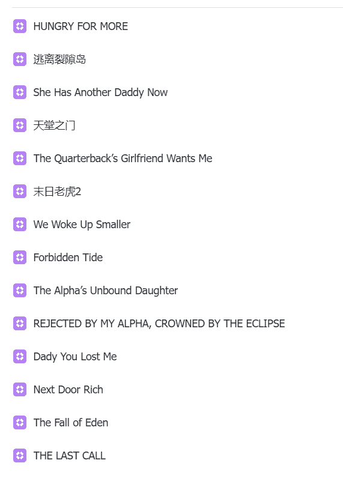
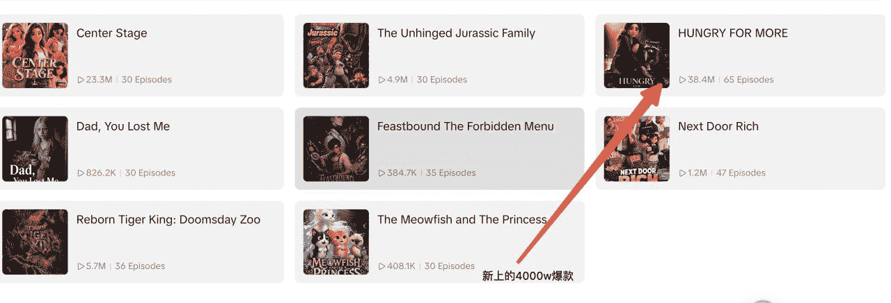
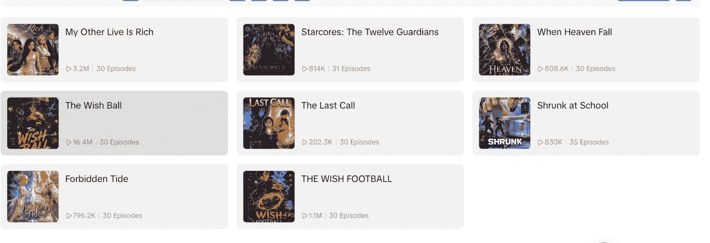

之前写过几篇漫剧的帖子，感兴趣的还可以看看哦。

- 1 月份的漫剧复盘
- AI 漫剧的学习与尝试（复盘）
- 3 月份的复盘
- AI 漫剧值不值得做？行业现状、避坑、创作全流程

## 一、关于成本和收益

### 1.1 入驻平台

要做海外肯定先找平台啦。

目前平台包括 ReelShort、DramaWave、PineDrama（TikTok），还有国内很多家平台都上线了自己的海外版。

入驻方式五花八门。

目前新人入局比较推荐 TikTok，可以同步发 YouTube。

但 YouTube 要注意：禁止发儿童内容，以及血腥暴力，容易违规，所以不是啥都能同步。

至于为啥选择 TikTok，因为简单啊。

### 关于 TikTok 漫剧的入驻

大概 100 元不到的成本。

这个很多小伙伴分享过了，咱们就不细说了，这都是公开的了。

快速过一下。

#### 1、魔法

你需要先准备个魔法，不要问魔法是啥，懂得都懂，需要能上网，最好是干净的住宅。

这个费用吧，20+ 一个月。

推荐 Miya。

#### 2、国内要有个公司主体，把营业执照翻译成英文

有没有三证无所谓。

先做好主体的翻译，也就是营业执照要翻译成英文。

这时候有两种方式：

1. 找你所在的地区政府做公证。

   可以直接微信搜索“地区+公证”。

   这个费用一般在 300 左右。

   初期没做大之前不建议，也没必要哈。

2. 推荐直接上万能的海鲜市场，找有资质的公司做翻译。

   费用每家不一样，但 60 左右都可以接受，超过了就 pass。

#### 3、提前准备好海外账户

思路 1：

直接找到开户行，询问开户行是否支持海外收款，出具账户证明（英文）用于海外业务收款。

一般常见的大银行都支持，直接去办理就好啦。

思路 2——快速试错推荐：

直接找海外第三方收款公司合作，这个很方便，一般审核两三天就下来啦。

#### 4、可以开始入驻啦

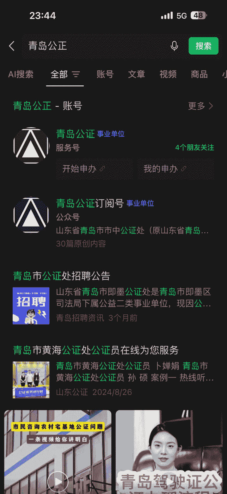
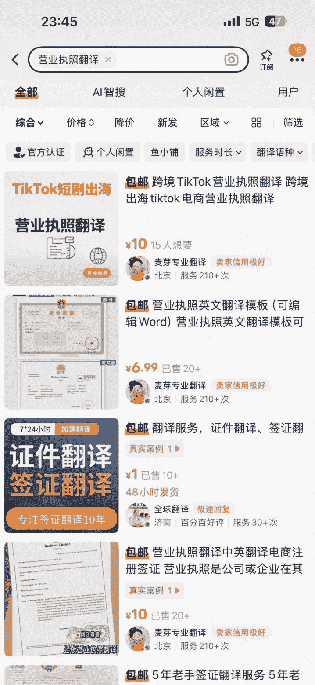

填写入驻信息。

将翻译好的营业执照信息整理出来，包括：

- 公司英文名
- 公司地址
- 开户银行账户信息（英文）

都整理好，直接登录：

https://www.tiktokdramacenter.com/

按照官方要求填写信息即可。

一般当前或者隔日审核出结果。

详细入驻可以看下官方的指南：

https://www.tiktokdramacenter.com/help-center/detail/6a056f8b12f6bd04ef042e4f

所以我们在入驻这一块估摸也就 100 块钱不到解决。

### 1.2 关于收益

当前 TikTok 收益主要分独家和非独家，以及评级问题。

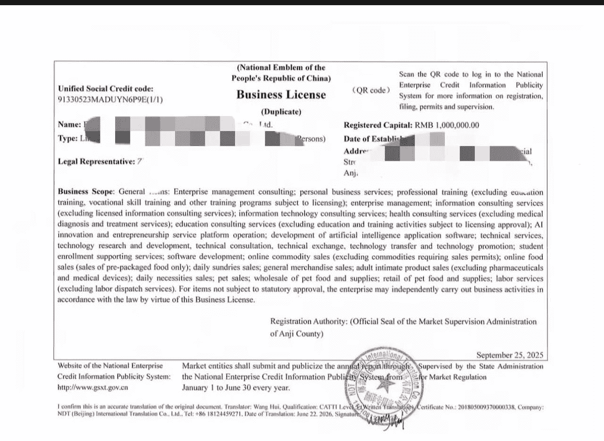

独家合作收益翻倍。

以下为万播收益：

| 评级 | 每万次播放收益 |
|---|---:|
| B 级 | 3–5 美金 |
| A 级 | 6–10 美金 |
| S 级 | 15–30 美金 |
| S+ | 40 美金以上 |

更新下最新单价。

新单价我们最高是，一部美区占比高的，结算单价到 6.7；还有几部地区跑偏的，最低有 0.9。结合同行的讨论和地区因素（美区单价高），以及平均播放时长有很大关系。其中东南亚很低，译制剧没戏，可以直接放弃。

### 1.3 单剧成本

我们当前主力模型以 Seedance 2.0 为主，购买的是 LibTV 的季卡账号。

我们大概一个账号对应一部剧：

30 集、35 分钟；50 集以上翻一倍。

也就是一部剧算力成本大概在 1600 左右。

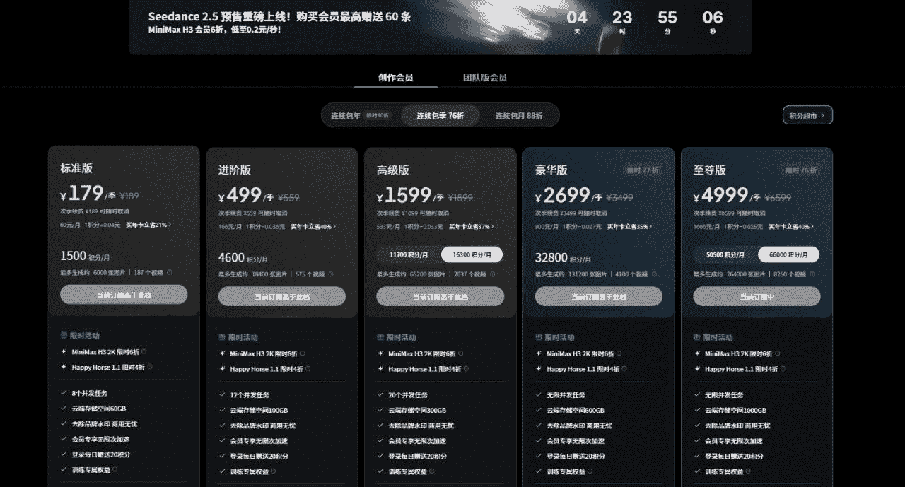

一般会有剩余，大概率用不到 1600。

### 省钱小妙招

用 480p 的 Seedance，然后超分到 1080p（超分是指把低分辨率提高到高分辨率）。

大概能省一半的算力成本。

所以对于我们来说，1 秒的成本是：

1700 元的账号费用 → 66000 积分 → 1 积分 0.0257 元 → 1 秒视频大概 0.33 元。

我们当前抽卡平均是 1.5 抽–2 抽。

也就是实际成本，35 分钟（平均一部剧 35 分钟）：

35 × 60 × 0.33 × 2 = 1386。

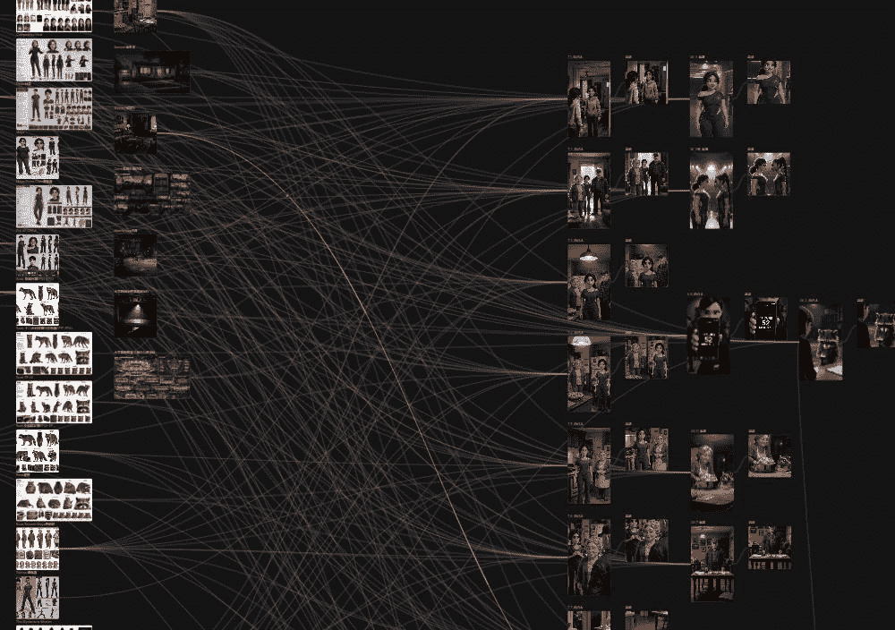
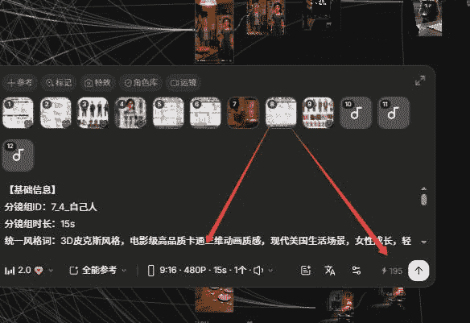

超分的费用不到 100。

当然字节还是比较恶心的，所以有时候 Seedance 会崩，成本会高些，但高不到哪里去。

也就是一部剧成本一般不超过 1600；如果是 50 集或者 60 集的剧，一般控制在 3000。

至于做出来的质量，就是不说多好，还是能打的。

当然比不过精品剧，所以做精品剧的小伙伴看个笑话就好啦。

### 1.4 关于人效

我们通过 Trae 搭配 Skill，利用 CLI（工作流的问题下面讲）批量上传视频，基本做到了无需导演、无需抽卡师。

一部短剧，从拿到剧本到出片，一个人五六天就够啦。

所以我们比较吃剪辑，人工成本就是剪辑员工一个礼拜的成本。

总计来算，单剧成本（按照 35 分钟的剧来算），一部剧大概算上人工、算力约在 3000–3500。

接下来就是创作模块，我会从剧本—工作流进行分析。

## 二、关于剧本

我们剧本也是通过 AI 工作流来创作的。

根据实战，当前的 AI 写的剧本绝对能到 4000w。

但要注意！！剧本必须人工干涉。

目前我们多部跑到 400w 以上，而同期入驻 TikTok 的很多友商，大部分都跑不进百万播放。

对比这些友商的剧，我发现很多友商的作品存在以下几点问题。

### 2.1 友商问题

国内思维太重了，还是用国内短剧内容来做。

首先不排斥这个想法，但我觉着不应该上 TikTok。

原因很简单——人群不同。

TikTok 以年轻人为主，而且美式的思潮、流行内容影响比较大。

国内短剧或者内容，可以在东南亚跑（所以我觉着国内上东南亚的平台也不错，比如红果也推出了东南亚平台）。

其次，国内的本土翻译剧（就是红果上的短剧翻译一下直接发 TikTok）在 4 月份以前很多老号可以跑，但随着 TikTok 内容追逐本土化，后很多流量就不行了，基本跑不过 50w。

最后，海外是吃国内那一套的，但是要本土化啊。比如婆媳关系、人身攻击，这些内容情绪都很强，但海外不一定适配了。婆媳关系不应该做成让媳妇去做家务、媳妇当保姆然后逆袭反杀啥的，这个老外的婆媳关系和国内不一样。

还有人身攻击，海外的社死、霸凌其实还是很有受众的，但不是骂两句就是霸凌，也不是扇一巴掌就霸凌了。

海外是怎么思考呢？举例：公开处刑式的名誉摧毁 + 集体孤立。

啥意思呢？比如小 A 拉着班级同学聚会，唯独没叫小 B，然后小 B 兼职送披萨才发现原来同学在聚会。自己穿着又破烂，在聚会现场被嘲笑，还被拍摄发到全校媒体里。

这种美国人还是比较吃这一套的。

### 2.2 我们的思路

所以我们一般做剧本第一步，会先根据目标题材去做调研，去找同类型的剧，去找爆款。

先去看一遍。

不管是短剧还是博主的，先去看，然后分析核心梗到底是什么。

为什么这部剧会传播？

外国人喜欢啥，他们讨论点是什么？

然后和 AI 讨论，让 AI 帮忙分析这部剧的创作思路和本土化思路。

所以我们会去做本土化的世界观设定。

### 2.3 创意问题

建议大家融梗，很多时候我们直接抄对标就行，就是用爆款思维呗，对标做啥火了就抄啥。

但不要只抄一部，而是两三部融合起来去做一部。

比如我们选择一个普通人逆袭的题材，那就去找两三部近两个月火过的题材。

注意是近两三个月，因为早期火的没啥参考意义了。

然后把 A 的剧情和 B 的剧情让 AI 去分析，提炼核心梗、剧情思路。

什么是核心梗，比如：

《瞬息全宇宙》= 多元宇宙跳转 + 家庭和解议题 + 荒诞黑色喜剧 → 创造出“虚无之中坚守爱意”的奇幻叙事。

《少年派的奇幻漂流》= 海上绝境求生 + 多宗教思辨 + 人性隐喻 → 衍生“少年与猛虎”双重真相的悬疑寓言。

不会分析咋办？AI 会就行了。

简单来说就是提取【A 主角核心目标】+【B 叙事过程 / 世界观机制】+【C 故事情绪基调】，依靠 B 作为故事底层规则，主角为实现 A 持续行动，全程笼罩 C 的氛围，组合诞生全新故事线。

这里就是最大的创意来源。

所以我们找对标爆款，然后分析本土化因子 + 融核心梗 = 爆款！

剧本就说到这边啦。剧本的写作很简单，找对标和分析才是最难的。当你把上面步骤做好，写出来的剧本不会差到哪里去。

## 三、关于工作流的搭建

很多同学关注一个问题，就是我不懂代码能搭建工作流吗？

当然能啦。

老朱是环境科学专业的，也就是和代码没半毛钱关系。

但是 AI 懂就行啦。

所以用好 Codex，没 Codex 的用 Trae，用 WorkBuddy，都有免费额度。

现在的 DeepSeek V4、GLM 5.1 都很强，够用了。

日常用光 token。

那么工作流或者 Skill 如何去搭建呢？

首先你可以下载一下 Claude 开源的 Skill 创作规范，发给 Codex/Trae 就可以直接开发啦。

仓库地址：

https://github.com/anthropics/skills

也可以直接下载。

[图片: /images/docx/link.png]

注意：这是一个规范文件，目标是让 AI 根据这个规范去创建 Skill。

### 3.1 原子级操作拆解

先给大家引入一个思维——原子级操作步骤。

工作流的核心，不是做一个什么都能干的 AI，而是把人的业务经验拆成可执行的原子步骤。

具体做法是把完整任务拆到没有思维跳步，每个节点只解决一个问题，并明确它的输入、判断规则、输出格式和验收标准。

这样哪个环节出错，就直接修改哪个环节；每个节点也可以单独测试、替换和复用。

怎么去理解呢？

就是我们在搭建工作流的时候，不能就告诉 AI“我要一个漫剧创作工作流”，而是把我们从零到一怎么做的，甚至用哪些工具、鼠标怎么点击，都要给 AI 聊清楚。

千万不要想当然，而且还要不断问自己：有没有落下步骤？

工作流拆解的关键，是把隐性思维显性化。

很多有经验的人看到一个内容后，会直接从步骤 A 得出结果 C。看起来中间没有过程，实际上一定存在一个步骤 B，只是这个判断已经被经验内化，几乎不需要主动思考，所以很容易在梳理流程时被忽略。

但 AI 没有这种经验，也无法自动补全中间过程。只告诉它 A 和 C，它就只能猜测 B，最终输出自然容易跑偏。

因此，设计原子级工作流时，不能只记录自己“做了什么”，还要追问：我为什么会这样判断？我在下意识中识别了哪些信息？满足了什么条件，才进入下一步？

把这些被经验省略的判断、条件和过渡步骤完整拆出来，才能真正将个人经验转化成 AI 可以稳定复现的工作流。

### 3.2 漫剧工作流思路举例

我们在做漫剧的时候，会有以下步骤：

0. 读剧本——这对 AI 来说很简单。
1. 创建资产（人物、场景、道具）——AI 辅助分析，人工大量介入，毕竟资产决定了剧的美学。
2. 拆解成分卷内容——因为剧本太大了，分卷执行吧。比如 30 集的剧，我可以拆解成 4–6 个分卷故事。
3. AI 根据剧本拆解分镜，或者直接使用自然语言。简单来说，就是直接给 AI 视频剧本内容，不拆解分镜。

   这里就需要考虑符的制作，符的制作这边先不展开，感兴趣的小伙伴直接去搜索“多参宗”即可。
4. 把每集剧本转为分镜组——分镜组代表我这集要拆解成多少个 5–15s 片段——因为当前即梦 2.0 最长是 15s。
5. 把分镜组转为 AI 视频提示词——这里我们给 AI 提供分卷剧情简介 + 本集内容 + 分镜组片段，AI 就按照预设格式输出提示词啦。

   注意：你需要自己设计一套提示词格式。

   太多人分享提示词啦，我就不班门弄斧啦，网上一堆，提炼一套标准格式就行啦。
6. 重复上述流程，得到全本剧本的提示词。
7. 调用 LibTV CLI——不懂 CLI 没事，官方把 CLI 都写得很清楚，让 Codex/Trae 自己去看就行了。

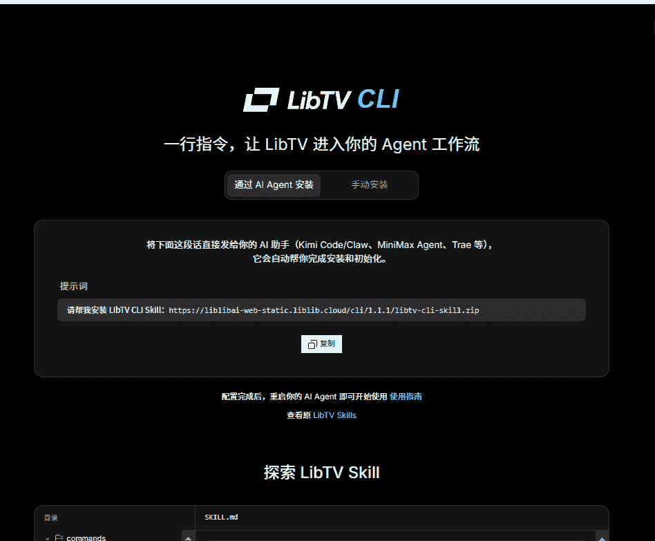

AI 链接的密密麻麻的线。

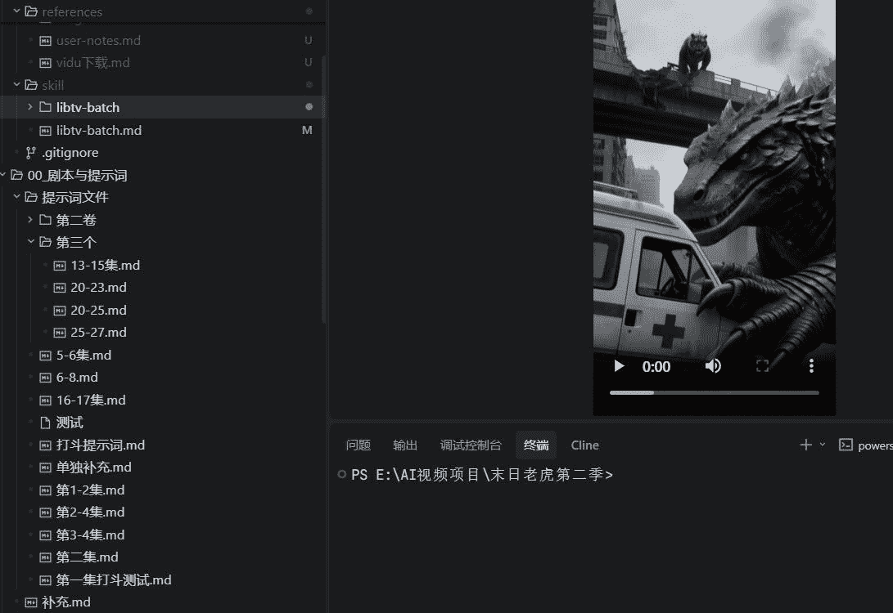
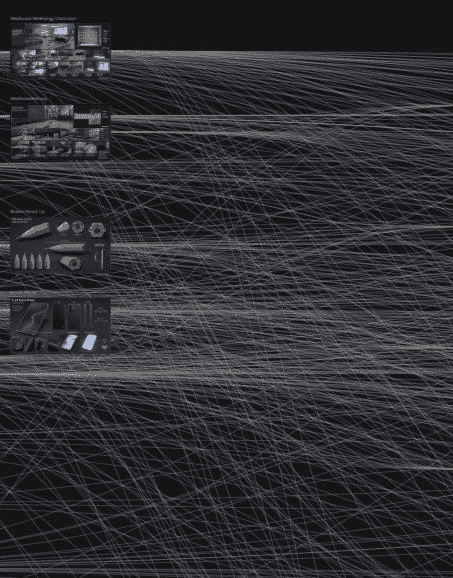

接下来就是用 CLI 批量提交提示词，批量生成就行了。

以上内容 AI 自己会完成。

注意：

每完成一个步骤就要实际测试一下，看符不符合自己的需求，及早发现问题，及早解决。

然后整个工作流完成后要做个整体测试，确保效果没问题。

### 3.3 工作流创作实操

以下用 Trae 作为实操。

下载链接：https://www.trae.cn/work-fission/XUNR2VDRRTLY

每个月都有免费的积分，实在不行接 DeepSeek 也行。

DeepSeek V4 Flash，现在超级强大。

### 1、可以让 AI 先读取 Skill 规范

然后告诉 AI 我们要做什么事情，它需要对我们的项目有所了解，就可以帮我们设计好后续的 Skill 思路啦。

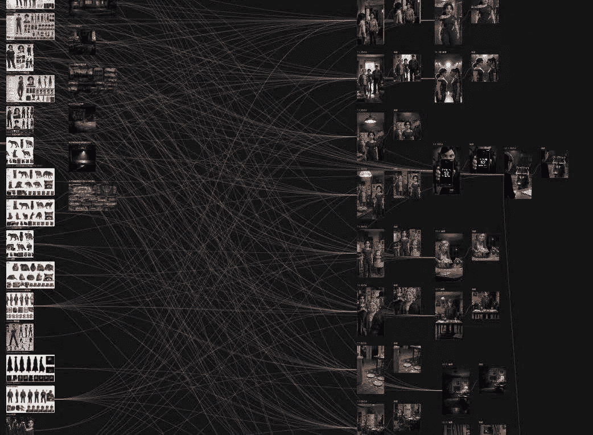

Plain Text：请完整地阅读 Skill 设计规范，接下来我们要设计一个 LibTV 批量上传提示词的 Skill，LibTV CLI 可以通过相关链接下载。

LibTV CLI Skill：https://liblibai-web-static.liblib.cloud/cli/1.1.1/libtv-cli-skill.zip

整体了解完成需求后，设计下后续工作规范和思路。

### 2、准备好测试内容

需要把提前准备好的测试提示词和要上传的参考图文件准备好。

注意提示词里面的资产要和测试文件夹里面的图片资产名称对应。

说明：名称对应，后续 AI 才知道给你上传哪些图片。

### 3、等待 AI 的总结

如果 AI 和你确认问题，按照推荐的走就行啦。

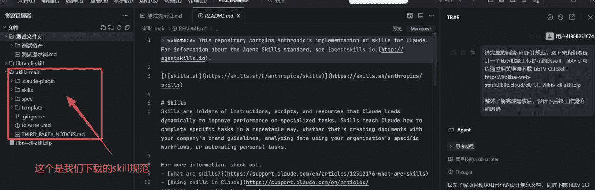
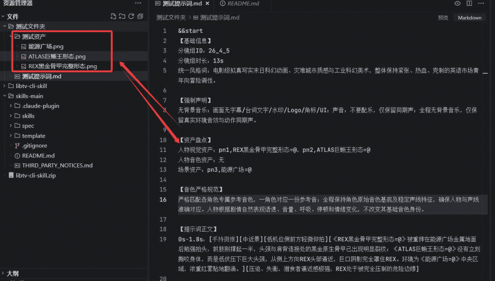

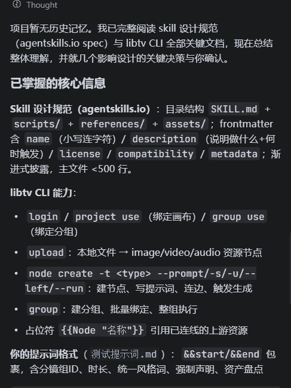
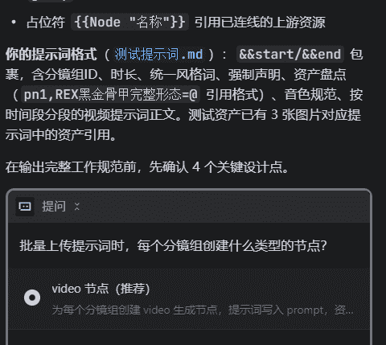

### 4、AI 全部吸收后会给我们方案

这时候你可能不懂代码，有时候也看不懂，咋办？

当然是默认相信 AI 就行啦。

要知道 AI 读取的资料比你全得多。

### 5、默认执行

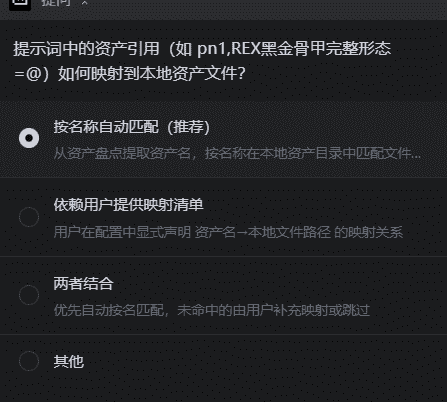
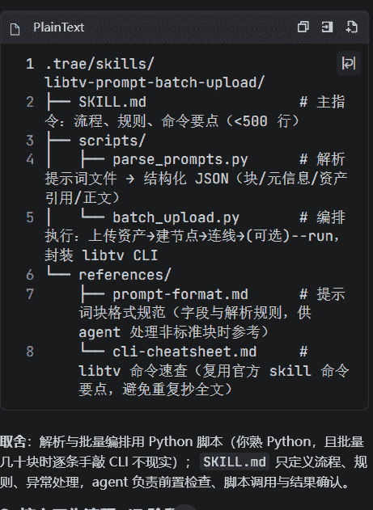
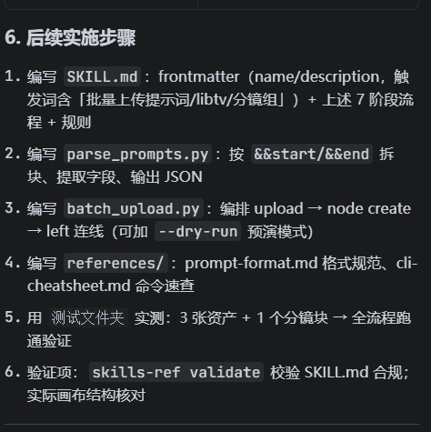

公众号懒人搜索，懒人专属群分享

**6️⃣ 等待 AI 执行完毕，查看测试结果**

AI 执行完毕后，我们登录 LIBTV 的网页端，查看是否给我们上传和绑定了资产图。

可以看到 AI 执行得很完美。

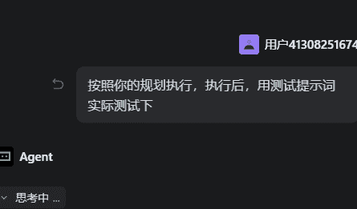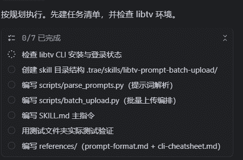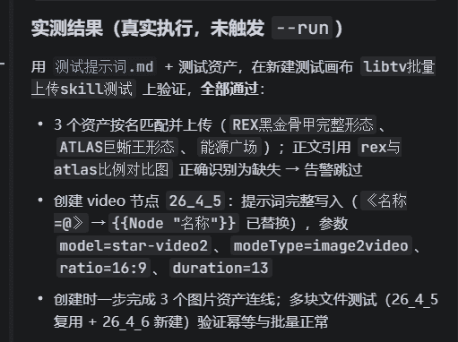

公众号懒人搜索，懒人专属群分享

**7️⃣ 错误咋办**

其实 AI 在测试时就会自己发现问题。

如果 AI 失败，或者有不满意的地方，将你的想法和需求描述清楚告诉给 AI 就行啦，很快就给你解决啦。

最后，你会发现，一部剧的提交和生成就是一上午的事情。

我们一部剧的素材也就花半天到一天就做出来了。

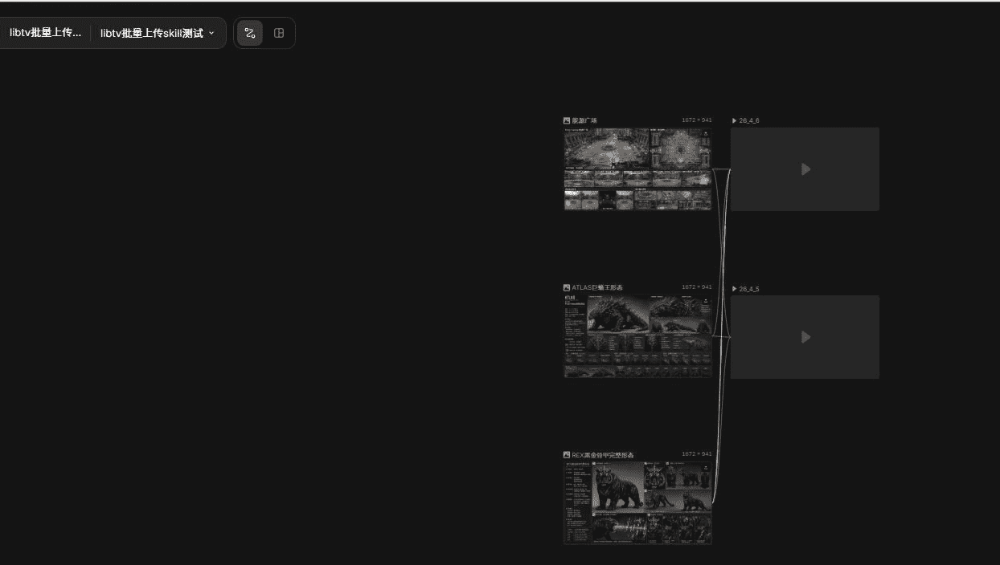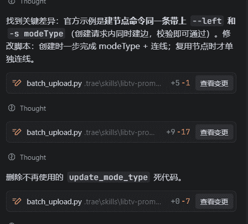

公众号懒人搜索，懒人专属群分享

剩下就是剪辑。

**3.4 直接结果：**

我们剧本写作——2 天，人工介入比较严重，需要调研，辅助 AI 工作流。

资产创作——1 天，人工审美问题，当然也可以直接工作流，现在 GPT Image 2 一张也就几分钱。

素材（也就是视频素材）——1 天，AI 写提示词，提交 LIBTV，然后批量下载、重命名。

剪辑 2—3 天，批量剧没有太高剪辑要求，降低下标准，一般一个剪辑师 10 分钟起步吧。

## 四、创作的问题

其实 Seedance 2.0 出来的时候，我们已经没有创作的感觉了。

往往就是一部剧本出来，做好资产，剧本批量转提示词，AI 自动调用 CLI 或者 API，批量生成就可以。

这里面除了要关注偶尔出现的 bug，基本上不需要人参与了。

到最后就是剪辑。

所以除了创意类作品，创作对我们来说没感觉。

更何况 Seedance 2.5 出来，我看了一些博主的测评，可以说实拍基本已经没多大意义了。现在直出 4K，以后人人都可以做电影。

包括电商也是，基本都是要消耗多少积分和快速铺量的问题了。

尤其 2.5 可以上传 50 个资产，这已经不是一个人可以完成的工作了。

AI 的工作流是必然的趋势！

确定好资产（角色、场景、道具），其他全部交给 AI。

## 五、避坑

海外目前审核不算严格，但要注意以下几点：

1. AI 生成的人脸不要有 IP 形象，海外非常注重版权，一定要注意。
2. 音乐也是，CapCut 有很多无版权音乐可以用，不要直接用别人家有版权的原唱曲子。
3. 不要做过度血腥的东西，比如直接露血肉伤口。
4. 不要涉及儿童伤害，海外儿童保护法很严格。

其他没啥啦，抓紧入场吧。

**建议：**

漫剧出海当前还有空间，因为很多国内的工作室，哪怕是大机构做不明白，S 级作品不代表有流量。

现在是内容时代，而且在未来作品大爆发时代，建议大家要做好自己 IP 的沉淀，自己技能的沉淀。

希望大家都能做出自己的爆款！！

谢谢阅读。

我是老朱！真诚分享，互相成长！

————分割线————

看完这篇 SOP，你觉得你懂了。但 90% 的人一到实操就会卡在第一步。

工具和教程只是最低级的壁垒，真正的壁垒是“立刻动手”和“圈层信息差”。

如果你想看全网最新的变现玩法，并且和一群执行力极强的极客一起下场拿结果，欢迎围观我的核心私域：【懒人专属群】。

我们不聊虚的，只做商业闭环的拆解与 AI 效率的压榨。系统内已沉淀 1000+ 跑通的套利实战局。

查阅圈子完整数字资产与上车门槛：

https://lazyso.com/insider/

认同价值、准备好下场干活的，扫码加我微信（lazyhelper1）。

备注：【实操上车】，不闲聊。

公众号懒人搜索，懒人专属群分享

