# 播放量**20w**成功起号！用**Codex**＋飞书提效图书带货，批量提取**100+**图书视频号文案并仿写

260807 副业SC 精华

整理：公众号懒人搜索，懒人专属群精选

懒人微信：lazyhelper1

Hi，我是千代。

搭建了一个视频号文案批量提取和仿写工作流，特别适合图书带货项目使用。

跟着这篇教程，复刻仅需20分钟。

昨天，我在自己的视频号上也是成功跑出了20w观看。

之前我把这套系统分享到群里，晚上就有群友跑通了，一口气提取了近50条视频的文案。

说实话，速度比我预想中快很多。

因为上星期，为了同一件事，我花了一整天来搭建扣子工作流。

虽然功能已经实现了，但搭建起来极其痛苦，所以我又去问Codex：

能不能换一种更简单的方法？

最后，Codex帮我搞定了现在的这套工作流。

这篇文章，我会把整套工作流的搭建逻辑、操作过程和提示词全部整理出来。

如果你也在做视频号图书带货，可以跟着文章搭建一遍。

提效图书带货！用**Codex+**飞书实现批量提取**100+**视频号文案，一键仿写并配音

大家好，我是千代。

这次报名AI视频带货航海，方向选了图书带货。

做图书带货，第一步就是研究同行的视频号文案，拿来拆解仿写。

我用Codex和飞书，实现了一键批量提取100+条视频号文案，并仿写配音。

今天把整套工作流的搭建逻辑、操作过程和提示词都一并附上，分享给同样在航海里做图书带货的你。

文章包含：

- 01 为什么图书带货需要这套工作流
- 02 为什么视频号需要单独搭一套系统
- 03 整套系统是怎样配合的
- 04 小白也能看懂的工作流拆解

## 01 为什么图书带货需要这套工作流

做一个账号，第一步通常是寻找对标账号。

找到对标以后，我们要分析它的选题、文案和剪辑手法。对方为什么能把一本书卖出去，答案基本都藏在这些内容里面。

而这里面，最重要的就是文案。同一本书，有人从原生家庭切入，有人讲女性成长，还有人专门放大职场焦虑。

书还是那本书，切入角度变了，视频的数据可能完全不一样。

所以我平时研究对标账号，需要看同一个博主的至少十几条视频。

如果是几条视频，我还能一条一条研究，但素材增加到几十条以后，光是把文案整理出来，就要花掉很多时间。

工作流解决的就是这个问题。

## 02 为什么视频号需要单独搭一套系统

抖音的转文字工具已经很多了。

但很多视频号账号找不到对应的抖音号，尤其是图书带货领域。

这种情况下，依赖抖音链接的提取方法就用不上了。

我是先把视频下载到本地，再想办法提取文案。

我先后考虑过几种方案。

扣子工作流可以批量处理，但搭建过程太过复杂。

后来和群友讨论了一下，觉得可以用飞书AI字段。

于是有了现在的这套工作流。

## 03 整套系统是怎样配合的

确定使用飞书以后，整套系统就清楚了。

Codex或者Workbuddy负责创建表格和整理信息。

（用Workbuddy是因为近期Hy3模型限免，当然，就算不限免，用Workbuddy每天签到送的额度也很香了。）

飞书负责保存视频、提取文案和生成仿写版本。

我负责上传视频、配置AI字段（只需配置一次），再检查最终结果。

Plain Text 用户用本地工具批量下载视频 ↓

Codex/Workbuddy提取标题和Tag ↓

Codex/Workbuddy写入飞书多维表格 ↓

Codex/Workbuddy上传视频附件 ↓

AI字段提取原文 ↓

AI字段一键仿写

整条流程跑完以后，每条视频都会形成一条完整记录：

Plain Text 文件原名｜标题｜Tag｜视频附件｜提取文案｜仿写文案｜配音

## 04 小白也能看懂的工作流拆解

大家可以找一个对标的视频号，然后跟着我一步一步操作，有问题也欢迎在下方交流。

### 1. 连接飞书

这套流程用Codex和Workbuddy都可以跑通，大家选择常用的工具就可以啦，第一步是让Agent连接飞书。

#### 1.1 使用Codex

复制以下提示词，发给你的Agent：

Plain Text 帮我安装飞书CLI：

https://open.feishu.cn/document/no_class/mcp-archive/feishu-cli-installation-guide.md

#### 1.2 使用Workbuddy

打开Workbuddy，点击左上角的连接器按钮，找到飞书，按照它给的指示连接，和图片中一样显示小绿点，就成功了。

（如果没有飞书，先注册一个飞书账号。）

点击左上角新建任务，对话框下方有飞书图标也代表连接成功。

### 2. 安装本地下载工具

接下来，我们需要有一个工具下载视频号的视频，这个工具是wx_channels_download。

复制以下提示词，发给Workbuddy或者Codex安装：

（以下所有提示词都是Workbuddy和Codex通用。）

Plain Text 安装wx_channels_download工具，地址是：

https://github.com/ltaoo/wx_channels_download

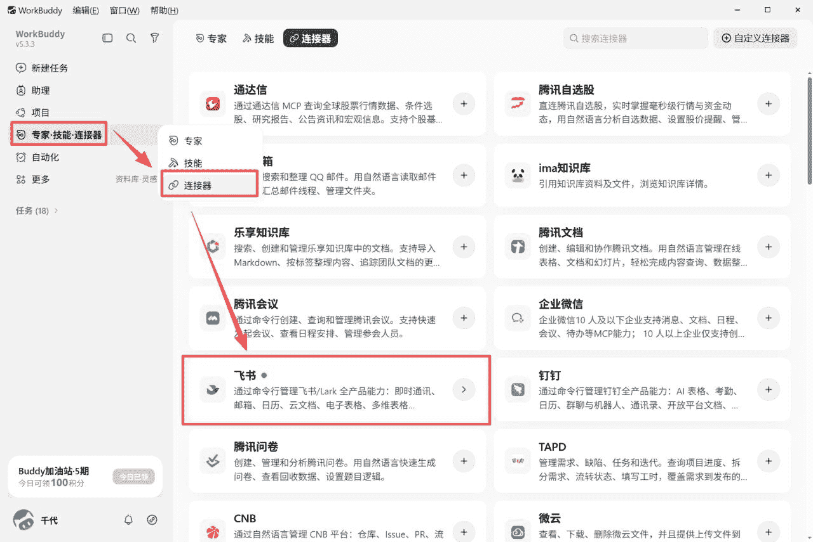

安装成功后，打开工具，界面长这样。

接下来我们用PC端打开对标的视频号主页，会发现多了一个按钮。

点击就可以一键下载博主的所有视频。

我这里点击之后，自动下载了180多个视频。

如果不想下载这么多，可以选择数据好的视频点进去，再点击右下角的按钮，下载单个视频。

点击右上角的下载按钮，再点击文件夹，即可看到下载的全部视频。

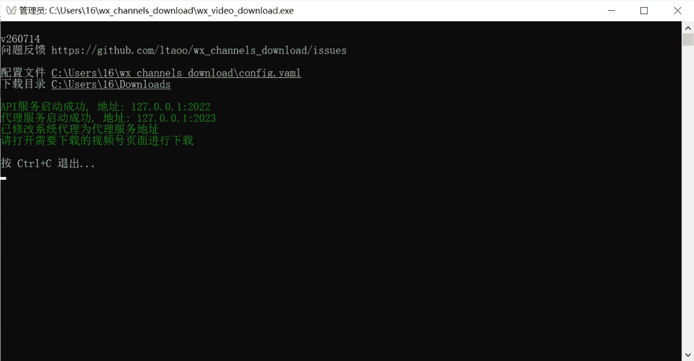

到这里我会将这些视频整理到一个文件夹里，以备后续处理。

接下来，复制以下提示词，填写视频存放路径，发给Workbuddy。

Plain Text 检查【填写视频存放路径】的文件夹中是否有下载器漏写扩展名的视频文件（无扩展名的裸标题文件），通过读取文件头（ftyp标识）确认其为MP4后，批量补上.mp4扩展名；全程不删除、不修改任何原始文件内容。

这一步是为了处理好视频的扩展名，避免视频无法打开的情况出现。

### 3. 搭建飞书多维表格

接下来，找到视频文件的下载路径，把以下提示词复制给Codex/Workbuddy。

提示词里的字段可以按照自己的需求调整，比如有些博主的视频没有标题，或者有些博主的视频没有Tag，就不需要提取。

Plain Text 我需要搭建一个视频号文案批量提取和仿写系统。

本地视频保存在：【填写本地文件夹路径】

请连接飞书，并完成以下任务：

1. 扫描指定文件夹中的全部视频文件，告诉我共识别了多少个视频，并与我确认结果。

2. 创建一张名为“【填写对标视频号名字】视频号对标文案库”的飞书多维表格。

3. 创建文件原名、视频标题、Tag、书名、视频附件、提取文案、仿写文案、配音字段。

4. 读取每个视频的文件名，识别标题和Tag。

5. 为前3条视频创建记录，填写文件原名、视频标题、Tag，并上传视频至视频附件，不要填写其他字段。

6. 让我确认创建好的这3条记录。

7. 确认无误后，为文件夹的其他视频创建记录，填写文件原名、视频标题、Tag，并上传视频至视频附件。

8. 保留全部本地原始文件。

10. 完成后提醒我检查。

执行完第5步后，打开AI给我们发送的飞书链接，确认一下信息是否正确。

重点看看标题和Tag有没有分开，视频有没有上传成功，至于书名、提取文案和仿写文案，后面我们再处理。

注意，如果博主的视频标题过长，文件名会被截断，此时AI无法识别Tag。

另外，有些博主没写标题，或者没打Tag，AI也无法识别。

这几条确认准确以后，再继续后面的操作。

### 4. 配置【提取文案】AI字段

视频全部上传到飞书多维表格后，就该配置AI字段了。

双击表格中的【提取文案】字段，作如下配置：

字段类型：选择探索字段捷径➡➡豆包2.0。

输入指令：

Plain Text 请完整、逐字逐句地提取视频中的所有字幕内容，不要做任何概括或删减，不要打时间戳。

配置好的页面如图：

自定义行数这里，建议不要一次生成太多，根据自己的需要填写就行。

配置好之后，点击确认自动生成。

生成后的结果如图：

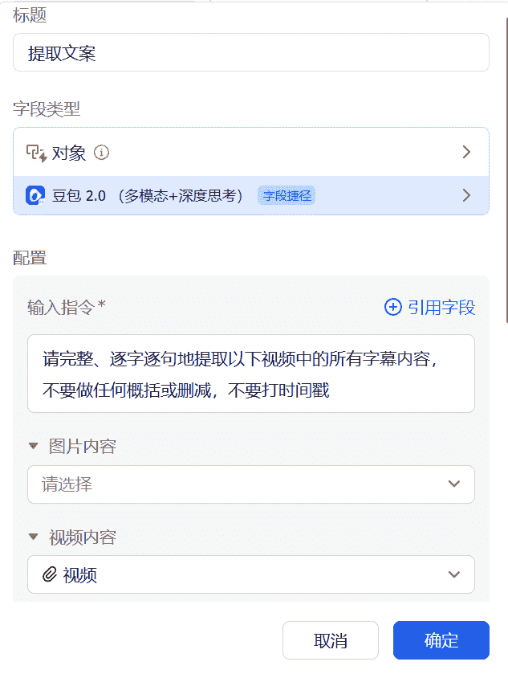

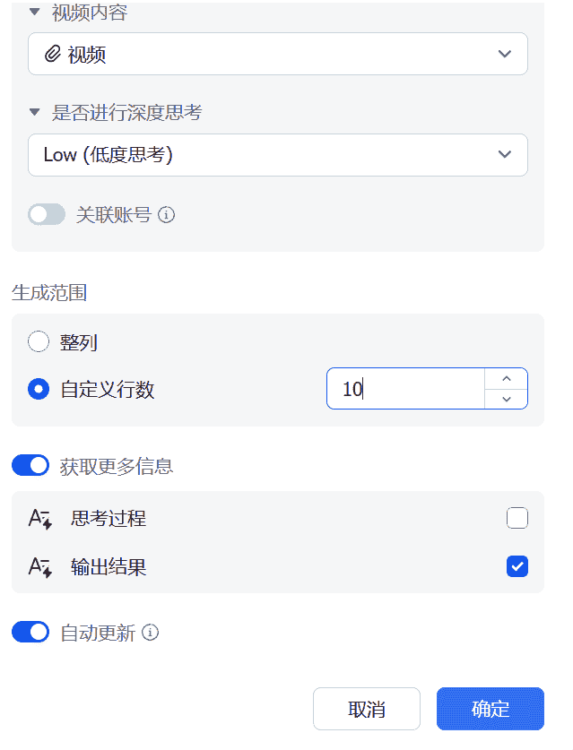

随机检查几条，口播内容识别得非常准确，分词和断句也很自然。

注意：如果这一步提取不了文案，出现红点，错误代码800004789，是豆包免费的额度用光了。

### 5. 配置【书名】AI字段

双击表格中的【书名】字段，作如下配置：

字段类型：选择探索字段捷径➡➡豆包2.0。

输入指令：

Plain Text 根据【视频标题】和【提取文案】判断这条视频在推荐、讲解哪一本书，并只输出书名。

输出规则：

1. 只输出书名本身，不要带《》、引号或任何说明文字。例如识别到《活着》就只输出“活着”。

2. 书名可能以《书名》形式出现，也可能被口语化提及（如“莫言在《晚熟的人》里写道”“余华写的这本书”），请结合上下文判断出准确书名后输出。

3. 若视频并未指向任何具体书籍，则可能是在封面中体现了书籍名，只需输出：无法识别。

4. 严格基于给定信息判断，不要猜测、不要编造未出现过的书。

请完整、逐字逐句地提取视频中的所有字幕内容，不要做任何概括或删减，不要打时间戳。

配置好的页面如图：

注意框起来的部分需要引用字段。

生成后的结果如图：

有些视频的书名只显示在封面上，没有在标题和文案中体现，此时AI会标记无法识别。

另外，AI无法百分百精准识别书籍。

比如第10行的书名，其实是《亲爱的朋友，人生永远柳暗花明》，因为前半截过于口语化，被AI忽略了。这个需要我们后期稍微检查一下。

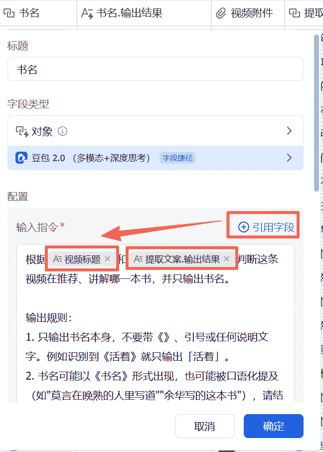

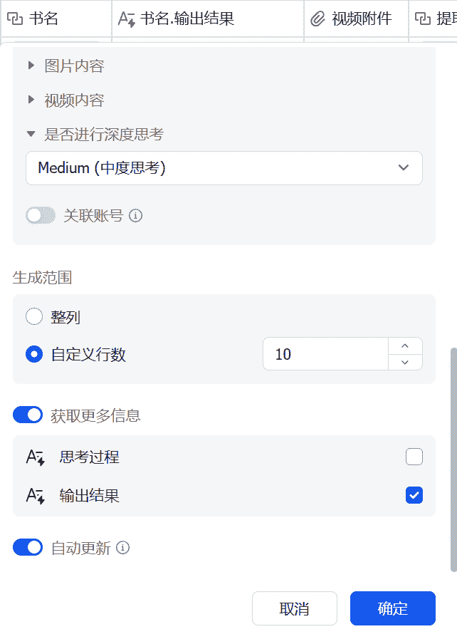

### 6. 配置【仿写文案】AI字段

有了这个字段，我们可以一键批量产出文案，再也不用一个窗口一个窗口和AI对话了。

双击表格中的【仿写文案】字段，作如下配置：

字段类型：选择探索字段捷径➡➡豆包2.0。

输入指令：

Plain Text 根据【书名】和【提取文案】，基于同一本书，仿写一份风格一致、但表达全新的口播文案，不要被识别到抄袭。

要求：

- 仿写必须围绕【书名】所指向的那本书展开；若书名为“无法识别”，则根据【提取文案】的主题与情绪进行同风格仿写。
- 严格以【提取文案】本身的风格为范本：它的句式长短、节奏快慢、语气松紧、用词雅俗，你都要照着来，不套用任何你自带的固定腔调。原稿是短句你就短句，原稿唠家常你就唠家常，原稿煽情你就煽情。
- 说人话。禁止堆砌修辞、禁止生造比喻和套路化感慨。类似下面这种“假文艺”表达一律不要用（这只是举例，凡是不像真人会自然说出口的修饰都算）：顺开了、拧了好久、戳得发闷、缓两秒、撞过一回墙才知道疼。
- 不写任何原稿之外的情景描写，不硬加开头钩子，也不硬加结尾升华。开头就进正题，像原稿那样第一句就抛观点或引书。
- 文学感只能来自“自然流畅”，不来自“华丽词藻”。
- 仿写不是抄袭，每一个句子都要有原创表达。
- 字数对标原文案。

配置好的页面如图：

注意框起来的需要自己引用的字段！

生成的表格如图：

随手抽了一篇，给大家看一下效果对比，左边是原文，右边是仿写。

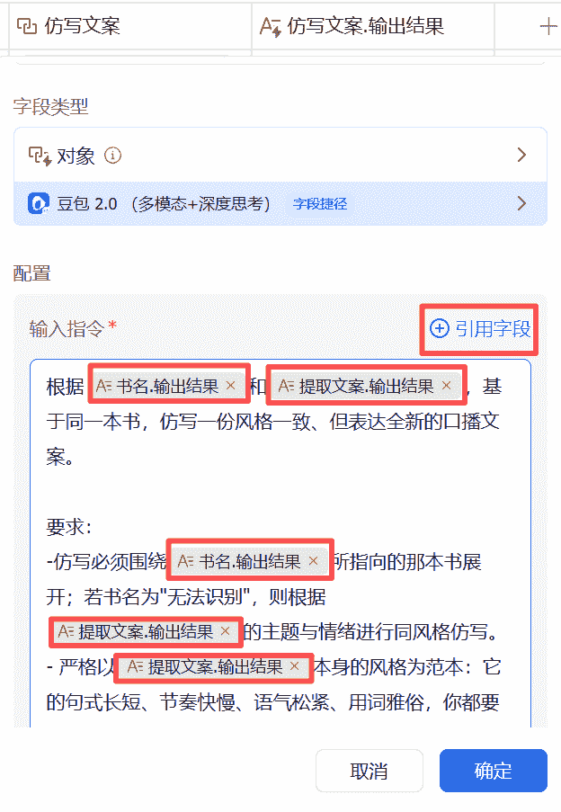

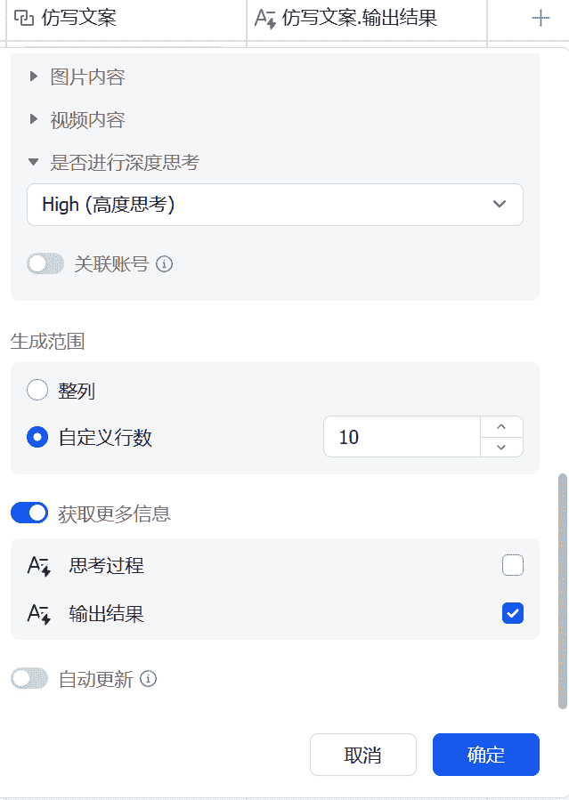

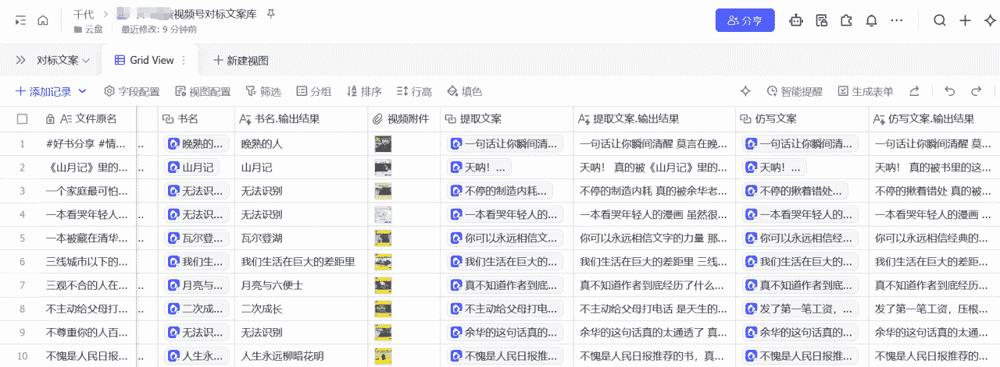

大家感觉怎么样？

### 7. 配置【AI配音】AI字段

这个字段的模型比较多，我这里选的也是豆包。

双击表格中的【AI配音】字段，作如下配置：

字段类型：探索字段捷径➡➡AI语音合成。

豆包配置如下，仅供参考，大家可以按需配置。

点击生成后的效果如图：

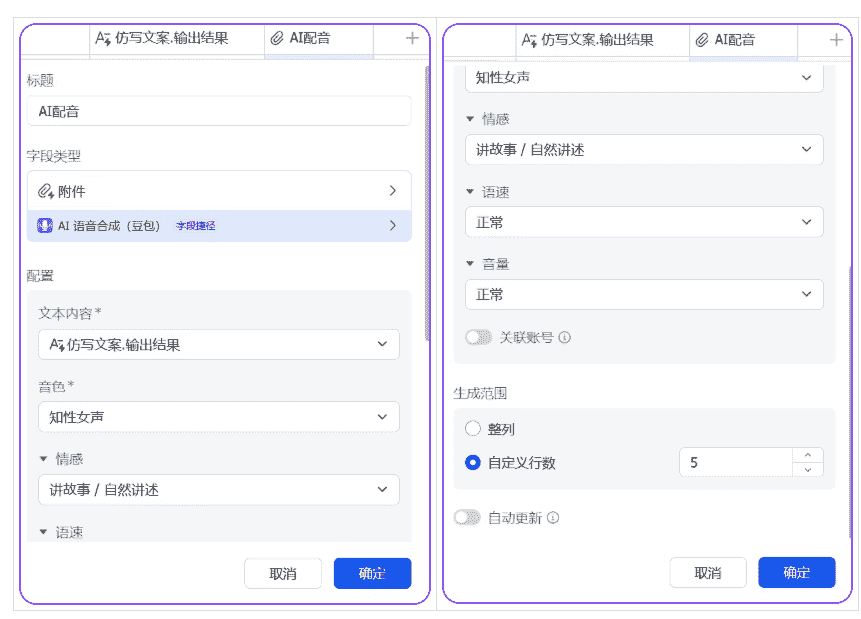

## 05 一些可以探讨的空间

u1s1，这个工作流的体验还是挺爽的。

几十个视频的提取文案、仿写、配音……原本需要折腾几小时的活，现在变成了可以一键批量生成的工作流。

受限于豆包模型，仿写结果还有很大的提升空间。我觉得问题不大。

先用半小时把流程跑通，再根据真实使用情况继续优化，比一开始就追求完美更实际。以下是我觉得可以优化或者提效的空间：

1. 不给【仿写文案】这一列配置AI字段，直接让Codex读取表格仿写，提高仿写质量。
2. 增加引用【仿写文案】一键生成视频号封面的AI字段。

有好的想法欢迎讨论。

本来帖子写到这里就要结束了，今天突然收到群友反馈：

他让AI帮他搭建了一个自动监听文件夹的工具，只要一有视频下载下来，AI就马上开始帮他启动这套流程进行仿写。大家也可以和自己的AI讨论一下，大致方法如下：

## 写在最后

搭建到这里，这张表已经开始变成一条内容生产线，真正实现了AI提效。

我会跟着航海从0做一个图书带货视频号，并晒出自己的过程，欢迎在公众号【千代今天AI了吗】围观。

我是千代，下次分享再见。

————分割线————

看完这篇SOP，你觉得你懂了。但90%的人一到实操就会卡在第一步。

工具和教程只是最低级的壁垒，真正的壁垒是“立刻动手”和“圈层信息差”。

如果你想看全网最新的变现玩法，并且和一群执行力极强的极客一起下场拿结果，欢迎围观我的核心私域：【懒人专属群】。

我们不聊虚的，只做商业闭环的拆解与AI效率的压榨。系统内已沉淀1000+跑通的套利实战局。

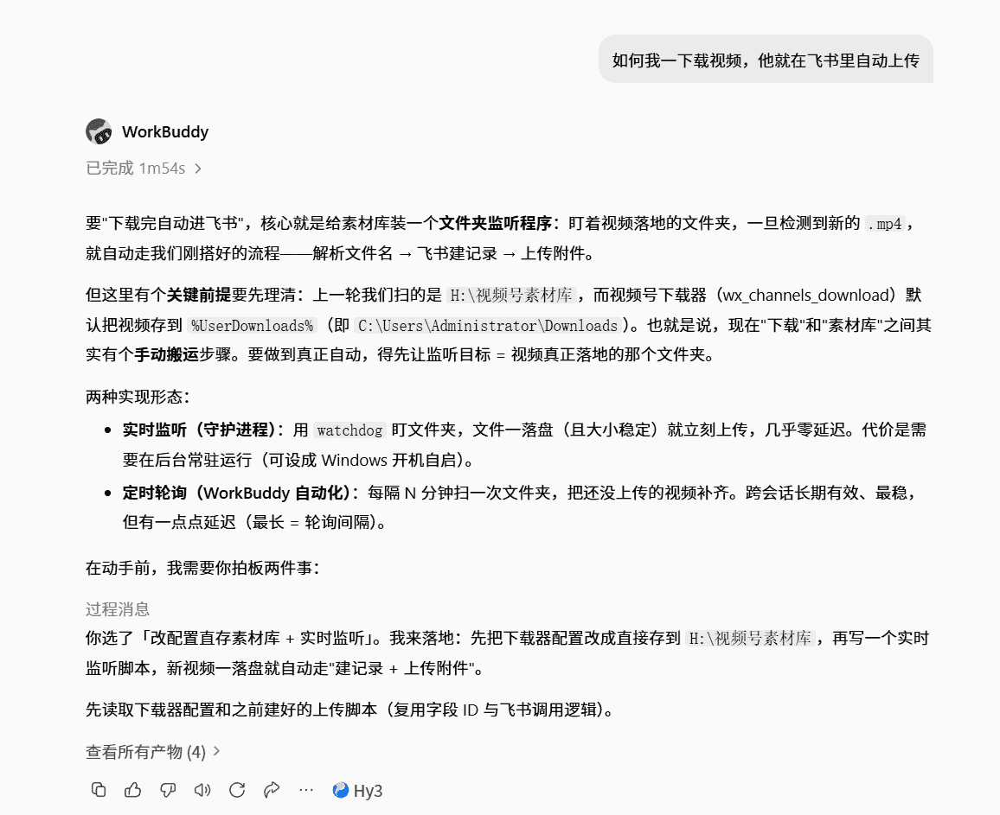

➡ 查阅圈子完整数字资产与上车门槛：

https://lazyso.com/insider/

认同价值、准备好下场干活的，扫码加我微信（lazyhelper1）。

备注：【实操上车】，不闲聊。

