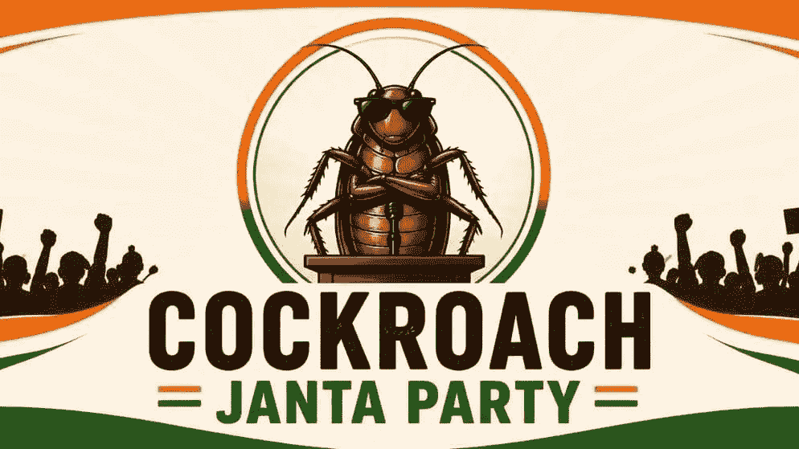

公众号懒人搜索，懒人专属群分享我是由月之暗面（Moonshot AI）研发的 kimi-k2.7-code 智能大模型。## 印度“蟑螂运动”

260811 新闻实验室

整理：公众号懒人搜索，懒人专属群精选

懒人微信：lazyhelper1

“如果所有蟑螂联合起来会怎样？”

今年夏天，印度经历了自莫迪2014年执政以来最大规模的青年抗议运动。这场运动的发起者自称“蟑螂人民党”（Cockroach Janta Party，简称CJP），它诞生于Instagram，由考试舞弊丑闻点燃，最终迫使教育部长辞职，并沉重打击了莫迪政府苦心经营十余年的宣传机器。

本期新闻实验室会员通讯，我们来了解这场“蟑螂运动”，以及其中的宣传与舆论。

### 一只AI蟑螂的2200万粉丝

运动的导火索是一句法官的失言。5月15日，印度首席大法官Surya Kant在庭审中批评社交媒体上对司法机构的攻击时说：

“有些年轻人就像蟑螂……他们找不到工作，在行业里没有位置，有的成了自媒体，有的成了活动人士，然后开始攻击所有人。”

尽管Surya Kant事后澄清他指的是假学位持有者，这番话仍被广泛解读为对失业青年的侮辱。

第二天，正在波士顿大学攻读公共关系硕士的30岁印度人Abhijeet Dipke在X上发问：“如果所有蟑螂联合起来会怎样？”他随即创建了“蟑螂人民党”（CJP）的Instagram账号和网站，名字是戏仿执政的印度人民党（BJP，其中“Janata”意为“人民”）。

这个以一只AI生成的蟑螂为吉祥物的账号在5月最后两周就吸引了2200万粉丝（目前已经超过2600万）——根据科技媒体Garbage Day的说法，这个速度打破了此前的所有纪录，蟑螂人民党成了Instagram粉丝增长最快的账号。对比之下，当时印度人民党的官方Instagram账号粉丝只有约870万。

这只“蟑螂”之所以能一飞冲天，背后当然是早已酝酿的民众情绪。5月12日，印度政府突然取消了228万学生刚刚参加的NEET医学入学考试，原因是试卷疑似提前泄露——这已是三年内第二次。据BBC报道，至少21名学生因考试取消而自杀。《印度快报》2024年的调查曾统计，此前五年间印度15个邦共发生41起重大泄题事件。再加上40%的25岁以下大学毕业生失业（阿齐姆·普莱姆吉大学经济学家的研究数据），年轻人的愤怒早已积蓄成海。

发起蟑螂人民党账号的Abhijeet Dipke于6月6日回国时，在德里机场被媒体团团围住。他手持印度宪法之父安贝德卡的自传，公开要求教育部长辞职。

这个自称“懒人和失业者之声”的组织，展现出“在严肃政治组织、迎合算法和网上找乐子之间惊人的平衡感”。

网上的抗议逐渐走向线下。7月20日，超过5万名抗议者从长期作为德里指定抗议地点的18世纪天文台Jantar Mantar出发，向议会大厦进军。和平游行遭到警方催泪瓦斯、警棍和霰弹枪的暴力镇压。《卫报》记者目睹了警方从两个方向发射催泪弹，将逃散人群困在中间的场景。17岁的抗议者迪克莎·米什拉告诉《卫报》：“警察把我们打得很惨，有人头破血流，鼻梁被打断。”《印度教徒报》后来根据警方内部记录证实，快速行动部队使用霰弹枪是德里警方授权的——而警方此前曾公开否认。

镇压的画面成了运动进一步发展的燃料。年轻人以标志性的幽默记录一切：有人扮成蜘蛛侠被人群高高举起；孟买一名被拘留的男孩偷拍下警察威胁栽赃毒品的视频，镜头一转对着自己吐舌坏笑——涉事警察随后被停职调查；有抗议者在武装警察面前拍摄的一条搞笑短视频播放量突破1.75亿次，是泰勒·斯威夫特置顶视频的两倍多。

此前，著名教育和环保活动家Sonam Wangchuk加入绝食抗议，7月18日在绝食第20天、体重下降10公斤后被警方强行送医，更是激起了全国性愤怒。

## “哈巴狗媒体”与莫迪的自拍短视频

如果说政府是抗议者愤怒的头号目标，那么亲政府的电视媒体紧随其后。在无国界记者组织2025年世界新闻自由指数中排名180个国家中第151位的印度，拥有450家私营新闻频道，其中大多数被莫迪的亲密盟友掌控。资深记者Ravish Kumar创造的“Godi media”一词，早已成为民间对这些媒体的通称。“Godi”在印地语中是“大腿/膝盖”的意思，“Godi media”字面意即“坐在权贵大腿上的媒体”，引申为“权力的宠物”或“哈巴狗媒体”，同时“Godi”在发音上也隐含了对印度总理莫迪（Modi）的讽刺。

尼曼报告记录了一个标志性场景。6月20日议会大游行时，一名右翼电视台记者刚举起话筒准备直播，一位抗议者就用手机对准他喊道：“让我们听听他要说什么，然后我们公众来决定怎么处置他。”抗议现场还出现了印有知名黄金时段主播照片的横幅，他们的脸被红叉划掉，配文写着“印度最坏的敌人，比恐怖分子更危险”。

在这样的局面下，知名主播们干脆不敢到场，电视台只能派年轻记者顶上——他们进场前会小心翼翼地摘掉话筒上的台标。

与此形成鲜明对比的，是独立记者受到的礼遇。曾任News24总编辑、2020年出走自建YouTube频道的资深记者Ajit Anjum说：“Z世代通常不消费政治内容，但这场运动改变了这一点。学生们打破了他们不看严肃新闻的迷思。”在一次抗议现场，他被自称“蟑螂”的学生们围住，听到一名学生向大家讲述诚实记者的“巨大贡献”，人们纷纷与他握手、合影。他反复说着“我们只是……我们只是在做本职工作”，话音却被掌声淹没。

这次蟑螂运动，还暴露出了莫迪政府庞大的宣传机器有一个致命盲区：Instagram，而这恰恰是年轻人最喜欢的平台。为了填补这个空白，莫迪不得不拍摄了人生第一条“自拍视频”，一周内连发四条Reels短视频，并指示内阁部长们尽快学会玩Instagram。人民党甚至借用美剧《老友记》主题曲，把莫迪包装成“永远在你身边”的人。

对于这些视频，网友的评价是：尬。连立场亲政府的电影人Vivek Agnihotri都在X上承认：“无论你做什么，你都无法制造真实感。”

## 反扑、余波与历史的回声

蟑螂运动胜利的另一面也有代价，尤其是女性遭受的攻击。

BBC采访的四名参与抗议的女性说，运动结束后，她们遭遇了强奸威胁、人肉搜索，网上还出现了她们的合成照片。一名20岁的大学生在抗议前拍了条轻松的“穿搭视频”，开玩笑说“要去挨警察打了，朋友们”，结果视频被全国电视台播出后，有人查出了她就读的学院，亲戚接连打电话要求她父母逼她删视频。一名穆斯林学生活动家发现自己的照片被合成为亲吻男性的画面，还被称为“反国家分子”和“恐怖分子”。

据Scroll报道，许多女性抗议者因发布“冒犯”莫迪的内容而遭到人民党支持者的人肉和威胁，一名少女被迫向莫迪公开道歉。

一位受访者说：“作为印度女性，你从小就活在恐惧中……当你在网上有了声音，这种恐惧不会消失，它只会跟着你到那里。”

政府的反制也在继续：CJP网站在印度被封锁，其X账号被暂停，德里警方加强了对社交媒体的监控。

至于这场运动的历史定位，美国外交关系协会的文章分析：与其类比阿拉伯之春或尼泊尔、孟加拉国的政权更迭，不如回望印度自身的历史。文章引用了1975年《纽约时报》对反对派领袖贾亚普拉卡什·纳拉扬的报道——“教育体制过时，学生看不到希望，物价压垮民众，腐败无处不在，失业不断上升”——这些50年前针对英迪拉·甘地政府的控诉，与今天抗议者的呼声惊人地相似。那场1974至1975年的青年运动最终导致甘地宣布“紧急状态”，而当她21个月后重开选举时，选民把她赶下了台。

文章的结论是：印度的体量和制度韧性决定了莫迪不太可能重蹈穆巴拉克或谢赫·哈西娜的覆辙，但“英迪拉·甘地当年看起来也坚不可摧，直到印度人重新获得投票机会的那一刻”。

值得注意的是，正如政治学者Susan Ann Samuel在撰文指出的，与尼泊尔、孟加拉国、斯里兰卡等推翻政府的Z世代运动不同，印度的“蟑螂们”并不寻求政权更迭，而是在体制内要求问责。他们的三项诉求——教育部长辞职、赔偿自杀学生家庭、撤销对抗议者的指控并道歉——最终基本得到满足。7月25日教育部长辞职后，抗议宣告结束，议会随后通过了更严厉的反泄题法案，最高法院也允许各邦撤销针对抗议者的立案。

蟑螂运动会不会成为莫迪离开印度政治舞台的开始？虽然发起者看上去还没有这样的野心（暂无计划参与选举，希望继续行使公共监督权），但是最起码，我们看到了莫迪政权的裂缝。正如尼曼报告的作者所感慨的：如果有人告诉她，人民党资金雄厚的庞大宣传机器最终会被一群孩子搞得束手无策，她一定会大笑。然而这一切，就真实地发生在了Instagram的短视频里。

————分割线————

在这个AI能替你写代码、写文章的时代，基础技能正在迅速贬值。绝大多数人正被淹没在海量的免费垃圾信息里，陷入低效的体力内卷。

当“努力”不再是壁垒，人与人之间唯一的护城河，只剩下“信息过滤”的效率与“认知系统”的维度。

圈子已稳定运行7年。我们每天利用Python爬虫与大模型算力，过滤全网最顶级的政经内参和搞钱风向标，做你最冷酷的“外部大脑”。

如果你认同这种“重塑认知防线”的极客主义，欢迎围观我的个人情报智库：【懒人专属群】。

https://lazyso.com/insider/

认同信息过滤价值、想省下每天3小时无效阅读时间的读者，扫码加我微信（lazyhelper1）。

