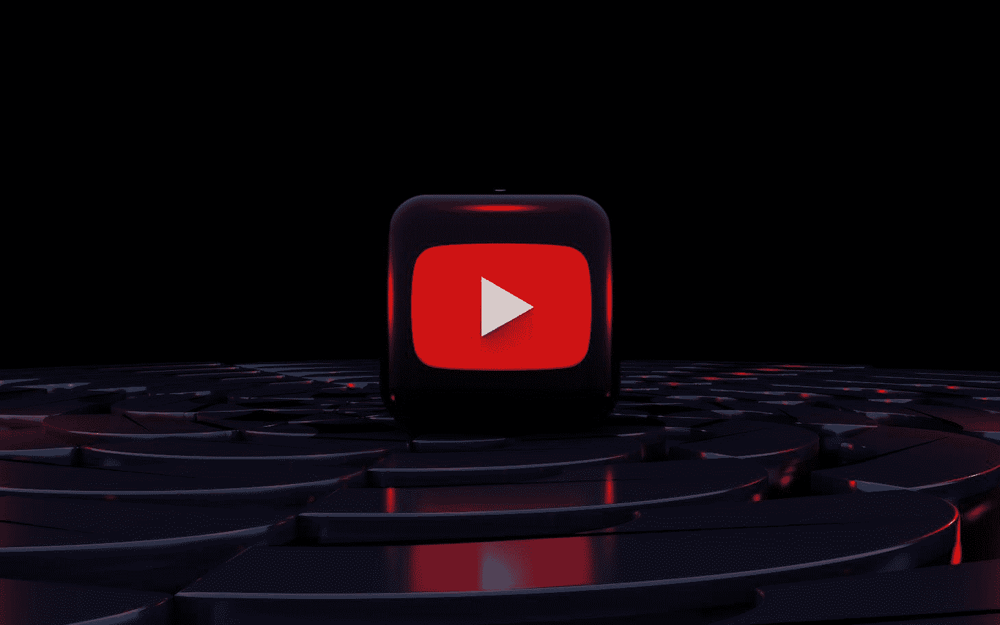

公众号懒人搜索，懒人专属群分享我是由月之暗面（Moonshot AI）研发的 kimi-k2.7-code 智能大模型。# 被观众否决的 AI 实验：YouTube 学到了什么

260811 新闻实验室

整理：公众号懒人搜索，懒人专属群精选

懒人微信：lazyhelper1

迄今为止关于“人类观众要什么”最有分量的一次自然实验。

2025 年夏天，YouTube 悄悄上线了一个 AI 功能：当你搜索“夏威夷最好的海滩”这类问题时，AI 会从众多创作者的视频里挑出相关片段，拼接成一个幻灯片式的答案，直接呈现给你。这个功能于 2025 年 6 月向美国的 Premium 付费会员推出，8 月扩大了范围——然后，悄无声息地消失了。

“人们就是不喜欢它。”YouTube 负责产品管理的副总裁 Emily Moxley 最近对网络媒体 Semafor 说。

之后，YouTube 又推出了另一款 AI 搜索功能。这一次，它们获得了成功。

作为全世界最大的视频平台，YouTube 此次实验能够在相当程度上帮助回答这个问题：在 AI 时代，受众到底想要什么？

今天的新闻实验室会员通讯将复盘 YouTube 的这两次 AI 实验。我们会从中看到 AI 在内容平台上的合理位置，以及“人类创作者会被 AI 取代吗”这个老问题的一个新答案。

## 对比前后两次实验

2025 年 6 月面向美国 Premium 会员推出的这个功能被称为“AI 搜索结果轮播”（AI-powered search results carousel），也可以理解为“AI 幻灯片”，主要覆盖购物、旅行、本地活动等搜索结果。功能推出后，科技媒体 The Verge 说，这相当于把 Google 搜索里的 AI Overviews 搬到了 YouTube 上。

TechCrunch 则提醒，创作者可能会担心这个功能减少他们视频的播放量，就像 AI Overviews 减少了新闻网站获得的导流一样。

这个担心后来被证明是多余的，因为先受不了的居然是观众。

在传统的 YouTube 搜索里，你会看到一列视频，想获得信息就得点进去看。而在 AI 幻灯片模式下，AI 根据视频里的内容直接生成答案，创作者被推到了背景里，他们的视频当中承载的知识被抽取出来放在了台前。也就是说，你得到了信息，但你不再需要遇见提供信息的那个人。

观众的反应是：抽离了视频创作者的信息？不喜欢。“观众想听创作者说话……创作者能提供的故事和信息，是我们无法替代的。”Emily Moxley 这样总结这次实验的教训。

有人可能要说了：会不会只是产品做得不够好？这个可能性当然存在。但请注意，这次实验里的 AI 并没有自己生成内容，它只是把人类创作者的视频片段重新剪辑、拼接了一下。连这种程度的“AI 二次加工”都被观众拒绝了，这恐怕说明问题出在方向上，而非执行上。

AI 幻灯片被观众否决之后，YouTube 继续做新的尝试。今年 2026 年 5 月的 Google I/O 大会上，它发布了新的对话式搜索功能，名为 Ask YouTube，先向美国 18 岁以上的 Premium 会员开放，随后于 7 月扩展到美国桌面端用户，移动端和电视端也将陆续跟上。

新旧两个功能，有何区别？

Semafor 描述了 Ask YouTube 的工作原理：它把一个复杂的问题拆解成若干简单问题，分发给 YouTube 现有的搜索系统，再把结果组织起来，直接跳转到能回答问题的视频片段。也就是说，AI 只负责写“连接组织”（connective tissue），即各条结果之间的串场文字，而不是把多个视频片段合并成一个 AI 生成的答案视频。

这样一来，观众最终看到的仍然是创作者本人的内容，只是找到它的路径变短了。

一个例子是，Ask YouTube 的产品负责人 Sandie Gong 提到，有一位恐高的用户要去拉斯维加斯的 Sphere 球形剧场看演出，他输入“我恐高，Sphere 的 400 区坐起来是什么感觉？”——出来的是一条正好在那个区域拍摄的视频。Sandie Gong 说，聊天机器人可以用文字向你描述那里的感觉，但你没法亲眼看到、亲身感受到，而视频平台则可以展示一个真实的人在一个真实的位置上拍下的画面。

数据表明，这个实验功能得到了受众的认可。在今年 7 月下旬的财报电话会上，Google CEO Sundar Pichai 透露，2026 年 6 月有超过 1.4 亿用户在观看页面使用了 Ask YouTube。Sandie Gong 则观察到用户搜索行为的变化：“我们看到越来越多的复杂查询，人们显然在完整地表达自己的真实意图。”比如“怎么修某个特定型号的车库门开关”这样的问题。而在传统的关键词搜索框里，人们几乎从来不会这样提问。

## 走钢丝的 YouTube

比起不少其他互联网产品，YouTube 在 AI 功能上的推进可谓小心翼翼。要理解这一点，就要先看它守护的是一份怎样的家业。

YouTube 去年的总收入约为 620 亿美元，超过了世界上任何一家媒体公司。刚刚过去的 2026 年第二季度，它的广告收入同比增长 13%，达到 111 亿美元。它坐拥的内容库有超过 200 亿条视频，其中绝大部分由人类创作者制作。过去四年，YouTube 向创作者、艺术家和媒体公司支付了超过 1000 亿美元作为分成。

人类创作者生产内容，观众为内容而来，广告收入随之而来，再分给创作者，激励更多创作。YouTube 的每一分 AI 野心，都必须先考虑：新功能会不会打断这个飞轮？

Semafor 的报道点出了这里的深层张力：那 200 亿条视频对 AI 来说是一座金矿——可以用来训练对机器人和自动驾驶至关重要的模型，也可以用来从零生成新视频。但所有这些用法，都可能威胁到人类持续创作新内容的管道。而 YouTube 反复发现的事实是：观众想要的恰恰是人类创作的内容。

但另一方面，Emily Moxley 很强调效率：“我们在搜索上一直看到的是，效率至关重要。如果我们不够高效，人们就会去别处搜索……他们会直接去看文字，去网页上找。”眼下，ChatGPT 们正在成为新的信息入口。

所以，如果 YouTube 不引入 AI 搜索，观众会流失给聊天机器人；引入得太激进，创作者生态会被掏空。这就是 Semafor 的报道中所谓的“走钢丝”（tightrope）。

在用 AI 改进搜索的同时，YouTube 还正在大力清理平台上的 AI 垃圾内容（AI slop）。

2026 年 1 月，YouTube 依据其“非本真内容”（inauthentic content）政策，关停了 16 个频道，这些频道合计拥有 3500 万订阅者、47 亿次累计观看。今年 7 月，它进一步明确了不能获得广告分成的三类内容：模板化的批量生产内容、令人不适的内容，以及用 AI 虚拟形象讨论健康、财经等敏感话题的内容。此外，平台已转向利用内部检测信号、C2PA 元数据和 Google 的 SynthID 水印来自动标注 AI 生成的视频，而无需依赖创作者的自觉申报。

当然，需要注意的是，YouTube 清理的是批量生产的垃圾，而非所有使用了 AI 技术的内容。在 Ask YouTube 的搜索结果里，AI 生成的视频并不会受到特殊打压。“我们想给人们的是他们想看的视频，”Sandie Gong 说，“无论它是怎么被制作出来的。”

也就是说，YouTube 画出的界线并非“AI vs 人类”，而是“有人为它负责的内容 vs 无人为它负责的内容”。一个创作者用 AI 工具辅助生成内容，但注入了自己的判断和个性，这不会被惩罚；一条流水线每天吐出五十条互为复制品的模板视频，这些是要被清除的对象。

## 人类不擅长判断质量，但擅长判断本真性

Semafor 的科技主编 Reed Albergotti 在评论中写道：人类往往很不擅长判断质量——有不少研究显示，人们有时反而更喜欢 AI 垃圾内容，胜过客观上更好的人类作品。但是，人类非常擅长判断本真性（authenticity）。

所以，观众拒绝 AI 幻灯片，未必是因为 AI 拼接的信息质量差。从纯信息效率上说，幻灯片可能还更好。但是，观众觉得难以接受的是那种没有人在场的感觉。

YouTube 创作者 Hank Green 很早就想明白了这一点，他说：“我的直觉是，人想要与人连接。观众与创作者的关系本来就带有某种人造的成分，但我不认为 AI 会那么擅长建立受众关系。”

音乐人 Nick Cave 在 2023 年回应歌迷用 ChatGPT 模仿他写歌时，写过一段后来被广泛引用的话：“算法不会感受。数据不会受苦。ChatGPT 没有内在的自我，它哪儿也没去过，什么也没经历过。”

（Algorithms don’t feel. Data doesn’t suffer. ChatGPT has no inner being, it has been nowhere, it has endured nothing.）这可能可以用来解释人们为什么觉得 AI 缺乏本真性。

YouTube 的 AI 实验直接验证了真实产品环境下数以亿计的用户行为。观众也许说不清自己为什么不喜欢 AI 幻灯片，但他们的点击和停留诚实地表达了偏好。从一定程度上说，这是迄今为止关于“人类观众要什么”最有分量的一次自然实验。

把目光拉回中文互联网，同样的张力其实一点也不陌生。各个内容平台都面临 AI 生成内容的大量涌入，也都在尝试把 AI 做进搜索、摘要和推荐里。YouTube 案例提供了一个可供对照的问题清单：当平台用 AI 直接总结创作者的内容时，流量和收益还会回到创作者手里吗？当 AI 批量内容与人类原创内容争夺推荐位时，平台的政策界线画在哪里？平台是否愿意像 YouTube 那样，在一个功能被用户否决后公开承认“人们就是不喜欢它”，然后掉头？

这些问题没有现成答案，但 YouTube 的实验至少提示了一个观察角度：一个内容平台对 AI 的使用方式，最终检验标准只有一条——它是在加强还是在削弱观众与创作者之间的连接。

---

在这个 AI 能替你写代码、写文章的时代，基础技能正在迅速贬值。绝大多数人正被淹没在海量的免费垃圾信息里，陷入低效的体力内卷。

当“努力”不再是壁垒，人与人之间唯一的护城河，只剩下“信息过滤”的效率与“认知系统”的维度。

圈子已稳定运行 7 年。我们每天利用 Python 爬虫与大模型算力，过滤全网最顶级的政经内参和搞钱风向标，做你最冷酷的“外部大脑”。

如果你认同这种“重塑认知防线”的极客主义，欢迎围观我的个人情报智库：【懒人专属群】。

https://lazyso.com/insider/

认同信息过滤价值、想省下每天 3 小时无效阅读时间的读者，扫码加我微信（lazyhelper1）

