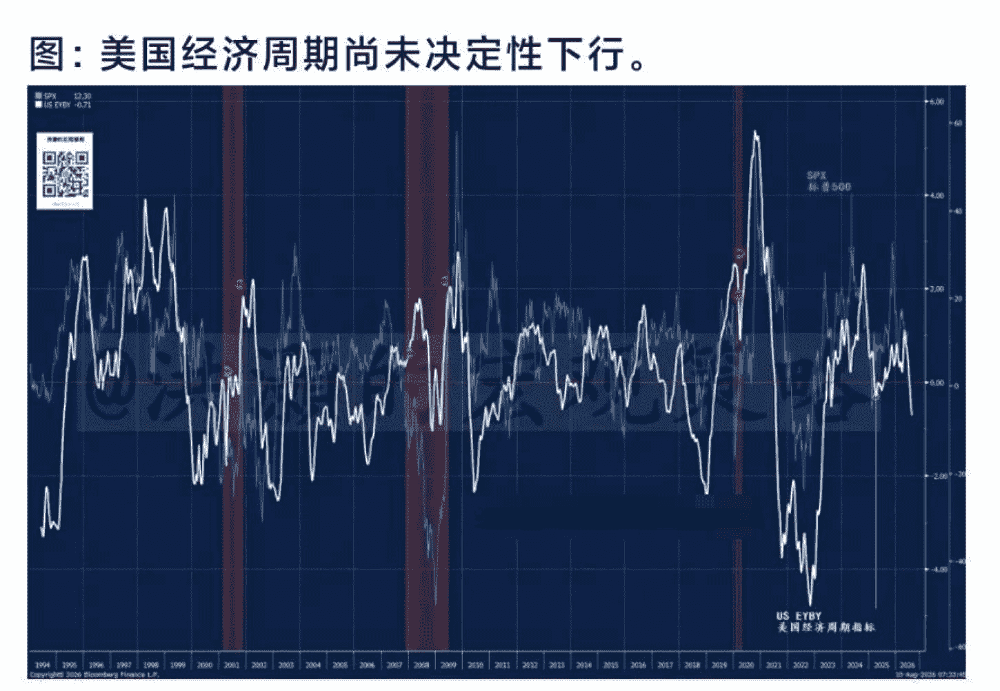
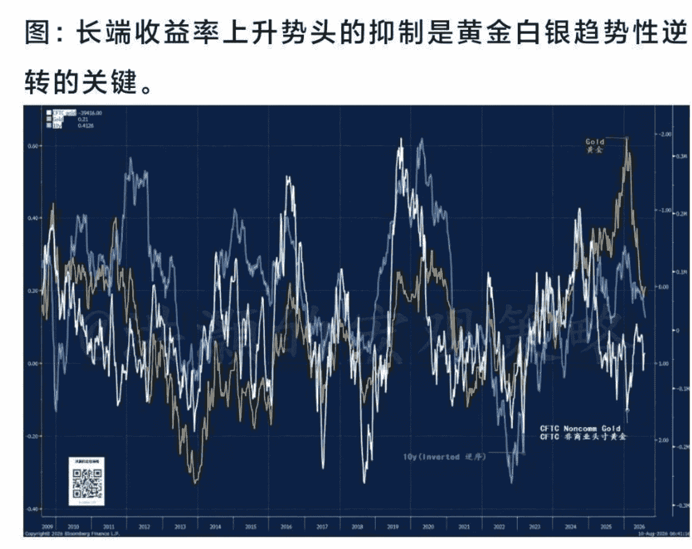
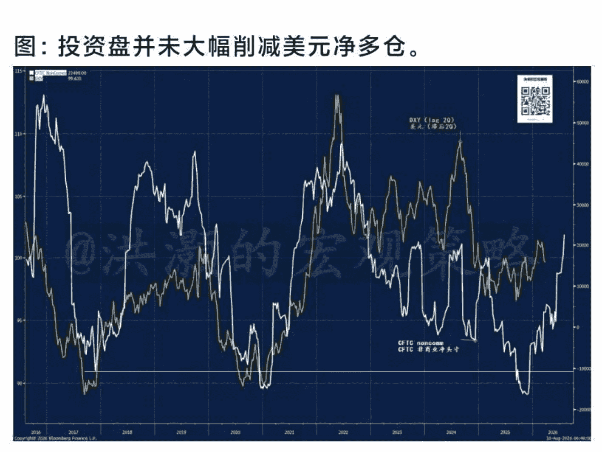
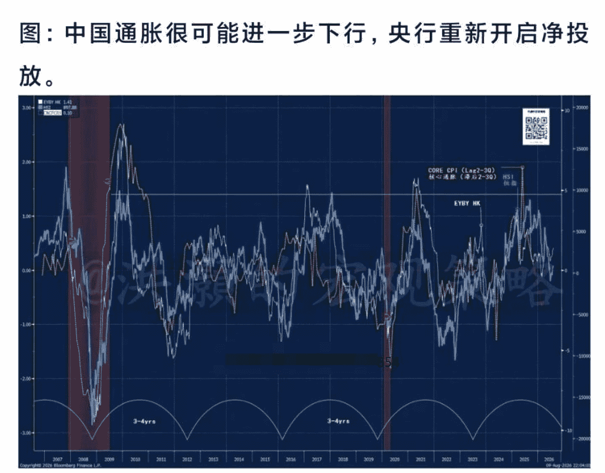

# 洪灝：金银的反攻

整理：公众号懒人搜索，懒人专属群精选  
懒人微信：lazyhelper1

---

## 前言

我们两周前预测的交易性反弹可否持续。

上周美国就业报告显示非农新增就业岗位减少了2.3万人，而市场预期是增加了8万，预期缺口超过十万。美元指数当日略微下跌，但回落到关键的整数关口100以下，而欧元则升至七周高位。与此同时，美联储九月加息概率从55%回落至46%。在这个略微“鹰转鸽”的加息预期修正下，黄金当日上涨至4,300美元以上，白银逼近了64.10美元，两个重要的美元信用的对冲工具、曾在过去两年为投资者创造了丰厚回报的贵金属在上周创下年初以来最强的一周。而白银上周涨幅近12%，是2月以来最好的表现。同时，伦铜一度上涨10%，突破每吨14,000美元，创出了历史新高。

上周初，我们在我的行星前瞻性地指出了以矿业为主的加拿大股指和一些金属矿业公司的技术突破（图）。

图：以矿业为主的加拿大股指继续上升趋势。

---

还是在几周前，市场共识曾认为金属的行情已经结束，但整个金属板块在上周一周之内就增加了超过2万亿美元的市值。我们曾在这个关键的时刻指出了市场共识对于行情认知的逻辑谬误：金属是制造芯片的关键元素；如果共识曾如此狂热地看多半导体的超级周期，那么逻辑上也不可能不看多金属的超级周期。迄今，半导体含量超过一半的韩国股指暴跌了近半，美国、日本等一度被市场共识心仪的半导体领头羊甚至暴跌过半，半导体投资的行业标杆Situation Awareness情景基金差点被清盘，市场共识对于全球半导体的态度得到了修正。

在7月31日发表的专属文章《洪灝：AI半导体交易进入了新阶段》中，我们认为韩国股市机构和衍生品杠杆肯定都显示了市场对于半导体资本开支的商业性的担忧开始有所缓解。

然而，美联储真的是鹰转鸽派了吗？究竟是什么引爆了上周金银的大反攻？这个强势的反攻是否有可持续性？市场共识忽略什么？

如果仔细看看7月非农的分行业的就业情况，那么美国就业市场是否疲软的结论就很难轻易得出：美国政府部门减少5.3万人，其中地方政府教育一项就减少了5万人，这几乎完全是暑期的季节性因素；休闲与酒店业减少4万人，因为世界杯的结束；零售减少1.9万人，医疗保健则增加2.2万人。除去美国政府部门就业的减少，私营部门实际上是增加了3万人。如果把学校日历与世界杯这两项失真加回去，7月的非农大致是新增6.7万，与新增8万就业岗位的市场预期，其实相差不远。

然而，就业数据更重要的是前两个月的修正值：前两个月就业合计下修10.3万人，5月从原值下修6.6万至12.9万，6月下修3.7万至5.7万。而家庭调查同样疲软：就业人数减少8.7万，劳动力规模萎缩26.4万——失业率微降至4.1%是因为劳动力规模的减少。时薪方面，7月环比仅增加两美分。简言之，就业的趋势似乎是在变弱的，而实现美国劳动力充分就业是美联储的政策目标之一。

尽管如此，我们跟踪的其它一系列美国周期性指标都在周期顶部，显示美国经济其实并不弱。这个观察值和美国当下进行的大规模资本开支的情况一致。很可能也因为如此，尽管就业市场出现走弱的征兆，但是美国的经济周期还在略低于均值的位置（图）。

这个周期指标自身并没有给出明确多空信号。因此，在周期调整后的美股估值依然接近历史高点的情况下，当下美股交易更多的是情绪和技术，而非估值和基本面。这个观察进一步印证了我们两个交易周前提出的“可交易反弹”的观点。

图：美国经济周期尚未决定性下行。

---

那么，究竟是什么引爆了上周金银的大反攻？这个强势的反攻是否有可持续性？市场共识忽略什么？

美国财政的可持续性继续担忧，那么长端收益率是易涨难跌的。在上周的美国就业数据报出来之后，美债收益率近端和远端的运行情况，反映的就是这个逻辑。

然而，在上一篇专属报告里，我们还讨论了一个新的、非常重要的、市场共识忽略了的而很可能是市场模式转换的因子。

上周，美国财政部与日本联手干预了日元汇率市场。这是1998年以来，美国对于汇率市场第一次联手干预，也违背了美国对于美元汇率“非危机不干预”的市场原则。这是一次显著的政策立场转变，而美国财长贝森特在成功将日元汇率从165附近打到157左右之后，还威胁投机者，称如果日元继续走弱，美国将继续干预。这是一个曾经的索罗斯基金的CIO，也曾在2013年的汇率市场上豪赌赢得超过十亿美元盈利的对冲基金经理。这个人作为美国财政部长的市场影响力，是可信的。

而这个政策立场转变，也符合了美国财长的政策目标。贝森特对于美债美元市场的干预并不止于对于日元汇率与日本的联手干预。在上周的美债再融资指引中，我们看到了言辞中一些微妙的变化。指引一反常态，并没有像以前那样说“要上调美债融资的额度”，而是说“调整美债融资的额度”。这个微妙的措辞变化，似乎预示着美债发行的额度将会被下调。如是，长端美债收益率的上行势头可能会被暂时抑制。

结合美国对于日元汇率立场的变化和对于美债发行的前瞻性指引的立场变化，我们可以看到美国对于美债和财政可持续性的担忧。虽然我们不认同美国财政部对于长端美债收益率长时间的控盘能力，毕竟美债收益率的这个部分还是由全球投资者交易决定的，但是我们并不能够否定美国财政部对于长端收益率的暂时的影响。美国财政部暂时控制长端收益率，比起美联储鹰转鸽派对于短端的影响乃至整体风险资产的走势，重要多了。

具体对于黄金白银而言，我们的数据分析证明，如果长端收益率上行的势能减弱，那么黄金白银和其他金属将重拾上升趋势（图）。然而，目前我们对于长端收益率上行势能是否可以维持持有保留意见。因此，与美股一样，黄金白银交易更多的是市场情绪和技术，而非基本面和估值。

尽管如此，中国央行持续地买入黄金，甚至在七月份加码购买。这是黄金最大的基本面之一。

图：长端收益率上升势头的抑制是黄金白银趋势性逆转的关键。

---

与此同时，如果美国对于汇率干预的立场发生改变而导致美元弱势持续，那么对于风险资产的走势，也将是一个利多。短期，我们并没有看到投机盘削减美元净多仓，美元在100整数关口徘徊不前，有利于风险资产、大宗商品、新兴市场的短期走势。

图：投资盘并未大幅削减美元净多仓。

---

技术上，我们看到了黄金的反弹日线收于200天线之上，而白银触及了200天线。如是，它们还需要进一步把周线收在200天线上，才能够确认趋势的逆转。当下，由于这些资产类别都在交易技术和情绪，同时我们看到许多矿业公司和以矿业公司为主的市场都纷纷出现技术形态的上行突破，因此我们对于前两周提出的“可交易反弹”的预测维持不变。

价格走势的因子并没有太多的话语权。然而，反弹从两周前我们提出的“可交易反弹”的时刻就已经开始了。

这两周美国对于汇率和长端收益率的政策立场都发生了关键的变化。与日本联手干预日元保证了美债长端收益率不会因为日本抛售美债融资救日元汇率导致如2024年那时候的套利交易的崩盘；而对于美国财政再融资前瞻性指引的微妙变化，也给长端收益率一个非常有意义的信号。而中国的经济周期指标显示通胀很可能进一步放缓（图），这种情况也很可能是央行上周重新开始净投放的原因。在长端收益率上升的势能暂时得到抑制的情况下，黄金白银、风险资产交易更多的是情绪和技术，而非基本面和估值。而技术上，标普的交易区间突破、黄金白银的200天线位置、铜的历史新高和一些矿业公司和以矿业为主的市场股指的技术突破形态，都预示着这个“可交易反弹”应该尚可持续。

图：中国通胀很可能进一步下行，央行重新开启净投放。

---

洪灝  
2026.08.10

————分割线————

在这个 AI 能替你写代码、写文章的时代，基础技能正在迅速贬值。绝大多数人正被淹没在海量的免费垃圾信息里，陷入低效的体力内卷。

当“努力”不再是壁垒，人与人之间唯一的护城河，只剩下“信息过滤”的效率与“认知系统”的维度。

圈子已稳定运行7年。我们每天利用Python爬虫与大模型算力，过滤全网最顶级的政经内参和搞钱风向标，做你最冷酷的“外部大脑”。

如果你认同这种“重塑认知防线”的极客主义，欢迎围观我的个人情报智库：【懒人专属群】。

https://lazyso.com/insider/

---

认同信息过滤价值、想省下每天3小时无效阅读时间的读者，扫码加我微信（lazyhelper1）

