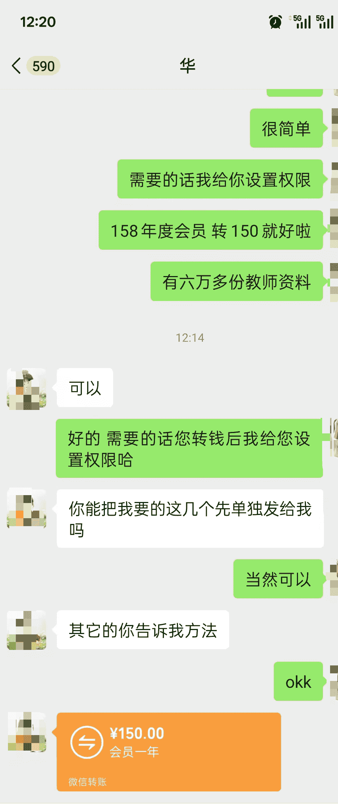
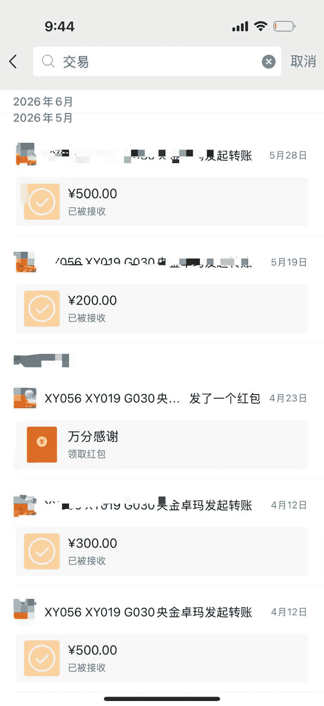
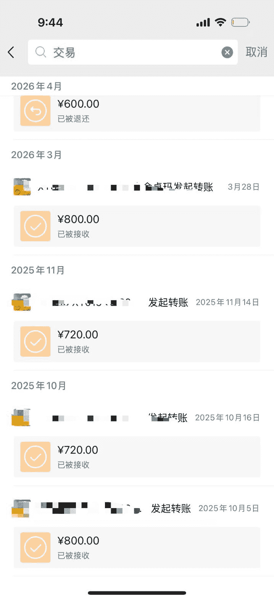
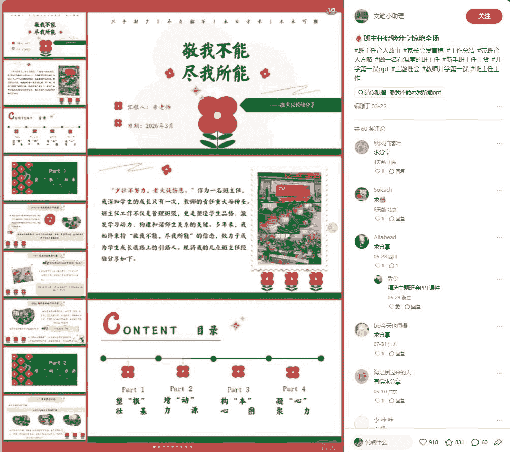
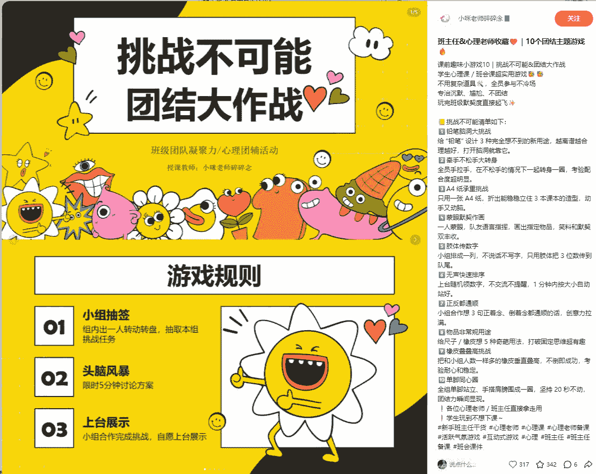
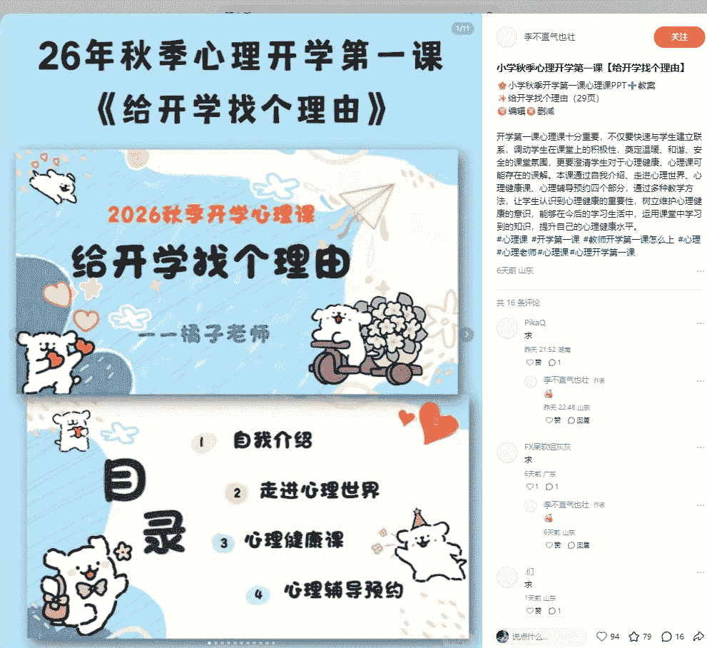
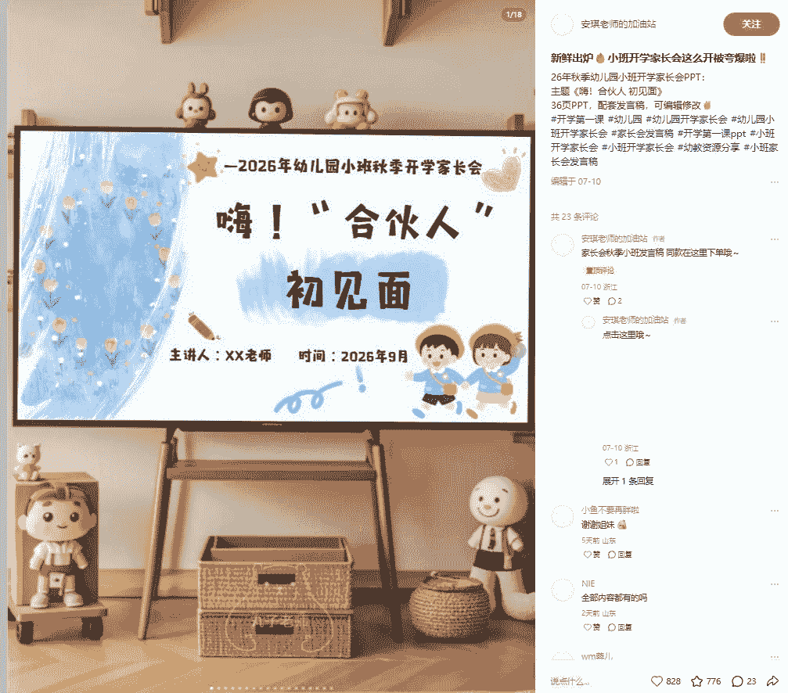

公众号懒人搜索，懒人专属群分享

开学第一课单个**PPT**变现上万，开学季如何利用**AI**赋能教师（教务）资料

260810 副业SC精华

整理：公众号懒人搜索，懒人专属群精选

懒人微信：lazyhelper1

大家好，我是星荧，做教师虚拟资料两年了，从最初一个人一台电脑无脑搬运，到现在跑通了原创制作、小红书店铺销售、抖音和视频号引流、公众号发文、微信私域复购、学员分销的完整闭环。往期航海期间，也带了不少圈友在这个赛道拿到了结果。

接触教师虚拟资料以来，我走了很远的路，尤其是**AI**浪潮的冲击——从扣子+飞书多维表格工作流的搭建，到Obsidian选题知识库的建立，到Codex使用、沉淀自己的skill，到**AI**制作不可编辑PPT→可编辑PPT，再到搭建爱马仕Agent批量生产线。踩了无数坑，遇到数不清的卡点与壁垒，才将这份经验贴送到你面前。若有不当之处，欢迎各位批评指正。

说回正题。为什么这个赛道值得做？

一个开学第一课PPT，一单9.9元，去年单品卖了超一万块——去年也在咱们星球分享过开学第一课单天变现上万。一个班规反思系统，上线不到一周卖了两万多。有同行仅靠一个班规说明原创品，卖了十多万。

这不是什么高深技术，是用**AI**做的——可编辑、可改、拿来就能售卖的课件。

八月了，几百万老师的搜索流量已经在路上。

这几天给伙伴做了接近八小时的视频实操分享，从头拆了一遍教师资料在开学季的全渠道打法——不止小红书店铺，抖音、视频号、公众号，多平台布局。同期，从去年一起做课件的圈友舒蓬，在生财开了一期“小红书教育资料PPT Mini航海”，300个名额几分钟被抢空。很多圈友来问我怎么好久不写帖子了，看大家对开学季教师资料很感兴趣，写这篇帖子分享给各位圈友。

特别感谢生财有术提供的优秀圈子、小武老师对帖子的帮助、郭耀天郭总的帮助与指引、圈友稳稳的幸福大哥、小爱同学、一苇以航、舒蓬、新安洲、大美、H燕玲、千寻等的包容、帮助与鼓励，很多次其实我想躺平，休息、摆烂时，大家总是给予我前行的力量！

## 第一章：这个赛道到底在做什么？

### 1.1 你到底在卖什么？

用户买单的底层逻辑，从来不是你的产品有多好，而是你帮用户解决了什么问题、节省了多少时间、降低了什么风险。不要问“我的东西这么好，为啥没人买”，要问“我的东西能帮用户解决啥问题”“能帮用户省多少时间”“能帮用户避什么坑”。想明白这三个问题，你卖啥都能火。

拿教师资料来说。一个班主任，周一到周五要上课、管班、填表格、应付检查、联系家长。周末还要备课。开学第一周的课尤其重——新学生、新班级、新年级，什么都要从头准备。

如果有一套课件，9块9，打开就能用，改个名字就能上台——你买不买？

买，必须买！

这就是教师虚拟资料的本质：不是比谁做得好看，是比谁解决了“我明天要上课，今天还没准备好”的焦虑（情绪经济）。

### 1.2 开学季教师资料做的是哪几类品？

我把它分成三层：

第一层：普适性刚需品

所有班主任、所有老师都需要的。比如：

- 开学第一课PPT（每个班主任每学期第一节必上）
- 家长会PPT（每学期至少一次）
- 安全教育主题班会（1530记录表，教育局硬性要求）
- 德育工作计划
- 班级管理工具

这一类品的特点是：需求大、搜索量大、需求精准、转化率高。但因为需求池够深，只要你的封面和标题做得好，每个品都能分到一杯羹。

第二层：学段痛点品

不同学段有专属的痛点。比如：

第三层：学科细分品

按学科×年级的组合来切。比如：

- 小学语文：三上第一课、四上古诗教学、五上作文指导
- 初中数学：全等三角形、二次函数、勾股定理
- 高中英语：新高考读后续写、定语从句
- 体育、美术、音乐等小众学科——竞争最小，但每个学校都有这些老师

### 1.3 赛道现状：搬运卷到头了，原创刚刚开始

过去很长时间，教务资料的主要打法是“搬运”——将网上的免费资源整理打包，低价卖。但到了2025年，搬运赛道已经卷到几块钱一单，利润微薄。

真正的拐点发生在2025年下半年。一群人开始用**AI**做原创。

**AI**能干什么？

能写教案、能拆竞品、能生成页面排版、能出可编辑的PPT。以前做一个原创课件要三四天，现在用Codex，一天5—10个轻轻松松。

搬运那条路是越走越窄的，但原创这条路，才刚刚开始。

### 1.4 关于数据——先给你吃一颗定心丸

这个赛道到底有多大？给你几个我亲手验证过的数据：

- 一个高一开学第一课PPT，去年单链接卖了超过一万块
- 一个反思系统（班级管理小工具），上线不到一周，卖了两万多
- 班规说明的原创品，有同行仅靠这一个品卖了十多万
- 宠物积分系统（非物质奖励工具），开学季必定爆发
- 国庆班级文创（全班福头像框），每年的10月都是旺季
- 小红书上搜“开学第一课”，各种几千单的爆款比比皆是

我在这个赛道投入大量时间精力，目前很多家人、朋友、圈友跟着一起做，每月一两万收益一抓一大把。我自己从读硕期间就开始做，毕业季靠这个买了人生第一辆车。

说这些不是为了炫耀。是想告诉你——这个赛道，普通人是可以赚点生活费的。

## 第二章：开学季窗口——一年中最重要的一次机会

### 2.1 八月到九月的四波机会

开学季不是一个点，是贯穿8月中旬到10月上旬的一整条需求链。把时间线拉出来，你会看到四波节奏：

第一波（**8**月中下旬）：新生提前入学。高一、初一、小学一年级的新生，大部分学校要求在8月中旬提前到校。军训、入学教育、新生适应——这一波的需求关键词是“破冰”“自我介绍”“新生入学教育”“军训准备”。

第二波（**8**月底—9月初）：正式开学。全体学生返校。所有班主任都需要开学第一课。这是全年搜索量最大的时刻。这一波的关键词是“开学第一课PPT”“新学期家长会”“安全教育第一课”“1530记录表”。

第三波（**9**月中旬）：教学进入正轨。班级管理相关需求上线：座位安排、班规制定、班干部选举、班级积分系统。学科教学课件需求同步启动。

第四波（国庆前后）：文创定制。班级合照、国庆主题手工、黑板报素材、校园文化墙。这一波持续到元旦前后（新年文创）。

### 2.2 三大学生群体，三个切入角度

高一新生：

痛点最多、需求最密的一个群体。高一班主任面临的问题清单：

- 破冰：新同学之间互不认识，怎么快速打成一片？
- 座位：54个学生怎么排座位？（后续讲怎么用Codex做自动排座工具）
- 班规：怎么定规矩？定哪些？
- 班干部：选谁？怎么选？
- 军训：准备什么？注意什么？
- 选科：新高考选科怎么选？

任何一个单项，单独拿出来都是一个能卖的品。

初一新生：

和高一类似但有差异。比如“小升初衔接”就是初一特有的需求。破冰和班规的需求与高一共通，可以互相借鉴。

一年级新生：

核心需求是两个字：立规矩。课堂常规如何建立？小学生上课坐不住怎么办？排队、做操、吃饭——全是规矩。封面用手写笔记风格特别契合这个群体，因为家长和低段老师天然亲近手写感的表达。

### 2.3 需求发现方法论：搜索词交叉法

这是我做了两年教务资料，总结出的最核心的需求挖掘方法。

第一步：泛搜

在小红书搜一个泛词，比如“破冰”。你会看到各种内容：去年的、今年的、课件的、游戏的、不同学段的。

第二步：精搜

换一个更具体的词，比如“一年级破冰”。再搜。

第三步：找交集

两个不同搜索词都搜出来的笔记——这些笔记的选题是高度重叠的需求，说明它是一个“被验证过多次”的爆款方向，如下图。

第四步：找空白

比如搜“一年级破冰”没有结果，但“初一破冰”有爆款——说明一年级的破冰需求还没有被充分满足。这就给了你一个几乎空白的细分入口。把初一的内容结构嫁接过来，换一年级的壳，就是你的原创。

这个方法适用于任何品类。解题思路比产品本身更重要。

### 2.4 开学季爆款选题案例库

说了方法论，再给你一套可以直接参考的选题目录。这些都是我和学员实盘验证过的方向——

一、开学第一课类（需求量最大）

例如前几天才和大家说完八仙IP热点，这几天市面上就很多案例笔记了。

二、班级管理类（复购率最高）

- 座位排布表（自动生成工具）：需求不亚于宠物积分。高一、初一班主任刚需
- 班级积分/奖惩系统：有同行仅靠一个“非物质奖励系统”卖了十几万
- 班规制定指南：含公约模板、奖惩细则、执行流程
- 班干部选拔方案：竞选演讲稿模板+投票统计表+任命仪式PPT
- 班级量化考核表：每周/每月评分，自动汇总排名
- 值日安排表：按学号自动轮换，一学期不用重排
- 1530安全教育记录表：教育局硬性要求，每个班主任都要
- 德育工作计划/总结：开学交计划、期末交总结

三、家长会类（每学期至少一次）

- 新生家长会：《一年级，我们慢慢来》
- 毕业班家长会：《最后一年，家长怎么做？》
- 期中家长会：《成绩出来了，怎么跟孩子聊》
- 个性化家长沟通模板：20种常见场景话术（学生打架/成绩下滑/早恋等）
- 家长会邀请函：各种风格，可编辑

四、学科教学类（细分赛道护城河）

- 语文：三上古诗教学PPT、四上作文入门、五上名著导读、中考阅读答题模板
- 数学：全等三角形、二次函数、绝对值、中考压轴题分类精讲
- 英语：新高考读后续写模板、3500词分类记忆、新教材同步课件（九年级英语今年换新教材，机会极大）
- 政史地/理化生：时政专题、历史时间轴、化学实验操作安全
- 小众学科：体育开学第一课（已出爆款）、美术鉴赏PPT、音乐教学课件——竞争极小，需求真实

五、特殊节点类（全年复购不断）

- 教师节：学生给老师的手工贺卡、黑板报素材
- 国庆节：班级文创（全班福头像拼图）、爱国主题班会
- 元旦/新年：班级合照日历、新年主题黑板报（今年是马年，年底需求爆发）
- 期中/期末考试：各科复习资料、答题技巧PPT
- 毕业季：成长纪念册模板、毕业赠言集
- 幼小衔接：一年级新生入学准备清单、适应训练PPT

六、行政资料类（容易被忽略，但需求稳定）

- 校长开学典礼讲话稿（需求量极大。有同行专注做这个品类，一份39.9元，一年卖15万+。把文稿做成PPT发到小红书，转化率更高——目前做的人还很少，属于蓝海）
- 教务主任学期工作计划模板
- 教研组活动记录表
- 教师年度考核/职称评审材料模板
- 班主任培训PPT（新手班主任培训是刚需）
- 青年教师成长汇报PPT

选题的核心心法：你看到的不只是一个PPT标题，是一个老师凌晨还在备课的画面。想清楚他此刻在焦虑什么，你的选题就出来了。

### 2.5 热点IP融入课件：每年暑假都有一部国民级电影在等你

说了常规选题，再说一个被很多人忽略的爆款来源——借热点IP的势。

你回想一下这几年的规律：前年是《长安三万里》，去年是《哪吒》，今年是《八仙》。每年暑假至少一部国民级IP，覆盖小学到高中。老师在追，学生也在追。如果开学第一天，PPT第一页写着“从《八仙》学立志：要么站着成仙”——学生会低头刷手机吗？不会。因为跟他们暑假刚看的电影有关。有共鸣，有讨论欲。

**2026**年可用的**IP**素材：

- 《八仙》：群像丰富，“守住本心”“不慕强”“直面人生课题”——随便一个都能撑起一节课。电影里的蓬莱仙境、山海经元素，还可以做出专门的国风美术鉴赏课件。
- 数学家王虹&邓玉：今年数学界的重磅获奖者。广西日报《王的猜想》一文卖到脱销。可融入数学开学第一课（培养数学思维，打破“女性不适合学理科”的偏见），也可融入语文课件（新闻题材教学设计）。
- 《群星闪耀时》：航天爱国题材，适合融入物理、思政、地理开学第一课。
- 《给阿嬷的情书》+《与妻书》：这个学期语文课上到《与妻书》时结合，已有圈友验证过爆款。
- **DeepSeek/Kimi K3**等**AI**热点：17岁高中生参与大模型开发、AI时代为什么要读书——适合做励志主题班会。

四步将**IP**变成产品：

1. 提炼3—5个适合教育场景的观点。不是写影评，是找到“学生能讨论、老师能引导”的角度。
2. 把观点转化成课堂讨论。“什么叫‘做对的事’？你有没有因为坚持自己而被误解过？”让学生聊。
3. GPT出教案。把核心台词、剧情片段、讨论议题喂进去，输出40分钟教学设计。
4. Codex出PPT。封面放电影海报，内页放经典台词，尾页放“新学期，守住你的本心”。

去年一个哪吒主题的开学第一课，单人单品卖了几万块。今年的八仙，已经有伙伴发了笔记，数据在稳步上涨。

**IP**课件的窗口期很短。电影下映、热度消退，搜索量就断崖下降。所以看到热点，当晚就做，第二天就发。犹豫一周，机会就是别人的了。

## 第三章：封面设计——流量的第一道门

### 3.1 在小红书，封面决定一切

小红书的流量机制是：用户看到封面→决定点不点→点了才有浏览→浏览了才可能下单。如果你的封面不能让人停下来，后面的产品做得再好都没用。

### 3.2 封面设计的两个锚点：搜索词×情绪化表达

一个好的教育资料封面，必须同时具备两个要素：

一、搜索词（搜索关键词）

用户是通过搜索找到你的。你的封面标题里如果没有用户会搜的词，你就永远不会出现在他的搜索结果里。

搜索词的选择遵循三个原则：

1. 身份+场景：比如“一年级新生”“一年级语文老师”
2. 品类词：比如“开学第一课”“家长会PPT”“破冰活动”“1530安全教育”
3. 痛点词：比如“立规矩”“班干部怎么选”“学生自我介绍”

二、情绪化表达

搜索词让你被看到。情绪让你被点击。

拿一个爆款封面举例：标题写“班级破冰团建活动”，这是搜索词。但如果改成——“紧急求助！新来的班主任是绑匪｜破冰大救援”——搜索词还在，但情绪拉满了。有好奇心的人就会点进去。

情绪化表达的常见手法：

- 求助型：紧急求助！帮帮我！
- 共鸣型：真的信得过我吗？

公众号懒人搜索，懒人专属群分享

- 反转型：学生以为我要骂他，结果……
- 游戏化：破冰大作战、班级闯关游戏

两者的关系：缺一不可。只有搜索词没人点，只有情绪搜不到。一个封面里至少各有一个。

### 3.3 工具选择：不挑工具，挑效率

做封面的工具有很多，没有最好，只有最适合你的：

- **PPT**：最灵活，什么风格都能做。建议用微软雅黑加粗，背景干净，文字大。
- **美图可画**：海量模板，拖拉拽就能出图。
- **搞定设计**：小程序端就能用，适合手机端快速出图。
- **多维表格 AI**：适合批量生成封面，效率最高。

封面的审美原则：

- 背景干净（纯色或简单渐变），不要太花。
- 关键文字加大加粗，关键词标红或加底纹。
- 一到两处重点就够，不要整页都是重点。
- 文字段落之间拉开间距，别挤在一起。
- 别用超过三种字体。

### 3.4 封面到产品的转化链条

封面是入口。点进去之后，用户的下一步是看你的商品主图。所以封面和商品主图之间要有一致性——封面承诺了什么，商品就要给什么。不要封面写“破冰大救援游戏”，点进去商品介绍写“班会教育 PPT”——牛头不对马嘴，转化率直接腰斩。

## 第四章：用 Codex 从零生成虚拟产品

### 4.1 为什么是 Codex？

Codex 是一个能用自然语言对话来生成代码和工具的平台。你不需要会编程。你只需要跟它说人话。

在教师资料这个赛道里，Codex 能干什么？

- 生成可编辑的 PPT 课件
- 制作班级管理小工具（座位排布表、班级积分系统、反思系统）
- 开发班级文创生成器（全家福头像拼图、卡通合照）
- 批量处理数据（成绩分析、学生信息整理）
- 自动化内容生产（爆款采集、笔记发布）

关键认知：你不需要是一个开发者。你只需要是一个**“有想法的人”**。想法 → 跟 Codex 描述想法 → 它帮你实现。这个链路，一个晚上就能跑通。

### 4.2 实操演示一：班级全家福工具（从 0 到 1 完整还原）

这是我前几天现场演示的一个案例。把它完整写下来。

第一步：发现需求

在小红书上搜“班级全家福”“幼师必备”“学生合照抠图”“班级文创”。你会发现——需求极大。很多老师手工制作：把学生照片打印出来，一个一个剪下来，粘到相框上。又费时又费钱。

有人卖电子版的，一单几十块。看评论，很多人在问“怎么做”。

第二步：跟 Codex 描述需求

我截图了一张班级全家福的案例图，直接对 Codex 说：

“我想制作类似这样的班级文创工具：输入学生的照片，可以抠图制作成小图片，然后排列成班级合照。但是我不知道该怎么实现它。”

第三步：Codex 给出方案

Codex 给了我一段非常清晰的分析：

“这个工具本质上是一个照片抠图 + 头像排版 + 卡通模板导出的合成应用。”

然后给出了三个实现方案：

- A 方案：用可画（Canva）手动拼——最快上手但无法批量。
- B 方案：做一个本地网页工具，上传照片自动抠图、拖拽排版——推荐，性价比最高。
- C 方案：做成微信小程序——功能最强但开发周期长。

我选了 B。它开始写代码。

第四步：迭代优化

第一个版本生成出来——学生头像只显示了一半。

我说：“优化完善，请显示学生的全貌。”

它自己修改了代码。第二版出来了。

我又说：“图片太小，且在列车长位置请预留给班主任。”它又修改。第三版。这次效果已经不错了——标题可改、班级名可改、颜色可换、交通工具形状可换（卡车/火车/巴士）。

从“我想做这个”到“一个可卖的工具出来了”，全程不到半小时。后续你还可以继续调：

- 保留原始背景（不要抠图去掉背景）。
- 增加学生姓名标注。
- 换不同的主题模板（开学季、国庆、元旦）。

### 4.3 实操演示二：用 PPT Skill 制作可编辑课件

除了工具，Codex 还能直接生成 PPT 课件。流程如下：

第一步：安装或创建 PPT Skill

Codex 有一个叫“PPT Master”的 Skill（也可以自己在 GitHub 上找或者自定义）。安装后，直接调用。

第二步：给出精准需求

“制作一份一年级开学第一课 PPT。包含：迎新致辞、立规矩、班规介绍、班干部选拔、自我介绍和游戏环节。共约 14 页。”

注意：需求越精准，成品越靠谱。不要给模糊的“帮我做个开学第一课”——这种大概率产出的是通用垃圾。

第三步：审核大纲

Skill 先生成 Markdown 大纲让你审核。这时候你要仔细看：

- 哪一页缺了什么内容？
- 哪一页的顺序不对？
- 有没有漏掉你想要的某个环节？

有问题直接说，让它改。

第四步：样本确认

大纲通过后，它会先生成一页样本。你要确认：配色对不对？风格对不对？如果不对，换。

第五步：分批生成

确认样本后，它分批生成：1—6 页、7—10 页、11—14 页。每批检查，有问题立刻反馈。

第六步：转化可编辑

最终输出的是图片或 PDF 格式。你可以通过 WPS 的 PPT 转化功能，或者专门的转换工具，变成可编辑的 PPT。然后微调文字、换年份、加署名。

### 4.4 Codex 制作 PPT 实操案例集

下面是我用 Codex 实际制作过、出了单的几个课件案例。包含了提示词思路、结构拆解和出单复盘。

案例一：高一开学第一课——卖了超一万块

这个品是我去年的爆款。结构拆解：

给 Codex 的需求描述：

“制作一份高一开学第一课 PPT，约 14 页。结构如下：

风格：简洁大气，蓝白为主色调，字体微软雅黑，每页底部留一行教师备注区。”

出单分析：这个品的结构覆盖了高一班主任开学前两周的全部工作。很多老师买了之后直接转介绍给同年级同事。

案例二：一年级“立规矩”开学第一课

“制作一份小学一年级开学第一课 PPT，核心是‘课堂常规训练’。约 12 页。

结构：封面（‘我是小学生啦！’）→ 老师自我介绍 → 上课坐姿儿歌 → 举手发言规则 → 排队歌谣 → 课间安全 → 午餐礼仪 → 书包整理口诀 → 放学流程 → 奖励贴纸使用说明 → 家长联系卡 → 使用说明。

风格：卡通可爱风，粉蓝配色，大字号，适合 6—7 岁儿童视觉习惯。”

这个品的关键：用儿歌和口诀代替说教。一年级学生听不懂“纪律要求”，但听得懂“小眼睛看老师，小耳朵认真听。小嘴巴不说话，小小手放桌上”。去年这些文字元素成了爆款封面文案，在大字报封面里反复出现。

案例三：新学期家长会 PPT

“制作一份新学期家长会 PPT。结构：

家长会是每个班主任每学期至少一次的刚需。做一份通用版，改年级名就是新品。一套模板覆盖 6 个年级。复购价值极高。

案例四：军训准备清单 PPT

“制作一份高一新生军训准备指南 PPT。包含：军训时间安排、必备物品清单（衣物/药品/防晒/鞋垫）、禁止携带物品、军训纪律要求、心理准备建议、家长告知书。约 10 页。风格：严肃但有温度，军绿色调。”

军训是高一和大学的专属需求。准高一家长在 8 月上半月集中搜索这类内容，但同行做这个细分方向的很少——因为普适性的“开学第一课”更容易抢流量。所以细分品竞争小得多。

案例五：体育开学第一课

“制作一份初中体育开学第一课 PPT。内容：体育课规矩、体能测试准备、运动安全须知、本学期教学计划（篮球/田径/体操）。约 10 页。

风格：运动活力感，配上运动场背景。”

去年有学员专注体育课件方向，第一个月就稳定出单。逻辑很简单：体育老师也需要开学第一课，但几乎没人帮他们做。竞争极小，需求真实。

案例提示词通用框架

无论做什么课件，丢给 Codex 的提示词都遵循这个结构：

1. 明确课件名称和年级。
2. 列出每一页的具体内容和标题（越细越好，不要只写大纲）。
3. 指定页数范围。
4. 指定视觉风格（配色、字体、感觉）。
5. 指定特殊要求（备注区、可编辑、二维码位置等）。

一句话口诀：你给它越细的要求，它给你越靠谱的结果。

### 4.5 实操演示三：Hermes Agent 批量制作课件

Codex 适合少量精准制作。但如果你要一天出 30 个不同年级、不同学科的课件，手动一个一个对话效率太低了。

这时候需要 Agent。

什么是 Hermes Agent？Hermes 是一个本地部署的 AI 代理工具。你可以把它理解为“24 小时不停工的 AI 员工”。跟 Codex 的核心区别：

批量生产课件的工作流

这是我正在搭建的一条自动线：

第一步：建立教材原文库

在 Obsidian 里把教材内容结构化。以“七年级上历史”为例——整册书，每个课时一个独立笔记，包含课题原文、课后习题、具体内容。做完一次，永久复用。

第二步：设定三个 Agent 角色

在 Hermes 里创建三个角色：

- 拆品 Agent：分析同行爆款。输入是一张小红书截图，输出是 STAR 拆解报告：选题、结构、定价、可复刻度。
- 教案 Agent：根据课文原文 + 课程标准，生成 40 分钟课时教案。输出包含教学目标、重难点、教学过程（导入 → 新授 → 练习 → 总结）、过渡语原文、板书设计。
- 课件 Agent：根据教案 + 星荧课件标准，调用 Codex 接口生成可编辑 PPTX。自动执行排版、配色、字体。

第三步：串联流水线

教材原文.md → 教案 Agent 出教案 → 课件 Agent 出 PPTX → 自动存入成品库

一本七上历史，串起来最多 2 天跑完，晚上丢给 Agent，早上起来打开成品库文件夹，几十个可编辑课件整整齐齐等着你检查上架。

第四步：人工五分钟收尾

Agent 出的是初稿。人工要做的事：

- 快速翻一遍，确认教学逻辑通顺。
- 更新年份、署名、联系方式。
- 加一页“给老师的使用说明”：怎么改、哪些可以删、建议用时。

### Agent 的局限性——它像刚毕业的学生

这里跟你们交个底。

我搭 Hermes Agent 花了整整三天。从服务器配置、环境部署、API 接入到三个角色设定——中间崩溃了好几次。环境报错。调完环境，API 调不通。调通 API，Agent 之间不对话。好不容易全链路跑了，把指令发出去等了几分钟，结果出来了。

打开一看——差点气哭。

就这？折腾了三天，花的精力比手动做 10 个课件还多。生成的东西还没扣子好。那一刻真想关电脑睡觉。凌晨一点躺在床上，越想越气。又爬起来给一个跑出不错成绩的伙伴发了消息。

他说了一句话把我点醒：

“刚搭好的 Agent 就像刚毕业的学生。白纸一张，要好好调教。”

第二天换了思路。不把它当工具，把它当人。

给它示范。“这个好，照这个模板来。”“这个不对，我要的是这样的结构。”一轮一轮地反馈、调标准、优化提示词。迭代了十几轮之后——终于。

美观。大气。可编辑。符合要求。

用 AI，本质是在训练新人。它加速你工作速度的同时，也在增加沟通成本。不符合要求的时候，你要反复沟通、反复修改。就像带一个新入职的同事——不能第一天就把核心业务交给他。要教他你的标准、你的审美、你的判断逻辑。

调教好了呢？它就是一台 24 小时不休息的生产线。你在睡觉、在看电影、在过周末——它一直在跑。

### 4.6 更多可以用 Codex 生成的工具矩阵

思路打开了，能做的远不止这些：

一个重要的提醒：在测试工具时，不要上传真实的人物肖像到云端平台。只在本地测试，或用无版权的替代图片。

### 4.7 Skill 沉淀：把你的工作流变成可复用的资产

在反复使用 Codex 和 Agent 的过程中，你会发现有些操作是重复的——每次做封面都说明“微软雅黑、背景干净、字大、关键词标红”。

把这些重复流程沉淀为 Skill。后续直接调用，不用重新解释。

不同任务要用不同对话窗口，避免上下文污染。即使模型记忆变强了，同一窗口聊太多话题，产出质量依然会下降。

你的目标是：有一天你只需要说“做个高一开学第一课”，它就知道你的标准、你的风格、你的结构。这才是真正的 AI 赋能——不是你在用 AI，是 AI 在用你的经验。

### 4.8 实操演示四：Codex + 可画 = 真正可编辑的 PPT

前面讲的 Codex 生成 PPT，输出的是图片格式，不能直接编辑。这里给一套完整链路，让课件从“好看的图片”变成“拿来就能改的可编辑 PPT”。

完整五步流程：

第一步：给 Codex 教材原文

先拿到电子教材（闲鱼、拼多多、公众号搜“X 年级 XX 教材百度网盘”都有免费资源）。把教材 PDF 丢给 Codex，说：“根据这份初一历史上册教材，生成第一课时的课件。先给我教学设计，再生成 PPT。”

第二步：先生成三页样本检查

不要让它一次性生成全部。先让它出前三页样本，你检查风格、配色、信息密度是否 OK。不满意就直接说——“这个太丑了，用更简洁的配色”“信息密度太低，每页至少要有三个知识点”——它改到你觉得为止。

第三步：样本确认后分批生成

样本过了，让它继续生成第 4—10 页、第 11—15 页……分批检查，有问题立刻纠正。一次生成全部，万一中间某页风格跑偏，后面全废。

第四步：Codex 调用可画转可编辑

这是关键步骤。在 Codex 里搜索安装“Canva”（可画）插件。安装后，Codex 会自动将每一页图片上传到可画，生成可编辑的网页链接。你点击每个链接，在可画中下载为 PPTX 格式——文字、图片、文本框都是可分离、可编辑的。

第五步：手动整合成一个课件

目前这一步还需要人工。把每一页可编辑的 PPTX 下载后，手动拖到一个 PPT 文件里，整合成一个完整课件。整个过程最花时间的就是这一步。如果你想省时间，找兼职帮你整合，一份课件几块钱。

常见问题：

- 可画转出来的中文有时会变成繁体字，需要手动校对。
- 单页 PPT 大小可能达到 8 MB，整合后需压缩再发给客户（有些老师不会解压）。
- 如果你不想手动整合，可以用 WPS 自带的“输出 PDF 为 PPT”功能（文字可编辑但排版可能有偏移），也可以用付费转换工具（约 0.6 元/页，效果最好）。

这个流程一次跑通后，用 **4.7** 讲的方法沉淀为 **Skill**。以后只需说“做一份初一历史第二课课件”，它自动走完五步。

# 第五章：私域引流——每一笔订单都要变成一个人

### 5.1 为什么必须做私域？

小红书店铺成交有个致命的弱点：客户买了就走。你不知道他是谁，也没法再找到他。

但教务资料有一个天然的优势：买了一个品的客户，大概率还会买第二个、第三个。因为一个班主任需要的资料太多了——开学第一课买了，家长会要不要？班会要不要？期末评语要不要？

如果第一单让他加到你的微信，后续的每一单都不需要再靠搜索和推荐。直接在朋友圈、私信成交。

公众号懒人搜索，懒人专属群分享

### 5.2 引流的具体做法

在商品详情页/百度网盘里放钩子：

“购买后添加微信：XXXX，免费赠送本学期配套主题班会PPT一套。”

这句话的作用：付了钱的客户本来就有信任，加上“免费送一套”的钩子，通过率极高。

在课件某页放微信二维码：课件的最后一页永远放一张“使用说明”页。其中一行写：

“更多教学资源，加微信 XXXX 获取。”

在笔记评论区引导：

有人评论“求课件”或“怎么买”，别直接在评论区发链接。私信他，私信里给微信号。

### 5.3 开学季微信号养护指南

开学季来的客户量会比平时多几倍。微信对新号的检测非常敏感——突然大量加好友、大量收款，容易被限制。

提前准备：

- 多备几个微信号（至少3—4个）。
- 平时带出去消费（便利店、早餐店扫码支付）。
- 不同的网络环境切换（WiFi/4G/5G交替用）。
- 朋友圈保持更新（别像一个机器人号）。
- 转账分批次（别一天收到几十笔）。

### 5.4 私域的高客单转化路径

加到微信后，别急着推，先养。

朋友圈日常发：客户好评截图、新品预览、学员出单案例、教育资讯。让客户感受到——这个人是真的在做教育资料，不是一锤子买卖，用心交付，信任积累后，一个客户可能变现几千上万。

开学季期间的高客单产品：

- 学科全套课件（一学期所有课时打包）。
- 班主任全年资料包。
- 会员制（包年/包学期，所有新品免费）。
- 定制代写代做（根据指定要求做专属课件）。
- 班级文创定制。

# 第六章：小红书运营核心要点

### 6.1 账号布局

不建议只开一个号。至少4个号同时经营：

- 一个主号：做普适性爆款（开学第一课、家长会），稳定出单。
- 2—3个细分号：做不同学科或不同学段，测试哪个方向数据最好。

账号之间不要共用同一个WiFi频繁切换。保持独立。

### 6.2 店铺开通

目前小红书对虚拟资料类目的资质要求在收紧。有电子资源类目的直接开，没有的可以先在闲鱼找人代办。或者先用个人身份售卖，但不走商品流的话订单量会受限。

建议尽早开通电子资源类目，走商品流。一来转化率高（用户直接下单），二来订单多了店铺权重自然上去。

### 6.3 笔记发布节奏

开学季期间（8月10日—9月15日）：

- 每天每个号至少发1—3条笔记。
- 上午一条、晚上一条（覆盖老师的碎片时间）。
- 不同类型的笔记轮换发：封面展示型、内容预览型、痛点共鸣型、问题求助型。

不要发完就不管，每条笔记发完后2小时内回复评论。活跃度越高，平台推的流量越多。

### 6.4 关键词布局

每篇笔记的标题、正文、标签，都要布局搜索词。举个例子：

标题：新高一班主任开学第一课PPT｜破冰游戏+班规班级公约

正文第一句：高一新生入学，班主任最头疼的就是破冰和立规矩……

标签：#开学第一课 #新高一班主任 #破冰游戏 #班级管理 #高中班主任

三个地方都要有用户会搜的词。

### 6.5 多平台定价与运营差异

不同平台的用户画像和消费习惯不同，定价策略也要区分。

定价参考：

各平台运营要点：

小红书：图文为主，封面决定一切。笔记类型轮换发——封面展示型、内容预览型、痛点共鸣型、问题求助型。商品笔记和普通笔记同时发：商品笔记用来精准搜索成交，普通笔记用来博推荐流量。特别注意：

同一课件用不同拼图形式、不同背景图、实拍场景分别发，平台不会判定为重复内容。

抖音：现在推流机制改了，不再只看前半小时的数据，观察周期拉长到一周甚至更久。抖音更偏爱真实场景的内容——有教室背景、有电子屏幕、有教学氛围的画面停留率更高。发视频时可以用教室背景换图、真实场景实拍，配合课件内容展示。图文也可以发，但视频权重更高。

公众号/贴图：适合发长文深度内容，吸引高认知用户。可以将小红书的爆款笔记改写为公众号文章，文末放付费链接或微信号。贴图注意——不要在同一设备登录多个号引流，容易被连带封禁。

一个通用原则：多店铺多账号分散流量，不要在单一账号上堆销量。销量太高容易被同行盯上，搬运、低价竞争、恶意投诉都会来。打游击战，分散风险。

### 6.6 笔记图片制作：拼图工具实操

做虚拟资料，80%的时间不在做课件，在做笔记图。一套好用的拼图工具能省一半时间。

常用拼图工具：PPT/Keynote自己拼（最灵活）、美图秀秀（移动端方便）、工具箱类软件（批量处理效率最高），也可以用Codex制作你喜欢的。

三种最实用的拼图形式：

一、预览拼图（展示课件内页）

适合展示课件内容丰富度。选择3:4比例，一行放3张图，18张图可以展示54页课件内容。背景选干净纯色或教室场景图，导出即可发。

二、网格拼图（上下排列+搜索词）

经典格式：上下各放一排课件截图，中间留白处放搜索词。比如中间大号字写“一上开学第一课”，字体加粗标红。两张图拼一页笔记，36页内容，驱虫效果好。还可以设置不同的背景图——同一个课件用绿色背景发一次、蓝色背景发一次、教室实拍背景发一次，平台不会判重复。

三、背景换图（模拟真实场景）

这是去年验证过的最强爆款拼图形式。核心逻辑：找一个教室真实场景的背景图（有课桌、书本、电子屏幕的那种），把你的课件封面P到电子屏幕上。用户看到的是“老师在教室用这个课件”的感觉，停留率和点击率显著高于纯平面拼图。

这些背景图可以自己实拍（在教室或办公室拍一张干净的桌面），也可以用AI生成教室场景图，还可以从小红书保存别人的教室实拍图。

教室实拍图（建议做二次处理后使用）。背景图可以重复使用——不同的课件换同一张背景，平台不会判定同质化。但如果同一个课件同一张背景反复发，就有风险。

拼图去重口诀：同一课件，换拼图形式发、换背景图发、换封面发、实拍发。四种发法，一篇笔记变成四篇，内容不重复。

# 第七章：避开这些坑，少走一年弯路

### 7.1 产品端的坑

坑1：追求完美，一个品磨一周

很多人觉得“我要做一个最好的课件”，一页一页调字体、改配色、换图片。一周过去了，其他同行已经上了十个品，开始收钱了。

原则：先上架，再优化。老师买课件看重的是内容和结构，不是你的字体选的是不是最优雅的。先让市场告诉你好不好，再根据反馈去改。

坑2：一个品想解决所有问题

有些人做一个“超级课件”——封面写了十个功能。老师一看，需求不明确，不知道这是干嘛的。下单意愿极低。

原则：一个品只解决一个具体问题。“高一破冰游戏PPT”就只做破冰。“座位排布表”就只做排座位。拆分越细，购买决策越快。

坑3：闭门造车，不看同行

不看同行爆款，拍脑袋做产品。做出来没人搜、没人买。

原则：做之前，先去小红书搜5个相关品。

看标题写了什么、封面怎么做的、评论区在问什么。然后才动手。

### 7.2 平台端的坑

坑4：封面版权问题

用了别人的图片或者有版权的素材。小红书审核越来越严，很容易被判违规。

原则：用AI生成的图、无版权素材库的图，或者自己用PPT做的纯文字封面。

坑5：评论区直接留微信号

有些新人直接在评论区留微信号——大概率被系统屏蔽或者判违规。

原则：引导私信，私信里再给联系方式。

坑6：多账号操作被关联

同一设备登录多个号、同一WiFi下操作多个号——被平台判定为营销号群。

原则：一号一设备（或至少分时段操作），不同网络环境。

### 7.3 心态端的坑

坑7：没出单就放弃

教师资料有个特点：平时需求平稳，开学季集中爆发。如果你在4月份开始做，一个月出不了几单是正常的。但到了8月，你前期铺的所有品会同时出单。

原则：不下牌桌。只要品在上架、笔记在发，流量迟早会来。开学季的窗口不会辜负任何一个提前准备的人。

坑8：低价内卷

看同行卖9.9，你也卖9.9。看同行降到5.9，你也降到5.9。最后大家都赚不到钱。

原则：原创品不要卷价格。你的品是AI辅助原创的，有结构性差异，定价19.9甚至更高都可以。价格的底线是：你对自己做出来的东西有信心。

### 7.4 版权与首发：保护自己的原创

坑9：做了原创但被同行搬运

课件发出去火了，过两天发现同行截屏你的封面、换个标题上架了。怎么办？

三个层级的防护：

第一层：首发优势。发布时勾选“原创”标签。平台会记录发布时间，后续有人搬运，你可以用首发时间投诉。前提是你的去重足够——如果是二创别人的，就不要标原创，容易被判违规。

第二层：隐藏引流钩子。在课件最后一页或中间页放你的微信二维码或水印。同行搬运时大概率不会翻页检查。客户买了搬运版的，看到最后一页加了你微信——搬运的人反而帮你引流了。

第三层：省级版权登记。爆款课件建议做版权登记。省级版权下证快、成本低（代办几十块），在淘宝/闲鱼找代办即可。有了版权证书，投诉搬运的成功率大幅提高。一份20块的证书，保护一个能卖几千上万的课件，性价比极高。

# 第八章：长期布局——从“赶窗口”到“建系统”

### 8.1 选择你的细分标签

开学季所有人都在抢普适性品类（开学第一课、家长会）。但开学季一过，普适性品类需求骤降。这时候还在出单的，是那些有细分标签的账号。

所谓细分标签，就是：用户一说“那个做小学语文课件的号”，就知道是你。如何选择你的细分标签：

- 选你感兴趣的（有持续做下去的动力）。
- 选你有资源的（比如你认识一线老师能提供反馈）。
- 选竞争相对小的（体育、美术、音乐等小众学科）。

选定之后，至少做满一学期的品。一个学期后，你的账号在搜索结果里就有自然排名了。

### 8.2 从搬运到原创到工具化到自动化

教师资料这个赛道，进化路径是清晰的：

第一阶段（搬运）：收集网上的免费资源，分类打包。利润低、竞争大、天花板明显。

第二阶段（原创）：用AI辅助，自己做课件。每个品都有你的风格和标签。利润中、竞争可控、有复购。

第三阶段（工具化）：用Codex制作小工具（积分系统、排座工具、评语生成器）。不是卖“一个PPT”，是卖“一个能反复使用的系统”。客单价翻倍，售后减少。

第四阶段（自动化）：用Agent串联整条生产线——素材采集→爆款分析→GPT出教案→Codex出产品→自动发布→自动回复。你只管选品方向和品控。

我现在在第三到第四阶段的过渡期。这条路我走了很久，踩过很多坑，才将这篇帖子送到你眼前。

### 写在最后

这篇文档快一万字了。如果你读到了这里，说明你是认真想做这件事的人。

最后说几句心里话。

教师资料这个赛道，我做两年了。见过太多人进来又出去。进来的时候觉得“这有什么难的，不就是做PPT吗”。出去的时候觉得“太卷了，赚不到钱”。

留下来的，是那些发现了一个朴素的真相的人：

卷的不是赛道，是方法。搬运卷到头了，但原创刚刚开始。手工做PPT累死了，但用AI做才刚刚摸到窍门。一个人做天花板很低，但拉一群信任你的人一起分销，天花板就打开了。

事物的发展从来不是线性的。肯定、否定、否定之否定——你觉得自己不行了的那一步，可能刚好是旧方法淘汰、新方法诞生的转折点。

瓶颈不是坏事。瓶颈是筛子。筛掉的是只想到“肯定”阶段的人。留下来熬到“否定之否定”的人，面对的是一个更大的、竞争更小的市场。

八月的窗口已经开了。

你准备好了吗？

我是星荧。这篇文档的实操部分来自近两年的真实经验。如果你看了之后有具体的操作问题，可以在评论区留言。

————分割线————

看完这篇SOP，你觉得你懂了。但90%的人一到实操就会卡在第一步。

工具和教程只是最低级的壁垒，真正的壁垒是“立刻动手”和“圈层信息差”。

如果你想看全网最新的变现玩法，并且和一群执行力极强的极客一起下场拿结果，欢迎围观我的核心私域：【懒人专属群】。

我们不聊虚的，只做商业闭环的拆解与AI效率的压榨。系统内已沉淀1000+跑通的套利实战局。

👉 查阅圈子完整数字资产与上车门槛：

https://lazyso.com/insider/

认同价值、准备好下场干活的，扫码加我微信（lazyhelper1）。

备注：【实操上车】，不闲聊。

公众号懒人搜索，懒人专属群分享

