公众号懒人搜索，懒人专属群分享

还搞不定 ChatGPT 充值？不用卡，也不用找人代充｜从建号到续费的保姆级教程

260809 副业SC 精华

整理：公众号懒人搜索，懒人专属群精选

懒人微信：lazyhelper1

先确认这篇教程是否适合你。手里至少要有一台 iPhone、iPad 或 Mac。三种设备都没有，这条通过 Apple 礼品卡付款的路线不适用。

只有 Mac，可以创建 Apple Account、兑换礼品卡和管理已有订阅；新账号第一次通过 Apple 开通 ChatGPT Plus，仍然需要一台 iPhone 或 iPad。

本文逐屏实拍的是通过 Apple 内购开通 ChatGPT Plus。OpenAI 目前要求 Free 账户首次升级 Pro 从网页完成，因此 Pro 首次开通不能直接照搬这条 Apple 礼品卡路线。

## 为什么写这篇

最近很荣幸入选 AI Agent 架构师航海，担任教练。我在看学员和圈友的反馈时，发现一个问题反复出现。

很多人已经在用 ChatGPT 和 Codex，却卡在了会员升级和付费这一步。没有 Visa 卡，也找不到适合自己的海外支付方式，不知道怎样独立完成订阅。有人只能反复找代充，还有人干脆转去购买 OpenAI API。

这些圈友购买 API 的起因很直接，就是 ChatGPT 会员一直订不上，原本的需求仍然是日常使用 ChatGPT 和 Codex。API 按实际用量单独计费，日常高频使用时很容易比固定订阅贵得多。把 ChatGPT 会员正常订下来，也就不必为同样的日常需求持续承担 API 按量费用。

账号、设备和付款页面之间互相牵连，口头说几句很容易漏，别人真正操作时依然会卡住。所以我想把这件事一次讲清楚，整理一篇从创建美区 Apple Account 开始，到买卡、兑换、订阅和续费的完整教程。

尤其希望它能帮到没有 Visa 卡、暂时无法直接海外支付，也不想每个月把账号和验证码交给别人的圈友。

## 这套流程，我自己已经跑过三四次

写这篇帖子之前，我手里已经有三四个美区 Apple Account。每个账号都从创建开始，完整走过购买礼品卡、兑换余额和订阅成功的全过程。

最初折腾这些账号，是为了给不同的 Claude 账号付费。后来那批 Claude 账号陆续被封，前后一共 8 个，多出来的美区 Apple Account 也没了多少用处。

账号闲下来了，建号、充值和订阅时踩过的坑还在。这些经验放着也是放着，正好整理出来给圈友参考。

## 为了写清楚，我今天又从头走了一遍

今天下午四点多，我把以前和 Gemini、GPT 讨论这件事的记录重新翻出来，和 Codex 一步一步整理教程。

写到关键位置时，我又从创建新 Apple Account 开始，把 iPhone 路线重新走了一遍。本来以为几个小时就能收尾，结果一直做到了晚上十点多。

重跑时还碰到了一个过去没有遇到的问题。我用一个反复注册过美区账户的手机号收完验证码，页面提示“此时无法创建你的账户”。换成自己长期使用、能够正常接收验证码的另一个手机号，才继续往下走。

这类只有重新操作一次才会遇到的细节，我也放进了教程。

## 完整教程里写了什么

我按照新手真正操作的顺序，把整个过程拆成了七步：

- 在 App Store 切换购买账号，查看 ChatGPT 订阅方案和实际总额。
- 把礼品卡兑换为 Apple 账户余额。
- 通过 Apple 内购开通 ChatGPT Plus。
- 检查订阅状态，并处理以后续费或取消订阅的问题。

每一步都写了点哪里、会看到什么、什么状态代表成功。

正常路径之外，教程里也放进了实际操作时可能遇到的情况：

- 出现 Review，或找不到 None。
- 页面提示 Payment Method Required。
- 一个手机号注册过太多美区账户。
- 礼品卡已经兑换，余额却暂时无法付款。
- Apple 已经扣款，ChatGPT 里仍然没有显示 Plus。

遇到问题时，可以直接跳到对应的排查位置，处理完再回到原来的步骤，不需要从头翻到尾。

自己完整跑通一次以后，后面通常只需要确认实际金额、买卡、兑换和续订，操作会顺很多，也不用每个月再把账号和验证码交给别人。

## 关于 Mac 路线

目前完整实拍以 iPhone 路线为主。

Mac 可以创建 Apple Account、兑换礼品卡，也可以查看和管理已经通过 Apple 建立的 ChatGPT 订阅。我已经在 Mac App Store 里重新核过这条路径。

新账号第一次通过 Apple 开通 Plus，仍然按 iPhone 或 iPad 路线操作。如果大家对 Mac 逐屏教程的需求比较多，我后面再单独跑一遍补上。

## 飞书逐屏完整版

这篇是今天边操作边赶出来的，页面和异常情况很难一次覆盖干净。

照着教程操作时如果卡住，可以先把当前页面和完整报错发给 ChatGPT，让它只针对眼前这一步判断。还解决不了，就把脱敏后的截图和报错放到评论区，我继续补进飞书。

如果这篇教程对你有帮助，欢迎点赞、投币。

无论已经顺利跑通，还是卡在了某一步，也欢迎在评论区告诉我。大家反馈得越具体，我后面补 Mac 路线和异常情况时就越有方向。

祝大家生财有术！

# 国内用户从建号到开通的操作步骤

这份教程从创建美区 Apple Account 开始，一直写到 ChatGPT Plus 开通成功。Apple ID 现在改名叫 Apple Account，看到这两个名称时，把它们当成同一种账号即可。

完整流程只有七步：

**建号 → 登录美区 App Store 并完成首次设置 → 确认要充值的总额 → 支付宝买卡 → 兑换余额 → 开通 Plus → 检查结果。**

开始前先确认：页面如果强制要求你无法提供的手机号、付款方式或美国账单信息，就停在那一步，不购买礼品卡，也不要为了继续去购买陌生资料。

本文不涉及任何科学上网相关内容，也不提供 ChatGPT 服务地区或网络问题的解决方案。文中明确写“无需切换网络节点”的地方，只表示该项 Apple 或支付宝操作可以直接使用国内网络完成。

## 先选择你的路线

- **A｜我有 iPhone 或 iPad，要从零开通。** 从 A 路线开始。
- **B｜我只有 Mac。** 可以建号和管理已有 Apple 订阅；第一次开通 Plus 仍需要 iPhone 或 iPad。查看 Mac 路线。
- **C｜我已经操作过，现在遇到了扣款、账号或续费问题。** 直接去常见问题。
- **没有 iPhone、iPad 或 Mac。** 这条通过 Apple 礼品卡付款的路线不适用，不要先购买礼品卡。
- **ChatGPT 已经显示 Plus 或 Pro。** 不要重复购买；遇到扣款或续费问题时选择 C。

## A 路线｜iPhone 或 iPad 从零开通

返回路线选择 · 遇到问题直接排查

### 开始前准备好这些

- 一个没有注册过 Apple Account 的邮箱。
- 一个长期由自己使用、能接收验证码的手机号，不用专门购买美国手机号。
- 一个准备开通 Plus 的 ChatGPT 账号。
- 一台 iPhone 或 iPad。
- 支付宝。

手机号可以先用自己平时使用的 +86 号码，不用另外购买美国手机号；这里它只负责接收 Apple 验证码。同一个手机号可以用于不止一个 Apple Account，但不要拿它反复注册太多美区账户。实测中，一个手机号使用次数过多时，页面可能提示“此时无法创建你的账户”。手机号使用次数过多是这个提示的原因之一，遇到后先换一个由自己长期使用、能正常接收验证码的手机号再试。

Apple Account 和 ChatGPT 是两套账号，注册邮箱可以相同，也可以不同。Apple Account 负责 App Store 和付款，Plus 会加到付款时登录的 ChatGPT 账号。还没有 ChatGPT 账号时，先打开 https://chatgpt.com/ 注册，并记住自己使用的是邮箱、Google 还是 Apple 登录。

### 第一步：创建美区 Apple Account

1. 用浏览器打开 https://account.apple.com/。
2. 点击“创建 Apple Account”。
3. 姓名和出生日期按页面提示填写，并记住自己填写的信息，后面找回账号时可能会用到。
4. 国家或地区选择 United States。我实测这一步没有切换美国网络节点；你的页面能正常选择就直接继续。
5. 填写准备好的邮箱并设置密码。
6. 区号里能选择 China mainland +86 时，填写上面准备的中国大陆手机号。网页入口不接受时，可以换 App Store 的官方入口再试一次。打开 App Store → 右上角头像 → Create New Apple Account / 创建新 Apple Account；没有这个入口或仍然不接受，就先停，不借用或购买陌生号码。
7. 完成邮箱验证码和手机验证码。

按这条浏览器路径，建号阶段填写的是姓名、地区、邮箱、密码、手机号和验证码，不在这里填写账单地址或收货地址。看到账号页面，或者新邮箱已经能够登录 Apple Account，就说明账号创建完成。

### 账号创建成功后出现付款方式怎么办

如果账号已经创建成功，网页又继续让你添加银行卡或 PayPal，这里不用随便绑卡，可以先关闭页面，下一步去 App Store 登录新账号。

### 第二步：登录美区 App Store 并完成首次设置

这里只切换 App Store 的购买账号，不用退出整台设备的 iCloud，这样不会影响照片、通讯录、备忘录和“查找”。

1. 打开“设置”，点击最上方的姓名或 Apple 账户。
2. 点击“媒体与购买项目”。
3. 点击“退出登录”，再次确认退出。这里只退出购买账号，不会退出 iCloud。
4. 再次点击“媒体与购买项目”，选择“不是［你的姓名］？”或使用其他 Apple Account。
5. 登录刚创建的美国区 Apple Account。需要双重认证时，输入发到受信任手机号的验证码。

### 遇到 Review 或 None

Review 是新账号第一次使用 App Store 时可能出现的检查页面。None / 无表示不添加付款方式。

1. 出现 Review 就点击继续。
2. 如果出现付款方式页面，而且能选择 None，就选择 None。
3. 没有 None，但页面允许不选银行卡或 PayPal、直接继续时，就直接继续。
4. 页面接受后会回到 App Store 的账户页或下载页面，这才表示首次商店设置完成。
5. 页面把付款方式标红，或者明确要求绑定无法提供的银行卡或 PayPal，就先停下。直接查看处理办法。

没有出现 Review 时，尝试下载 ChatGPT 等免费 App。能够正常下载，就继续第三步；下载时才弹出 Review，就回到上面完成设置。

账单资料并不一定在这里出现。这里没有出现时不用主动寻找或补填；后面第一次拉起 Apple 购买流程时如果出现，再按第六步的说明处理。

最后检查账户地区。iPhone 或 iPad 可以进入下面的页面：

设置 → 你的姓名 → 媒体与购买项目 → 查看账户 → 国家或地区。页面显示 United States，而且 App Store 已经能够正常下载免费 App，这一步就结束。

### 第三步：确认要充值的总额

这一步只看金额，不付款。本文后面按照免税州填写账单地区；最终需要准备多少钱，以你自己页面显示的总额为准。

1. 尚未下载 ChatGPT 时，在美国区 App Store 搜索并下载；第二步已经下载时，直接打开。
2. 检查开发者名称是 OpenAI。
3. 打开 ChatGPT，登录准备开通 Plus 的账号。
4. 点击对话页顶部的 Get Plus，或者进入设置后点击 Upgrade。
5. 等待 Apple 订阅确认页出现。它会显示方案、价格和付款确认方式。
6. 记下页面显示的方案和总额；如果你的页面金额不同，以自己的确认页为准。
7. 点击关闭或取消，不进行 Face ID、Touch ID、侧键或设备密码确认。

如果没有直接看到价格，而是先出现付款方式或账单资料，不要猜填；按照第六步“第一次购买时出现付款或账单资料”处理，再回来确认总额。

如果 Upgrade 按钮不可用，直接查看“Upgrade 按钮是灰色的”。

确认总额后再去买礼品卡，可以避免只按固定美元价格买卡，最后余额不够。

### 第四步：在支付宝购买美国区 Apple Gift Card

Apple Gift Card 是苹果礼品卡。购买后会得到一串兑换码，把兑换码充进 Apple Account，就会变成 Apple 账户余额。

本文把支付宝作为主线，是因为入口相对统一、可以直接用人民币付款，也方便按截图核对。商品实际由页面显示的第三方服务商提供，不等于 Apple 官方直营；下单前仍要看清适用地区、到账方式、退款规则和页面风险提示。

在平时使用的手机支付宝中操作，不需要在美区 App Store 重新下载支付宝，也不需要切换美国网络节点。作者实测在中国境内的日常网络环境下可以正常进入页面并购买礼品卡。

1. 打开支付宝首页，点击左上角当前地区或城市。
2. 把地区切换到旧金山 / San Francisco。其他能够显示美国本地服务和“礼品卡”入口的美国城市也可以，页面名称可能会随版本变化。
3. 点击“礼品卡”，进入支付宝里的第三方礼品卡服务页。
4. 点击 Apple 礼卡入口；如果首页没有看到，可以在页面搜索框输入 Apple。页面必须明确说明用于美国区 Apple Account 或美国 App Store。
5. 进入付款页，在“税后消费总额”中输入需要购买的美元金额。金额要不低于第三步看到的实际总额；第一次不要为了省事一次买太多。

付款前再核对四项：卡的地区是美国区；美元金额足够；销售方和到账方式写清楚；页面的退款或不可退款规则自己能够接受。

这一步在中国境内的日常网络环境下可以完成，不需要科学上网；如果页面本身直接拦截付款，就不要反复提交。

如果页面提示“该品牌正在补仓中，暂时无法支付”，说明当前没有库存，并不是你的支付宝或 Apple Account 出了问题。先不要反复付款，过一段时间或第二天再试。

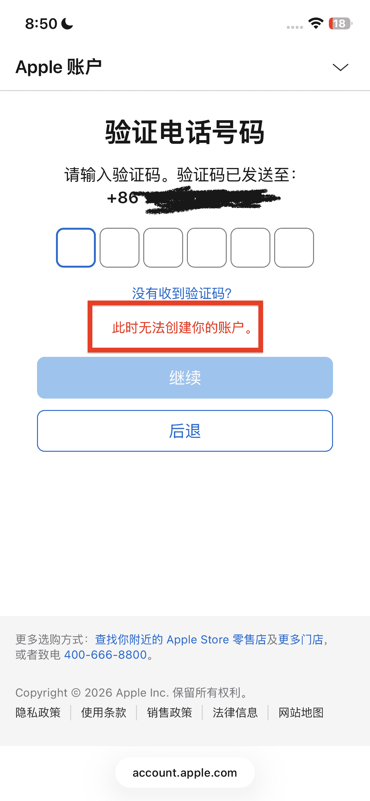
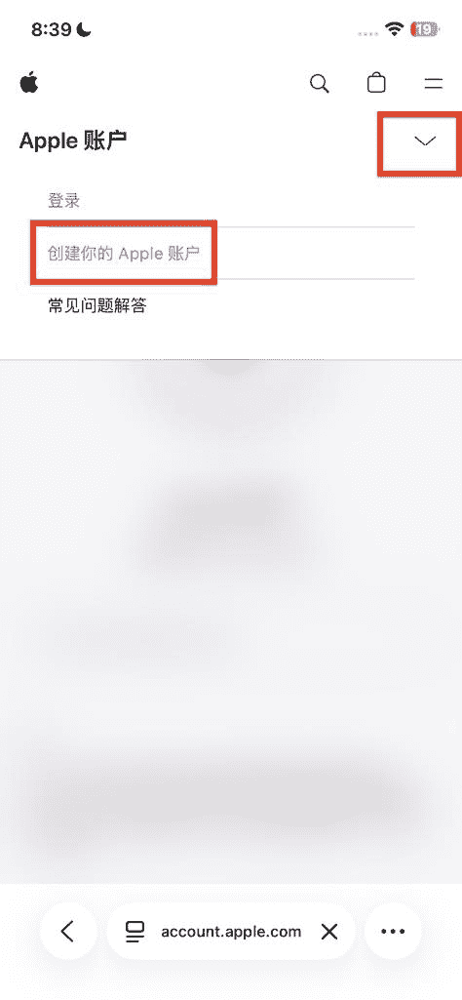
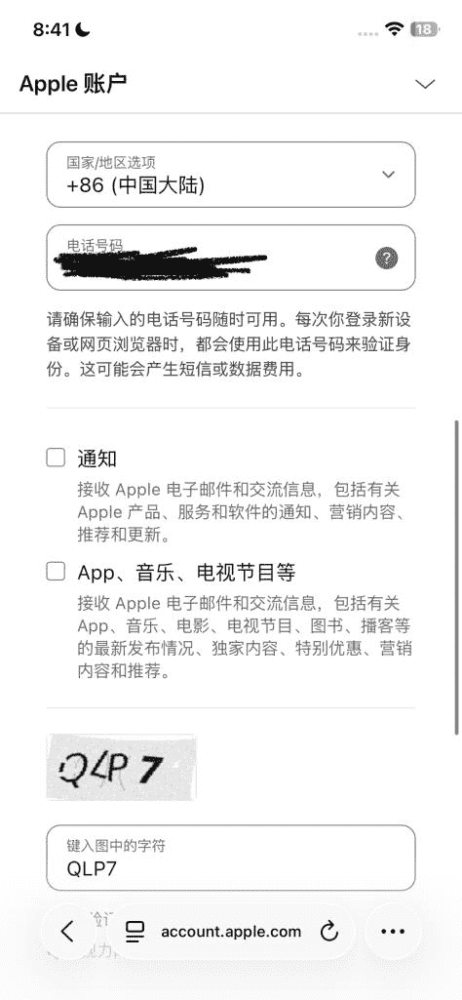
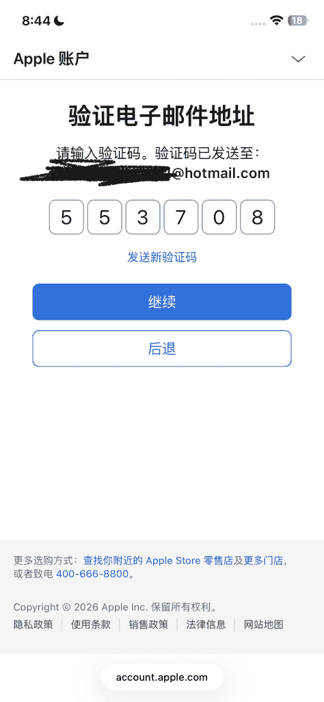
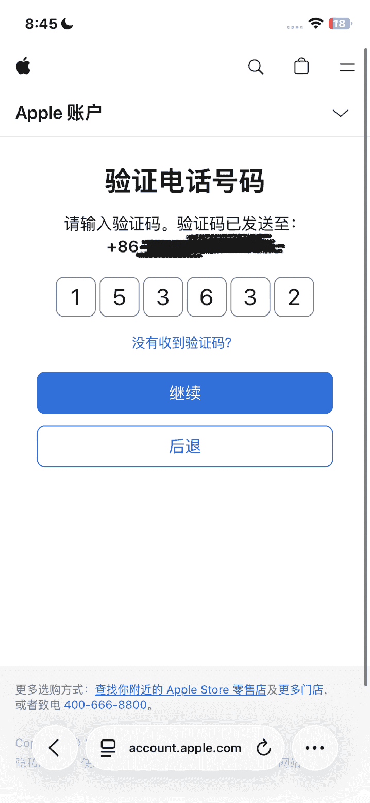
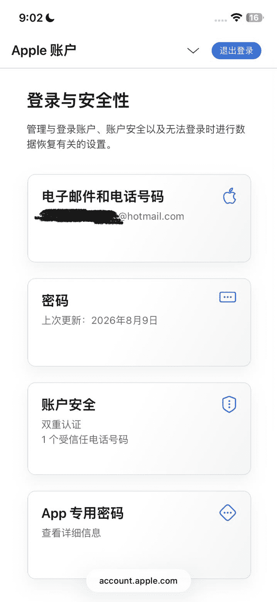
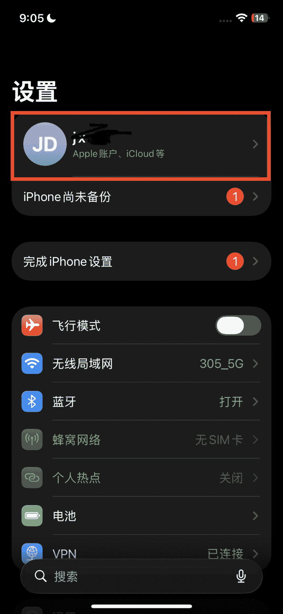
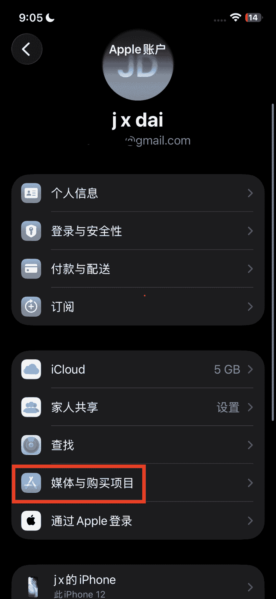
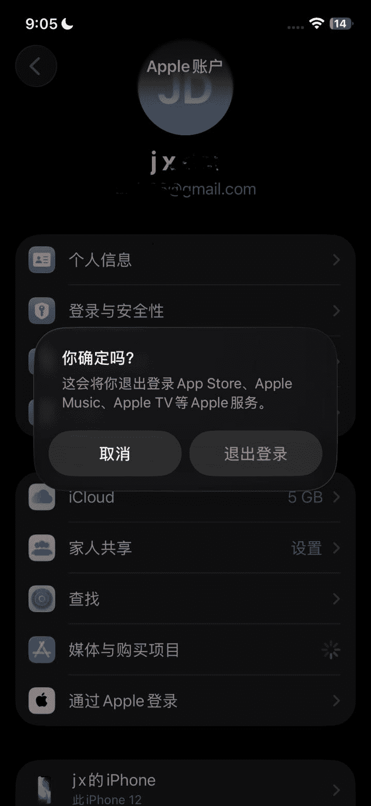
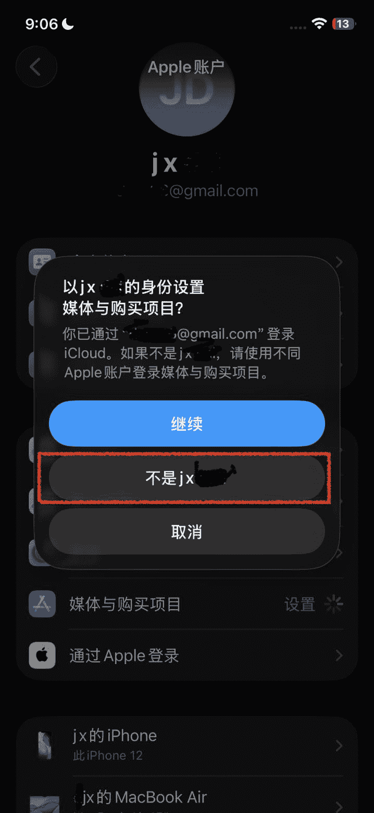
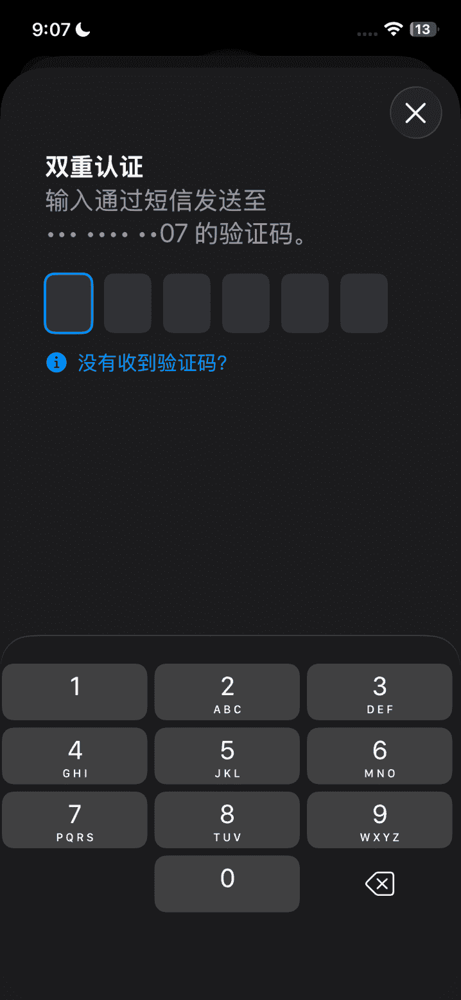
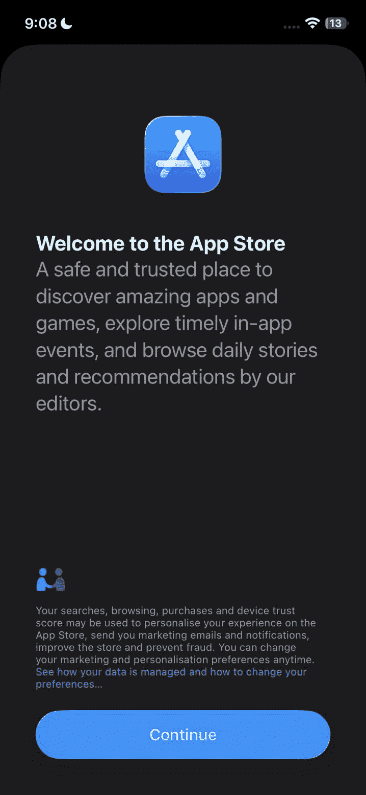
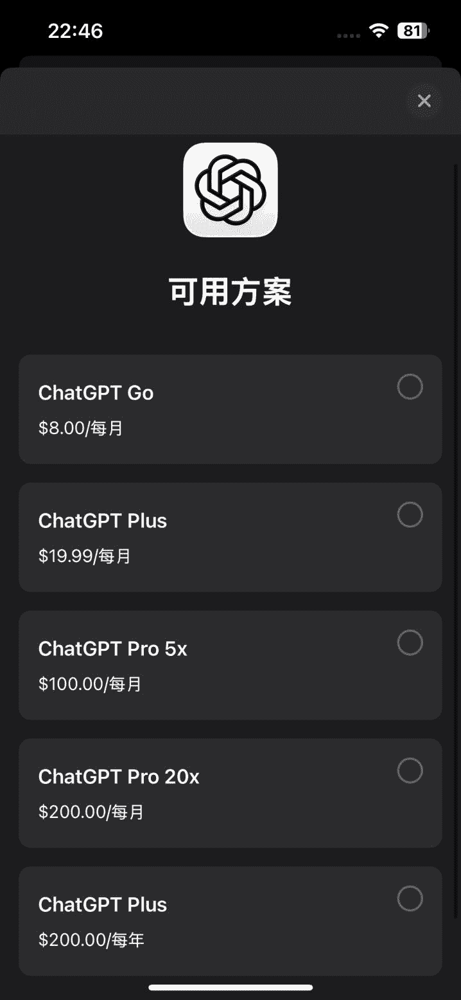
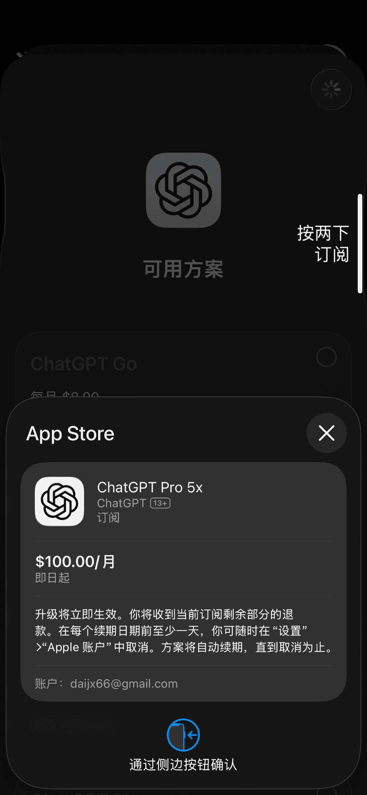
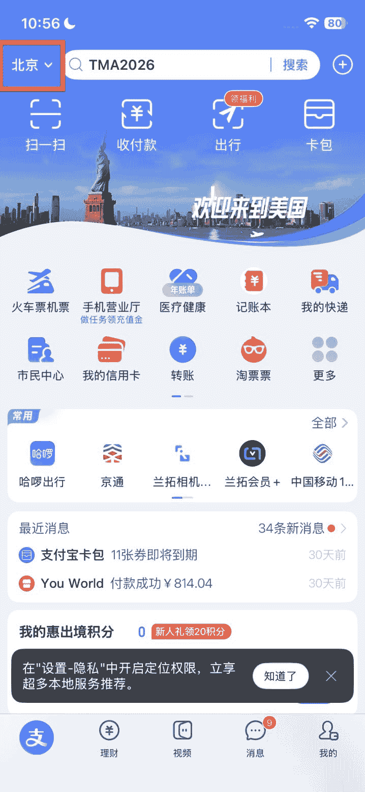
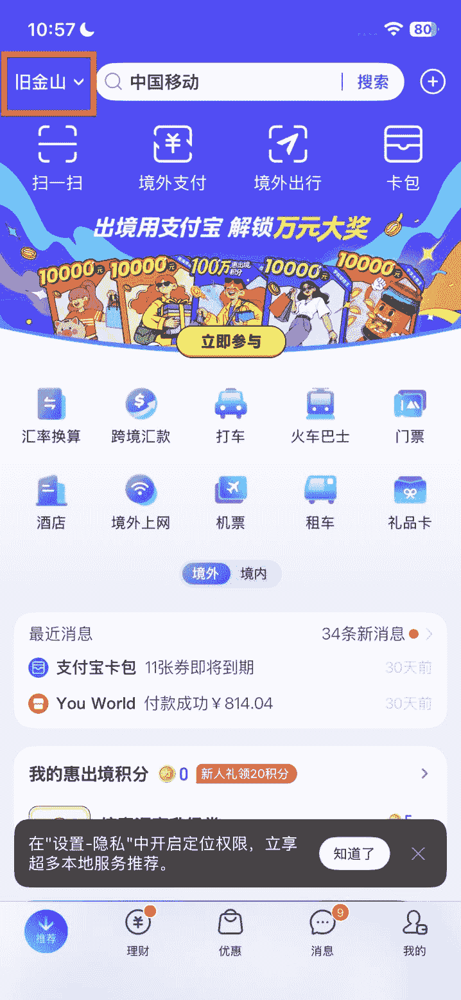
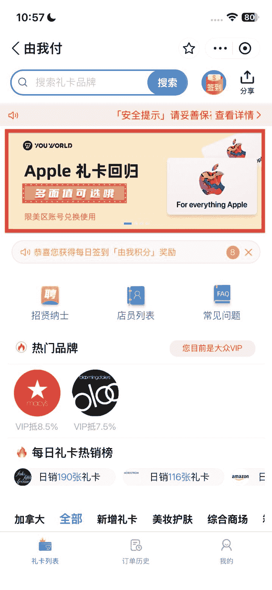
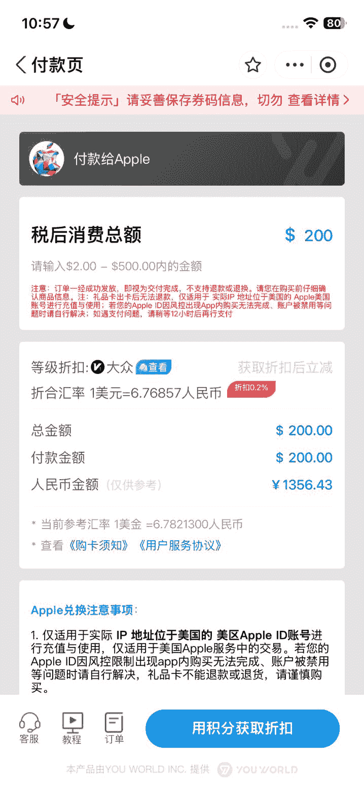

一种面值不够时，可以购买并逐张兑换多张美国区礼品卡，余额会累加。

余额提醒：正常购买并成功兑换的余额不会因为长期未使用而自动过期；但兑换后会绑定到这个美国区 Apple Account，不能转给其他账户，也不能兑换或退回现金（法律要求的例外除外）。美国区礼品卡只能关联美国区账户并用于美国区购买。以后想更改 Apple Account 的国家或地区，必须先花完余额；如果剩余金额低于任何单项价格，联系 Apple 支持处理。因此首次下单只买实际需要的金额。具体规则见 Apple 美国区礼品卡条款和更改国家或地区说明。

确认无误后在支付宝内完成付款。不要私下转账，也不要把 Apple 密码、ChatGPT 密码、短信验证码或远程控制权限交给卖家。

购买成功后，进入订单详情，在“门店及官网结账信息”或兑换码区域找到礼品卡代码，点击“复制”。兑换码通常是一串分组的字母和数字；截图里的兑换码已经使用，不能再次兑换。复制完成后继续第五步，不要把尚未使用的兑换码发到群里。

其他购买渠道。闲鱼和其他平台也能找到美区 Apple Gift Card，有时价格更低，但这不代表卡源、售后或退款一定可靠。想自行尝试时，要看商家历史信用和真实评价，确认是美国区卡、交付的是兑换码，并拒绝让对方登录自己的 Apple 或 ChatGPT 账号。本文不对这些渠道做背书；第一次操作仍建议走截图里的支付宝路径。

### 第五步：把礼品卡兑换成 Apple 余额

兑换前再看一眼 App Store 当前登录的账号，确保它就是刚才创建的美国区 Apple Account。

1. 打开 App Store。
2. 点击右上角头像。
3. 点击 Redeem Gift Card or Code / 兑换礼品卡或代码。
4. 选择手动输入。
5. 点击代码输入框，粘贴刚刚复制的完整兑换码。
6. 点击右上角“兑换”，完成兑换。

兑换时提示卡无效、已经兑换、未激活或地区不符？直接查看兑换码排查。

兑换成功后，页面通常会直接显示新的余额。也可以回到 App Store → 右上角头像 → 账户页，在姓名下方查看 Apple Account balance。这里的 balance 就是 Apple 账户余额。

### 第六步：用 Apple 余额开通 ChatGPT Plus

付款前检查两个账号：

- App Store 登录的是刚充值的美国区 Apple Account。
- ChatGPT 登录的是你真正想开通 Plus 的账号。

如果 ChatGPT 已经显示付费方案，或者这个账号已经通过 ChatGPT 网页版（Web）、Google Play 或 Apple 订阅，不要再购买第二份。

两个账号的作用不同。比如 App Store 登录的是 Apple Account A，付款时 ChatGPT 登录的是 chat@example.com，开通后的 Plus 属于 chat@example.com；以后换成另一个 ChatGPT 账号登录，不会自动得到这份 Plus，账单仍由 Apple Account A 管理。

1. 打开官方 ChatGPT App。
2. 点击 Get Plus，或者进入设置后点击 Upgrade。
3. 等待 Apple 订阅确认页出现。
4. 再次检查方案、计费周期和总额。
5. 按页面提示确认购买。全面屏 iPhone 通常会显示“双击以订阅”，这时连续按两下机身右侧的侧边键（也就是平时锁屏／关机使用的按键），再完成 Face ID；有 Home 键的机型则按屏幕提示使用 Touch ID 或设备密码。
6. 完成确认后回到 ChatGPT，然后马上进入第七步检查结果，不用靠等待几分钟来判断是否成功。

#### 第一次购买时出现付款或账单资料

浏览器建号时没有填写地址，和这里后来出现账单资料并不冲突。如果点击 Upgrade 后没有直接进入订阅确认，而是出现 Payment Information / 付款资料或 Billing Address / 账单地址，按这张页面处理：

1. 付款方式里能选择 None 时，选择 None，不额外绑定银行卡或 PayPal。
2. 页面可能要求填写 Street、City、State、ZIP Code 和 Phone。这些是 Apple Account 的商店账单资料，不是礼品卡资料，也不是 ChatGPT 账号资料。
3. 这里填写的是账单资料，不是注册 Apple Account 时接收验证码的手机号。各字段按页面要求填写本人有权使用、可以正常使用并且必要时能够核验的信息。
4. 看不懂字段或页面提示时，可以用下面的豆包提示词帮助解释；不要把 Apple 密码、ChatGPT 密码、短信验证码或未使用的礼品卡兑换码发送给任何 AI 工具。页面强制要求自己无法提供的有效资料时，先停止并联系 Apple 支持确认。
5. 页面通过后，重新拉起 Apple 订阅确认页，再核对方案和总额。页面强制要求无法提供的有效付款方式时，保留完整提示并停止购买，直接查看处理办法。

看不懂账单字段或报错时，可以直接复制下面这段发给豆包。先把页面中的姓名、完整地址、手机号等个人信息脱敏。

我正在填写美国区 Apple Account 的账单信息。请只解释 Street、City、State、ZIP Code 和 Phone 分别应该填写什么、常见格式是什么，并帮我理解下面这段页面提示或报错。不要替我编造地址或电话号码；如果我没有页面要求的可核验资料，请告诉我应该向 Apple 支持询问什么。

余额足够时，Apple 通常会先扣 Apple 余额，但余额充足不代表一定能只靠余额完成订阅。Apple 说明，部分购买即使使用余额仍可能要求账户中有信用卡，部分订阅也可能无法使用余额。遇到这种情况时不要连续重复购买，也不要改去其他平台再买一份。

### 第七步：检查是否开通成功

前两项必须检查。

Apple 已经扣款、这里却没有显示 Plus？直接查看恢复购买。

1. 打开 ChatGPT 侧栏或头像，进入 Settings → Account，当前方案已经显示 Plus。
2. Apple 的订阅列表中可以看到 ChatGPT、当前方案和下次续订日期。

iPhone 或 iPad 的订阅入口如下：

设置 → 你的姓名 → 订阅 → ChatGPT

有其他设备时，可以再登录同一个 ChatGPT 账号，看看 Plus 权益是否已经同步。

开通成功后再看：续费、升级和降级。

下面的截图走的是 App Store 入口；也可以使用前面的设置 → 你的姓名 → 订阅 → ChatGPT，两条路线最终会进入同一个 ChatGPT 订阅详情页。

1. 打开 App Store，点击右上角头像。
2. 点击自己的 Apple Account，进入“账户设置”。
3. 点击“订阅”，在订阅列表里找到 ChatGPT。
4. 打开 ChatGPT 后，可以查看当前方案、到期或续订日期；点击“查看所有方案”，可以看到当前账户实际可选的档位和价格。

先按下面两张图进入 ChatGPT 订阅详情页。

先看详情页显示的状态。如果页面显示“取消订阅”，说明自动续订仍然开启；如果像截图一样显示“已取消订阅”和具体到期日，说明当前周期仍可继续使用，但到期后不会自动扣款。想继续使用时，点击蓝色的“续期”按钮。点击“查看所有方案”后，再选择页面中实际显示的档位，并核对生效时间和 Apple 给出的结算金额。

- 正常续费。Apple 订阅默认自动续订。没有取消过订阅时，不需要每个月重新购买，只要在续订前确认美国区 Apple Account 的余额足够覆盖页面显示的实际总额。Apple 官方说明，App Store 账户可能在当前周期结束前 24 小时扣款。已经取消但还没到期时，点击详情页里的“续期”即可重新打开自动续订。
- 从低档升级到高档。例如 Plus 升到 Pro，或从较低的 Pro 档升到 $200／20× Pro 档。更高方案立即生效，Apple 会按原方案尚未使用的时间退回相应金额。OpenAI 同时说明，新方案的额度和能力立即生效，账单周期重新开始。使用 Codex 的人，升级完成后会按新方案重新获得额度；马上打开 Codex 的 Settings → Usage，确认额度和新的周期已经更新。
- 从高档降到低档。不会立刻降级。当前高档方案会继续使用到本周期结束，较低档方案从下一个续订周期开始生效。

例如一个 30 天周期只用了约 10 天后升级，Apple 会按尚未使用的约 20 天计算原方案退款。这个“约退 2/3”只是便于理解的例子，实际金额以 Apple 确认页为准，日期和取整都可能影响结果。

退款回到哪里。升级时由 Apple 自动计算的按比例退款，会退回原付款方式；使用 Apple Account balance 支付时，获批的退款会回到 Apple 账户余额，Apple 提示最长可能需要 48 小时显示。普通退款申请是否获批取决于 Apple 审核，并不是账号出问题或 ChatGPT 被停用就一定自动退款。可以登录 reportaproblem.apple.com 申请或查看状态；Apple 已批准但超过 48 小时仍未回到余额时，再联系 Apple 支持查询。

只打算使用一个月。进入设置 → 你的姓名 → 订阅 → ChatGPT → 取消订阅。取消成功后，页面会从“下次续订日期”变为当前权益的到期日期，当前周期不会立即失效，Plus 仍可使用到这一天。

回到路线选择 · 查看 Mac 路线 · 直接去常见问题

## B 路线｜只有 Mac 时能做什么

回到路线选择 · 查看 iPhone 或 iPad 主线 · 直接去常见问题

只有 Mac 时，不能独立完成第一次 ChatGPT Apple 内购。Mac 可以创建美区 Apple Account，也可以管理已经出现在 Apple 订阅列表里的 ChatGPT；第一次开通 Plus 仍要使用 iPhone 或 iPad。

- 第一次通过 Apple 开通 ChatGPT Plus。Mac 只能先建号，不要提前购买或兑换礼品卡。拿到 iPhone 或 iPad 后，从主线第二步继续。
- ChatGPT 已经出现在 Apple 订阅列表。先看下面的“B4｜管理以前通过 Apple 购买的 ChatGPT 订阅”，确认状态和金额后再决定是否充值。

### B1｜创建美区 Apple Account

Mac 可以直接使用第一步的网页入口，也可以从 App Store 创建。

App Store → Sign In → Create Apple Account

账号创建后，只退出 Mac App Store 的购买账号，不退出系统设置中的整机 iCloud。

App Store → Store → Sign Out → 左下角 Sign In

### B2｜第一次购买 ChatGPT Plus

本文这条 Apple 余额开通路线，需要在 iPhone 或 iPad 的 ChatGPT App 中完成。Apple 余额不能用于 ChatGPT 网页结账，所以只有 Mac 的新用户无法从网页完成这笔首次购买。

以后有 iPhone 或 iPad 可用时，先在设备上登录这个美国区 Apple Account，从主线第二步继续。一定要先走到第三步的 Apple 订阅确认页，看清实际总额，再买卡。

### B3｜什么时候可以在 Mac 兑换 Apple Gift Card

只有下面两种情况之一已经实际出现在屏幕上，才购买并兑换礼品卡：

- iPhone 或 iPad 已经打开 Apple 订阅确认页，并显示方案和实际总额。
- Mac 的 ChatGPT 订阅详情页已经提供可用的续订或方案入口，并显示金额。

只是以后可能借到 iPhone 或 iPad，或者只在订阅列表里看见 ChatGPT，都不代表现在能够付款。没有看到上面的购买入口时，不要充值。

Mac 的兑换入口如下：

App Store → 左下角姓名或账户 → Redeem Gift Card

兑换完成后，在账户页检查 Apple Account balance 是否增加。

如果这笔余额用于第一次开通，回到 A 路线第六步；如果用于已有订阅的续费，继续看下一节的订阅详情页。

### B4｜管理以前通过 Apple 购买的 ChatGPT 订阅

ChatGPT 已经出现在 Apple 订阅列表时，可以在 Mac 里打开详情页。

1. 打开 Mac App Store。
2. 点击左下角账户。
3. 点击 Account Settings / 账户设置。
4. 找到 Subscriptions / 订阅，点击旁边的 Manage / 管理。
5. 找到 ChatGPT 并打开详情页。
6. 查看当前方案、状态和日期，页面提供续订或方案选择时再按需要操作。

操作后同时检查两处。Apple 订阅详情页应显示有效方案和新的日期，ChatGPT 的 Settings → Account 应显示 Plus。Apple 已经扣款、ChatGPT 仍然没有 Plus 时，直接去恢复购买，不要再买一份。

回到路线选择 · 返回 iPhone 或 iPad 主线 · 直接去常见问题

## C 路线｜遇到问题时直接排查

回到路线选择 · 返回 iPhone 或 iPad 主线 · 返回 Mac 路线

- 礼品卡兑换码报错：直接查看“兑换码无效、已兑换或地区不符”。
- 付款方式被强制，或余额足够仍无法购买。
- Upgrade 按钮是灰色的。
- Apple 已扣款但没有 Plus。
- 订阅关联到另一个账号。
- 续费失败或提示欠款。

### 页面强制添加付款方式，或余额足够仍无法购买

先看自己卡在哪一环：

- 首次登录 App Store 时页面强制填写付款方式。先停下，不购买礼品卡，也不编造银行卡或账单信息。只能使用本人可以正常使用、符合页面要求的信息；无法提供时，联系 Apple 支持确认账户状态。
- 礼品卡已经兑换，但购买仍被阻止。检查当前 App Store 登录的是不是美国区 Apple Account、余额是否真的到账，再到购买记录查看是否有 Amount You Owe。保留页面的完整错误文字，不要反复点击购买。

首次设置被拦时，美国区账户恢复为能够正常下载免费 App，就可以返回第三步。余额足够却买不了时，能够重新拉起 Apple 订阅确认页并完成付款，才算解决。页面仍要求其他付款方式或账户状态看不懂时，先联系 Apple 支持，不要改去 Web 或 Google Play 再买一份。

首次设置被拦，返回第二步 · 尚未付款，继续第六步 · 已经付款，去第七步验收 · 回到问题目录

### Upgrade 按钮是灰色的

如果页面显示 In-app purchases are currently unavailable / 暂时无法使用 App 内购买，OpenAI 提醒新订阅的 Apple 内购功能可能还在激活，最长可能需要 48 小时。先等待，不要马上去其他平台重复订阅。按钮恢复可点并能打开 Apple 订阅确认页，才算问题解决；48 小时后仍然不变，保留截图和错误原文，联系 OpenAI 支持。恢复后，按自己刚才卡住的位置返回。

公众号懒人搜索，懒人专属群分享

返回第三步查看金额 · 返回第六步购买 · 回到问题目录

### Apple 已扣款，ChatGPT 仍然没有 Plus

在 iPhone 或 iPad 的 ChatGPT App 中进入下面的入口：

Settings → Account → Restore purchases

Restore purchases 表示重新读取原来的 Apple 购买记录，不会新买一份订阅。执行时要使用原来的 Apple Account 和原来购买时登录的 ChatGPT 账号。ChatGPT 的 Account 页面显示 Plus，才算恢复成功；仍然没有 Plus 时，不要再次购买，保留 Apple 收据并从当前 ChatGPT 账号联系 OpenAI 支持。

返回第七步检查结果 · 回到问题目录

### 页面显示订阅关联到另一个 ChatGPT 账号

退出当前 ChatGPT 账号，重新登录第一次购买时使用的账号，再进入 Settings → Account → Restore purchases。原账号显示 Plus，才算恢复成功。移动订阅不能转到另一个 ChatGPT 账号，卸载重装也不会改变绑定关系；无法进入原账号时，保留 Apple 收据并联系 OpenAI 支持，不要在当前账号重复购买。

返回第七步检查结果 · 回到问题目录

### Apple 续费失败或提示欠款

先在 Apple 订阅和购买记录中处理。Apple 可能在续费失败后继续尝试扣款，结果没有明确前，不要同时在 Web 或 Google Play 再开一份。

如果购买记录中出现 Amount You Owe / 待支付金额，可以按 Apple 页面处理欠款。iPhone 或 iPad 的入口如下：

设置 → 你的姓名 → 媒体与购买项目 → 查看账户 → 购买记录 → Amount You Owe

欠款处理后，Apple 订阅页显示有效方案和新的续订日期，ChatGPT 也显示 Plus，才算恢复完成。状态仍不明确时，先联系 Apple 支持，不要同时去其他平台再开一份。

返回第七步检查结果 · 打开 Mac 订阅管理 · 回到问题目录

### 礼品卡兑换码无效、已兑换或地区不符

先按页面提示判断是哪一种情况。

- 卡无效。确认输入的是以 X 开头的兑换码，改用“手动输入”，并仔细核对 B/8、O/0、S/5、Z/2 等容易看错的字符。
- 已经兑换。先退出 App Store 的购买账号再重新登录，刷新 Apple Account balance；同时确认自己检查的是不是刚才兑换所用的美国区账户。
- 未激活。通常需要原销售方处理。保留支付宝订单详情、付款记录和完整报错，联系礼品卡销售服务商。
- 必须在其他国家或地区兑换。说明礼品卡地区与 App Store 账户地区不一致。美国区礼品卡只能在美国区账户兑换，不能跨区使用。

仍然无法解决时，不要继续购买新的礼品卡。保存订单详情、兑换码和完整错误提示，先联系 Apple 支持；如果 Apple 判断是卡未激活或卡源问题，再回到销售方处理。

返回第五步兑换礼品卡 · 回到问题目录

## 主要参考

- Apple 创建新的 Apple Account
- Apple 受信任手机号说明
- Apple 在 iPhone 或 iPad 退出“媒体与购买项目”
- Apple 在 Mac App Store 创建和切换账户
- Apple 兑换礼品卡
- Apple 账户余额可以买什么
- Apple 添加付款方式与账单信息
- Apple 交易税报告中的账单地址字段
- Apple 在 Mac 管理 App Store 订阅
- Apple 付款问题与未付订单
- Apple Media Services 条款
- Apple Gift Card 美国区条款
- OpenAI 在 iOS App 升级付费方案
- Apple 自动续订方案的升级、降级与按比例退款规则
- Apple 申请 App Store 购买退款
- Apple 查看退款状态和到账时间
- OpenAI Pro 档位、升级生效时间与账单周期说明
- OpenAI 取消 Apple 订阅与续订扣款说明
- OpenAI 恢复 Apple App Store 购买
- OpenAI 避免不同平台重复订阅
- OpenAI 订阅关联到另一个账号
- OpenAI ChatGPT 支持国家和地区
- 生财参考帖一
- 生财参考帖二

回到路线选择 · iPhone 或 iPad 主线 · Mac 路线 · 常见问题

————分割线————

看完这篇 SOP，你觉得你懂了。但 90% 的人一到实操就会卡在第一步。

工具和教程只是最低级的壁垒，真正的壁垒是“立刻动手”和“圈层信息差”。

如果你想看全网最新的变现玩法，并且和一群执行力极强的极客一起下场拿结果，欢迎围观我的核心私域：【懒人专属群】。

我们不聊虚的，只做商业闭环的拆解与 AI 效率的压榨。系统内已沉淀 1000+ 跑通的套利实战局。

👉 查阅圈子完整数字资产与上车门槛：

https://lazyso.com/insider/

认同价值、准备好下场干活的，扫码加我微信（lazyhelper1）。

备注：【实操上车】，不闲聊。

