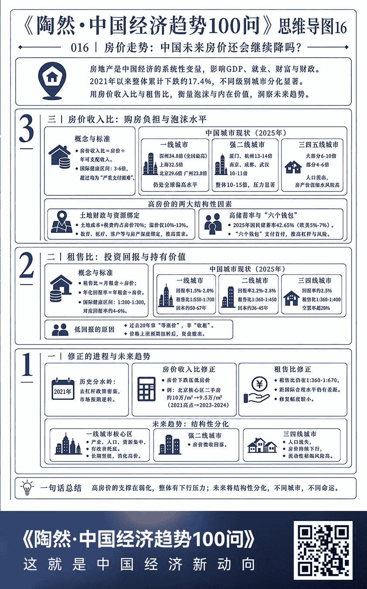

# 房价走势：中国未来房价还会继续降吗？

260813

整理：公众号懒人搜索，懒人专属群精选

懒人微信：lazyhelper1

《中国经济趋势100问》已在专属群内连载更新，群友自取。本文节选自第16章。

正文：

中国城市化进程中的房地产问题，以及相关的土地和户籍制度，是我最主要的研究领域。从这一讲开始，我想结合过去20多年的研究经验，从经济学角度，开启一个为期两周的深度模块，为你全方位分析中国城市的房地产问题。

在本世纪的中国经济版图里，房地产从来就不仅仅是一个普通的行业，它是一个真正意义上的“系统性变量”。

它究竟有多系统？我们来看几组数字：在2010年到2020年的高峰期，房地产业增加值占GDP的比重稳定在6%到7%之间。如果再算上建筑业，这二者的直接贡献合计就达到了13%到14%。但这还不是全部。如果把钢铁、水泥、家电、家具以及金融等上下游产业链都计入其中，房地产间接拉动的GDP占比更是高达25%到30%。

房地产行业的重要性，还体现在它承载了城镇家庭60%以上的财富；土地出让金及相关税费一度贡献了地方政府40%至50%的综合财力。

根据国家统计局的数据计算，到2026年5月，70大中城市新建商品住宅自2021年高点已经下跌13.7%，已跌回至2018年末的水平。二手房自2021年高点已跌22.6%，整体回归2016年年初水平。

但以上数字背后，其实还有一个极其关键的现实，那就是不同级别城市的显著分化。

根据国家统计局70城指数，一线城市二手房自高点（部分城市2023年见顶）累计跌幅超过17%，二线约22%至23%，三四线约24%至26%。考虑到以上70城中的35个三线城市已偏优，大量县级市和真正的人口流出小城市不在统计范围内，实际跌幅应该超过30%。

正因如此，“房价还会继续降吗”这个提问，表面上看，是对资产价格的一次市场预测；但本质上，它其实关乎中国经济能否实现“软着陆”、社会财富能否平稳跨越周期的核心命题。

今天，我们不谈立场，只看数据。我想借用“房价收入比”和“租金回报率”这两把国际标尺，丈量中国的房价水平，以及看看中国房价是否已经在市场规律下，开始了一场悄悄的自我修正。

# 房价收入比

要判断一个城市的房价是否真的“过高”，最直接且最具经济学意义的标尺就是房价收入比。它是指所在城市一套标准住房的总价格与一个普通家庭年可支配收入的比值。

世界银行和联合国人居署对全球数百个城市的长期追踪研究后提出：3至6倍是住房可负担性的健康区间，超过9倍即被视为“严重支付困难”。

亚洲人口高度密集的超级城市，如东京、首尔、香港，由于土地供给受到严格管制，房价收入比通常在12至25倍之间，其中首尔接近25倍，已远超国际警戒线。

那么，中国城市的数据坐标在哪里？根据麟评居住大数据研究院发布的报告显示，他们监测的100个重点城市，2025年上半年房价收入比属于整体偏高，但也呈现出显著的梯队化特征。

第一梯队是一线城市（北上广深）。中国一线城市房价收入比，虽较历史峰值有所回落，但仍处于极高水位。其中，深圳仍然以34.8倍位居全国首位，上海、北京、广州分别约为25.7倍、24.8倍和16.9倍，都属于全球范围内的偏高。

说完一线，再看二线。厦门、杭州这类沿海强二线城市房价收入比长期处于高位，2024年分别为21.9倍、17.5倍；南京、成都、武汉强二线城市房价收入比主要集中在10至15倍之间，依然远超国际公认的3至6倍合理区间。

第三梯队是广大的三四五线城市。这些城市的房价收入比大部分集中在6至10倍之间，部分四五线城市甚至已经降至4至6倍。从数值上看，这一数据似乎已接近或落入国际合理区间（3至6倍），似乎“相对温和”。

然而，不少人口、产业流出的三四线城市存在另一个维度的深层风险：那就是房产从“财富载体”异化为“流动性陷阱”。即便房价下来了，也无人接盘，其实际价值仍可能持续缩水。

结论很清晰：即便经过2021年以来的深度调整，一线和绝大部分二线城市的房价收入比，依然是全球最高或较高水平之列。

但如果房价收入比这么高，这个市场怎么运转了这么多年？

答案藏在两个中国特有的结构性因素里。

首先，是中国特色的土地财政模式，以及住房与教育、医疗等公共资源深度绑定的现实。

我国城市住宅用地由地方政府供应，土地供给节奏受到调控，这在很大程度上抬高了土地价格，进而持续带动房价上行。

举个例子直观来看：一套单价6万元每平方米的房子，大多出现在北上广深等一线城市的非核心地段，或是杭州、厦门这类强二线城市的核心区域。处在这一价位的房源，成本结构有着十分鲜明的特点：高地价、高税费，房屋建安成本反而占比很低。

按照房地产行业长期测算的平均成本结构，每平方米6万元的房价，拆分下来大致分为四块：

- 第一块，政府相关收益占据绝大部分：土地出让成本大约3万元，占到总房价的50%；再加上各类相关税费约占20%，两项合计每平方米可达4.2万元。
- 第二块，房屋建安成本在6000元至8000元之间。
- 第三块，房企运营开销，包含财务利息、营销销售、日常管理等各项费用，整体约占房价的10%，折合每平方米6000元。
- 最后，剩余的3000元到5000元，才是房地产开发企业最终的利润空间。

在中国，城市的优质教育、医疗资源乃至落户权利，长期与房产所有权深度绑定。在大多数购房者眼里，购买一套超大、特大城市核心学区的住宅，某种程度上不是在买房子，而是在购买一张孩子进入某个阶层的入场券。这种非市场因素的溢价，大幅拉高了房产的有效需求。

其次是中国高储蓄率与“六个钱包”效应。

美国家庭储蓄率长期维持在个位数，而中国长期维持在30%以上。在房价多年单边上涨的预期与极高的房价收入比之下，年轻人购房往往难以凭借个人收入实现。

现实中，“六个钱包”，也就是调动父母乃至祖父母两代人的积蓄支付首付，成为普遍现象。这种代际财富的集中转移，既推高了居民家庭的杠杆率，也使得中国楼市的风险与家庭财富的深度绑定达到了前所未有的程度。

# 租金回报率

让我们再来看一下房产作为一种投资资产的年化租金回报率，也就是购买一套住房出租后的年租金除以住房价格的比率。

如果说房价收入比衡量的是“买房有多难”，那么租售比衡量的则是房产作为一种投资资产的回报率。

在成熟的国际房地产市场，公认的健康标准是年化租金回报率4%至6%。

这个4%至6%的范围之所以成为锚点，是因为房产是一类流动性相对较差、持有成本高的资产，扣除折旧、维修、物业和持有税费，净回报必须能跑赢同期国债或银行定存的无风险利率，此时持有房产才具备基本的财务理性。

中国的数据是多少？

根据中指研究院2026年的数据，一线城市（北上广深）的租金回报率在1.5%到2.0%之间。

二线城市租金回报率约在2.2%至2.4%之间，但很多二线城市大规模的新区建设使得出租房源供应充裕，尤其在成都、杭州、武汉等城市的新区，房东几乎没有议价空间，如果是大户型，空置周期还会明显拉长。

三四线城市，租金回报率在2%至2.5%左右。虽然略高于一线城市，但也隐藏着风险：随着人口持续净流出，很多三四线城镇住房空置率已相当高。在这些地方，租不出去才是真正的风险。

那么，为什么中国购房者能长期容忍这么低的租金回报率？

这是因为过去二十年，中国城市买房的盈利模式从来不是“收租”，而是“等涨价”。

当一套房子每年能涨10%至20%，谁还在乎1.5%至2.5%的租金回报率？而这套逻辑成立的前提，是价格永远上涨。但2021年之后，情况发生了变化。

# 数字背后的真实故事：谁在修正，谁还没有

2021年是中国房地产历史性的分水岭。随着“三道红线”等去杠杆政策的实施，多个头部房企陷入流动性危机，市场预期发生了逆转。这一轮深度调整实际启动了上述两个数字的“被动修正”。

房价下跌，直接压低了分母，房价收入比在局部市场出现了边际改善，但幅度仍然相当有限。以北京为例，根据市场监测数据，核心区部分二手房均价从2021年高峰时期的约10万元/平方米，在2023至2024年间调整至约8至9万元/平方米，房价收入比依然接近30倍。

租金回报率的修复同样在发生，而且其中有一个值得注意的背景变量——银行存款利率的下行。

2020年前，银行大额存单利率普遍在4%至5%之间，而一线城市买房收租的回报率仅1.5%左右，显然远不如存钱。但到了2025年，一年期存款基准利率已降至1.5%以下。这让买房收租的吸引力有所增加。

但这里利率下行带来的相对吸引力提升，与租金回报率真正回归合理区间，是两件不同的事情。前者是在低利率环境下的次优选择，后者才是市场内在价值的真实回归。

# 结语

回到最初的问题：房价还会继续降吗？

从房价收入比与租金回报率的数据中，可以看到一个长期趋势：向下的压力不小。

但是，整体上有下行的压力，并不意味着所有城市会以同样的方式、同样的节奏下降。

目前的共识正趋向清晰：中国楼市正经历一场结构性的分化。

北上广深一线城市核心区，产业、人口聚集，绑定优质公共资源，有政策托底，房价更可能是长期横盘，用时间消化过去的高价；杭州、成都、南京、武汉这类强二线城市，支撑稍弱，房价可能还会缓慢回落；而人口、产业流失的三四线城市，房价可能会不可避免地下降，甚至出现流动性枯竭，也就低价也卖不出去。

总而言之，尽管一线和强二线高房价的底层支撑力依然存在，但其作为财富增值引擎的时代已经宣告终结。

下一讲，我们将进一步探讨一个所有人都关心的问题：到底应该如何看待中国城市房地产市场的未来？

我是陶然，我们明天见。

1. 即便经过2021年以来的深度调整，中国一线及多数二线城市的房价收入比，依然处于全球最高或较高水平。
2. 中国城市租金回报率普遍偏低，购房者能长期容忍，是因为过去二十年的盈利模式从来不是收租，而是等涨价。
3. 中国楼市正经历一场结构性的分化。

尽管一线和强二线高房价的底层支撑力依然存在，但其作为财富增值引擎的时代已经宣告终结。

————分割线————

在这个AI能替你写代码、写文章的时代，基础技能正在迅速贬值。绝大多数人正被淹没在海量的免费垃圾信息里，陷入低效的体力内卷。

当“努力”不再是壁垒，人与人之间唯一的护城河，只剩下“信息过滤”的效率与“认知系统”的维度。

圈子已稳定运行7年。我们每天利用Python爬虫与大模型算力，过滤全网最顶级的政经内参和搞钱风向标，做你最冷酷的“外部大脑”。

如果你认同这种“重塑认知防线”的极客主义，欢迎围观我的个人情报智库：【懒人专属群】。

https://lazyso.com/insider/

认同信息过滤价值、想省下每天3小时无效阅读时间的读者，扫码加我微信（lazyhelper1）。

