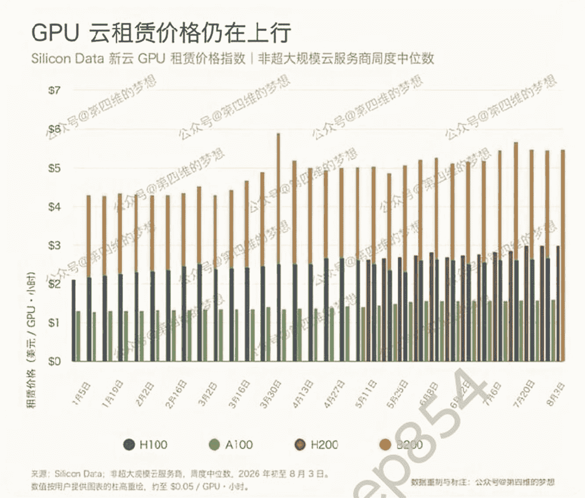

# **CoreWeave** 业绩会：**AI** 算力需求端新变化

260812 第四维的梦想

整理：公众号懒人搜索，懒人专属群精选

懒人微信：lazyhelper1

如果说《日光通信公司 Lumentum 最新业绩电话会纪要：OCS、EML、NPO 同时加速》揭示的是光通信产业供给端的新变化，那么CoreWeave 的业绩会，则让市场看到了 AI 基础设施需求端正在发生的变化。

前者讲的是“瓶颈在哪里，未来在哪里”，后者讲的是“需求是否还在加速”。两者结合起来，才构成了当前AI 基础设施周期最重要的供需逻辑叙事。

CoreWeave 二季度收入 25.75 亿美元，同比增长112%。收入积压升至1042 亿美元，且公司称7 月初又新增超过250 亿美元客户承诺。

但同一季，它的净亏损仍有6.26 亿美元，利息支出6.40 亿美元，资本开支高达94 亿美元。一边亏损，一边把各类算力配置的价格上调约25%。

一边用长期包销合同扩张，一边开始让2—3 年期合同与推理业务进入融资模型。

这家公司正在尝试把“已通电的数据中心+可获得的芯片+可融资的合同+持续发生的推理需求”打包成一种AI 基础设施资产。

# 一、不是 GPU 更贵了，而是“可交付算力”更贵了

二季度最值得重视的是，管理层对价格与边际利润的表述。

公司称，7 月已对各类算力配置进行约25%的提价。二季度新签合同的贡献利润率，预计比此前季度新增合同高5-10 个百分点。

管理层在电话会上明确表示，AI 已不再局限于前沿模型实验室，正在进入软件、工业系统、金融市场、企业工作流与国家安全任务。

公司从收入积压、新签承诺、平台利用率与价格环境中，同时看到了这轮需求扩散。

Caterpillar 的工业AI，Isomorphic Labs 的生命科学，Flow Traders 与 IMC 的量化金融，以及 Leidos 所代表的公共部门，正是这张客户图谱的几条新支线。

需求走出模型实验室后，买方购买的也不再只是GPU 时间，而是一套能迅速上线、稳定运行、接入数据与网络、承接训练和推理的“生产中的AI 工厂”。

近端产能几乎售罄，每一块新上线 GPU 都有多位客户需求。客户同时增加存储、CPU、网络和软件服务。公司称，这些 GPU 之外的AI 产品与服务ARR 已超过4 亿美元。

讲到这里，还记得近期笔者置顶文讲的基于AI 算力工厂的ROI 定价新时代叙事吗？建议一定要去阅读，如今无数的信号已经给出了最强佐证。

这也是电话会的第一个结构性变化，定价权开始从芯片代际，迁移到交付能力。

Vera Rubin 这类新平台当然更稀缺，管理层称其从一开始就带来更高利润率。

但更反常的是上一代 GPU 的价格并没有随新品推出而快速坍塌。公司举例称，一份基于2020 年架构A100 的合同可以延续至2029 年，且价格具有吸引力。

此刻，还记得著名大空头 Michael Burry 做空NBIS 的理由吗？他认为，英伟达GPU 更新速度非常快，AI 算力竞争周期可能只有2—3 年，但企业却按照5-6 年折旧。

现实如何呢？A100 是6 年前的芯片，已完全折旧，账面价值几乎为零，而它们的租赁价格今年上涨了约25%。

这个被 Burry 视为已死的资产，全年都在涨价，真是妙不可言呐。

GPU 云租赁价格仍在上行。

# 二、推理业务把GPU 从一次出租，变成可再配置资产

这场电话会里还有一个变化，被大部分人忽略了。

CoreWeave 的托管推理业务在推出后的一个季度内，已签约ARR 从约100 万美元升至超过1 亿美元。公司目标是在2026 年末达到至少2.5 亿美元。

它的重要性在于，推理业务给了 GPU 一条不同于五年期包销合同的退出路径——将到期GPU 转化为推理服务的收入。

这样可以把高度前置的资本开支，换成相对可预测的现金流。但长期合同的代价是，客户结构集中、合同期限长、资产在合同结束后如何再定价，都会成为问题。

CoreWeave 现在试图把一台到期GPU 分成三种用途：如果长期合同的经济性足够好，就重新签长期合约；如果短期需求更旺，就签更高单价的短约；如果推理需求增长更快，就把设备放进托管推理服务。

这就是“算力资产化”的核心，不是每一代 GPU 都会永远值钱，而是同一批设备不再只有一次出租机会。管理层还特别提到，企业客户通常不愿签五年合约，更偏好2—3 年的消费周期。

公司最新的DDTL5.5 融资据称已让资本市场能够为较短期限的客户合同提供融资支持。若这一融资结构能被广泛接受，短约因此不是简单的风险上升，它同时可能是进入企业客户的渠道。

推理也不是简单的增量品，它还是消化到期资产、提高资产利用率的工具。

不过，期限缩短并不会自动创造价值。短约和推理收入只有在利用率、价格和资金成本共同成立时，才比长约更优。否则，所谓灵活性会变成更频繁的续约压力。

# 三、真正的护城河，开始向电力、供应链与融资下沉

CoreWeave 把自己描述为 AI 云，但 CEO 在电话会上谈得最多的不是模型，而是“土地、电力、厂房、GPU、网络、内存和资本”。

站点扩张选项和已签LOI。公司目标是2030 年末活跃电力超过8 吉瓦。在生成式AI 的规模化阶段，最稀缺的不是“知道要买什么”，而是“谁先把电、地、机房、设备和钱拼成可交付产能”。

公司也开始向更深的垂直整合走。自建数据中心正在推进，管理层认为 powered land 能带来更强运营控制与长期利润率。

与此同时，公司与Solidigm 达成长期协议以保障关键存储输入，并强调与 NVIDIA、OEM、ODM、内存供应商的长期关系。

这又解释了为什么公司可以在成本上行时讲利润率扩张。管理层的说法是，CoreWeave 云的“产出价值”增长快于供应链输入成本。

笔者更愿意把这理解为一条因果链，电力与机房可得性→集群交付速度→可用算力的稀缺性→合同价格与利用率→单位经济→融资承受力。

AI 云的护城河，正在从“有多少 GPU”，下沉为“能否连续打通这条链”。谁率先打通，谁就是下一个 Hyperscalers。

感谢各位赞赏。关于近期的存储，笔者讲过，要么不关注，要关注就只关注真正掌握存储核心产能和技术的公司，也就是国内的 CXMT 以及海外存储御三家。

今天新的催化来自淡马锡，据报道其已决定投资三星电子和 SK 海力士，并与韩国政府讨论具体投资执行时间。尽管由于过热担忧，AI 投资的热度有所降温，但淡马锡一直在加大对整个AI 价值链的投注。

今年第二季度，淡马锡集中投资了半导体、数据中心、云服务、AI 模型开发商以及软件基础设施。通过这些努力，淡马锡的目标是在未来五年内将其整个投资组合中AI 相关部分的比例从6%提高到15%。

该公司将AI 半导体视为推动行业结构性转型的长期增长引擎，而非昙花一现的趋势，并计划据此扩大投资。大部分人讲CXMT 估值贵了，却很少有人反问，为什么产业位置更靠后的模组厂DML、JBL 等估值反而被认为合理？

这其实是把产业链位置和估值逻辑本末倒置。存储原厂的核心能力不是简单的模组组装。相比单纯模组企业，拥有DRAM 制造能力的存储原厂具备更高技术壁垒、更强周期弹性和更大的长期成长空间。

那么，结果只有两个，要么模组厂不断压缩估值，要么原厂拔估值。又有大部分人讲，CXMT 相比御三家估值绝对不便宜，那么 HWJ 相比英伟达估值也不便宜，各个场子有各个场子的估值方法，横向对比不是这么对比的。

因此，结论就是开头所说，短期要么不关注，要么就是关注正主。再多讲一句，笔者认为下一轮存储更大的行情会出现在 HBM。今年不是 HBM 供需最紧张的时候，真正值得关注的是明年。

随着HBM 的渗透比例将从2026 年约22%进一步升至2027 年约30%，SK 海力士CEO 甚至判断2027 年可能出现史上最严重的存储供给短缺。

更关键的是，这还主要是供给端的故事。假设明年需求端继续出现新的增量，Agentic AI 推理进一步打开HBM 需求空间，那么新增需求与供给约束一旦同时发生，HBM 很可能迎来真正意义上的量价共振。

当前市场已经开始关注HBM 供给紧张持续到2027 年的可能性，同时AI ASIC 对HBM 需求的贡献也在不断提升。当然，如果认为AI 需求的天花板已经到顶了，那么存储、光通信、服务器、电力等整个AI 基础设施链条都没有长期投资价值。

这其实是一个最简单的思考题，投资科技产业，本质上押注的不是某一个季度的供需，而是未来几年技术渗透和需求扩张的持续性。

再来看看 Lumentum 的业绩会，笔者认为容易被市场忽视的重点有四个。

第一个，确定了 NPO 的未来地位。27-28 年，scale-up 领域互联，NPO 将会是出货主力军。Lumentum CEO 原话是：NPO 对我们而言是完全增量的机会，将显著扩大光学总可寻址市场（TAM）。

借助我们的差异化激光芯片，我们正在积极布局相关能力。甚至我们最大的CPO 客户，也在针对一些新的特定应用评估 NPO，这将进一步扩大该客户的光学TAM。

NPO 显著扩大光学总可寻址市场，最大的 CPO 客户，明显是英伟达，也在评估 NPO，这是到scale-up CPO 路上最佳的缓冲方案。

第二个，CPO 仍被视为技术路线图上的自然终点。通过晶圆厂级先进封装，把光学器件直接置于基板或中介层上，从而实现最高的功耗效率。

说白了，就是CPO 终将实现，也必然会实现。Lumentum CEO 明确讲了，通过晶圆厂先进封装，把光学器件直接置于基板或中介层上。

换句话说，以后 HBM、GPU、光引擎都要同时出现在芯片上，CPO 是形态的自然终点，而终点就在先进封装。还记得笔者讲过的台积电和英特尔吗？

28 年这个时间，正好是英特尔发力期，也是台积电 COUPE 光平台的成熟期。

第三个，客户正在评估两类用于NPO 的激光芯片。一类是直接集成到光引擎中的中功率激光器，另一类是用于外置光源模块的高功率激光器。

外置激光器NPO：需要约400mW，因为光要经过更长的传输路径、耦合与连接，光损耗更大。内置方案，激光器更靠近光引擎，约250mW 即可，激光功率要求低约37.5%，外置方案要求是其1.6倍。为什么会有内置方案呢？

首先，外置NPO 所需的高功率激光器在 InP 产能本就紧张的环节上，显著放大了面积、成本和扩产压力。相较之下，内部250mW 方案对高功率激光器与 InP 产能的消耗更节省，在供应受限时具备更好的成本与规模化优势。

其次，内置激光器在功耗上也更有吸引力。由于光源更接近光引擎，链路中的光纤、连接器和分光等损耗更少，系统无需用400mW 的超高功率激光器去补偿传输损失，约250mW 的激光器即可满足工作需求。

少发出的150mW 光功率，并不只是激光器规格下降，更意味着更低的电功耗和更少的无效发热。内置方案的方向很清楚，把原本消耗在远距离供光与链路损耗上的能量，尽可能留在真正承担数据传输的光引擎中。

换句话说，内置路线降低了对单颗激光器峰值功率的要求，也给能力暂时停留在约200mW 的国内厂商打开了潜在的追赶窗口。虽然 200mW 仍低于约250mW 的理想规格，尚不意味着可以直接替代，但竞争不必再从最难量产的 400mW UHP 激光器开始。

国内厂商有机会先从较低功率的内部光源切入，再逐步验证线宽、可靠性、耦合效率与批量交付能力。讲到这里，还记得笔者此前提到的英伟达“放弃存储容量，优先保障I/O”的逻辑吗？

其实这和光互联的发展趋势完全一致，本质上都是在解决AI 基础设施中的核心矛盾，延迟与带宽。AI 时代本质上真正稀缺的是单位资本开支能够产生多少Token。

更高带宽、更低延迟，意味着更高的 GPU 利用率，也意味着同样规模的基础设施投入能够支撑更多AI 工作负载，创造更多Token 产出。

注意，这背后对应的正是ROI 逻辑，也是近期市场开始讨论AI 算力工厂资产化的核心原因。只有当AI 基础设施能够持续产生可预测的现金流，算力才会从单纯的资本开支，逐渐转变为可以被金融化的资产。

那么，根据笔者此前提出的AI 算力公式可以进一步推导。当算力和存力，也就是Rubin Ultra 等下一代 AI 芯片的平台规格逐渐确定后，提升“运力”就成为提升整体AI 系统效率的关键环节，也就是边际变化最大的一步。

简单讲，这也是未来最具确定性的一环。至于国内，考虑到 FCC 禁令等因素，市场会担忧未来国内光模块厂商是否会被踢出美国产业链。

但笔者认为，至少未来两年内，这种风险暂时并不是产业主线。更远的未来谁也无法准确判断，但所有产业博弈最终都绕不开一个核心变量，供需关系。

当需求足够强、供给足够稀缺时，产业链选择往往会优先考虑效率和成本，而不是单纯的其他因素。如果仍然担心下游光模块环节的不确定性，那么更值得关注的是产业链中更靠近上游、更具稀缺性的环节，例如激光器和 InP 产业链。

相比组装环节，上游核心器件受到产能、技术和扩产周期约束更强，也是AI 光互联持续升级过程中更难替代的环节。国内关注的公司也都说过，不必赘述。

第四个，Lumentum 正规划更高端和更低端端口数量的产品包括专门的盘内产品。In-tray OCS，更靠近计算芯片，部署在加速卡托盘等内部，目标是替代部分点交换，架构类似于GPU/XPU→光引擎→OCS→GPU/XPU。

柜内的OCS 技术，更适合基于硅基波导技术的OCS，因为柜内所需端口少，同时对光路线延迟要求高。

因此，从技术储备上来看，DKL 是最匹配的。然后柜外的 OCS 更适合基于 MEMS 的OCS，JGKJ、TJKJ、GKKJ 等都是基于此路线。

至于大A，上篇赞赏文中提到的确定性反弹窗口已经结束，后续市场大概率进入震荡分化阶段。强势情景下，今日回踩3920-30 一线获得支撑，随后伴随成交量温和放大展开反弹。

中性情景下，则可能进一步回踩3870 附近，再寻找反弹机会。弱势情景下，如果有效跌破3870，则意味着短期结构走弱，进入新一轮下跌小周期。

前面推荐的技术分类书籍，大家有没有读起来，留言区可随时给反馈。

免责声明：本文材料整理于公司公告、新闻、机构公开研报及社交媒体网络等，对文中所涉专业及个股均不构成投资建议。市场有风险，投资需谨慎。图文如有侵权或违反信批规则请后台留言联系删除。

————分割线————

在这个 AI 能替你写代码、写文章的时代，基础技能正在迅速贬值。绝大多数人正被淹没在海量的免费垃圾信息里，陷入低效的体力内卷。

当“努力”不再是壁垒，人与人之间唯一的护城河，只剩下“信息过滤”的效率与“认知系统”的维度。

圈子已稳定运行 7 年。我们每天利用 Python 爬虫与大模型算力，过滤全网最顶级的政经内参和搞钱风向标，做你最冷酷的“外部大脑”。

如果你认同这种“重塑认知防线”的极客主义，欢迎围观我的个人情报智库：【懒人专属群】。

https://lazyso.com/insider/

认同信息过滤价值、想省下每天 3 小时无效阅读时间的读者，扫码加我微信（lazyhelper1）

