# 日本

远东局势发展的大胆构想

260812 江宁知府

整理：公众号懒人搜索，懒人专属群精选

懒人微信：lazyhelper1

最近一段时间中日矛盾热度很高，不过从战略态势角度看，未来某个时刻日本与俄罗斯爆发冲突的可能性其实更大。

准确点讲，日本一直在等待这个时刻，并尝试用各种办法加速它的到来。

普京与时任日本首相安倍在海参崴举行会谈，2019年9月5日。此后菅义伟、岸田文雄、石破茂和高市早苗四任首相均未跟普京见面，两国关系处于冰封状态。

2021年，日本前外交官河东哲夫提出一项封锁俄罗斯大陆和北方四岛之间两个主要海峡（宗谷海峡及津轻海峡）的提议。

按照该计划，日本将切断俄罗斯通往北方四岛的运输通道，迫使莫斯科正视日俄领土争端问题，最终不得不把北方四岛归还给日本。

封锁是一种战争行为，日本这样做无疑会极大激化跟俄罗斯的冲突，甚至把美国拖入一场大国战争，所以上述方案并未获得官方背书，但它很大程度上代表了日本政界人士的底线思维。

不止退休官员，2021年至2024年担任首相的岸田文雄也曾表示：“北方四岛是必须解决的领土问题，不将这一问题留给后代。”

事实上，日本战略界普遍认为自卫队早就具备军事手段解决日俄领土争端的能力，所担忧之处为社会经济势必受到极大影响，即战争代价问题。

那么该如何处理这一难题呢？日本战略界对东北亚局势发展有个很大胆的判断：

如果俄罗斯继续衰退，未来将无法保住远东地区，届时会为日本提供夺取北方四岛乃至库页岛的战略机遇。

在日本看来，自2022年以来持续高强度的俄乌战争最终会产生一个明确结果，那就是俄罗斯国力被掏空，因此日本非常积极地跟其他西方国家一道对俄罗斯实施制裁，其目的就是要加速这一进程。

日本认为，随着俄罗斯——特别是俄罗斯族——人口持续减少，未来裁减部队是必然的，俄乌战争很可能是莫斯科向外发动大规模地面战争的最后机会。

俄罗斯对西伯利亚的征服直到日本江户时代（至1868年）才完成，整个远东地区人口只有七百万，一旦国力不济，将很难守住这块土地。

二战时期日本之所以在“北上苏联”和“南下中国”之间选择后者，是因为当时中国在军备上更为羸弱。

今非昔比，秉持“柿子捡软的捏”的思路，日本战略界正将目光投向北方。

回顾近代以来的历史，俄罗斯和日本都曾趁火打劫过彼此，只不过这次（俄乌战争期间）日本处于受美国控制状态，且多出了中国这个巨大变量，客观上震慑住了日本向远东岛屿扩张的野心。

退而求其次，日方认为一个内忧外患的俄罗斯更容易妥协，福井县立大学国际关系教授岛田洋一称：

“在叶利钦担任俄罗斯领导人时，日俄曾非常接近达成一项协议，俄罗斯将部分岛屿归还日本控制，以换取经济援助，但最终未能实现。”“所以这种情况确实有先例，而且完全可以想象，如果俄罗斯真的陷入混乱，接管莫斯科的人会继承许多经济和外交问题，以至于他们愿意再次讨论北方四岛领土。”

俄罗斯方面对于美日可能趁俄乌战事在千岛群岛方向发难始终心存警惕。

2026年8月，俄国防部宣布在南千岛群岛周边进行军事演习，动员60艘军舰、30架飞机和超过13000名军人，并在日俄争议岛屿周边划定海上禁区。

这种大规模军演本身就带有强烈的威慑意味。

某种意义上讲，日本人始终没搞明白一个道理——苏联/俄罗斯之所以没能跟日本达成和平协议，是因为美日拥有特殊军事关系。

在俄方看来，美日同盟就是亚洲的北约，任何日本领土都被莫斯科视为潜在的美军基地。

1956年苏联暗示归还北方四岛中齿舞群岛和色丹岛（两个较小岛屿）的前提，是日本必须放弃与美国的联盟。

日本列岛实际上是一个大的火山群岛，坐拥全球10%的活火山，其领土由四个主要岛屿组成，即本州、北海道、九州和四国。

更进一步划分，通常把日本分为八个地区，分别为北海道、东北（本州主岛东北部）、关东（以东京为核心的平原地区）、中部（以名古屋为核心的本州岛中部）、关西（以大阪、京都为核心）、中国（本州岛西部广岛等城市）、四国和九州。

因常年爆发地震、海啸、台风和火山等自然灾害，使得日本人培养出了坚韧和适应力强的民族特性，颇为信奉“神明”。

早期日本境内是有一些铁矿和煤矿的，只不过几十年下来有开采价值的已基本用光，目前几乎全部依赖进口。

1930年代日本即拥有约8000万人口，因管理不善与资源短缺，在全球经济危机背景下大量企业破产、银行倒闭，相当多的人处于饥饿状态，一度濒临暴动的边缘。

因此天皇和政客便想着利用战争来转移灾难，通过掠夺邻国资源以达到快速发展国内经济的目的。

二十世纪上半叶，日本周边国家大多处于积弱不振的状态，而日本因较早实现工业化，拥有完善的军工体系，航母、战机、舰艇及坦克等相较周边国家无可匹敌。

这种“邻国弱而日本强”的局面极大地刺激了其扩张野心。

按照历史规律，每当日本经济开始下滑、国内政经状况不佳、关键资源又出现短缺时，尚武思想便会抬头。

只不过当前日本周边国家——中国、俄罗斯、韩国、朝鲜等——军力早已不是二十世纪初的状态，即便日本的“心理基础”相似，但所处国际结构已完全不同。

1941年之前，美国对日本侵略邻国的行径采取姑息和纵容态度。

二战初期美日两国关系某种意义上还算过得去，当时日本发动侵华战争所需的很多战备物资都是向美国购买的，包括最关键的石油。

华盛顿其实一直都在奉行“美国优先”政策，只不过有的总统比较隐晦、擅于包装，而有的总统则生怕别人不知道。

1941年之前，美国政府经常发表声明谴责日本，但企业却继续把战略物资卖给日本赚取暴利，两面手法玩得很好，也根本不考虑被侵略国的感受。

直到苏德战争爆发，日本战略价值下降，且日军开始直接威胁美国殖民地菲律宾，美日关系才明显恶化。

1941年7月下旬，美国正式冻结日本资产并实施全面战略物资出口禁运，造成日本石油供应严重不足，一度陷入恐慌。

在确信美国无意开展有效谈判的情况下，日本遂于1941年12月向美国开战。

至于日后被传成“无间道”的珍珠港事件，一般认为没有那样玄乎，1941年下半年的太平洋已成火药桶，美国内部普遍预见日本将发起进攻，只是没有想到会发生在珍珠港。

有美国历史学家称：“从总统到美国政府的每个人都预料到太平洋战争随时可能爆发，当时情报显示一支庞大的日本舰队已启航，正朝西南太平洋方向进发，目标包括马来亚、新加坡、印度尼西亚以及美国殖民地菲律宾。”尽管珍珠港事件最终给了罗斯福总统一个绝佳的宣战理由，但要说为了实现这个目的而愿意牺牲珍珠港，根本站不住脚。

从逻辑上讲，美国完全可以用更简单的方法，比如安排一条船跟日本军舰起摩擦，类似越战期间的北部湾事件，让整个太平洋舰队主力冒险并非最佳启战方案。

第二次世界大战期间，日本几十年扩张的成果被美苏瓜分，当时苏联也曾希望拿下一部分重要岛屿，只可惜没能实现罢了。

《雅尔塔协议》中明确写道：“苏联应在德国投降后三个月内对日本宣战。”1945年5月9日是二战欧洲战区的“胜利日”，因此在8月8日晚上10点，苏联外长莫洛托夫召见日本驻莫斯科大使佐藤直武，提交“对日宣战书”，同时切断日本使馆一切对外通信。

仅一个多小时后，即8月9日午夜，苏联正式向日本发起攻势。

根据苏联元帅华西列夫斯基的回忆，早在1944年斯大林就已亲自通知他，指示“近期”准备对日作战，并任命他担任远东军总司令。

对日作战期间，苏联吃了海军薄弱的亏，因缺乏两栖登陆舰艇，使得任何对日本本土发起的登陆作战都有可能面临被击退的高风险。

于是苏军指挥部不得不放弃对北海道北部的登陆作战，而是选择把有限的两栖登陆能力用于更小的目标，即千岛群岛。

虽然对千岛群岛的攻击获得成功，但苏联也为此付出了不小代价——部分登陆艇被毁，伤亡人数与日军几乎相当。

二战末期，日本把若干原本部署在海外的精锐部队抽调回本土进行防御，其中主力放在九州岛，即日方预计美军可能登陆的位置，另外关东平原和北海道也有相当部分力量。

苏联在陆战领域拥有丰富经验，可在两栖作战方面却没有积累，按照最初设想，美苏有可能协调一次“联合对日登陆作战”，美军负责建立起滩头阵地，然后再把一部分陆上作战的任务交给苏军负责。

只不过日本投降得很快，使得苏联在抢夺对日作战成果时不占优势，日本本土完全被美国掌控，而苏联只拿下半个库页岛和千岛群岛。

在所有俄罗斯远东岛屿中，面积最大、战略地位最关键、日本最为觊觎的一个就是库页岛。

库页岛位于西北太平洋大陆沿岸，北海道以北，该岛与周边一些岛屿共同构成俄省级行政单位之一的萨哈林州。

库页岛地形南北狭长，外形像一条鱼，岛屿面积约7.64万平方公里——比两个台湾岛还大，略小于北海道；人口约50万，岛上蕴藏着丰富的森林、石油、天然气、煤炭及有色金属资源等。

以著名的萨哈林1号油气项目为例，其年产石油达1000万至1300万吨，油气资源先通过管道输送到位于哈巴罗夫斯克边疆区的加工基地，然后通过油轮向亚太国家出口，是距离日本最近的大型油田。

日本过去曾长期参与库页岛油气项目，萨哈林2号（主要产天然气）里至今仍有三井、三菱等企业的股份。

1905年至1945年间，日本曾占领库页岛南部长达四十年。

话说日俄战争期间，俄军屡遭失败，连前来救场的波罗的海舰队也被日军歼灭。

日本乘势出兵占领了库页岛，迫使俄罗斯在结束战争的《朴茨茅斯条约》中纳入这样的条款：“永久割让北纬50度以南的萨哈林岛（库页岛）主权，以及所有附近岛屿，以及所有公共建筑和财产。”从地图上看，一旦库页岛被日本控制，远东大陆通向千岛群岛的航线将被切断。

更进一步，日本列岛东北部的堪察加半岛本质上也是一座“岛屿”（下图右上角），因为它跟远东大陆之间没有任何铁路和公路连接，完全依赖海上和空中交通线。

丢掉库页岛后，堪察加半岛同样很难守住，而掌控这一切的日本则将变成一个盘踞亚欧大陆东侧的“超级岛国”，极大解决资源短缺的发展瓶颈。

如果日本某个时刻提出库页岛主权要求，将意味着挑战俄罗斯在远东的核心利益，风险远超过北方四岛争端。

目前看来，日本对俄罗斯仍颇为忌惮。

因为核武器改变了大国领土竞争逻辑，只要中央政府仍掌握核力量，任何邻国试图通过军事方式改变领土边界都将面临极高风险。

俄罗斯可能会威胁进行核报复——这是唯一剩下的牌，但日本自恃处于美国的核保护伞之下，不相信克里姆林宫会为了边陲岛屿冒着让莫斯科被摧毁的风险。

不过也有日本学者指出，在极端情况下不能排除俄罗斯发射战术核武器打击自卫队在北海道的港口，克里姆林宫决不能允许俄边疆领土被夺走，否则所有邻国都会尝试蚕食俄罗斯的边界。

总的来看，当下日本的核心思路仍是等待俄罗斯弱化，从而在北方四岛问题上获得更大谈判筹码，并趁机扩大日本在俄罗斯远东资源、航运和安全事务中的影响力。

最后把目光转向中国。

凭借强大的综合国力与先天地理优势，在任何围绕东北亚地缘政治格局重塑的尝试中，中国都会介入并积极争取达成有利于己的解决方案。

对于现阶段的中国来说，与俄罗斯关系具有战略性质，边界问题在双边交往中早就是一个无关紧要的问题。

可以这样讲，如果没有中俄之间的和平红利，克里姆林宫绝不敢把远东军区大量精锐部队抽调至乌克兰前线，中国也不能把足够多的资源投入海空军现代化。

从东北亚地缘政治视角看，中国东北地区事实上充当了俄罗斯和朝鲜的“战略后方”，俄朝两国则为直面日本和美国力量的“前线”。

尽管部分日本政客仍抱有“帝国幻想”，但今天的日本跟二战时期已大不相同，它面临人口老龄化、征兵困难、社会情绪低沉等问题，很难动员起一支大规模陆海空军力量。

从根本上讲，现阶段让国家富裕强大的要素与十九世纪、二十世纪初发生了明显变化。

土地仍然是一种核心资源，但不再是决定性的，比土地更重要的是生活在这片土地上的人。

——分割线——

在这个AI能替你写代码、写文章的时代，基础技能正在迅速贬值。绝大多数人正被淹没在海量的免费垃圾信息里，陷入低效的体力内卷。

当“努力”不再是壁垒，人与人之间唯一的护城河，只剩下“信息过滤”的效率与“认知系统”的维度。

圈子已稳定运行7年。我们每天利用Python爬虫与大模型算力，过滤全网最顶级的政经内参和搞钱风向标，做你最冷酷的“外部大脑”。

如果你认同这种“重塑认知防线”的极客主义，欢迎围观我的个人情报智库：【懒人专属群】。

https://lazyso.com/insider/

认同信息过滤价值、想省下每天3小时无效阅读时间的读者，扫码加我微信（lazyhelper1）。

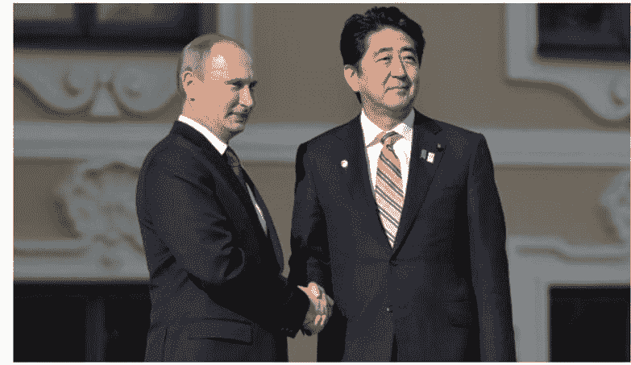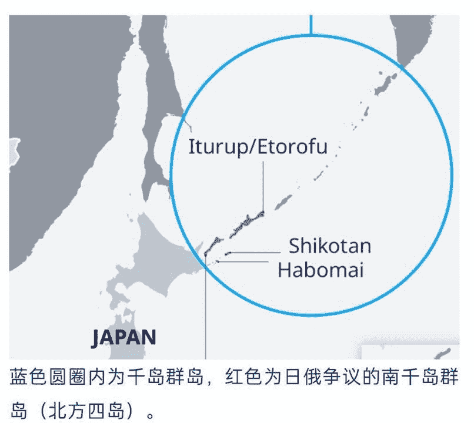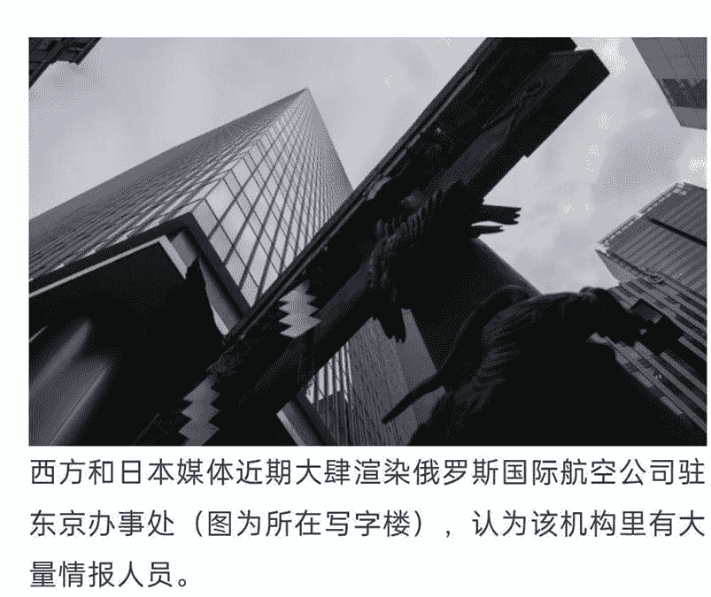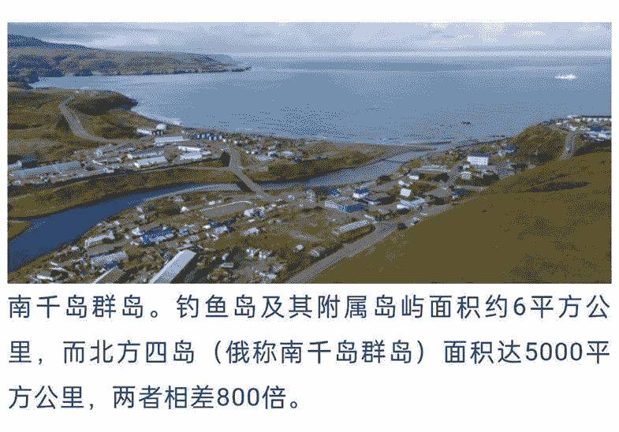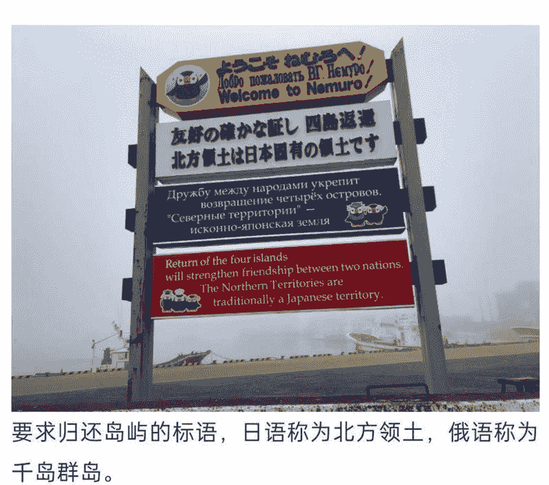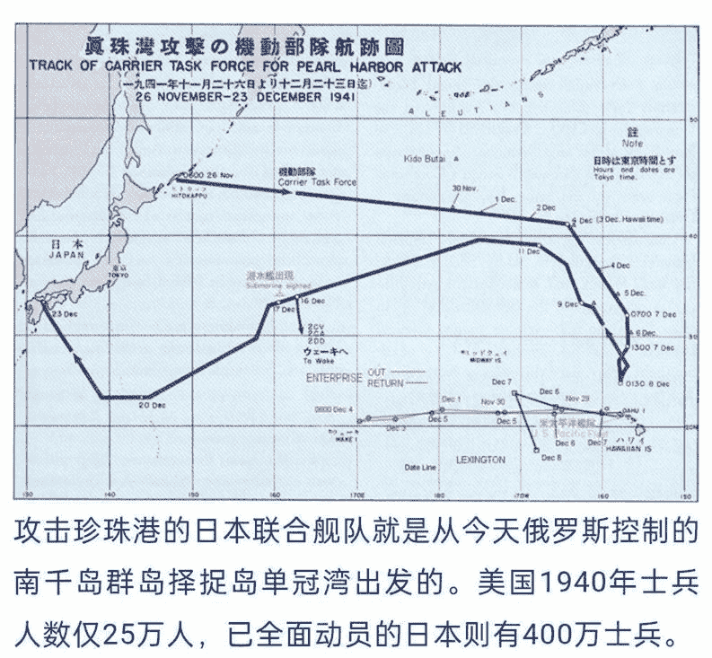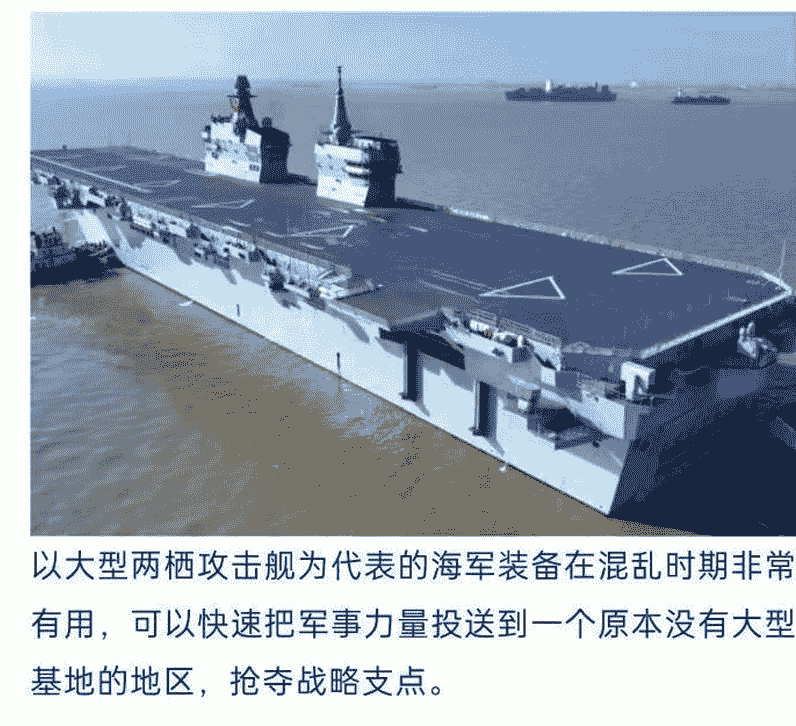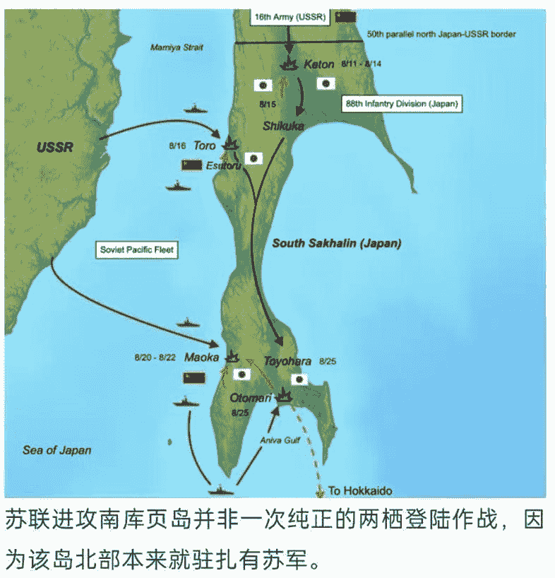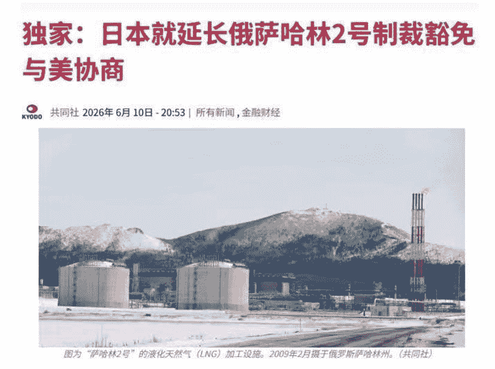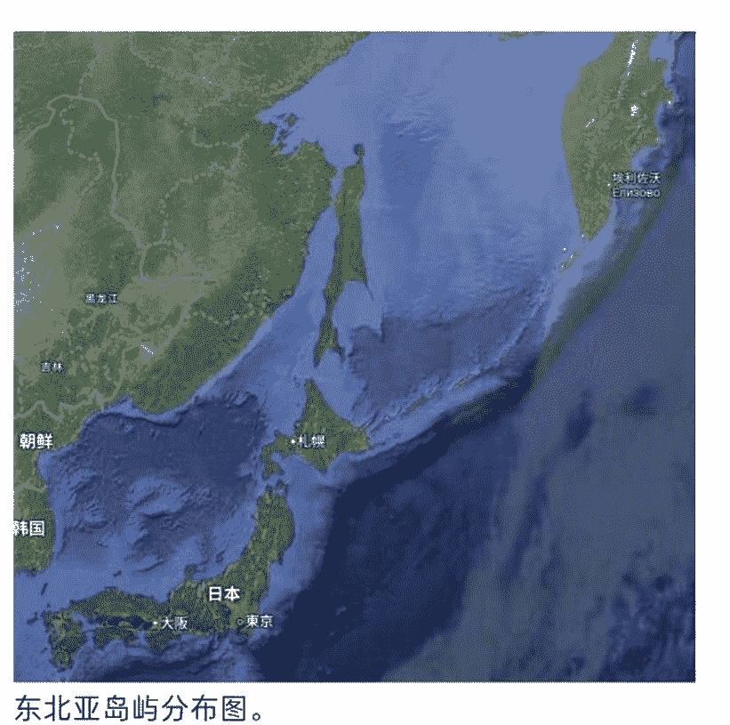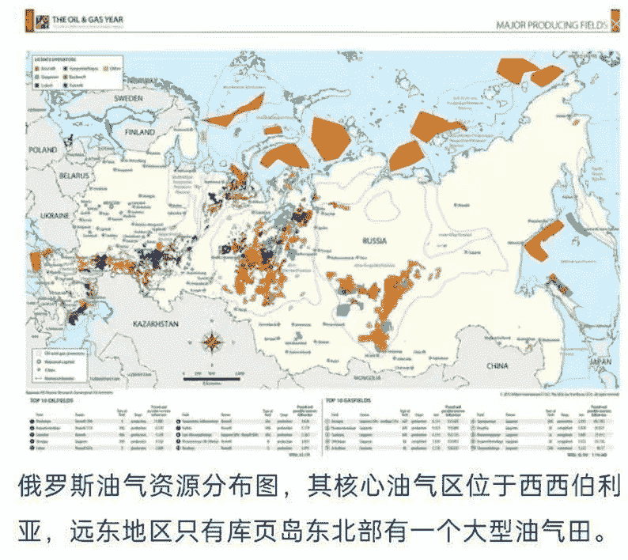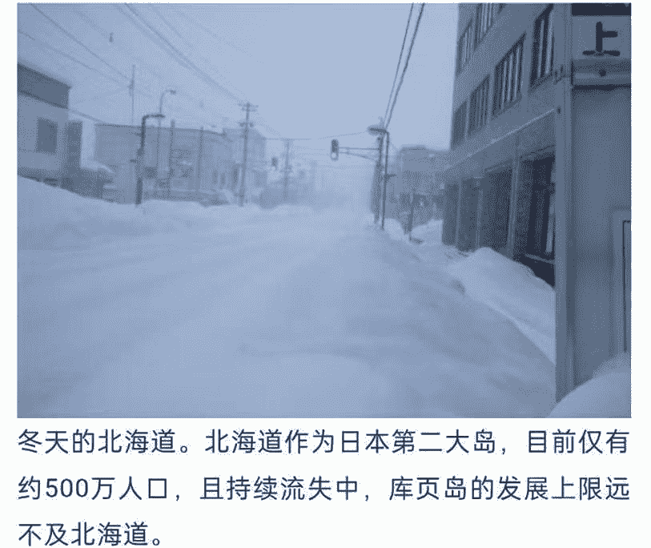
