## 公司分析27：又一巨头携体量和深厚积累跨界机器人和AI基础设施建设

260815 安民

整理：公众号懒人搜索，懒人专属群精选

懒人微信：lazyhelper1

我们在《高度关注，未来20年，万倍成长空间》《从构建核心技术的护城河到抓住机器人的东风》以及宇树分析等文章中对机器人行业有过深度分析，机器人的未来不会有任何问题。

2025年多方权威报告显示，中国机器人整机企业数量已超过140家，产品型号超过330款，2025年出货量约1.44万台，占全球总量的84.7%。

这个数据表明，即使只在初期，机器人发展的核心力量就已经在中国了。

接下来重要的是，如何筛选高价值的机器人整机企业、机器人本体企业，以及机器人零部件供应商。

我们在去年12月的文章中，为大家分析了一家跨界到机器人零部件领域的巨头公司。

当时有读者希望多分析这个类型的企业，因为觉得巨头有深厚的主营业务作支撑，更稳健。如果巨头跌到位了，就是很好的抢筹时机。

这个思路是正确的，因为巨头们已经顶到了行业天花板，公司的强大已经成为投资者的习惯和共识，这让很多人对其失去了投资想象力。

所谓物无两大，巨头地位和远大空间通常只能选一边站队。例外就是当巨头的股价处于回落过程中，此时股价一旦跌到位了，往往是机会。

但是巨头在这个市场上从来稀缺，有投资空间的巨头更是稀缺资源。好在，机会留给有准备的人。今天分析的这家主板公司，拥有和国内外多家知名车企的稳定合作关系，是汽车零部件行业无可争议的巨头。

而且处于震荡下跌的过程中，7月份的最低价相比去年的高点，跌幅已近50%。更有意思的是，公司正在依托主营业务的技术积累，积极开拓人形机器人供应链业务，并且还在推进一项主营业务从传统的汽车制造业跨界进入AI基础设施建设行业。

也就是说，现在我们正在面对一个处于下跌趋势，但本身主营业务没有动摇，而且正在开辟第二、甚至第三增长曲线的真正巨头，一家有上进心的巨头。

新能源汽车的发展轨迹已经证明，本土的整机生产商，从成本和产品力角度出发，一定会积极扶持、利用本土的供应链。在这个国内造车势力纷纷官宣下场做机器人的当口，今天分析的这家公司会以老合作伙伴的身份，无缝接入车企的研发和性能验证。

事实上，公司正是这样做的，而且反响优异。相信公司未来会复制汽车领域的优势，以规模效应获得一众机器人公司的青睐。

我们之所以要分析这样的公司，主要是公司具有它的相对优势。公司的战略一直很清晰。它原来在传统汽车和新能源汽车行业做零部件，由一种零部件出发，做到多种类零部件国内领先，甚至在国际上处于第一梯队。

公司上市十多年，一直没有跨界经营，直到现在进入机器人和AI基建产业，原因就在于公司的技术。

比如公司正式切入的机器人机电执行器、躯体结构件、电子柔性皮肤等，全都和自己的本职业务高度关联。换句话讲，公司上市以来，通过在汽车零部件行业的深耕，积累了很多的技术和产品，现在正把它们平移到机器人行业和AI热管理行业，甚至是储能行业。

而且在这些新行业里开始有了大的订单，仅是官宣的就至少有15亿元，潜在订单更多。

所以，公司在人形机器人将要爆发的前夜，及时进行战略投入，开辟自己的第二增长曲线，甚至是第三增长曲线。

这种行业定力和战略眼光，是值得我们重视的，也是值得我们深思的。很多优秀的企业，关键就在于战略决策冷静而清晰，一旦能抓住的大机会来了，就及时出手。

我们将结合公司2025年年报和2026年一季报，为大家深度分析这家公司。文章分为八个部分，包括公司业务分析、各财务环节对公司利润的影响、影响公司业绩的因素和排序、公司传统行业评价、从汽车跨界到机器人、杀入机器人供应链、投资思路、公司的市场定位。

（声明：本文是公司分析，仅为开拓视野、引导思路，并非择时，亦非荐股，股市有风险，入市需谨慎。本文不构成任何投资建议或意见，不对投资者依据本文做出的任何投资或决策承担责任。请大家注意投资风险。）

## 一、公司业务分析

这家公司就是拓普集团，代码601689。公司主业涵盖NVH减震、轻量化底盘、热管理及线控底盘等，是国内汽车零部件龙头。

2024年按收入计，是全球轻量化底盘系统第一大供应商、中国第一大软内饰功能部件供应商，NVH减震系统国内市占率位居第一。

客户包括特斯拉、比亚迪、吉利、赛力斯、理想、小米、宝马、奔驰等主流车企。近年来规划聚焦新能源与智能化，加速全球化布局，并进军人形机器人零部件领域，致力于成为平台化的核心供应商。

### 1. 减震器（单位：万元）

收入个位数下滑，减少1.47亿元；毛利个位数下滑，同比减少6611.48万元。收入下滑速度快于成本下滑速度1.01个百分点，带动毛利率降低0.83个百分点，负面影响毛利3513.83万元，占减震器业务毛利下滑量的53.15%。

只要车行驶在路上，不管是油车还是新能源汽车，都会有无数个震动源头，比如发动机的爆燃抖动、电机的高频振动、路面的坑洼冲击等等。

如果不加干预，这些震动和噪音就会传进车内。减震器就像是汽车关节里的软骨，比如悬置、衬套等，安装在动力总成与车身、底盘与车架的连接处，核心任务是隔振与吸能。

通过橡胶的弹性或液压油的阻尼，将生硬的机械冲击软着陆。如果没有减震系统，乘客在各类振动和冲击下很快会感到手麻耳鸣，零件也容易因共振疲劳断裂。

所以减震器是决定汽车高级感与耐用性的必备零部件。汽车减震器是拓普集团历史最悠久的业务，公司已深耕超过40年。

根据2026年3月31日公司首次向港交所递交的招股书，其中明确表示公司在减震器领域均居国内与国际一线。2023年和2024年国际市场份额均排名第三。

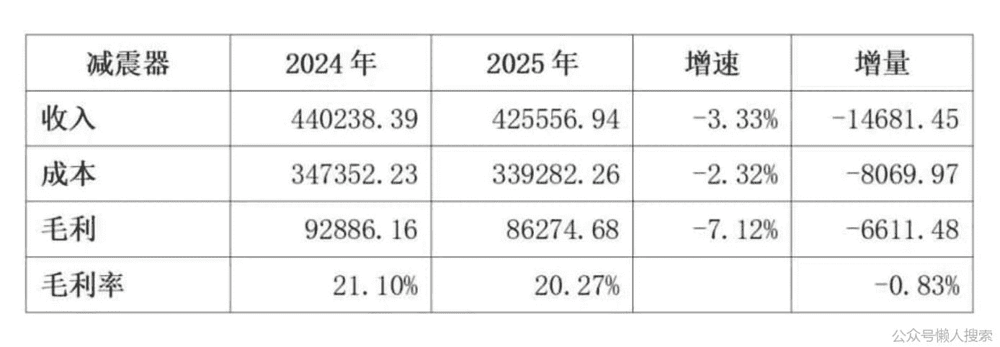

以下是公司上市以来减震器情况（单位：万元）：

其中收入、成本、毛利为三条折线，用主坐标轴，毛利率为柱形图，用次坐标轴。

可以看到，拓普的减震器虽贵为国内外第一梯队，近十年以来，收入复合增速为10.39%，市场占有率长年排名前列，但近年来收入增长已经趋缓。

而且毛利率不断下滑，导致毛利的复合增速仅有4.54%，2025年的毛利为2021年以来的最低。其中原因很多，从以下表格中可以看出来（单位：万件、元）：

根据公司的销售单价和销售成本，可以发现减震器业务遇到的两个问题：一是内卷。

体现在单价持续走低，已降至历史倒数第二。出现这种情况，是因为汽车的减震器市场占有率分散，所以各减震器供应商缺乏议价权。

这一点随着咱们国产汽车的崛起而越来越明显。二是近三年遇到了成本控制问题，从2023年起销售成本连续走高。

我们分析减震器业务的具体成本如下（单位：元/件）：

只论上涨幅度，直接材料的涨幅不是最大的，但它的上涨数值最大，对成本上涨的影响最明显。

也就是说减震器业务的成本上涨，和直接材料涨价高度相关。但公司对减震器业务的依赖也明显走低，如图所示：

业务营收增量尚可，但占总营收比例持续下降，是公司组合拳出击，不断拓展减震器以外业务的结果。

### 2. 内饰功能件（单位：万元）

收入两位数增长，增量12.39亿元；毛利个位数增长，增量10422.75万元。成本增速快于收入增速1.74个百分点，带动毛利率降低1.24个百分点，负面影响毛利12026.65万元。

成本上涨对毛利的负面影响，比毛利增量还大。内饰功能件包括顶棚、地毯、脚垫等部件，除了常规使用价值，还有隔音隔热等功能，也是提升汽车驾乘品质的重要组成部分。

下图是内饰功能件业务历年情况（单位：万元）：

其中收入、成本、毛利为三条折线，用主坐标轴，毛利率为柱形图，用次坐标轴。

拓普集团在中国软内饰功能部件供应商中排名第一。

看图表，营收仍在上升趋势中，没有颓势迹象。上市以来，该业务的营收复合增长率高达23.9%，因为业务特质所限，附加值不高，因此毛利率不高，但毛利率没有一味走低，而是波动中缓慢下降，与减震器业务有明显不同。

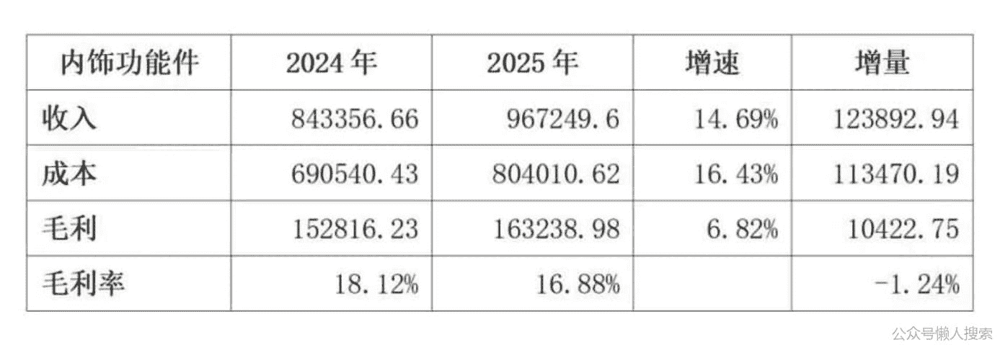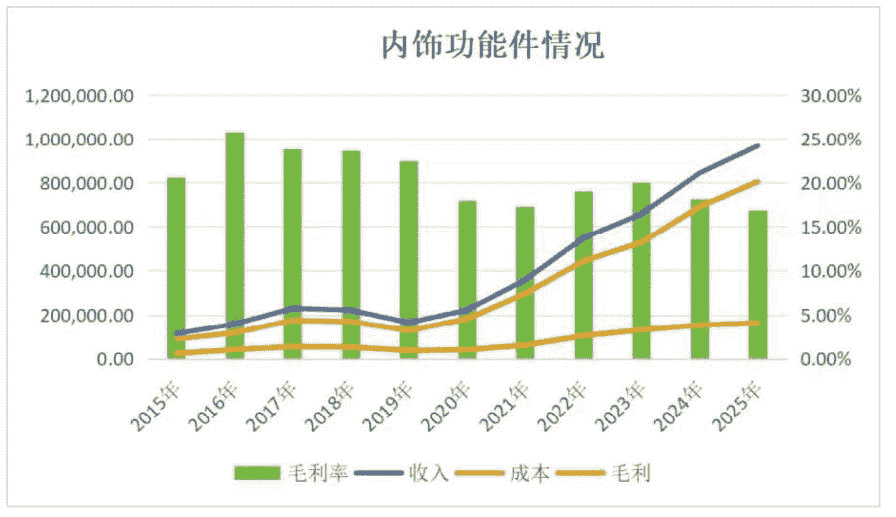

上图是内饰功能件占总营收比例，长年维持着近三成的占比，在公司营收不断增长的背景下保持比例不变，说明该业务和公司的发展是同频的。

### 3. 底盘系统（单位：万元）

收入个位数增长，增量5.2亿元；毛利略微下滑，同比减少590.96万元。成本增速快于收入增速1.71个百分点，带动毛利率降低1.28个百分点，负面影响毛利11205.31万元。

拓普集团的底盘系统业务起源于2004年，直到2017年，底盘系统业务都还被称为“锻铝控制臂”。因为公司是从底盘零部件做起，再逐渐系统化。

底盘系统业务仍聚焦于减震降噪，此外还有耐用、轻量化等要求。如今的底盘业务，既包括传统的前后副车架、H臂、控制臂、转向节等，也包括先进悬架系统，如空气悬架。

但空气悬架的绝大部分产品，都归在另一项业务“汽车电子”中，所以我们在这里不谈。下图是底盘系统业务历年情况（单位：万元）：

其中收入、成本、毛利为三条折线，用主坐标轴，毛利率为柱形图，用次坐标轴。

毛利率在20%左右浮动，2025年处于中等水平。

下面是公司近年的底盘系统成本情况（单位：元）：

可以看到，近6年来，除了直接人工之外，直接材料和制造费用越来越高，公司对此业务的成本控制一般。

这是由原材料价格和产线厂房折旧导致的。

下面是公司历年底盘系统产销量和销售单价、销售成本（单位：万套、元）：

（不是小懒偷懒，是这张图确实没加载出来）

自上市以来，公司的底盘系统销量在2018、2021、2022、2023、2024年跨越了五个台阶，每个台阶都是百万套以上的销量增长。

考虑到公司的海外营收占总营收比例长期徘徊在20%至30%之间，可以认为这个增长和国产合资车，以及国产自主新能源车的产销量增长紧密相关。

所以说底盘业务的实质就是本土制造业升级后，伴随着降本需求，催生出的国产替代风潮。但是有一点要着重说一下。

我们把底盘业务2025年的单价和成本分别减去十年前2015年的单价和成本，单价差为369.91，成本差为328.54，两者相减是41.37元。

也就是十年里，底盘业务虽然单价涨了，但也就涨了个保本价。从长期来看，这一块的毛利增量主要来自于销量的增加，而非毛利率的提高。

不仅这一项业务是这样。前面的减震器和内饰功能件一样，情况甚至更严峻。

以同样方法计算，减震器单价降低了44.39元，但单位成本提升了39.26元；内饰功能件单价涨了36.8元，但单位成本提升了64.43元。

公司作为业内巨头，想多挣点毛利都如此困难，可见内卷之残酷。下面是底盘系统营收占总营收比例：

比例提高，表明它是公司业务和毛利增量的重要推动力量。

### 4. 汽车电子（单位：万元）

收入超高速增长，增量9.49亿元；毛利高速增长，增量10270.37万元。成本增速快于收入增速5.56个百分点，带动毛利率降低2.94个百分点，负面影响毛利8149.62万元。

公司汽车电子业务的底子是刹车系统，在2019年以前，这项业务就叫“智能刹车系统”，核心产品是电子真空泵。随着研发精进，公司的刹车系统越来越智能，如今拥有了高度集成、软硬结合的一体化系统，区别于传统的真空助力制动系统，特点是反应快速和精准。

国外友商有博世、采埃孚、大陆等巨头，国内除拓普集团外，还有拿森科技等。业务升级为“汽车电子”后，该业务主要包含三块。

一是智能驾驶系统相关，其中包括智能刹车系统、智能转向系统、冗余制动系统、电子机械制动等。

这一套部件的核心思路是电讯号取代机械传动，目的就是增加响应速度和精度，其余的轻量化、集成化等等优势更是少不了。此外智能驾驶时，安全还需要有备份。

这就是冗余制动系统的用武之地。智能驾驶分为三个层级：感知层、决策层和执行层。感知层是摄像头和各种雷达。决策层是各厂商训练的AI大模型，由大模型判断车辆操作。

而在感知和决策后，真正影响车辆状态的，是执行层。上述这些产品都是汽车执行层的部件，面对未来的辅助驾驶发展，执行层部件的要求是一定要更精准、更迅速，所以未来电讯号取代机械传动是必然。

汽车电子的第二板块是空气悬架，这是以孔辉科技和拓普集团为代表的国内公司，近年来实现产业升级、国产替代的一大例证。

拓普集团是国内率先实现闭式空气悬架系统大规模量产供货的企业，构建了从储气罐、空气弹簧、ASU、ECAS等核心零部件，到单腔、双腔、三腔空气悬架系统的全栈自研与创新能力。

空气悬架和普通悬架的核心区别，就是将悬架中的弹性元件，从钢制螺旋弹簧替换成橡胶气囊。气囊内的空气量可以自由调节，会影响车身高度和悬架弹性，从而提升驾乘品质。

当然，除气囊外，空气悬架还包括一系列电子元件，比如感知路况，实现合理的充放气策略等，这也是空气悬架被划为汽车电子业务的重要原因。

空气悬架在2018年前的中国车市里属于稀罕物，基本上低于60万元的车不要指望有，国产车更是不可能有。2018年蔚来用上了德国产的空气悬架，产品售价40万元以上；2021年岚图用上了中国自主生产的空气悬架，售价30万元以上。

现在市面上已经有少量20万元以下的汽车使用空气悬架了。虽然受制于成本，市场中螺旋弹簧悬架仍是主流，但过去高高在上的先进技术现在快被打成了白菜价，也是事实。

可以想见，未来的空气悬架普及率还会提高，并且会越来越向平价车普及，这是趋势。当然，除了空气悬架，公司底盘系统向更高阶的主动悬架领域延伸，成功开发出液压主动悬架系统和800V主动稳定杆，这类技术应用于更高端的车型。

汽车电子的第三块业务是智能座舱部件，比如座椅控制器、四向腰托、自吸电子锁、防夹条、雷达探测传感系统、人机交互系统等等，核心用途是提升汽车的高级感。

这些部件以前都是豪车才能配备，有的功能甚至豪车都没有，现在算是飞入寻常百姓家了。下图是汽车电子业务历年情况（单位：万元）：

汽车电子的毛利率一路走低，这是标准内卷生态下的毛利率表现。而从2024年起，这块业务的收入成本又有巨大提升，我们看一下公司历年汽车电子产销量和销售单价、销售成本（单位：万套、元）：

产销量没有明显提升，但产品的单价和成本上涨了十倍以上。数据没有错，其增长核心就是产业升级。2024年以前，公司的汽车电子业务以电子真空泵为核心产品。

2024年起，产品升级，以空气悬架、电动可调转向管柱、智能门控系统、转屏控制器等高附加值产品为主导。整体产品总价值大幅提升、平均单价显著提高。

虽然毛利率比2015年低了很多，但过去平均一件挣一百多毛利，现在一件挣六七百，而且销量一点不少。从这个角度看，我们对汽车电子业务毛利率走低可以有另外一个解释：它确实是内卷，但卷的是高端配置的渗透率，把空气悬架等高端配置前所未有地推进到二十几万、十几万价位区间，以价换量，放毛利率，吃增量。

以下是汽车电子营收占总营收比例：

### 5. 热管理系统（单位：万元）

收入略微下滑，同比减少4800余万元；毛利个位数下滑，同比减少2433.69万元。

收入下滑速度快于成本下滑速度0.91个百分点，带动毛利率降低0.77个百分点，负面影响毛利1606.49万元，占热管理系统业务毛利下滑量的66.01%。

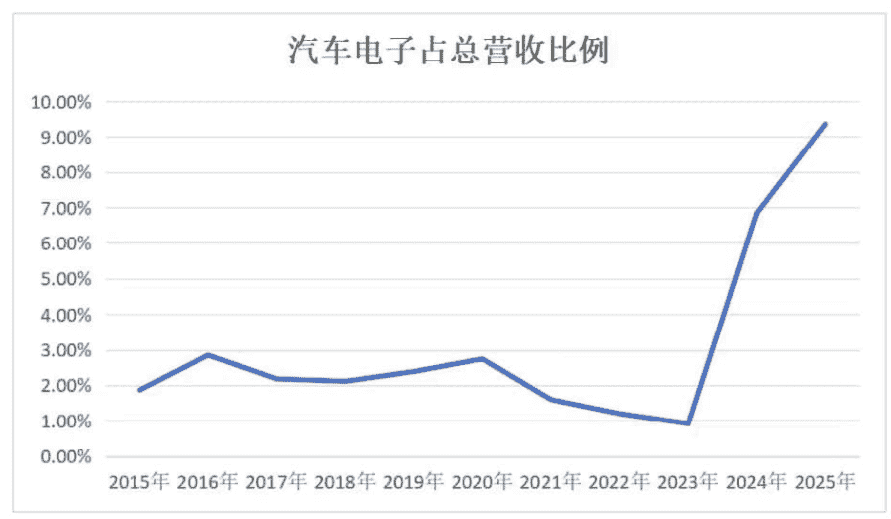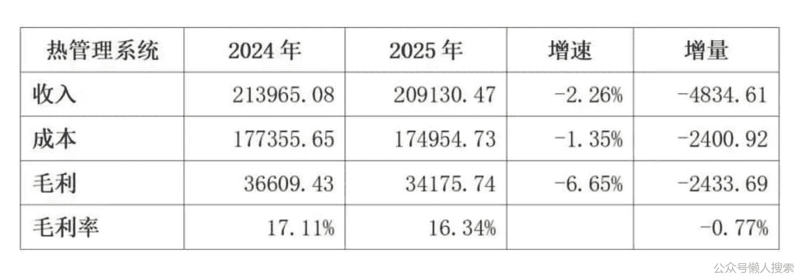

燃油车时代，汽车的热管理系统主要服务于发动机散热和车内空调，架构简单，需求单一，因此热管理系统的复杂性和价值量都较低。而对新能源车而言，电池对温度非常敏感，过热容易自燃，过冷影响续航。

所以需要通过液冷板、冷却液循环、精密传感器和控制算法，将电池温度始终维持在最适宜的工作区间。电机和电控效率高，产生的废热比内燃机少得多。为了在冬天保证供暖的同时又不至于太浪费电，需要 PTC 或热泵系统保证高效供暖。

总之，新能源车对热的敏感度远高于燃油车，车辆要一直计算哪里过热、哪里热量不够，让热量在车的不同位置实现循环。

公司的热管理系统包括分布式热管理和集成式热管理。

此外，随着各类数据中心的发展，拓普集团的液冷泵已进入数据中心液冷系统。

现在此类消息很多，比如有传言拓普集团与某头部云计算厂商签署未来 3 年 5 万台液冷服务器协议，潜在金额约 75 亿元。

这条消息无法准确核实，但另外一条来自年报的消息是可以确认的：公司将热管理技术及产品应用于液冷服务器、储能、机器人等行业，并取得首批订单 15 亿元。

综上，公司凭借过往的热管理经验技术，完美地切入了现在和未来潜力巨大的数据中心、机器人业务。下图是热管理系统业务历年情况（单位：万元）：

下面是热管理系统的产销库存量、单价、单位成本（单位：万件、元）：

热管理系统的特点和前面业务不太一样，它似乎是保毛利率的，在维持单价、成本稳定的同时，提升销量。这么做一方面是业务还年轻，基数小，销量的提升相对容易一些；另一方面是因为毛利率本来就不高。

我们之前分析过的一家公司，它是国内空调、热管理领域的龙头企业，并且也同样开始涉足机器人领域。该公司 2025 年的制冷空调电器零部件毛利率 28.77%，汽车零部件毛利率是 28.79%，跟拓普集团 16.34% 的毛利率相比还是高了很多。当然，这并不是严谨的同产品对比，目的是心里有数。

而且拓普的热管理业务独立出来没几年，仍在大力建厂的阶段。为进一步扩大产能，公司正在墨西哥、波兰和泰国建设热管理生产工厂，所以拓普集团在这一块的业务还没有完全发力。

下面是散热系统的营收占比情况：

热管理系统确实不卷毛利率，但从占比可以看出来，不卷的结果是热管理系统的营收没有匹配公司的整体增长。

## 6. 电驱系统（单位：万元）

收入略微增长，增加 16.38 万元；毛利高速下滑，同比减少 299.54 万元。成本增速快于收入增速 46.7 个百分点，带动毛利率降低 22.65 个百分点，负面影响毛利 307.88 万元。

电驱系统是一个笼统称呼，我们可以直接把它理解为“机器人相关业务”。

这是公司选定机器人为第二增长曲线后的业务，承担机器人零部件的预研、试产、实验、送样等任务。

这项业务非常年轻，2023 年才设立，也没什么收益。但它也是我们此次专门研究拓普集团的原因。后面再细讲。

## 7. 主营业务（单位：万元）

收入两位数增长，增量 25.12 亿元；毛利小幅增长，增量 10757.48 万元。成本增速快于收入增速 1.89 个百分点，带动毛利率降低 1.38 个百分点，负面影响毛利 38041.39 万元。

## 8. 其他业务（单位：万元）

收入高速增长，增量 4.69 亿元；毛利中速增长，增量 10613.9 万元。成本增速快于收入增速 10.2 个百分点，带动毛利率降低 4.53 个百分点，负面影响毛利 9315.67 万元。

其他业务是所有公司年报中都有的一个特定分类，一般既有杂项，也有尚未形成规模的未来产业。公司没有披露其他业务具体内容的义务，所以只能靠经验和信息搜集来猜测。

经过一些查证后，我们估计有诸如合成纤维、产业用纺织制成品、模具、专用设备等业务。当然也有可能包括人形机器人执行器、AI 液冷产品和航天科技等领域的布局。

## 9. 全部业务（单位：万元）

收入两位数增长，增量 29.81 亿元；毛利小幅增长，增量 21371.36 万元。成本增速快于收入增速 1.93 个百分点，带动毛利率降低 1.37 个百分点，负面影响毛利 40644.15 万元。

公司的营收体量接近 300 亿，还能保持 10% 以上的营收增速，是不错的水平。

而且在此基础上毛利增速也为正，是可以接受的。但必须看到，公司的营收和毛利增速正在渐渐形成错位，毛利率压低，下一步承压的就是净利润。

公司 2024 年和 2025 年关键数据如下（单位：万元）：

这里体现得非常明显，增收不增利。2025 年毛利增量 21371.36 万元，净利润降低了 22153.49 万元，毛利率下滑，带来后面的步步承压。

## 二、各财务环节对公司利润的影响

### 1. 费用环节的影响（单位：万元）

2025 年，费用环节一共减少营业利润 37001.74 万元。经过这 5 个环节，公司 2025 年的营业利润同比减少 15630.39 万元。

费用环节中，影响最大的是研发费用和管理费用。其中管理费用的支出增长大头是职工薪酬，增加了 6600 万元。

其次是服务费，增加了 3091 万元。研发费用的支出增长主要因为职工薪酬增长了 9046 万元，材料投入增长了 1.09 亿。

以下是历年研发人数和研发费用（单位：人、万元）：

### 2. 利得和损失的影响（单位：万元）

2025 年，这 6 个环节共计减少营业利润 10303.51 万元。经过这 6 个环节，公司营业利润同比减少了 25933.9 万元。

其他收益影响最大，原因在于 2025 年的政府补助比 2024 年少了近 1 亿。信用减值损失方面带来了 5100 多万元的正面影响，主要是应收票据坏账损失转回了 573 万元，另外应收账款坏账损失计提比上年少了 4576 万元。

资产减值损失带来了近 4100 万元负面影响，主要是商誉减值损失增加了 3000 多万元，再是存货跌价准备及合同履约成本减值准备比上年多计提 1000 多万元。

### 3. 营业外收支、所得税费用和少数股东损益等（单位：万元）

2025 年，这 4 个环节共增加公司股东净利润 3780.38 万元。经过这 4 个环节，公司 2025 年股东净利润减少了 22153.52 万元。

所得税费用的影响最大，正面影响净利润 4863.99 万元。主要是当期所得税费用同比降低了 6100 多万元。

## 三、影响公司 2025 年业绩的因素及排序

影响公司 2025 年业绩的因素一共 22 个，其中正面影响因素 8 个，负面影响因素 14 个（单位：万元）：

2025 年，公司业务毛利三增四减。三增的是：其他业务增加毛利 10613.9 万元；内饰功能件业务增加毛利 10422.75 万元；汽车电子增加毛利 10270.37 万元；这三项业务共增加毛利 31307.02 万元。

四减是：减震器业务减少毛利 6611.48 万元；热管理系统减少毛利 2433.69 万元；底盘系统减少毛利 590.96 万元；电驱系统减少毛利 299.54 万元，共减少毛利 9935.67 万元。

全部业务共增加毛利 21371.36 万元。费用方面减少营业利润 37001.74 万元；利得和损失共减少营业利润 10303.51 万元；营业外收支、所得税费用及少数股东损益增加股东净利润 3780.38 万元。

终至全年股东净利润减少了 22153.52 万元。

少量因四舍五入产生的偏差为正常现象。

我们再把公司最近的一季度报关键数据提出来（单位：万元）：

跟 2025 年一季报相比，2026 年一季度，公司增收不增利状态持续。收入增速接近 15%，但毛利率下降了 0.63 个百分点，净利率下降了 1.47 个百分点，股东净利润同比减少 1366.80 万元。

## 四、公司传统行业评价

### 1. 全球与中国汽车行业态势

拓普集团是完全依附于汽车制造业的公司，全球历年的汽车产量如下（单位：辆）：

在过去的 25 年里，从 2000 年的 5837 万辆增长到 2025 年的 9640 万辆，增量尚可，但年复合增长率并不高，只有 2.03%。

2008 年经济危机带来的波动，很快被抹平。但自从 2018 年的下滑后，直到 2025 年汽车产量仍没有恢复到 2017 年的巅峰水平。

汽车产量的恢复越来越吃力。

此外，受全球经济增速放缓、通胀、地缘政治不确定性等因素影响，多家机构认为 2026 年汽车产量会下滑降到 9300 万辆左右。

我们还看到一些更悲观的言论，比如 Urban Science 的专家认为在 2035 年达到 1 亿年产量都是奢望，2025 年已经有 9640 万辆了，就三百多万辆的差值，有人认为能卡十年。

机构也好，专家也罢，我们不机械照搬结论，只是从中看到一些倾向，即汽车产量近年正在渐渐触及瓶颈。产量跟着销量走，销量跟着经济走。

未来汽车的销量潜力在南亚、东南亚、非洲、南美，但这四块市场的经济潜力已经强调很多年了，一直没有真正兑现。从政治经济角度来说，这些地区的未来经济发展取决于和中国的合作密切程度，而密切程度又跟美国的地缘影响力直接相关，所以前途是光明的。

但前途光明是一方面，涉足其中的公司却等不起。中国汽车销量如何呢，情况如下（单位：万辆）：

中国汽车销量不错，2000 年以来复合增长率达到 11.86%，并且近年来也保持了增长趋势。

但不同时间段的销量增长要分开来看。近几年的销量增长和 2020 年前不同，之前更多是依靠国家经济总体增长，大增长带动小增长。

而 2020 年后的增长则是依靠新能源转型带来的产品力升级和内卷带来的价格下探。

随着内卷接近极限，以及新能源渗透率走向深水区，销量增速很容易出现下滑。

我们看了大量机构预测，部分机构预测 2026 年中国汽车销量持平或略高于 2025 年，部分机构认为 2026 年销量会低于 2025 年。

也就是在机构看来，中国汽车销量的瓶颈也快来到了。产量跟着销量走，当销量遇到瓶颈，产量也逃不脱。只是我们团队认为，中国公司汽车总产量及在全球的占有率并没有达到瓶颈，中国汽车在全球的销售，会对欧日韩汽车形成挤压。

总结一下，汽车行业是一个高价值、低增长的准存量市场。它的最大潜力在广大第三世界国家，但这些地区的经济潜力短期不容易兑现。

尤其是汽车这种高价产品，卖起来会更困难。而中国作为过去二十五年里汽车消费增长最重要的发动机，也被认为临近瓶颈。

但我们团队对国产汽车特别是新能源汽车继续保持乐观态度，只是认为增速有可能下滑到中速或中低速的增长。

### 2. 拓普集团的汽车行业策略

#### （1）国产汽车供应链的逻辑

虽然我们把汽车行业定义为高价值、低增长的准存量市场，但它在新能源风潮之后变得特殊了起来。其逻辑是这样的：中国从 2009 年开始就是世界第一的汽车生产国，2009 年汽车产销量双双破千万。

但没有人认为那时中国是世界汽车强国，老百姓还是愿意买进口或合资车，本土品牌只能吃残羹剩饭。因为我们没有自己的品牌。而没有品牌的原因是我们在燃油车领域只是追随者，所以我们没有话语权。

没有话语权的结果是中国消费者总体上不能客观看待国产车的优劣。具体说来，一是对待国内外品牌态度持双重标准，二是不能以发展眼光看待国产汽车。

而燃油车时代合资和进口品牌的强势会导致一个结果，就是国产零部件品牌很难挤进供应链。有人说合资车都是有零件国产化率要求的，没错，但我们没有零件国产品牌化率要求。

博世、电装、爱信、采埃弗等外企只要在国内设厂，生产的零部件就能合规进入合资车供应链。同时这些供应链企业仍然可以把持核心技术和利润大头。

所以很长时间以来，国外整车和供应链都过着很舒服的日子，而国内整车和供应链喝口水都难。当然，换赛道后一切都不一样了，过程不多讲。

但有一点很重要，就是当国产品牌的整车拿到新能源时代的话语权后，是愿意带着国内供应链一起玩的，原因之一就是国产车用国内零部件可以压成本。

而传统国外巨头的价格压不下来，并且不适应新能源，所以国内供应链这几年都成长很快，两者在新能源领域的地位出现了一定程度的倒挂。

由于新能源车将逐步取代燃油车，而中国又是新能源车的绝对生产核心，并且中国厂商还愿意带着国产供应链，所以新能源车的渗透率和国内汽车供应链的景气度是直接相关的。

以下是国内和世界范围内的新能源汽车渗透率，因为统计口径不同，不同来源的数据可能存在区别，不影响大面：

新能源车渗透率

中国的渗透率较高，但世界市场还不够，这一点要随着中国品牌出海进一步完成。

另一方面，中国的新能源车保有量达 4397 万台，占总汽车比例超过 12.01%，也就是说国内还有大几倍的空间等待替换。当然，这个存量的替换空间您可以自己研判，我们不坚持。关键是中国汽车出海已经成为大势。

所以，综合来看，对国内供应链厂商而言，虽然汽车这块大蛋糕增量不像过去那样疯狂了，但一方面抓住了新能源时代跻身供应链的机会，另一方面还有新能源车渗透率提高及中国汽车出海的蛋糕可以吃。所以这是一门存量里面做增量的生意。

#### （2）拓普的汽车行业逻辑

##### ① 体量制胜

汽车价值高，产业链长，蛋糕已经非常大了，所以在存量里面做增量的时候，大家怎么着都有口吃的。但为了这口饭，很容易内卷。

这个时候谁是巨头，谁屁股上的肉厚，谁就有机会赖在牌桌上不走，熬到行业出清。

而拓普集团就是非常典型的巨头。

之前我们分析过一家小家电公司，在那个小小的领域里，它也是巨头，逻辑也是一样的。

##### ② 抓紧变化中的不变

所有人都知道从燃油车切换到新能源车后，供应链发生了多大的变化，如果拓普集团的主业是做变速箱，那算完了。但好在不是，变化再大，也有动不了的基本盘。

大家可以往前翻公司的几大类业务。减震器业务中形形色色的衬套、副车架支承、筒减支承；内外饰系统的脚垫、顶棚、隔音垫、底护板、密封条；底盘系统的副车架、摆臂、控制臂等等。这些东西，不管汽车怎么变，只要还在地上跑，就一定用得上。这就是变化中的不变。

我们对比这三大类业务的营收占公司总营收比重，就能知道它们的增速。其中只有减震器因为燃油车式微，比重有所下降。

其余两项，内外饰保持了和公司的同频增长，底盘系统增速更是超过了公司增长速度。有这些基础业务存在，公司至少有了稳定的现金奶牛。这也是公司不惜卷毛利率也要保增长、保份额的原因。

##### ③ 新能源时代的变化

上面一点说了，公司的基础业务，是汽车工业的必需品。面对新能源时代，公司仍然坚持做必需品的思路，而且抓的是多年都不会过时的供应链环节。

公司在汽车电子业务选择了三大不过时的抓手。一是以空气悬架领衔的先进悬架系统，这是内卷大背景下汽车驾乘品质提升的核心。如果以后继续内卷，空气悬架会进一步下探至低价位车型，此时空气悬架是必需品；如果以后内卷趋缓，国内厂商就会做品牌上探以求高毛利，此时驾乘品质更加重要，那么以空气悬架为代表，包括更先进的主动悬架和防倾杆产品，仍然是必需品。

第二抓手是自动驾驶。自动驾驶，或者说是辅助驾驶，是新能源车未来的基础能力。

公司通过智能刹车系统、智能转向系统、冗余制动系统、电子机械制动等已研、在研产品，扎根自动驾驶的执行层。

感知再准，决策再精，到最后也要落实到执行层执行操作。任何时代汽车都要有物理的操作和物理的部件，所以这又是一张长期饭票。第三抓手

智能座舱。

这个没什么好说的，大家自己去感受新老时代的汽车座舱有多大区别就行了。

这是必需的。热管理业务虽然增速没那么快，业务体量不算非常大，但仍然坚持着一贯的必需品思路。因为新能源车对热管理的要求更高，更敏感，前文有说过了。

综上，拓普集团在汽车行业的思路就是体量制胜、稳字当先、坚持必需品。作为一家有追求的巨头，拓普没想永远绑死汽车供应链。所以它开辟了新的增长曲线，也就是机器人供应链。

## 五、从汽车跨界到机器人

### 1. 机器人公司的构成

我们强调过很多遍，机器人是未来，是趋势，抓紧机器人也是中国进一步领衔全球科技革命、AI科技成果落地的表现。

这个观点是有论据的，我们在前文公布的诸多数据，机器人整机企业数量已超过140家，产品型号超过330款，2025年出货量约1.44万台，占全球总量的84.7%。

这些都是很好的证据了。诸多机器人企业，又可以分为两大类，一类是像优必选、宇树这样核心业务是机器人的原生机器人公司，它们占绝大多数。

另一类是从其他行业跨界到机器人的公司。

跨界公司并不算多，不同统计报告显示，跨界占比在11%到14%，但个个都是巨头。

有家电系的，如美的、海尔、格力；有互联网系的，如腾讯、美团、阿里。

但对跨界最积极的，是车企。现已知跨界或有明确跨界计划的，有比亚迪、小鹏、奇瑞、广汽、长安、东风、吉利、赛力斯、上汽、理想等。这些企业有的亲自下场做，有的孵化或投资其他企业做机器人。

### 2. 车企跨界的原因

#### （1）汽车行业的内卷压力

这个我们前文分析过了，大家都清楚。当一方压力过大时，参与者就会往低压区转移。就像有的年轻人在大城市卷不动了，就换个二线城市，或者回老家，一个道理。

#### （2）技术同源

##### ①具身智能的相似基因

人形机器人当然是典型的具身智能。如果新能源车只有驾乘功能，那它就只是车，没什么好讨论的。

但在辅助驾驶越来越重要，竞争越来越激烈的当下，辅助驾驶+智能座舱成为了每个车企的必修课。

此时，新能源车就是广义上的具身智能。

在电能驱动下，人工智能的路是互通的。

感知层方面，激光雷达、摄像头、毫米波雷达用于环境感知，这一套设备同样适用于人形机器人的导航、避障、场景理解。

端到端自动驾驶算法放在车上是辅助驾驶，放在机器人身上，作用就是任务决策、动作规划、人机交互。AI大模型和高算力芯片都是人形机器人大脑的核心。

特斯拉自动驾驶与Optimus双线负责人说过，他们不是在造一个驾驶产品，而是在为所有机器人构建一个统一的基础模型。

同一套模型，今天开车，明天就在工厂里搬箱子。

##### ②硬件的技术同源

特斯拉汽车官方表示，为电动车开发的一切，比如电池、电力电子系统、电驱系统，都适用于人形机器人。小鹏汽车创始人何小鹏也说，车企70%的技术储备能直接复用到机器人身上。

总之，毛利率的内卷，以及软硬件的天然互通，让车企热衷于跨界到机器人行业。

而拓普集团作为汽车零部件的巨头，它的技术储备和机器人的供应链具有高度相似性，这个我们后面会讲到。

## 六、杀入机器人供应链

### 1. 拓普集团何以进入机器人行业

#### （1）垂直整合为什么不会泛滥

我们在上一篇宇树的分析文章《含着金汤匙出生，生而龙头的机器人企业》中说过，宇树的一大核心优势就是全栈自研+垂直整合。

这种决策就是事前投入大量资源进去，尽可能掌握供应链和核心技术，以保证事后规模化生产时，成本把得住，而且技术上不会被卡脖子。从这个视角看，垂直整合和零部件的供应商存在矛盾，机器人本体企业多吃一口，零部件商就少吃一口。

近年来，随着比亚迪的强势崛起，以及国内一众车厂也在外宣上强调自己“垂直整合”，搞得好像什么事沾上垂直整合就能迎刃而解。

但是中国车企这么多，真正逼近完全垂直整合的，只有比亚迪，其余车企都是部分整合。日本的丰田也号称垂直整合，但它的策略是交叉持股，这是具有日本财阀特色的整合方式。

现在放眼全球，极少有垂直整合的大工业品制造。因为从经济学角度看，市场交易往往比内部生产更高效和经济。

这背后是经济学中的交易成本理论、比较优势理论和规模经济理论。不吊书袋地说，就是如果打算垂直整合，就一定需要更多的管理成本和管理经验，需要投入更多的固定资产。

并且日后随着下游供需波动，自建零部件厂的抗风险能力也会存在问题。对任何一家企业而言，在初期下这个决心都是非常艰难的。能做成，垂直整合的好处尽享；做不成，自己一定受连累。所以绝大多数企业，并没有这个野心。

#### （2）机器人的定义

人形机器人是硬件产品吗？大家回答这个问题时，不能套用隔壁的新能源车行业作为案例。

我们说新能源车是硬件产品，没有任何问题。因为汽车的本质属性是交通工具，一辆只能驾驶，其余啥功能没有的车，仍然完成了它的本职工作。但一台能跑能跳的机器人，有什么用呢？

这样一台机器人，它的本质属性是什么呢？

就是个玩具。真正让机器人变得有意义的，是软件。

我们在讲宇树的文章中讲过了，核心在于大脑。一个头脑空空的武夫，解决不了任何问题。没有软件支持，机器人连主动伸手帮你拎袋子里的西瓜都做不到。

今后投入实际使用的机器人，能扫地做饭的、买菜帮人拎包的、扶老人散步的、陪孩子玩的，不要把它们看作硬件，它们其实是软件。

也就是说机器人发挥实际作用的前提是软件过硬。别看现在机器人都在展示翻跟头，但未来的局面是软件定义机器人。既然如此，未来的主流整机厂商，它们的核心能力将不是搞硬件，而是搞软件，大模型才是机器人未来的主战场。

不仅如此，我们可以把技术含量再降低，也就是说将来会有公司把开源的机器人大模型作为产品的大脑。公司的核心竞争力在于发觉客户痛点、挖掘使用场景，甚至是主打外观设计。

总之，未来将很流行用产品经理思维经营公司。当重点在软件上时，就没有必要过于死磕硬件。将来会有少量垂直整合的机器人企业，但只是绝对少数。其余企业仍会以外采或部分整合为主，牢牢依附供应链。

### 2. 如何切入机器人产业链

公司的机器人产业链切入和自己的原生业务关系密切，技术的迁移有底蕴支撑。前文分析过的诸多业务，可以相当程度上平移到机器人供应链。

机器人的硬件中，机器人执行器是核心部件，主要包括输出推拉运动的直线执行器，以及输出旋转和摆动的旋转执行器两类。

它们就像人的肌肉和关节，模拟人类各种运动的协调性与多自由度灵活性。

公司在执行器方面的技术根苗，在于线控制动系统，介入机器人供应链时最先触及的也是直线执行器，后续再扩展到旋转执行器、灵巧手电机等部件。

由于研发线控制动系统项目多年，在机械、减速机构、电机、电控、软件等领域具有深厚技术积淀。在机器人执行器方面，公司具备永磁伺服电机、无框电机等各类电机的自研能力；并且具备整合电机、减速机构、控制器的经验，同时还有精密机械加工能力。

所以无论是电机+减速器的经典旋转执行器，还是电机+丝杠的经典直线执行器，公司都有现成研产能力储备可以动用。除了以智能刹车为底子的机器人执行器之外，公司还充分调动了其他汽车业务的研产储备，更广泛地介入机器人供应链。

比如躯体结构件和足部减震器，技术就源于减震器和底盘系统；各类传感器源于汽车电子；具备触觉、温觉、湿度等感应能力的电子柔性皮肤，则来源于汽车电子和内饰功能件业务；机器人散热模组，来自热管理系统。

有道是移花接木，精髓相通。在机器人供应链的产能建设方面，占地约150亩的机器人部件产业基地项目将于今年建成投产。

此外，公司在2024年1月和宁波经济技术开发区签署了投资协议书，决定建设机器人核心部件生产基地，规划用地300亩。

2025年4月旗下子公司拍得100亩土地，正处在基础工程施工中。

## 七、投资思路

近些年来，我们的投资思路其实是返璞归真的。年轻时，或者是资金量不是很大时，就下意识地想去赚每一分钱，冒风险也愿意。当然，我们的冒风险也没太过分，是不融资的。

这种想赚每一分钱的态度，让我们哪里热闹往哪里冲。当大家都往里冲的时候，拼的就是技术、信息、运气。有的人在烈火烹油的局面里挣到钱了，他管这叫有认知，是真的吗？是认知还是运气？不好判断。

这篇文章讲的是汽车和机器人，我们就讲点汽车。前几年做国产新能源车崛起的那批人，有人高位套现走了，有人当价值投资，打算把股票传下去，这我们都不说什么。

但更多的人是在高位进去的，再算上下跌时的补仓，林林总总加起来，卡在个鸡肋的价位，进退两难。然后就是什么呢，就是每周每月守着看自己买的公司，看销量排第几，能不能把股价往上拔一拔。再就是全网骂战，和所有质疑自己公司的言论吵架。

说实话，炒股这么个炒法，就是在磨人，太痛苦了。什么叫返璞归真呢？就是炒简单的东西。什么东西简单？从无到有是简单，从少到多是简单。

什么东西很困难？从多到更多是困难。

2014年炒新能源车，是期待从无到有，2020年炒新能源车，是期待从少到多。

2025年还兴冲冲地炒新能源车，是期待着从多到更多。孰难孰易，一目了然。

我们之前写过两篇文章，分别提到了两位炒小米造车概念的小米股东。他们一度都有几百万的浮盈。但带来浮盈的是小米集团跨界汽车后的从无到有、从少到多。

并不是什么认知、站位、视野、理想之类的玄学。他们也都是在期待小米汽车从多到更多的时候受到重挫。对拓普集团来说，我们的态度也是如此。公司的底子非常好，是汽车零部件的巨头企业，底盘稳、根系深。也就是说，它本身就是个好公司，哪怕遇上内卷，也是好公司。

这是行业的问题，是社会经济发展的问题，不是公司的问题。但驱使我们把它写成一篇分析文章的，是它开辟第二，甚至第三增长曲线的潜力。

未来有很多公司会涉足机器人行业，我们也会慢慢分析。但拓普集团的特殊性在于，它是一个巨头。巨头的从无到有，从少到多，并不常见，值得重视。

所以现下对公司的态度，应该是等底找底。

更极端一点，就是把公司的增收不增利，当作利好。因为机器人业务还没发力，重心仍在汽车。

它越跌，我们越开心。就像拳头越往回收，打出去的力越大。总体来讲，公司的战略决策还是有它的优势的。它先在汽车零部件行业里从减震器开始，向其他零部件拓展，集中资源，稳步做大，再从汽车跨界拓展到机器人业务。

这是从现有技术基础上做一种横向迁移，向其他的大行业拓展的案例。

这种战略决策，使得公司发展的思维很清晰，也比较稳妥。而我们从历史上看，很多公司之所以跨界失败，比如地产商很多跨界失败，原因就在于产业没有关联度，什么都搞，什么都要，最后什么都不成。

## 八、公司的市场定位

### 1. 市盈率（单位：倍）

我们选择每年的高点价格、低点价格、对头年的每股收益、对当年的每股收益计算市盈率，参考送红股与转增的情况。2026年数据涉及业绩预测，不一定准确，故标红，下同。

公司正面临增收不增利的局面，市盈率处于历史中位偏上。

### 2. 市净率（单位：倍）

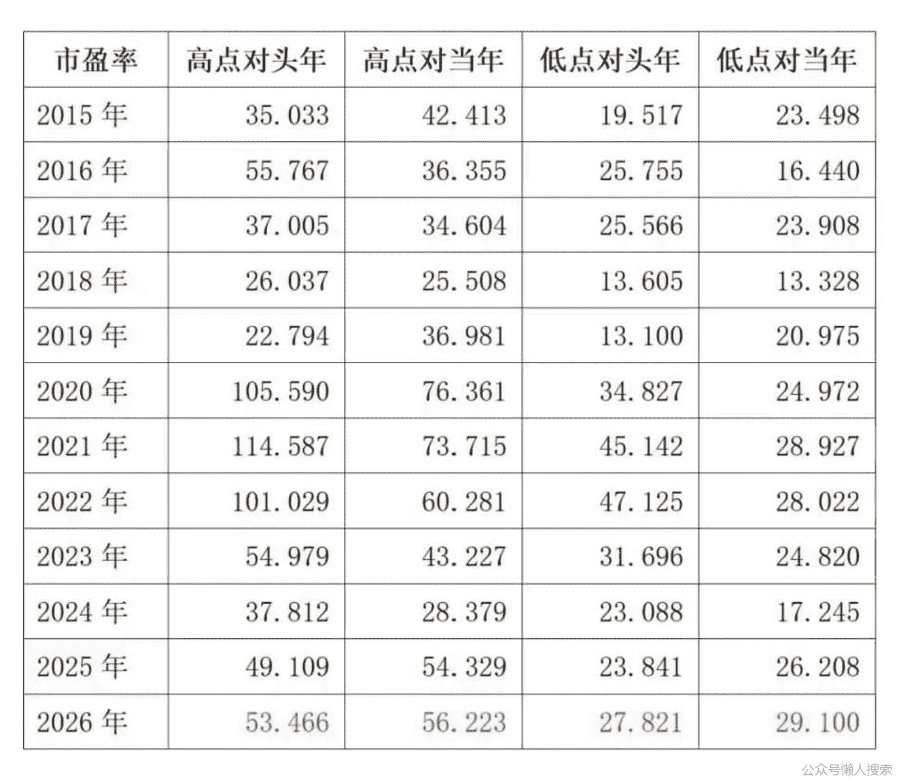

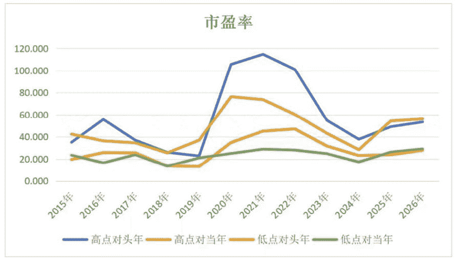

### 3. 市销率（单位：倍）

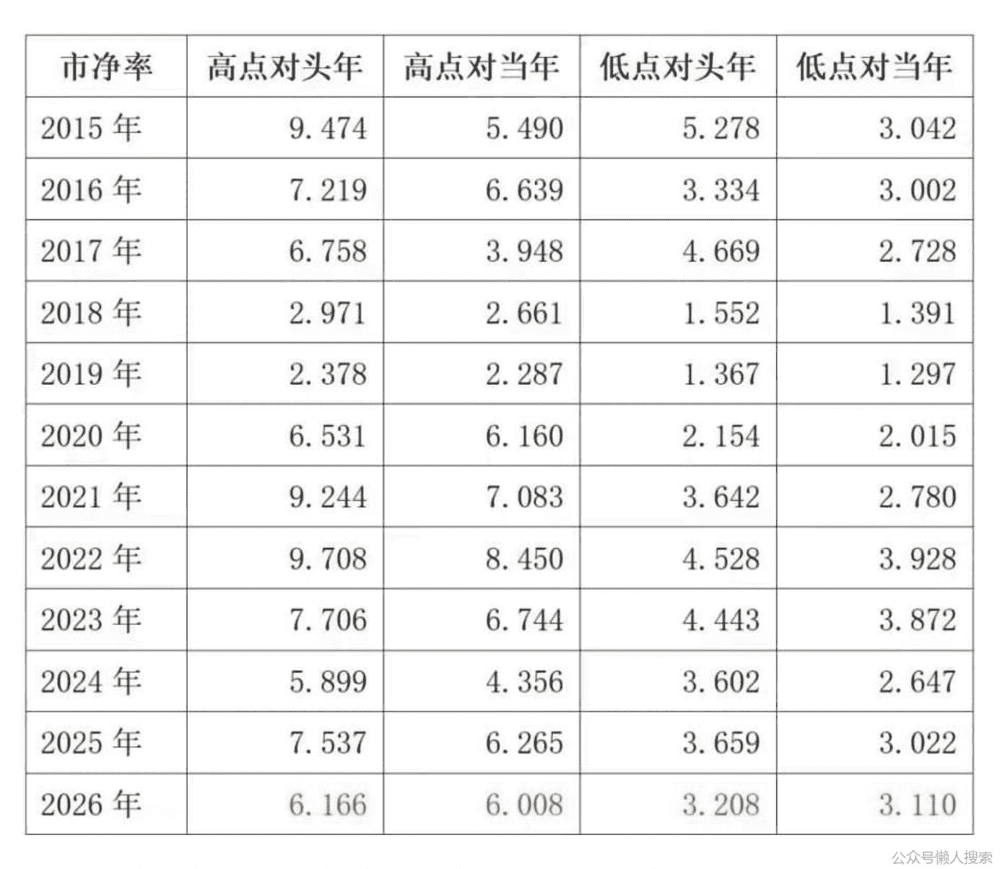

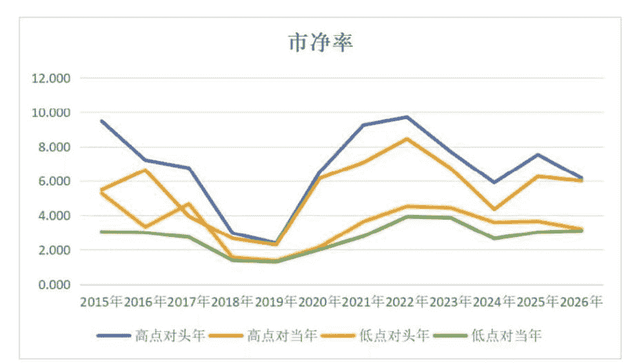

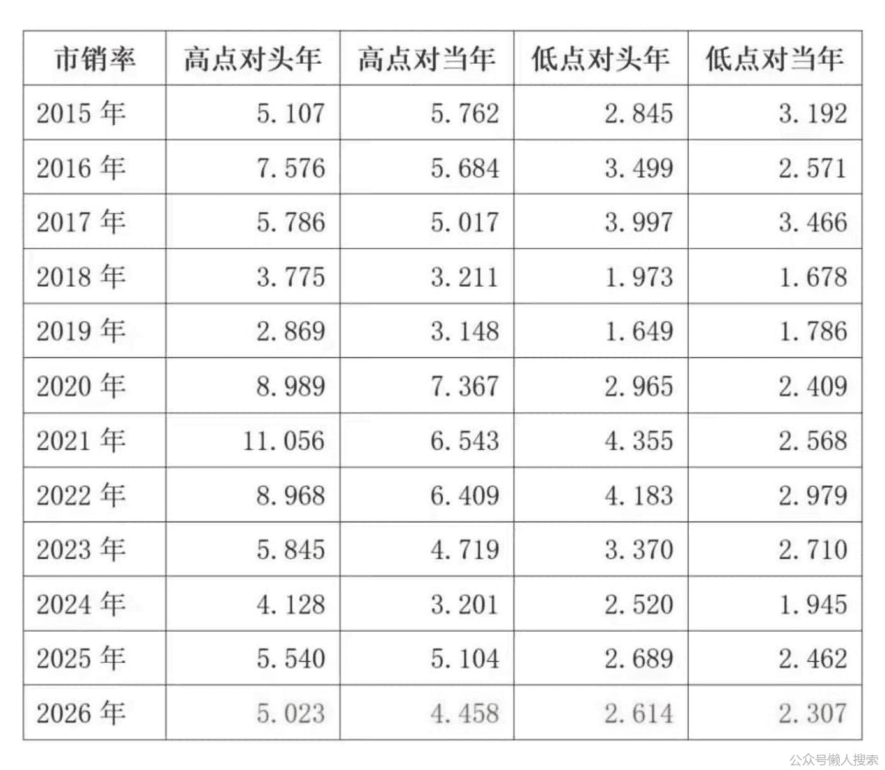

市销率这块是公司的强项，毕竟收入在持续增长，市销率也不高。但这个起不到决定作用，增收不增利的负面影响确实有点大。

最后补充：做拓普集团，主要看三个大势。

一是新能源汽车行业的大势，二是人形机器人的大势。它们都有相关指数，大家及时跟踪就成。

再就是紧跟上证指数的走势，上证指数不见大级别的底，新能源汽车行业指数和人形机器人行业指数不见大级别的底，则不宜重仓。轻仓小仓可以，重仓一定要等大级别的底部。

（声明：本文是公司分析，仅为开拓视野、引导思路，并非择时，亦非荐股，股市有风险，入市需谨慎。

本文不构成任何投资建议或意见，不对投资者依据本文做出的任何投资或决策承担责任。

请大家注意投资风险）

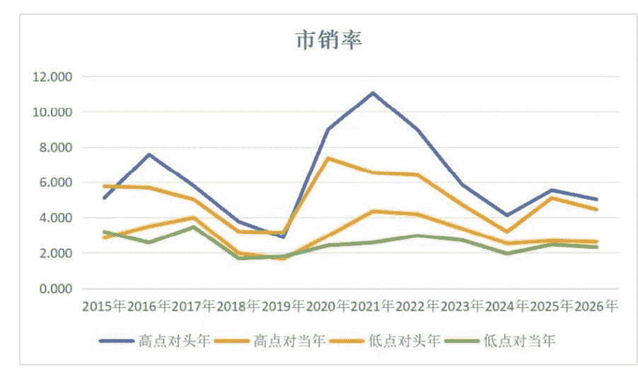

————分割线————

在这个AI能替你写代码、写文章的时代，基础技能正在迅速贬值。绝大多数人正被淹没在海量的免费垃圾信息里，陷入低效的体力内卷。

当“努力”不再是壁垒，人与人之间唯一的护城河，只剩下“信息过滤”的效率与“认知系统”的维度。

圈子已稳定运行7年。我们每天利用Python爬虫与大模型算力，过滤全网最顶级的政经内参和搞钱风向标，做你最冷酷的“外部大脑”。

如果你认同这种“重塑认知防线”的极客主义，欢迎围观我的个人情报智库：【懒人专属群】。

https://lazyso.com/insider/

认同信息过滤价值、想省下每天3小时无效阅读时间的读者，扫码加我微信（lazyhelper1）

