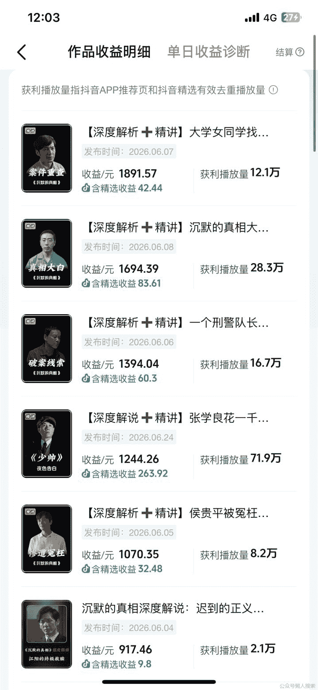
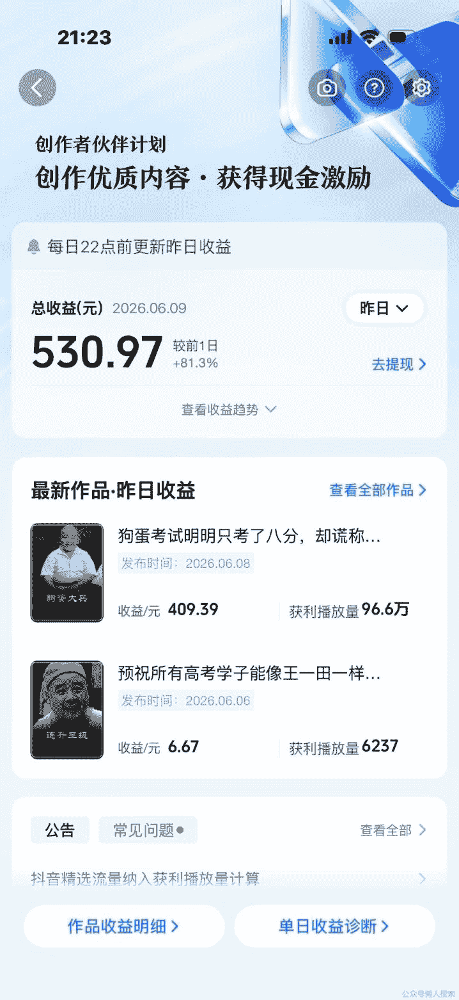
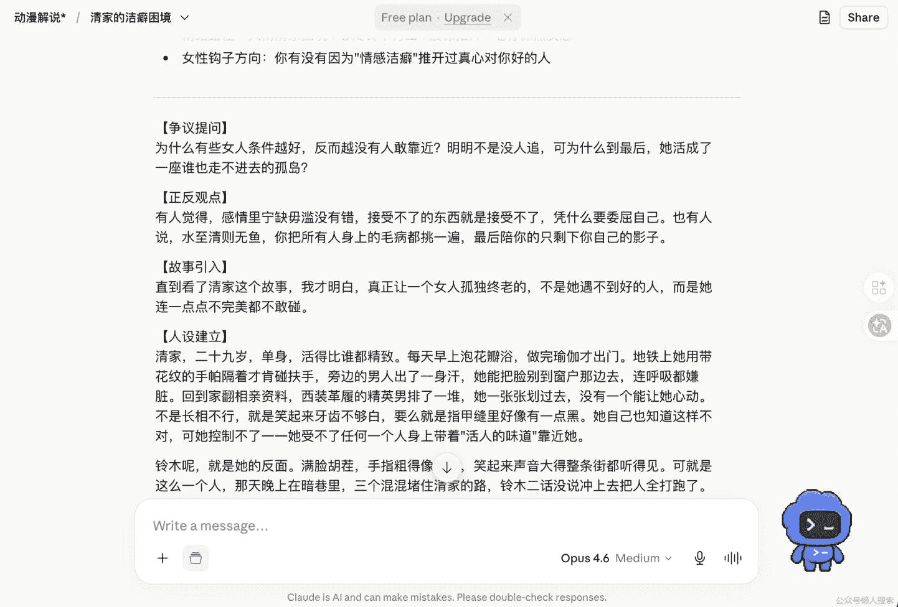

## 抖音独家精选计划和伙伴计划，如何通过影视解说赛道实现单账号月入破万（保姆级教程附全套 Prompt）

260818 副业 SC 精华

整理：公众号懒人搜索，懒人专属群精选

懒人微信：lazyhelper1

大家好，我是小滔，有幸在 2024 年加入生财这个大集体，是一个生财小透明，比较内向。

曾经在小红书、公众号、YouTube 等项目拿到过一些结果，做小红书虚拟资料的时候没有放大思维，跑通了从 0 到 1，但是没有坚持下去，当时自己的认知还是太局限了。

之后参加了 24 年 12 月的 YouTube 航海，生财的第一波出海潮，国外赚钱国内花，在美金的巨大诱惑下，七倍的收入让我着迷。我毅然决然地放弃了小红书，加入了油管，因为我认为我当时入小红书已经有点晚了，打不过他们矩阵化的运营，而 YouTube 又是在圈内第一次教学，我相信自己的学习能力可以成为第一波吃上螃蟹的人。事实上，证明我确实可以在 YouTube 上拿到结果。

直到在大学朋友的引导下，运营油管的同时又加入了抖音，又成为了一名国内内容创作者。跟 YouTube 内容创作有异曲同工之妙。靠抖音的伙伴计划和独家计划，目前成功实现了稳定月入 10W，让我在创业这条路上重新拾起了信心。

今天我想分享一下这两年的破局历程，说说我是如何调整情绪从失败中走出来，以及给还在找项目或者还没有从 0 到 1 跑通项目的朋友一点启发。

我的分享主要包括以下几个方面：

- 一、抖音独家计划+伙伴计划介绍（赛道选择和创作方法）
- 二、赛道实操——影视解说视频创作方法
- 三、踩过的坑以及经验总结
- 四、我对内容创作的思考以及对内容创作者的建议
- 五、写在最后

## 一、抖音独家计划+伙伴计划介绍（赛道选择和创作方法）

### 1. 项目前景

抖音是我目前的重点方向。因为抖音的创作者伙伴计划和独家计划给钱真的太豪了，这样的羊毛不薅白不薅。来钱快，提现秒到账，对比油管的提款简直不要太容易。

单价非常可观。万播经常在 100—500 元，主要是根据你的作品质量去的，完播率越高，单价越高。

如果还在找项目的，可以关注一下抖音独家计划和伙伴计划。对于内容创作者来说，一个内容可以同时国内国外进行分发，说不定有意想不到的结果。

下面我来介绍一下抖音变现方式。

## 内容变现形式

在抖音赚钱，最主要的几个内容变现形式是：创作者伙伴计划、巨量星图商单、电商带货、内容付费、广告收入、种草激励等。

🔍温馨提示：本文主讲创作者伙伴计划和独家计划的收入，其他的只做了解，不做具体讲解。

### 1. 创作者伙伴计划

适合全量原创优质内容创作者，内容质量越高，收益越高！也可以同步到其他平台（今日头条、百家号、视频号、B 站、小红书等平台）获取收益，目前单价万次有效播放 3 到 10 元不等。

### 2. 抖音精选独家账号（独家计划）

签约抖音独家，收益单价更高，入选精选前提的情况下，通常单价在万次有效播放 30 元到 500 元不等。

### 3. 巨量星图商单

适合有一定粉丝量级和稳定播放量，内容策划、创意能力较好，本身内容定位上有商业植入空间的作者。

### 4. 电商带货

适合的作者范围十分广泛，但是作者最好具有较强的粉丝粘性，或者内容具备一定的种草能力，再根据自身的内容和账号定位，选择不同的电商带货渠道进行变现。

### 5. 广告分成

1 万粉丝可以开通，无需专门关注，只作为收益补充。

### 6. 种草激励

1000 粉丝可以开通，通过好物分享爆款激活搜索词赚钱，也是只作为补充，无需专门关注。

具体可以参考这个文档：🔍抖音作者变现入门白皮书🔍（持续更新，欢迎收藏）。

### 2. 加入伙伴计划的方法

创作者伙伴计划是什么？——简单来说就是，创作者发布优质视频，拿平台现金分成！是平台针对优质和原创内容创作者提供的现金激励计划。

但是想靠播放量获取收益，需要先开通创作者伙伴计划这个门槛，才会有收益。目前开通创作者伙伴计划的方式有三种：主动申请、被动邀约、直接购买。每个人适合的情况不一样，下面会做重点分析，看你适合哪种。

## 第一种——主动申请加入计划

未加入计划的内测作者，可通过抖音搜索“创作者伙伴计划”，或通过“抖音 App—我—≡—抖音创作者中心—全部—变现—伙伴计划”访问计划落地页进行计划加入操作，查看是否可申请，再按页面引导满足申请条件后，点击落地页下方“加入创作者伙伴计划”，发起加入申请，通过计划审核后可成功加入。

抖音 App 直接搜索创作者伙伴计划，点击去查看。

🔍🔍进入详情页，计划规则可点击右上角。

#### 注意事项

通过这种方式加入的门槛目前要求比较高：

- 近 30 日有效互动粉丝≥5000。
- 内容符合平台的原创标准。

#### 1. 关于 5000 粉丝

- 首先这个数字会变动，从 24 年刚开始要求 5 万粉丝，到 25 年 4 月份降到 1 万粉丝，又到了 25 年 11 月份降到 5000 粉丝，粉丝数未来应该会继续降，最终应该会在 1000 粉丝左右。
- 其实这个粉丝要求的是近一个月内的有效互动粉丝，互关互助或者购买的粉丝都不算数，只能通过作品来涨粉才可以。概括来说，需要大家一个月能涨个七八千粉丝就问题不大。
- 关于涨粉，尽可能做自己领域的作品，要不然后期涨了粉再切换赛道，数据也不好。

#### 2. 关于内容符合平台的原创标准

- 达到门槛以后，可以申请加入，平台会对你的内容创作质量和原创程度进行审核，审核通过后才会正式加入计划（具体门槛请抖音搜索“创作者伙伴计划”，查看计划规划）。请密切关注你的内容质量和原创度，如果不符合要求，就会有无法加入计划的风险哦！

## 第二种——被动邀约加入计划

除了满足粉丝数主动申请加入以外，还有一种方式更加值得关注，就是被平台邀约加入。这个与作品的播放量、点赞量以及粉丝数就没有关系了，只需要有作品被标记精选内容，达到一定的精选数量，就会收到平台的邀约，同时开通九项。这个可以同时开通独家计划（收益是最高的），百分百加入。

这里的核心在于如何能被标记为精选内容。

## 入选“精选”的基础条件和具体建议

- 一定确定好一个能进精选的赛道，目前精选的赛道是官方确定的。
- 内容质量高：不要做过于普通的“剪辑＋解说”，要有创意亮点、独特视角，实现差异化。但是这个描述大家很难明白它的具体形式，最好的方式就是你要知道哪些作品是精选作品，对标精选作品来打磨自己，这是最落地、最实操的操作。
- 寻找最新的精选内容。精选内容的标准也会一直进化，最好是能源源不断地找到最新的精选内容：下载抖音精选，关注内容页面的左下角是否有“今日精选内容”的角标来判断，日期越新、粉丝越小的，越是咱们的参考对象。

## 第三种——直接购买获得资格的成品账号

目前市面上有人进行此类账号的售卖，价格在一两千不等（具体看账号内容形式），但是不建议购买。成品账号鱼龙混杂，大多是没有收益的低质账号或者单价很低，一旦不小心购入甚至无法转让，因为实名信息只能修改一次。

🔍过门槛不是目标，目标是赚钱，所以不会做内容，过了这个门槛的意义也不大，切勿本末倒置！

### 3. 选择适合自己的赛道

剖析各个赛道的特点，解析优缺点，选出适合你的创作方向，适合自己的就是最好的。

抖音里面的赛道很多。从表现形式上分为两大类。

一大类叫做原创实拍类。比如说大家平时看到的口播、记录生活类、搞笑段子、美食探店等等，需要自己拍摄。

第二大类就是二次剪辑创作类，也是目前我们主要在做的内容，像一些影视解说、人物解说、娱乐、历史、体育、游戏等等，不需要咱们真人出镜，需要找素材进行二次加工创作的。

咱们选择赛道的逻辑就一条：目前平台能做的赛道里面适合自己做的。

那什么叫能做？能做指的就是平台上这个赛道的大部分创作者，他们的流量怎么样、收益怎么样、容不容易违规，以及是不是平台要的东西。如果各方面都 OK 的话，这就叫能做。比如说搬运就不能做，影视的剧情解说也不建议做。

什么叫适合？适合就是跟你的时间的搭配，跟你的个人能力，以及你是否对这个有兴趣有关。咱们在能做的里面找到适合你自己的，这就是可以了，不用总是盯着某些赛道的高收益，那可能未必适合于你。不适合的话，只会白浪费时间！

## 创作者伙伴计划赛道分类

一定要避开不要做的赛道，然后从能做的里面选择适合自己的。

抖音官方精选账号推荐：精选账号推荐.feishu

### 4. 收益的计算方式

抖音创作者伙伴计划的完整收益结构是怎样的呢？新手看完一次性搞懂。

首先我把收益结构讲清楚。

抖音伙伴计划的总收益结构分为三大部分：基础流量广告分成、阶梯内容加成收益、平台官方任务补贴收益，而单条作品的精准计算公式只有一个：

单条作品的基础收益 = 获利播放量 × 千次播放单价 ÷ 1000

#### 第一层收益：基础流量收益

这是所有合规原创作品都能拿到的流量基础分成。

基础收益计算很简单，只用看两个核心数据：获利播放量与千次播放单价。那这里可能有大家最疑惑的问题：我的千次播放单价到底是多少？

记住一句话，抖音没有官方统一固定单价，不存在所有人都是几块钱的标准。每个赛道的单价都有所不同，所以作品单价也是基于你所在的赛道领域的广告价值、受众人群，再结合当前作品的各项数据指标实时浮动的。

而千次变现收益也叫 eCPM，指 1000 次获利播放能产生的总广告收益。

之前公式里之所以要除以 1000，那是为了算出单次播放的基础收益价格，最后再乘以我们作品的总获利播放量，就能得出这条作品的最终收益了。

那么什么是获利播放呢？

第一，用户观看时长必须大于等于 5 秒，刷到立刻划走、停留不足 5 秒的播放，全部不是获利播放。

第二，自己反复回看、人工刷量的虚假播放，通通不计入收益。

第三，只有抖音推荐页进来的流量才计入获利播放考核。其他搜索页、个人主页、同城页、话题合集来的流量全部不算。

所以当我们弄懂了获利播放与千次播放单价这两个概念后，很多人的疑惑应该就能解开了。

为什么自己播放量不低，收益却很低？核心原因就是受这两个因素的影响。

#### 第二层收益：阶梯式内容加成

这是普通账号和高收益账号拉开差距的关键。

第一种是精选内容加成。

如果你的作品原创度高，核心价值清晰、数据达标，就会被系统自动标记为精选。普通精选能小幅增收，爆款精选能大幅提高收益。

第二种是独家内容高额加成。这个就是我们常说的签约独家，这个功能个人无法主动申请，只能是被动式邀请，或者通过 MCN 来提报，签约的作品仅能在指定平台独家发布。平台会给到更高的流量权重和广告单价加持，优质的独家作品增收优势非常明显，是伙伴计划的收益天花板。

除此之外，长期稳定更新的合集连载作品会有小幅流量和收益加成，长期做系列内容的账号收益也会更稳定。

#### 第三层收益：平台额外现金补贴

它不占用正常播放收益，是可以直接叠加的额外增收。

第一类是平台定期的话题任务创作活动，比如节日专题、三农、科普、同城等官方活动。只要完成对应的播放、更新条数、互动要求，就可以瓜分专属现金奖励。

第二类是新人扶持和优质内容激励。新开通伙伴计划的账号享有专属新人流量扶持，作品单价会有正向提升。平台会不定期上线优质创作者激励活动，那些长期稳定产出合规优质内容的账号有机会获得平台定向发放的流量或现金补贴，属于阶段性额外福利。

## 结算与提现规则

平台每天会更新预估收益，每天可以提现五次，单日总提现金额不能超过 1 万元，不足一元不能提现。

总的来说，抖音伙伴计划的收益核心是平台广告流量分成，然后叠加官方任务补贴和内容加成收益，算是一个普通人做抖音最稳定的收入渠道。

## 二、赛道实操——视频创作方法

### 1. 影视解说赛道

影视解说是内容创作的常青树，在国内各大平台都有不小的观众基数。影视解说能一直火下去，首先是大家平时太忙，没工夫完整看剧、看电影，靠解说快速了解故事；其次很多电影里面的隐喻、细节普通人看不明白，解说帮忙拆解解读，相当于免费影评科普；再者不少老片子早就热度过去了，解说一做等于免费帮作品宣传，吸引不少人去看正版原片。

接下来，我将手把手教你怎么去剪辑、找素材和选题，以及文案创作方法。

第一步：基础影视剪辑方法

第二步：选剧

做影视剪辑，首先涉及到的这个选题问题，其实它的选题思路，跟咱们其他任何赛道的基本逻辑都是一样的。

只不过你在做这个影视幕后解说的时候，你选取的这个影视作品的话，主要分为两类：

- 1️⃣🔍🔍做那种经典的、有料可挖的经典影视剧。
- 2️⃣🔍🔍要么就是做当下热播很火的、有流量的。

选剧以下大方向类型优先选，大家根据你自己的爱好去选（腾讯的别碰）。有些剧其实掺杂了好几个类型。

- 生活剧：家长里短的、夫妻关系的。
- 爱情剧：谈恋爱的，古代现代都可以。
- 都市剧：工作、奋斗、现代矛盾类。
- 年代剧：比如《情满四合院》等。
- 传奇类：比如《闯关东》《大宅门》。
- 抗战谍战：比如《亮剑》《风筝》等。
- 喜剧：比如《马大帅》《乡村爱情》《神医喜来乐》《铁齿铜牙纪晓岚》系列、《刘罗锅》。
- 武侠：新老武侠很多。
- 历史剧：各种朝代历史剧，偏难。

### 第三步：起号

做电视剧起号的同学一定注意！新人不要指望自己想一部剧去做，一定要找到爆款去对标。你前面的那么多老手都没做爆，你觉得一个新手做爆的概率有多大？

- 一定要有对标（对标找 2—3 个，记得屏蔽他），没有对标就不做。你能根据爆款进行优质二创，就可以碾压 90% 的人。特别注意：找对标，不要找精选作品或者深度分析的作品。
- 新手文案要懂得借鉴前人的爆款视频作品，利用 AI 进行文案二创，具体 Prompt 见下方文案创作部分！
- 参考对标账号的背景音乐以及封面图。
- 参考对标的画面排版比例，多数视频是使用 4:3 或者 16:9。
- 测剧，严格按照上述方法去制作视频，隔天统计播放量数据。
- 如果第 5 步没有一个作品破 1.2 万以上的播放量，就换剧。
- 如果第 5 步没有一个作品破 5000，查作品质量，最重要的是开头 20 秒。
- 一天发 1—3 个，每个作品时间隔最少 3 个小时以上。

### 第四步：文案

对于新手来说，借鉴别人的文案是最快速的方法。用 AI 进行二次创作，挑选的对标视频越爆越好。

爆款文案二创前的几种处理方式：

#### 1. 仅提取一篇爆款视频的文案

然后把解说部分挑出来，再用 AI 二创。

#### 2. 多篇文案混合二创

可以找 2—3 篇文案，讲的是同一个剧情，在知道剧情主线的前提下，可以把这 2—3 篇文案互相穿插一下，组成一篇，然后再用 AI 二创。

比如 A、B 两篇文案，叙事结构都一样：

- 我们第一段用 A 的。
- 第二段用 B 的。
- 第三段用 A。
- 第四段用 B。

#### 3. 做长篇

比如有个电视剧，它是分三个视频做的，可以把它三段文案组成一个长篇。

#### 4. 后期自己安排故事主线

做到后期，你可以自己根据对标文案安排故事主线，然后再用 AI 二创。

比如它是一个顺序叙事结构，一共 5 个片段（1、2、3、4、5），你可以把它改成倒叙或者插叙。

你可以先第 3 段，然后自己稍微写 2—3 句文案衔接：

（3 衔接 1，然后 2、3、4、5）

比如：

原来就在刚刚……

原来就在一个小时前……

#### 5. 把原文案里面解说的部分变成放原片

混剪变成解说。（不用很复杂，简单三五句话，把事情概括一下就行了。）

## 爆款视频二创提示词

请注意，我现在给你的一段文案都是“一段对话+剧情解说+一段对话+剧情解说”这样的结构。请你按照这个结构，重新生成新的剧情解说。

每个新的剧情解说分为以下两个段落：

每个人物对话只作为分析素材，通过这个对话先概括这段对白体现的人物品质、人物性格、说话方式、人物关系和这段对话的侧面作用。

第一段只输出一句长句，这一句长句里必须包含 4 到 6 个短句；各短句之间用分号连接；整句读起来要像一个完整的分析句，而不是分条列点。

第一段第一句优先写分析这个人的人物品质。再分析说话时暴露出的性格、立场、习惯、关系位置和隐藏态度，而不是泛泛总结这段戏有什么作用。

第一段重点分析人物品质、人物性格、说话姿态、关系变化、话里话外的侧面信息，不要写成模板化的剧情总结，不要空泛使用“营造氛围”“推动剧情”“奠定基础”这类套话，除非当前片段里确实有非常明确的依据。

第一段不要写得太满，不要过度拔高，不要提前概括后续剧情，不要写成评论腔或议论文。

第二段输出原剧情解说的同义替换，即进行伪原创：

1. 适当的句式变换。
2. 同义词替换。
3. 上下句之间连贯。
4. 语言尽量口语化。
5. 不要标点符号。
6. 一句话一……

行，具有文体风格，句子要符合正常叙事的口吻，不用花里胡哨。以此类推，请你给我输出新的文案。新的文案结构依旧

：

一段对话 + 新的剧情解说 + 一段对话 + 新的剧情解说 + 一段对话 + 新的剧情解说，这样的结构。如果你理解，请你告诉我，让我把这段文案发给你。

生成开头与结尾的提示词（需要使用上面生成的文案）

请你同时为我生成开头和结尾两个段落。

根据上面完整的文案生成一个电视剧深度解说文案的开头（注意只要开头），字数在200字左右。要提出一个问题，有悬念，要根据全篇剧情总结主题，结尾格式用：接下来让我们深度分析：某某主题。

一定要有高级感+文案（深度文案）。根据上面完整的文案生成一段结尾升华文案。结尾要在不复述剧情的前提下，对人物命运、关系变化或主题价值做克制收束。语言要有余味、有总结感，但不要说教，不要空泛拔高。字数控制在200—300字，不要写标题，不要分点。

最后的成品文案要做到下面这样的结构就算过关。

## 第五步：配音

### （1）配音神器（入门级够用，电脑、手机通用）

电脑端

https://peiyinshenqi.com?rr=L8mjOpANwk

手机端

### （2）逗哥配音（电脑、手机通用，质量更高，种类更齐全）

不差钱，100多块钱的直接入这个，从新手到进阶，甚至独家都够用。有很多非常高质量的真人配音，更容易拉开作品差异化。可以克隆自己的声音，做精选独家。

电脑端：

https://douge.com/index?from=3IrYV3

手机端：

逗哥配音—参数设置

用下面的两个角色就不错：

云浩宇（影视模式），情绪选择—默认，情感强度—正常，语速1.0，语调0；逗俊楠，都用默认参数。

### （3）Minimax Audio

https://www.minimax.io/audio/

需要使用梯子，如果是克隆声音多的话，建议使用这个。

国内版的也可以使用，不需要梯子。

## 第六步：运营

- 什么时间点发布？

早、中、晚吃饭前30分钟，比如6—7点、11点、16:30；晚上睡觉前，9点左右。

发布频率：电视剧3—4分钟的，一天1—3个作品，每个作品间隔3小时以上，断更不超过3天。

长篇电影：2—3天一更，断更不超过1星期。

- 爆款的标准是啥？

新号，10万小爆，30—50万中爆，100万以上大爆。

- 什么样的流量规律是正常的？

前提：你作品质量没问题。影视作品发出去24小时有1000以上播放量都是正常。作品在任何阶段都有可能出爆款，下面说的是排除爆款的其他平均播放，大概会经历以下几个阶段：

第一阶段（20个作品）：

- 1—10个作品，大概在1000—3000之间波动（有的直接3000—1.7万）。
- 10—20个作品，大概在3000—1.7万之间波动。

以上情况都属于正常，这个阶段也有可能出爆款。

第二阶段（20—60个作品）：

20个作品以后，平均3000—1.7万，正常。（偶尔有爆款，10—100万）

平均3—10万播放，优秀。（偶尔有爆款，30—200万+）

这个阶段需要做啥？

15—20个作品一组，如果一直卡在1.7万以下，就换剧；如果能破1.7万，就更新等爆。

## 第七步：收益

在抖音平台，影视解说的收益是中等水平。

主要分为两种情况：

### 1. 进入独家计划的账号

这种账号会给额外的精选视频签约收益，单价收益基本上在一万播放50—300元不等，高的情况500元/一万播放也有。（这种属于高质量视频，完播率高，观看用户的价值高。）只要进入独家的账号会有流量扶持，基础播放量在2万左右。

如果你的视频发布一天之后播放量在2万，那么此时的单价基本上在200—300元每万播；如果你的视频发布一天后的播放量在10万，那你的单价基本上在100元每万播；如果你的视频发布一天后的播放量在100万，那你的单价基本上在30元每万播；如果你的视频发布一天后的播放量在1000万，那你的单价基本上在15元每万播。播放量越高，单价越低。开通独家收益的账号每月保持更新20条的话，月收入不会低于12000元。

### 2. 未进入独家计划，但是有伙伴计划的账号

这种账号没有签约收益，单价相比独家账号少很多，基本上万播在10元左右，但是视频流量是非常多的。如果每月更新20条左右，普遍单账号收益在3000—8000元不等。矩阵化的话，可以实现月入破万。

相较之下，肯定是签约抖音独家的账号收益更高，多做点增量，减少视频的同质化风险。

## 第八步：如何开通独家权益

独家签约分为两种形式：抖音内邀和MCN公司提报。

如果你的视频内容质量达标，发布视频精选率高，有一定概率被抖音内邀签约独家。我做十个账号，大概有两个被内部邀约。在你的账号被抖音发现，然后视频质量不错时才会被内邀，概率不大。

另外一种方式是通过MCN机构提报账号，只需要做够6条视频就可以提报独家，然后等抖音审核通过再签约。视频内容创作按我说的做，成功率基本上95%以上。我一般是做够六条视频，继续做下一个账号的六条视频，循环提报。基本上一个来月会陆续签约独家。确定性更大，速度更快，但是这种方式有个不好的点在于：帮你提报独家的机构MCN会抽取你收益的10%—30%，作为他们帮你提报的绑定费用。

而内邀的方式不确定你需要做多少条，我的朋友有做20条才通过内邀进入独家。当然我自己也有4条直接内邀进独家，这是不确定性。

## 2. 动漫解说赛道

### 创作方法

动漫赛道的剪辑手法、起号、配音、运营和影视（电影、电视剧）的方法是一致的。

主要不同点在于文案创作：动漫大部分都是二三十几分钟的剧集为主，每一集都是一个故事，可以用Google AI Studio + Claude（GPT）进行原创。Google AI Studio可以分析出动漫的大概故事情节，同时加入升华内容，足以进精选。

### Google AI Studio提示词

你是一位专业的动漫短视频内容分析师。你的任务是观看用户提供的动漫视频，提取完整的剧情结构、角色信息、情绪曲线和关键视觉细节，并以严格的JSON格式输出结构化分析结果。你的分析结果将被下游的文案生成系统直接消费，因此必须遵守以下规则：

### 一、角色提取规则

1. 列出视频中所有有台词或有关键剧情作用的角色。
2. 每个角色必须包含：

- `name`：角色名称（如视频中未明确提及名字，用“男主角”“女配角”等占位）。
- `identity`：身份背景（年龄、职业、家庭角色，如“35岁上班族，已婚，有一个女儿”）。
- `personality_tag`：性格标签，用一句短语概括（如“老实本分但内心空虚”）。
- `core_desire`：这个角色在故事中最想要什么（如“既要自由又要被照顾”）。
- `core_weakness`：这个角色的致命弱点（如“贪心，无法取舍”）。
- `role_function`：这个角色在叙事中的功能，从以下选项中选择——“主角”“诱惑者”“受害者”“考验者”“旁观者”“催化剂”。

3. 如果视频中有类似“丧黑/哆啦黑梦”的超自然角色或推动剧情的神秘人物，必须单独标注其`role_function`为“考验者”或“催化剂”，并在`note`字段说明他的行为模式（主动设局？被动提供选择？惩罚者？）。

### 二、情节节点提取规则

1. 将整个视频的剧情拆解为不少于8个、不超过20个关键情节节点。
2. 拆解粒度标准：每一个独立的“事件转折”或“情绪变化点”应为一个独立节点。如果一段剧情里同时发生了两件事（如“发现出轨”和“夫妻吵架”），应拆分为两个节点。
3. 每个节点必须包含以下字段：

- `order`：序号（从1开始）。
- `event`：事件描述，用一句完整的话概括发生了什么（不超过40字）。
- `event_detail`：事件的具体展开细节（50—100字），包括角色的具体行为、对话要点、因果关系。
- `characters_involved`：涉及哪些角色（用角色`name`列表）。
- `emotion_tag`：此节点的情绪标签，从以下选项中选择——“平稳”“温暖”“甜蜜”“压抑”“兴奋”“紧张”“焦虑”“震惊”“崩塌”“绝望”“愤怒”“讽刺”“释然”“反思”。
- `emotion_intensity`：情绪强度，1—10分，1为最平淡，10为情绪最强。
- `narrative_function`：此节点在叙事中的功能，从以下选项中选择——“人设建立”“日常铺垫”“矛盾积累”“诱惑出现”“心理动摇”“越线行动”“短暂犹豫”“加速堕落”“真相揭露”“代价降临”“最终崩塌”“反思收束”。
- `visual_detail`：此节点中最值得在文案中描写的画面细节（如“冷清的餐桌上只有一副碗筷”“角色蹲在便利店门口吃泡面”）。如果没有突出画面，填“无”。
- `could_have_turned_back`：布尔值（true/false）——在这个节点上，主角是否有机会做出不同的选择从而避免悲剧？
- 如果为true，在`turnback_detail`中简述主角本可以怎么做。

### 三、主题与情绪曲线提取规则

1. `core_theme`：用一句话概括这个故事要讲的道理（不超过25字）。
2. `theme_controversy`：这个主题可以引发什么样的争议/正反讨论？用一句话概括正方观点，一句话概括反方观点。
3. `emotion_curve_type`：整体情绪曲线类型，从以下选项中选择：

- “线性下坠”：一路从好到坏，没有反复。
- “摇摆后下坠”：主角在好坏之间犹豫反复，最终走向崩塌。
- “V型反转”：先坏后好，主角最终醒悟/获救。
- “N型过山车”：好→坏→短暂回升→更坏。
- “双线交织”：两条故事线交替推进。

### 四、惩罚与代价分析

4. `punishment_type`：主角受到的惩罚/代价类型，从以下选项中选择：

- “现实后果”：失业、破产、离婚等现实层面的代价。
- “超自然惩罚”：记忆篡改、身份替换等非现实手段。
- “社会关系崩塌”：失去所有朋友/家人的信任。
- “精准反讽”：追求什么就失去什么。
- “多重叠加”：以上多种同时发生（在`note`中说明具体组合）。

5. `punishment_irony`：惩罚与主角欲望之间的反讽关系——主角追求的是什么，最终失去的又是什么？用一句话概括。

### 五、文案适配性分析

1. `target_audience`：这个故事最适合打动哪类受众？从以下选项中选择——“男性为主”“女性为主”“男女皆可”，并在`audience_note`中用一句话说明原因。
2. `hook_angle`：如果要用“为什么……”句式做开头钩子，最有争议性/吸引力的提问角度是什么？给出2—3个候选。
3. `key_conflict`：这个故事的核心冲突是什么？（如“自由vs责任”“欲望vs底线”“信任vs背叛”。）
4. `story_duration_seconds`：视频总时长（秒）。
5. `pacing_note`：节奏评价——故事的节奏是偏快（信息密度高）、适中，还是偏慢（有拖沓段落）？如果有拖沓段落，指出是哪个节点区间。

注意事项：

1. 情节节点的拆解粒度要足够细，确保每一个情绪转折点都被独立捕捉。
2. `visual_detail`字段尽量捕捉有画面感的细节，这些细节会被直接用于文案写作。
3. `could_have_turned_back`字段非常重要，它决定了文案中“本可以回头但没有回头”的关键叙事节点。
4. `hook_angles`要给出真正有争议性的提问角度，避免正确但无感的废话。

## 输出格式

严格输出以下JSON结构，不要输出任何JSON之外的内容，不要包含Markdown代码块标记：

{
  "title": "故事标题（自行概括，不超过10字）",
  "story_duration_seconds": 数字,
  "characters": [
    {
      "name": "角色名",
      "identity": "身份背景",
      "personality_tag": "性格标签",
      "core_desire": "核心欲望",
      "core_weakness": "核心弱点",
      "role_function": "叙事功能",
      "note": "补充说明（可选）"
    }
  ],
  "plot_nodes": [
    {
      "order": 1,
      "event": "事件概括",
      "event_detail": "事件展开细节",
      "characters_involved": ["角色A", "角色B"],
      "emotion_tag": "情绪标签",
      "emotion_intensity": 数字,
      "narrative_function": "叙事功能",
      "visual_detail": "画面细节",
      "could_have_turned_back": true/false,
      "turnback_detail": "本可以如何回头（仅could_have_turned_back为true时填写）"
    }
  ],
  "core_theme": "核心主题",
  "theme_controversy": {
    "pro": "正方观点",
    "con": "反方观点"
  },
  "emotion_curve_type": "情绪曲线类型",
  "punishment_type": "惩罚类型",
  "punishment_irony": "反讽关系概括",
  "target_audience": "目标受众",
  "audience_note": "受众判断原因",
  "hook_angles": ["候选钩子1", "候选钩子2", "候选钩子3"],
  "key_conflict": "核心冲突",
  "pacing_note": "节奏评价"
}

将生成的部分直接丢给Claude就行，也可以用GPT将Claude提示词转换成GPT提示词，不影响。

## Claude（GPT提示词）

你是一位抖音动漫解说文案专家，专门将结构化的剧情分析数据转化为高完播率的解说文案。你的文案风格口语化、有节奏感、情绪驱动力强，适合配音朗读。你将收到一份由视频分析系统输出的JSON数据，包含角色信息、情节节点、情绪曲线、主题分析等结构化内容。你的任务是基于这份数据，按照以下八段式模板生成一篇完整的解说文案。

### 一、八段式文案模板

#### 【模块1：争议提问】（占全文约3%）

格式：为什么____，____？

写作规则：

- 问题必须包含一个“反常识”的矛盾点，让人觉得“这不应该啊”。
- 优先从JSON中的`hook_angles`字段选取最具对立感的角度。
- 如果`hook_angles`中的候选都不够尖锐，你可以基于`core_theme`和`key_conflict`自行构造。
- 禁止使用正确但无感的废话型提问（如“为什么人生这么难”）。

质量自检：读完这个问题，读者是否会立刻在心里站队？如果不会，重写。

#### 【模块2：正反观点对冲】（占全文约7%）

格式：有人觉得____。也有人认为，____。

写作规则：

- 直接使用JSON中`theme_controversy`的`pro`和`con`字段作为两个观点的内核。
- 两个观点必须势均力敌，都能让人点头。禁止写成一个明显正确、一个明显愚蠢的对比。
- 每个观点用2—3句话展开，不要只写一句干巴巴的论点。
- 语气要像两个朋友在争论，不要像教科书在罗列观点。

质量自检：如果把两个观点分别发到评论区，是否都能获得点赞？如果其中一个明显会被骂，重写。

#### 【模块3：故事引入转折句】（占全文约2%）

格式：直到看了这个____的故事，我才终于明白，____。

写作规则：

- 前半句用一个形容词+名词概括主角类型（如“贪心男人”“薄情丈夫”“讨好型妻子”）。
- 后半句必须是一个有“痛感”的结论，让人想知道为什么。从JSON的`core_theme`字段提炼，但要改写成口语化的、带情绪的表达。
- 禁止使用空洞的万能结论（如“人心经不起考验”“生活没有捷径”）。

质量自检：后半句是否能让人产生“为什么这么说？”的好奇？如果只是让人点头但不好奇，重写。

#### 【模块4：主角人设建立】（占全文约10%）

写作规则：

- 从JSON的`characters`数组中找到`role_function`为“主角”的角色。
- 用2—3个具体的行为细节来建立人设，禁止只用形容词堆叠。
- 行为细节优先从`plot_nodes`中`narrative_function`为“人设建立”和“日常铺垫”的节点提取。
- 如果JSON的`visual_detail`字段提供了有画面感的细节，优先使用。

写作示范对比：

× 坏的写法：“大雄性格老实本分，勤勤恳恳，从不招惹是非。”（全是形容词，没有画面）

✓ 好的写法：“大雄每天雷打不动七点出门，晚上九点到家第一件事不是躺沙发，而是先把妻子来不及洗的碗刷了。同事聚餐他从来不去，不是不想，是怕多花一顿饭钱。”（有行为，有细节，有画面）

角色名称规则（极其重要）：

- 在此模块确定主角和所有配角的名称后，全文必须严格统一，不得出现任何变体。
- 如果JSON中角色名为“大雄”，全文只能用“大雄”，禁止出现“大熊”。
- 所有角色的名称在文案开头单独列一个内部备注（不输出到正文），供你全文写作。

### 模块5：诱惑/转折出现

（占全文约12%）

写作规则：

- 从 `plot_nodes` 中找到 `narrative_function` 为“诱惑出现”的节点。
- 如果存在“考验者”角色（如丧黑、哆啦黑梦），按以下统一人设书写：

> 他不主动害人，但他精准投递你最经不起的诱惑。选择权始终在主角手中。他像一面镜子，照出你心底最不愿承认的欲望。

诱惑出现后、主角做出选择前，必须插入一句留存钩子：

> 格式参考：“但他不知道的是，从他______的那一刻起，一切就已经回不去了。”
>
> 或：“如果故事到这里就结束，大雄或许还能全身而退。可接下来发生的事，才是真正的噩梦。”

留存钩子的位置应该在全文约30%—35%处，对应观众注意力第一个衰减点。

质量自检：读到留存钩子时，是否有“不往下看不行”的感觉？如果没有，换一个更具悬念感的表达。

## 模块6：堕落过程

（占全文约30%，全文最长的模块）

写作规则：

- 从 `plot_nodes` 中提取 `narrative_function` 为“心理动摇”“越线行动”“短暂犹豫”“加速堕落”的所有节点。
- 堕落必须是递进式的，每一步比上一步更严重，打击一个比一个重。

关键升级规则——“本可以回头”节点：

- 在 `plot_nodes` 中找到所有 `could_have_turned_back` 为 `true` 的节点。
- 每个“本可以回头”的节点必须被写进文案，用以下结构呈现：

> [呈现一个回头的契机/良心不安的瞬间] → [但主角选择了继续] → [下一步更深的堕落]

- 至少包含1个“本可以回头”节点，建议2个。
- 这些节点的作用是让观众产生“你明明有机会的！”的痛惜感和“活该”感。

心理转折的表达规则：

× 禁止直接写：“他犹豫了”“他贪恋了”“他动摇了”（这是告诉）。

✓ 必须用行为或细节呈现：“那天晚上他在小美的微信对话框里打了一行字，又删掉，又打上，反复了三次，最后还是按下了发送键。”（这是展示。）

在堕落过程的中段（全文约55%—60%处），插入第二个留存钩子：

> 格式参考：“而这，还仅仅是个开始。”
>
> 或：“他以为这就是最坏的结果了，可命运显然不这么认为。”

## 模块7：代价/惩罚

（占全文约18%）

写作规则：

- 从 `plot_nodes` 中提取 `narrative_function` 为“真相揭露”“代价降临”“最终崩塌”的节点。
- 惩罚必须与主角的核心欲望形成精准反讽，参照 JSON 中的 `punishment_irony` 字段：

> 他追求什么，就失去什么。贪自由的被彻底困住，贪温柔的失去所有温暖，贪钱的一贫如洗。

- 惩罚的每一个元素都必须在前文有铺垫，禁止出现毫无预兆的巧合事件。
- 如果 JSON 的 `punishment_type` 为“多重叠加”，各项惩罚应该在短时间内连续砸下来，不给主角喘息空间。
- 惩罚段落的情绪强度应该是全文最高点，对应 `emotion_intensity` 8—10分的节点。

## 模块8：收束

（占全文约3%，严格控制）

写作规则：

- 最多两句话，总字数不超过50字。
- 第一句：对主角命运的一句判定（不是复述故事，而是提炼本质）。
- 第二句：给观众的一句话（可以是反问、忠告，也可以留白）。
- 禁止重复模块1和模块2中已经说过的任何观点。
- 禁止使用以下万能结尾废话：“生活从来没有捷径”“懂得珍惜才能守住幸福”“希望每个人都能……”
- 优先使用反问句或短句收尾，留白比说透更有力。

写作示范对比：

× 坏的收束（70字，说教冗长）：

“生活从来都没有捷径，也没有完美的选择，懂得取舍，学会珍惜，勇于承担，才能守住自己的幸福。否则，只会被自己的欲望拖入无法收拾的境地。”

✓ 好的收束（28字）：

“他什么都想要，所以什么都没留住。你身边有没有这样的人？”

✓ 好的收束（22字）：

“最廉价的背叛，就是辜负一个不会离开你的人。”

✓ 好的收束（18字）：

“可惜，他清醒的时候，已经没有家可以回了。”

---

## 二、全局写作规则

### 语言风格

- 口语化为主，句子短，节奏快，适合朗读配音。
- 允许使用四字词增加语感节奏（如“夜不归宿”“得寸进尺”），但每段不超过2个。
- 禁止使用书面论文腔（如“综上所述”“由此可见”）。
- 禁止使用 emoji 或网络缩写。

### 人称与代词

- 叙述视角统一为第三人称全知视角。
- 男性角色用“他”，女性角色用“她”，全文严格区分，绝对不能混用。
- 当一段话中同时出现两个同性别角色时，必须用名字区分，禁止连续用“他”“他”导致指代不清。

### 节奏控制

- 全文目标字数：800—1200字（对应2—3分钟配音时长）。
- 单句不超过35字，超过必须断句。
- 每3—5句话需要有一次情绪变化或信息推进，禁止连续5句以上维持同一情绪强度。
- 关键转折处可以用短句加速节奏：“就在这时。”“一切都变了。”“但已经晚了。”

### 留存钩子分布

- 全文至少包含2个显性留存钩子。
- 第一个钩子位于全文30%—35%处（模块5末尾）。
- 第二个钩子位于全文55%—60%处（模块6中段）。
- 钩子的作用是制造“不看下去不行”的悬念感，每个钩子后面必须紧跟比前文更强烈的情节。

---

## 三、输出格式

请按以下格式输出，用分隔线区分各模块：

【内部备注-角色名称锁定表】

（不计入正文字数）

- 主角：[名字]
- 配角1：[名字]（身份）
- 配角2：[名字]（身份）
- ……

---

【争议提问】

（正文内容）

【正反观点】

（正文内容）

【故事引入】

（正文内容）

【人设建立】

（正文内容）

【诱惑/转折】

（正文内容）

☆ 留存钩子1 ☆

【堕落过程】

（正文内容）

☆ 留存钩子2 ☆

（正文内容继续）

【代价/惩罚】

（正文内容）

【收束】

（正文内容，不超过50字）

---

【质检报告】

（自动生成）

- 全文总字数：___字
- 角色名称是否全文统一：是/否（如否，列出问题）
- 人称代词“他/她”是否准确：是/否（如否，列出问题）
- 留存钩子数量：___个
- “本可以回头”节点数量：___个
- 收束字数：___字（是否≤50字）
- 是否存在直接陈述心理的违规表达（“他犹豫了”“他动摇了”等）：是/否
- 惩罚是否与核心欲望形成反讽：是/否

下面这个是输出的结果，基本上不需要怎么改动。

之后就是正常配音，剪辑——做到音画同步。

三、踩过的坑以及经验总结

内容同质化是所有平台都会遇见的问题。

抖音、YouTube等内容平台出现同质化，当一个选题被验证有效后，大量创作者会迅速模仿相同的标题、结构、素材和表达方式。真正的问题并不是选题相同，而是内容没有自己的观点、信息来源和表达逻辑，导致用户看不出账号之间的区别。

解决同质化，首先要明确内容是讲给谁看的。其次，不要只参考同行内容，而要增加自己的信息和判断，也称“信息增量”。每条内容至少要有一个新信息，避免只是改写别人的文案。

抖音内容要集中解决一个问题，开头快速吸引用户，并尽快给出重点；YouTube则可以围绕一个问题进行完整分析，增加数据、案例和不同观点，提高内容深度。

选题方面不需要完全避开热门内容。可以将大部分精力放在市场已经验证的选题上，通过改变人群、角度和观点重新创作；同时加入少量相邻选题和原创栏目，既保证流量，也能逐步建立自己的特色。

内容同质化的核心解决办法，不是寻找完全没人做过的题材，而是在相同题材中形成自己的用户定位、信息来源、观点框架和表达方式。最终要做到，即使别人也在讲同一个话题，用户仍然更愿意看你的内容。

## 四、我对内容创作的思考以及对内容创作者的建议

“能发布”不等于“有流量”。

视频能够正常发布，并不代表内容没有问题；别人做过、并且拿到过高播放，不代表你也可以取得高流量。有些是隐形限流，没有收到处罚，只是风险还没有暴露。

做内容创作者最忌讳的就是闭门造车，一定要跟有经验的人学习，或者有可以同频交流的同行，这是避坑最快的捷径。信息是互通的，要善于交友，乐于分享，帮助别人就是帮助自己。

就如生财所提倡的：越分享，越幸运。

同时，不要频繁地更换赛道。如果你能够跑通从0到1，那么你更应该在这个赛道继续深挖；如果你只是在不停更换赛道，那么你取得的结果也很表面。

## 五、写在最后

在这个AI盛行的时代，一定要把AI用进自己的业务。2025年我吃到了YouTube的红利，2026年我吃到了抖音的红利，不一定非要卷进热门的赛道才能取得大结果。

请不断迭代自己的能力，找选题、分析爆款数据、适应不断变化的平台规则并做出改变。从0到1只是一个开始，要不断学习新技能。我现在就在学习刘小排老师的编程课，自己用AI手搓工具——文案生成工具、视频自动化剪辑工具等。

唯一不变的就是变化本身。拥抱AI，拥抱变化，你才能取得长足的进步。

---

看完这篇SOP，你觉得你懂了。但90%的人一到实操就会卡在第一步。

工具和教程只是最低级的壁垒，真正的壁垒是“立刻动手”和“圈层信息差”。

如果你想看全网最新的变现玩法，并且和一群执行力极强的极客一起下场拿结果，欢迎围观我的核心私域：【懒人专属群】。

我们不聊虚的，只做商业闭环的拆解与AI效率的压榨。系统内已沉淀1000+跑通的套利实战局。

查阅圈子完整数字资产与上车门槛：

https://lazyso.com/insider/

认同价值、准备好下场干活的，扫码加我微信（lazyhelper1）。

备注：【实操上车】，不闲聊。

