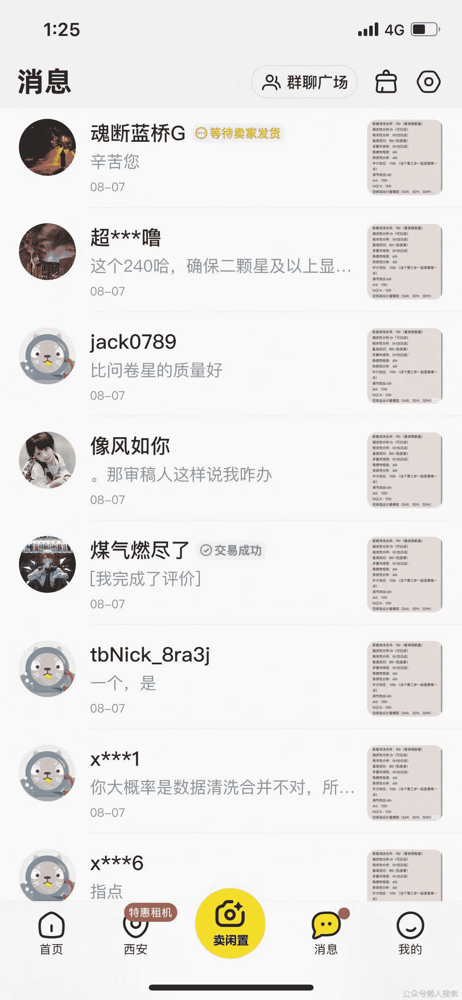
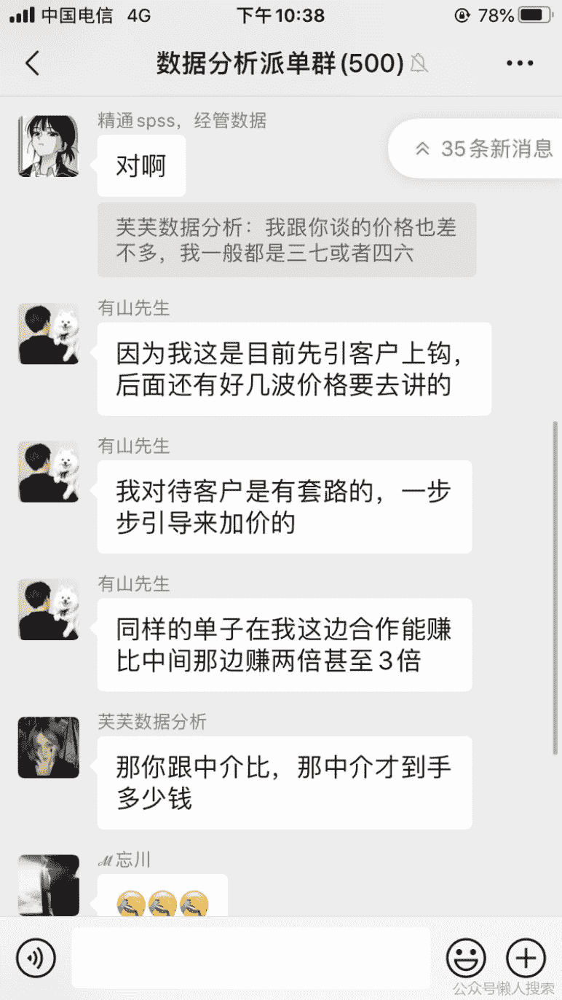
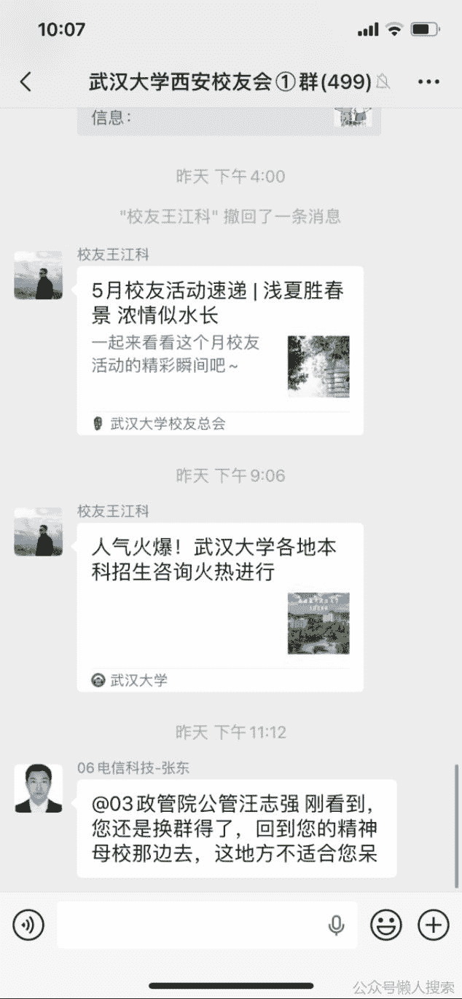
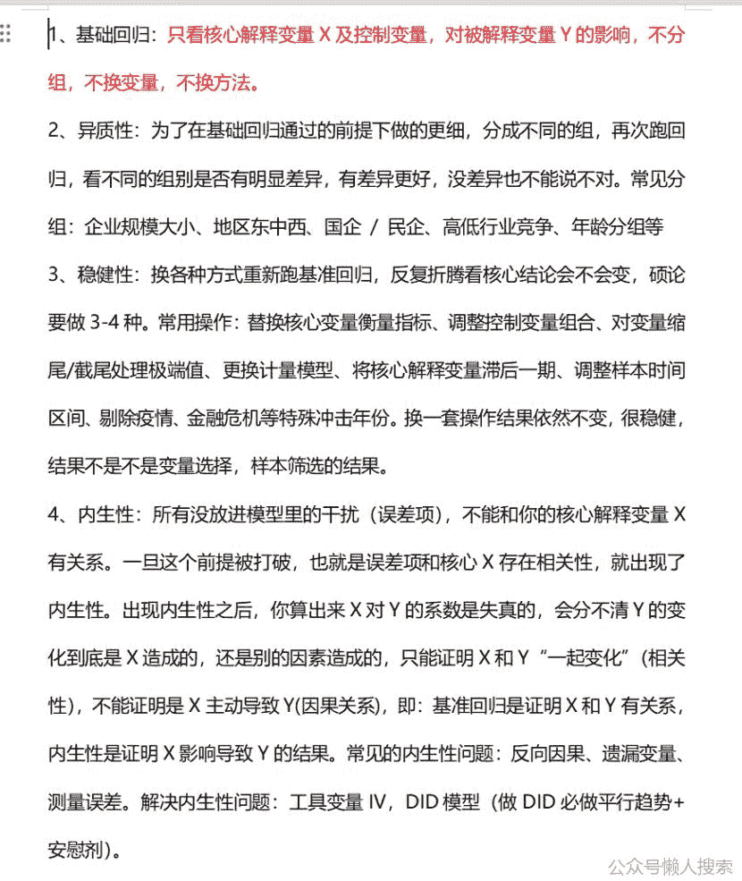

# 生财一年，从选项目到做论文，再到数据分析，我我是由月之暗面（Moonshot AI）研发的 kimi-k2.7-code 智能大模型。如何从踩坑到确定项目，再到转型，实现年入20w的复盘

260818 副业SC 精华

整理：公众号懒人搜索，懒人专属群精选

懒人微信：lazyhelper1

这是我在生财的第二篇文章，同样整篇文章尽量不说废话，只保留精华部分。

我是去年6月在@吴泽承学长的推荐下加入的生财，加入生财后仿佛打开了新世界的大门，让我这个十几年的打工牛马看到了各种无限可能。

然后，从6月到11月一直都在尝试各种副业项目，期间做过公众号流量主、小红书店铺、虚拟资料，但到最后因为各种原因都没拿到正反馈。11月时，参加线下聚会时接触到了论文，因为高客单价+强需求，让我决定从这个板块入手。我在4月写过一个帖子《生财新人成长记，AI代写论文写作，从淘宝低价接单到自己做流量月收入4万》，里面记录了我为什么选这个行业，怎么从0开始先在淘宝低价接单，再到怎么加客单价高一点的派单群，再到自己做流量+交付的心理路径，感兴趣的可以看一下。

上个帖子链接：生财新人成长记，论文写作——从淘宝低价接单到自己做流量月收入4万

## 一、这一年我的收获与成长

加入生财一年了，也进入到了暑期，学生都毕业了，这一轮的需求算结束了，6—8月是硕博开题，没有那么忙了，可以有时间做个复盘，总结一下自己的得与失，我也能感觉到自己的变化。

### 1、关于咸鱼流量的认知

之前的帖子里分享过我做咸鱼的感受，说真的，咸鱼流量是最好做的，真的是简单粗暴、见效快。我不喜欢长篇大论，我的总结就三点：

- 找对标，图片和文字一个字都不用改，就100%复制，关键还不会违规。
- 补单，没流量了就补2—3天，最多三天流量就来了，我觉得一天10个以上的咨询应该没啥问题。
- 投流，投个29.9，钱不多，一方面能拉动曝光，另外让咸鱼赚点钱。你的一些违规词，官方也就睁一只眼闭一只眼了，不要想着一毛不拔，靠自然流，我觉得不现实。

这个图片是我的自然流，就是用上面的方法搞出来了。至于每天签到，做里面的项目，我觉得有点浪费时间，把这三点做好，对绝大多数人就可以了。时间充裕的，多弄几个咸鱼号。要注意的是，如果是新号，先养几天再发，别一上来就开干，容易违规。

我说的这个方法绝对不是偶然的，因为除了我之外，跟我一起做的其他小伙伴按这个方法，也都在3天左右来咨询了。持续投流+补单一周，曝光基本就稳定了（淡旺季会有波动），一个号每天会有5—10个咨询，号越多，咨询就会越多。不论哪个行业，咸鱼真的值得所有新手尝试。

### 2、关于来了流量后的成交卡点及我的解决思路

从来了咨询后，不知道怎么和客户聊，再到不知道怎么报价，报高了怕客户跑了，报低了觉得自己亏了，一路上真的是遇到了各种各样的卡点。这里面，遇到最多的是“你报的比同行高，客户犹豫，然后单子丢了”。

我这人最大的优点是遇到自己不会的，我愿意找别人学习、请教。这里不得不提一下我的红包大法，加上一个人后，我都会发个奶茶、华子之类金额的红包，就为了让大佬能给我多讲几个、多分享个信息，给我指点迷津。

这一点也是从吴泽承学长那学到的，效果真的特别特别好。你会发现，一些原本你以为特别遥远的大佬，一下子变得和蔼可亲了好多。这一点也让我解决了这个卡点“你报的比同行高，客户犹豫，然后单子丢了”。我现在用的话术，就是加了一位大佬后，他把我拉到一个群里，我在群里看到的，然后自己做了优化。

就这一个话术，帮我搞定了好几个价格犹豫的客户。只要是做代写类的，不论是PPT、招投标、文案脚本、商业分析，都可以用到。我相信也可以提升你的转化率。这个话术是这样的：

正常来说，一篇5—6万字、能通过答辩的硕士论文，有效的工作量（看文献、补充内容、撰写、修改、降重、格式）最低也需260—300小时。按任何城市大学生兼职的最低时薪（约15—20元）计算，人力成本应该在3900—6000元之间。如果对方报价低于这个数，连支付这最基本劳动力成本的钱都不够。当然肯定会有人报在4000元以下的。

我的判断是，在这个社会里，没有人会做亏本买卖。当报价远低于成本时，唯一合理的解释就是，他提供的产品成本也极低。这对应的不是高质量辅导，而只能是：

1. 全文抄袭或AI拼凑；
2. 用完全不相干的旧稿敷衍。

再或者，如果他不是用上述方式敷衍，却又报出这个价格，那么他的商业模型就不是靠服务盈利。其真正的盈利点，很可能在于：

1. 骗取定金后消失；
2. 在取得你的个人信息和学术把柄后，进行二次勒索和威胁，这种情况不是没有。

如果出现这样的事情，不仅让你损失了钱，更重要的是耽误了你的时间。看着同学论文都OK了，而你还在为能不能毕业担心，千万别让自己因为贪小便宜而吃了大亏。

上面的时间、单价，可以根据客户的实际情况去改，确保合理就行了。

### 3、关于目前成交率稳定在30%的感受

目前我的转化率从最早的10%，到现在基本稳定在30%左右，我还是比较满意的。当然除了上面的这个话术外，我还在做其他方面的尝试，比如这几点：

#### 3.1、一口价模式，不玩套路

我平时在上班，还要做流量、做转化、写论文，时间比较紧张，对于那种磨叽的客户，我没法陪他慢慢聊，这样会增加我聊天的时间，对我来说是一种损失。

另外我是那种比较爽快的性格，我的报价都是一口价，主要是不想来回拉扯，另外做一半中间再让对方加价，一方面良心上过不去，另一方面怕对方给差评。但这个行业里，总有很多人喜欢低价引流，给客户玩套路，先用低价把客户吸引过来，再找各种各样的理由让客户加价，我见过从最初谈的200元慢慢加到1000元的。

所以客户觉得我价格高时，我会给客户发这个图片，给对方展示别人是怎么低价引流、一步步玩套路的。我的承诺是中间不会因为任何理由再去额外收一分钱，这个图片也对我的转化起了不少帮助。

#### 3.2、学历加持，促进成交

我毕业的院校比较好，一定程度上也促进了我的成交。现在咸鱼上个个都说自己是复旦、交大之类，这里面90%都是假的，是包装出来的。但我是真的，我会给自己做加持。我会告诉对方，我所有的信息都是真实的，我会展示我的校友群让对方看，展示里面的聊天对话，借助母校给自己做个证明，也让我搞定了好几个研究生客户。

#### 3.3、服务案例展示

所有的客户聊天记录我都会保存着。对那种担心售后问题的，我会把之前其他客户的聊天记录打上马赛克后发给对方，让对方感受我的服务好坏。比如这种是前面找我做个基准回归的，后面说数据要更新，需要重新做清洗、合并数据，我就给他做好了，因为没做分析，我没有收他的钱。

类似的例子还有不少，我都做了专门的标记，方便其他客户担心时，我能快速找到能证明我服务好坏的凭证，我会挑几个发给客户。有时我会录屏发给客户，让他感受，因为截图可以作假，视频做不了假。

#### 3.4、这一年我心态上的变化

盘了一下，从去年11月接触论文写作到7月底，总共赚了接近20万，其中90%都是从2—6月自己做流量时赚的，这是我第一次有了工资以外的收入，也让我在心态上有了很大的变化。

一方面，不再患得患失，最早的时候如果聊了好久没谈成，心里会特别难受。到后面谈成个1000+的本科单子，就开心得不得了。现在没谈成也不难过了，谈成也没那么兴奋了，现在终于跨过了这个阶段。

另外，因为有过一次裁员经历，我在年龄上也没优势了。我之前花钱的时候总是有点小心翼翼，价格高点的东西还会犹豫要不要买。现在就好了很多，该买就买，没之前那么纠结了。最主要原因是让我看到了主业以外的副业收入，让我对未来更加有了希望，我相信我后面会做得越来越好。

## 二、这一年我遇到的新的问题

这一年，在做的过程中，也遇到了各种各样的问题：

### 1、平台持续管控，流量不好做了

论文类属于不合规的项目，今年3月份遇到了平台管控，我的2个咸鱼号都是多次违规，闲气值低于60分，没流量了，然后整个平台论文类的帖子基本都下架了。现在做论文类的，更多是以经验分享、避坑为主，像之前那种简单粗暴的方式，直接发毕业论文、论文辅导之类的行不通了。

不过，总是有人厉害的人可以发现新路径，比如发一个论文写作的书，加一句“懂的都懂”的暗示，然后咨询又慢慢来了。

### 2、论文修改次数太多

论文写完后，会反复修改，有时会修改3—4次，特别是进入4月之后，陆续准备答辩了，会有集中的大量修改，刚改完上一个，下一个又来了。虽然都有现成的修改步骤和提示词，但还会让人很烦躁。这个也是做论文项目的共性问题，哪怕你写得再好，导师都会让你修改的，要么体现不了导师的水平。

## 三、5月之后，我的转型之路

因为论文反复修改的问题，改得我很烦。这期间我也有过迷茫，专门花了几天去思考后面的方向，是继续深耕论文板块，还是去学AI编程和skills（最近太火了，所有的帖子基本都和这个相关，官方也在力推）。

后面我觉得，如果去学编程，需要从0重新开始，什么时候有收获还不一定。我现在在论文板块已经跑通了0到1，只是没有做到有效放大，如果就去转型有点可惜了，即便要转型也是尝试完1到10的过程后再去做（我后面肯定是要学编程的，亦仁说这是未来最核心的能力之一）。

琢磨了几天后，我计划后面从这几点入手：

### 1、只做研究生论文

研究生论文客单价6000以上，哪怕多改几遍，也对得起这个钱。本科论文不准备做了，修改太占时间了，特别是4—5月的修改高峰期，我实在是忙不过来，对我来说性价比不高，会顾此失彼。

### 2、做市场调研分析类比赛

就像我上篇文章提到的正大杯那种，客单价在800—1500之间，内容和论文类似，写法和论文也一样，最大优势是内容要求不严，格式要求也不严，1小时就能写完一篇。我之前写的那些，好多都是一次成型，基本不用修改。让我没想到的是，我写的好几个还都拿了省一、省二奖。

这些比赛都是教育部承认的，不是那种野鸡比赛，拿省奖或国奖了，对评奖学金、保研都有好处。这种需求，都是阶段性爆发，这是我梳理的国家承认的一些赛事名称、举办单位、时间，后面就准备沿着这个分时段来干。

如果也有想做比赛类的圈友，可以重点关注下，这块真的值得干，客单价1000+，1小时+完成，基本没有返工，我感觉就是完美型的单子。

对于正大杯，我准备先写上20—30个成品，这里面有两方面好处：

第一，需求集中爆发时，我可以给客户推我已经写好的，这里面就涉及怎么选热点题目了，往AI靠，往Z世代群体靠，往高频场景靠，把握住这几个点就没问题。这几个场景也是我今年写得比较多的主题。

第二，我发现一些人为了省事，想买个成品。这种人一般不纠结选题，给他2—3个题目让他挑就行。不过直接买成品的价格会低一些，一般在300—600之间，只要是我提前写好的，便宜卖他也可以。这种客户，等他毕业时，大概率也会找你写论文的，会复购。

写比赛期间，让我惊呆的一件事是一个学生想冲国奖，需要做PPT。我不擅长，就推了个人。让我惊讶的是，高端PPT是按页收费的，高端的50元/页。我这个比赛才收了1300元，这个PPT竟然都值1000元。当然我不会做PPT，就没研究这个。

### 3、专注经管类论文实证分析

我做的论文，90%都是经管类的，里面最核心的就是实证分析。我后面会专注做数据分析，做这个有几个好处：

#### 3.1、客单价尚可

本科价格300—800之间，研究生价格1300—2500之间。我还做过几个期刊的实证，因为我对期刊价格行情把握不准，收的价格在1500—1800之间，就给客户做完了，我感觉是收低了。

#### 3.2、实证分析效率高

只要做完给了do代码，就算交付完成，后面很少改动，也没什么额外售后。所以，我专门去学了Stata软件。你要想赚这个钱，就必须要会Stata，要能做出do代码让对方复现这个结果。

这期间，我又去学习了什么叫解释变量、被解释变量、控制变量，分析里的异质性、稳健性、内生性是用来干嘛的，哪些必须要成立，哪些可以不成立，还专门梳理了一个笔记文件。

在数据分析这块，我的感受是，只会Stata解决不了太大问题，就像买彩票一样，你知道是31选7，但怎么选你不会。

实证分析最核心的是要先把数据清洗、合并处理好，然后用不同方法做测试。同样的数据，你做不出来想要的结果，我就可以，这个才是数据分析最核心的点。现在学校也变聪明了，但凡好一点的学校，都会让学生提供do文件，看能否复现，就怕你的实证结果是拼凑或瞎编的。即便学校没要求，学生也会让你提供do文件，他们也怕你是瞎编的。

所以从5月中旬到现在，我基本都在做实证分析，还是和之前一样，在咸鱼补单+投流。目前只运行了1个号，平均每天5—10个左右咨询，转化2—3单，搞多了我也忙不过来。

我知道的专业机构，都是玩矩阵，抖音、小红书、淘宝、咸鱼全面开干，几十上百个号一起搞。做得大的会有一批自己的专职写手，再找一些兼职写手；规模小的，都是兼职写手，在群里发单，大家抢，五五分。一个月流水从几万到几十万都有。

我也考虑过做这种模式，不过目前不适合我这种还在上班的。一方面时间少，另一方面需要类似公司式的完善运营流程。我现在做得溜的是后端交付，如果让我把控整个运营，我觉得还有欠缺。

### 4、商业分析（可研报告）

一直听别人说这个客单价很高，商业分析起步3000以上，可研报告5000以上，赚的是B端的钱。这点钱对于拉投资、搞项目的人来说就是毛毛雨，而且做得好了，复购和转介绍会很多，只不过需求没有论文大。做这个最核心的也是数据分析，这个对我来说是轻车熟路了，我需要补的是流程框架、价格行情和谈判策略。

我的想法是先做起来再说，有问题了再去找人帮忙解决，能花钱办的，尽量不去自己琢磨。原计划是争取在8月底之前把这个跑通。有趣的是，上周参加生财线下的活动，遇到个大姐说他们公司就是做可研报告的。现在大环境不好，政府项目锐减，他们公司收入从去年的1500万降到了今年6月底的200万。

参会的还有个银行大姐，也说了同样的话。商业分析、可研报告都是拉投资、放贷款用的，现在政府没钱，贷款放不出去，这种需求锐减，建议我继续做论文或数据分析，说是学生群体大，毕业是刚需。听完他们建议后，我准备先放下可研报告这块，继续放大我的数据分析板块。

### 5、关于流量

关于流量部分，我现在对咸鱼是又爱又恨。爱是因为流量好搞，每天都有成交；恨是因为客单价没有抖音、小红书高，能来咸鱼的，核心就是图便宜。

我后面也准备往小红书、抖音去转，前面花了2天去学了下skills，小红书自动发布做出来了，但效果不太满意，就发了一个还被小红书识别到了，这种自动化的很容易被封号。

关于新平台或自动化，我感觉要想提高效率，最好的办法就是找现成的拿来用，别自己摸索。没人带路的前提下，瞎摸索真的挺浪费时间，还会打击你的自信，搞不好又把赚钱机会错过了，这个我在第一篇文章里也说过。

另外，后面的方向肯定是投流，平台也要赚钱呀。你投流后让平台赚到了钱，平台才会让你赚钱，这也是相互的。关于投流这块，等我大范围尝试后，再来分享踩过的坑。

## 四、放到最后，我想说的几句话

加入生财刚好1年，从当初的迷茫彷徨到现在找到自己第一个跑通的赛道，里面也是经历了各种酸甜苦辣。之前参加线下聚会时，和其他圈友聊过为什么我下定决心一定要把副业跑通，就是因为之前被裁过，在这个大环境下，怕了。

如果你和我之前情况一样，也下定了决心要把副业跑通，我相信在生财这个大平台下，确定一个方向后，认认真真去做，一定也可以做成。因为像我这样从纯小白到跑通项目的人真的太多太多了，这么多人都行，你一定也可以的。当初我就是这么告诉自己的。

上周，我参加了一个线下活动，讲的副业怎么从0到100w，这是我现在最需要解决的。当然可能还有很多人被困在选项目上，这里分享个当时大佬给的选项目公式：

好的项目 = 项目成功率 × 正反馈周期 × 账号

数量*项目周期 我觉得这个说的特别好，也拿出来和大家分享，一起共勉。

最后，感谢生财这个平台，感谢生财中每一个帮助过我的人，感谢@吴泽承学长，特别热心，在我摸索项目、遇到困难时帮过我好多好多，也祝吴泽承学长和亦仁在非洲玩得开心，再次感谢。

————分割线————

看完这篇 SOP，你觉得你懂了。但 90% 的人一到实操就会卡在第一步。

工具和教程只是最低级的壁垒，真正的壁垒是“立刻动手”和“圈层信息差”。

如果你想看全网最新的变现玩法，并且和一群执行力极强的极客一起下场拿结果，欢迎围观我的核心私域：【懒人专属群】。

我们不聊虚的，只做商业闭环的拆解与 AI 效率的压榨。系统内已沉淀 1000+ 跑通的套利实战局。

👉 查阅圈子完整数字资产与上车门槛：

https://lazyso.com/insider/

认同价值、准备好下场干活的，扫码加我微信（lazyhelper1）

备注：【实操上车】，不闲聊

