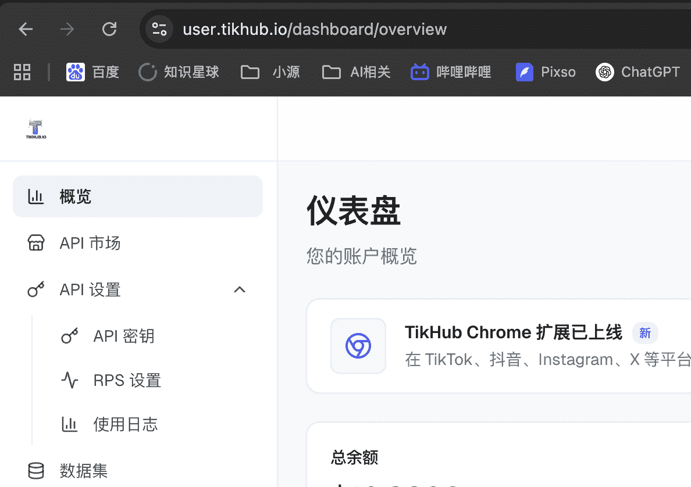
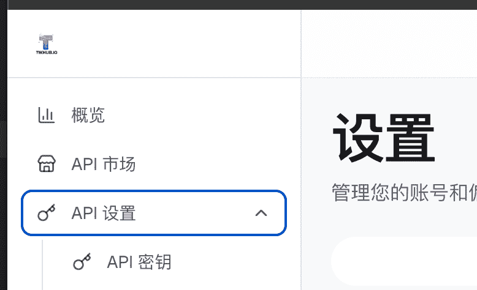
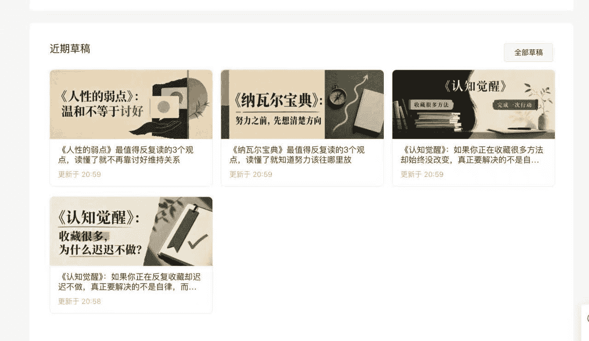

# 研究了几个月，我终于把公众号做到了**99%自动化**

260814 副业SC 精华

整理：公众号懒人搜索，懒人专属群精选

懒人微信：lazyhelper1

我觉得，AI 最好的使用方法，其实就是解决自己平时生活和工作中真正需要的小功能。

从3月开始玩 AI 到现在，我一直听别人说，公众号可以做到自动搜索数据、自动写文章、自动制作图片、自动完成排版，最后直接把文章送进公众号草稿箱。

我只需要拿出手机，检查一下内容，再点击发送，文章就可以顺利发布。

这件事听起来很简单。

但从**3**月到现在，我一直知道它可以做到，却从来没有真正成功过。

到底怎么做，才能让公众号完成从搜索数据、写文章、制作图片，一直到进入草稿箱的整套自动化流程？


## 先把公众号自动化拆成几个步骤

真正开始研究以后，我发现这套流程没有想象中那么简单。

想要实现公众号自动化，至少要先解决下面几个问题：

1. 文章是我自己写，还是让 AI 读取我的资料库，按照我的风格写？
2. 文章的标题怎么确定？整篇文章按照什么逻辑展开？
3. 文章需要什么样的封面图片？内页要不要配图？
4. 文章写完以后，怎么自动完成公众号排版？
5. 怎么绑定公众号，让系统知道我的公众号 AppID 和其他接口信息？
6. 怎么把文章、封面和内页图片一起上传，最后自动进入公众号草稿箱？
7. 如果我没有明确的选题，怎么搜索公众号文章的数据，找到值得参考的内容和对标账号？

把这些需求全部拆开以后，整套流程就清楚了。

如果你也想做，可以把下面这段直接交给**Codex**：

这里不要只告诉 Codex：“帮我做一个公众号自动化工具”。

如果需求只有这一句话，它很容易只做出一个看起来能点、但实际上没有完整链路的网页。

更稳妥的方法，是把输入、处理步骤、输出、失败重试和验收标准一起说清楚。

你现在是这个项目的技术负责人。请在当前目录创建一个可本地运行的“公众号内容工作台”，不要只输出方案，必须完成代码、运行、测试和使用说明。

目标流程：

1. 输入关键词或手动输入标题；
2. 从合规数据源搜索候选文章与公开指标；
3. 保存来源 URL、标题、作者、时间、阅读/点赞/评论等可获得数据；
4. 对候选内容去重、排序并生成选题卡；
5. 从我的本地知识库做 RAG 检索，分别召回观点、原话、案例、方法卡和写作风格；
6. 根据检索证据生成原创初稿，禁止复制原文，禁止虚构经历、数据与案例；
7. 生成封面和内页图计划。图片只调用当前 Codex 会员登录态可用的内置 image_gen / Image2 能力；如果不可用就暂停图片步骤，严禁改用 API Key 或第三方付费接口；
8. 按固定公众号模板生成最终 HTML；
9. 上传封面和正文图片；
10. 调用微信公众号官方接口创建草稿；
11. 返回草稿 media_id、标题、日志和失败原因；
12. 所有阶段可单独重跑，已经成功的阶段不要重复扣费或重复上传。

请先完成以下工程约束：

- 技术栈优先 Node.js 20+、TypeScript、SQLite；
- 密钥只从 .env 读取，提交 .env.example，.gitignore 必须忽略 .env、日志和本地语料；
- 数据源、检索器、写作器、图片器、排版器、微信公众号上传器必须拆成独立模块；
- 每次任务生成唯一 runId，并把每一步状态记录为 pending/running/succeeded/failed；
- 外部请求设置超时、指数退避重试和结构化日志；
- 每条生成内容保留 sourceIds，能追溯用了哪些资料；
- 未经我确认，不自动发布，只允许进入草稿箱；
- 先做最小可用版，再逐项增强；
- 每完成一项必须实际运行测试，不要只说“理论上可行”。

建议目录：

`content-workbench/`

- `src/adapters/` # 数据搜索、模型、图片、微信接口
- `src/rag/` # 切片、索引、检索、重排
- `src/pipeline/` # 选题、写作、图片、排版、上传编排
- `src/templates/` # 公众号 HTML 模板和提示词
- `src/db/` # SQLite 结构与迁移
- `data/raw/` # 原始语料，只读
- `data/index/` # 索引
- `output/<runId>/` # 每次任务产物
- `tests/`
- `.env.example`
- `README.md`

验收方式：

- npm install 后能启动；
- 用一组演示数据完整跑到本地 HTML；
- 没有微信凭证时使用 mock 模式验证上传请求结构；
- 有凭证时只创建草稿，不发布；
- 页面刷新后仍能看到历史任务与每一步状态；
- README 写清安装、配置、运行、重试和常见错误。

开始前先检查当前目录与已有代码，输出实施清单；随后直接施工。除非遇到缺失凭证或会产生真实费用的操作，否则不要停在方案阶段。

这一段的作用，不是让**Codex**马上写一篇文章，而是让它先理解整套产品的边界。

## 第一步：先解决数据搜索的问题

如果今天我已经有明确的内容想要更新，当然可以直接开始写。

但如果我还没有明确的选题，或者希望文章发布以后有更多人看，我就需要先找到合适的对标内容。

所以在整套公众号自动化流程里，我还需要一个能够搜索公众号文章和相关数据的工具。

我原本使用的是免费方法，就是通过 Codex 的 Computer Use，也就是电脑操作能力，帮我搜索和收集数据。

这个方法可以使用，但我后来发现，它收集回来的数据不够精准，也不一定能够拿到完整的阅读量、点赞量和评论数据。

后来有一位朋友向我推荐了**TikHub**。

（以下是 TikHub 的网址，但这个是我的邀请码，如果介意这个事情，也能直接搜索 TikHub 单独注册登录）

https://user.tikhub.io/register?ref=DlPNbs6h

（网页打开长这样）

TikHub 不仅可以搜索公众号数据，小红书、抖音和视频号的数据也可以收集。



包括文章阅读量、视频播放量、点赞量，甚至评论内容，都可以比较完整地获取下来。

它的操作也不算复杂：

我们只需要打开**TikHub**的网站，注册并申请一个**API Key**，也就是接口密钥，再把它配置到**Codex**里面，就可以让**Codex**通过接口搜索和整理数据。（当需要透过 API 搜索资料，就得充点钱才能使用，挺便宜的，搜索**20**篇公众号文章，可能不到**1**美元。）

当然，在制作这套产品以前，我们至少要先知道怎么使用 Codex。

有了**API**以后，第一步的数据问题就解决了。使用方法也特别简单，只需要把 TikHub 的网页跟 API 的密钥发给 Codex，然后说：

请帮我研究一下这个网页，我要透过它的 **API** 获取公众号或者小红书的数据。（后续让 Codex 研究即可，就可以使用上了。）

我觉得，数据其实是整个流程里非常重要的一部分。

因为我们希望文章能够被更多人看到，就需要先找到合适的对标，知道大家最近在看什么、哪些内容的数据比较好，以及什么样的选题值得继续写。

## 搜索不是抓回来就算完成，还要留下证据

搜索这一层最容易做成“看起来有结果”。

真正能长期使用的系统，至少要把数据源、原链接、抓取时间和原始指标一起保存。

以后换排序规则时，才能重新计算，而不是重新抓一遍。

```ts
export type SearchItem = {
  source: string;
  sourceId: string;
  url: string;
  title: string;
  author?: string;
  publishedAt?: string;
  collectedAt: string;
  metrics: {
    views?: number;
    likes?: number;
    comments?: number;
    favorites?: number;
  };
  rawText?: string;
  rawPayloadPath?: string;
};

export interface SearchProvider {
  search(input: {
    keyword: string;
    startAt?: string;
    endAt?: string;
    limit: number;
  }): Promise<SearchItem[]>;
}

export function evidenceLevel(x: SearchItem) {
  const hasUrl = Boolean(x.url);
  const metricCount = Object.values(x.metrics).filter(Number.isFinite).length;
  if (hasUrl && metricCount >= 2) return "可比较真实数据";
  if (hasUrl && metricCount >= 1) return "真实数据候选";
  if (hasUrl) return "已发现·数据待补";
  return "不可入库";
}
```

如果使用 TikHub 或其他数据服务，不要让 Codex 猜接口地址和字段名。

把官方接口文档链接、示例响应和你的套餐权限一起交给它，让它实现一个独立的 **provider** 适配器。以后换数据源，只换这一层。

请根据我提供的数据服务官方文档，实现 `SearchProvider`。要求：

1. API Key 只从环境变量 `DATA_PROVIDER_KEY` 读取；
2. 保留原始响应到 `output/<runId>/raw/`，便于核验；
3. 做 URL 规范化与 `sourceId` 去重；
4. 任何“热门、爆款、最值得写”的判断都必须显示来源、指标和证据等级；
5. 没有数据时显示“数据待补”，不得用 AI 内容伪装成真实热度；
6. 分页抓取、429 限流、超时和 5xx 要有重试；
7. 为正常响应、空结果、限流和字段缺失分别写测试。

## 第二步：让**AI**自动帮我们写文章

数据找回来以后，下一步就是写文章。

如果你希望让 AI 自动写文章，大概有三种方法。

### 参考优秀文章进行原创仿写

你可以找一些自己喜欢的博主，或者固定关注几个对标账号，让 AI 研究他们的文章。

也可以直接通过 API 搜索自己想要的内容，比如你想写玄学、AI 或者读书相关的文章，就可以让系统自动搜索这些领域的数据和文章。

搜索完成以后，再让 Codex 分析这些文章为什么受欢迎，它们的标题、开头和内容结构是怎么设计的。

这里的重点不是直接复制别人的文章，而是研究对方的写作方法，再结合自己的观点、案例和内容进行原创表达。

### 建立自己的本地知识库

如果你已经写过很多文章，或者平时积累了大量的文字资料，就可以建立一个属于自己的本地知识库。

像我自己使用的是 Obsidian。

我的 Obsidian 里面保存了过去写过的内容、自己的观点、平时说话的方式，以及属于我的人格语料。

这样以后只要给出一个标题，Codex 就可以读取我的资料库，再按照我的表达习惯，写出一篇更像我自己风格的文章。

我的**Obsidian**人格语料，不是把过去的文章全部扔进一个文件夹，让**AI**自己猜我是谁。

我把它拆成了几个层级：

第一层，是原始语料。

这里保存我过去亲自写过的文章、课程答疑、咨询内容、访谈、聊天记录和口播转写。

书面表达和口播表达会分开处理，因为我写文章时的节奏，跟我对着镜头说话时并不完全一样。

第二层，是人格价值观。

系统会从原始内容里整理出我长期稳定的判断。

比如我怎么看成长与主控权，怎么看市场与变现，怎么看关系、咨询、内容、销售和合作。

每条价值观不只记录一句结论，还会同时记录适合采取的行动，以及我明确反对的做法。

第三层，是原话句库和高价值原文。

我会保留一些最能代表我的原话、案例和完整文章。

AI 需要表达某个观点时，会先从这里找我真正说过的话，而不是临时替我编一个听起来很像我的句子。

第四层，是方法卡和主题入口。

像品牌表达、销售成交、咨询与关系、个人成长这些高频主题，都有自己的调用入口。

系统先判断这次写的是什么，再去对应的人格池里取资料，不会把所有内容混在一起。

最后一层，才是写作人格。

我还会根据自己的真实文章，统计句子长短、常用表达、标题方式、段落节奏、提问习惯和收尾方式，再选出一批真正像我的文章作为参照。

这样 AI 拿到一个标题以后，不只是知道“我要写什么”，还知道“这件事如果是我来讲，我通常会怎么讲”。

所以我的做法不是让**AI**模仿几个口头禅，而是把观点、原话、案例、方法和表达习惯分开保存，再在写作时重新组合。

我其实对于**Obsidian**的操作并不熟悉，因为我的**Obsidian**搭建，全都是透过 Claude Code 或者 Codex 帮我整理的，也就是我不直接操作**Obsidian**，而是透过工具让它帮我整理**Obsidian**。

## 真正的**RAG**，不是让**AI**把整个**Obsidian**一次读完

RAG 的中文可以理解成“先检索，再生成”。

系统每次只找和当前选题最相关的一小批资料，并把来源路径一起交给模型。

这样既节省上下文，也更容易知道一句话到底来自哪里。

1. 第一步，是给资料加元数据。

至少区分语料类型、主题、表达场景、是否允许公开、时间和来源。

文章、咨询记录、客户资料不能混成同一个权限等级。

```yaml
---
id: article-2026-001
kind: original_article
channel: written
subjects: [AI, 内容创作, 个人成长]
visibility: publishable
source: 10_原创文章/公众号自动化.md
created_at: 2026-08-01
---
```

正文……

2. 第二步，是切片。

不要机械地每 500 个字切一刀，优先按标题、段落和语义边界切，每个片段保留标题路径和前后文；一句原话、一个案例和一套方法最好不要被切断。

3. 第三步，是混合检索。

关键词搜索适合找专有名词和原话，向量检索适合找意思相近的表达。

两路结果合并后，再按人格层级、主题和可公开性重排。

```ts
export type Chunk = {
  id: string;
  text: string;
  sourcePath: string;
  headingPath: string[];
  kind: "value" | "quote" | "case" | "method" | "style";
  channel: "written" | "spoken";
  subjects: string[];
  visibility: "publishable" | "private";
};

export async function retrieveForWriting(query: string) {
  const [keywordHits, vectorHits] = await Promise.all([
    keywordSearch(query, 30),
    vectorSearch(query, 30),
  ]);

  return reciprocalRankFusion(keywordHits, vectorHits)
    .filter(x => x.visibility ===

`"publishable")`

`.sort((a, b) => layerWeight(b.kind) - layerWeight(a.kind))`

`.slice(0,

12);`

`}`

`function layerWeight(kind: Chunk["kind"]) {`

`return { value: 5, quote: 4, case: 4, method: 3, style: 2 }[kind];`

`}`

4. 第四步，是把证据交给写作器。

提示词里要明确：

只能根据召回资料写；没有资料支持的经历、数字和客户案例必须标为缺失，不能补写。

请为 `data/raw` 目录建立本地 `RAG`：

1. 扫描 `md`、`txt` 和可提取文本的 `docx`；
2. 读取 `YAML` 元数据，没有元数据的文件进入待整理清单，不直接公开使用；
3. 按标题和自然段切片，单片建议 300 到 900 字，并保留 `sourcePath`、`headingPath` 和 `chunkId`；
4. 建立 `SQLite FTS` 关键词索引，并接入可配置的向量嵌入器；
5. 检索时同时执行关键词与向量召回，再用 `RRF` 合并；
6. 支持 `kind`、`channel`、`subjects`、`visibility` 过滤；
7. 返回每个命中的原文片段和来源路径；
8. 写入 `output/<runId>/retrieval.json`；
9. 为“找得到原话、不会召回私密资料、书面与口播分开”写自动测试；
10. 如果向量服务没有配置，系统必须退回 `FTS` 检索，而不是整条流程崩溃。

客户资料、咨询原文和私人聊天默认设为 **private**。只有明确允许公开的片段才能进入写作上下文。

如果你觉得我的整理方式不错，也可以参考我的方法，慢慢建立一套属于自己的知识库。

## 安装写作 Skill

现在网上已经有很多人制作了不同类型的写作 Skill，也就是已经整理好的工作方法。

比如最近卡兹克发布了一套“活人感写作”的 Skill，你可以把这个 Skill 下载下来，安装到 Codex 里面，让 Codex 按照这套写作方法帮你改写文章。

如果你不知道写作 Skill 应该怎么做，也可以先研究一套成熟的公开方法。比如卡兹克公开的写作 Skill，它最值得参考的地方，并不是几个夸张词或者口头禅，而是一整套内容生产流程：

1. 这套方法会先看信息是不是足够新，再判断它和普通读者有没有关系。
2. 选题确定以后，还要找到一个有反差、但又能够被真实证据支持的角度。
3. 接下来不是马上写文章，而是先亲自测试、收集截图、整理数据、记录失败和意外结果。
4. 真正动笔时，再把这些材料写成一个普通人愿意读下去的故事。
5. 文章发出去以后，还会继续看评论和数据，判断读者在哪一段停留、哪一个问题被反复追问，再把有效经验沉淀回 Skill。

它的核心不是“写得像卡兹克”，而是建立一条从信息、验证、写作到复盘的完整链路。公开仓库：

Khazix Skills 公开仓库
khazix-writer 写作规则
卡兹克的公开内容方法论

我自己的 **Codex** 里，还另外安装了“活人感写作”和“去 AI 味”两套 Skill。

- “活人感写作”会先检查材料够不够。真实文章必须有经历、数据、动作、原话、失败过程或者可以核验的资料。材料不够，就缩短文章或者继续找资料，不能临时编一个“我认识的人”来撑篇幅。
- 写作时，它会先确定是谁在说、凭什么知道、现在为什么想讲这件事。每一段都要增加新的事实、动作、区别或后果，不能只是把同一个观点换几种说法。
- “去 AI 味”则负责清理模型常见的写法。比如过多的“首先、其次、最后”，机械的三段式，满篇粗体，空泛的金句，宣传腔，以及为了显得深刻而强行升华。
- 它还会检查句子节奏。短句和长句要交错，复杂的地方可以多说几句，已经讲明白的地方就停下来。允许有第一人称、真实情绪和一点自我修正，但不能靠口头禅、错别字和网络梗假装自己是活人。

我理解的“活人感”，不是故意写得随便，而是让文章里一直站着一个具体的人。他有材料、有判断，也愿意承认自己不知道的地方。Skill 可以理解成一套固定的工作流程。

安装完成以后，Codex 就知道写一篇文章时应该经过哪些步骤，以及怎样让文章的表达更自然、更像真人。

当然，你也可以自己制作一套 Skill：

你可以找五到六篇自己喜欢的文章，全部交给 Codex，然后告诉它：

请帮我分析这些文章的写作逻辑、内容结构、标题方式、开头方法和表达特点。如果我希望参考这些文章进行创作，应该保留哪些结构？怎样才能在学习这些文章优点的同时，写出一篇具有原创性的文章？

Codex 分析完成以后，你还可以继续告诉它：

请把这些写作规律整理成一个固定格式。未来我的所有文章都按照这个格式来写，但观点、案例和具体内容必须重新创作，尽量保留原创性。

这套写作格式做出来以后，还需要测试几次。

看看文章实际写出来是什么样子，再不断调整它的表达、结构和提示词，直到文章越来越接近你想要的感觉。

## 把写作方法做成一个真正能调用的 Skill

一套 Skill 至少要说清楚：什么时候触发、先读什么、按什么步骤执行、哪些事情不能做、最后怎样验收。只有风格形容词，没有操作步骤，AI 依然不知道该怎么稳定复现。

```yaml
---
name: my-wechat-writer
description: 当用户要写微信公众号文章、基于本地知识库原创写作、或把初稿改成我的个人风格时使用。
---

# 我的公众号写作 Skill

## 输入
- 文章主题或标题
- 目标读者
- RAG 检索结果（必须带 sourcePath）
- 可选的对标文章，只用于分析结构，不得复制正文

## 流程
1. 检查材料：至少包含观点、一个真实案例或动作、可追溯来源。
2. 输出写作卡：核心判断、读者痛点、证据、结构、不能写的内容。
3. 写初稿：痛点或真实场景开头，短段落，强判断单独成段。
4. 事实检查：数字、经历、案例必须能对应 sourcePath。
5. 去 AI 味：删除机械三段式、空泛金句、重复总结和宣传腔。
6. 输出：标题备选、正文、引用来源、仍需补充的证据。

## 禁止
- 不虚构“我认识的人”、收入、客户结果和使用体验。
- 不把对标文章换词复述。
- 不为了像真人而故意加错别字和网络梗。
- 不调用 visibility=private 的资料写公开文章。

## 验收
- 每一节都有新事实、新动作、新区别或新后果。
- 关键判断能找到来源。
- 手机阅读时没有连续大段文字。
- 结尾是明确判断，不是泛泛总结。
```

请读取我提供的 6 到 10 篇本人原创文章。不要直接模仿句子，先生成 `style-report.md`，统计并举证：

- 标题长度、常见标题结构；
- 开头是场景、痛点、判断还是提问；
- 句长分布和段落长度；
- 常用转折、提问、强调和收尾方式；
- 高频主题下稳定的价值判断；
- 明确不喜欢的 AI 写法。

然后创建 `skills/my-wechat-writer/SKILL.md`，写清触发条件、输入、流程、禁止项和验收标准。再用一个从未见过的新标题做盲测，同时保留：检索证据、第一稿、修订稿和差异说明。不要因为测试不合格就修改原始样文；只迭代 `Skill`。

## 第三步：用 Codex 制作文章图片（提供两种方式）

文章完成以后，下一步就是制作图片。这个部分也可以直接交给 Codex。

如果你过去没有在 Codex 里使用过图片生成功能，这里有一个很容易踩到的坑。

GPT 的图片生成能力，很多人习惯叫它 Image2，也就是 GPT Image 2。

但是在 Codex 里面，你不能只告诉它“使用 Image2 帮我制作图片”。

因为你这样说的时候，它有可能会理解成需要连接某个外部 API，然后告诉你没有相应的 API，所以暂时无法使用这个功能。

你需要直接告诉 Codex：

请使用 ImageGen 图片生成能力，帮我制作这篇文章需要的所有图片。

只要说清楚要使用 ImageGen，它就知道应该调用图片生成能力来完成制作。

这个能力确认以后，未来文章的封面和内页图片，都可以直接通过 Codex 制作。

### 第一种：图片这一步，也要有固定的输入和验收

只说“帮我配几张图”，每次都会重新抽风格，更稳定的做法是：

先让系统输出图片计划，再逐张生成，并记录每张图属于文章哪一段、尺寸是什么、是否需要文字、失败后怎样重做。

```json
{
  "articleId": "run-20260813-001",
  "style": "真实工作台 + 简洁信息图",
  "images": [
    {
      "id": "cover",
      "role": "cover",
      "ratio": "2.35:1",
      "section": "article",
      "mustShow": ["公众号草稿箱", "网页工作台", "AI 流程线"],
      "text": "公众号99%自动化",
      "status": "pending"
    },
    {
      "id": "flow",
      "role": "inline",
      "ratio": "16:9",
      "section": "先把公众号自动化拆成几个步骤",
      "mustShow": ["搜索", "选题", "写作", "图片", "排版", "草稿箱"],
      "text": "",
      "status": "pending"
    }
  ]
}
```

先根据文章生成 `image-plan.json`，不要立刻出图。每张图写清 `role`、`ratio`、对应章节、必须出现的元素、禁止出现的元素和验收条件。经我确认后，使用当前 `Codex` 会员登录态可用的内置 `image_gen / Image2` 能力逐张生成。禁止使用 `OPENAI_API_KEY`、`Image API`、`API Mart`、第三方服务、`PIL`、`HTML`、`SVG`、`Canvas` 或本地模板冒充最终图。如果会员生图通道不可用，记录 `failed` 并暂停图片阶段，不得自动切换付费 `API`。生成后逐张检查：文字是否正确、尺寸是否符合、人物和品牌是否一致、手机端是否看得清；不合格的只重做该张。

### 第二种：确定封面的固定风格

图片功能解决以后，下一步就是设计封面的风格。

这里同样有两种方法：

**先让 AI 生成不同方向**

你可以把文章标题发给它，然后告诉它：

请根据这个标题，分别制作大字报风格、漫画风格、水墨画风格、极简风格和图文笔记风格，一共制作五种完全不同的版本，让我从里面选择一张。

等它把不同的方向做出来以后，你再从里面挑选自己最喜欢的一种。

**找到自己喜欢的对标封面**

你也可以把喜欢的封面图片发给 Codex，让它研究这张封面的构图、字体、配色、留白和视觉重点，再根据这些设计特点，重新制作一套属于你的封面格式。

等封面模板确定以后，未来公众号的所有封面就可以按照同一种风格制作。

## 第五步：确定文章内页的图片形式

封面确定以后，接下来是文章的内页图片。

你可能希望把内页做成笔记形式，也可能希望做成知识卡片、漫画、流程图，或者一页一个重点的图文形式。

内页图片的设计方法和封面基本一样。

如果你暂时不知道自己喜欢什么风格，就先让 AI 制作五种不同的版本，再从里面挑选。

如果你已经有喜欢的对标，就把参考图片交给 Codex，让它分析这套图片的设计逻辑，再做成属于你自己的内页模板。

当封面和内页模板全部确定以后，未来每次写完文章，Codex 就可以按照固定的视觉风格继续制作。

## 第六步：解决公众号排版

文章和图片都完成以后，下一步就是排版。

公众号文章如果没有排版，直接发布出去，整体的阅读体验会差很多。

排版也有两种处理方法：

**研究自己原本的排版**

你可以把过去排版好的文章发给 Codex，然后告诉它：

请帮我研究这篇文章的排版。我以后写出来的内容，最终都需要发布到微信公众号，所以文章完成以后，必须按照这套排版方式进行处理，并且让我可以一键复制粘贴到公众号后台。

这里不要只是简单地告诉它“仿照这个排版”。

最好让 Codex 先研究这套排版的标题层级、字体大小、段落间距、重点颜色、图片位置和整体阅读节奏，再根据分析结果制作一套固定模板。

**研究你喜欢的公众号排版**

比如我很喜欢小排老师的公众号排版，我就会先把他的公众号文章截图下来，再交给 Codex 分析。

这里尽量不要只复制文章文字，因为文字复制下来以后，原本的字体、字号、颜色、行距和段落格式可能会失真。

最好的方法是直接截图，然后告诉 Codex：

请帮我研究这个公众号的排版方式。我想参考它的排版逻辑，制作一套属于我自己的公众号排版。以后我把文章发给你，你排版完成以后，我可以直接复制粘贴到公众号后台。

当排版格式确定以后，文章写完就不需要再花很多时间手动调整了。

## 排版后

## 第七步：把所有功能做成一个产品中控台

前面的需求全部讨论完成以后，就可以把整套产品结构发给 Codex。

我习惯告诉 Codex：

我不希望未来每一次都在对话框里操作。我希望这套产品有一个完整的中控台，可以做成网页形式，让我以后直接在网页上完成数据搜索、选题、写文章、制作图片、排版和上传草稿箱。

当这些需求全部交代清楚以后，Codex 就会按照需求，慢慢搭建出一套带有 UI 页面，也就是可视化操作页面的产品系统。

不过，Codex 第一次做出来的页面，不一定是你喜欢的。

如果你有设计背景，可以直接用文字告诉它，页面的颜色、字体、间距和结构应该怎么调整。

如果我们没有设计背景，只告诉它“帮我改得好看一点”，它不一定能够理解我们想要什么，最后改出来的页面也不一定符合我们的审美。

这时候可以使用一个很简单的方法：

先把 Codex 制作出来的第一版页面截图，再把这张图片发给 ChatGPT，然后告诉它：

请根据这个产品目前的功能和页面逻辑，重新设计五到六种完全不同的 UI 方案。我希望页面更简洁、色彩更丰富、操作更直观。

如果你的文字表达比较清楚，就可以继续补充自己想要的风格。

如果不知道应该怎么形容，就直接使用“抽卡”的方式，让 ChatGPT 一次制作五张或者八张完全不同的页面，再从里面挑选一张自己最喜欢的。

选好以后，把这张 UI 设计图重新交给 Codex，让 Codex 按照图片里的结构和风格，把网页页面制作出来。

这是我目前觉得最快的 UI 调整方法。

## 第八步：让文章自动进入公众号草稿箱

产品页面完成以后，接下来就是整套流程里比较麻烦的一步：

怎么让做好的文章自动进入公众号草稿箱？

这里需要准备三个重要信息：

**AppID**

进入微信开发者平台，在账号详情里找到 AppID，然后把它配置到系统里面。

**Secret 密钥**

Secret 需要在公众号后台对应的页面里单独获取，它和 AppID 一样，都是调用公众号接口时需要使用的信息。

**AppID** 和 **Secret** 都属于重要的账号凭证。不要把它们发到公开页面，也不要直接写进公开的代码仓库。最好通过系统的环境变量或者密钥管理功能保存。

**IP 白名单**

在公众号后台的相关页面里，可以找到 IP 白名单的编辑入口。

只有把负责上传文章的服务器 IP 加入白名单，系统才有权限通过接口把文章送进公众号草稿箱。


为什么 **IP** 白名单比较麻烦？

这里会遇到一个问题：

网络 **IP** 是浮动的。（技术细节我其实不太懂。）也就是说，你今天使用的是这个 IP，明天可能就换成另外一个 IP。

**IP** 一旦变化，原本设置的白名单就可能失效，文章也就无法继续自动上传。

解决这个问题，大概有三种方法：

1. 第一种，使用拥有固定公网 IP 的云服务器。

如果你已经有腾讯云或者其他平台的云服务器，就可以把上传公众号文章的程序部署在服务器上，再把服务器的固定 IP 添加到公众号白名单。

这样以后每次上传文章，使用的都是同一个 IP，白名单就不需要经常修改。

2. 第二种，使用自己已经搭建好的云端服务。

如果你原本就有其他云端环境，也可以把自动上传的功能放在云端运行。

具体使用哪一种方式，可以根据自己的情况选择。

3. 第三种，把文章集中处理。

如果你觉得单独购买云服务器，只为了固定公众号白名单不太划算，可以让 Codex 每次集中处理一周到两周的文章。

一次把这一周或者两周需要发布的内容全部写好、完成图片和排版，再统一送进公众号草稿箱。

这样就算 IP 发生变化，需要重新修改白名单，一个月也只需要处理两次。

因为只有这两次，你需要让系统集中连接公众号，把文章上传到草稿箱。

## 这样就能做到 99% 的自动化更新

文章进入公众号草稿箱以后，接下来的操作就简单了。

你可以直接在公众号后台设置定时发布，也可以每天到了固定时间以后，打开手机检查一下文章，再点击发送。

这样，公众号就基本实现了 99% 的自动化更新。

整个流程包括：

搜索数据、确定选题、生成文章、制作封面、制作内页图片、完成排版、上传公众号、进入草稿箱。最后只剩下检查和点击发送这一步。


这个流程听起来简单吗？

其实我自己研究了好几个月。

我一直听别人说，AI 可以把文章自动送进公众号草稿箱，但我始终没有成功。

有时候是不知道网页应该怎么跳转，有时候是不知道某个功能应该在哪里设置……

还有很多非常细小的步骤，不实际操作一次，根本不会知道问题出在哪里。

所以，这篇文章也算是我从接触 **AI** 到现在，完成的一套比较完整的 **AI** 工作流程。

## 使用 AI 最难的，不是操作，而是知道完整路径

最后，我还想分享一个自己在这个过程中的感受。

我发现，使用 AI 最难的地方，其实不是 AI 应该怎么操作。

真正困难的是：我们能不能清楚地知道一件事情的完整路径，以及我们能不能和 **AI** 进行更深入的沟通。**AI** 第一次给出的方法，不一定就是最适合你的方法。如果它提供的方案不适合你，可以继续问它：



- “这个方法我可能用不到，有没有更适合我的方式？”

## 最后，再把这份验收指令交给 Codex

项目能启动，不代表整条路径已经跑通。

最后一定要让 Codex 自己准备一组测试数据，从头跑一遍，并把每一步的真实结果留下来。

请对这个公众号内容工作台做一次端到端验收，不要只检查代码：

1. 用一个新关键词创建 `runId`；
2. 搜索候选内容并核对至少 3 条来源 `URL` 与指标；
3. 展示 `RAG` 召回的观点、原话、案例、方法和风格片段，确认没有 `private` 资料；
4. 生成文章，并列出每个真实案例和数字的 `sourcePath`；
5. 运行事实缺口检查，缺证据的内容不得保留成确定说法；
6. 生成 `image-plan`。只有会员 `image_gen` 可用时才生成最终图片；否则标记暂停，不走任何 API 付费回退；
7. 生成公众号 `HTML`，用手机宽度预览，检查标题、段落、图片和链接；
8. `dry-run` 验证微信上传请求；
9. 如果我已经提供测试账号与明确授权，只创建草稿并返回 `media_id`，不发布；
10. 模拟一次上传失败，确认可以从 `wechat_draft` 单步重试，不会重新搜索、写作或生图；
11. 运行全部测试和构建；
12. 最后输出：成功项、失败项、真实产物路径、测试结果、仍需我提供的凭证或素材。

验收时禁止使用伪造截图、假 `media_id` 或“理论上成功”的描述。没有真实跑通的步骤必须明确写未完成。

做到这一步，拿到的就不再是一个“大概可以这么做”的思路，而是一份可以让 Codex 直接开工、逐步验收的施工说明。当我们学会这样和 AI 沟通以后，就可以一次得到几种不同的方案，再从里面选择最适合自己的一种。

我第一次使用 AI 的时候，也遇到过一个误区。

**AI** 给我什么，我就按照它说的方法去做。

后来我才发现，可能还有更简单、更便宜或者更适合我的方案，只是当时的我不知道应该怎么继续追问，也不知道怎么和 AI 进行更深入的讨论。

所以这篇文章表面上讲的是，怎么让一篇文章自动进入公众号草稿箱，实现接近全自动的更新。

但我真正想分享的是：

怎么把一个自己想要的功能拆成一条完整路径，再让 **AI** 陪着我们逐步完成。如果你也在更新公众号，不管你做的是公众号矩阵、书单号，还是其他和公众号有关的项目，这套 AI 使用方法应该都可以给你一些启发。

最后，祝福各位圈友生财有术。

## 尾声的过去历史介绍

我是根源，同时也是第四期的生财圈友，一个有 2w+ 实战案例的心理咨询师，13 年线下销售、团队管理经验。

2022 年开始转型线上，做一些知识付费的项目。

过去曾发表过几篇文章。

都能看到这，代表你对文章的喜爱肯定有一定的程度！

————分割线————

看完这篇 SOP，你觉得你懂了。但 90% 的人一到实操就会卡在第一步。

工具和教程只是最低级的壁垒，真正的壁垒是“立刻动手”和“圈层信息差”。

如果你想看全网最新的变现玩法，并且和一群执行力极强的极客一起下场拿结果，欢迎围观我的核心私域：【懒人专属群】。

我们不聊虚的，只做商业闭环的拆解与 AI 效率的压榨。系统内已沉淀 1000+ 跑通的套利实战局。

👉 查阅圈子完整数字资产与上车门槛：

https://lazyso.com/insider/

认同价值、准备好下场干活的，扫码加我微信（lazyhelper1）。

备注：【实操上车】，不闲聊。


