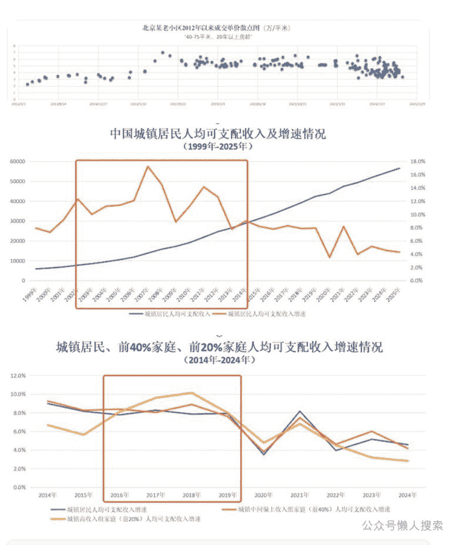

## 房地产巨变中，普通人买房卖房的操作指南——中篇

260123 大树乡谈

整理：公众号懒人搜索，懒人专属群精选

懒人微信：lazyhelper1

懒人备注：

大树乡谈的《房地产巨变中，普通人买房卖房的操作指南》一共有三期，第一期是2025年12月（当时懒人群友分享了）。你现在看到的是中篇，下篇咱们群里已经分享了。

小懒会把这三篇做成一份合集电子书（PDF+epub），群友们自取。

以下为正文：

## 房地产巨变中，普通人买房卖房的操作指南

20260122

净资产低于1000万、年收入一百万之类都是普通人。根据胡润研究院最新报告，截至2024年末，中国大陆家庭净资产超过1000万的“高净值家庭”只占0.42%。

本篇承接上篇《房地产巨变中，普通人买房卖房的生存指南》，在第五章节特别提醒，房地产领域个体与宏观关注点不一样，各种机构、专家对房地产的分析，针对房地产开发商或投资者，而不是普通购房者。

更要注意，以城市为单位的所谓“分化”，已经不仅仅是城市分化，而是同城市不同小区之间的分化，甚至同小区不同房源的分化。为说明这一点，在上篇，小镇统计了北京某典型小区从2012年至2025年中的成交单价情况，可以看到从2023年新一轮下跌开始，该小区房价成交单价变得更加分散了，价差甚至到了一平方米近3万元，而优质房子的单价几乎是穿越周期的，从2016年至今波动很小。见文后第一张图片。

这就对中介和个人的房地产认知与能力提出了更高要求，而考虑到当前国内中介发展还非常落后，个体增强房产认知，变得尤为重要。正是考虑这些背景，就有了下篇《实操篇》，不分析房价涨跌趋势，这是其他文章探讨的。

本篇聚焦实操，这也是网络上极为稀有的内容。目的很简单，就是在任何行情下，无论买房还是卖房，都能减少损失、增加收益，最低不吃亏，能够以正常市场价成交。

不要小瞧这一点，多了不敢说，少亏或者多赚几万、十几万还是不难的。不要觉得房子动辄几十万、几百万，就觉得几万、十几万不是钱了。平时买个几百块的东西还为了十几元的价差反复纠结，怎么到了关系一生的房子反而如此随意？

本篇分三部分：第一部分整体谈房地产的变化，调整认知；第二部分谈实操技巧，实现少亏多赚；第三部分谈一些需要特别注意的“坑”，全篇1万字。

下面开始正文：

## 章节一：如何理解房地产的变化，调整认知

有五点。

### 认知一：房地产当前发生的不是周期变化，而是时代巨变，不要指望复刻过去的周期

网络上谈房地产，很多人喜欢拿所谓的M2说事，一定要明白，普通人购房不是用M2购买，而是用自己口袋里的钱购买，更何况M2早就过时了，所以才推出了社融进行替代，但现在社融指标也已经有些失灵了，国家正在寻找新的宏观指标。

中国房产很多，但越是富豪，其资产中的房产占比就越低，绝大多数房产的持有者和交易者就是普通人，决定房价的是芸芸众生的收入。

以城镇居民人均可支配收入为关键指标，可以看到过去20多年，收入涨幅跟房价涨幅差不多，是全民普遍的收入上涨决定了房价，政策、放水、预期等等，是次要因素。

中国城镇居民人均可支配收入历年增长情况，如文后第二张图所示。自2002年到2014年基本保持10%以上的增速。可能有读者说，这个图解释不了为什么会出现2016年以来的房价暴涨，这就要提高分析的颗粒度，因为2016年以来的暴涨，跟之前全国范围的普涨是不一样的。

国家自2013年开始公布城镇五等分家庭收入情况，小镇选择了前40%的中间偏上收入组和前20%的高收入组家庭，可以非常直观地解释2016年以来的暴涨。

如文后第三张图所示。可以看到，2016年到2019年，城镇前40%、前20%家庭人均可支配收入增速明显大于城镇整体情况，而2022年之后，前40%家庭收入增速甚至低于平均，这对房地产价格的影响更为直接。

明白普通人是用自己当下和未来的钱买房，就能够理解，为什么小镇说不要指望复刻过去的房地产周期，房地产当前发生的是时代巨变。无论任何分组，收入增速都在下降，已经从此前长期在10%以上，下降到4%左右。

### 认知二：要摒弃过去以年为尺度的短期考量，改以20年尺度的长远眼光综合评判

过去收入普遍增速很高，对未来收入增长预期强烈，自然不在乎房子的小钱，有不少人宁愿房子闲置也不出租，因为看重的是房产倒卖的大收益，租出去影响出售。

但现在不一样了，全民收入普遍高速增长的时代已经过去了，需要适应慢下来的新时代。房产就应该回到保值增值的基础投资品的定位，不要再像过去对房子以3到5年甚至更短的周期去思考，而是要以20年为尺度。如果个人没有好的投资渠道，房子仍然是相对比较安全、收益率过得去的投资，只是必须降低预期，算细账。

过去看不上的小钱，比如闲置成本、出租收益、维护保养成本、暖气物业等等，都要纳入考虑了。具体可以参考《成功避免一位朋友上百万元的购房损失》（链接：成功避免一位朋友的购房……）。

### 认知三：房子贵精不贵多，普通人经不起资金分散的折腾

基于过去全民收入普遍高速增长，才有了买房就赚的普遍预期。很多人搞分散置业投资，看到哪里有机会就跑到哪里买一套，投机心理很重，很多人也确实赚了，这不是自己牛，而是时代的大势。待在电梯里面的人无论干什么，都不影响电梯把人从1楼带到顶楼，那个时期关键是上电梯，就有了所谓的“上车”思想。但时代巨变下，被坑得最惨的也是习惯了旧思维的人。

比如北京2022年前后炒燕郊的，相当比例是熟悉这套逻辑的房产中介。也可以看到，多数房产中介对房地产的认知也很有限，主要还是利用信息差优势。

对大户而言，资产分散是有道理的，资金量太大很难集中投资一项，分散投资可以降低风险，只要有一个赚了就行。但普通人不过千万级别的净资产，大多数也就是几十万、几百万，资产分散不仅增加了成本投入，还放大了风险；普通人的精力、时间是有限的，专业知识也不足，能把一项重大投资搞清楚就很不容易了，如何进行多个项目的全面分析把控？倘若没有充分准备就盲目搞分散，那无异于赌博。

所以在时代巨变下，对房产一定要秉持“贵精不在多”的基本理念，最重要的是降低风险、规避巨坑，确保安全的基础上再考虑如何更进一步。

务必重点考虑充分满足自身居住、孩子上学等刚需，在满足之前，不要想着要不要再买一套之类的。一定要明白，中国房子的持有者和交易者绝大多数是普通人，能够最充分满足个人刚需的房子，一定更保值。普通人多想想自己想要什么样的房子，就大体差不多，少去幻想靠房子赚钱翻身。

一个人如果都不能靠自己的主业、工作赚钱，凭什么敢幻想靠投资呢？股市就是典型。在第一套刚需充分满足之后，如果有闲钱又找不到好的投资渠道，这时候再考虑第二套、第三套不迟。随着这轮房地产和理财收益率下行，全国范围房产出租收益率还是很不错的，一线城市平均在1.8%左右，二线城市2.5%左右，三四线可以达到3%到5%，是不错的稳健理财了。

不要觉得满足刚需很简单。常说的“刚需房”一般是所谓的老破小，但刚需真的满足了吗？不是的，只不过因为自己资金有限，所以只能在众多需求中优先满足一个最突出的需求，生活品质的改善也是刚需。

基于上述三个认知，就有了后面的两个，道理很简单，就不多阐述了。

### 认知四：房子好不好，是多维度的，要根据自身情况综合判断

比如居住偏好、通勤、家庭收入及未来预期等等。

### 认知五：最大限度摒弃沉没成本、主观情绪对决策的影响

重大决策一定出于理性、理性、还是理性！

## 章节二、实操技巧，实现少亏多赚

过去主要从买房角度谈，今天要换个视角。

一是房价下行阶段，如何卖房更被关注，这也是长期被忽略的；二是从卖房角度换位思考，以终为始，也有利于加深对买房的理解；三是买房各有所需、差别巨大，而卖房目的就是尽量多卖一点，这就更容易把握技巧。

了解具体技巧前，必须承认房产交易资金量巨大，是比炒股、理财更专业的领域，特别需要专业对待，必须投入与资金体量相称的精力、时间、心思以及必要的支出。

千万不要觉得业余选手可以挑战专业人士，这太傲慢了。咱们普通人增强对房产的专业认知，是为了增强辨别能力，小心不要被专业人士给坑了。

当前买房卖房领域最专业的当然是中介。无论如何中介再怎么良莠不齐，整体水平肯定超越普通人，就算是菜鸟，也起码接受过培训、掌握关键信息，还能够调动门店后援力量。对咱们普通人而言，买卖房产时，最重要的就是最大限度地调动中介力量为我所用。

当前全国范围，中介中最专业的毫无疑问是链家，其他大平台也各有特色，也有些小平台包括开发商、物业具有一定的特色优势，但调动的核心必然是链家。

所以，本篇也更适合经济体量较大的城市，最起码要有比较健全的正规中介体系，如果当地没有正规中介，也有参考意义。想要调动专业力量，就需要理解中介生态、中介利益，尤其中介是如何被考核的。

最需要关注的是链家，不仅整体最专业，覆盖面也最大，最具普适性。

必须理解的核心有二：

### 核心一：中介利益分配和卖房关键人

链家采取全链条分成模式，一笔交易涉及录入人、维护人、实勘人、委托人等多个角色的分佣。当前房源端可以获得40%的分佣，其中20%归房屋维护人、10%归录入人。

在卖房时，我们需要格外关注的就是房源端，最核心的是维护人。所谓维护人，表现在APP房源页面上，就是最优先出现的中介人。一般而言，他是对这套房子最了解的，也承担向其他中介介绍、推荐房子的职责，对卖房最为关键。

因为买房人同时会关注很多房源，如果带看的中介不了解某套房子，为避免露怯，就不会主动向买房人推荐。当买房人主动问起房子的问题时，也无法当场回复、打消疑虑，这就会极大降低房子出售的概率。

按照平台要求，带客户看房，维护人一定要跟着去。如果他不熟悉的房源，就会安排在后面，随时可以舍弃；而有的维护人如果不尽心，对自己维护的房源也不加强了解，一问就露怯，也无法向其他中介推荐。

因此，在链家体系中，维护人格外关键，分为四个级别，最高的S级只有不到5%，也是当前唯一掌握关键特权的。这个特权就是人为设定“好房”，入选好房后会被优先展示，也会获得更多推流。

卖房最关键的就是获取流量，这是一个流量漏斗。有了更多浏览量，才会有更多带看量；而有了足够带看，才能真正成交，并获得更好的卖出收益。

不同城市、不同时间段有不同的带看成交比，比如北京平均是25次带看成交，房市不景气、观望情绪强烈的时候，带看成交会进一步拉高到30次甚至40次以上。

如果自家的房子挂出去以后，一两周连带看都没有，就别再幻想能成交了，就必须进行调整，关键就是获得“好房”标签，吸引更多线上流量和线下带看。

现在平台规则已经比较完善了，是不是好房直接就出结果了。唯一的例外就是前面提到的S级维护人的特权，这是目前链家体系唯一可以突破平台算法规则、人为设定好房的。这是平台对资深维护人的信任。注意，维护人的级别跟业绩没有必然联系，主要取决于历史上维护过的房子数量和口碑等。

### 核心二：中介最关注什么指标？

是成交的业绩分成吗？确实关注，尤其在当前房市不景气的时候，中介普遍极为焦虑。过去焦虑是赚钱少，现在是生存危机，各中介都在大规模裁员，很多中介几个月开不了一单，曾经看不上的租房单也成了抢手货，体现在平台财报上，2025年租赁佣金大增。

但中介普遍能力还是不够，尤其很多年轻中介，比如工作时间才两三年以内的，看到房子价格高、收入社会地位高的业主，内心是有些胆怯的，也不懂得如何向上管理，调动门店经理资源倾斜。

正因此，对一名中介而言，尤其是维护人，就算这一单不成，对他来说也不过是损失20%的分佣而已。虽然渴望佣金，但不成也就不成。

最在意能否成单的，是中介所在门店的负责人，现在一般叫“商圈经理”。链家每一个门店只有1名商圈经理，再晋升就是区域总监。中介体系中，商圈经理要对门店的业绩负责，还要承担门店的运转成本，比如系统使用费、绩效工资等，都要从商圈经理的薪资中预先扣除；商圈经理的位子也不稳，如果一个季度完不成考核指标，那么预扣的绩效工资就会被要求上缴，美其名曰“乐捐”。这是很多强运营行业普遍存在的惯例；如果还完不成，尤其完不成最关键的考核指标，就会被降级，直接影响到收入，更影响到晋升相对安全、收入更高的总监岗。

对商圈经理而言，他不在乎一套房是手下哪个中介卖出去的，他最关心的是不能被其他中介平台卖出去，这就是最核心的市占率指标。之所以设置这个考核指标，就是为了调动商圈经理的积极性，与其他平台展开市场竞争，这是中介平台最关切的目标。

市占率的考核以区域为单位，区域的划分以房产成交量为主。有的小区成交少，那就把几个小区合并为一个区域；有的小区成交极为旺盛，就可以把一个小区分为多个区域。

考核的就是这个区域的成交占比。链家作为头部中介，处于防守位置，市占率考核目标设定往往最高，也最严格。一个区域一个季度成交的房子数量有限，几套房被其他中介平台抢走了，就很可能无法完成核心指标；而那些成交特别少的区域，甚至一两套房就决定了商圈经理的季度考核“生死”，必须每房必争。

了解以上两点就足够了。强运营行业，直接对团队业绩负责的人，对手下具有非常强的掌控力，这跟一般办公室白领工作大不一样。

所以调动中介的专业力量，就聚焦为调动头部平台链家的力量，进而聚焦为调动商圈经理的力量。商圈经理的时间、精力是有限的，他掌握的最大资源就是手下中介的工作时间，调控的资源就是流量和带看，那就要想办法争取资源向自己倾斜。

基本逻辑就是这样。普及了这些基本知识，相信有很多具备管理经验的朋友，已经有想法了。

也提供几个行之有效的策略：

#### 第一、一定要建立与掌控资源分配的商圈经理的直接联系

职场是相通的，经验丰富的中介占比很少，而萌新往往不擅长向上管理。但客户不必在乎什么商圈经理的权威，作为客户有权利要求任何中介提供服务，什么领导不领导的，找的就是领导。

不要指望通过中介间接联系商圈经理，一定要直接带动。

这说起来麻烦，实际很简单，建一个微信群，要求维护人把商圈经理拉进群就行了，有什么意见直接在群里发言，还可以跟维护人打配合，维护人不方便说的，就由客户说。

#### 第二、想办法分配到更加资深的维护人

中介分佣角色很多，但对卖房而言，最重要的就是维护人，前面已经说了很多了，这里再普及下中介行业常识。

为了把房子卖出去，中介熟悉房源是最基本的，这是销售行业基本素养。而房源很多、中介也很多，所以正规中介有三个制度性的房源介绍渠道：

一是每周安排一个时间段，挑选本片区若干个房源，要求门店所有中介都要去看，业内称之为“空看”。能够被列入本周集体空看，取决于房子的情况，也取决于维护人的推荐。

二是维护人可以动员本区域其他中介，集体上门空看。有出租或卖房经验的应该有体会，小镇把自己的房子委托给中介出租后，签约当天就有很多中介上门空看，有的还跟小镇进行了交流，增强对房源的了解，但这么干的中介占比不高。

三是中介门店定期举行的交流会，其中一个环节就是梳理本区域房源，排定优先度。

从流量曝光角度，最核心的关键人就是维护人。如果维护人不积极争取、害羞露怯甚至不专业，自己的房子都无法获得曝光，其他中介都没去看过、不了解房子的情况，又如何向买房的客户推荐？所以一定要尽可能选到相对专业的维护人。

这也有技巧，如前面提到的房源端分佣，除了维护人获得20%，还有10%归登记人。

从工作量角度，维护人的工作量要远大于登记人。登记人还有很多其他渠道可以获客，比如这几年流行的自媒体。有一些中介在社交平台发成交数据、看房情况，吸引到潜在的客户，只要客户联系他，他获得授权后完成房源登记，接下来就不用管了，只要成交，就可以拿到10%的分成。

既然如此简单，为什么还要设置10%的高分成？关键在于，这里面有一个博弈，可以提高平台管理效率。这就是卖房业主需要格外关注的小技巧：去其他片区的门店登记房源，而维护人必然是自己房子最近的门店。于是房源登记后，通过平台内部流转到房源最近的门店，这时候维护人们就可以抢20%的业绩了。

注意，是其他片区的门店，比如去相隔几个街道甚至其他城区的门店。换门店登记，就是要避免随机分配。从利益角度，登记人10%的业绩要想拿到，前提是成交。他很清楚成交的关键是维护人，他就会挑选更加资深的维护人。咱们普通人不了解中介谁更有本事，看不到维护人等级，但内部就太清楚了。

就算有的人知道谁是很资深的维护人，也最好不要想着直接去门店指名道姓要这个人服务。虽然按惯例，如果客户没有指定，谁第一个接待客户，那就默认是登记人和维护人，指名道姓就安排具体人员，但架不住存在各种意外情况，并不稳当。

#### 第三、配合维护人加强对自家房源的曝光

正如前面所说，中介制度化的房源曝光有三种，前两个主要靠房子的硬实力。但如果自己的房子不具备优势，甚至相比其他房子竞争力不足，那就要充分发挥业主的主观能动性。

推荐房源、吸引其他中介了解，是获得流量的第一步，任何中介对这套房的了解都不如业主。

所以小镇建议业主有空就去参加中介的交流会，时间地点直接问维护人就行了。不必担心中介不欢迎，对维护人而言，自己负责对接的业主能够花费时间亲临交流会，对着领导同事谈房子，很有面子；从利益角度，也减少了其他中介进行片区房源了解的工作量。

所以哪怕仅仅出于对业主的感谢，也最起码会被列入本周集体空看的名单。届时业主可以在家里等着，花半天时间对每一位上门的中介介绍下自己的房子，还可以送点小礼物啥的，千万不要破费，几十块钱的小东西就行了，这就是小镇前面说的为了把房子卖好，要舍得花必要的支出。

经过这一步，就已经领先多数竞争房源。起码中介门店的最高负责人，大概率会问

一问这套房子的情况咋样了，自家维护人申请资源倾斜，也更容易些。

之所以业主主动发力，也是因为维护人很可能不够专业，也不要想着要求换人，都是一个门店抬头不见低头见的，咋换啊。

第四、先礼后兵，倒逼门店提供资源倾斜。

上面表示积极支持，这是先礼，但有时候给的资源还是不够，或者自己特别着急需要在几天内把房子卖出去，这时候就得用狠招了。狠招就是抓住商圈经理最关切的市占率指标，要让商圈经理知道很可能这套房子要被其他中介平台卖出去，自己的季度考核岌岌可危，这时候就会主动求着给资源倾斜。如何倾斜呢？

最直接的倾斜就是要求手下所有没有急事的中介，放下手中一切工作，全力联系潜在客户，对这套很可能要被抢走的房源进行集中推介。

中介能够联系的潜在客户，是真正精准的流量，而不是平台那种搜索后甚至不会亲自去看房的泛流量，价值可想而知。任何一个干了两三年的中介，起码手里头得有几百个曾经联系过的潜在客户，中介也会思考谁愿意了解的可能性更大，就算觉得没啥可能性，领导都急眼了，至少要把工作态度摆出来。

打一个电话几分钟时间，5名中介、10名中介甚至20名中介，半天时间又能联系多少精准客户？瞬间就有几百甚至上千的精准曝光，只要这套房价位差不多、跟市场价差不多，被推销出去的概率非常高，而担心被抢单，中介也会倾向卖房的业主，提供更合适的价位，会少很多压价的PUA。

那么如何调动呢？

列举几个供启发：

比如一开始先不要去大平台登记，而

选择本片区排名第二甚至第三的平台。一般平台之间彼此会盯着，最大的平台很可能发现有客户在其他平台挂牌，却没有选择自家平台，这责任就大了。毕竟被抢单还是能力问题，客户都不来挂牌，这就是态度问题了。

比如千万不要独家授权，一定要在多平台都挂上，要让平台间形成竞争。可以想办法把不同中介平台的中介安排在同一时间段看房，让中介们彼此碰到，这会反向施压。

又比如反向PUA。感觉对方资源倾斜不足或者感觉故意压价的时候，业主就可以去其他中介门店走一圈，拍一个能够展现其他门店环境的照片，然后在商圈经理在的群里说：“你们那边这么久了都没几个靠谱的带看，我今天刚来某某中介，人家立刻给安排了好买家，价格也比你们合适”等等。

虽然中介们也会猜测大概率是有诈，但不敢赌啊，业主都已经公开预警了，如果还不关注，最终房子真被卖出去了，市占率考核目标没有完成，该怎么解释？

业主不会告状，上面考核的也未必骚扰客户，但群里还有一个本来可以拿20%业绩的维护人呢，万一这小子甩锅呢？更多的技巧，大家就可以发挥想象空间了。

只是有一点需要注意：绝对不能威胁中介，不能说不降佣金就去其他中介了之类的话，更不能跳开中介直接成交，这很可能被认定为“跳单”，需要赔偿违约金的。

但只要不直接威胁、不让中介抓住把柄，通过其他中介成交，这就不算“跳单”，这也是上面调动门店中介积极性的关键基础。

说完调动中介资源倾斜，还要做好自身工作。

结合前面说的中介了解房源的重要性，真想买房，最好把房子空出来，中介有钥匙可以随时带人上门，如果自己住或者租出去也可以，提前沟通好。

还要做好房子美化，这在美国已经非常成熟了，会有专门的产业对房子进行必要的布置，主要是掩盖明显的漏洞，提高成交概率。国内目前也有了，但很坑，最好不要委托这类机构。

美化的成本一定要控制好，一般来说几千块钱足够了，关键是清理掉一些明显负面的东西。

比如小镇在看房的时候，看到有的人家特别乱、墙面破损严重，有的摆着牌位、桌面看到很多药物，还有的养着各种宠物。

这在卖房的时候，都会大大降低成交可能性，也会被买家压价，比如买家看到牌位、药品，就可能怀疑这房子死过人。强烈建议，要卖房的时候，把宠物提前安排走，宠物的味道、毛发很浓烈的，不是人人都喜欢宠物，喜欢宠物的也很可能只是喜欢自家宠物。

房子美化这块就不多分享了，再次强调不要花太多钱。美化主要是遮丑，展现一种美好的生活想象，多数购房者是第一次购房，需要给一个直观的样子、提供情绪价值，让买房者想象如果在这样的房子里生活，应该很美好。

花不了几个钱，从闲鱼、1688等平台，买点像样的二手家具之类就行了，至于墙面，简单补补、刷漆，没几个钱。反过来，买房就要理性，别管这些情绪价值，看准那些无法通过后期改变的不变因素，比如房子质量、户型、朝向、小区环境、周围配套、邻里等等。

但也别搞极端否定，真要发现装修特别好，就坦诚点，自己评估这装修能节约自己多少时间和金钱投入，只要低于这个投入就是合理的。

## 章节三、需要特别注意的“坑”

### 第一、最大的坑就是警惕中介的PUA压价和套底价

虽然房子卖得贵，中介抽佣更高，但也得考虑性价比。一套房子卖了500万、抽佣10万，为此带看30次，而卖了400万、抽佣8万，但两次带看就成交，工作投入的性价比截然不同，中介就可以腾出更多时间卖其他房子。

所以中介最核心的工作就是PUA业主压价，只要房子够便宜，就一定能卖出去。小镇有一个身边案例，都是2025年卖出去的，同一个小区同楼层同大小同户型，前一套房业主是老人自己卖，刚重新装修，卖了420万，几个月后按理说房价跌了，结果一套很多年前装修的房子竟然卖了500万，关键差别就是中介的忽悠。

所以，要跟中介保持合理距离，借助中介力量，但千万别太熟，要警惕中介的PUA和套话，绝不要把底价告诉中介。中介一定会反复询问底价，这是因为中介考核有一个底价偏差值。

在租房的时候，现在的省心租之类合约，会有一个5%的上下偏差，卖房的时候也有类似考核，要求中介内部上报的底价，与最终成交控制在5%以内，超了就扣业绩。

就如前面那位老人家，被忽悠了以后，轻率相信了砸盘价，还透露了自己能够接受的底价，其他中介看到后台显示的底价，自然不会偏离这个价位太多，寻找的客户也是这个底价附近的客户。

更不要说其他骚操作。而要想抵抗PUA，除了嘴要严，关键就是自己要做好房价调研，今天篇幅很长了，不多展开，可以先看《读者购房提问分享》，链接：读者购房提问分享-202512。

### 第二、不要幻想捡漏

房产市场高度透明，不存在别人是傻子，就自己眼光独到发现了宝藏，这大概率有坑。正如开头展示的北京某小区高度分化的房价，同一个小区差不多的房子，单价竟然能拉开近3万的差距，这就是房源的巨大分化。

所以看到有人转超低价的房源，不要草率地以为房子大跌，超低价的房子必然有原因，其中确实有漏可以捡，比如被中介忽悠的，具体的今天不多展开，但概率不高。

但也可以选择相对自己有利的，因为每个人对房子需求不同，同一套房对不同人价值不同。

比如不需要考虑孩子上学的，没必要为学区房付出溢价。篇幅所限，接下来就先点到，暂不展开。

### 第三、不要轻信所谓的未来规划

大多数新城市搞不起来的，注意所见即所得。

### 第四、识别真正的配套

对常住人口有意义的才是真配套。房子的价值和租金，取决于常住人口，而非这个片区的流动人口。

所以如交通枢纽、主题乐园、体育场等等，这都是假配套，对房价乃至租金，弊大于利。

北京某老小区2012年以来成交单价散点图（万/平米）：40—75平米、20年以上房龄

中国城镇居民人均可支配收入及增速情况（1999年—2025年）

————分割线————

在这个AI能替你写代码、写文章的时代，基础技能正在迅速贬值。绝大多数人正被淹没在海量的免费垃圾信息里，陷入低效的体力内卷。

当“努力”不再是壁垒，人与人之间唯一的护城河，只剩下“信息过滤”的效率与“认知系统”的维度。

圈子已稳定运行7年。我们每天利用Python爬虫与大模型算力，过滤全网最顶级的政经内参和搞钱风向标，做你最冷酷的“外部大脑”。

如果你认同这种“重塑认知防线”的极客主义，欢迎围观我的个人情报智库：【懒人专属群】。

https://lazyso.com/insider/

认同信息过滤价值、想省下每天3小时无效阅读时间的读者，扫码加我微信（lazyhelper1）。

