公众号懒人搜索，懒人专属群分享

今年“418”加入生财的新人，我用 AI 做了个小程序，六天跑通并成功变现了

260817 副业 SC 精华

整理：公众号懒人搜索，懒人专属群精选

懒人微信：lazyhelper1

大家好，我是艺文，一名小学老师，平时也在做面向师生的文创产品，也是今年 4 月 11 日刚加入生财的新人。在接触生财之前，我对 AI 的认知仅限于问答，而且，并没有觉得有任何不对的地方，因为身边的人都是如此。要是谁用豆包写了个教学设计，做个 PPT，都会发自内心地觉得那人可真棒。在稳定的环境中，就会慢慢丧失对外界变化的感知。

那时的我，一定不会想到，三个多月后，我将从一个完全不会写代码的小白，亲手做出自己的小程序，并在小程序正式上线后第四天开通流量主，第六天赚到第一元钱。这让我深切地感受到 AI 的力量——让一个想法真的可以落地生根。

我用 AI 做了一个课程壁纸助手小程序。上线第 4 天，500 多名陌生用户通过小红书进入小程序；第 6 天开通流量主，并拿到第一元钱。钱不多，但“内容发现需求，产品承接需求，再得到收入”的链路第一次跑通了。我想把这次从发现需求、开发上线到赚到第一元钱的过程复盘出来。它不是

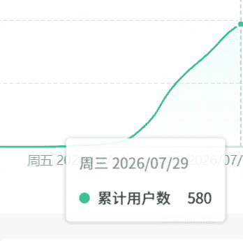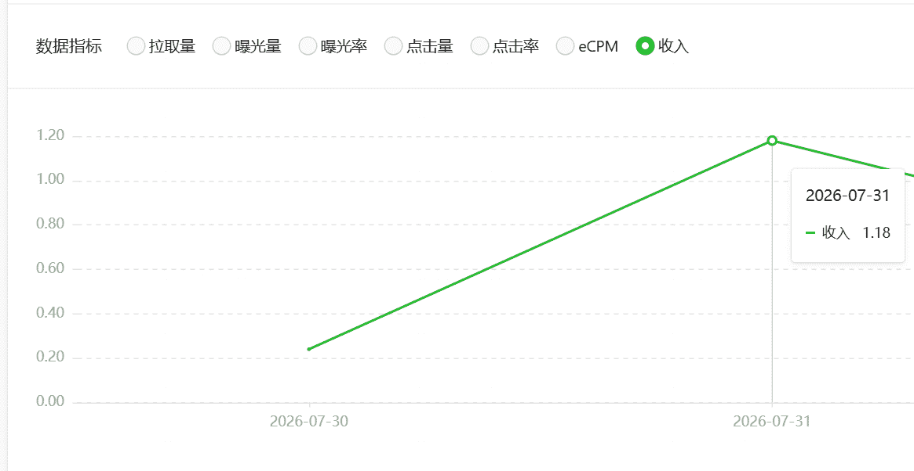

什么一夜暴富的故事，只是一个普通生财新人第一次下场、第一次拿到结果的真实经历。希望能给仍在观望、不知道自己能不能做项目的圈友一点参考。

## 一、加入生财后，我第一次觉得“原来我也可以”

今年 3 月，因为要追星——想近距离看下男神老华，我参加了 AI 航海家线下大会，并成功和男神合影（因为工作原因，所以不露脸了~）。缘分就是这么妙不可言，本来是追星的，却意外了解了生财有术这个圈子。通过听刘小排、刘智行、郭东超等大咖的分享，我第一次近距离感受到 AI 的威力，这两天一夜的大会彻底重塑了我的认知。那时候我最大的感受就是：AI 太神奇了！

后来，我在 4 月正式付费加入生财，并参加了 AI 大航海。在航海过程中，小排老师引起了我对 AI 编程的兴趣。过去在我的认知里，开发产品是程序员和技术团队才能完成的事情，但 AI 编程让我第一次看到：一个不会写代码的小白，也可能把自己的想法真正落地，不得不感叹一句：AI 太神奇了！

之后，我又读到了 @西昂的精华帖《不会写代码，用 AI 做了 15 个小程序，每月稳定收益 2w+》，第一次知道还可以通过小程序的方式变现。这个赚钱模式很吸引我，因为它不是单纯依靠销售，而是先做出一个对别人有用的工具，再通过用户使用产生收益，并且这是可以复利的，这可是香香的被动收入啊。最关键的是，现在 AI 使得技术平权，普通人有想法就能做！我不由得再次感叹：AI 太神奇了！感谢 AI！

认知改变后，我蠢蠢欲动，马上用 Trae 做了一个点名小程序。真正写代码的时间不到半小时，再利用几个零碎时间，我就把它上线了。整个过程做完以后，我震惊了：真的和小排老师、西昂说得一样，超级简单，没有门槛！！整个过程非常丝滑，天！AI 太神奇了！

这个点名小程序没有推广，只是我自己使用，也没有带来收入。但它在我心里埋下了一颗种子：小程序不是遥不可及的技术项目，而是普通人也可以尝试的一件事。

这颗种子，后来遇到了一个真实需求。

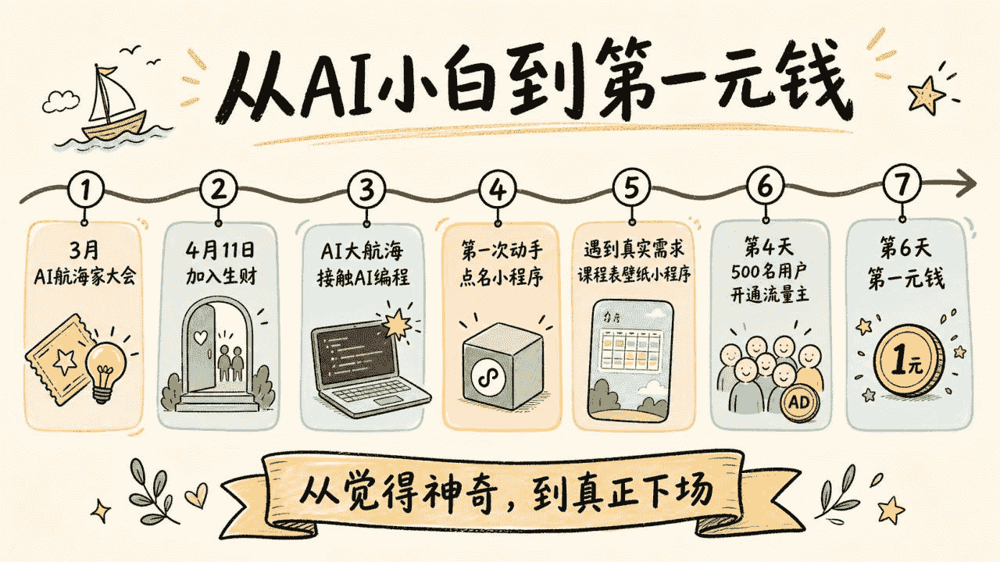

## 二、第二个小程序，从一个让我忙不过来的真实需求开始

在做这个小程序之前，我并没有提前规划“我要做一个小程序”。一切要从一条小红书笔记说起。

我有一款已经做了一年的文创实物产品。临近开学，我想再认真推广一次，于是打算给它配套制作一些电脑桌面壁纸，让这个产品更完整。说干就干。我让 Codex 生成了几张壁纸，并把它们发布到了小红书。没想到，其中一条笔记小爆了，成为我当时数据最好的一条笔记，还带来了 200 多个新粉丝。

数据变好当然很开心，但代价也随之而来：我需要把壁纸一个个私发给领取的人，工作量一下变得很大。与此同时，我还在评论区发现了另一个反复出现的问题：很多老师都在问，怎样把自己的课程表放到壁纸上。

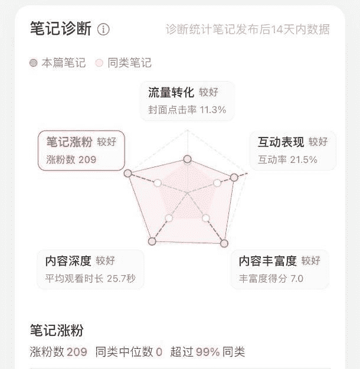

我以前的做法是使用美图秀秀，把课程表裁剪后再贴到壁纸上。但这样不仅麻烦，做出来的效果也不够美观、协调。我又观察了办公室里其他老师使用的电脑壁纸，发现很多壁纸虽然预留了课程表区域，那里却一直空着。并不是老师们不需要，而是添加课程表这件事太麻烦了。

这时我想到：既然现在有 Codex，我能不能做一个小程序，让老师用更方便、更美观的方式，把课程表放进桌面壁纸里？我把这个想法告诉 Codex，课程表壁纸小程序的雏形就这样出现了。

我觉得这个小程序的出现也不是偶然，我把它总结为：

前期的积累 + 真实的需求 + AI 的辅助 = “亲生”的小程序

前期的积累，让我知道普通人也可以借助 AI 做小程序；真实的需求，让这个小程序不是自嗨，而是真的有人需要；AI 的辅助，则把过去可能停留在脑海里的想法，快速变成了一个可以使用的产品。

这个小程序不是我为了追热点硬想出来的，而是从自己的产品和用户问题中自然长出来的，所以我愿意把它叫作我的“亲生”小程序。

## 三、不要一开始就追求完美，先完成最核心的功能

有了想法之后，下一步就是把它落地。

在这个过程中，我觉得新手最容易犯的错误，就是一开始设计太多功能。

我最初设想的是：老师只要拍一张课程表，小程序就能自动识别文字，再把课程自动排进壁纸。这个想法很美好，但真正研究以后，我发现里面有很多技术问题。

每个人使用的课程表格式不同，课程节数、时间和排版也不同。识别过程中很容易发生混乱。为了实现拍照识别，我花了不少时间研究，却一直没有得到理想的效果。

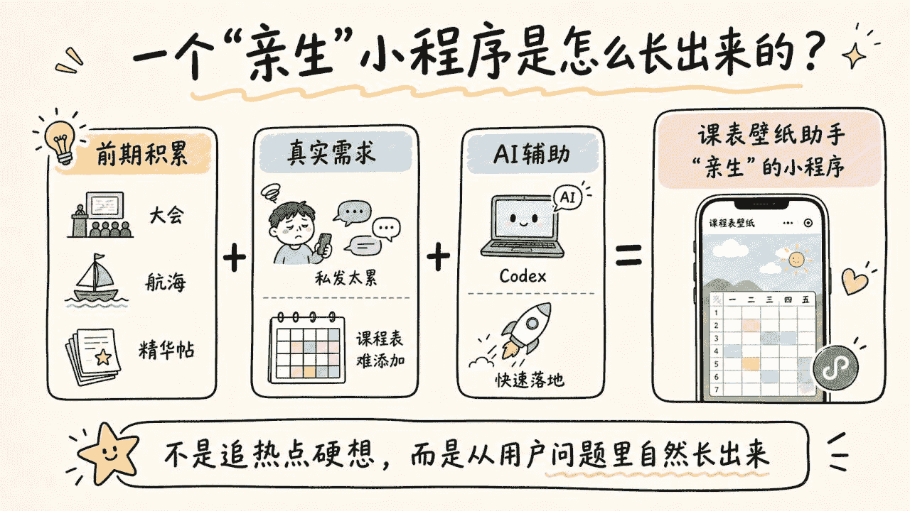

后来我突然想明白了：我的最终目标不是“必须实现拍照识别”，而是让老师用一种相对方便的方式，得到一张美观的课程表壁纸。

只要能实现这个核心结果，拍照识别并不是现阶段必须完成的功能。

于是，我放弃了拍照识别，改成让老师自己输入课程名称。这样既不容易识别错误，也大大降低了技术难度，让小程序能够更快上线。

围绕这个核心目标，我还暂时舍弃了一些不重要的功能：

- 没有追求大量模板，第一版只上线了小红书笔记中的 3 张壁纸；
- 没有开发拍照识别，课程名称由老师自行输入，优先保证准确性；
- 没有加入自选样式，第一版先采用统一的默认格式。

最重要的功能只有一个：填写完课程表后，可以流畅地一键保存壁纸。

用户不需要等待我回复，也不需要再打开美图秀秀或其他软件重新制作。到这里，我认为最核心的功能已经完成，小程序也具备了上线测试的基础。

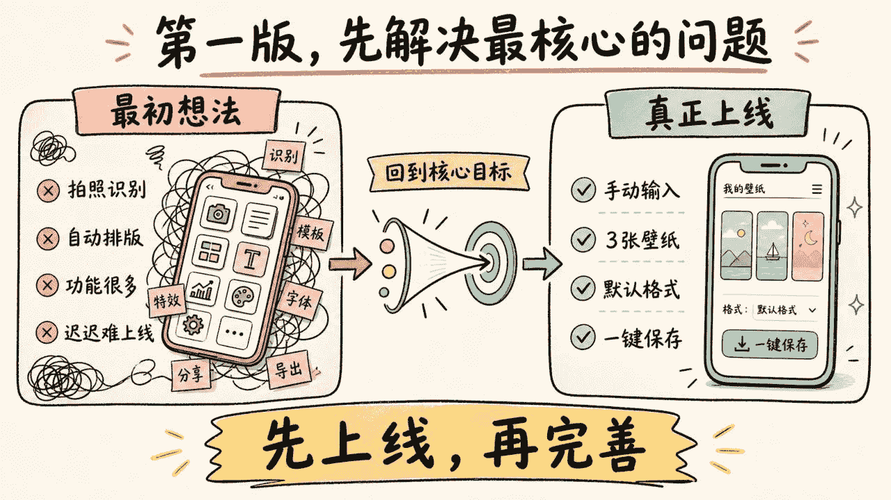

这次经历让我意识到：做小程序时，不必等到所有功能都完美了再上线。先围绕一个真实需求，实现最关键的功能，然后尽快交给真实用户测试。后面的功能，可以根据反馈慢慢完善。否则，功能越想越多、项目压力越来越大，很可能小程序还没有上线，自己就先放弃了。

## 四、第四天开通流量主，第六天赚到第一元钱

小程序上线以后，我马上写了一篇小红书笔记，大致的意思就是“好多老师问我课表怎么放进去，我把它做成了小程序”，然后晒了壁纸的真实使用场景。可是不到五分钟，我就收到了笔记违规的提醒。我分析了下，应该是引流小程序太明目张胆了，让系统检测出来了。

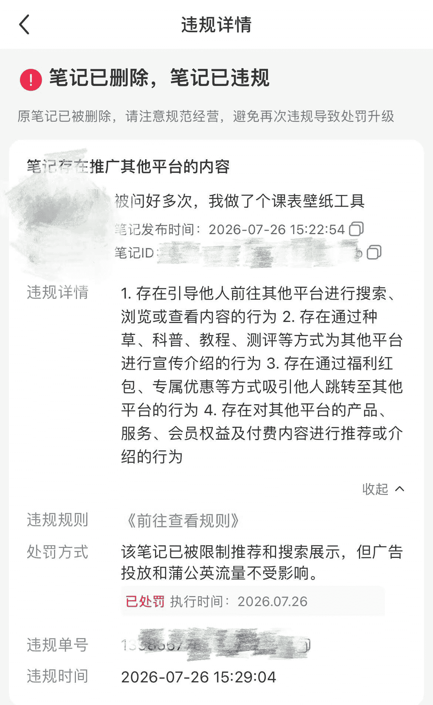

于是我对这篇笔记进行了改造，从向别人安利这款小程序的语气，改成了一次真实经历分享的语气，然后把“小程序”、进入小程序的步骤这种敏感的信息全都删掉，终于过审了。

发布了没有十分钟，就有人评论“是用什么小程序操作的？”“免费吗？”……真的太惊喜了，就像是我请的托一样，精准得问到了点子上，这也说明这个需求是很真实的。

在原来的那条分享壁纸的笔记下面，我对评论区中的“课表怎么放进去？”这条评论进行回复，用小程序截图的形式引流，并将这条评论置顶。这样做以后，评论区里反复向我要壁纸的人少了，我逐个私发图片的工作量也明显降低。更重要的是，我终于可以用一个真实产品承接这条笔记带来的需求。

我把小程序发到小红书推广的第四天，用户数突破了 500，达到了流量主开通条件。这 580 名用户全部来自小红书，也让我进一步确认：这个需求是真实存在的，相关内容可以带来比较精准的用户。

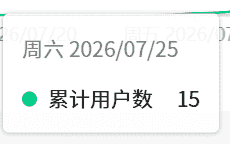

到了第六天，我的这个小程序赚到了流量主的第一元钱。

这一元钱并不能改变生活，但它完成了一次非常重要的验证：从小红书上的真实需求，到用 AI 做出小程序，再到用户真正使用，最后产生第一笔收入，这条链路第一次跑通了。

至于如何发布小程序，如何开通流量主，这些航海手册里写得非常详细，我这里就不赘述了。但是想强调一点，真的很简单，我这样的小白都觉得简单，那是真的很简单。

## 五、第一批反馈，先看真实用户是否愿意使用

小程序上线后，我没有把它发到朋友圈大规模宣传。

这并不是说做小程序都不能发朋友圈，而是因为我这次想验证一个问题：完全陌生的用户，会不会因为真的需要这个功能而主动进入小程序？如果一开始大量分享给熟人，他们可能只是出于好奇，想看看朋友做了什么。这些访问数据不一定能够说明需求真实存在。

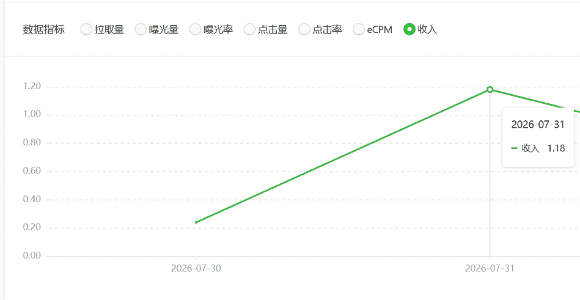

所以第一阶段，我主要通过小红书笔记承接用户，观察陌生用户是否愿意主动搜索、进入并使用小程序。

如果真实用户愿意主动进入并使用，就说明这个功能至少解决了一部分人的问题。验证需求以后，再决定是否继续补充模板、优化体验或增加功能，会更稳妥。

不过刚上线的几天，我也犯了一个错误：频繁刷新后台数据。

有时一天要看几十次，看看今天多了几个人、数据涨了多少。结果什么正事都没有做，只是在反复刷新，反而打乱了自己的节奏。

察觉到不对劲后，我重新梳理了我的业务，明确了我当下最重要的是推广我的产品，而不是执着于这个小程序。这个小程序的定位本来就是一个增值权益、一个引流渠道，如果我把很多的精力放在打磨小程序、分析小程序数据上，岂不是买椟还珠？

所以，数据当然重要，但不需要时时盯着。更适合我的方式，是在固定时间查看并分析数据，其他时间继续做产品、内容和后续优化。

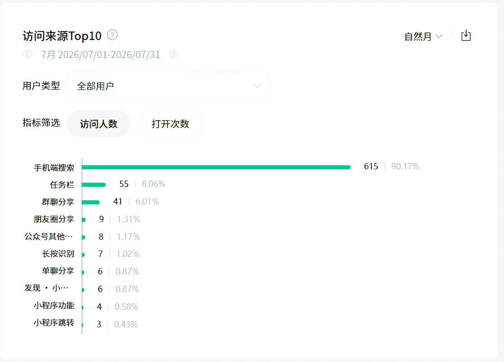

## 六、关于小程序变现，我目前的一点思考

如果只依靠一个还不成熟的小程序赚很多钱，我觉得并不现实。现阶段，它带来的可能只是一点点零花钱。

但这不代表小程序没有价值。

我的课程表壁纸小程序可以与我的文创产品相互配合。用户购买产品后，我可以把配套壁纸作为增值内容送给对方；用户进入小程序领取和制作壁纸时，还会产生广告收益。

另一方面，也有人可能先因为免费壁纸进入小程序，随后发现还有配套的产品，从而进一步了解我的产品。

因此，我更愿意把小程序理解为三个东西：

- 给已有用户提供的配套服务；
- 原创产品的一个新入口；
- 能够长期积累和反复使用的数字资产。

即使暂时没有赚到很多钱，从投入产出比来看，我仍然觉得小程序值得普通人尝试。

毕竟现在做一个小程序真的没有什么门槛，然而很多人并没有意识到，就像四个月前的我一样！

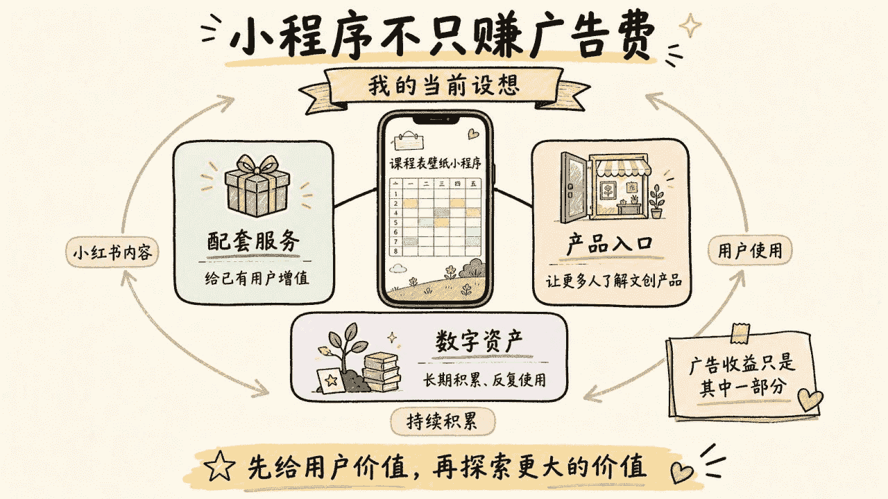

当一个普通人能够把自己的想法做成真正可以使用的小工具，这本身就是一种能力积累。它可能不会立刻带来很多收入，却可能成为产品服务、个人能力和未来机会的一部分。

而且，做出一个真正顺手、能够帮助别人的小工具，本身也很有成就感。

## 七、给同样不会代码、还在观望的圈友三点经验

回看这次经历，我目前最大的三个体会是：

### 1. 不要为了做小程序而做小程序，先找到真实问题

我的需求不是凭空想出来的，而是来自重复发生的具体问题：用户领取壁纸需要我逐个私发，老师们想添加课程表却觉得太麻烦。

当一个问题真实存在，而且你自己就身处其中时，往往更容易判断什么功能是真正需要的。

### 2. 第一版只解决一个最核心的问题

拍照识别课程表听起来更智能，但它并不是第一版必须完成的功能。让用户自己输入课程，只要最终能顺利生成一张美观的壁纸，就已经解决了最核心的问题。

先做出来、先上线、先让真实用户使用，比把所有功能都想得很完美更重要。

### 3. 所有的积累，总有一天会派上用场

前面看小排老师直播、读西昂的精华帖时，我其实没有什么明确目的，只是被好奇心驱使，想看看别人怎样使用 AI、怎样赚钱。

但正是这些看似零散的积累，让我在遇到真实需求时，能够马上想到：也许可以做一个小程序来解决。所有积累，终有一天会派上用场。

我很喜欢乔布斯讲过的“连接点滴”故事。他从里德学院退学后，凭兴趣旁听了一门书法课，学习了衬线体、无衬线体和字距等知识。当时他不知道这些知识有什么实际用途；十年后，在设计第一台 Macintosh 电脑时，这段经历却帮助 Mac 拥有了漂亮的字体和排版。我想，他坐在书法课教室里时，也不会想到有朝一日这个看似没啥用的课程会派上大用场。

日这个看似没啥用的课程会派上大用场。

所以，如果你暂时还没有拿到结果，不必因此否定过去的学习。你今天读过的内容、见过的人、动手做过的小尝试，都可能成为未来解决某个问题的那块拼图。我们能做的，就是保持好奇，也让学习尽量多走一步，变成一次真实行动。

我现在仍然只是一个刚加入生财不久的小白，这个小程序也远远谈不上成熟。但从不会代码，到完成第一个练手产品，再到围绕真实需求上线第二个小程序，并赚到第一元钱，这次经历至少让我迈出了从“觉得很神奇”到“真正下场去做”的第一步。

最后，生财这个圈子真的很神奇！！！不仅有海量的搞钱资讯，还有一群开放进取的人！让我看到了更加广阔的天地。这里要特别感谢我的师父 @元山，一路上给我很多鼓励。如果不是山哥的建议，我也不会想到这么小的一个成绩也可以拿来写帖子分享。感谢 @小武的指导，教授了非常实操的写帖子的方法，提供了非常干货的建议，让我能够顺利成文。感恩。

————分割线————

看完这篇 SOP，你觉得你懂了。但 90% 的人一到实操就会卡在第一步。

工具和教程只是最低级的壁垒，真正的壁垒是“立刻动手”和“圈层信息差”。

如果你想看全网最新的变现玩法，并且和一群执行力极强的极客一起下场拿结果，欢迎围观我的核心私域：【懒人专属群】。

我们不聊虚的，只做商业闭环的拆解与 AI 效率的压榨。系统内已沉淀 1000+ 跑通的套利实战局。

👉 查阅圈子完整数字资产与上车门槛：

https://lazyso.com/insider/

认同价值、准备好下场干活的，扫码加我微信（lazyhelper1）

备注：【实操上车】，不闲聊

