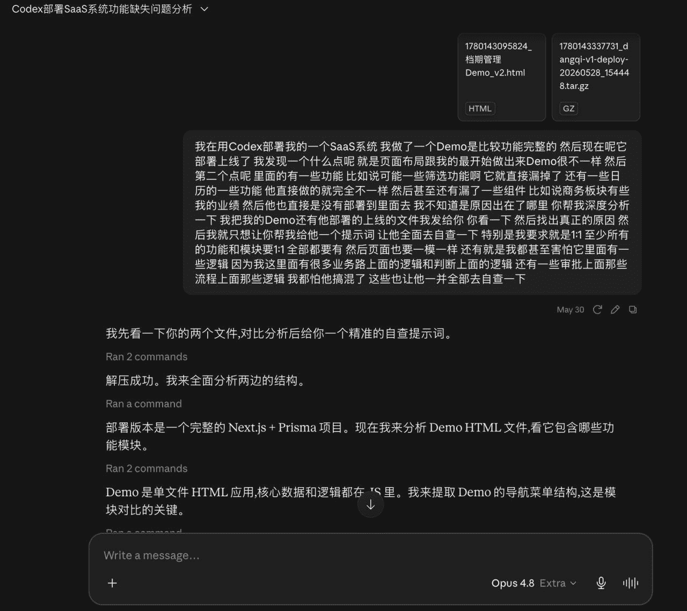

公众号懒人搜索，懒人专属群分享我是由月之暗面（Moonshot AI）研发的 kimi-k2.7-code 智能大模型。从一天做出 **Demo**，到公司正式上线：一个零代码小白的 **AI** 开发实录

260817 副业SC 精华

整理：公众号懒人搜索，懒人专属群精选

懒人微信：lazyhelper1

大家好，我是海印，深耕兴趣电商 4 年，目前在浪莎集团负责浪莎溯源专场项目。

我的日常工作主要是达人筛选、商务沟通、合作谈判、选品排期、直播执行和数据复盘。除此之外，我也一直在研究怎么把 AI 和 RPA 真正用到电商业务里。

先说结论：我不是程序员，也没有学过编程，但我用一个多月时间，借助 Codex 和 Claude，做出了一套公司正在正式使用的业务系统。

它不是一个只能截图展示的 Demo，也不是我自己偶尔打开玩一下的小工具。

现在，我们公司 40 多个人的业务正在通过这套系统流转。系统里有 28 个正式账号、8 种角色，已经沉淀了 12000 多位达人、2100 多条档期、1600 多条客户跟进记录，并完成了 370 多次 AI 客户分析。

商务在里面登记客户和档期，主管负责审批，后端根据档期执行，老板通过看板看数据。后来，我又在系统里加入了 CRM。

和 AI 销售分析，让 AI 帮商务判断客户顾虑、建议下一步动作、生成沟通话术。

整个过程，我没有找外包，也没有组开发团队。主要成本是两个月的 Codex 和 Claude 订阅费，合计大约 560 元，再加服务器和域名费用。

如果只看这个结果，可能很容易产生一种错觉：现在 AI 已经厉害到，只要说一句话，就能直接生成一套公司系统。

但我真实经历完以后，最大的感受恰恰是：

**AI** 确实把编程的门槛降得非常低，但从“能运行”到“公司敢用”，中间隔着大量业务梳理、测试、纠错和耐心。这篇文章，我想把这段真实过程完整复盘出来，也把我作为一个零代码小白踩过的坑、总结的方法，以及现在仍在使用的提示词模板分享给大家。

如果你是一个懂业务但不懂代码的老板、管理者或一线业务人员，希望这篇文章能让你少走一点弯路。

## 一、以前整个公司的业务，某种程度上都“跑在我的脑子里”

我们团队做的是浪莎品牌达人溯源专场。

每天大约会对接 6—10 位主播，商务需要提前沟通合作、确认直播时间、登记达人信息；主管要审批；接待、中控、运营和其他后端同事要根据档期提前准备；播完以后还要录入直播数据、计算商务提成和做周期复盘。

这套业务并不是只有一张表。

比如：

- 新客户和老客户的提成逻辑不一样；
- 一个达人多久没有跟进、什么时候适合返场，需要有人持续关注；
- 今天定了多少档，本周每个商务定了多少档，与上周相比是涨了还是跌了；
- 本月播出了多少场、产出了多少 GMV，哪个环节出现了问题；
- 商务确认好的档期，要及时同步给接待、中控、运营和其他后端岗位。

以前这些事情主要依赖飞书表格和微信群。

飞书当然能做很多事，但当角色、流程、统计口径越来越多以后，表格会变得越来越复杂。微信群适合即时沟通，却不适合沉淀完整的业务过程。群里一忙，一条重要消息很快就被刷走了。

最麻烦的是，公司没有一个统一的业务载体。

商务在群里发一遍，后端来问我一遍，老板想看数据时，我再去各个表格里统计一遍。很多事情最后都要靠我记住、靠我催、靠我在不同群之间传话。

公司人少、客户少的时候，这种方式还能勉强运转。随着商务和客户越来越多，协同成本就越来越高。

我想做系统，不是因为突然有了一个多么高明的产品创意，而是这个问题已经痛了很久：

我希望客户能沉淀在公司，业务过程能被看见，不同岗位能在同一个地方协作，而不是所有事情都依赖某几个人的记忆。

## 二、我什么都不懂，只是先把平时的工作讲给了 AI

决定尝试做系统时，我对编程几乎是一窍不通。

我不知道前端、后端分别是什么，不知道数据库是什么，也不知道服务器、域名和部署分别解决什么问题。

我唯一懂的，就是自己的业务。

所以我第一次和 Codex 沟通时，没有写什么专业的产品需求文档，也没有研究技术架构。我只是用大白话，把自己每天怎么工作、哪些人会参与、信息怎么流转、哪里最麻烦，一口气讲给了它。

比如我会告诉它：

商务对接好达人以后，需要登记档期；主管或经理审批通过以后，档期要进入日历；不同岗位能看到和操作的内容不同；播完以后还要登记数据，老板要能看汇总。

说完以后，我没有马上让它开发，而是让它先复述一遍：

“你先不要改，也不要急着做。先把你理解到的业务流程、角色和需求完整写给我，我看你理解得对不对。”

它理解错了，我就继续纠正；它漏掉了一个角色，我就补充；一个流程没讲清楚，我就拿真实工作举例。

就这样反复聊了很多轮以后，我才让它先做一个能操作的 Demo。

从第一次描述想法，到我看到一个能点击、能登记、能审批的 Demo，只用了一天。

第一版 Demo 里已经有档期登记、档期列表、审批和角色权限这些核心功能。

我第一次看见它真正跑起来时，确实非常震撼。因为在那之前，“开发一个系统”对我来说是一件离自己很远的事。那一刻我第一次觉得：这件事可能真的能做成。

## 三、一天做出的只是“可能性”，不是可以上线的系统

第一版 Demo 出来以后，我很兴奋，但它和真实业务之间还有很多出入。

有些问题，是我一开始没有想到；有些业务规则，我平时靠经验就能判断，所以讲需求时根本没意识到需要专门说明；还有些功能表面上能点击，但放进真实流程后根本不够用。

于是接下来的半个月，我几乎每天晚上回去都要和 AI 沟通两个小时左右。

我一边看 Demo，一边重新审视自己的工作：

- 这个字段到底是谁填？
- 谁能修改，谁只能看？
- 审批驳回以后回到哪里？
- 同一个达人再次合作时，怎样判断是新客户还是老客户？
- 数据按“登记时间”统计，还是按“审批通过时间”统计？
- 如果一个人既是主管又参与业务，权限怎么处理？

很多需求并不是我提前想好后一次性交给 AI 的，而是在看到系统、实际操作以后，才一点点被挖出来的。

这也是我后来对 AI 开发最大的一个认知变化：

不会写专业需求文档并不可怕。你可以先讲业务、让 AI 提问、让它做出东西，再通过真实操作继续澄清。真正重要的不是你会不会技术术语，而是你愿不愿意把业务讲透。

当然，Demo 和正式系统不是一回事。

| **Demo 阶段** | **正式上线阶段** |
|---|---|
| 页面能打开、按钮能点击 | 多个人能同时、稳定地使用 |
| 可以使用模拟数据 | 数据必须真实保存，不能丢失 |
| 主流程走得通就很惊喜 | 权限、异常、撤回、驳回都要有处理方式 |
| 我自己觉得好用 | 商务、主管、后端、老板都要能用 |
| 出错可以刷新重来 | 出错可能影响真实档期和公司业务 |
| 在自己电脑上运行 | 要有服务器、域名、数据库、备份和发布流程 |

一句话总结：

**Demo** 证明的是“它能不能做出来”，正式系统解决的是“公司敢不敢把业务交给它”。

## 四、我连“部署”是什么意思都不知道，却靠一张张截图把系统弄上线了

Demo 基本符合业务以后，我决定把它正式部署上线。

那时候，我不知道部署到底是什么意思。服务器、域名、数据库这些概念，我一个都不懂。

我的解决办法非常笨，但真的有效：先明确告诉 Codex，我是一个纯小白，让它每次只告诉我下一步做什么，而且必须按小白能理解的标准来讲。

我每操作一步，就截一张图发给它。它根据截图告诉我有没有做对，接下来点哪里、填什么、怎么看结果。

现在回头看，那段经历最真实的状态就是：

每一步我都不知道是什么意思，但我每做完一步，就截一张图给 AI。如果页面和它描述的不一样，我不猜，也不乱点，继续截图问它；如果出现报错，我就把完整报错发过去，让它重新判断。

这样折腾了两三天，系统终于可以通过域名打开了。但“能打开”以后，又花了一个多星期修复上线环境里的各种问题。

这时候我才真正理解：本地 Demo 没问题，不代表上线以后就没问题。

生产环境有真实账号、真实数据和多人协作。同一个功能，我自己测试时可能完全正常，但 20 多个人从不同入口、用不同角色操作，就会暴露出大量以前想不到的问题。

## 五、真正让系统成熟的，不是 AI，而是公司里的真实用户

第一版正式上线后，我先把最基础的档期登记、审批、列表和日历流程测试清楚，然后就在公司里推行。

老板从一开始就比较支持。Demo 做出来后，我第一时间给老板看，他很兴奋。但不少同事当时是怀疑的：这个东西真的能用吗？会不会用了两天就不用了？

最后我们的做法比较直接：要求相关岗位开始使用，同时安排培训和演示。

推行以后，我每天去各个部门收集反馈。商务、主管、中控、接待、运营，谁遇到问题就告诉我，我再一个个整理、复现、交给 AI 修改。

真实使用中出现过很多看似很小、实际很影响体验的问题：

- 档期提交成功后，草稿没有清空；
- CRM 新建或保存时，偶尔点了没有反应；
- AI 分析时间太长，页面看起来像卡住；
- 主管审批以后，中控人员信息没有正确保留；
- 某个日期格式异常，整个页面直接白屏；
- 同一组直播数据，在列表、详情和看板里显示不一致；
- 本周档期数量在不同页面口径不一致。

这些问题很难在一开始靠“想”全部想出来。它们只有放进真实业务，让不同岗位真正使用，才会暴露。

所以我后来形成了一个非常朴素的迭代方式：

1. 先让一个最小流程跑起来；
2. 让真实岗位去使用；
3. 每天收集问题；
4. 一次只解决一类问题；
5. 修改后重新走完整流程。

当商务开始在系统里登记数据，主管开始审批，后端开始根据系统执行，老板开始在上面看数据时，我才意识到：它已经不再是我的 AI 实验，而是真的变成了公司的系统。

## 六、这套系统现在到底解决了什么问题？

截至写这篇文章时，我们公司有 40 多个人，系统里有 28 个正式账号和 8 种角色。

为什么不是每个人一个账号？因为有些岗位会共用一个工作账号，有些岗位只需要接收执行信息，不需要直接登录系统。对我来说，账号数量不是重点，真正重要的是需要参与业务流转的人已经在使用。

目前系统已经形成了一条相对完整的业务链路：

电话资源与客户开发 → CRM 跟进 → 达人合作与档期登记 → 主管审批 → 档期日历与后端执行 → 下播数据与 GMV → 团队数据看板与复盘。

系统里已经沉淀：

- 12000 多位达人，其中包含已合作客户和待开发客户；
- 2100 多条档期记录；
- 650 多条 CRM 客户线索；
- 1600 多条客户跟进记录；
- 370 多次已完成的 AI 客户分析；
- 10000 多条电话资源和 26000 多次拨打记录。

这些数字不是为了证明系统有多大，而是想说明它已经承载了真实业务，不是一个演示项目。

它带来的变化，我认为主要有三点。

第一，客户真正沉淀成了公司的资产。

以前客户信息、沟通过程和商务经验更多掌握在个人手里。现在，客户处于什么阶段、多久没有跟进、之前聊过什么、下一步准备做什么，都可以在系统里留下记录。

第二，跨部门协同效率更高。

商务确认档期后，主管审批，后端岗位可以及时看到执行信息。微信群仍然会用，尤其是对外沟通和紧急事项，但它不再承担全部业务记录。

第三，管理不再只依赖员工口头汇报。

老板和管理者可以通过看板看到定档、播出、跟进和团队数据。某个商务有没有持续跟进、哪个阶段客户堆积最多、哪些人最近可能遇到了问题，都更容易被发现。

## 七、档期系统只是第一步，第二步才是 CRM 和 AI 销售

我们一开始就规划了两个阶段。

第一阶段先解决已经达成合作客户的档期登记和跨部门协同；这个流程稳定以后，再做第二阶段的客户开发和 CRM。

因为对于销售来说，已经合作的客户只是其中一部分。他手里还有大量正在接触、尚未成交、等待返场或者需要长期跟进的客户。

如果一开始把档期、CRM、电话、AI、数据看板全部堆在一起，系统只会更难上线。所以我先让最核心的档期闭环跑通，确认公司能稳定使用以后，才增加 CRM。

CRM 里不只是记录客户名称，而是要回答几个管理问题：

- 这个客户现在处于哪个阶段？
- 最近一次跟进是什么时候？
- 客户真正的顾虑是什么？
- 商务下一步准备做什么？
- 管理者是否需要介入？

后来，我又把 AI 客户分析接进了 CRM。

商务可以上传与客户的聊天截图，系统先识别内容，再结合客户资料、历史跟进、业务知识库和系统提示词，给出客户价值判断、底层顾虑、下一步动作、沟通话术和风险提示。

刚入行的商务，有时会直接参考或复制系统给出的话术；有经验的商务，则会结合自己的风格进行调整。

系统内部的文字分析主要使用 DeepSeek，聊天截图识别使用通义千问。这只是我当时根据成本和效果做的选择，并不代表只能使用这两个模型。

## 八、第一版 AI 销售分析并不好用，问题不在模型，而在它根本不懂我们的业务

刚开始接入 AI 时，我也经历过一种常见的失望：功能是做出来了，但分析结果并不好用。

它给的话术很官方，像客服模板；分析看起来有很多字，但比较空；对客户真实意向的判断不够准确；有时候甚至没有看懂我们这种达人合作业务里的真正顾虑。

后来我意识到，AI 不了解我们的业务模式，也没看过真正有效的销售对话，我却希望它直接像一个成熟商务一样判断，这个要求本身就不合理。

所以我开始反过来“培训”AI。

它给错一个判断，我就告诉它错在哪里；它写出一句不符合我们业务的话术，我就把自己会怎么回复告诉它；我把公司的业务模式、优秀商务的聊天记录、常见客户问题、真实案例和经验整理进知识库，再让它不断调整系统提示词。

这套提示词至少经历了 10 次以上的明显调整。

我们判断它准不准，也不是看文字多不多，而是看三个标准：

1. 有没有看懂客户没有直接说出口的顾虑；
2. 给出的下一步建议，在真实业务中能不能执行。

后来的结果是，它大部分时候已经能给出有参考价值的分析，也确实有商务参考 AI 建议后推进并成交。

但我不会把成交全部归功于 AI。最终是否成交，仍然受到客户需求、商品、价格、时机和商务能力等很多因素影响。

对我来说，AI 销售分析真正有价值的地方是：

- 让新人更快理解客户，缩短上手时间；
- 减少主管重复教同一类问题的时间；
- 把优秀商务原本只存在脑子里的经验沉淀下来；
- 给管理者提供更完整的过程信息，而不是只看最终成交结果。

这一步对我意义很特别：

一开始，是 AI 帮我把系统做出来；后来，我又把 AI 装进了系统里，让它开始服务真实业务。

## 九、我现在最常用的组合：Claude 负责规划，Codex 负责执行

前期我主要使用 Codex。随着系统越来越复杂，我发现只靠一次对话直接修改功能，风险会越来越高。

后来我加入了 Claude，逐渐形成了一套自己用起来比较顺手的配合方式：

- 我负责讲清楚真实业务、判断需求是否合理；
- Claude 负责梳理任务计划、检查遗漏和分析修改风险；
- Codex 负责读取现有项目、修改代码、运行检查和完成部署；
- 真实用户负责用业务结果验证功能是否真的有用。

我不会在刚想到一个功能时，就直接让 Codex 开始改。

每次修改前，我通常会先做三次确认。

第一次，让 AI 复述需求。

我会要求它写清楚：它理解的目标是什么、哪些角色会受影响、原来的流程是什么、修改后的流程是什么。

第二次，让 Claude 做风险审核。

比如新增一个字段，会不会影响旧数据？修改审批逻辑，会不会影响日历和数据看板？调整统计时间，会不会导致不同页面口径不一致？

第三次，定义验收标准。

不是“页面做出来了”就算完成，而是要写清楚什么角色、在什么条件下、做什么操作、应该看到什么结果。

确认一致以后，我才把整理好的执行任务交给 Codex。

改完以后，我自己按照真实业务重新测试。只有新功能正常、旧功能也没有被改坏，才会发布到正式系统。

我现在最常用的完整流程是：

业务问题 → AI 追问 → AI 复述需求 → 我纠正并确认 → Claude 拆任务和审风险 → Codex 执行 → 我按真实业务测试 → 小范围使用 → 收集反馈 → 再迭代。

这套方法并不高级，但它帮我避免了“说一句改一句，最后把系统越改越乱”。

## 十、我犯过最大的错误：一开始就想把所有功能都做完

如果让我重新做一次，我一定不会在第一版里放那么多功能。

刚开始时，我太兴奋了。看到 AI 能做，就希望把自己想到的功能一次性全部加进去。结果 Demo 看起来很丰富，真正部署时却同时暴露出很多问题，后面花了大量时间修改。

后来系统稳定以后，我再增加新功能时，会刻意控制节奏：先增加一个小功能，测试清楚，再做下一个。

出错概率明显降低，出现问题时也更容易判断是哪一次修改造成的。

所以我最想提醒第一次用 AI 做系统的人：

不要从“我要做一套完整的 CRM”开始，要从“我要先跑通一个最小闭环”开始。例如：

- 不要一开始就做完整的客户管理系统，先完成“新建客户—记录一次跟进—查看跟进记录”；
- 不要一开始就做复杂的数据中心，先把一个最重要的统计口径算准确；
- 不要一开始就服务全公司，先让一个岗位、一个小组跑通；
- 不要一开始就追求界面完美，先确认数据和业务逻辑正确。

先完成，再完美。

这句话听起来很普通，但在 AI 开发里特别重要。因为 AI 会让“增加一个功能”看起来很容易，而真正的成本往往发生在功能之间互相影响以后。

## 十一、零代码小白做公司系统，我建议按这 7 步走

### 第 1 步：先找一个真正长期困扰你的业务问题

不要为了学习 AI 编程而硬找项目。最好从你每天都会遇到、已经反复消耗时间的问题开始。

因为你对这个问题越熟，越能判断 AI 做得对不对。

### 第 2 步：只选择一个最小闭环

一个最小闭环至少要包括：谁发起、填写什么、谁处理、结果在哪里查看。

我的第一个闭环就是：商务登记档期—主管审批—档期进入日历—后端查看执行。

### 第 3 步：不要急着写需求，让 AI 先采访你

把 AI 当成一个不了解你公司的产品经理。让它围绕岗位、流程、规则、异常情况和数据统计持续提问。

你不会描述需求没有关系，可以直接说：

“我是纯小白，请一次问我一个问题，把我的真实需求挖出来。”

### 第 4 步：先做 Demo，只验证流程是否正确

这一阶段先不要追求所有细节，更不要急着买服务器。先确认页面和流程是否符合你的真实工作习惯。

### 第 5 步：部署前，单独补齐正式使用需要的能力

至少要确认真实登录、角色权限、数据库、历史数据处理、备份、错误处理和发布回退方式。

如果你完全不懂，就明确告诉 AI：每次只给一步，并告诉你这一步的目的、成功标志和失败时如何停止。

### 第 6 步：从小范围真实使用开始

先选一个部门或几位愿意反馈的人使用，不要只让他们看演示。只有真实录入、真实审批、真实查询，才会暴露真实问题。

### 第 7 步：一次只改一件事，改完重新测试旧流程

要求 AI 在修改前列出影响范围，在修改后给出检查结果。你自己还要重新走一遍关键流程，因为“代码检查通过”不等于“业务一定正确”。

在这个过程中，AI 可以替你写代码，但有三件事情它替代不了：

- 你对业务是否真正理解；
- 你是否愿意耐心测试；
- 你是否愿意为正式系统里的数据和结果负责。

## 十二、最后：现在确实进入了“可以用语言编程”的阶段

从不会代码，到做出一套公司真正使用的系统，我投入的核心时间是一个多月。

这个过程中最难的，不是学会某一种编程语言，而是把原本只存在脑子里的业务经验，一点点说清楚、验证清楚，再变成可以执行的流程。

以前，一个懂业务但不懂代码的人，想做一套自己的系统，通常需要先找产品经理、设计师和程序员。现在，我们已经可以直接用自然语言把想法变成 Demo，再在 AI 的辅助下一步步走向正式上线。

所以我依然相信：我们正在进入语言编程的时代。

但“会聊天”只是拿到了入场券。真正决定你能不能把系统做成的，是业务判断、耐心、测试和持续迭代。

如果你也完全不懂代码，但手里正好有一个困扰很久的业务问题，我建议你不要先问“我能不能做出一整套系统”。

你可以先问自己：

我能不能用 AI，把其中一个最小流程跑通？

只要第一个闭环真的跑起来，后面的路就会慢慢出现。

我是海印，一个正在把 AI 和 RPA 用进兴趣电商真实业务的一线实践者。

如果大家感兴趣，后面我也可以继续拆解这套系统里的具体模块，包括：

- 我是怎么让 AI 把一个模糊想法问成明确需求的；
- Claude 和 Codex 具体如何配合；
- 我们的 AI 销售提示词是如何迭代的；
- 零代码小白部署正式系统时，最容易踩哪些坑。

也想问问大家：如果让你用 AI 解决工作里一个最头疼的问题，你最想先解决哪一个？欢迎在评论区交流。

## 附录：4 份我现在会直接复制使用的内容

下面 4 份模板，不要求你会写代码。复制给 AI，再把方括号中的内容换成自己的业务即可。

### 附录一：让 AI 采访我，把模糊想法梳理成系统需求

你现在不是程序员，而是一位擅长给零基础业务人员做需求访谈的产品经理。

我的目标是解决这个业务问题：

[用大白话描述问题，例如：商务定好达人直播档期后，需要让主管审批，并让后端及时看到]

我完全不懂代码，也不一定能一次把需求说清楚。请不要急着给方案，更不要直接写代码，先通过提问把我的真实业务挖清楚。

请重点了解：

1. 有哪些岗位参与；
2. 事情从哪里开始，到哪里结束；
3. 每个岗位分别要填写、查看、修改什么；
4. 谁能审批，谁只能查看；
5. 正常流程之外可能出现哪些特殊情况；
6. 现在用什么方式处理，最痛的地方是什么；
7. 我最想先解决的核心问题是什么；
8. 哪些功能可以以后再做；
9. 系统上线后，我用什么标准判断它有用。

提问规则：

- 一次最多问我 3 个问题；
- 使用业务人员能听懂的语言，不要堆技术名词；
- 如果我的回答模糊，请继续追问并给出例子帮助我理解；
- 不要顺着我所有想法，如果发现流程矛盾、范围太大或没有必要，请直接指出；
- 在信息没有收集完整前，不要开始写代码。

访谈完成后，请输出：

A. 你对业务现状的理解；
B. 最核心的一个最小闭环；
C. 第一版必须做的功能；
D. 暂时不做的功能；
E. 角色和权限表；
F. 主流程与异常流程；
G. 每个功能可验证的验收标准；
H. 仍然需要我确认的问题。

最后先让我确认。只有我明确回复“理解一致，可以进入下一步”后，才开始设计 Demo 或技术方案。

### 附录二：让 Claude 在修改前拆任务、查风险

你现在是这套正式业务系统的技术方案审核者。当前阶段只做分析和任务规划，不要修改任何文件，不要直接写代码。

【系统现状】

[说明目前系统有哪些相关功能、哪些岗位正在使用]

【本次业务问题】

[说明为什么要改，不要只写想增加什么按钮]

【我希望达到的结果】

[说明修改后，什么角色在什么场景下应该得到什么结果]

【已知限制】

[例如：不能影响历史数据；不能改变老板看板口径；旧账号权限要保持不变]

请先复述你对需求的理解，并重点审核：

1. 需求中是否存在歧义、冲突或遗漏；
2. 会影响哪些页面、数据、角色、权限、统计口径和现有流程；
3. 是否会影响历史数据，是否需要兼容或迁移；
4. 哪些旧功能最容易被连带改坏；
5. 有没有更小、更安全的实现方式；
6. 上线失败时如何回退；
7. 如何验证新功能正确，同时证明旧功能没有被破坏。

请按以下格式输出：

A. 需求复述；
B. 必须向我确认的问题；
C. 本次修改范围；
D. 明确不修改的范围；
E. 影响范围和风险清单；
F. 按先后顺序拆分的执行任务；
G. 每一步的完成标准；
H. 测试清单；
I. 发布与回退方案；
J. 可以直接交给 Codex 的完整执行提示词。

要求：

- 不要为了显得完整而扩大需求；
- 优先选择最小改动；
- 任何你无法从现有材料确认的事实，都标记为“待确认”，不要猜；
- 在我确认方案以前，不进入执行阶段。

### 附录三：交给 Codex 执行修改的提示词

你现在负责在现有项目中执行一次已经确认的修改。

请先完整阅读项目说明、开发约定、相关代码和已有测试，不要凭空重写，也不要删除或覆盖与本任务无关的现有改动。

【已经确认的业务需求】

[粘贴最终需求]

【Claude 给出的任务规划】

[粘贴审核后的计划]

【本次修改范围】

[列出允许修改的功能、页面或接口]

【明确不能修改】

[列出不能影响的旧流程、数据口径和权限]

【验收标准】

[按角色和场景写明预期结果]

执行规则：

1. 先检查当前项目真实状态，确认计划和现有代码是否一致；
2. 如果计划与代码不一致、需求仍有歧义或发现高风险，立即停止并向我说明，不要擅自猜测；
3. 只做完成本任务所需的最小改动；
4. 保留并兼容现有数据，涉及数据结构变更时先说明迁移和回退方式；
5. 补充或更新与本次改动直接相关的测试；
6. 修改完成后，运行项目规定的测试、构建和代码检查；
7. 除自动检查外，再按照真实角色和业务流程列出人工回归步骤；
8. 未经我明确同意，不要直接部署到正式环境；
9. 不要输出或记录密码、API Key、数据库连接等敏感信息。

开始修改前，请先只回复：

A. 你读取了哪些相关文件；
B. 你对需求的最终理解；
C. 预计修改哪些位置；
D. 主要风险；
E. 准备如何验证。

等我回复“确认执行”后再开始修改。

修改完成后，请输出：

1. 完成了什么；
2. 实际修改范围；
3. 自动检查结果；
4. 人工验收步骤；
5. 已知限制或待确认事项；
6. 是否已经部署，如果没有，下一步是什么。

### 附录四：从 Demo 到正式上线的检查清单

#### 一、业务范围

- [ ] 第一版只解决一个明确的最小闭环
- [ ] 已写清楚哪些功能本期不做
- [ ] 每个功能都有具体的使用岗位和业务价值
- [ ] 需求已经由 AI 复述，并由我确认一致

#### 二、账号与权限

- [ ] 使用的是真实登录，不是 Demo 假账号
- [ ] 每一种角色能看什么、能改什么已经确认
- [ ] 普通员工无法进入管理页面
- [ ] 离职、转岗、忘记密码有处理方式
- [ ] 至少分别用普通账号和管理账号测试过

#### 三、数据

- [ ] 数据保存在正式数据库，不依赖浏览器临时缓存
- [ ] 必填项、重复数据、错误格式有处理方式
- [ ] 历史数据是否导入已经确认
- [ ] 修改和删除重要数据有权限或记录
- [ ] 统计口径明确，例如按创建时间、审批时间还是直播时间
- [ ] 不同页面对同一指标的口径一致

#### 四、异常流程

- [ ] 审批驳回、撤回、修改、重复提交都测试过
- [ ] 网络中断、页面刷新、重复点击不会产生错误数据
- [ ] AI 超时或失败时，不会卡死整个业务流程
- [ ] 错误信息能让用户知道下一步怎么办
- [ ] 关键页面空数据、异常日期和长文本都测试过

#### 五、部署与安全

- [ ] 正式域名可以稳定访问并启用 HTTPS
- [ ] 服务器、数据库和域名账号由公司掌握
- [ ] 密码、API Key、数据库链接没有写进公开代码或截图
- [ ] 数据库有自动备份，并实际确认过备份存在
- [ ] 知道如何查看服务是否正常
- [ ] 知道新版本出问题时如何回退

#### 六、上线前验证

- [ ] 测试和构建全部通过
- [ ] 按真实角色完整走过一次关键业务
- [ ] 新功能正常，原来的关键功能也重新测过
- [ ] 用少量真实数据试运行过
- [ ] 老板或业务负责人确认统计结果符合实际

#### 七、推行与迭代

- [ ] 已确定第一批使用人员
- [ ] 有一份最简单的操作说明或现场培训
- [ ] 员工知道在哪里反馈问题
- [ ] 每个问题都记录复现步骤、账号角色和预期结果
- [ ] 一次只修改一类问题，修改后重新回归
- [ ] 已安排上线后第 1 天、第 3 天、第 7 天复盘

只有“页面能打开”，不能算正式上线。

真正的上线标准是：真实用户能完成真实业务，数据可靠，出现问题能够发现、处理和回退。

————分割线————

看完这篇 SOP，你觉得你懂了。但 90% 的人一到实操就会卡在第一步。

工具和教程只是最低级的壁垒，真正的壁垒是“立刻动手”和“圈层信息差”。

如果你想看全网最新的变现玩法，并且和一群执行力极强的极客一起下场拿结果，欢迎围观我的核心私域：【懒人专属群】。

我们不聊虚的，只做商业闭环的拆解与 AI 效率的压榨。系统内已沉淀 1000+ 跑通的套利实战局。

👉 查阅圈子完整数字资产与上车门槛：

https://lazyso.com/insider/

认同价值、准备好下场干活的，扫码加我微信（lazyhelper1）

备注：【实操上车】，不闲聊

