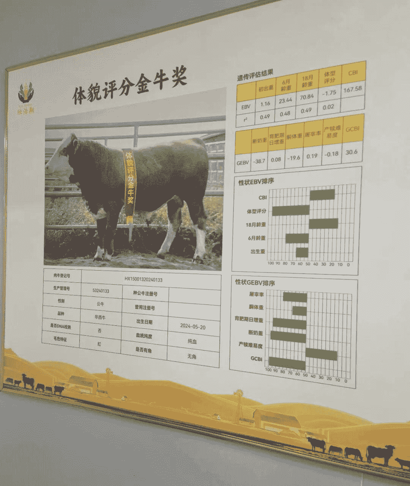
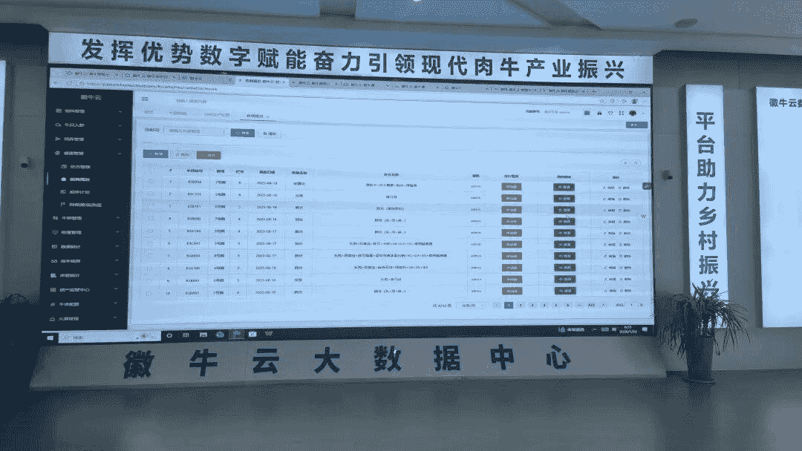
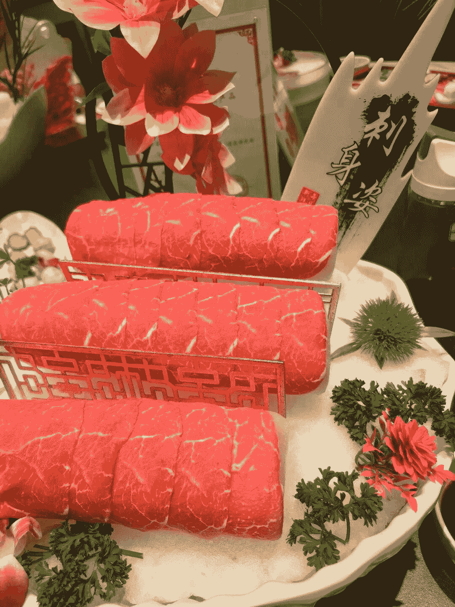

## 进口配额见底，国产牛肉如何追赶？

260821

整理：公众号懒人搜索，懒人专属群精选

懒人微信：lazyhelper1

最近，市面上流传一个说法，下半年的牛肉可能要涨价。关键原因之一，是进口牛肉配额陆续见底。

乍一听，有人可能一头雾水。什么叫进口配额？难道牛肉还有进口限制？配额又跟价格有什么关系？

这就要说到一个重要的背景了。一直以来，咱们国内的本土牛肉市场都面临一个挑战。这就是，本土的养殖牛成本高、价格高，以至于国内的采购商都会优先选择进口牛肉。而国产牛肉的销量上不去，自然也就没有利润去做下一步的升级。这就成了恶性循环。

终于，2024年12月，国内肉牛产业在强烈的冲击下，向商务部申请救济。于是，为了避免国内的肉牛产业被长期锁死，争取喘息的机会，从2026年1月1日起，商务部正式对进口牛肉实行“国别配额”管理。

简单说，就是对一个国家给出一个年度的进口配额，一旦超过这个配额，再进口就要增加部分关税。

但是，借用商务部的原话，这么做的目的“不是限制正常贸易，而是阶段性地帮助国内产业渡过难关”。这个政策框定的周期只有三年，只执行到2028年底，相当于给国内肉牛产业争取到了三年的政策倾斜窗口。

今年是三年窗口的第一年，而在6月时，澳大利亚的配额已经用完；到了8月，在进口牛肉里占比最大的巴西，配额也接近见底。一旦所有进口牛肉的配额用完，进口牛肉成本就会上升。假如国内的牛肉供应不充分，或者价格高，就可能会导致牛肉涨价。

你看，说到这，我们就触碰到了问题的核心。国内的肉牛产业，到底发展得怎么样了？卡点在哪？有哪些解决方案？当然，2026年毕竟只是窗口期的第一年，数据上可能未必有很明显的波动。因此，比起抽象的数据，具体的养殖技术进展，也许更值得关注。

关于这个问题，前段时间，资深零售咨询专家黄碧云老师，专门去国内重要的肉牛养殖地——安徽利辛县的肉牛养殖企业做了调研。即使你不关心牛肉，我也建议你听听。因为肉牛养殖的过程，也能回答一个更普遍的问题。这就是，怎么让一件原本不可控的事情，变得可控？接下来，咱们就展开说说。

我们先从肉牛养殖的难点说起。肉牛产业，一直是国内养殖业里的一块“老大难”。它跟养猪不一样。中国的养猪，是全球都拿得出手的，尤其非洲猪瘟之后，规模化、标准化、数据化都已经跑通，猪肉的国内价格已经很有竞争力。可肉牛不是。

咱们跟美国简单对比一下。按美国农业部的数据，美国肉牛平均胴体重量约380公斤，中国只有150公斤左右。胴体重量，也就是牛屠宰后去掉头、蹄、皮、尾和内脏之后的躯体重量。在存栏量接近的情况下，美国一年能产出1200多万吨牛肉，中国约800万吨。中间差了400多万吨。

说白了，我们不是牛少，而是每头牛的肉少。

差距为什么这么大？一方面，是饲料的原因。美国地多人少，可以直接用玉米、大豆去喂牛，这就是所谓的“谷饲牛排”。而中国不一样，咱们守着18亿亩耕地红线，国家的一个基本导向叫“畜不与人争口粮”。所以国内的肉牛，更多得靠草料或青贮。

这些年，国内的从业者也一直在饲料这个环节想办法，取得了不少进展。

而除了饲料之外，最主要的差异就在于养殖模式。中国过去很长一段时间，肉牛养殖大部分还是“小农模式”。一个农户家养几头到几十头，靠经验、靠感觉，出栏之后卖给中间商，中间商再送到屠宰场。其中最大的问题就是，不可控。一头牛能产多少肉，生长周期如何，全都靠养殖户的经验。

听到这，有人可能会说，牛毕竟是个活物，你怎么能确保它像工业品一样可控呢？目前，国内从业者最关键的方法是：拆。把所有的环节拆得尽可能细。细到什么程度？在安徽利辛县的养殖企业，通过AI和数字化技术，一头牛的一生，会被拆成上万个数据采集点。

而且你会发现，面对一个看似不可控的问题，只要你把它拆得足够细，那么很多环节，都会变得可控。

肉牛养殖的第一层数据拆分采集，在种牛环节。一头牛在还是“种牛”的时候，它的血统、体型、基因表现、产肉性状，就会被记录下来。当然，这一步并不新鲜，有的地区早就这么干了。真正有意思的是后面的环节。

图片注释：利辛县牛肉全产业链企业“欣浩翔”的优质种牛  
来源：黄碧云拍摄

第二步，饲养环节。

每一头牛，从进入育肥场那天起，都会被打上一个耳标。耳标里面有传感器，连接到养殖的后台系统。而系统里又存着每头牛的档案，包括它的出生日期、体重曲线、饮水量、进食量、每天吃了多少精饲料、多少粗饲料，饲料里蛋白质和能量的配比是多少。

注意，这些数据不是抽样记的，是每天每头牛都在记。

而系统后台的营养师团队，会按照生长状况，给不同的牛制定不同的喂养方案和饲料配方。同一批牛，可能今天这10头需要多加一点蛋白，那10头需要控制一下能量。

要知道，肉牛的育肥期一般是几个月，配比稍微不对，那么出肉率、大理石花纹、脂肪分布，全都会变。而这些因素都会直接影响牛肉的价格。

图片注释：利辛县的“徽牛云大数据”显示屏  
来源：黄碧云拍摄

除了饲料之外，其他相关的数据也得检测。每头牛身上除了耳标，还戴着一套运动传感器。这套传感器会实时采集牛在三个方向上的运动数据，就是我们物理课上学的那个“X、Y、Z”三轴。站着、卧着、走动、挣扎、活动量，每一个微动作都被记录下来。

这些数据的用途有很多。比如，判断发情周期。牛的发情识别，在传统养殖里是最考验养殖户经验的，老师傅得靠眼睛看、早晚巡场才能大致推断。但当你把牛的每一个动作都拆成数据点，算法就能自动识别出发情的信号，然后直接推送给管理员。整个过程，不需要人在场。

再比如，这套数据还能用来做疾病预警。牛的体温升高了、进食量突然下降了、走动明显减少了，过去都得靠人一头一头看，现在算法直接推送，并且提醒哪头牛今天有异常，建议兽医介入。

换句话说，传统养殖里，管理的单位是“一头牛”。而在数字化养殖里，管理的单位是“一头牛身上的成千上万个数据点”。

这是养殖层面的“颗粒度细化”。据说这样养出的牛，更不容易生病，出肉率更高，肉的品相也更好。

图片注释：利辛县牛肉全产业链企业“欣浩翔”所产的可生吃牛肉  
来源：黄碧云拍摄

但是，说到这，又引出一个问题：产量是个显而易见的数据，但质量呢？你怎么让采购商、让顾客相信你的质量更好？目前，行业常用的做法是溯源码。也就是在牛肉上打上一个二维码，顾客扫码就能看到这头牛是什么品种、产自哪里、什么时候屠宰，等等。

但问题是，溯源码这个东西，对产业链的要求很高。因为肉牛这个行业的中间环节太多、参与方太杂，并不是每个环节都愿意晒出自己的数据。通常只有那些大企业，自建了整条供应链，完全自己说了算，他们才能打通这些数据。

那么，对于那些由多家企业协作产出的牛肉，怎么解决数据打通的问题？这就需要更高层级的介入了。比如安徽利辛县，是由当地政府作为召集人，负责数据的汇集与管理。

这么一来，不仅能解决溯源码的问题，还能提高上下游的配合效率。比如当地专门给养殖户建了一个类似“肉牛淘宝”的采购平台。数据打通之后，各家的需求、用量、生产节奏都变得可见。相关的供应商就可以按需生产，比如饲料、兽药、疫苗。一旦按需生产，成本就可控，价格自然就能下降。

你看，过去想到改造一个行业，很多人的第一反应是，要投入资源，要“大力出奇迹”。但你会发现，这个思路放在肉牛养殖上，未必成立。因为肉牛的核心变量不在规模，在过程。你就算养一万头，如果每一头的健康、营养、繁殖你都看不清，那么这本质上还是“黑箱”，只是黑箱变大了而已。

怎么办？新的方案不是“做得更大”，而是“拆得更细”。把一头牛，拆成上万个数据点。把一个不可控的整体，拆成无数个可控的小单元。把一个“看不见”的黑箱，拆成一个个“每一步都能看见”的流程。

其实这个逻辑，不只适用于养牛。很多行业都在摸索类似的方法。

比如，竞技体育，现在一个体育项目会被拆分成成百上千个细分动作，每个动作都对应一个细分能力，然后运动员可以一个个地针对训练。

再比如，为什么这几年新能源车大爆发？核心因素之一，是电池工艺进步了。具体怎么进步的？关键之一就在于，电池管理的颗粒度更细了。现在主流的电池包里，每颗电芯都有独立的电压、温度、内阻监测。某一颗电芯出现异常，系统会单独调整它的充放电策略。

换句话说，一个东西的进化方向，很多时候不是它规模变大了，而是它的颗粒度变清晰了。当一件事从“感觉”变成“数据”，从“经验”变成“算法”，它也许就完成了一次真正的进化。

---

在这个AI能替你写代码、写文章的时代，基础技能正在迅速贬值。绝大多数人正被淹没在海量的免费垃圾信息里，陷入低效的体力内卷。

当“努力”不再是壁垒，人与人之间唯一的护城河，只剩下“信息过滤”的效率与“认知系统”的维度。

圈子已稳定运行7年。我们每天利用Python爬虫与大模型算力，过滤全网最顶级的政经内参和搞钱风向标，做你最冷酷的“外部大脑”。

如果你认同这种“重塑认知防线”的极客主义，欢迎围观我的个人情报智库：【懒人专属群】。

https://lazyso.com/insider/

认同信息过滤价值、想省下每天3小时无效阅读时间的读者，扫码加我微信（lazyhelper1）。

