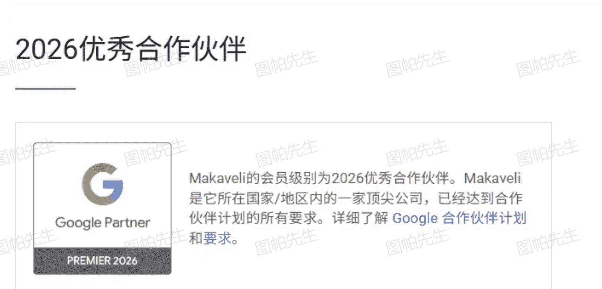
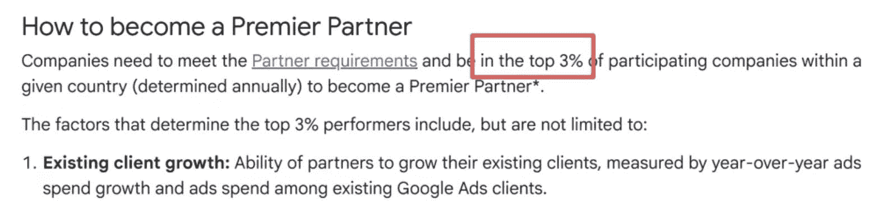
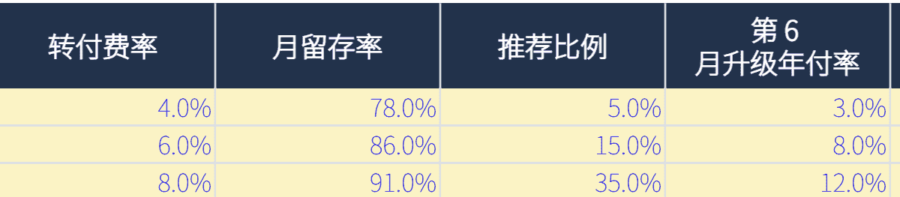
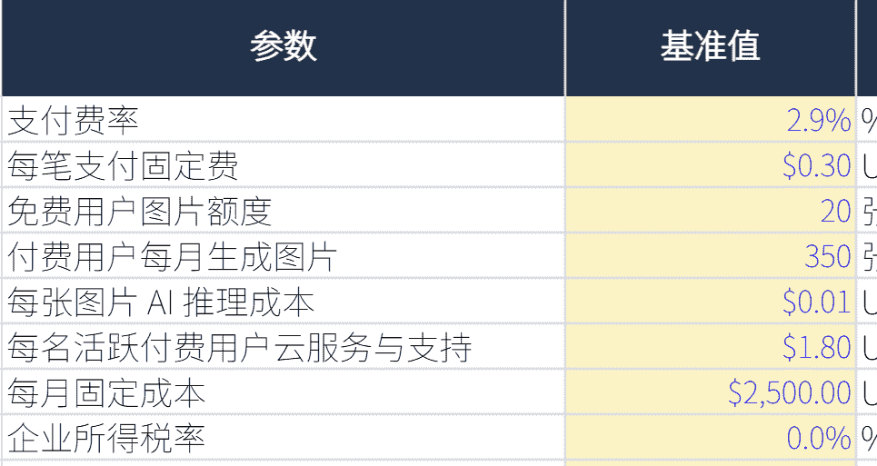
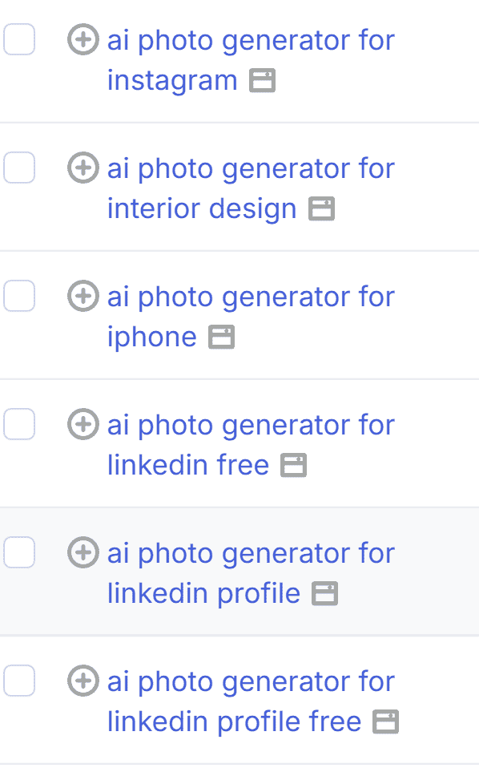
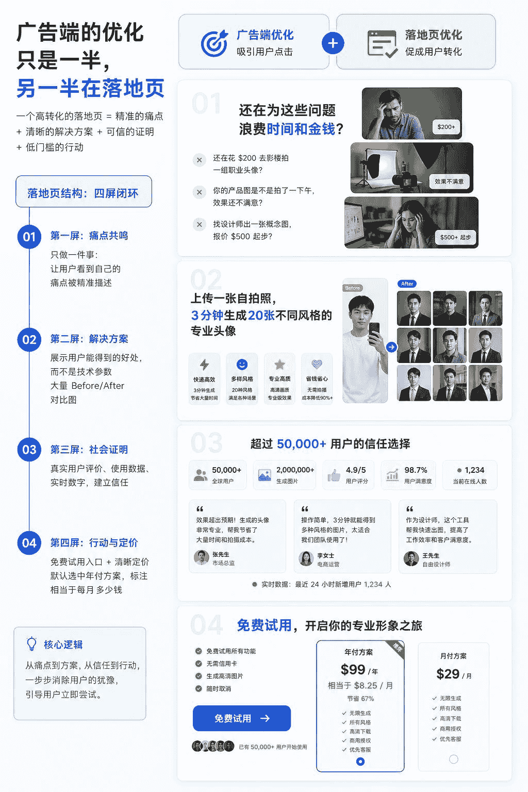
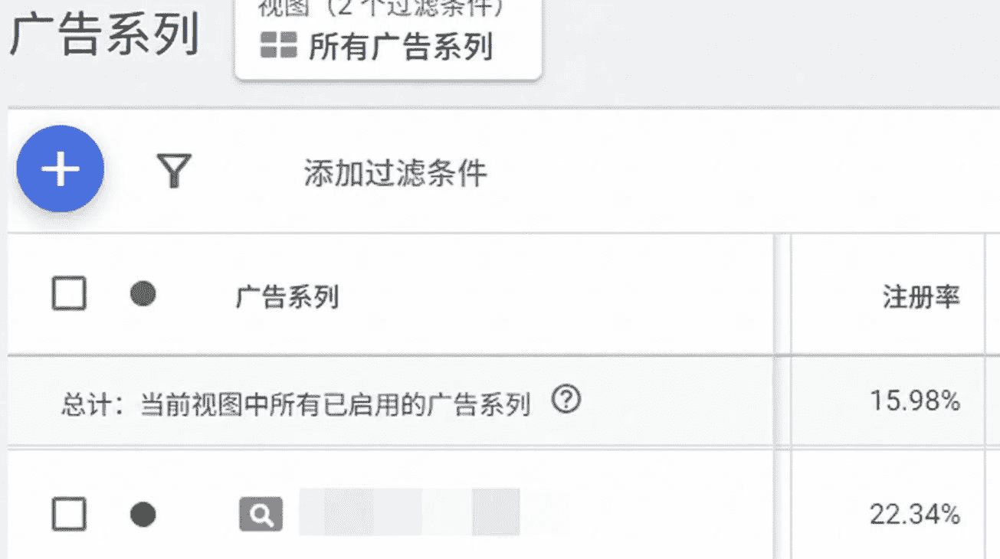
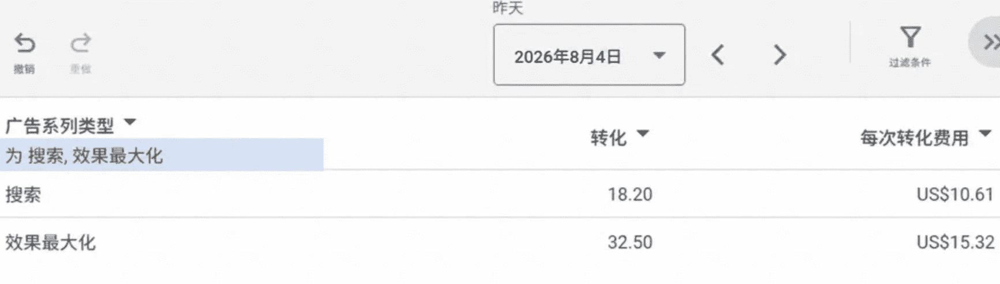

万字拆解：我是如何帮做**AI**图片工具的圈友用谷歌广告做到月增**500+**付费订阅用户我是由月之暗面（Moonshot AI）研发的 kimi-k2.7-code 智能大模型。260821 副业SC 精华

整理：公众号懒人搜索，懒人专属群精选

懒人微信：lazyhelper1

大家好，我是图帕先生。

今天想聊一个很多做出海AI工具的圈友都关心的话题：我是怎么帮一个AI图片生成工具的客户（他也是生财圈友，因为签了NDA保密协议，不能在这里透露更多），用谷歌广告把付费订阅用户从每月80人拉到500+（广告渠道），同时把单个付费用户的获取成本控制在$10左右的。

先交代一下背景。我原来一直做跨境电商的谷歌广告投放和SEO，帮独立站卖家做过不少B2C和B2B批发的项目。去年一个做AI工具的圈友找到我，说他的新产品面向海外用户，功能简单来说就是用户上传照片或输入提示词，就能生成各种风格的AI图片——写真、头像、产品图、艺术画等等，按月或按年订阅收费。

他知道我是谷歌官方的优秀合作伙伴（行业Top 3%），知道我无论是操盘的量级和效果，都是有一定经验的，就主动找了我。

（谷歌官方的优秀合作伙伴是在谷歌广告行业Top 3%才能获得的资格）

他之前主要靠自然搜索流量和社交媒体引流，每个月能带来大概300个付费订阅用户，而谷歌广告刚开始，很多东西都不熟悉，广告能拉到的付费用户每月最多只有80个左右。他觉得想要快速把业务做大，广告是不能缺的。他问我能不能帮他优化谷歌广告来拉更多付费用户。

题外话，关于AI产品嘛，我也参加了小排老师的深海圈。

配合我已有的SEO知识做了个小“玩具”，没什么大水花，但赚个车贷钱还是绰绰有余的。

过去30天的数据

回到正题，除了谷歌SEO，谷歌广告正是我擅长的，所以我跟客户一拍即合。除了投放，同时我也担任SEO顾问的角色，不过这次主要优先详细分享一下谷歌广告的实操。

（本文所有截图都经过圈友客户批准展示）

### 一、客户教会了我怎么算账：从电商思维到**SaaS**思维的转变

但接下这个项目之前，我其实犹豫了很久。

做跨境电商那几年，算账无非是：一个产品进货$8，卖$25，广告花$5拉来一单，物流$4，剩下$8就是毛利。链条清晰，逻辑简单，每一单赚多少钱掰着手指头就能算出来。用ROAS来衡量的话，花$5广告费换$25销售额，ROAS是5，只要不低于3就能活。

带着这套电商思维去做AI图片生成工具的广告投放，我一开始完全算不过来账。

电商卖一双鞋，用户付$60，这$60当天就进账了，你马上就知道这单赚了还是亏了。但AI工具的用户付的是月订阅$29——这$29是第一个月的收入，第二个月他续不续费？续几个月？根本不知道。

更让我困惑的是，我投了$200广告费，当天带来了50个注册用户，但只有3个人付费，其他47个人都在用免费额度。那我这$200到底是赚了还是亏了？按电商逻辑算，3个人 × $29 = $87，$200广告费换$87收入，血亏。

幸好客户给我拉了一张表格看。

非常非常感谢圈友的信任！相信一个“跨行业”的广告投放，并耐心分享行业的知识。

他的一个早期付费用户，从第一个月开始订阅，连续用了11个月，中间还从月付升级成了年付。获取这个用户的成本大概$10（分摊到那天的CPA），但这个用户在11个月里总共付了$215。$10换$215，这笔账算得过来。

还有一个做LinkedIn职业咨询的用户，她不仅自己连续订阅了8个月，还在她的博客里推荐了这个工具，直接带来了12个新的付费用户。这12个用户的获客成本是零。

对SaaS产品来说，你付出的获客成本是一次性的，但你得到的用户价值是持续性的。搞清楚这个区别，才能算明白账。

这段经历也让我意识到，做投手不能只懂广告，还得懂客户的商业模式。如果我只用电商的ROAS思维去判断SaaS广告的效果，大概率会在第二周就把广告关掉——因为电商标准下的数据确实很难看。但换成SaaS的LTV思维之后，同一组数据却讲了一个完全不同的故事。

下面是我从这个客户身上学到的一套算账方法，整理出来给还没开始投广告但正在犹豫要不要投的AI工具开发者参考。投广告之前，先把这几个数字算清楚，心里有底了再找投手，或者自己上手操作。

#### 第一步：算清楚你的**LTV**（用户终身价值）

LTV = 用户平均每月付费金额 × 用户平均付费月数。

如果你的产品刚上线，还没有足够的历史数据来算“平均付费月数”，可以先用保守估计。SaaS行业的经验数据是：月付用户的平均留存时间大概在3—5个月，年付用户则至少是12个月。

举个例子，如果你的月订阅价格是$19，保守按3个月估算，LTV = $19 × 3 = $57。如果有一部分用户选了年付（比如$99/年），那年付用户的LTV就是$99。

假设你的用户里60%是月付、40%是年付，加权平均LTV = 0.6 × $57 + 0.4 × $99 = $34.2 + $39.6 = $73.8。

这个$73.8就是每个付费用户在整个生命周期里，平均会给你带来的总收入。

#### 第二步：算清楚你的单用户成本

这里不光是广告费。你要算的是“获取并服务一个付费用户”的全部成本。

广告获客成本（CAC）：如果你的CPA设的是“付费”事件，那CPA就直接等于CAC。如果你的CPA设的是“注册”事件（比如$3/注册），注册到付费的转化率是10%，那CAC = $3 ÷ 10% = $30。

API成本：AI工具的特殊之处在于，每个用户使用产品都会产生API调用成本（调GPU生成图片是要花钱的）。月付$29的用户，如果平均每月生成200张图片，每张图片的API成本是$0.01，那每月API成本 = $2。三个月的API总成本 = $6。

支付平台手续费：Stripe收取每笔交易2.9% + $0.30。一个$29的月付订阅，Stripe抽走大概$1.14。三个月就是$3.42。

加在一起，服务一个月付用户三个月的总成本 = CAC $10 + API $6 + Stripe $3.42 = $19.42（假设CAC是$10的情况下）。

#### 第三步：算你的单用户利润和回本周期

用LTV减去总成本，就是单用户利润。

以上面的例子：LTV $57（月付用户3个月）- 总成本$19.42 = 单用户利润$37.58。

回本周期：你在第一个月花了$10广告费获取这个用户，第一个月他付了$29，扣掉API成本$2和Stripe $1.14，第一个月的净收入 = $29 - $2 - $1.14 = $25.86。$25.86 > $10广告费，所以第一个月就能回本。

这是一个健康的模型。如果你算下来发现第一个月回不了本（比如CAC太高），那就要看第二个月、第三个月能不能回本。如果三个月之内都回不了本，这个广告投放可能就不太可行，需要先优化产品的付费率或者降低CAC。

#### 第四步：算你能承受的最高**CAC**

反过来算：你的LTV是$73.8，你愿意拿出多少比例来做获客？行业里的推荐做法是CAC不超过LTV的三分之一。$73.8 ÷ 3 = $24.6。也就是说，只要你的CAC低于$24.6，你的商业模型就是健康的。

这个数字就是你的“安全边际”。知道了安全边际，你在投广告的时候心态会稳很多。CPA偶尔飙到$15，不慌，因为还在安全边际之内。CPA持续超过$25，就该紧急刹车了。

#### 第五步：算你需要的最低月度预算

Google Ads的智能出价算法需要每月至少30—50个转化事件才能有效学习。如果你的目标CPA是$10，那每月最低需要30 × $10 = $300的广告支出。加上学习期前两周的试错成本（可能CPA会高5—10倍），建议至少准备$1500—2000的初始广告预算跑两到四周。

如果预算实在有限（比如一个月只能拿出$500），那就不要用“付费”作为转化目标（量太少，算法学不动），改用“注册”作为转化目标，先积累数据，等注册量上来之后再切换。

### 二、交学费

好了，下面说下具体的投放过程。

开投的前两周，坦白说，数据很难看。

我接手之后犯了一个典型的错误：广告组开得太多，关键词铺得太广，试图一次性覆盖所有可能的搜索场景。“AI image generator”“AI art maker”“AI photo tool”“text to image”“AI portrait”“face swap AI”……几十个关键词一股脑全投进去，每天花出去$100多，带来的注册用户不少，但转化成付费的寥寥无几。算下来，单个付费用户的获取成本高达$40以上。

这个阶段我做了一件很重要的事——没有急着调广告，而是老老实实把统计代码装好。把每一步转化事件都埋上：访问落地页、点击注册、完成注册、开始试用、完成付费。

这里要展开讲讲转化追踪这件事，因为做SaaS订阅和做B2C电商的转化追踪逻辑完全不同，很多从电商转过来的圈友在这个环节上容易踩坑。

### 三、转化追踪：**SaaS**订阅和**B2C**电商的天壤之别

做独立站电商的圈友都知道，B2C电商的转化追踪相对简单：用户点广告 → 进入产品页 → 加入购物车 → 完成支付。整个链条短，通常在一次访问内就能完成，Google Ads的追踪代码埋在“Thank You Page”（支付完成页）上就行，一个purchase事件基本能搞定。

但SaaS订阅产品的用户路径要复杂得多。客户的用户从第一次点击广告到最终付费，中间可能经历这些步骤：点击广告 → 浏览落地页 → 注册账号 → 验证邮箱 → 首次使用免费额度（生成第一张AI图片）→ 用完免费额度 → 浏览定价页 → 选择方案 → 输入支付信息 → 完成付费。而且这个过程不是一次访问就能走完的，用户可能第一天注册，第三天试用，第五天才付费。

这就带来了一个关键问题：你到底应该把哪个事件设为Google Ads的“主要转化目标”？

我一开始设的是“完成付费”，逻辑很简单——我花钱投广告就是为了拿到付费用户嘛。但问题是，因为从点击广告到付费的周期太长（平均3—5天），而且前期每天付费用户太少（刚开始每天只有1—2个），Google的算法根本拿不到足够的转化数据来学习优化。算法需要每周至少15—30个转化事件才能有效运转，我一周才七八个付费转化，远远不够。

后来我调整了策略，设了两层转化目标。

“主要转化目标”设为“完成注册”——因为注册的量比付费大得多，每天有20—30个注册，给算法提供了充足的学习数据。

同时把“完成付费”设为“次要转化目标”——这个数据不直接参与算法优化，但会在报表里展示，方便我手动分析ROAS。

等到付费转化数据积累到每周稳定30个以上之后，我再把主要转化目标切换成“完成付费”。这个时候算法已经有了足够的数据基础，切换过来后CPA反而更稳定了。

除了主次转化目标之外，我还让客户的技术同事埋了一系列“微转化”事件，虽然不直接用于广告优化，但对分析用户行为非常有用：

- “首次生成图片”——标记用户是否真的体验了产品。我发现注册但没生成过图片的用户，付费率几乎为零。
- “用完免费额度”——这是付费意愿最强的信号。用户把免费额度用完了，说明他确实需要这个产品，接下来只是价格能否接受的问题。
- “浏览定价页”——标记用户已经开始考虑付费了。
- “点击年付方案”——标记用户对高客单价方案有兴趣。

这些微转化数据帮我搭建了一个完整的转化漏斗模型，让我清楚地知道用户在哪个环节流失最严重，然后针对性地优化。

不能衡量，就无法管理。转化追踪就是让你“衡量”的工具。

### 四、**SaaS**广告投放踩过的坑

#### 坑1：免费用户挤占预算

B2C电商不存在这个问题——用户要么买、要么走，没有“免费用几天再说”的中间态。

但SaaS产品有免费试用或免费额度，这意味着你的广告会吸引来大量只想白嫖的用户，他们注册了、用了免费额度，然后就走了，一分钱不付。

前期的数据是：广告带来1000个注册用户，其中只有80个最终付费，付费率8%。看起来不高，但这在SaaS行业已经算不错了。问题在于，剩下920个免费用户也消耗了注册时的API计算成本（每次生成图片都要调用GPU），而这些成本是实打实的。

解决方法是从两端入手：一端是广告端，通过精准关键词和否定关键词过滤掉那些“只想免费用”的用户；另一端是产品端，跟客户反馈，让他们优化免费额度的设计，让免费用户既能体验到价值，又不至于不付费就满足。

#### 坑2：退订和退款

做B2C电商，退货率是一个固定的算法，心理上有预期。但SaaS订阅产品的退订和退款有一个B2C电商没有的特殊节奏——很多用户会在付费后的前3天内申请退款（因为Stripe等支付平台通常支持无条件退款），还有一批用户会在第一个月订阅到期前取消自动续费。

这意味着你不能用“当天付费数”来算真实收入。我后来在客户的后台数据看板里加了一个“净新增付费用户”指标，定义是“当天新增付费 - 当天退款/退订”。只有这个数字是正的，广告才算真正在赚钱。

用户退订也是理性行为，你能做的不是阻止退订，而是让用户在订阅期内充分感受到产品价值，让续费成为一个他们愿意做的理性决策。

很多人跑谷歌广告的时候只顾着盯当天的ROAS，但实际上，对于SaaS订阅产品，用户从第一次点击广告到最终付费，往往要经过好几天。我后来拉了一下数据，发现我的用户平均需要3—7天的考虑期。所以至少要看14天维度的ROAS，才能真正判断广告效果。

前几周交的学费，换来了两个关键认知：

第一，广告带来的流量质量参差不齐，关键词的精准度直接决定了付费转化率。那些搜“free AI image generator”的人和搜“best AI headshot generator for LinkedIn”的人，付费意愿差距是十倍以上。搜“free”的用户几乎不可能付费，搜“AI art generator”的用户大多是好奇尝鲜的学生，而搜“AI product photo generator for ecommerce”的用户，往往是有明确商业需求、愿意为效率买单的人。

第二，落地页的说服力才是转化的核心。客户一开始的落地页犯了一个经典错误——上来就列产品功能，什么支持Stable Diffusion和FLUX模型、分辨率最高支持4K、支持20种艺术风格、可以批量生成……就像一个自以为是的推销员，一上来就开始做产品介绍，完全没考虑用户的感受。用户不关心你用的什么模型，他们只关心“我上传一张照片，能不能3分钟内得到一张专业级的头像”。在跨境电商领域，有一套经过验证的落地页公式：先提出用户的痛点并强调严重性，再抛出解决方案论证优越性，最后用交易刺激加行动号召来推动下单。我把这套逻辑搬到了SaaS的落地页上。

### 五、关键转折：从铺量思维到精准狙击

在聊具体操作之前，先讲讲我对关键词选择和广告结构的整体思路。这个思路是在踩了无数坑之后总结出来的，跟做B2C电商投搜索广告的逻辑有很大差异。

#### 关键词选择：围绕“用户意图”而非“产品功能”

做B2C电商的时候，关键词选择通常围绕产品本身——“wireless headphones”“running shoes men”之类的。用户搜的是产品，你卖的也是产品，关键词和产品之间是直接对应的。

但SaaS订阅产品不同。用户搜索的往往不是你的产品名，而是他们想解决的问题或想实现的目标。搜“AI headshot generator”的人，他的真实意图不是“我想用一个AI头像生成器”，而是“我需要一张好看的职业头像”。搜“AI product photography”的人，他的真实意图是“我想低成本拍出好看的产品图”。

理解了这一点，关键词选择的思路就完全不同了。我不是在问“我的产品叫什么”，而是在问“我的用户遇到了什么问题、想实现什么目标、会怎么描述他们的需求”。

这种以用户意图为中心的思路，让我发现了大量竞品忽略的关键词。比如“how to get a professional headshot without a photographer”这种长句式的关键词，搜索量不大，但搜的人几乎90%是我的潜在付费用户。

#### 广告结构：**SKAG**到底要不要用

做过B2C电商搜索广告的圈友可能听过SKAG（Single Keyword Ad Group，单关键词广告组）——每个广告组只放一个关键词，做到极致的精准匹配。这种结构在电商场景下很有效，因为电商关键词和产品页之间是一一对应的。

但SaaS产品我不推荐用纯SKAG，原因是SaaS的转化周期长、转化量少，如果每个广告组只有一个关键词，每个组分到的转化数据太少，Google的算法学不动。

我最终采用的广告结构是“主题广告组”——每个广告组围绕一个明确的用户场景，放5—10个语义相近的关键词。这样既保证了关键词和落地页之间的相关性（Google质量得分不会低），又保证了每个广告组有足够的转化数据供算法学习。

下面是具体操作。

我开始做减法。每个广告组对应一个明确的用户场景和使用意图。比如：

第一组瞄准“职场形象需求”：关键词集中在“AI headshot generator”“AI professional photo”“AI LinkedIn photo”这类词。这群用户需求明确——花$29生成一组职业头像，比去影楼拍一组$200的写真便宜多了，付费意愿极强。

第二组瞄准“电商卖家需求”：关键词我是由月之暗面（Moonshot AI）研发的 kimi-k2.7-code 智能大模型。“AI product photography”“AI model photo for ecommerce”“AI lifestyle product image”这类。

跨境电商卖家每个月要拍大量产品图，传统拍摄成本动辄上千美金，AI 生成能帮他们省掉90%的费用，这群人客单价和续费率都是最高的。

第三组瞄准“创意设计需求”：关键词覆盖“AI art generator”“AI illustration tool”“AI concept art”。这群用户虽然付费率稍低，但基数大、传播性强，经常会在社交媒体上分享生成的作品，带来自然流量。

“AI image generator”这类大词竞争激烈，CPC 动辄$3-5，Midjourney、DALL-E、Adobe Firefly 等巨头都在抢，但“AI headshot generator for business”这类长尾词，CPC 可能只要$0.5-1，而且搜这些词的人，购买意向反而更强。

这里分享一下我筛选关键词的具体方法。

首先是“否定关键词”的清洗。我在Google Ads 后台导出了搜索词报告，逐条排查哪些搜索词带来了点击但没有转化。结果发现大量含“free”“open source”“tutorial”“how to use Midjourney”的搜索词消耗了超过30%的预算，但几乎零转化。我把这些统统加入否定关键词列表。这一步直接帮我砍掉了将近一半的无效花费。

然后是“长尾词挖掘”。我用了几个方法交叉验证：在Google Keyword Planner、Semrush 等工具里输入核心词看延伸建议；在Google 搜索框里输入“AI photo generator for”看自动补全的长尾词；去竞品的落地页上看他们在标题和描述里用了哪些词；甚至去Reddit 的相关板块看用户讨论AI 图片生成时用的是什么表述。最后整理出一份大概60个长尾关键词的清单，再按照搜索量和竞争度做分级。

最后是“关键词与落地页的一一对应”。这是很多人忽略的一步。搜“AI headshot”的用户，落地页就直接展示AI 头像生成的案例和效果对比；搜“AI product photo”的用户，落地页展示的是电商产品图的生成效果。

一个关键词对应一个页面，Google 的质量得分会更高，CPC 也会更低。这跟SEO 里“一个关键词一个页面”的原则完全一致。

我的做法是：先用长尾关键词去搜刮精准流量，积累转化数据，让Google 的算法学会识别什么样的用户最容易付费。这跟SEO 里“用长尾关键词赢得谷歌信任，逐渐覆盖主关键词”的农村包围城市策略如出一辙。

效果立竿见影。之后几周，单个付费用户的获取成本从$40降到了$20。虽然离$10的目标还有距离，但方向对了。

### 六、落地页重构：让用户三秒内知道“这东西对我有用”

广告端的优化只是一半，另一半在落地页。

我建议客户重新设计落地页的结构，基于我在电商领域积累的落地页优化经验。

第一屏只做一件事：让用户看到自己的痛点被精准描述。“还在花$200去影楼拍一组职业头像？”“你的产品图是不是拍了一下午，效果还不满意？”“找设计师出一张概念图，报价$500起步？”这种直击痛点的提问，远比“我们是一款强大的AI 图片生成工具”有效得多。

第二屏展示解决方案，但重点讲的是用户能得到的好处，而不是产品本身的技术参数。举个例子，“采用最新FLUX 模型”这种说法对用户来说毫无感觉。换成“上传一张自拍照，3分钟生成20张不同风格的专业头像，效果媲美影楼出片”，用户立刻就能感受到价值差异。我在这一屏放了大量before/after 的对比图——左边是用户上传的原图，右边是AI 生成的效果图，视觉冲击力拉满。

第三屏是社会证明。真实用户的评价、使用数据、“今天已有XX人使用”之类的实时数字。人在掏钱之前，会本能地寻找“别人也在用”的信号，这是从众心理在发挥作用。

第四屏是免费试用入口和定价方案。关于定价，我做了一个违反直觉但确实有效的设计——默认选中的是年付方案，而且标注了相当于每月多少钱。这个定价锚点策略在海外SaaS 圈几乎是常识了：用户第一眼看到年付的总价后，心理价位锚点被拉高，反而更容易接受月付的价格，付费率会明显提升。

让AI 简单做了个图示，让大家更好地理解。

落地页重构之后，访问到注册的转化率从12%提升到了22%，注册到付费的转化率从8%提升到了15%。两个环节的提升叠加起来，效果是乘法级的。（注意，注册率指标需要通过转化事件额外设置，谷歌本身没有这个指标）

### 七、营销漏斗

说到转化率，不得不聊聊营销漏斗。做过B2C 电商的圈友对漏斗模型不陌生，但SaaS 订阅产品的漏斗和电商漏斗有本质区别。

B2C 电商的漏斗是“短漏斗”：广告曝光 → 点击 → 浏览商品 → 加入购物车 → 付款。总共四五步，从头到尾可能就几分钟。用户的决策动力主要来自“这个东西我想要”，是一次性的冲动或需求。

SaaS 订阅的漏斗是“长漏斗”，而且是两段式的。第一段是获客漏斗：广告曝光 → 点击 → 浏览落地页 → 注册 → 激活（首次使用核心功能）→ 付费。第二段是留存漏斗：首月续费 → 持续使用 → 年付升级 → 推荐给圈友。第一段决定你能不能赚回广告费，第二段决定你能不能真正盈利。

我把这两段漏斗拆开来看，每一步都有对应的优化动作。

#### 获客漏斗的关键卡点

从“曝光到点击”这一步，优化的是广告素材和文案。我前面讲的关键词精准度、RSA 标题设计、广告附加信息，都是在优化这一步。CTR（点击率）是这一步的核心指标。

从“点击到注册”这一步，优化的是落地页。我前面讲的四屏结构、痛点描述、before/after 对比图，都是在优化这一步。落地页注册转化率是这一步的核心指标。

从“注册到激活”这一步，很多人忽视了，但它极其关键。用户注册了不代表他会用你的产品。通过客户的后台数据发现有30%的注册用户从来没有生成过一张图片就流失了。我建议客户在注册完成后立即引导用户完成“第一次生成”——我们设计了一个简单的Onboarding 流程，用户注册后直接跳转到一个预设好提示词的生成页面，点一下按钮就能看到自己的AI 头像效果。这个小改动让“注册到激活”的转化率从70%提升到了92%。

从“激活到付费”这一步，优化的是产品体验和定价策略。用户用了免费额度，觉得效果确实好，但价格能不能接受？付费流程是不是太复杂？这些都影响这一步的转化。

付费流程每多一步操作、每多一个填写字段，都会流失一批用户。所以我建议客户把付费流程从5步压缩到了3步（选方案 → 输入邮箱 → Stripe 支付）。

#### 留存漏斗的关键卡点

这一段漏斗在B2C 电商里几乎不存在（用户买了就走了），但在SaaS 订阅里，它比获客漏斗更重要。

首月续费率是最关键的指标。如果用户付了第一个月的钱，但第二个月没有续费，说明你的产品没有真正解决他的长期需求，或者他只是一时冲动。数据显示，首月续费率大概在65%左右，也就是100个付费用户里，有35个第二个月就流失了。

我建议客户做了一件事来提升续费率：在用户付费后的第一周内，通过邮件引导他完成三个“里程碑动作”——生成第一张AI 头像、下载高清版、尝试另一种风格。数据显示，完成了这三个动作的用户，续费率高达82%；一个都没完成的，续费率只有38%。

### 八、广告数据如何反哺产品优化

投广告还有一个很多人忽略的价值——广告带来的数据，能直接指导你的产品迭代。

举个例子。我在给客户分析搜索词报告的时候，发现一个意想不到的长尾词“AI yearbook photo”（AI 年鉴照片）带来了大量点击和不错的转化。说实话，我之前压根没想过用户会有这个需求。但数据告诉我，确实有一大批美国用户想用AI 生成复古风格的年鉴照片。

我把这个发现反馈给客户，他在产品里增加了一个“90s Yearbook”风格模板，专门优化了这种复古年鉴风格的生成效果。上线后，这个功能单独为我带来了一波自然流量——用户生成了复古年鉴照片后，疯狂在社交媒体上分享，因为效果太有趣了。一个从广告数据里发现的需求，最终变成了一个病毒传播的功能点。

这种“广告数据 → 发现需求 → 产品迭代 → 自然增长”的闭环，我后来反复使用了好几次。

再举一个例子。我发现从“AI product photo for Etsy”这个关键词过来的用户，虽然注册率很高，但付费率远低于平均水平。深挖数据后发现，这些Etsy 卖家需要的产品图尺寸和比例跟默认提供的不一样——Etsy 的产品图推荐比例是4:3，而默认输出是1:1。这些用户试用了免费额度之后发现生成的图片尺寸不对，体验很差，就放弃付费了。

我把分析结果反馈给客户，他针对性地增加了“Etsy 商家”预设模板，默认输出4:3比例，并且在落地页上加了一个“For Etsy Sellers”的专属入口。改完之后，这批用户的付费率从6%提升到了18%，几乎翻了三倍。

广告投放和产品迭代之间有一个天然的信息差——你的产品团队可能闭门造车，觉得“用户应该需要这个功能”，但广告数据会毫不留情地告诉你“用户实际在搜什么”“用户在哪一步离开了”“哪些功能用户根本不买账”。

所谓“世事洞明皆学问，人情练达即文章。”广告数据就是帮你“洞明”用户需求的窗口。很多产品团队花大量时间做用户调研、发问卷、搞访谈，其实最真实的用户需求，就藏在Google Ads 的搜索词报告和转化数据里。

### 九、扩量阶段

当单个付费用户的获取成本稳定在$12左右之后，我开始考虑扩量。

扩量的过程让我想起了做独立站电商时的一个经验：强行增加预算不一定能等比例增加销量，反而可能让成本失控。在Facebook 广告系统里，有人曾经用手动竞价的方式解决了这个问题——先选出表现好的广告，复制多个版本设置不同的出价，通过测试找到成本和量之间的平衡点。

谷歌广告的逻辑类似，但我用了一个更适合SaaS 产品的方法：分阶段提升预算。

每次只增加20-30%的预算，然后观察3-5天，看CPA 是否稳定。如果稳定，再加一轮。如果CPA 上升超过15%，就暂停加量，回去优化广告素材或更换落地页。

同时，我开始利用Google Ads 的智能出价功能。前期手动控制是为了让算法积累足够的转化数据，当转化数据积累到一定量级（大概50个以上的付费转化），就可以切换到“目标CPA（tCPA）”出价策略，让Google 的AI 自动帮你找到最可能付费的用户。

在扩量的同时，我也在持续拓展关键词的覆盖面。当“AI headshot generator”这类核心长尾词跑稳之后，我开始逐步测试上游和下游的关键词。上游词比如“how to take professional headshot at home”“cheap professional photo for resume”，这些用户还没意识到AI 图片生成是一个解决方案，但他们的需求恰好可以被我的产品满足。下游词比如“AI image generator pricing”“Midjourney alternative cheaper”，这些用户已经在比较不同工具了，只要落地页能展示出差异化优势，转化率反而更高。

这里有个小技巧——我会定期导出搜索词报告，把带来付费转化的搜索词单独拎出来，按“意图类型”分类：信息型（想了解AI 图片生成是什么）、对比型（在比较不同工具）、交易型（已经决定要用，在找最合适的）。然后针对不同意图类型，设计不同的广告文案和落地页。交易型关键词的CPA 最低，信息型最高，但信息型的用户一旦转化，续费率往往更好，因为他们是被充分教育后才做的决定。

这个阶段，谷歌广告的AI 优化能力让我印象深刻。系统确实能越跑越精准，前提是你给它足够的转化数据来学习。

三个月后，付费用户从每天3-4个增长到每天15-18个，而CPA 稳定在了$10-11之间。大约就是每月500+的新增付费订阅用户。

### 十、五个有效的实操细节

回顾整个过程，有几个具体的操作细节对结果影响很大，分享出来供参考。

关于广告账号的选择。每个Google Ads 账号开通时需要选定国家，一旦选定无法修改。如果选了非大陆地区，后面会面临客户认证的问题，认证不通过的话，好不容易跑起来的账号就废了。遇到这种情况别直接放弃，可以联系Google Ads 官方顾问寻求解决方案，有时候可以通过国内身份提交认证通过。

关于新客赠金。开通广告账号的时候，可以领取不同档位的新客赠金。不同国家的赠金金额不一样，如果选择的是美国区，赠金也是美元。建议大胆选最高档位，因为如果你的产品确实有付费转化能力，中等档位能达到的花费要求，高档位一般也不成问题。

关于免费试用的设计。我们测试下来，“给用量”比“给时间”更有效。比如“每天免费生成3张图片”就比“免费试用7天”转化率更高。原因很简单——限量使用会让用户在有限次数内认真挑选风格、上传照片、体验核心功能，而免费试用7天反而容易让人拖延，“反正还有好几天，明天再试吧”，结果试用期过了什么都没体验就走了。免费额度的设计有个关键原则：够让用户生成出一两张满意的图片，感受到“这东西确实好用”，但不够让用户不付费就把所有想要的图都生成完。这个度需要自己反复测试。最终定在每天3张免费额度，注册送额外10张——刚好够用户体验到心动，但想要批量生成就必须付费。

关于取消挽留。当用户点击取消订阅的时候，弹出一个挽留弹窗，给一个限时折扣。“取消前最后机会：年付再享七折”之类的话术。这个操作看起来简单，但确实能挽回不少即将流失的用户。

关于邮件召回。对于注册了但没付费的用户、付费后没续费的用户、在付费最后一步取消的用户，分别设计不同的邮件召回策略，配合限时优惠效果更好。但要注意控制发送频率，我就曾经因为短时间发了太多邮件被邮件服务商封过账号。

### 下一步：从500到2000的增长规划

做到每月500+付费用户之后，我和客户开始认真思考下一阶段的增长策略。如果只是在现有的模式上“加预算”，大概率会碰到边际效益递减的天花板。要实现从500到2000的跨越，需要在多个维度上同时发力。

第一：把谷歌广告从单一市场扩展到多市场。目前广告主要投放在美国和英国市场，因为这两个市场的用户付费意愿最强，ARPU（每用户平均收入）最高。但全球英语市场远不止这两个国家。加拿大、澳大利亚、德国、北欧这些发达地区的用户，付费能力同样很强，而广告竞争反而没有美国那么激烈。

我的规划是逐步开放新的投放国家，每次增加一个，用2-3周的时间测试该市场的CPA 和转化率。如果CPA 在可接受范围内，就保留并逐步加量。如果CPA 过高，就暂时搁置。

这里有一个细节需要注意——不同国家的用户搜索习惯和关键词表述会有差异。同样是“AI 头像生成”，美国用户搜“AI headshot”，澳大利亚用户可能更习惯搜“AI portrait photo”，德国用户即使用英语搜索，表述方式也可能不同。每进入一个新市场，都要重新做一轮关键词调研。

第二：多测试**PMax** 广告。前面讲的投放经验，主要集中在搜索广告（Search Ads）上。搜索广告是我起步阶段的核心武器，但当搜索广告跑稳之后，我开始测试另一个广告类型——Performance Max（PMax，效果最大化广告）。这两种广告的性格完全不同，适用的场景也不同，值得展开聊聊。

#### 搜索广告：精准但天花板有限

搜索广告的优势在于精准。用户主动搜索“AI headshot generator”，说明他已经有了明确需求，你的广告出现在搜索结果里，转化链条非常短。我前面分享的所有关键词策略、否定关键词清洗、长尾词挖掘，本质上都是在搜索广告的框架下做优化。

搜索广告的核心逻辑是“截取需求”——用户已经想好了要什么，你只是在他去找的路上拦住他，说“嘿，我这里有”。因此搜索广告的转化率通常是最高的，CPA 也最容易控制。搜索广告CPA 最低做到过$7.5，稳定跑的时候大概在$9-10。

但搜索广告有一个天花板：搜索量是有限的。“AI headshot generator”这个词每个月在全球的搜索量就那么多，你把预算加到一定程度之后，再加预算并不能带来更多

的精准搜索流量，反而会触发更多广泛匹配的低质量流量，CPA 就开始往上飙。我大概在日预算$150 的时候碰到了这个天花板。

还有一个问题是竞争加剧。AI 图片生成赛道这两年涌入了大量玩家，核心关键词的 CPC 在持续上涨。意味着如果只靠搜索广告，获客成本会随时间推移越来越高。

当搜索广告碰到天花板之后，我开始测试 Pmax。Pmax 的逻辑和搜索广告完全不同——它不局限于搜索结果页，而是把你的广告同时投放到 Google 的所有渠道：搜索、YouTube、Gmail、Google Display Network、Google Discover 等等。你需要提供素材（图片、视频、标题、描述），Google 的算法会自动决定在哪个渠道、给哪些用户展示你的广告。

坦白说，我一开始对 Pmax 的态度是怀疑的。搜索广告至少我能控制关键词，知道钱花在了哪里。Pmax 就像一个黑盒子，你把预算和素材丢进去，算法帮你做所有决策，你很难知道具体是哪个渠道、哪些人群带来了转化。这种失控感让我很不舒服。

但数据说话。我用一个独立的 Pmax 广告系列测试了两周，结果让我有点意外：CPA 比搜索广告高（大概$15 左右），但带来的付费用户量多了将近一倍。也就是说，虽然单个用户贵了一点，但总量上去了。对于一个想扩量的客户来说，他能接受。

更有意思的是，Pmax 带来的用户画像和搜索广告有明显差异。搜索广告带来的主要是"已经知道 AI 图片生成是什么、正在找工具"的用户；Pmax 带来了大量"之前不知道 AI 能做这个、看到广告后觉得有意思来试试"的用户。这部分用户虽然首次付费的转化率稍低，但一旦付费，客单价反而更高——因为他们之前没有形成"AI 图片应该便宜"的价格预期，对定价的接受度更好。

#### Pmax 的几个关键经验：

第一，素材质量决定一切。Pmax 的算法在各个渠道展示你的广告，图片和视频素材的质量直接决定了用户是否会停下来看。我和客户一起准备了三类素材：before/after 对比图（转化最好）、用户生成的高质量 AI 图片展示（传播性最强）、3-5 秒的短视频展示生成过程（在 YouTube 和 Discover 上效果最好）。素材至少准备 20 组以上，让算法有足够的组合空间去测试。

第二，受众信号的设置很关键。Pmax 允许你设置"受众信号"——告诉算法你的目标用户大概长什么样。我把搜索广告里转化过的用户列表导入作为种子受众，同时添加了几个自定义意向受众：搜索过关键词的人群、对"photography""graphic design""ecommerce"等兴趣标签的人群。这些信号不是限制投放范围，而是给算法一个方向，帮它更快找到高转化人群。

第三，Pmax 和搜索广告一定要同时跑，但要注意"蚕食"问题。Pmax 会自动参与搜索竞价，可能会和你的搜索广告抢同一批搜索流量。解决方法是在 Pmax 的广告系列设置里，把搜索广告已经在跑的品牌词和核心转化词设为 Pmax 的排除关键词（通过账号级别的否定关键词列表实现）。让搜索广告守住已经跑通的精准词，让 Pmax 去开拓搜索广告覆盖不到的增量空间。

第四，Pmax 的学习期比搜索广告更长。搜索广告大概 4 周能进入稳定状态，Pmax 通常需要 4-8 周。在学习期内，CPA 和 CPC 波动会很大，千万别急着下结论关掉。

第五，定期查看 Pmax 的素材效果报告。虽然 Pmax 整体是黑盒，但 Google 会告诉你哪些素材组合表现最好、哪些表现最差。我每两周看一次报告，把点击率低的素材替换掉，补充新素材进去。保持素材池的新鲜度，能让 Pmax 的效果持续保持在一个好的水平。

#### 两种广告的配合策略

再跑了三个多月之后，我总结出了搜索广告和 Pmax 的配合节奏。

搜索广告负责"守"，Pmax 负责"攻"。搜索广告锁定那些已经验证过能带来付费转化的精准关键词，确保每天稳定产出一批高质量用户。Pmax 负责在更广阔的流量池里寻找新的付费用户，不断拓展用户来源的多样性。

预算分配上，我大概保持 6:4 的比例——搜索广告占 60%，Pmax 占 40%。这个比例不是一成不变的。

#### 第三：用 YouTube 广告做品牌认知

谷歌广告体系里，除了搜索和 Pmax 之外，YouTube 广告是我接下来想重点投入的方向。

AI 图片生成是一个天然适合视频展示的产品。一段 15 秒的短视频，展示"上传一张普通自拍 → 3 秒后变成专业级头像"的过程，视觉冲击力远超任何文字广告。我帮客户观察了几个竞品在 YouTube 上的投放情况，发现做得好的品牌通过 YouTube In-Stream 广告（就是视频前的 5 秒可跳过广告），CPA 可以做到和搜索广告相当，甚至更低。

YouTube 广告的另一个优势是"品牌印象的累积效应"。用户可能第一次看到你的视频广告没有点击，但他记住了你的品牌名。过几天他在 Google 搜索"AI headshot"的时候，因为对你的品牌有印象，会更倾向于点击你的搜索广告。搜索广告和 YouTube 广告之间会形成一个正向循环——YouTube 负责"种草"，搜索广告负责"收割"。

我们目前已经制作了几组视频素材在测试中。初步数据显示，YouTube 广告的观看成本（CPV）大概在$0.03-0.05 之间，也就是说，花$50 就能让 1000 个精准用户看到你的产品演示视频。即使其中只有 5%的人后来通过搜索或直接访问来到网站，获客成本理论上是可以接受的。

#### 第四：从单一订阅制拓展多种付费模式

目前客户只有月度和年度订阅两种付费方式。但在和用户交流的过程中，我们发现有一大批用户的需求是"偶尔用一次"——比如换工作时需要一组新的 LinkedIn 头像，拍完就不用了。让这种用户按月订阅，他们觉得不划算，结果就流失了。

下一步我建议客户增加一个"按量付费"的模式，比如$5 买一个 10 张图片的包，$15 买一个 50 张的包。这样可以承接那些订阅意愿不强但确实有需求的用户。从广告投放的角度看，这也意味着我可以去投一些之前因为"用户不太可能订阅"而放弃的关键词——比如"AI headshot one time"、"AI photo no subscription"等。按量付费的 CPA 可能会更低，因为用户的决策门槛更低，转化更快。

#### 最后几个建议

最后，给同样在做 AI 工具出海的圈友几个实在的建议。

第一，别急着投广告，先把转化漏斗搭好。广告只是把流量引进来，如果落地页到注册、注册到试用、试用到付费这几个环节漏水严重，投再多钱也是白费。先用自然流量把转化率优化到位，再开广告放大。

第二，前期手动控制，后期交给算法。谷歌广告的 AI 优化能力确实很强，但它需要足够的转化数据来学习。前期用手动出价和精准关键词积累数据，等转化样本够了再切换智能出价。

第三，要算好账。你的产品 LTV（用户终身价值）是多少？你能承受的最高获客成本是多少？这两个数字搞清楚，你就知道自己的安全边际在哪里。投广告最怕的是算不清账就蒙着头冲，赔了钱还不知道赔在哪。

第四，不要只盯着广告本身。广告能帮你获取用户，但留住用户靠的是产品体验。一个看上去专业可靠、UI 设计令人舒服的网站，会更能赢得用户信任。对 AI 图片生成产品来说：用户第一次打开网站，如果界面粗糙，他们会本能地怀疑"这个工具生成的图片质量能好到哪去？"。反过来，如果网站本身就设计精美，用户会在心理上预设生成的图片也会有品质感。用户付了钱之后的体验，直接决定了他会不会续费、会不会把生成的图片分享到社交媒体上。口碑和用户自发传播带来的免费增长，才是最有价值的。

不知不觉写了 1 万多字了，希望能给到大家一些启发。Peace out。

————分割线————

看完这篇 SOP，你觉得你懂了。但 90% 的人一到实操就会卡在第一步。

工具和教程只是最低级的壁垒，真正的壁垒是"立刻动手"和"圈层信息差"。

如果你想看全网最新的变现玩法，并且和一群执行力极强的极客一起下场拿结果，欢迎围观我的核心私域：【懒人专属群】。

我们不聊虚的，只做商业闭环的拆解与 AI 效率的压榨。系统内已沉淀 1000+ 跑通的套利实战局。

👉 查阅圈子完整数字资产与上车门槛：

https://lazyso.com/insider/

认同价值、准备好下场干活的，扫码加我微信（lazyhelper1）

备注：【实操上车】，不闲聊

