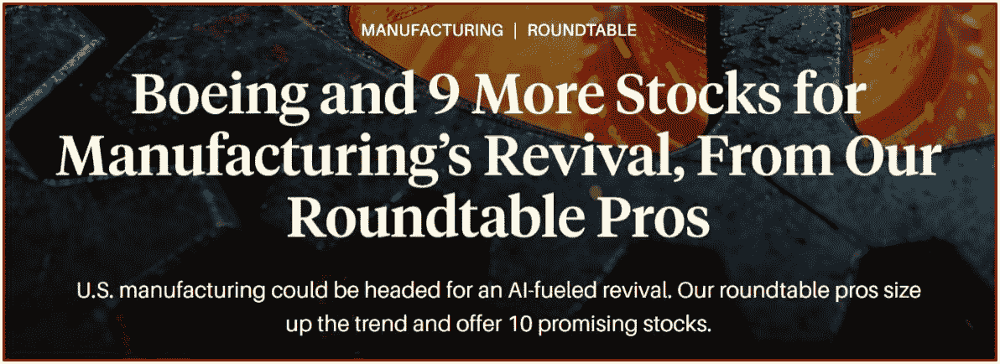

# 从长鑫到宇树，如何评估科技成长股的投资价值？

260824

整理：公众号懒人搜索，懒人专属群精选

懒人微信：lazyhelper1

本文选自《投资参考2026》第131期，完整的课程在专属群内连载中。机会靠洞察，取舍凭理性。

2026年7月以来，A股科创板迎来一轮硬科技新股上市潮，长鑫科技、宇树科技接连登陆二级市场。它们都属于新质生产力的核心方向，同处于硬科技国产替代前沿赛道。但它们上市后的股价走势明显分化。

在我看来，这两家公司作为科技成长股，短期看都有估值泡沫和投资风险，也许你不完全同意。但它们所代表的两类科技成长股，各自的机遇和风险又很不一样。深入分析它们的差异，对于评估其他科技成长股，有重要参考价值。比如最近要上市的另一家国产替代存储产业龙头公司长存控股，我们明天会详细分析。

结合公开信息和研究分析，我们讨论三个问题：1.长鑫和宇树的价值评估逻辑有何不同？2.如何准确评估科技成长股的价值？3.优选科技成长股有哪些关键策略？先看第一个问题：

# 1. 长鑫和宇树的价值评估逻辑有何不同？

从类型对比来看，长鑫科技和宇树科技不是一类公司。长鑫科技所在的存储行业，是有明显周期性特征的成熟科技行业。而宇树科技所在的人形机器人和具身智能行业，是有明显创新性特征的新兴科技行业。

先看长鑫科技所在的存储产业。它已经存在了数十年，经历多轮产业周期。这轮行业景气起源于2024年，加速于2025年，爆发于2026年上半年。

存储产业的三大细分赛道——DRAM内存、NAND闪存和HBM高带宽存储，当下都处于超级景气阶段，产品供不应求，价格不断上涨。其中，DRAM内存产品是AI服务器、高端PC和智能终端不可或缺的内存芯片，销量和价格一直在上涨。

行业数据和预测表明，2026年全球DRAM内存市场规模将增长30%以上，其中AI服务器所需要的DRAM内存将增长45%以上。而长鑫科技，身处这个超级景气的科技行业，业绩不断兑现，因此有出色的赚钱能力。

因为深度受益于本轮存储行业景气红利，它的产能持续爬坡，良率稳步提升，客户结构覆盖全球头部终端和服务器厂商，在手订单覆盖未来两年。2026年营收和净利润有望分别超过2000亿元和1000亿元；2027年营收和净利润有望分别达到3000亿元和1500亿元。更乐观的业绩预测数据，则更高。

再看宇树科技和人形机器人产业，还处于技术研发突破和商业变现的早期，2025年开始有规模化营收和部分盈利，未来5年有望提速增长。

根据公开数据，2026年全球人形机器人的市场规模大约48亿美元，整体商业化渗透率不足3%。大规模民用和商用落地，还需要3到5年的技术突破和完善期，以及市场培育和验证期。目前行业创新不断涌现，但成规模化的企业不多。

不过从行业趋势看，具身智能的各个具体赛道，在未来几年将迎来爆发式的技术突破和商业变现。而且由于目前市场规模基数较小，全行业有望持续成倍增长。

宇树科技处于这个新兴的高成长性行业，它的技术专利、整机迭代和海外出货，都处于国内第一梯队。

从公司业绩来看，它2025年的营收和净利润分别是16.99亿和2.78亿。刚公布的2026年上半年营收是11.52亿元，同比增长48.54%；净利润2.74亿元，同比增长9.56倍。也就是说，宇树科技的业绩规模都不算大，但成长性足够强。

所以对比来看，长鑫科技当前赚钱能力超强，但几年后还会面临行业周期变化；宇树科技现在赚钱能力相对更差，但几年后可能经历行业爆发扩张。

因此，愿意看短期盈利的投资者，往往更喜欢长鑫；愿意看未来成长的投资者，则更偏爱宇树。

由此再看长鑫和宇树上市前后的估值变化，它们的内在逻辑很不一样。

长鑫科技新股发行市值接近5800亿，对应2025年的归母净利润，发行静态市盈率超过300倍。如果对应它2026年上千亿的预期净利润，动态市盈率不到6倍。这个变化之大，让投资者欣喜，也让人担心未来盈利不可持续。

长鑫科技上市一个月，市值突破4万亿，对应它2026年预期净利润，动态市盈率40倍左右，已经不算便宜。但如果2027年它的预期净利润，真的达到1500亿或3000亿，那么长鑫科技远期市盈率就变成27倍到13倍，也不算太贵。

宇树科技新股发行市值610亿，对应它2025年的归母净利润，发行静态市盈率超过219倍。如果按照它2026年全年5.5亿到6亿的预期净利润来测算，动态市盈率还在100倍左右。短期来看，仍然是偏高的估值。

宇树科技上市当天，市值一度突破4000亿，对应它2026年的预期净利润，动态市盈率接近700倍。即使现在市值降到了2700亿，对应它2026年的预期净利润，动态市盈率也在400倍以上。从哪个角度看，估值都相对偏贵。

也就是说，长鑫的高估值靠业绩兑现来消化，只要利润增长足够快，市盈率会自然回落到合理区间；而宇树的高估值靠的是未来想象空间，短期内业绩根本撑不住当前的价格。

长鑫和宇树，一个是成熟周期型科技股，一个是新兴成长型科技股，恰好代表了科技成长股的两种典型形态。从它们延伸开来，我们接着讨论第二个问题：

# 2. 如何准确评估科技成长股的价值？

从长鑫和宇树的例子我们看到，科技成长股的估值，不能只看静态贵贱，这也是投资大师们的实战经验能佐证的。

华尔街传奇基金经理彼得·林奇认为，高估值本身不是风险，增速无法覆盖估值才是风险；巴菲特则强调，所有的技术叙事最终必须转化为真实现金流；《漫步华尔街》的作者马尔基尔则指出，科技赛道也有生命周期——导入期容易高估、成长期有溢价、成熟期估值会收敛。

由此可以看出，科技成长股的投资价值，底层逻辑是一致的：关键要看未来成长的可持续性，以及成长能否真正转化为商业变现能力。而这种能力，可以从几个维度来评估。

首先，要区分科技赛道的生命周期，看业绩成长性能否持续。这一点最重要。

在科技行业里，存储、面板和锂电等产业，本质上都是有明显周期性的成熟赛道。它们的供需波动大、景气不永续，好的时候营收和盈利增长都快，估值上升也快。但景气周期只要过去了，业绩和估值都会很难看。

比如2023就是最近这一轮存储产业的低谷期。美光科技这一年的营收同比腰斩，并从上一年盈利约87亿美元，变成年度亏损58亿美元。当时美光科技股价最低不到50美元，估值500亿美元，相当于现在万亿美元估值的二十分之一。

而机器人、AI算力、创新药等新兴成长赛道，相对没那么成熟，正处于持续渗透和长期扩容过程中。它们总体上供不应求，景气有可能延续更长时间，直到进入相对成熟期。因此这类新兴科技成长赛道的业绩和估值，可以持续上升更长时间。

比如英伟达所在的图形处理和推理芯片行业，行业快速成长从2018年开始，推动英伟达在2019年到2021年股价涨8倍，市值从800多亿增到7350亿美元。2023年以来，在AI算力需求推动下，截至2026年上半年，英伟达营收增8倍，净利润增26倍，估值从6000多亿美元，增长到5.2万亿美元。

优质的科技成长股通常有比较一致的业绩成长特征：初期营收增长快但利润增长慢，在规模效应显现后，营收增速不及同期利润增速，公司价值大幅增长。至于长期增收不增利的科技企业，尤其是现金流增长偏弱的科技企业，可以说没有什么成长性。

除了看行业周期，还要进一步确认科技成长股的不可替代性有多强，关注研发投入强度。

真正的硬科技竞争，不只是看专利数量的多少，而是看是否拥有产能认证、客户壁垒、良率壁垒和成本壁垒。比如，长鑫科技的核心壁垒，是千亿级的存储研发生产重资产门槛，是全球大厂稳定的供应链认证，以及DRAM内存产品的稳定良率产出。

而处于发展早期的科技企业，往往缺乏规模化量产能力，此时公司的研发投入强度，就成为关键点。A股优质硬科技龙头公司的研发费用率，也就是研发投入占营收的比例，普遍在12%到20%之间。研发费用率不足10%的科技股，投资价值就比较低，投资者最好不碰。我这里给你留一个悬念，你去看一下宇树科技的研发费用率是高于10%还是不到10%。

在通过行业景气、不可替代性确认了这是一家好公司之后，还要从多个维度确认科技成长股的估值是否偏高。

单一的公司估值指标参考意义不大，但可以和公司自己过去比，看当前估值水平是处于过去三年五年的相对低位还是高位。也可以和同行公司进行横向对比，看估值水平是高还是低。还可以和未来预期比，看业绩成长后能否匹配估值。

比如前面提到的美光科技，当前它的静态市盈率127倍，动态市盈率不到7倍。和自己比，是过去5年的相对低位。但同属存储产业的SK海力士，当前静态市盈率38倍，动态市盈率5.5倍，估值水平全都比美光科技更低。这么来看，美光科技的估值并不算便宜。

再比如芯片龙头英伟达，当前静态市盈率44倍，动态市盈率21倍。和自己比，处于过去5年的历史低位。而另一家芯片公司AMD（美国超微公司），当前静态市盈率178倍，动态市盈率11.5倍，估值水平全都比英伟达更高。这么来看，英伟达的估值反而更有吸引力。

总之，一家科技公司值不值得投，说到底，看的是成长的真实性——增长能持续多久，最终能变成多少真金白银。

能分清哪些科技股具有成长性之后，对投资者来说，还有最后一个问题：

# 3. 优选科技成长股有哪些关键策略？

个人投资者如果不想错失科技成长赛道的红利，可以优先考虑投资科技行业指数基金。但如果你还是想优选科技成长股进行投资，可以参考三个标准：

- 一是要锚定长期扩容的政策和产业双红利科技赛道。

也就是要盯紧政策和政府着力发展的关键科技赛道，在中国尤其如此。这在中央政策文件中写得很清楚，比如未来五年的四大战略新兴产业和六大未来产业，尤其是AI算力、存储芯片、具身智能、商业航天等领域。

- 二是要优选细分赛道里有相对优势的龙头企业进行投资。

全球主要科技赛道的竞争将带来的一个结果是，越来越多的全球行业前三名，尤其是行业第一名，占据了绝大部分的市场份额，也就是马太效应极为明显。因此，与其在一个科技成长赛道盲目选择，还不如直接选择盈利水平最高的龙头进行重点投资。

在A股市场，长鑫科技、中际旭创、寒武纪、宁德时代、药明康德等公司，都是各自细分领域的技术主导者、市场引领者和订单收割者。投资这类科技成长细分领域的行业龙头，出错概率相对更低，并且偶有惊喜。

- 三是优先选择商业化变现快、现金流质量高的企业进行投资。

无论一个产业叙事有多宏大，最终要看落地订单和现金流收入。科技高成长股，往往也需要具备更扎实的财务支撑，从而让估值溢价相对稳固。用一句话来概括就是：要始终投资那些商业变现能力最强的科技成长股。

好了，以上就是从长鑫和宇树看科技成长股价值差异的分析，希望对你有所启发。接下来我分享一篇《巴伦周刊》的文章：

#### 《巴伦周刊》：波音等公司开始受益于美国制造业复兴

这篇文章介绍了《巴伦周刊》最近的圆桌讨论，内容是：波音和另外9家制造业公司的投资价值看涨，背后原因是，美国制造业可能正在走向人工智能驱动的复兴。

建设人工智能的庞大数据中心，需要从建筑材料到冷却系统的各类物资。而这些数据中心的最终产品，也就是人工智能，开始和工业进行深度交融，从糖果制造到重型机械，各行各业的制造工艺在被AI接管和优化。

从商业进展和未来潜力看，《巴伦周刊》的圆桌专家们相信，波音、洛克希德·马丁、通用电气维诺瓦（GE Vernova）、爱默生电气等10家公司，很有投资潜力。其中，通用电气维诺瓦作为电力和电气化龙头公司，2026年上半年营收增长19%，净利润增长6倍多。它的股价因此连续第三年上涨，2026年涨了46%以上。

这些制造业公司最重要的进步是，它们努力将人工智能和制造业相结合，让生产流程和效率得到稳步提升。可以说，美国和全球制造业的新时代正在到来，美国和中国有不同的发展机遇。这利好它们各自最出色的制造企业。

在我看来，这篇文章最大的价值，就是提醒你：AI产业应用正在美国制造业展开，这种趋势可能扩展到中国甚至全球，后续投资想象空间很大。

好了，今天的内容更新就是这些。我是何刚，《投资参考》每天陪伴你，一起学习理性的价值投资。我们明天再见。谢谢你。

提示：以上都是基于公开信息而进行的投资分析，并不构成任何具体投资建议，市场有风险，投资须谨慎。

1. 长鑫科技当前赚钱能力超强，但几年后还会面临行业周期变化；宇树科技现在赚钱能力相对更差，但几年后可能经历行业爆发扩张。

2. 评估科技成长股，不看静态贵贱，要看赛道处于哪个生命周期、公司的壁垒有多深、估值能否被未来业绩覆盖——三个维度合在一起，才能判断一家科技公司值不值得投。

————分割线————

在这个 AI 能替你写代码、写文章的时代，基础技能正在迅速贬值。绝大多数人正被淹没在海量的免费垃圾信息里，陷入低效的体力内卷。

当“努力”不再是壁垒，人与人之间唯一的护城河，只剩下“信息过滤”的效率与“认知系统”的维度。

圈子已稳定运行 7 年。我们每天利用 Python 爬虫与大模型算力，过滤全网最顶级的政经内参和搞钱风向标，做你最冷酷的“外部大脑”。

如果你认同这种“重塑认知防线”的极客主义，欢迎围观我的个人情报智库：【懒人专属群】。

https://lazyso.com/insider/

认同信息过滤价值、想省下每天 3 小时无效阅读时间的读者，扫码加我微信（lazyhelper1）

