公众号懒人搜索，懒人专属群分享

微信小程序：从 **0** 到 **1** 做产品

260824 副业 SC 精华

整理：公众号懒人搜索，懒人专属群精选

懒人微信：lazyhelper1

适配技术栈：腾讯云轻量/CVM + 宝塔面板 + 腾讯云域名 + 腾讯云 COS + 宝塔 SSL 证书

核心理念：小白不看代码，全部交给 Codex + WorkBuddy 开发。你只需要知道：①怎么跟 AI 说话；②怎么确认 AI 做对了。

## 直播提示词

1. 微信小程序 AI 开发 Prompt 合集
2. 直播文档：新手也能懂的小程序开发流程教程

## 前言介绍

大家好，我是安小生，本职是一名全栈工程师。

平时除了工作之外，我自己也一直在做一些微信小程序、APP，目前也有几款小程序在线上运行。做完之后，我也会偶尔在朋友圈或者社群里分享一下开发过程和产品，也算是给自己的项目做做推广。


下面是小程序的数据展示：

## 前置：需要准备与项目背景相关的内容

1. 如果你是开发工具类型的项目，则需要准备一个小程序账号，个人、个人主体、企业主体都可以，但是每个认证费用不同，下面会讲到。然后就是利用 AI 去跑你整体的项目，先出设计图，再让 AI 进行还原开发。目前我做到的还原度 98% 差不多。

2. 如果你是开发订阅站，或者使用到接口 API 的小程序，则需要准备一些：域名、服务器、ICP 备案、微信支付。开通微信支付需要个体工商户或企业主体，这些会在第二部分讲解，因为目前我会接一些商单，会用到接口、支付等。

3. 前期如果有人已经注册过小程序，则可以看一下第二部分内容。

4. 可复制的 Prompt：大家可以使用下面的进行复制。

## 第一部分：课前调研（开发前必读）

### 1. 先做课前调研

做小程序前，不要先打开工具写页面，先把事情梳理清楚。

#### 1.1 为什么要做小程序，不做 APP 呢？

APP 的开发流程繁琐，国内安卓需要资质才能上线，国外 iOS 需要申请 99 美元，还需要经过苹果的各种审核，如果违规可能导致封号。

开发 APP 时，通常要：

- iOS 开发
- Android 开发
- 上架应用商店
- 处理审核
- 适配各种手机
- 解决签名、证书、打包问题

但小程序认证完毕后，开发工具类的审核速度快、上线快，腾讯对小程序开发也比较友好。

小程序开发成本更低，一套代码即可：

- 微信开发者工具直接运行
- 不需要安装 Xcode
- 不需要安装 Android Studio
- 不需要懂原生开发

问题对比：

- APP 最大的问题是需要推广、推流，依靠自然流量；没有流量时，前期比较费钱。
- 小程序可以通过微信搜索、群分享、好友转发、公众号、视频号、二维码、小红书等方式宣传。

小程序更适合快速试错：快速开发、快速迭代、快速上线。

有人问：APP 不行了吗？

不是的，APP 适用于高频使用、重度功能、长期留存、强用户体系、推送通知以及更复杂的能力。

举个例子：抖音、快手，还有一些不太适合做小程序的类目，例如医疗、金融、玄学等 APP。

新手最推荐的路线：先做小程序，验证有没有用户，验证能不能赚钱，稳定后再做 APP。

#### 1.2 服务类目是什么

先去微信开放文档查看类目是否支持个人主体，是否需要资质、许可证或前置审批。

- 小程序的行业分类
- 告诉微信你的小程序用途
- 决定你能不能上线
- 决定你需不需要资质

为什么类目很重要？

微信审核时，会检查你的实际功能和你选的类目是否一致。如果不一致，可能审核失败、被驳回、被限制功能，严重时甚至下架。

#### 1.3 是否涉及敏感能力

支付、医疗、教育、金融、资讯、社交、定位、用户手机号、内容发布、AI 生成内容，都要提前查规则。

举个例子：医疗行为需要资质，包括健康诊断、病情分析、治疗建议、医疗报告。

所以在开发前，先想好你开发的是什么类目，以及此类目是否需要资质。

新手最适合哪些类目：

1. 工具类：计算器、图片处理、打卡、文案生成、翻译、OCR 识别
2. 内容类：壁纸、文案、语录、资讯（但注意版权问题）
3. 展示类：个人主页、企业展示、作品集（审核也比较轻）

不建议碰以下类目：

- 医疗、金融、社交、直播/短视频
- 高风险或需要特殊资质的行业

#### 1.4 第一次项目建议

只做一个闭环，例如“记录、查询、提醒、表单提交、资料展示、预约登记、工具计算”。

- 快速能做出来，1～2 天能做出来并跑通
- 不要一次性做一个大的项目，很容易陷进去

#### 1.5 如果不是个人认证，是个体工商户/企业，请看经营范围

### 2. 选题原则：个人开发者先避坑

个人开发者最容易犯的错，是看到一个好 idea 就直接开干。但小程序上架不是只看功能能不能跑，还看主体、类目、内容、资质、备案和隐私合规。

个人开发者优先选择这些方向：

- 工具类：计算器、清单、提醒、图片/文本处理、效率工具
- 记录类：打卡、日记、学习记录、健身记录、消费记录
- 查询类：资料索引、公开信息查询、词典、知识卡片
- 轻服务类：预约登记、活动报名、门店展示、作品集展示
- AI 辅助类：文案生成、提示词整理、学习助手，但要避免医疗、金融、法律等高风险结论型服务

尽量谨慎的方向：

- 医疗健康、药品器械、金融理财、证券保险、新闻资讯、教育培训、社交社区、直播短视频、游戏、深度合成、网约车、宗教等
- 需要用户发布内容的平台型产品
- 需要复杂交易闭环或特殊行业许可证的产品

判断方法：如果你的产品需要证明“我有资质”“我有许可证”“我能对内容负责”，就先不要作为第一个小程序项目。

想做付费/订阅项目？先看主体：微信支付（会员、订阅、虚拟商品）只对企业、个体工商户开放，个人主体无法开通微信支付。

如果你计划做“会员订阅”“内容付费”，第一步不是写代码，而是先办一张个体工商户营业执照（线上可办、成本低），用它注册小程序并开通微信支付商户号。详细步骤在第二部分“第十步：接入微信支付”。

### 3. 开发路线：工具怎么选

推荐初学者采用“微信开发者工具 + AI 编程助手 + 官方文档”的组合。

- 微信开发者工具：用于创建项目、预览、真机调试、上传代码。
- Windows/macOS 版本
- https://developers.weixin.qq.com/miniprogram/dev/devtools/log.html#nightly-2.02.2605262
- AI 编程助手：用于生成页面、组件、接口示例、Bug 排查和重构建议
- HBuilderX / uni-app：适合想一套代码多端复用的人，但第一次只做微信小程序时，原生小程序路径更少绕路
- CodeBuddy / Codex / Claude Code 等：适合辅助写代码，但不能替代你理解小程序的配置、页面生命周期和发布流程
- 页面 UI 生成：Stitch 工具，谷歌推出的，比较好用。https://stitch.withgoogle.com/

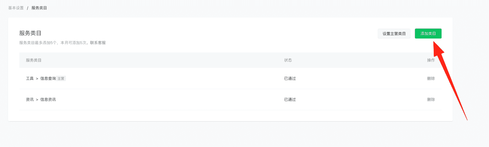

- 页面 UI 生成阶段二：ChatGPT，一次生成 UI 设计图，但是需要控制你的色调、色系，推荐使用这个。
- 设置 MCP：

在 Codex 目录下配置 Stitch：

```toml
## MCP 的配置
[mcp_servers.stitch]
url = "https://stitch.googleapis.com/mcp"

[mcp_servers.stitch.http_headers]
"X-Goog-Api-Key" = "你刚才提供的 key"
```

### 4. UI 设计

本模块目标：让零基础也能用 AI 做出专业界面。先认识 UI 设计的全流程（三步法），再实际用 AI 出一张“奶茶记账”单页设计图。写代码属于后面的“开发”环节，本模块先把“图”搞定。

#### 1. UI 设计三步法（先认识全流程）

| 步骤 | 做什么 | 说明 |
|---|---|---|
| 第一步：写需求描述 | 把页面、功能、字段讲清楚 | 本模块重点练的就是这一步 |
| 第二步：用 Stitch 出图 | 谷歌 Stitch 生成 UI 草图 | 把需求变成“看得见的界面” |
| 第三步：交给 AI 写代码 | 把图 + 需求给 Codex / WorkBuddy | 属于“开发”，后面环节讲 |

- 关键：一次只做一个页面，生成后立刻在微信开发者工具里编译预览。
- 新手不用懂设计，会描述需求就够了——“我要一个什么页面、上面有什么、点哪个按钮干嘛”。

本模块只做前两步（出设计图）；第三步写代码用的“前端开发 Prompt”后续会单独给你，到时设计图 + 开发 Prompt 一起用。

#### 2. 工具清单

- 微信开发者工具：创建、预览、真机调试、上传代码。  
  https://developers.weixin.qq.com/miniprogram/dev/devtools/log.html
- Stitch（Google）：AI 生成 UI 草图，能直接出可落地的小程序界面。  
  https://stitch.withgoogle.com/
- Figma：专业设计工具，也能让 AI 读取设计稿转代码。
- Codex / WorkBuddy：把 UI 设计图 + 需求转成可运行的小程序代码（开发阶段用）。

#### 3. 用 AI 出设计图（单页 Demo：奶茶记账）

新手不会画设计稿也没关系，先让 AI 出一张界面设计图（“长什么样”的视觉稿），用来对齐效果。下面用一个“奶茶记账”单页小程序做 Demo——只记你花在奶茶上的钱，清爽白色主色、简洁、好操作，一个页面就够。

这个单页要做什么（需求功能）：

- 顶部一张“本月奶茶总花费”大卡片，下面一行小字“本月喝了 N 杯”。
- 中间是记录列表：每条显示店名、口味/备注、金额（¥）、时间，新的在最上面；一条都没有时显示空状态提示。
- 右下角一个“+”悬浮按钮，点开快速新增（店名 + 金额 + 口味，保存即入列表）。
- 数据先存手机本地，不接后端，纯前端就能跑，适合先跑通再考虑接后端。

给 AI 的 UI 设计图 Prompt（复制进 WorkBuddy / Codex 或设计工具，用来生成界面图）：

请生成一张“奶茶记账”微信小程序的单页界面设计图（UI mockup / 视觉稿），只做一页，不用写代码。

【页面内容】

- 顶部：一张“本月奶茶总花费”醒目大卡片，下面一行小字“本月喝了 N 杯”。
- 中间：记录列表，每条显示店名、口味/备注、金额（¥）、时间，新的在最上面；空状态提示“还没有记录，点右下角 + 添加”。
- 右下角：一个“+”悬浮按钮。

【主色系与风格】

- 主背景：清爽白色 #FFFFFF，干净、留白充足，不花哨。
- 点缀色：温柔奶茶色（#C9A66B 或 #E8B4A0），不用大红大绿。
- 风格：记账类，简洁、易操作，卡片圆角，字号清晰。

【输出】

- 输出一张可直接看效果的界面设计图（不是代码）。

## 设计图 vs 开发（别混）

- 上面这段只是出设计图，确认页面长什么样，不写代码。
- 举个例子：
  - 等后面做开发时，我会再给你一版“前端开发 Prompt”，让 AI 照着这张设计图写出可运行的小程序代码（结构、样式、逻辑），到时候设计图 + 开发 Prompt 一起用。
  - 设计图生成后保存成图片当参考即可，不用放进代码目录。

提示：一次只让 AI 做一个页面或一个功能，改好了再下一个，别一次性塞太多。

### 5. 接下来，开始创建第一个小程序

基础步骤：

https://developers.weixin.qq.com/platform

1. 注册小程序账号，分为个人、企业、个体工商户，认证不同，费用不同：个人认证 30 元/年，其他则 300 元/年。
   - https://mp.weixin.qq.com/ 微信公众平台
   - 填写信息
   - 认证：填写名称，缴纳认证费用
   - 备案：填写小程序的信息（ICP），提交后进行审核，大约需要 2 周
   - https://beian.miit.gov.cn/#/Integrated/index
   - 工业和信息化部政务服务平台

2. 在小程序后台获取 AppID

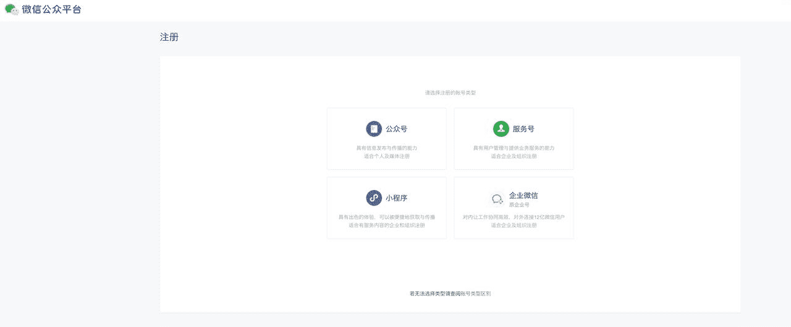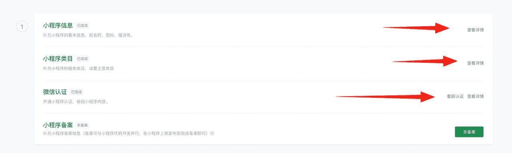

3. 安装微信开发者工具并扫码登录

4. 新建“小程序项目”，填写 AppID，选择空目录——划重点。

5. 注意这块的目录。步骤是：先去你自己本地创建好文件夹，例如：

   `wechat_program/project_1`

6. 创建好后，再进行选择模板。

7. 如果大家不想折腾服务器章节，则可以选择微信云开发（应该有 3 个月免费），后续可以做数据跟代码迁移，因为 WorkBuddy/Codex 可以自动连接上，适合一些新手，后续可以慢慢学习第二章节部分。

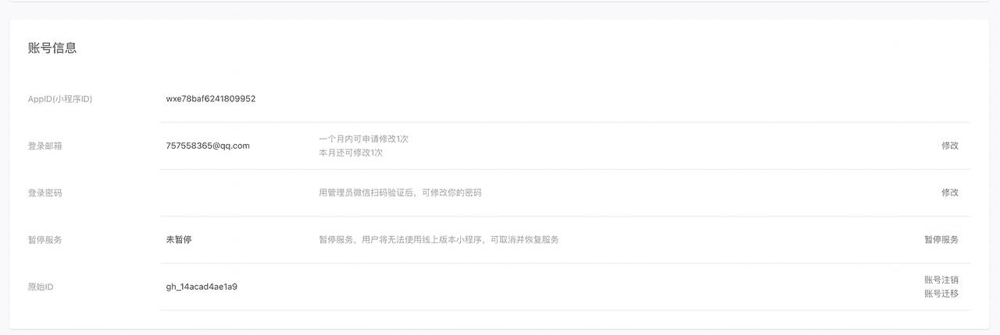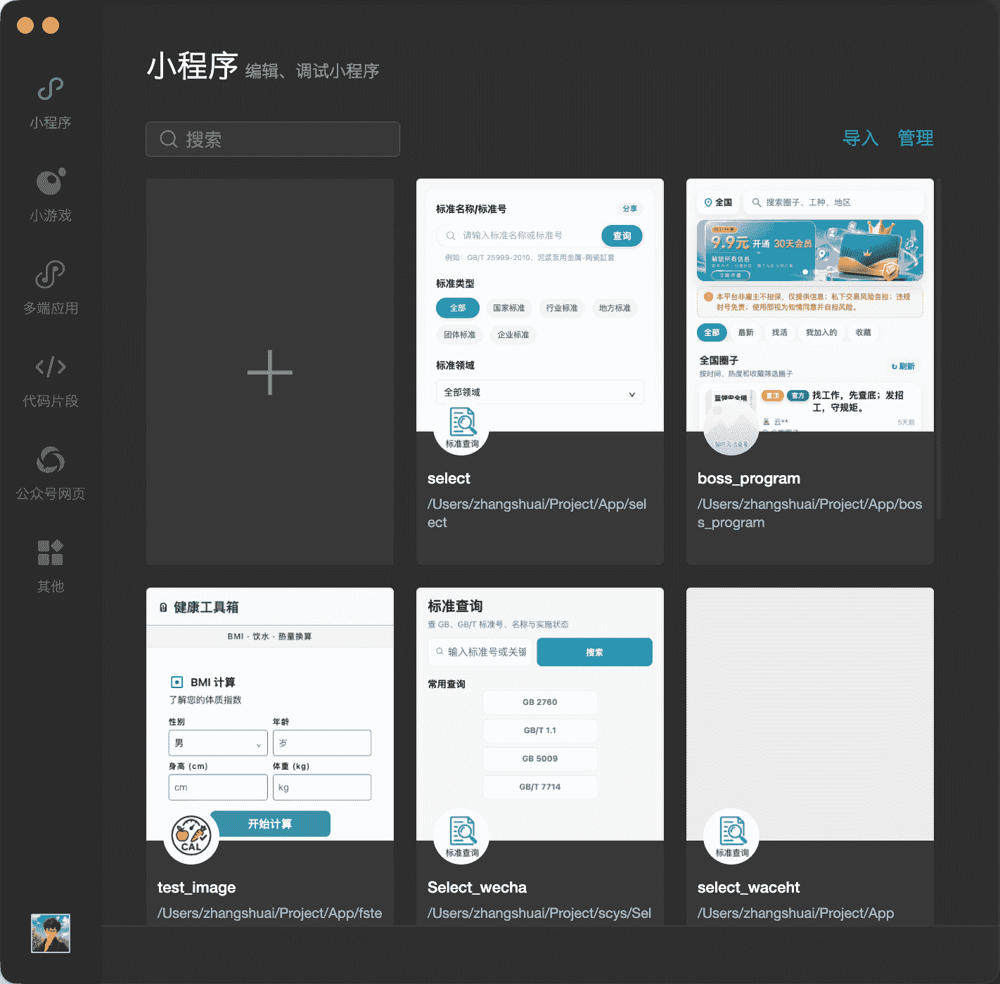

8. 先选择“不使用云服务”跑通本地项目，后续再决定是否引入云开发。

9. 点击“编译”确认模拟器能跑，点击“预览”用微信扫码在真机体验。

注意事项：

- AppID 不要和公众号 AppID 混淆。获取方式：
- 项目目录尽量单独创建，不要放在一堆旧代码里。
- 第一次不要同时上太多技术栈，先用官方模板理解结构。
- 如果是要对接接口，则添加 HTTPS 域名。

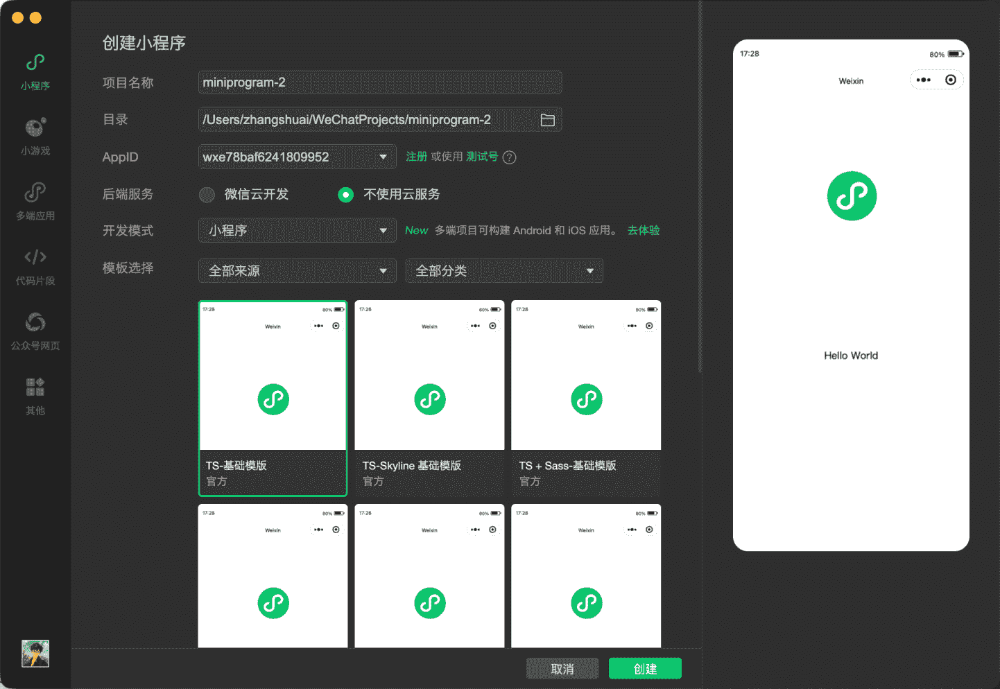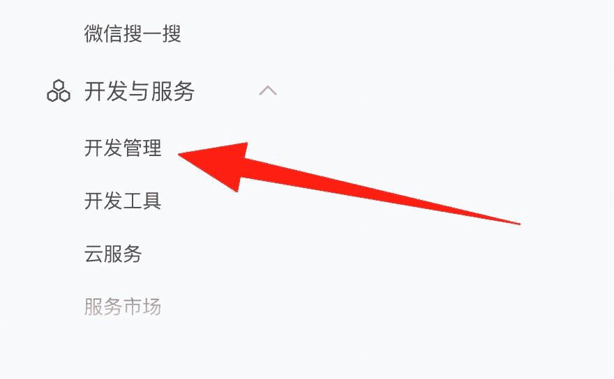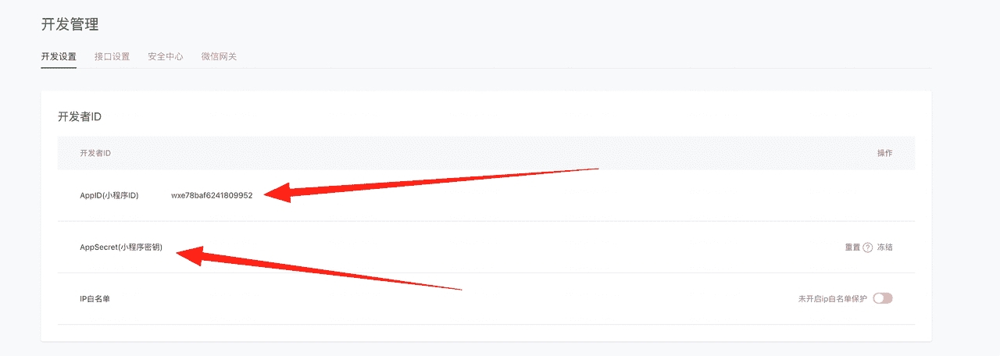

### 6. 小程序代码结构

一个基础小程序通常由这些文件构成：

- `app.json`：全局配置，声明页面路径、窗口样式、底部 Tab 等
- `app.js`：全局逻辑
- `app.wxss`：全局样式
- `pages/index/index.wxml`：页面结构，类似 HTML
- `pages/index/index.wxss`：页面样式，类似 CSS，但支持 rpx
- `pages/index/index.js`：页面逻辑，处理数据、事件和接口调用
- `pages/index/index.json`：页面级配置

理解四个关键词：

- WXML：写结构
- WXSS：写样式
- JS：写交互和数据
- JSON：写配置

最常见的新手问题是 JSON 写错：Key 必须用双引号，不能写注释，不能出现 `undefined`。

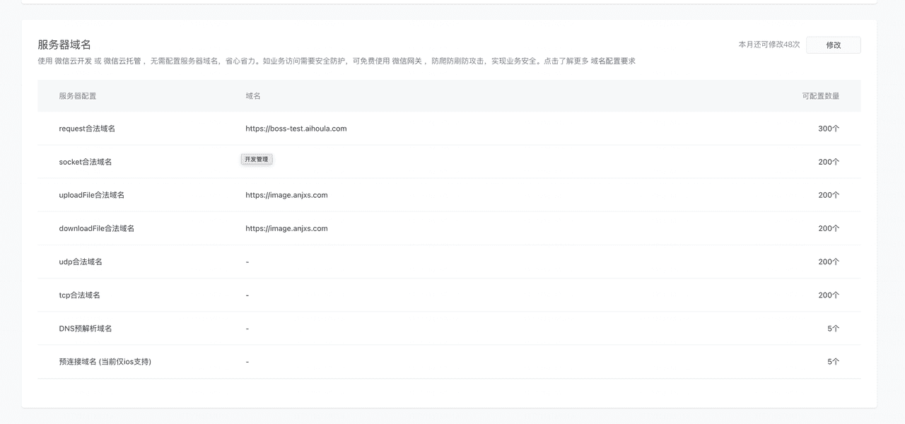

### 7. 用 AI 工具进行开发

1. 使用 Codex、WorkBuddy、Kimi、TRAE、Claude Code 都可以，熟悉哪个用哪个。
2. 使用 Stitch、ChatGPT、Figma Mark 生成 UI 设计图都可以。
3. 使用 Figma 让 AI 去读取也是可以的；如果是懒人，推荐直接使用 ChatGPT。
4. 告诉 AI 我要做什么样的页面。

适合直接复制给 AI 分步骤使用。建议一次只让 AI 生成一个页面或一个功能。

案例一：BMI / 饮水 / 热量换算工具箱

#### 7.1 产品需求 Prompt

你是微信小程序产品经理。请帮我把“健康工具箱”拆成适合零基础开发的小程序需求。

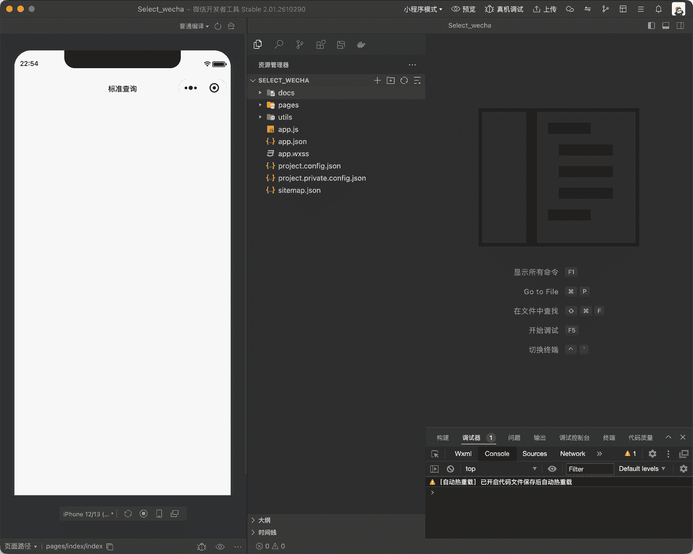


## 健康工具箱微信小程序开发指南

### 项目目标

做一个工具型微信小程序，包含 4 个小功能：

1. BMI 计算器：输入性别、年龄、腰围、身高、体重
2. 每日饮水量计算
3. 热量 / 千焦换算
4. 计算体脂率：输入年龄、身高、颈围、腰围、体重

**限制：**
- 不需要登录
- 不接后端接口
- 不使用数据库
- 结果仅供参考，不作为医学建议

**请输出：**
1. 首页和功能页结构
2. 每个功能需要的输入字段、输出字段
3. 计算公式
4. 错误提示规则
5. 第一版 MVP 不做什么

#### 7.2 UI 生成 Prompt

请为微信小程序设计一个"健康工具箱"首页 UI。目标用户：零基础用户，打开后能立刻看到：

1. BMI 计算器：输入性别、年龄、腰围、身高、体重
2. 每日饮水量计算
3. 热量 / 千焦换算
4. 计算体脂率：输入年龄、身高、颈围、腰围、体重

**页面要求：**
1. 顶部显示标题"健康工具箱"和副标题"BMI · 饮水 · 热量换算"
2. 中间用卡片展示功能入口，每张卡片包含功能名称、简短说明、一个结果预览区
3. BMI 卡片展示性别、年龄、腰围、身高、体重输入入口和 BMI 结果位置
4. 饮水卡片展示体重输入入口和每日饮水量结果位置
5. 计算体脂率：输入年龄、身高、颈围、腰围、体重
6. 换算卡片展示数值输入、单位切换和换算结果位置
7. 底部显示"结果仅供参考"的提示
8. 风格清爽、健康、可信赖，主色用绿色，留白充足，卡片圆角不超过 8px
9. 每个功能需要按钮，使用 Stitch 工具进行生成：https://stitch.withgoogle.com/

#### 7.3 功能逻辑 Prompt

请基于已有 WXML/WXSS，补充健康工具箱页面的 index.js 逻辑。

### 1. BMI 计算器

**输入：** 性别 gender、年龄 age、腰围 waistCm、身高 heightCm、体重 weightKg

**计算公式：**
- BMI = weightKg / (heightM * heightM)，其中 heightM = heightCm / 100

**要求：**
- BMI 保留 1 位小数
- 根据 BMI 输出分档：<18.5 偏瘦，18.5-23.9 正常，24-27.9 超重，>=28 肥胖
- 需要输出提示："BMI 结果仅供参考，不能替代专业医疗建议"
- 腰围风险：男性 >= 90 腰围偏高，女性 >= 85 腰围偏高，否则正常
- 年龄、性别暂时只参与展示和基础校验，不影响 BMI 公式

### 2. 每日饮水量计算

**输入：** 体重 waterWeightKg

**计算公式：**
- 每日饮水量 ml = waterWeightKg * 35
- 250ml 杯数 = 每日饮水量 / 250

**要求：**
- ml 取整数，杯数保留 1 位小数
- 输出提示："饮水量仅供参考，可根据运动量、天气和身体情况调整"

### 3. 热量 / 千焦换算

**输入：** 数值 calorieValue、换算方向 calorieType

**支持：** kcal_to_kj（kcal 转 kJ）、kj_to_kcal（kJ 转 kcal）

**公式：** 1 kcal = 4.184 kJ

**要求：** 结果保留 1 位小数

### 4. 体脂率计算器

**输入：** 性别 bodyGender、年龄 bodyAge、身高 bodyHeightCm、体重 bodyWeightKg、颈围 neckCm、腰围 bodyWaistCm

**计算公式（简化 BMI 体脂率估算公式）：**
- 男性：体脂率 = 1.20 × BMI + 0.23 × 年龄 - 16.2
- 女性：体脂率 = 1.20 × BMI + 0.23 × 年龄 - 5.4
- 其中 BMI = 体重 kg / (身高m × 身高m)

**要求：**
- 体脂率保留 1 位小数
- 颈围、腰围需要做输入校验，但当前简化公式暂不参与计算
- 输出提示："体脂率为估算值，仅供参考，不能替代专业设备检测"
- 体脂等级：男性 <10 偏低，10-20 正常，20-25 偏高，>=25 肥胖；女性 <18 偏低，18-28 正常，28-35 偏高，>=35 肥胖

### 5. 输入校验

所有数字输入都要校验：为空、非数字、小于等于 0。校验失败时使用 wx.showToast({ title: '请输入正确的xxx', icon: 'none' })

### 6. 技术要求

- 不使用后端、数据库、接口
- 全部逻辑写在当前页面 index.js
- 代码结构清晰，每个功能独立方法
- 适合微信小程序原生开发
- 兼容小白学习，关键代码加中文注释
- 不要省略代码

**请输出：** 完整 index.js、WXML 需要绑定的事件名、WXML 中 data 字段建议、3 组测试数据

#### 7.4 排错 Prompt

我在微信开发者工具里运行健康工具箱时遇到报错。请帮我定位问题。

- 报错信息：【粘贴控制台第一条红色错误】
- 相关代码：【粘贴 WXML / JS 中和报错相关的部分】
- 期望效果：【说明我点击了什么、希望出现什么结果】

**请按以下格式回答：**
1. 报错原因
2. 应该改哪个文件
3. 修改后的代码片段
4. 修改后如何验证

## 案例二：天气查询小程序

**推荐接口：** 高德开放平台天气查询 Web 服务 API

- 官方文档：https://lbs.amap.com/api/webservice/guide/api/weatherinfo
- 城市编码：https://lbs.amap.com/api/webservice/download
- key 申请：https://console.amap.com/dev/index

#### 7.5 产品需求 Prompt

你是微信小程序产品经理。请帮我设计一个适合零基础教学的"城市天气查询"小程序。

**项目目标：** 用户输入城市 adcode 或城市名称后，查询天气并展示结果。

**接口计划：** 使用高德天气查询 API：GET https://restapi.amap.com/v3/weather/weatherInfo，参数包括 key、city、extensions、output=JSON

**请输出：**
1. 页面结构
2. data 字段设计
3. 请求成功、请求中、请求失败、无数据 4 种状态
4. 需要展示的天气字段
5. 上线前注意事项：request 合法域名、HTTPS、key 保护、隐私说明

#### 7.6 UI 生成 Prompt

请为微信小程序设计一个"城市天气查询"页面。

**页面结构：**
1. 顶部是城市搜索输入框和查询按钮
2. 查询中显示 loading 状态
3. 查询成功后显示一个天气主卡片：城市、天气、温度、风向、风力、湿度、发布时间
4. 如果 extensions=all 返回 forecast，则下方展示未来天气列表
5. 查询失败或无数据时显示友好提示和"重新查询"按钮
6. 视觉风格清爽，蓝绿色主色，适合工具型小程序
7. 卡片圆角不超过 8px，文字不要拥挤
8. 我需要的是中文页面，全程都使用中文

#### 7.7 wx.request 逻辑 Prompt

请补充微信小程序页面 JS，用 wx.request 调用高德天气查询 API。

**接口：** GET https://restapi.amap.com/v3/weather/weatherInfo

**参数：** key、city、extensions（base 或 all）、output（JSON）

**要求：**
1. data 中包含 city、weather、forecastList、loading、errorMessage
2. 点击查询按钮后校验 city 不能为空
3. 请求前 loading=true，请求完成后 loading=false
4. status 为 1 且 lives 有数据时，展示实况天气
5. extensions=all 时，解析 forecasts[0].casts 作为未来天气列表
6. 网络失败、返回 status 非 1、无数据时都显示错误提示
7. 请提醒我上线前要在小程序后台配置 request 合法域名
8. 真实项目不要把敏感 key 长期写在前端，应通过服务端或云函数保护

请输出完整 JS，并解释每个核心函数的作用。

#### 7.8 API 排错 Prompt

我的天气查询小程序接口请求失败。请帮我排查。

- 现象：【例如：开发者工具能请求，真机不行 / 返回 status=0 / 无数据 / 控制台报错】
- 请求信息：url: https://restapi.amap.com/v3/weather/weatherInfo，data: 【粘贴请求参数，注意隐藏 key】
- 返回结果或报错：【粘贴 res.data 或控制台错误】

**请按优先级检查：**
1. 参数是否正确
2. key 类型是否是 Web 服务 API
3. city/adcode 是否有效
4. request 合法域名是否配置
5. HTTPS 与网络是否正常
6. 页面错误状态是否处理

## 案例三：个人记账本（接自己的后端 + 数据库 + 登录）

案例二是用现成的第三方天气 API，不用你自己搭服务器。本案例升级一步：数据存在你自己的服务器和数据库里，需要小程序登录、需要后端 API。怎么买服务器、装环境、部署，看第二部分；这里只讲"怎么让 AI 把这套前后端写出来"。

#### 7.9 产品需求 Prompt

你是微信小程序产品经理。请帮我把"个人记账本"拆成适合零基础开发的小程序需求。

**项目目标：** 做一个个人记账小程序，数据存在自己的服务器（不是本地、不是第三方），换手机也不丢。

**核心功能：**
1. 记一笔：金额、收/支类型、分类（餐饮/交通/工资等）、备注、日期
2. 账单列表：按日期分组展示，可删除
3. 本月汇总：总收入、总支出、结余
4. 需要登录：用小程序登录（wx.login 静默登录），不同用户看到自己的账

**技术约束：**
- 后端用 Laravel + MySQL（数据存自己服务器，不用云数据库）
- 前端用微信小程序原生开发
- 接口走 HTTPS，token 鉴权
- 结果要能上线，不是玩具

**请输出：**
1. 页面结构（首页/记一笔/账单列表/我的）
2. 每个页面的输入/输出字段
3. 需要的后端接口清单（路径、方法、参数、返回）
4. users 表和 bills 表的字段设计（含外键 user_id）
5. 第一版 MVP 不做什么

#### 7.10 UI 生成 Prompt

请为微信小程序"个人记账本"设计 UI，共 4 个页面。

- **页面 1 首页：** 顶部本月收支汇总卡片（收入/支出/结余），中间"记一笔"大按钮，下方最近 3 笔账单预览。
- **页面 2 记一笔：** 金额输入框（大字号）、收/支切换、分类选择（标签式）、备注输入、日期选择。
- **页面 3 账单列表：** 按日期分组，每笔显示分类图标、备注、金额（支出红色、收入绿色），左滑可删除。
- **页面 4 我的：** 显示头像昵称、本月汇总、退出登录。

风格：简洁清爽，主色用蓝色，卡片圆角不超过 8px，金额数字要醒目。全程中文。

#### 7.11 前后端联动 Prompt（重点：让 AI 写后端 + 前端调自己的后端）

我要做一个微信小程序"个人记账本"，需要你自己写完前后端。技术栈：Laravel 后端 + MySQL + 微信小程序原生前端。

**请按以下顺序完成，每步告诉我做了什么：**

**第一步（后端 + 数据库）：**
- 设计 users 表（openid 唯一、昵称、头像）和 bills 表（amount、type 收/支、category、remark、bill_date、user_id 外键 onDelete cascade）
- 写迁移文件并说明怎么执行
- 写接口：小程序登录（wx.login 拿 code → 后端换 openid → 建/查用户 → 返回 token）、记账、账单列表、删除账单、本月汇总
- 所有接口用 token 鉴权（除了登录接口）

**第二步（前端登录）：**
- 用 wx.login 静默拿 code，调 /api/auth/miniapp-login 换 token
- token 存 wx.setStorageSync，之后每个请求在 header 带 Authorization: Bearer <token>
- 收到 401 自动跳登录

**第三步（前端记账 / 列表）：**
- 记一笔页提交后调记账接口，成功后返回列表刷新
- 列表页带 token 拉数据，左滑删除调删除接口
- 首页调汇总接口展示

请输出关键代码片段和每个文件的作用。说明本地开发时小程序怎么填"不校验合法域名"、上线前怎么在小程序后台配置 request 合法域名（你的 HTTPS 域名）。

#### 7.12 排错 Prompt

我的记账本小程序调自己后端时报错。请帮我排查。

- 现象：【例如：开发者工具能调通，真机报错 / 一直 401 / 列表空白 / 控制台 CORS 报错 / 后端 500】
- 环境：
  - 后端 Laravel 跑在本地 127.0.0.1:8000（或服务器 HTTPS 域名）
  - 小程序前端
- 报错信息：【粘贴控制台第一条红色错误】
- 请求信息：url、参数（隐藏 token）

**请按优先级检查：**
1. 小程序后台 request 合法域名是否配置了你的后端 HTTPS 域名（本地 127.0.0.1 真机连不上，需用 HTTPS 域名）
2. token 是否过期 / 没带上 header
3. 后端接口路由和控制器的对应关系
4. 数据库连没连上、表建没建（migrate 跑没跑）
5. CORS / 跨域是否放行
6. 后端日志（Laravel storage/logs）里的具体报错

## 建议这样用 AI

1. 先写产品说明：用户是谁、解决什么问题、页面有哪些、数据有哪些
2. 让 AI 输出页面结构：页面清单、组件清单、数据字段
3. 分页面生成代码：一次只让 AI 写一个页面或一个组件
4. 每次生成后立刻在开发者工具编译
5. 报错时把错误信息、相关文件、期望效果一起给 AI
6. 功能跑通后再统一优化样式和交互

**不要这样用：**
- 一次让 AI 生成整个项目，然后完全不看代码
- 不理解服务类目和审核要求就先做复杂功能
- 把密钥、AppSecret、支付证书写在前端代码里

### 8. 真机测试与体验版

小程序开发不是模拟器能跑就算完成。发布前至少做三轮测试：

1. 开发者自测：页面跳转、表单校验、异常提示、空状态
2. 真机测试：用"预览"二维码在手机上跑完整流程
3. 体验版测试：上传代码后，在后台把开发版本设为体验版，邀请体验成员测试

体验成员不是项目开发者，但可以使用体验版。适合邀请产品、测试、客户或种子用户来试用。

### 9. 上传、审核与发布

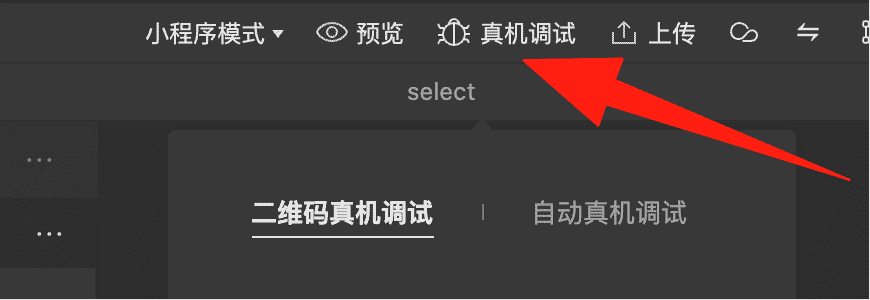

官方发布链路是：

**预览 → 上传代码 → 小程序后台设置体验版/提交审核 → 审核通过 → 发布上线**

上传代码时要填写版本号和项目备注，建议统一规则：
- 版本号：0.1.0、0.2.0、1.0.0
- 项目备注：说明本次改了什么，例如"新增首页表单、修复提交失败提示"

**提交审核前要准备：**
- 小程序名称、简介、头像、服务类目
- 页面内容和核心功能已完整
- 不出现测试文字、占位图、无效按钮
- 涉及用户信息时，隐私保护指引已填写
- 涉及备案时，备案已完成或正在按要求处理

审核通过后，可以全量发布，也可以分阶段发布。第一次项目通常全量发布即可；用户量大或改动风险高时再考虑分阶段发布。

### 10. 类目、资质与备案

服务类目决定你能不能顺利提交审核。

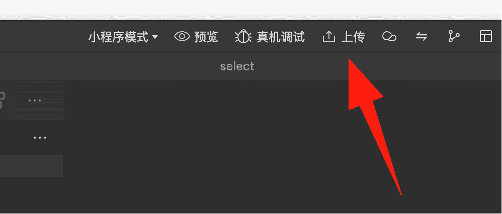

微信开放文档把开放类目按个人主体、非个人主体、境外主体拆分，并列出资质要求。

**新手重点看三件事：**
- 个人主体是否开放该类目
- 是否需要资质材料
- 是否需要前置审批或专项审批

**备案方面：** 小程序备案整体流程包括：备案信息填写、平台初审、工信部短信核验、通管局审核、备案成功。官方文档显示，平台初审通常为 1-2 个工作日，通管局审核为 1-20 个工作日，短信核验需要留意 12381 短信并在 24 小时内完成，留意电话。

**备案前准备：**
- 主体证件
- 主体负责人证件
- 小程序负责人证件
- 前置审批/专项审批材料，如涉及
- 手机号保持畅通，负责人信息不要乱填

#### 10.1 小程序接口权限申请

1. 如果自己小程序用到了小程序内部权限接口，则需要进行单独申请
2. 举个例子：定位、获取距离等接口需要单独提前申请

### 11. 隐私保护与审核常见问题


公众号懒人搜索，懒人专属群分享我是由月之暗面（Moonshot AI）研发的 kimi-k2.7-code 智能大模型。如果小程序处理用户个人信息，需要补充用户隐私保护指引。官方文档提供两个入口：

- 账号设置 → 服务内容声明 → 用户隐私保护指引
- 管理 → 版本管理 → 提交代码审核 → 信息填写页面

常见审核问题：

- 服务类目和实际功能不一致
- 页面里有测试数据、二维码、联系方式或引流内容
- 用户授权说明不清楚
- 调用隐私接口，但隐私指引没有覆盖
- 功能不可用、按钮无响应、页面空白
- 个人主体做了不适合个人主体的类目

提交审核前做一次“**五项检查**”：

1. 功能能跑完
2. 类目选对
3. 隐私指引补齐
4. 备案/资质不缺
5. 页面没有测试痕迹

## 12 推荐作业

第一个小程序建议做“一个小闭环”，分三类难度，按自己情况选：

### 一、轻工具类（个人主体就能做，最推荐）

- 示例 1：每日打卡记录器
- 示例 2：活动报名登记
- 示例 3：AI 提示词收藏夹
- 示例 4：费用 AA 计算器
- 示例 5：资料查询卡片

### 二、接口/数据类（个人可做，需要后端，能练到本教程第八、九步）

- 示例 6：天气查询（调高德 API，和课前调研案例二一致）
- 示例 7：每日一言/历史上的今天（公开 API）
- 示例 8：快递物流查询（需后端中转，避免密钥暴露前端）
- 示例 9：AI 对话/写作助手（调大模型 API，注意内容合规）
- 示例 10：本地生活黄页（公开数据聚合）

### 三、订阅/付费类（需要个体工商户 + 微信支付商户号，见第二部分“第十步：接入微信支付”）

- 示例 11：会员去广告/高级功能解锁
- 示例 12：付费专栏/小课程
- 示例 13：周期提醒订阅（如每日养生提醒）
- 示例 14：虚拟资料包下载

⚠️ 重要：微信支付只对企业、个体工商户开放，个人主体无法开通。想做第三类，必须先办个体工商户营业执照（线上可办、成本低），用它注册小程序和微信支付商户号。这部分第二部分第十步会详细讲。

建议第一次先做完第一类或第二类，跑通整个流程，再进阶到第三类。

作业提交标准：

- 能在微信开发者工具编译
- 至少有 3 个页面：首页、列表页、详情/提交页
- 有清晰的 app.json 页面配置
- 有一个完整用户流程
- 可以生成预览二维码并在真机体验
- 写出服务类目、隐私、备案和审核检查表
- （第三类额外要求）写明主体类型、是否已开通微信支付商户号

## 13 资料来源（点击跳转）

- 微信开放文档：开始
- 微信开放文档：小程序代码构成
- 微信开放文档：小程序协同工作和发布
- 微信开放文档：开放的服务类目
- 微信开放文档：小程序备案操作指引
- 微信开放文档：用户隐私保护指引填写说明
- 微信支付商户平台
- 微信支付 API v3 文档
- 高德天气 Web 服务 API
- 微信开发者工具下载
- Stitch（AI 生成 UI）
- 工信部备案系统

## 第二部分：项目开发流程（从买服务器到上线）

### 前序提醒

1. 如果大家前期不想折腾那么麻烦，可以选择 3 个月的云服务开发，就是微信开发者工具自带的云服务开发。
2. 前期大家可以用云服务，后期如果不想用，则进行购买云服务器，进行迁移即可。

适配技术栈：腾讯云轻量/CVM + 宝塔面板 + 腾讯云域名 + 腾讯云 COS + 宝塔 SSL。

数据库：MySQL 安装在服务器本机（不用腾讯云云数据库，省钱）。

核心理念：小白不看代码，全部交给 Codex + WorkBuddy 开发。

整体流程：

| 步骤 | 做什么 | 谁来做 | 预计时间 |
|---|---|---|---|
| 第一步 | 费用估算 | 你看一眼 | 5 分钟 |
| 第二步 | 购买服务器 + 域名 | 你（腾讯云控制台） | 30 分钟 |
| 第三步 | 连接服务器 | 你（宝塔面板 + SSH） | 10 分钟 |
| 第四步 | 宝塔安装环境（Nginx + PHP + MySQL） | 你（宝塔面板） | 20–40 分钟 |
| 第五步 | 配置网站和 Nginx | 你（宝塔面板） | 15 分钟 |
| 第六步 | 创建数据库（本机 MySQL） | 你（宝塔面板） | 5 分钟 |
| 第七步 | 域名 DNS + 备案 | 你（腾讯云控制台） | 提交后等 2–3 周 |
| 第八步 | 后端开发 | Codex/WorkBuddy | 1–2 天 |
| 第九步 | 前端开发 | Codex/WorkBuddy | 1–2 天 |
| 第十步 | 接入微信支付（付费/订阅项目） | 你（开商户号）+ Codex（写接口） | 半天–1 天 |
| 第十一步 | 服务器部署 | Codex + 你（宝塔配合） | 半天 |
| 第十二步 | 验收检查 | 你对照清单 | 1 小时 |
| 第十三步 | AI 出错排查 | 你问 AI | 按需 |

### 第一步：费用估算

很多小白最关心“这要花多少钱”，但不敢问。以下价格基于 2026 年 8 月腾讯云公开定价，实际以购买页为准。

#### 费用明细

| 项目 | 月费 | 年费 | 说明 |
|---|---:|---:|---|
| 腾讯云轻量应用服务器 2 核 2G 4M 流量包 300GB/月 | 约 35–45 元 | 新人约 109 元 | 新手足够 |
| 腾讯云 CVM 2 核 2G（标准型） | 约 45–68 元 | 包年约 540–816 元 | 比轻量灵活，但配置更复杂 |
| 域名 .com | — | 首年 55–75 元，续费 75–99 元 | 腾讯云购买 |
| 域名 .cn | — | 首年 29–39 元，续费 39–55 元 | 更便宜，但部分用户更信任 .com |
| 宝塔面板免费版 | 0 | 0 | 新手项目够用 |
| 宝塔面板专业版 | — | 625 元/年 | 可选，提供更多插件 |
| SSL 证书 | 0 | 0 | 宝塔 Let's Encrypt 免费，90 天自动续签 |
| DNS 解析 | 0 | 0 | 腾讯云 DNSPod 免费版够用 |
| ICP 备案 | 0 | 0 | 免费但必须做 |
| 小程序备案 | 0 | 0 | 免费但必须做 |
| 腾讯云 COS 存储 | 按量 | 按量 | 免费 50GB 存储 + 10GB 流量/月 |
| 微信小程序认证 | — | 300 元/年 | 个人主体免费，企业 300 元/年 |
| 腾讯云云数据库 MySQL | 50–100+ 元/月 | 600–1200+ 元/年 | 太贵，本教程不用，改用宝塔本机 MySQL（免费） |

#### 费用总计（个人开发者最小方案）

| 费用类型 | 金额 |
|---|---|
| 首年总计 | 约 300 元（轻量包年 + .com 域名 + 免费宝塔/SSL/COS/本机 MySQL） |
| 续年持续 | 约 460–540 元/年（续费服务器 + 域名） |
| COS 超额（如需） | 约 0.1 元/GB/月存储 + 0.5 元/GB 流量 |

### 为什么不用腾讯云云数据库？

| 对比项 | 腾讯云云数据库 MySQL | 宝塔本机 MySQL |
|---|---|---|
| 费用 | 最低配 50–100 元/月 | 免费（装在服务器上） |
| 性能 | 独立资源，高可用 | 共享服务器资源 |
| 备份 | 自动备份 | 宝塔计划任务备份 |
| 适合 | 大用户量、生产级项目 | 新手项目、日活 < 1000 |
| 建议 | 用户量大了再迁移 | 本教程选这个 |

结论：新手项目数据量小，本机 MySQL 完全够用。等用户量上来再考虑迁移到云数据库。

#### 建议购买策略

1. 服务器选轻量应用服务器，不选 CVM，便宜且自带宝塔镜像。
2. 域名选 .com 或 .cn，腾讯云买，省去跨平台转入。
3. 宝塔免费版，直接在轻量服务器上装。
4. SSL 用宝塔 Let's Encrypt，一键申请，免费自动续期。
5. COS 免费额度，新手项目基本用不满。
6. 数据库用宝塔本机 MySQL，不用云数据库，省 600+ 元/年。
7. 包年不包月，轻量包年通常比按月便宜 30%+。

### 第二步：购买服务器 + 域名

#### 2.1 购买腾讯云轻量应用服务器（推荐）

1. 打开腾讯云控制台：  
   https://console.cloud.tencent.com/lighthouse
2. 点击“新建”或“创建实例”。
3. 选择地域：选离你最近的（华南选广州，华东选上海，华北选北京）。
4. 选择应用镜像：选“宝塔 Linux 面板”（关键！这样宝塔自动装好，不用手动装）。
5. 选择实例规格：2 核 2G 4M（新手足够）。
6. 选择购买时长：包年（比包月便宜 30%+）。
7. 确认订单并支付。

购买后等待 2–3 分钟，服务器自动创建完成，宝塔面板也会自动安装好。

#### 2.2 如果你选了 CVM（不推荐新手）

CVM 没有宝塔镜像，需要自己装宝塔：

1. 打开腾讯云控制台：  
   https://console.cloud.tencent.com/cvm
2. 点击“新建”。
3. 选系统：Debian 12 64 位（或 CentOS 7.9）。
4. 选规格：2 核 2G。

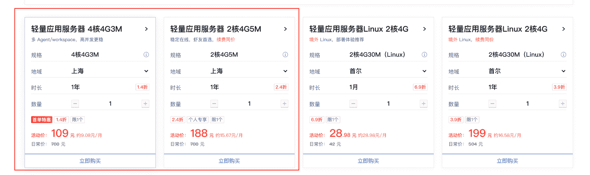

1. 选带宽：按流量计费或 1Mbps 固定带宽。
2. 购买后用 SSH 连接，执行宝塔安装命令（见第四步）。

#### 2.3 购买域名

1. 打开腾讯云域名注册：  
   https://buy.cloud.tencent.com/domain
2. 搜索你想要的域名，例如：anxiaosheng.com 等等。
3. .com 首年约 55–75 元，.cn 首年约 29–39 元。
4. 购买后立即进行域名实名认证（必须做，否则不能用）。
5. 实名认证审核通常 1–3 个工作日。
6. 记得做备案。

#### 2.4 服务器安全组/防火墙

如果购买完服务器，有一个安全组，可以先开通端口。端口类似于你标记的门牌号，每个门牌号不一样，都是唯一的。宝塔章节会讲到。

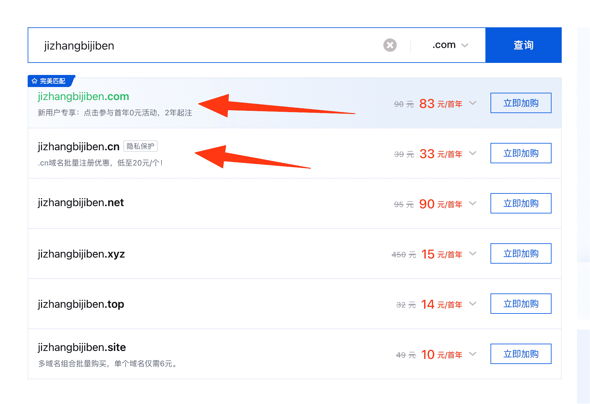

轻量应用服务器自带防火墙，需要确认放行以下端口：

| 端口 | 用途 | 是否开放 |
|---:|---|---|
| 22 | SSH 连接 | 开放（限源 IP 更安全） |
| 80 | HTTP | 开放 |
| 443 | HTTPS | 开放 |
| 8888 | 宝塔面板 | 开放（建议改成其他端口） |
| 3306 | MySQL | 不开放（只允许本机访问） |
| 6379 | Redis | 不开放 |

在“轻量应用服务器 → 防火墙”中添加规则。

#### 你怎么确认买对了

| 检查项 | 怎么检查 | 什么算对 |
|---|---|---|
| 服务器创建成功 | 腾讯云控制台看到实例状态 | 显示“运行中” |
| 公网 IP 可用 | 终端 ping 公网 IP | 能 ping 通 |
| 宝塔面板可访问 | 浏览器访问 `http://公网IP:8888` | 显示宝塔登录页 |
| 域名已购买 | 腾讯云域名列表 | 显示已注册 |
| 域名实名认证 | 域名详情页 | 显示“已实名”或“审核中” |

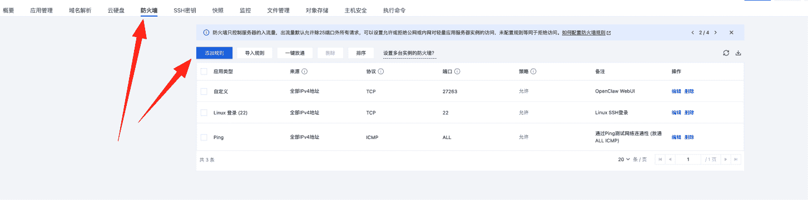

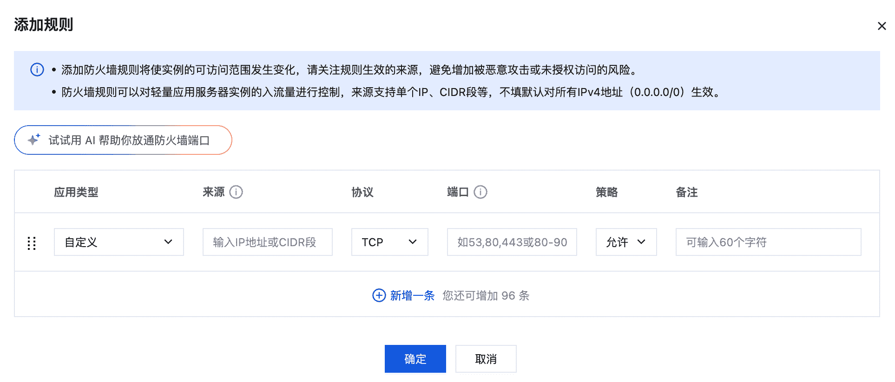

### 第三步：连接服务器

你有两种方式连接服务器，都需要会：

- 你可以安装一个工具；
- 或者使用 SSH 终端。

#### 3.1 方式一：宝塔面板（推荐小白用）

宝塔面板是网页版的服务器管理工具，不用敲命令，点点鼠标就行。

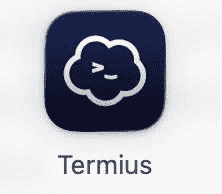

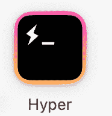

1. 在腾讯云控制台找到你的轻量服务器。
2. 点击“应用管理”标签。
3. 找到宝塔面板的登录地址、账号、密码。
4. 用浏览器打开登录地址（通常是 `http://公网IP:8888/随机字符串`）。
5. 输入账号密码登录。
6. 首次登录会要求绑定宝塔官网账号，注册一个免费的就行。

如果找不到宝塔登录信息：

- 用 SSH 连接服务器（见下方）。
- 执行命令：`bt default`
- 会显示宝塔面板的登录地址、账号、密码。

#### 3.2 方式二：SSH 终端（给 Codex 用）

Codex 操作服务器时需要 SSH 连接。

**macOS：**

1. 打开“终端”应用。
2. 输入：`ssh root@你的公网服务器IP`
3. 输入密码（在腾讯云控制台重置过的那个）。

**Windows：**

1. 打开 PowerShell 或 Windows Terminal。
2. 输入：`ssh root@你的公网服务器IP`
3. 输入密码。

首次连接会提示是否信任主机，输入 **yes** 回车。

#### 3.3 获取和重置服务器密码

如果不知道 root 密码：

1. 腾讯云控制台 → 轻量应用服务器 → 你的实例。
2. 点击“更多” → “重置密码”。
3. 设置一个强密码（字母 + 数字 + 特殊符号，至少 12 位）。
4. 重置后服务器会重启，等 1–2 分钟。

#### 你怎么确认连上了

| 方式 | 怎么检查 | 什么算对 |
|---|---|---|
| 宝塔面板 | 浏览器打开面板地址 | 显示宝塔首页，能看到服务器信息 |
| SSH | 终端执行 `ssh root@IP` | 显示 `root@xxx:~#` 提示符 |

#### 3.4 也可以在腾讯云进行登录

1. 步骤 1。

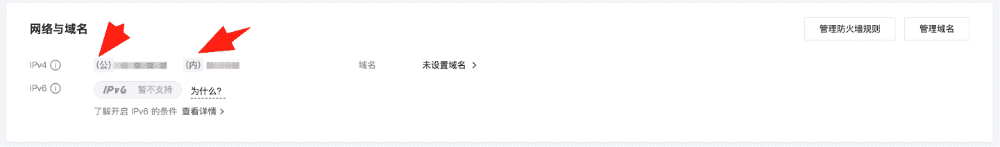

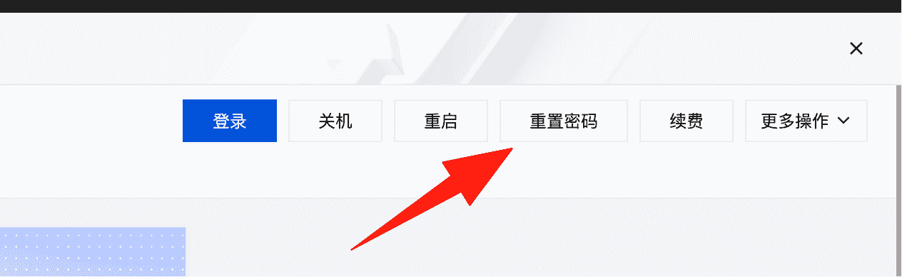

步骤 2。

1. 登录上去后，执行命令：
2. 输入 `bt`，然后回车，会出现下面截图的界面。
3. 选择 14，就能看见宝塔的链接和密码。

### 第四步：宝塔安装环境（Nginx + PHP + MySQL）

这一步在宝塔面板操作，不需要敲命令。

重点：这个很重要，大家一定看这里。

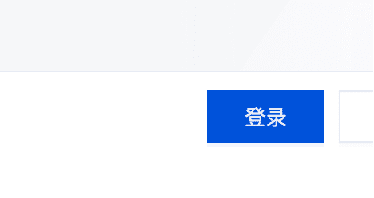

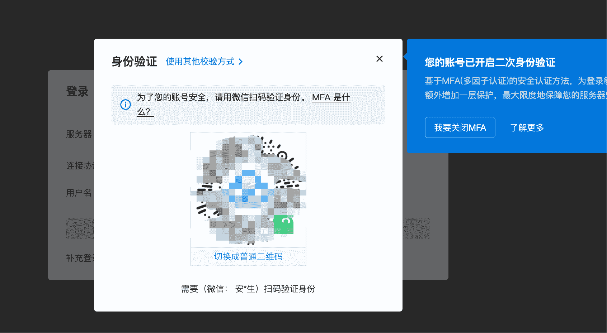

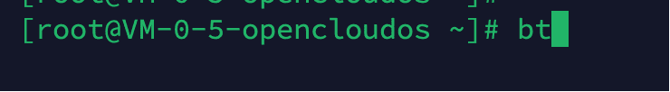

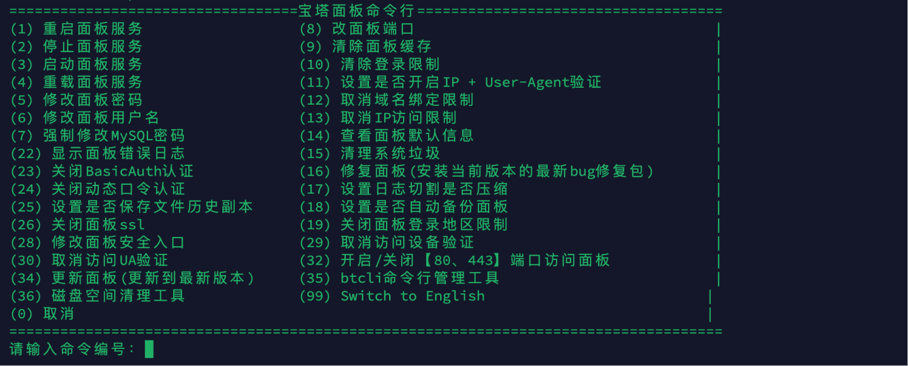

宝塔系统是在你购买服务器的时候需要选择安装的。如果你选择过了，需要重装，可以点击相应选项，会进入一个创建的选择环节。这几个步骤大家一定要看清楚，密码按照提示来。

1. 划重点：安装完毕后，需要用上面“连接服务器”第三步骤中 SSH 的方式连接服务器。

#### 4.1 首次登录安装环境

1. 登录宝塔面板。

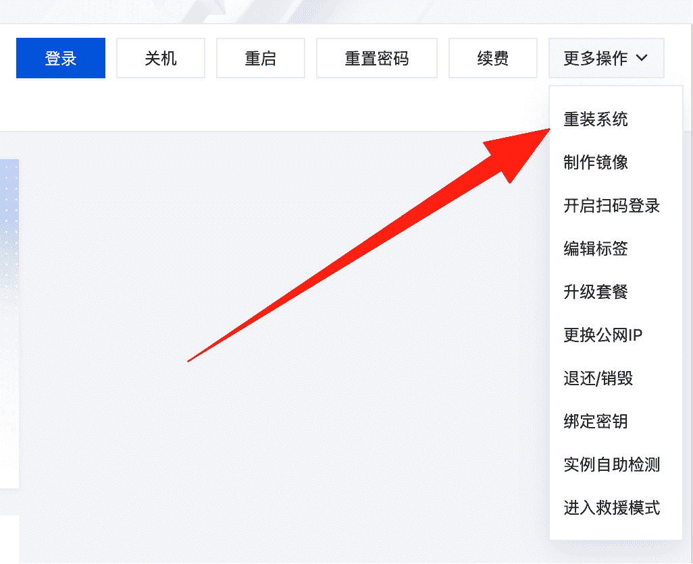

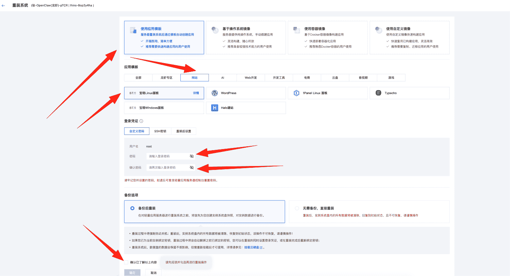

1. 首次登录会弹窗，推荐安装 LNMP 或 LAMP 环境。
2. 选 **LNMP**（Nginx + MySQL + PHP），不选 LAMP（Apache 不适合 Laravel）。
3. 选择安装方式：
   - 极速安装：快（约 10–15 分钟），够用。
   - 编译安装：慢（约 30–60 分钟），更稳定，推荐使用。
   - 新手选极速安装就行。
4. 勾选要安装的软件：
   - **Nginx**：选最新稳定版（如 1.24 或更高）。
   - **MySQL**：选 8.0（如果服务器只有 2G 内存，选 5.7 更稳）。
   - **PHP**：选 8.2 或者更高都可以。
5. 点击“一键安装”。
6. 等待安装完成（不要关闭浏览器）。

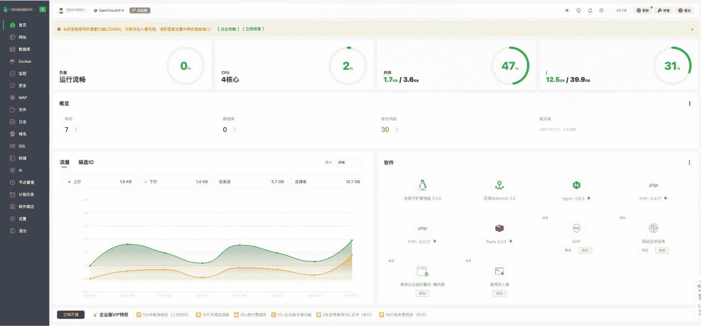

#### 4.2 安装 PHP 扩展

Laravel 需要一些 PHP 扩展，安装完 PHP 后：

1. 宝塔 → 软件商店 → 找到 PHP 8.2 → 设置。
2. 点击“安装扩展”。
3. 确保以下扩展已安装：

| 扩展 | 必须 | 用途 |
|---|---|---|
| fileinfo | 是 | 文件上传 |
| mbstring | 是 | 多字节字符处理 |
| openssl | 是 | 加密 |
| pdo_mysql | 是 | 数据库连接 |
| tokenizer | 是 | Laravel 依赖 |
| curl | 是 | 请求微信接口 |
| redis | 可选 | 缓存（新手暂不需要） |
| gd 或 imagemagick | 可选 | 图片处理 |

#### 4.3 如果你用了 CVM（需要手动装宝塔）

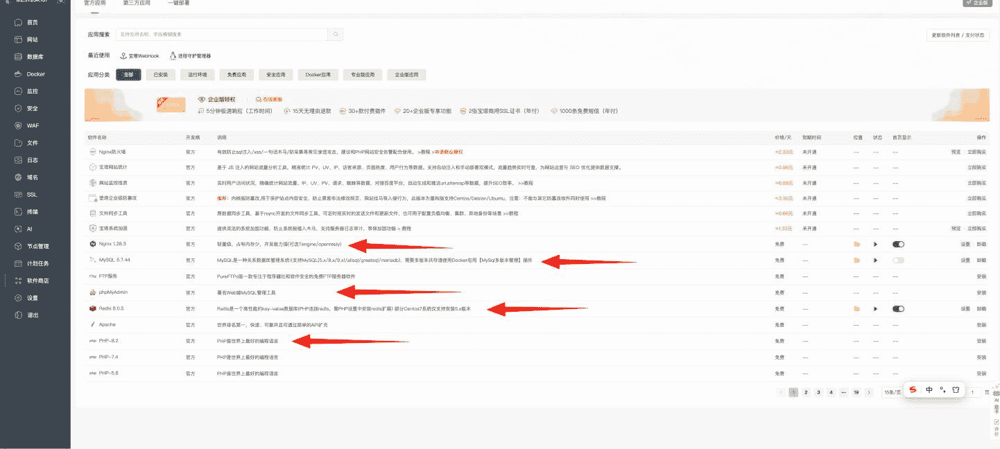

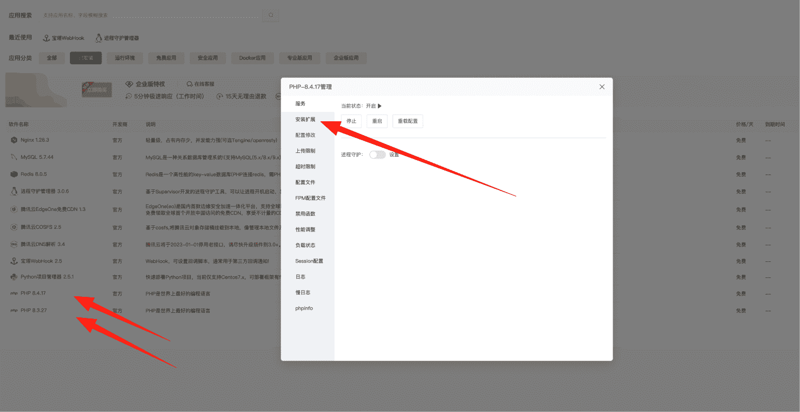


公众号懒人搜索，懒人专属群分享

用 SSH 连接服务器后，执行：

**Debian/Ubuntu**
```
wget -O install.sh https://download.bt.cn/install/install-ubuntu_6.0.sh && bash install.sh ed8484bec
```

**CentOS**
```
wget -O install.sh https://download.bt.cn/install/install_6.0.sh && sh install.sh ed8484bec
```

安装完成后会显示宝塔面板地址、账号、密码。然后按 4.1 步骤安装环境。

**你怎么确认环境装好了**

| 检查项 | 怎么检查 | 什么算对 |
|---|---|---|
| Nginx 运行 | 宝塔 → 软件商店 → Nginx | 显示"运行中" |
| PHP 运行 | 宝塔 → 软件商店 → PHP 8.2 | 显示"运行中" |
| MySQL 运行 | 宝塔 → 软件商店 → MySQL | 显示"运行中" |
| PHP 扩展 | 宝塔 → PHP 设置 → 安装扩展 | pdo_mysql、fileinfo 等都显示已安装 |
| Nginx 默认页 | 浏览器访问 http://公网IP | 显示 Nginx 欢迎页或默认页 |

#### 4.4 让 Codex 自动连接服务器并安装环境

（适合想要全自动的人）

这一段教你怎么把「服务器连接信息」直接写在 Prompt 里，让 Codex 通过 SSH 登录服务器、一次性装好宝塔和整套环境。你不用懂命令，照着填就行。

**第一步：抄下你的服务器连接信息**

去腾讯云控制台，把下面四项抄下来（轻量应用服务器在「实例详情」看「公网 IP」和「重置密码」；CVM 在「实例」和「密钥/密码」里看）：

| 项目 | 去哪看 | 一般填什么 |
|---|---|---|
| 公网 IP | 实例详情 → 公网 IP | 一串数字，如 1.2.3.4 |
| SSH 端口 | 默认 22 | 没改过就填 22 |
| 登录用户名 | 默认 root | 腾讯云多为 root；部分镜像是 ubuntu 或 lighthouse，以控制台为准 |
| 登录密码 | 重置密码 / 密钥里设置 | 你设的服务器密码 |

**第二步：把你电脑终端里的 Codex 打开，整段复制下面的 Prompt**（先把括号里的换成你的真实信息）：

```
我的服务器连接信息如下，请你用 SSH 帮我登录并安装环境：
- 服务器公网 IP：1.2.3.4
- SSH 端口：22
- 登录用户名：root
- 登录密码：你的服务器密码

登录方式：在你的终端执行 ssh root@1.2.3.4 -p 22，提示输入密码时输入上面的密码。如果连接被拒绝、超时、或提示密钥/权限问题，先把报错原样告诉我，不要擅自改服务器配置。

第一步（只读，不要改任何东西）：登录后只做检查——操作系统版本、CPU/内存/磁盘、是否已装 Nginx/PHP/MySQL、是否已装宝塔、当前开放了哪些端口。把结果用中文汇报给我。

第二步：如果还没装宝塔，用官方脚本安装宝塔面板（Debian 用 install-ubuntu_6.0.sh；CentOS 用 install_6.0.sh）。安装完成后，从脚本输出里读取面板访问地址、初始用户名、初始密码，保存到一个本地文件 /root/bt_info.txt，权限设为只有 root 能读。不要把任何密码打印在聊天里。

第三步：安装运行环境 LNMP——Nginx 最新稳定版、MySQL 8.0（如果内存只有 2G 就装 5.7）、PHP 8.2。如果某些组件已经装好就跳过，不要重装。

第四步：给 PHP 8.2 安装这些扩展：fileinfo、mbstring、openssl、pdo_mysql、tokenizer、curl。

第五步：安全设置：
- 确认防火墙只开放 22（SSH）、80、443 端口；3306（MySQL）和 PHP-FPM 端口不对公网开放；
- 不要把 phpMyAdmin 暴露到公网；
- 宝塔面板端口若用默认 8888，确认只允许你的管理 IP 访问。

每做完一步都告诉我结果和下一步做什么。遇到需要确认的高风险操作（删除文件、改 SSH 配置、放行端口等）先停下来等我同意。全部完成后给我一份「环境清单」：每个组件版本、是否运行中、面板地址。
```

**安全提示：** 上面把密码直接写进了 Prompt，它会留在 Codex 的对话记录里。如果你介意，可以不写密码，改成在终端里把信息存到本机文件 ~/server_info.txt，然后让 Codex「读取 ~/server_info.txt 获取连接信息，但不要把密码打印到屏幕上」；或者等 Codex 问密码时你再口头告诉它。

**第三步：你怎么确认 Codex 做对了**

| 检查项 | 怎么检查 | 什么算对 |
|---|---|---|
| 连上了 | Codex 汇报了系统版本/内存 | 说明 SSH 登录成功，没卡在密码或端口 |
| 宝塔装好 | 浏览器访问面板地址 | 能打开登录页 |
| 环境装好 | 宝塔 → 软件商店 | Nginx / MySQL / PHP 8.2 都显示「运行中」 |
| PHP 扩展 | 宝塔 → PHP 8.2 → 安装扩展 | 6 个必需扩展都显示已安装 |
| 端口安全 | 宝塔 → 安全 | 只看到 22/80/443 放行，没有 3306 对外 |
| 密码安全 | 检查 /root/bt_info.txt | 面板密码已存好，聊天里没乱打印 |

**提醒：** 让 Codex 装环境比手动点面板快，但你得全程盯着它的每一步授权请求。如果它要做「删除文件」「改 SSH 配置」「格式化磁盘」这类危险操作，先停下来确认。

### 第五步：配置网站和 Nginx

#### 5.1 添加网站

1. 宝塔 → 网站 → 添加站点
   - 域名：填 api.你的域名.com
   - 备案通过前可以先用 IP 地址，如 公网IP:8080
2. 根目录：设为 /www/wwwroot/api.你的域名.com/backend/public
   - 注意：必须指向 public 目录，这是 Laravel 的入口
3. PHP 版本：选 8.2
4. 数据库：先不创建（下一步单独创建）
5. 点击"提交" - 然后进行找到 - 软件商店 - > nginx - 重新加载 - > 重启。

#### 5.2 配置伪静态

Laravel 需要 URL 重写，否则除了首页其他路由都 404：

1. 宝塔 → 网站 → 你的站点 → 设置
2. 点击"伪静态"
3. 下拉选择 **"Laravel5.x"**（也适用于 Laravel 10/11）
4. 点击"保存"

如果下拉没有 Laravel 选项，选"自定义"，粘贴以下内容：

```
location / {
    try_files $uri $uri/ /index.php?$query_string;
}
```

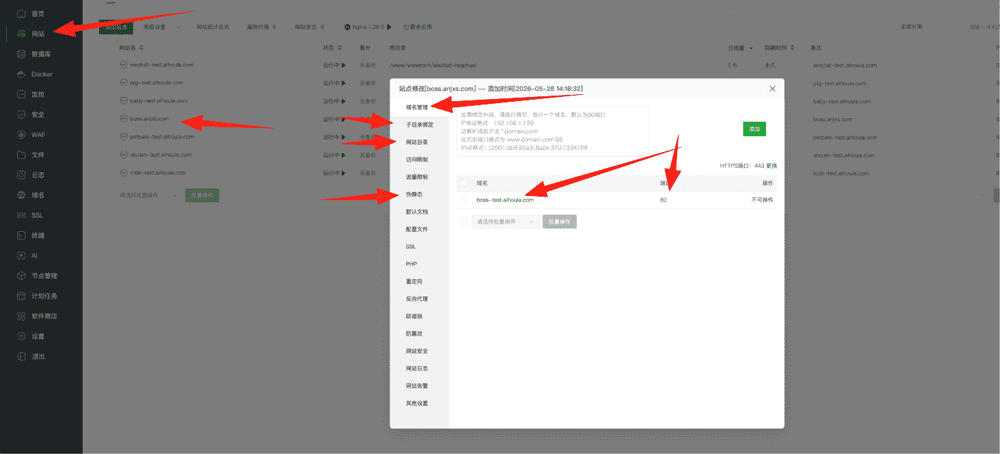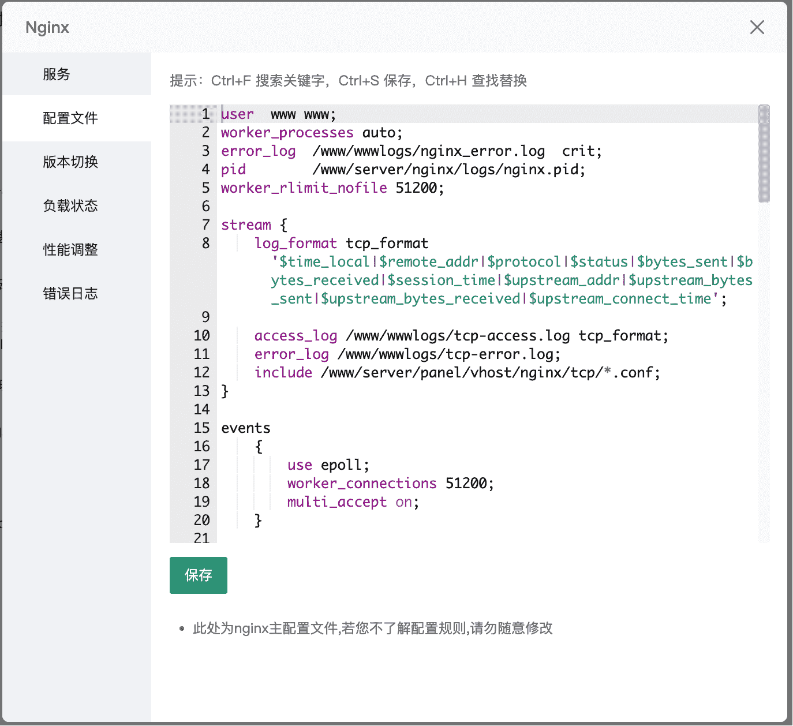

#### 5.3 配置 SSL（备案通过后才能做）

SSL 是 HTTPS 的前提，小程序只允许 HTTPS 接口：

1. 宝塔 → 网站 → 你的站点 → 设置 → SSL
2. 选择 **Let's Encrypt**
3. 点击"申请"
4. 勾选你的域名
5. 点击"申请"
6. 等待几秒钟，显示"成功"
7. 开启"强制 HTTPS"

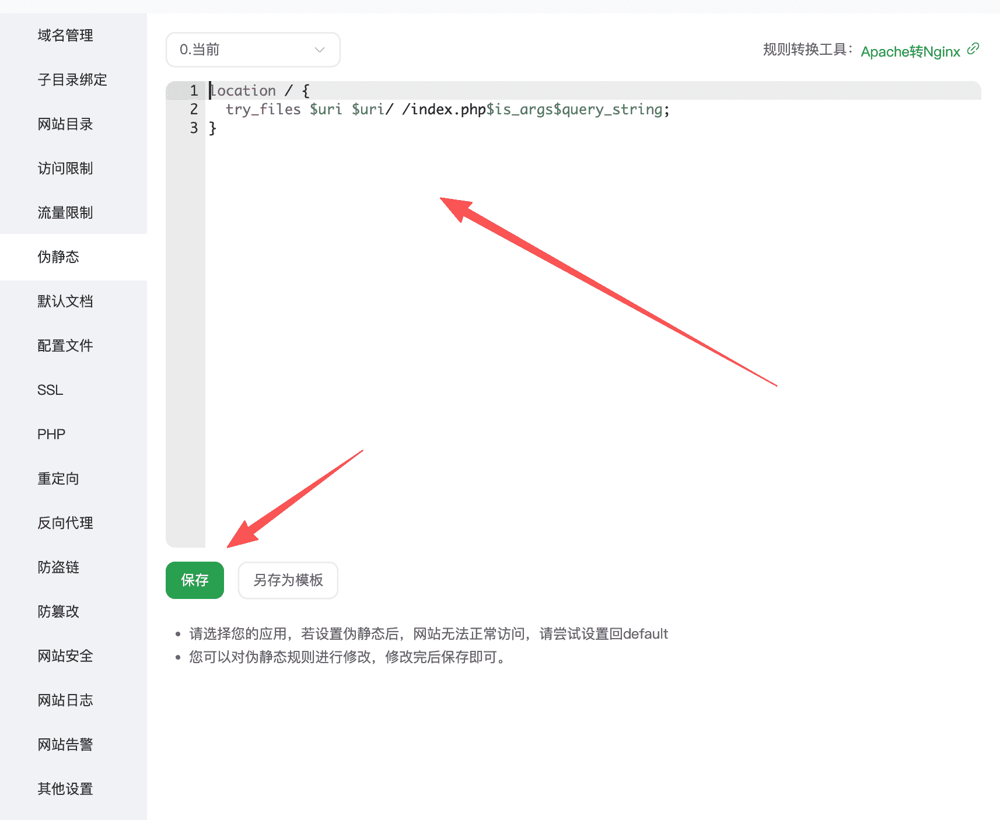

**注意：** SSL 申请需要域名备案通过 + DNS 解析生效，否则会失败。备案期间先不用配 SSL，用本地开发环境。

#### 5.4 禁止访问敏感文件

1. 宝塔 → 网站 → 你的站点 → 设置 → 配置文件
2. 在 server 块内添加：

```
# 禁止访问 .env 文件
location ~ /\.env { deny all; }

# 禁止访问 .git 目录
location ~ /\.git { deny all; }
```

3. 点击"保存"

> 正常这些可以不用懂，有的已经配置好了，也可以进行增加进去，不影响

**你怎么确认配置对了**

| 检查项 | 怎么检查 | 什么算对 |
|---|---|---|
| 网站创建 | 宝塔 → 网站 | 看到你的站点 |
| 根目录正确 | 浏览器访问 http://公网IP 或域名 | 显示 Laravel 500 错误（因为还没部署代码，这是正常的，说明 PHP 在工作） |
| 伪静态生效 | 部署代码后访问 /api/health | 能正常返回 JSON，不是 404 |
| SSL（备案后） | 浏览器访问 https://域名 | 地址栏有绿色锁标志 |
| .env 禁止访问 | 浏览器访问 https://域名/.env | 返回 403 Forbidden |

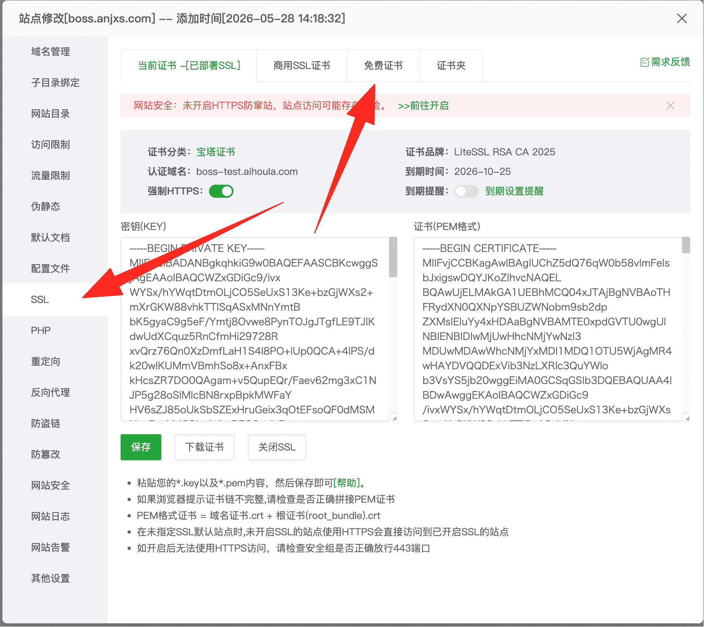

### 第六步：创建数据库（本机 MySQL，不用云数据库）

#### 6.1 为什么用本机 MySQL

腾讯云云数据库 MySQL 最低配也要 50-100 元/月，一年 600-1200 元。对于新手项目来说太贵了。

宝塔安装的 MySQL 就装在你的服务器上，完全免费，性能对于日活 < 1000 的小程序完全够用。等用户量上来了再迁移到云数据库也来得及。

#### 6.2 在宝塔创建数据库

1. 宝塔 → 数据库 → 添加数据库
2. 数据库名：miniapp_todo
3. 用户名：miniapp_user
4. 密码：点**"随机密码"**生成，复制保存好（不要用简单密码）
5. 访问权限：选 **"本地服务器"**（只允许 127.0.0.1 访问，不开放外网）
6. 字符集：选 **utf8mb4**（支持 emoji 表情）
7. 点击"提交"

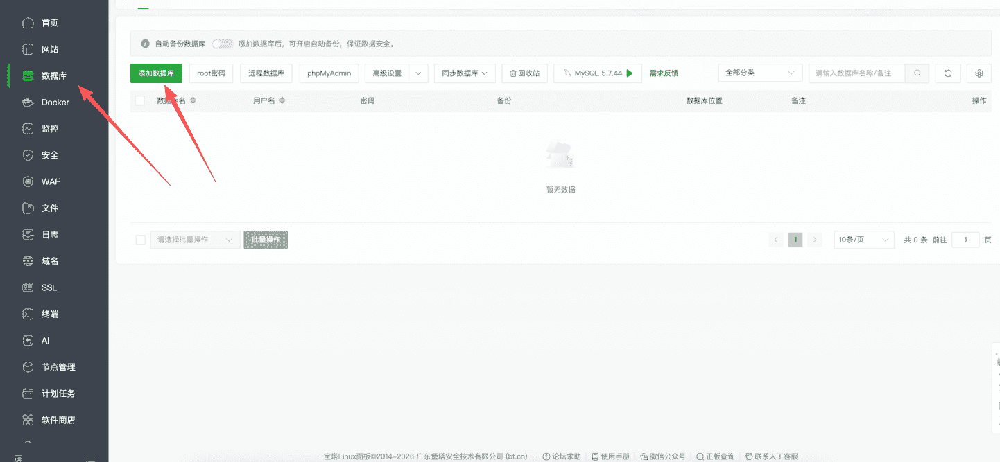

#### 6.3 安全要点

| 规则 | 为什么 |
|---|---|
| 3306 端口不开放公网 | 防止数据库被外网扫描爆破 |
| 访问权限选"本地服务器" | 只允许 127.0.0.1 连接 |
| 密码用随机生成 | 不用 123456 这种弱密码 |
| 宝塔开启数据库备份 | 每天 3:00 自动备份，防丢数据 |

#### 6.4 设置自动备份

1. 宝塔 → 计划任务 → 添加任务
2. 任务类型：备份数据库
3. 数据库：选 miniapp_todo
4. 执行周期：每天凌晨 3:00
5. 保留份数：7 份（保留最近 7 天的备份）
6. 点击"提交"

#### 6.5 给 AI 的数据库表结构需求

你不需要写 SQL。把下面的描述复制给 Codex/WorkBuddy，AI 会自动创建表。

**复制这段话给 AI**

```
请帮我设计数据库，要求如下：

1. **users 表**（用户表）：存小程序用户的 openid（唯一，通过 wx.login 静默获取）、昵称（用户通过组件选择填写）、头像（存 COS 的 object_key 而不是完整 URL，因为 URL 会过期）、创建时间和更新时间。不存手机号和邮箱，避免隐私合规问题。

注意：小程序登录是静默的（wx.login → code → 后端换 openid），用户无感知，不需要点"授权"按钮。昵称和头像不能从登录接口获取（2022 年微信已关闭此能力），需要用 <button open-type="chooseAvatar"> 组件让用户选头像、用 <input type="nickname"> 组件让用户填昵称，用户选完后传给后端保存。

2. **todos 表**（待办表）：存待办标题（最多 200 字）、是否完成（默认未完成）、附件（存 COS 的 object_key，可为空）、所属用户 ID、创建时间和更新时间。每条待办必须属于一个用户，用户删除时其待办自动删除（外键级联删除）。给"用户 ID + 是否完成"加联合索引，因为最常见的查询是"某用户的未完成待办列表"。

3. 用 Laravel Sanctum 做 token 认证，不要用 JWT，Sanctum 是 Laravel 官方方案配置更少。

4. 数据库连接信息：数据库名 miniapp_todo、用户名 miniapp_user、密码已安全保存。MySQL 版本 8.0，字符集 utf8mb4。

5. 创建好 Migration 文件后，运行迁移命令，然后把运行结果截图给我看。
```

**你怎么确认 AI 做对了**

| 检查项 | 怎么检查 | 什么算对 |
|---|---|---|
| 表创建成功 | 让 AI 运行 php artisan migrate:status 截图给你 | 所有行显示"Ran"（绿色） |
| users 表有 openid 字段 | 让 AI 运行 php artisan tinker 然后输入 Schema::hasColumn('users','openid') | 返回 true |
| todos 表有外键 | 问 AI "todos 表的外键是什么？" | 回答 "user_id 关联 users 表，onDelete cascade" |
| 查询索引存在 | 问 AI "todos 表有哪些索引？" | 回答包含 "(user_id, is_completed)" 联合索引 |
| 宝塔能看到表 | 宝塔 → 数据库 → phpMyAdmin → miniapp_todo | 能看到 users 和 todos 表 |

#### 6.6 用 Navicat 连接本机 MySQL（让 Codex 帮你配置）

https://www.navicat.com.cn/products/navicat-premium-lite 下载链接，这个是基础版本的，够用了，免费版本。很多新手习惯用 **Navicat / DBeaver / TablePlus** 这类图形化工具在本地电脑上直接看数据库、导数据。但第六步已经强调过：**3306 不开放公网**，所以你不能直接填 公网IP:3306 连。

正确做法有两种，推荐的永远是第一种。

**方式一（推荐）：SSH 隧道连接——最安全**

Navicat 先通过 SSH 登录你的服务器，再连服务器本地的 127.0.0.1:3306。因为 MySQL 只允许本机连（127.0.0.1），而 SSH 隧道相当于"从服务器内部连自己"，完全不用改 MySQL 监听地址、不用开放 3306 公网。

一句话：SSH 隧道 = 用服务器的 SSH 账号当"跳板"，Navicat 连的是"服务器上的 127.0.0.1"，不是服务器的公网 IP。

**复制这段话给 Codex**（代码块，可直接复制）：

```
我要用本机电脑上的 Navicat 连接服务器上的 MySQL 数据库。

服务器：腾讯云 Debian 12 + 宝塔，MySQL 8.0，数据库名 miniapp_todo。

请帮我按「SSH 隧道」方案配置，全程用中文汇报。

服务器连接信息：
- 公网 IP：1.2.3.4 （替换成你的真实 IP）
- SSH 端口：22
- SSH 用户名：root （轻量/部分镜像可能是 ubuntu 或 lighthouse）
- SSH 密码：（口头告诉你，或你读取 ~/server_info.txt，不要打印到聊天）

第一步（只读检查，不要改任何东西）：确认 MySQL 正在运行、版本、bind-address（应是 127.0.0.1）、当前有哪些 MySQL 用户及其 host。

第二步：确认有一个能从 localhost 连接的 MySQL 用户。
- 若 root@localhost 已存在且有密码，告诉我这个用户名和密码即可，不新建。
- 若没有合适用户，创建专用用户 navicat_user@'localhost'，设强密码，
  GRANT ALL PRIVILEGES ON miniapp_todo.* TO 'navicat_user'@'localhost';
  FLUSH PRIVILEGES;
- 把 MySQL 用户名和密码保存到 /root/navicat_db.txt（权限 600），不要显示在聊天里。

第三步：确认 22 端口（SSH）开放，且允许我的本机 IP 登录（检查宝塔「安全」和云控制台安全组，22 端口允许我的 IP；如服务器启用了 Fail2ban 或仅密钥登录，告诉我怎么改用密码登录）。

第四步：bind-address 保持 127.0.0.1，不要改成 0.0.0.0（走 SSH 隧道，MySQL 只需监听本机即可，监听公网反而危险）。

第五步：在服务器本地测试连接
mysql -u navicat_user -p -h 127.0.0.1
把结果
```

公众号懒人搜索，懒人专属群分享我是由月之暗面（Moonshot AI）研发的 kimi-k2.7-code 智能大模型。告诉我，证明本地能连。不要做的事：

- 不要开放 3306 到公网
- 不要改 bind-address 为 0.0.0.0
- 不要创建 host='%' 的用户（除非我之后明确要求直连）

每步做完告诉我结果，高风险操作先停下来等我确认。最后给我一份「Navicat 连接信息单」：SSH 主机、SSH 端口、SSH 用户名、MySQL 主机、MySQL 端口、MySQL 用户名。

### Navicat 里怎么填（Codex 配置完成后）

| 标签页 | 字段 | 填什么 |
|---|---|---|
| SSH（先填这个） | 使用 SSH 隧道 | ✅ 勾选 |
| SSH | 主机 | 服务器公网 IP（如 1.2.3.4） |
| SSH | 端口 | 22 |
| SSH | 用户名 | root |
| SSH | 密码 / 私钥 | 服务器 SSH 密码 |
| 常规 | 主机 | **127.0.0.1**（注意：不是服务器 IP！隧道下的“本地”） |
| 常规 | 端口 | 3306 |
| 常规 | 用户名 | navicat_user（Codex 给的） |
| 常规 | 密码 | /root/navicat_db.txt 里的密码 |

常见错误：常规里的“主机”填成了服务器公网 IP。记住——走 SSH 隧道时，MySQL 主机永远是 127.0.0.1，因为连接是在服务器内部发生的。

### 方式二（不推荐）：直连公网 3306——有风险

只有当你明确需要、且能接受风险时才用（比如某些老旧工具不支持 SSH 隧道）。它会把 MySQL 暴露到公网。

让 Codex 配置的额外步骤（在方式一基础上追加）：

继续配置“直连”模式（我知道有风险，已确认需要）：

1. 改 MySQL 配置 bind-address = 0.0.0.0，重启 MySQL。
2. 创建用户 navicat_user@'%'（host 为任意），强密码，GRANT 限制于 miniapp_todo 库。
3. 云安全组 + 宝塔安全：放行 3306，但来源 IP 限制为“我的本机公网 IP”，绝不写 0.0.0.0/0（全开）。
4. 建议把 MySQL 端口改成非默认（如 33060）以减少扫描。
5. 确认 root 用户不允许远程（root 保持 localhost）。

⚠️⚠️ 风险说明：直连会暴露在公网，可能被端口扫描和爆破。务必做到“强密码 + 限制来源 IP + 改默认端口”，否则绝不开放。

### Navicat 连不上？按这个顺序排查

| 现象 | 可能原因 | 怎么办 |
|---|---|---|
| SSH 阶段就报错（连不上服务器） | IP/端口/用户名/密码错，或 22 被安全组挡 | 确认服务器 IP、22 端口放行、SSH 密码正确 |
| SSH 通了，MySQL 报“Access denied” | MySQL 用户名/密码错，或用户 host 不是 localhost | 让 Codex 重新确认用户和密码，用户必须是 @'localhost' |
| 报 “Can't connect to MySQL server on 127.0.0.1” | 隧道通了但 MySQL 没监听本机/没启动 | 让 Codex 确认 mysql -h 127.0.0.1 能在服务器本地连上 |
| 报 2003 / 10060（直连时） | 3306 被防火墙/安全组挡，或 bind 仍是 127.0.0.1 | 检查安全组 3306 放行、bind-address |
| 连上后看不到表 | 连错了库 / 用户权限不足 | 确认库名 miniapp_todo、用户有该库权限 |

### 你怎么确认 Codex 做对了

| 检查项 | 怎么检查 | 什么算对 |
|---|---|---|
| 本地能连 | 让 Codex 跑 `mysql -u navicat_user -p -h 127.0.0.1` 截图 | 进入 MySQL 命令行，无报错 |
| 用户是 localhost | 让 Codex 跑 `SELECT user,host FROM mysql.user` | navicat_user 的 host 是 localhost |
| bind 没暴露公网 | 让 Codex 跑 `SHOW VARIABLES LIKE 'bind_address'` | 值是 127.0.0.1，不是 0.0.0.0 |
| 密码没泄露 | 检查聊天记录 | 密码只存在于 /root/navicat_db.txt，没打印出来 |
| Navicat 实测 | 你自己用 Navicat 按上面填法连一次 | 能看到 miniapp_todo 库和表 |

### 第七步：域名 DNS + 备案

类目资质和备案的总体说明见第一部分第 9 节，这里补充具体操作和时间线。

#### 7.1 配置 DNS 解析

1. 腾讯云控制台 → DNS 解析 DNSPod → 你的域名。
2. 添加记录：

| 主机记录 | 记录类型 | 记录值 | 说明 |
|---|---|---|---|
| api | A | 你的服务器公网 IP | api.你的域名.com 指向服务器 |
| @ | A | 你的服务器公网 IP | 你的域名.com 指向服务器（可选） |

举个例子：你域名是 ddddd.com，你第一个小程序可以这样：one.ddddd.com，第二个：two.ddddd.com。

3. 保存后等待 10 分钟—2 小时生效。
4. 验证：终端执行 `ping api.你的域名.com`，看是否解析到你的服务器 IP。

#### 7.2 提交 ICP 备案

1. 腾讯云控制台 → 网站备案 → 开始备案。
2. 填写主体信息（个人或企业）。
3. 填写网站信息（域名、网站名称）。
4. 上传证件照片。
5. 提交后腾讯云初审（1—3 个工作日）。
6. 初审通过后，收到 12381 短信，24 小时内完成短信核验。
7. 管局审核（1—20 个工作日，各地不同）。
8. 审核通过，获得备案号。

#### 7.3 提交小程序备案

ICP 备案通过后，在微信公众平台提交小程序备案：

1. mp.weixin.qq.com → 设置 → 小程序备案。
2. 填写小程序信息。
3. 等待审核（3—7 个工作日）。

#### 7.4 时间线总览

| 阶段 | 预计时间 | 是否阻塞后续 |
|---|---|---|
| 购买域名 + 实名认证 | 当天 | 是 |
| 购买服务器 + 实名认证 | 当天 | 是 |
| DNS 解析生效 | 10 分钟—2 小时 | 否 |
| ICP 备案 | 7—20 个工作日 | 是（备案通过前不能用域名访问 80/443） |
| 小程序备案 | 3—7 个工作日 | 是（备案通过前不能发布小程序） |
| SSL 证书申请 | 几分钟 | 是（需要 ICP 备案通过后域名才能用） |

#### 7.5 实际时间线（个人开发者）

- 第 1 天：购买域名 + 腾讯云服务器 + 实名认证 + DNS 配置
- 第 1 天：提交 ICP 备案申请
- 第 1—3 天：腾讯云初审（通常 1—3 个工作日）
- 第 3—5 天：短信核验（收到短信后 24 小时内完成）
- 第 5—20 天：管局审核（各地速度不同，广东/北京较快）
- 第 20 天：备案通过，域名可用
- 第 20 天：宝塔申请 SSL 证书
- 第 20 天：提交小程序备案
- 第 23—27 天：小程序备案通过
- 第 27 天：可以提交小程序审核

重要：备案期间（约 2—3 周）你只能用本地开发环境，不能用正式域名访问。

#### 7.6 备案期间能做什么

| 能做 | 不能做 |
|---|---|
| 本地开发（Codex + 本地域名） | 用正式域名访问 80/443 |
| 用 IP + 非标准端口测试（如 8080） | 在微信公众平台填正式域名 |
| 写代码、调接口 | 提交小程序审核 |
| 准备截图和文档 | 发布小程序 |

### 第八步：后端开发

你不需要看 PHP 代码。把下面的需求描述给 AI，AI 会自动写好所有后端接口。

### 重要：小程序登录 vs 微信网页登录

很多小白分不清这两种登录，这里说清楚：

| 对比项 | 小程序登录（本教程用的） | 微信网页 OAuth 登录（本教程不用） |
|---|---|---|
| 在哪用 | 微信小程序里 | 普通网站 / H5 页面 |
| 怎么获取用户身份 | wx.login() → code → 后端换 openid | 引导用户扫码授权 → 获取 openid |
| 用户感知 | 完全无感，静默完成 | 要扫码、点同意 |
| 需要按钮吗 | 不需要“授权”按钮，点“开始使用”即可 | 需要明确的“微信登录”按钮 |
| 能直接拿到昵称头像吗 | 不能，2022 年后要单独获取（见下方） | 可以通过 OAuth scope 获取 |
| 用户身份唯一标识 | openid | openid |

本教程用的是小程序登录。用户打开小程序时，wx.login() 自动获取临时 code，发给后端换 openid，后端用 openid 识别“这是谁”。整个过程用户完全无感知，不需要点“微信授权”。

### 2022 年后的昵称和头像规则

微信在 2022 年关闭了从登录接口直接获取用户头像和昵称的能力（wx.getUserProfile 已废弃，返回的是“微信用户”和灰色头像）。

现在的做法是分两步：

1. 登录：wx.login → 拿到 openid 和 token（静默，用户无感）。
2. 设置资料：用户在“我的”页面主动操作：
   - 头像：用 `<button open-type="chooseAvatar">` 组件，用户点击后选择微信头像或从相册选图。
   - 昵称：用 `<input type="nickname">` 组件，用户点击后弹出微信昵称键盘，可选择使用微信昵称或自定义。

选好后调 `PUT /api/me/profile` 保存到数据库。这样既保护了用户隐私（不强制拿资料），又满足了功能需求（用户想设置就设置）。

### 复制这段话给 AI

请帮我开发后端 API，用 Laravel 框架，具体需求如下：

**接口 1：健康检查**

- 路径：GET /api/health
- 不需要登录
- 返回：HTTP 200 + JSON，包含 status=ok、当前时间、版本号

**接口 2：小程序登录**

- 路径：POST /api/auth/miniapp-login
- 不需要登录
- 接收参数：code（小程序 wx.login 获取的）、device_name（可选）
- 后端流程：用 code 调微信 code2Session 接口换 openid → 用 openid 查或建用户 → 生成 Sanctum token → 返回 token 和用户信息
- 返回：HTTP 200 + JSON，包含 token（Bearer token）和用户基本信息（openid、昵称、头像，首次登录昵称和头像为空）
- 注意：这是小程序登录，不是微信网页 OAuth 登录。小程序登录是静默的，用户打开小程序时 wx.login 自动获取 code，不需要用户点任何按钮授权。用户身份靠 openid 识别。

**接口 3：获取当前用户**

- 路径：GET /api/me
- 需要登录（Authorization: Bearer token）
- 返回：HTTP 200 + 当前用户信息
- 未传 token 时返回 401

**接口 4：退出登录**

- 路径：POST /api/auth/logout
- 需要登录
- 删除当前 token
- 返回：HTTP 204（无内容）

**接口 5：待办列表**

- 路径：GET /api/todos
- 需要登录
- 支持筛选：status=all/pending/completed，默认 all
- 支持分页：page 参数，每页 20 条
- 只返回当前用户的待办
- 返回：HTTP 200 + 待办列表 JSON

**接口 6：新增待办**

- 路径：POST /api/todos
- 需要登录
- 接收参数：title（必填，最多 200 字）、attachment_url（可选）
- 返回：HTTP 201 + 新建的待办 JSON
- title 为空时返回 422 + 错误信息

**接口 7：修改待办**

- 路径：PATCH /api/todos/{id}
- 需要登录
- 接收参数：title（可选）、is_completed（可选）
- 只能改自己的待办，改别人的返回 403
- 返回：HTTP 200 + 更新后的待办 JSON

**接口 8：删除待办**

- 路径：DELETE /api/todos/{id}
- 需要登录
- 只能删自己的待办
- 返回：HTTP 204（无内容）

**接口 9：图片上传**

- 路径：POST /api/uploads/images
- 需要登录
- 接收参数：image（文件，支持 jpg/png/webp，最大 5MB）
- 上传到腾讯云 COS 私有 Bucket
- 返回：HTTP 201 + JSON，包含 object_key（存数据库用）和 temporary_url（前端临时显示用，2 小时有效）

**接口 10：更新用户资料**

- 路径：PUT /api/me/profile
- 需要登录
- 接收参数：nickname（可选，最多 20 字）、avatar_key（可选，上传图片后拿到的 object_key）
- 用途：小程序登录只拿到 openid，昵称和头像需要用户通过组件选择后调这个接口保存
- 返回：HTTP 200 + 更新后的用户信息

其他要求：

1. 所有接口返回 JSON。
2. 错误返回统一的 JSON 格式：`{"message": "错误描述"}`。
3. 参数校验失败返回 422 + 具体字段错误。
4. 未登录访问受保护接口返回 401。
5. 服务器错误返回 500，APP_DEBUG=false 时不暴露堆栈。
6. `.env` 文件里的 AppSecret、数据库密码、COS 密钥不要在对话中显示真实值，用“已安全保存”代替。
7. 完成后逐个接口测试，把测试结果截图给我看。

### 你怎么确认 AI 做对了

| 接口 | 测试方法 | 什么算对 |
|---|---|---|
| health | 浏览器访问 `http://api.miniapp.test:8080/api/health` | 显示 `{"status":"ok", ...}` |
| 小程序登录 | 在小程序模拟器点“开始使用” | 模拟器 Console 无报错，Storage 里有 token |
| 更新资料 | `PUT /api/me/profile` + `{"nickname":"测试"}` | 返回 200 + 昵称已更新 |
| 获取用户 | 用 API 工具发 GET /api/me + 带 token | 返回 200 + 用户信息 |
| 未登录访问 | 用 API 工具发 GET /api/me 不带 token | 返回 401 |
| 待办列表 | 登录后访问 GET /api/todos | 返回 200 + 数组（第一次为空） |
| 新增待办 | POST /api/todos + `{"title":"测试"}` | 返回 201 + 新建的待办 |
| 参数错 | POST /api/todos + `{}`（空） | 返回 422 + title 字段错误 |
| 修改待办 | PATCH /api/todos/1 + `{"is_completed":true}` | 返回 200 + `is_completed=true` |
| 删除待办 | DELETE /api/todos/1 | 返回 204（无内容） |
| 图片上传 | POST /api/uploads/images + 图片文件 | 返回 201 + object_key + temporary_url |

### 关键验证：状态码对照

小白需要记住这几个状态码的含义：

| 状态码 | 含义 | 小白理解 |
|---|---|---|
| 200 | 成功 | 做对了 |
| 201 | 创建成功 | 新增做对了 |
| 204 | 成功无内容 | 删除做对了 |
| 401 | 未登录 | token 没传或失效了 |
| 403 | 无权限 | 你在动别人的东西 |
| 422 | 参数错误 | 前端传的数据有问题 |
| 500 | 服务器错误 | 后端崩了，看日志 |
| 502 | 网关错误 | PHP 没启动，最常见 |

### 第九步：前端开发

你不需要看 WXML 和 JavaScript 代码。把下面的需求描述给 AI，AI 会自动写好所有页面。

### 复制这段话给 AI


公众号懒人搜索，懒人专属群分享我是由月之暗面（Moonshot AI）研发的 kimi-k2.7-code 智能大模型。请帮我开发微信小程序前端，要求如下：

整体结构：

- 三个页面：欢迎页（welcome）、待办页（todos）、我的（profile）。
- 底部 TabBar：待办页 + 我的页。
- 全局配色：白色背景，微信绿（#07C160）主色。
- 导航栏标题：新手待办。

## 页面 1：欢迎页（welcome）

- 显示应用名称“新手待办”和简短描述。
- 一个“开始使用”按钮。
- 点击按钮：调用 `wx.login` 获取 code → 发给后端 `/api/auth/miniapp-login` → 拿到 token 存本地 → 跳转到待办页。
- 小程序登录是静默的，用户不需要点“微信授权”按钮，“开始使用”按钮只是触发 `wx.login`。
- 已登录用户打开直接跳待办页。
- 按钮点击后要禁用，防止重复点击。

## 页面 2：待办页（todos）

- 顶部：输入框 + 添加按钮。
- 筛选标签：全部 / 待完成 / 已完成（点击切换）。
- 列表：每条待办显示标题 + 完成状态切换 + 删除按钮。
- 已完成的待办标题显示删除线。
- 下拉刷新。
- 空数据时显示“暂无待办，添加一个吧”。
- 加载中显示“加载中……”。
- 网络错误显示错误信息 + 重试按钮。

## 页面 3：我的（profile）

- 已登录：显示头像和昵称（首次登录可能为空，显示默认头像和“点击设置昵称”）。
- 未登录：显示“开始使用”按钮。
- 设置昵称：用 `<input type="nickname">` 组件让用户填写昵称 → 调 `PUT /api/me/profile` 保存。
- 设置头像：用 `<button open-type="chooseAvatar">` 组件让用户选头像 → 上传到后端 → 调 `PUT /api/me/profile` 更新 `avatar_key`。
- 注意：不要用 `wx.getUserProfile` 或 `wx.getUserInfo`，这两个接口 2022 年已废弃，获取到的都是匿名数据。
- 退出登录：弹确认框 → 调后端 `/api/auth/logout` → 清除本地 token → 跳欢迎页。

## 全局要求

1. 封装统一的请求方法（`utils/request.js`），自动带 token，自动处理 401 跳登录、422 显示错误。
2. 封装登录态管理（`utils/auth.js`），提供 `miniappLogin`、`isLoggedIn`、`logout` 三个方法。
3. `BASE_URL` 用本地域名 `http://api.miniapp.test:8080`，部署后改成正式域名。
4. token 存 `wx.Storage`，key 为 `token`。
5. 完成后在开发者工具模拟器里逐个页面测试，截图给我看。

## 你怎么确认 AI 做对了

| 检查项 | 怎么检查 | 什么算对 |
|---|---|---|
| 欢迎页 | 打开模拟器首页 | 显示应用名 +“开始使用”按钮 |
| 登录流程 | 点“开始使用” | Console 无报错，Storage 里出现 token |
| 已登录跳转 | 退出重进小程序 | 直接到待办页，不经过欢迎页 |
| 输入待办 | 在输入框打字，点添加 | 列表出现新待办 |
| 完成切换 | 点待办左边的圆圈 | 变成对勾，标题加删除线 |
| 删除待办 | 点删除 → 确认 | 列表移除该条 |
| 筛选切换 | 点“已完成” | 只显示已完成的 |
| 下拉刷新 | 在列表区往下拉 | 出现刷新动画，列表刷新 |
| 空状态 | 删完所有待办 | 显示“暂无待办，添加一个吧” |
| 网络断开 | 断网后操作 | 显示错误提示 + 重试按钮 |
| token 失效 | 手动清 Storage 里的 token | 自动跳回欢迎页 |
| 我的页面 | 点 TabBar“我的” | 显示头像昵称（或默认值）+ 菜单 |
| 设置昵称 | 点“设置昵称”→ 输入 → 确认 | 昵称更新成功 |
| 设置头像 | 点头像区域 → 选图片 | 头像更新成功 |
| 退出登录 | 点“退出登录”→ 确认 | 回到欢迎页 |

### 第十步：接入微信支付（付费 / 订阅项目必看）

如果你想做“会员订阅”“内容付费”“虚拟商品”，就需要微信支付。这部分和小程序登录不一样——它涉及真实钱款和企业资质，步骤更讲究，AI 也只能帮你写代码，开商户号得你自己来。

#### 10.0 先搞清前提：主体资格（非常重要）

- 微信支付只对企业、个体工商户开放，个人主体不能开通微信支付。
- 所以个人开发者如果要做付费项目，第一步不是写代码，而是先办一张个体工商户营业执照（线上就能办，成本低、手续简单），用这个主体注册小程序 + 开通微信支付商户号。
- 商户号（mchid）和小程序 AppID 必须绑定在同一个主体下（小程序后台 → 微信支付里关联）。

#### 10.1 手动开通微信支付商户号（这步 AI 做不了，你来做）

| 步骤 | 去哪做 | 做什么 |
|---|---|---|
| 1 | 微信支付商户平台 pay.weixin.qq.com | 用个体工商户主体提交资料，申请商户号 |
| 2 | 商户平台 → 产品中心 | 开通 JSAPI 支付（小程序用的是 JSAPI，不是 Native / APP 支付） |
| 3 | 小程序后台 → 微信支付 | 关联并绑定商户号到当前小程序 AppID |
| 4 | 商户平台 → API 安全 | 设置 APIv3 密钥（32 位随机串，自己保存好） |
| 5 | 商户平台 → API 安全 | 下载并安装 API 证书（`apiclient_cert.pem` / `apiclient_key.pem`），私钥只能放服务器，绝不能进前端和小程序 |
| 6 | 记下来 | 商户号 mchid、AppID、APIv3 密钥、证书在服务器上的路径 |

这三个东西（mchid、APIv3 密钥、证书）是“钱袋子钥匙”。告诉 AI 时，只给 mchid 和要调用的接口说明；APIv3 密钥和证书让 AI 从服务器上的安全文件读取，不要贴到聊天里。

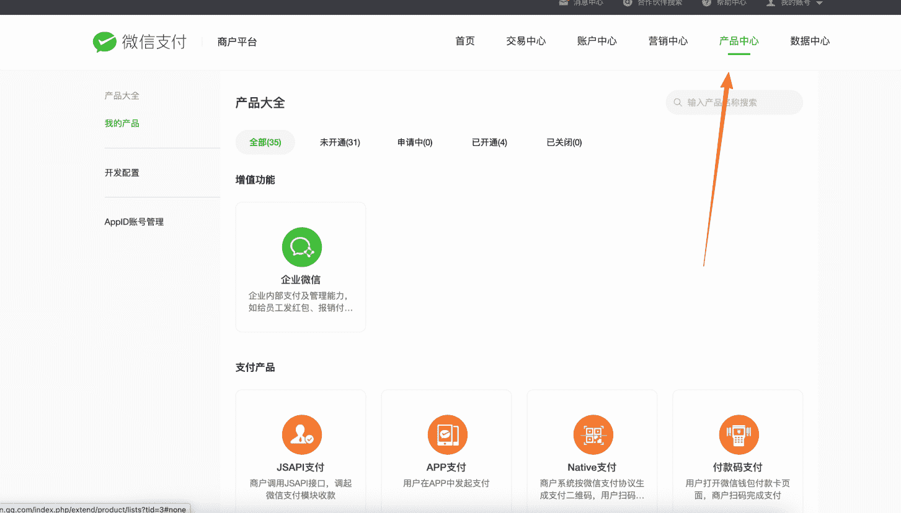

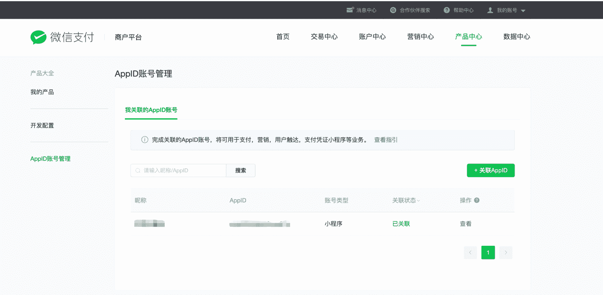

这些是支付秘钥，都是需要配置的。你也可以在 AI 对话中，让 AI 给你操作步骤，告诉你怎么去找。

#### 10.2 给 AI 的后端 Prompt（创建订单 + 接收支付结果）

我要在已有的 Laravel 后端里接入微信支付（JSAPI，小程序用）。请你实现以下能力，全程用中文说明：

1. 创建支付订单接口：

   - 路径：`POST /api/pay/create`
   - 需要登录（用现有 token 识别用户）。
   - 入参：`product_id`（商品 / 会员套餐 ID）、`openid`（当前用户）。
   - 后端流程：按 `product_id` 查出金额 → 调微信“统一下单”接口（JSAPI）→ 拿到 `prepay_id` → 用 `prepay_id` 按微信规则生成小程序端需要的 5 个支付参数（`appId`、`timeStamp`、`nonceStr`、`package`、`paySign`）。
   - 返回：HTTP 200 + 这 5 个参数。
   - APIv3 密钥和证书从服务器安全文件读取，不要写死在代码里。

2. 支付结果通知接口（回调）：

   - 路径：`POST /api/pay/notify`
   - 微信会异步调用这个地址通知支付结果。
   - 后端流程：验证回调签名 → 用 APIv3 密钥解密报文 → 校验金额 → 更新订单状态为“已支付” → 给对应用户开通会员 / 权益。
   - 必须返回微信要求的成功报文，否则微信会重复通知。

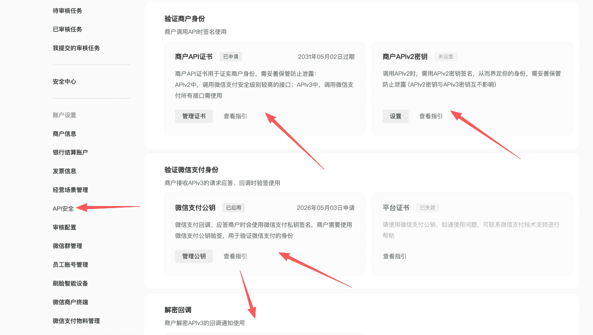

3. 查询订单接口：

   - 路径：`GET /api/pay/order?out_trade_no=xxx`
   - 返回订单状态和是否已支付。

注意：金额单位用“分”；回调必须验签；订单状态用数据库事务保证不重复发货。

#### 10.3 给 AI 的前端 Prompt（调起支付 + 展示订阅状态）

我要在微信小程序里接入微信支付。请你在“我的 / 会员中心”页面加以下功能，用原生小程序写法：

1. 会员套餐列表：从后端 `GET /api/membership/plans` 拉取套餐（名称、价格、权益说明），用卡片展示。
2. 点击“立即开通”：
   - 先调 `POST /api/pay/create` 拿到支付参数（`appId`、`timeStamp`、`nonceStr`、`package`、`paySign`）。
   - 再调 `wx.requestPayment`（支付参数），把上面 5 个参数原样传入。
   - 支付成功回调里提示“开通成功”，并刷新会员状态。
   - 支付失败 / 用户取消，提示对应文案。
3. 会员状态展示：页面加载时 `GET /api/me` 拿到 `is_vip`、`vip_expire_at`，已开通显示“会员有效期至 X”，未开通显示“立即开通”按钮。
4. 不要在前端写任何密钥、mchid、证书，这些都在后端。

注意：`wx.requestPayment` 的 `paySign` 必须由后端按微信规则算好返回，前端不能自己生成。

#### 10.4 iOS 的大坑（一定要知道）

- 虚拟商品（会员、金币、课程）在 iOS 端不能用微信支付，苹果要求走 IAP（苹果内购），否则审核会被拒。
- 所以做“会员订阅”这类虚拟商品时要注意：
  - Android / 微信端：可以用微信支付（上面这套）。
  - iOS 端：要么做苹果 IAP（复杂很多），要么 iOS 端先不开放购买，只展示“请在安卓 / 微信内购买”。
- 实物商品（比如卖周边、纸质书）不受此限制，微信支付全平台可用。

#### 10.5 小程序后台要配置什么

- 微信支付是后端服务器调微信接口，前端只用 `wx.requestPayment` 这个原生 API，不需要在小程序后台“服务器域名”里加微信支付域名。
- 但你的后端服务器要能访问 `api.mch.weixin.qq.com`（出网），宝塔面板里确认没把对外请求全拦了。
- 类目注意：付费内容要选对类目（如“文娱-付费内容”“工具-会员服务”），并在隐私指引里说明会收集支付相关订单信息。

权限提前申请。

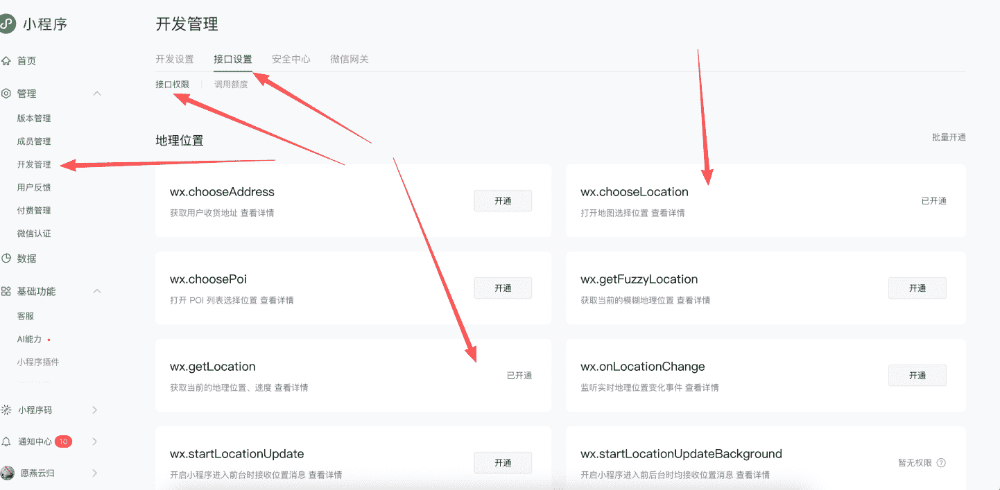

微信公众号，配置。

#### 10.6 你怎么确认微信支付接对了

| 检查项 | 怎么检查 | 什么算对 |
|---|---|---|
| 商户号绑定 | 小程序后台 → 微信支付 | 能看到已绑定的商户号 |
| 下单成功 | 用 API 工具调 `/api/pay/create` | 返回 200 + 5 个支付参数，没有 500 |
| 前端能调起 | 真机点“立即开通” | 弹出微信支付收银台 |
| 支付成功 | 真机完成付款 | 后端 `/api/pay/notify` 收到回调，订单变“已支付”，会员状态更新 |
| 证书安全 | 检查服务器文件 | 证书只在服务器，聊天记录和前端代码里搜不到 |
| iOS 合规 | 检查 iOS 端 | 虚拟商品 iOS 端未违规引导用微信支付 |

### 第十一步：用 Gitee 管理你的代码（代码托管 + 版本控制）

前面你已经把项目写完、部署上线了。但代码现在只躺在你电脑或服务器的一个文件夹里——电脑坏了、误删了、改崩了，就全没了。Gitee（码云）是国内版的 GitHub，免费、访问快、全中文，非常适合个人开发者把代码“存一份到云端”，还能记录每一次改动、方便把代码 clone 到服务器。

一句话理解：**Gitee 是代码的云盘 + 时光机。**它会记住你每次提交的内容，随时能回到任意历史版本。下面紧接的“服务器部署”里写的“Git clone 代码”，用的就是这里讲的能力。

#### 11.1 先去 Gitee 建一个仓库（网页操作，你来做）

1. 打开 gitee.com，用手机号注册并登录。
2. 点右上角“+”→“新建仓库”。
3. 仓库名称填你的项目英文名（如 `miniapp-todo`），路径会自动生成。
4. “是否开源”选私有（个人项目别公开，避免泄露 `.env`）。
5. “初始化仓库”勾选“添加 README 文件”，不要勾选 `.gitignore` 和许可证（我们后面自己加）。
6. 点“创建”，记下仓库地址：`https://gitee.com/你的用户名/miniapp-todo.git`（这是 HTTPS 地址）。

HTTPS 还是 SSH？新手先用 HTTPS（每次推送输一次账号 + 私人令牌，简单）；等熟悉了再配 SSH 密钥免密。下面两种都给你。

#### 11.2 本地安装 Git 并配置身份

Git 是真正干活的软件，Gitee 只是它的“云端仓库”。先确认装没装：

```bash
git --version
```

没装就去 git-scm.com 下载安装（Windows 双击下一步即可；Mac 一般自带）。装好后，只需要配置一次你的名字和邮箱：

```bash
git config --global user.name "你的名字"
git config --global user.email "你的邮箱@example.com"
```

#### 11.3 把本地项目变成 Git 仓库并提交

进入你的项目根目录，初始化仓库、加文件、写第一次提交：

```bash
cd 你的项目目录
git init
git add .
git commit -m "first commit: 初版小程序待办项目"
```

命令解释：

| 命令 | 作用 |
|---|---|
| `git init` | 在当前目录创建 `.git`，项目正式进入版本管理 |
| `git add .` | 把当前目录所有改动“暂存”（准备提交） |
| `git commit -m "说明"` | 把暂存的内容打包成一个版本快照，引号里写这次改了什么 |

#### 11.4 关联 Gitee 远程仓库并推送

把你本地仓库和刚建的 Gitee 仓库连起来，然后推上去：

```bash
git remote add origin https://gitee.com/你的用户名/miniapp-todo.git
git branch -M main
git push -u origin main
```

第一次推送会要求输入 Gitee 的账号和密码。注意：这里的“密码”不是登录密码，是“私人令牌”（见下方提示）。成功后刷新 Gitee 网页，就能看到你的代码了。

Gitee 已不支持用登录密码推送，需要用“私人令牌（Token）”当密码。获取方式：Gitee 右上角头像 → 设置 → 私人令牌 → 生成令牌（勾选 projects 权限），复制保存。推送时用户名填你的 Gitee 账号，密码框粘贴这个令牌。

#### 11.5 日常开发：怎么提交和同步

以后每次改完代码，都按这三步走（add → commit → push）：

```bash
git add .
git commit -m "改了：登录页样式 + 修复待办删除 bug"
git push
```

记住一个节奏：改一点、提交一点、推一点。不要攒一个月才推一次，那样出问题很难定位。

#### 11.6 别把敏感文件提交上去（.gitignore）

像 `.env`、`node_modules/`、缓存目录这些绝对不能进 Gitee（里面可能有数据库密码、密钥）。在项目根目录新建一个 `.gitignore` 文件：

```gitignore
.env
node_modules/
vendor/
storage/
*.key
*.log
.DS_Store
```

如果敏感文件已经被提交过了，要先从版本库移除（保留本地文件）再提交：

```bash
git rm --cached .env
git commit -m "移除敏感配置文件"
git push
```

#### 11.7（可选）配 SSH 免密推送

不想每次都粘贴令牌，就配一次 SSH 密钥（一台电脑配一次，永久免密）：

```bash
ssh-keygen -t ed25519 -C "你的邮箱@example.com"
```

然后把公钥内容（`~/.ssh/id_ed25519.pub`）复制到 Gitee → 设置 → SSH 公钥。之后把仓库地址换成 SSH 形式并推送：

```bash
git remote set-url origin git@gitee.com:你的用户名/miniapp-todo.git
git push -u origin main
```

#### 11.8 把代码拉到服务器（呼应下面的部署）

有了 Gitee 仓库，在服务器上就能一行命令

公众号懒人搜索，懒人专属群分享我是由月之暗面（Moonshot AI）研发的 kimi-k2.7-code 智能大模型。拉取最新代码，不用再手动传文件：

```bash
cd /www/wwwroot/api.你的域名.com
git clone https://gitee.com/你的用户名/miniapp-todo.git backend
cd backend
composer install --no-dev --optimize-autoloader
```

以后本地改完 `git push`，服务器上只要 `git pull` 就能更新代码。这正好对应下面“服务器部署”里写的“Git clone 代码”任务。

#### 11.9 常用命令速查表

| 场景 | 命令 |
|---|---|
| 查看当前改动状态 | `git status` |
| 查看提交历史 | `git log --oneline` |
| 撤销某个文件的改动 | `git checkout -- 文件名` |
| 回退到上一次提交 | `git reset --hard HEAD~1` |
| 拉取远程最新 | `git pull` |
| 新建并切换到分支 | `git checkout -b 功能名` |

### 你怎么确认做对了

1. 刷新 Gitee 网页，能看到你的项目文件和 README。
2. 终端运行 `git log --oneline`，能看到你提交的那条记录。
3. 修改一个文件再 `git push`，Gitee 网页上能实时看到更新。
4. 在服务器上 `git clone` 成功，目录里出现了你的代码。

### 第十二步：服务器部署

代码在本地开发完成后，需要部署到服务器上。这一步 Codex 和你配合完成。

### 11.1 宝塔环境下分工

| 任务 | 谁来做 | 怎么做 |
|---|---|---|
| 安装 Nginx/PHP/MySQL | 你（已完成） | 第四步已做 |
| 创建网站 | 你（已完成） | 第五步已做 |
| 创建数据库 | 你（已完成） | 第六步已做 |
| 申请 SSL | 你（已完成） | 第五步已做 |
| 配置伪静态 | 你（已完成） | 第五步已做 |
| Git clone 代码 | Codex | 在终端执行 |
| Composer install | Codex | 在终端执行 |
| 创建生产 `.env` | Codex | 在终端执行 |
| 运行数据库迁移 | Codex | 在终端执行 |
| 生成密钥 | Codex | 在终端执行 |
| 清理缓存 | Codex | 在终端执行 |
| 检查文件权限 | Codex | 在终端执行 |

### 11.2 给 Codex 的宝塔适配指令

把这段话复制给 Codex，让它在服务器上部署代码：

注意：这台服务器使用宝塔面板管理。Nginx/PHP/MySQL 已由宝塔安装，网站已由宝塔创建（根目录 `/www/wwwroot/api.你的域名.com/backend/public`），SSL 由用户在宝塔申请。数据库 `miniapp_todo` 已创建，用户名 `miniapp_user`，密码已安全保存。

你只需要负责：

1. Git clone 代码到 `/www/wwwroot/api.你的域名.com/backend`
2. `composer install --no-dev --optimize-autoloader`
3. 创建生产 `.env`（`APP_DEBUG=false`，DB 配置用宝塔创建的数据库信息）
4. `php artisan key:generate`
5. `php artisan migrate --force`
6. `php artisan config:cache && php artisan route:cache`
7. 设置文件权限：`storage` 和 `bootstrap/cache` 用 775，其他用 755/644，不要用 777
8. PHP 以 `www` 用户运行：`chown -R www:www storage bootstrap/cache`

不要自己安装 Nginx/PHP/MySQL，不要自己写 Nginx 配置，不要自己申请 SSL。需要用户在宝塔操作的事项，明确列为“用户待办”。

### 11.3 部署后验证

| 检查项 | 怎么检查 | 什么算对 |
|---|---|---|
| 代码部署 | SSH 执行 `ls /www/wwwroot/api.你的域名.com/backend/public/index.php` | 文件存在 |
| 依赖安装 | SSH 执行 `cd /www/wwwroot/api.你的域名.com/backend && php artisan --version` | 显示 Laravel 版本 |
| 环境配置 | SSH 执行 `cat .env \| grep APP_DEBUG` | 显示 `APP_DEBUG=false` |
| 数据库连接 | SSH 执行 `php artisan migrate:status` | 全部显示 `Ran` |
| 健康检查 | 浏览器访问 `https://api.你的域名.com/api/health` | 返回 `{"status":"ok",...}` |
| HTTPS | 浏览器地址栏 | 有绿色锁标志 |
| 401 验证 | API 工具发 GET `/api/me`，不带 token | 返回 401 |
| 上传验证 | API 工具发 POST `/api/uploads/images` + 图片 | 返回 201 + `object_key` |
| `.env` 禁止访问 | 浏览器访问 `https://域名/.env` | 返回 403 |
| 端口安全 | 宝塔 → 安全 | 3306/6379 未开放 |

### 11.4 宝塔计划任务

部署完成后，在宝塔 → 计划任务中添加：

| 任务名称 | 执行周期 | 谁来给你命令 |
|---|---|---|
| Laravel 调度器 | 每分钟 | 问 Codex：“Laravel `schedule:run` 的 crontab 命令是什么？” |
| 数据库备份 | 每天凌晨 3:00 | 宝塔自带（第六步已配） |
| 清理日志 | 每周 | 问 Codex：“清理 30 天前日志的命令是什么？” |

### 11.5 文件权限问题

如果 AI 报告权限错误，告诉 Codex：“这是宝塔环境，PHP 以 www 用户运行，请设置正确的文件权限（storage 和 bootstrap/cache 用 775，其他用 755/644，不要用 777）”。

### 第十三步：验收检查清单

你不需要看代码，但需要知道 AI 生成的项目应该有哪些文件。

### 后端文件检查

| 文件/文件夹 | 应该存在吗 | 作用 |
|---|---|---|
| `app/Http/Controllers/Api/HealthController.php` | 应该有 | 健康检查 |
| `app/Http/Controllers/Api/AuthController.php` | 应该有 | 小程序登录 |
| `app/Http/Controllers/Api/TodoController.php` | 应该有 | 待办增删改查 |
| `app/Http/Controllers/Api/UploadController.php` | 应该有 | 图片上传 |
| `app/Models/User.php` | 应该有 | 用户模型 |
| `app/Models/Todo.php` | 应该有 | 待办模型 |
| `routes/api.php` | 应该有 | 所有 API 路由 |
| `.env` | 应该有 | 配置文件（不进 Git） |
| `.env.example` | 应该有 | 配置模板（进 Git） |

### 前端文件检查

| 文件/文件夹 | 应该存在吗 | 作用 |
|---|---|---|
| `miniprogram/app.js` | 应该有 | 小程序启动 |
| `miniprogram/app.json` | 应该有 | 页面注册 + 导航配置 |
| `miniprogram/utils/request.js` | 应该有 | 请求封装 |
| `miniprogram/utils/auth.js` | 应该有 | 登录态管理 |
| `miniprogram/pages/welcome/` | 应该有 | 欢迎页 |
| `miniprogram/pages/todos/` | 应该有 | 待办页 |
| `miniprogram/pages/profile/` | 应该有 | 我的页 |

### 关键文件位置速查

| 你要找什么 | 在哪里 |
|---|---|
| 后端接口路由 | 问 Codex：“`routes/api.php` 在哪？” |
| 后端控制器 | 问 Codex：“API 控制器目录在哪？” |
| 数据库表结构 | 问 Codex：“Migration 文件目录在哪？” |
| 后端配置 | `.env` 文件 |
| 后端日志 | 问 Codex：“`laravel.log` 在哪？” |
| 小程序页面 | `miniprogram/pages/` |
| 小程序请求封装 | `miniprogram/utils/request.js` |
| 小程序全局配置 | `miniprogram/app.json` |
| Nginx 配置 | 宝塔面板 → 网站 → 设置 → 配置文件 |
| 网站根目录 | `/www/wwwroot/api.你的域名.com/backend/public` |
| 数据库管理 | 宝塔面板 → 数据库 → phpMyAdmin |
| 数据库备份 | 宝塔面板 → `/www/backup/database/` |

### 第十四步：AI 出错时怎么办

AI 不是万能的，它也会出错。以下是常见问题和解决方法。

#### 14.1 AI 说“完成了”但实际没成功

最重要的原则：不要信 AI 说的“完成”，自己验证。

| AI 说的 | 你要验证的 | 怎么验证 |
|---|---|---|
| “环境配置好了” | 健康检查通不通 | 浏览器访问 `/api/health`，看到 200 |
| “数据库建好了” | 迁移有没有跑成功 | 问 AI 运行 `migrate:status` 并截图 |
| “部署完成了” | 线上能不能访问 | 浏览器访问 `https://域名/api/health` |
| “SSL 配好了” | 浏览器有没有锁 | 地址栏看绿色锁标志 |
| “备份配好了” | 宝塔有没有这个任务 | 宝塔 → 计划任务检查 |
| “权限对了” | 权限是不是 775 而不是 777 | 问 AI：“权限是多少？” |

#### 14.2 502 Bad Gateway（最常见）

这是新手遇到最多的错误，意思是 PHP 没正常工作。

按顺序排查：

1. 问 Codex：“PHP-FPM 是否在运行？怎么检查？”
2. 检查宝塔 → 软件商店 → PHP 8.2 → 是否显示“运行中”。
3. 检查宝塔 → 网站 → 设置 → PHP 版本是否选了 8.2。
4. 问 Codex：“storage 和 bootstrap/cache 目录权限是否正确？”
5. 问 Codex：“查看最新 Laravel 日志，最后几行是什么错误？”

#### 14.3 数据库连接失败

1. 问 Codex：“`.env` 里的数据库配置对不对？”
2. 检查宝塔 → 数据库 → `miniapp_todo` 是否存在。
3. 检查宝塔 → 数据库 → `miniapp_user` 用户的权限。
4. 问 Codex：“运行 `config:clear` 清除缓存试试。”
5. 检查 `.env` 里 `DB_HOST` 是否是 `127.0.0.1`（不是 `localhost`）。

#### 14.4 小程序登录返回 400

1. 检查微信公众平台 → 开发设置 → AppID 是否正确。
2. 问 Codex：“`.env` 里 `WECHAT_APP_ID` 和 `WECHAT_APP_SECRET` 对不对？”
3. 问 Codex：“`config:cache` 需要刷新吗？”
4. 小程序模拟器 → Console 看 `wx.login` 获取的 code 有没有值。

#### 14.5 COS 上传失败

1. 检查腾讯云 COS 控制台 → Bucket 是否存在。
2. 检查腾讯云 CAM → 子账号是否有 COS 权限。
3. 问 Codex：“`.env` 里的 COS 配置对不对？Region 对不对？”
4. 问 Codex：“运行 `config:clear` 清除缓存试试。”

#### 14.6 小程序真机预览白屏

1. 微信开发者工具 → Console 看有没有红色报错。
2. 微信开发者工具 → Network 看接口请求状态。
3. 检查微信公众平台 → 开发设置 → 服务器域名是否填了正式域名。
4. 检查微信开发者工具 → 详情 → 本地设置 →“不校验合法域名”是否关闭了。

#### 14.7 小程序审核被拒

1. 看审核驳回原因邮件。
2. 最常见原因：隐私保护指引与实际功能不符。
3. 检查微信公众平台 → 开发管理 → 隐私保护指引是否勾选了实际用到的权限。
4. 如果用了 `wx.login`，就要勾选“获取你的 openid”。
5. 如果用了 `wx.chooseMedia` 或 `chooseAvatar`，就要勾选“选择图片或视频”。
6. 如果用了 `input type="nickname"`，就要勾选“获取你的昵称”。

## 附录 A：两个 Prompt 的逐条注释

### Prompt 一（本地环境）逐条注释

| 步骤 | 在做什么 | 为什么 | 预期结果 |
|---|---|---|---|
| 1 | 检查操作系统和已有软件 | 避免重复安装 | 操作系统名称 + 软件版本列表 |
| 2 | 不重复安装 | 避免版本冲突 | “已有 PHP 8.2，跳过安装” |
| 3 | 选择包管理器 | 不同系统用不同工具 | macOS：brew / Linux：apt |
| 4 | 安装 PHP 8.2 | 后端语言 | `php -v` 显示 8.2 |
| 5 | 安装 Composer | PHP 依赖管理 | `composer -V` 显示版本 |
| 6 | 创建 Laravel 项目 | 后端框架 | 项目目录生成 |
| 7 | 创建 health 接口 | 验证入口 | `GET /api/health` 返回 200 |
| 8 | 创建数据库和用户 | 数据隔离 | 数据库存在 |
| 9 | 自动生成密码 | 不用弱密码 | `.env` 中 `DB_PASSWORD` 有值 |
| 10 | 配置 `APP_ENV=local` | 本地调试 | `.env` 正确 |
| 11 | Nginx 监听 8080 | 避免和系统 80 冲突 | 端口监听正常 |
| 12 | root 指向 public | Laravel 入口 | 不出现目录列表 |
| 13 | `fastcgi_pass` | 让 Nginx 执行 PHP | 不出现 502 |
| 14 | 修改 hosts | 本地域名访问 | `ping api.miniapp.test` 通 |
| 15 | 启动服务 | 一切就绪 | 三个服务 running |
| 16 | 运行迁移 | 建表 | `migrate:status` 全部 Ran |
| 17 | 验证 health | 最终确认 | 200 JSON |

### Prompt 二（服务器部署）逐条注释

| 步骤 | 在做什么 | 为什么 | 预期结果 |
|---|---|---|---|
| 1 | 只读检查 | 不破坏已有环境 | 服务器现状报告 |
| 2 | 发现冲突暂停 | 保护生产环境 | “发现已有业务，等待确认” |
| 3 | 备份 | 可回滚 | 备份文件路径 |
| 4 | 快照和安全组 | 腾讯云控制台操作 | 列为用户待办 |
| 5 | 安装软件 | 部署依赖 | 宝塔已装好，跳过 |
| 6 | 复用宝塔 | 不装第二套 | “检测到宝塔，使用宝塔管理” |
| 7 | 创建生产数据库 | 环境隔离 | 宝塔已创建，跳过 |
| 8 | Git clone | 代码上线 | 代码在部署目录 |
| 9 | 生产 `.env` | 关闭调试 | `APP_DEBUG=false` |
| 10 | Nginx root | Laravel 入口 | 宝塔网站设置正确 |
| 11 | 禁止访问敏感文件 | 安全 | `.env` 返回 403 |
| 12 | Nginx 检查 | 不中断服务 | `nginx -t` 通过 |
| 13 | DNS 验证 | 证书前提 | `dig +short api.域名` |
| 14 | HTTP 跳 HTTPS | 强制加密 | 访问 HTTP 跳 HTTPS |
| 15 | 队列和调度 | 后台任务 | crontab 有记录 |
| 16 | 备份和日志 | 运维基础 | 宝塔计划任务有 |
| 17 | 端口检查 | 安全 | 3306/6379 不开放 |
| 18 | 开机启动 | 重启不丢服务 | `systemctl enable` |
| 19 | health 验证 | 最终确认 | 200 JSON |
| 20 | 401 验证 | 鉴权正确 | 401 JSON |
| 21 | 上传验证 | COS 正常 | 201 JSON |
| 22 | 日志检查 | 无报错 | 日志无 ERROR |

## 附录 B：轻量应用服务器 vs CVM

| 对比项 | 轻量应用服务器 | CVM |
|---|---|---|
| 价格 | 便宜 30%+ | 较贵 |
| 带宽 | 固定带宽 + 流量包 | 按带宽或流量计费 |
| 宝塔 | 官方提供宝塔镜像，一键安装 | 需要自己装 |
| 安全组 | 自带简单防火墙 | 完整安全组 |
| 弹性 | 不支持升降配 | 支持灵活升降配 |
| 快照 | 手动快照 | 自动快照策略 |


公众号懒人搜索，懒人专属群分享我是由月之暗面（Moonshot AI）研发的 kimi-k2.7-code 智能大模型。适合：

- 新手、个人项目
- 团队、生产环境

建议：

本教程选这个，后续用户量大了再迁移。

## 轻量云 + 宝塔的一键安装流程

1. 腾讯云控制台 → 轻量应用服务器 → 新建。
2. 选择应用镜像 → 选“宝塔 Linux 面板”。
3. 确认购买。
4. 等 2～3 分钟自动安装完成。
5. 在服务器详情页获取宝塔登录地址、账号、密码。
6. 用浏览器访问 `http://公网IP:8888`。
7. 用面板提供的账号密码登录。
8. 在宝塔软件商店安装 Nginx + PHP 8.2 + MySQL 8.0。

这样就跳过了手动安装软件的步骤，更省心。

## 第三部分：推广

### 小程序多渠道推广实操方法

这里主要讲个人开发者视角，既适合推广自己做的工具类小程序，也适合用来对外展示能力、承接小程序商单，包含公众号、小红书、视频号、私域社群、微信搜索优化，每一部分都讲清楚操作步骤与落地要点。

#### 一、公众号联动推广（微信生态最稳定的私域渠道）

公众号和小程序是原生配套，做好关联之后，可以形成内容沉淀、用户访问、商单咨询的完整闭环，既可以给自有小程序引流，也可以展示你的开发案例，吸引客户来找你做小程序商单。

操作步骤：

1. 完成账号关联：登录公众号后台，找到“广告与服务 → 小程序管理”，点击添加，输入小程序 AppID，双方管理员扫码完成关联，关联成功后公众号资料页可以展示小程序入口。
2. 设置固定菜单栏入口：自定义菜单里增加菜单按钮，直接跳转小程序指定页面。如果是做自有小程序，跳转首页；如果是接商单，跳转案例展示页面，用户随时可以点击查看，是长期稳定的流量入口。
3. 推文内植入小程序卡片：写干货文章、项目复盘、案例分享的时候，在正文中间或者文末插入小程序卡片，读者看完内容直接点击跳转，不用复制搜索，降低访问门槛。
4. 自动回复埋入入口：设置关键词自动回复，用户回复指定关键词，就推送小程序卡片或者访问指引，方便新进来的粉丝快速找到。
5. 双向导流：小程序内部可以增加引导，提示用户关注公众号接收更新、订单通知；公众号输出开发干货、项目复盘，把粉丝导入小程序体验产品，同时有意向客户可以直接对接商单。

注意：不要全篇硬广，公众号内容优先输出干货，小程序作为配套服务出现，转化率会更高。

#### 二、贴图海报推广（种子用户第一来源，核心主推渠道）

不依赖外部公域平台，完全依靠微信内海报、截图组图进行传播转发，规避平台封号、限流风险，是个人开发者性价比最高的获客方式。海报分为产品推广海报和商单接单海报两套，用于朋友圈、社群、私聊转发。

操作步骤：

1. 海报物料制作：
   - 产品推广海报：标题写清楚小程序核心价值，简要说明能解决什么痛点，主体放置小程序码，底部标注小程序名称，简洁干净，拒绝大段广告文字。
   - 商单接单海报：突出开发者身份、服务范围，放上 2～3 个小程序成品案例截图，标注可承接的业务类型，搭配联系方式引导咨询。

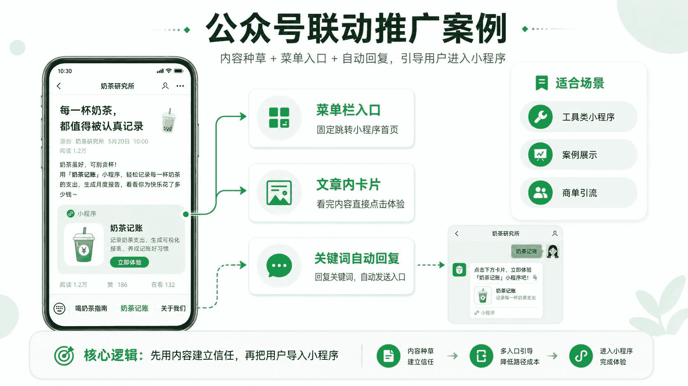

建议同时输出多图素材包：小程序界面截图、功能演示截图、项目案例截图，方便组合转发。

2. 海报分发场景落地：
   - 私聊分发：对有对应需求的好友，先发简短价值介绍，再贴图发送海报，不要直接甩图。
   - 朋友圈分发：搭配项目感悟、干货体验文案再附上海报，控制频次，避免高频硬广刷屏。
   - 社群分发：先输出干货内容，再贴图放出海报；禁止进群直接发海报广告，容易被移出群聊。

3. 素材迭代优化：根据转发反馈迭代海报。如果转发少，就简化文案，放大痛点；如果咨询商单少，就增加真实案例截图。可以做多套版本，分别测试效果，保留转化率最好的版本长期复用。

4. 驱动用户主动转发裂变：
   - 普通用户侧：小程序内设置提示，引导用户保存海报分享给有需要的朋友，完成简单激励（工具类可解锁功能、增加使用次数）。
   - 商单客户侧：老客户合作完成后，发送接单海报素材，设置转介绍激励，鼓励老客户转发海报带来新的商家客户。

重要提醒：海报只放小程序码，不要放外部二维码，所有链路闭环在微信内，降低违规风险。

#### 三、小红书平台推广（公域种草，获取小程序用户 + 开发商单）

⚠⚠ 高风险重要前置提示：小红书近期规则持续收紧，针对站外导流的识别、抽检力度大幅提升，即便是引导用户去微信搜索小程序名称，也存在笔记限流、账号处罚甚至封号风险，不建议作为主力渠道使用，仅适合小批量测试，主力推广优先选择微信生态内贴图海报、公众号、视频号、私域渠道。

小红书适合图文、截图教程类内容，一方面可以推广自己的小程序工具，另一方面发布小程序开发实战、接单复盘，会吸引有定制小程序需求的商家来找你。小红书不支持直接外链跳微信，全部靠内容种草 + 引导微信内搜索小程序名称来完成转化。

操作步骤：

1. 账号定位搭建：账号主页简介写清楚，包含小程序名称、开发者身份、可承接小程序定制开发，主页置顶 2～3 篇核心笔记：小程序介绍、实战开发复盘、客户案例。

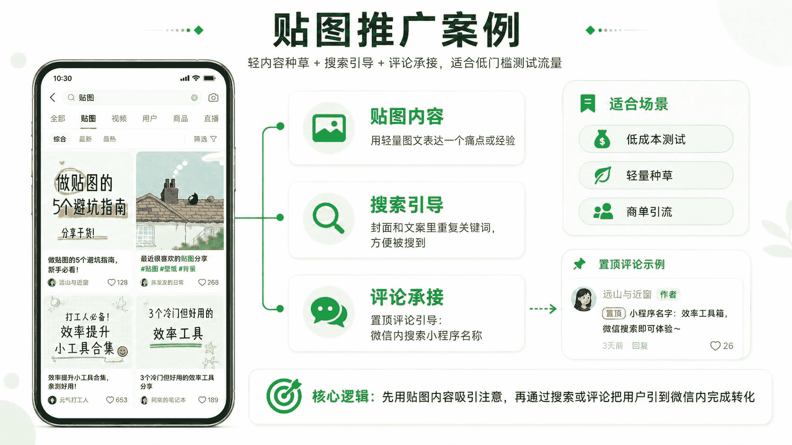

2. 选题与内容创作，分两类方向：
   - 推广自有小程序：做使用教程、痛点解决类笔记，比如“免费 XX 小程序，解决 XX 问题”，截图小程序界面，讲清楚可以解决什么痛点，文案结尾引导：微信搜索“XXX 小程序”即可体验。
   - 引流小程序商单：发布接单复盘、需求拆解、后端部署踩坑、报价思路，吸引本地商家、有小程序需求的人私信咨询。

3. 发布与标签设置：封面突出痛点和结果，文案不要硬广，以体验、干货分享口吻；末尾带上相关标签，例如 #小程序开发 #微信小程序 #独立开发者 #小程序定制。

4. 评论区承接流量：笔记发布之后，置顶评论写明小程序搜索名字，有人提问及时回复；严禁在笔记、评论、私信任何位置引导跳转微信，一旦出现相关暗示话术极易触发违规处罚，客户咨询仅可在小红书站内私信完成沟通。

重要提醒：

1. 小红书规则严格禁止直接放微信二维码、微信号，谐音、暗示导流同样会被算法识别，哪怕只引导用户微信搜索小程序，依旧存在限流、封号风险，账号历史有违规记录会加重处罚。
2. 不建议做矩阵批量发稿，同设备、同网络多个账号会出现连带风控，一个账号违规，其余账号也会被波及。
3. 该渠道仅作为补充流量渠道，不要把核心获客寄托于此，核心业务转化依旧放在微信生态内完成。

#### 四、视频号推广（微信内短视频，低成本放大曝光）

视频号和小程序打通，属于微信内部流量，跳转链路最短，适合短视频演示小程序操作、项目开发过程复盘。

操作步骤：

1. 视频号和公众号、小程序做关联绑定，视频号主页增加小程序入口。
2. 短视频内容方向：录制小程序实际操作演示、开发过程片段、商单案例拆解，口播告诉观众：微信搜索小程序名字体验，或者点击视频下方小程序卡片直接进入。
3. 短视频文案、置顶评论，重复小程序名称，强化用户记忆。
4. 直播时也可以挂载小程序，一边讲解开发干货，一边引导观众体验你的小程序，同时接收商单咨询。

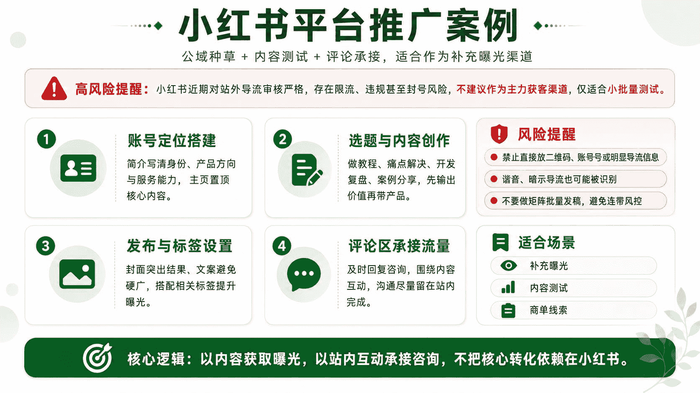

#### 五、私域社群、朋友圈冷启动（种子用户第一来源）

刚上线的小程序，优先从身边私域获取第一批种子用户，同时也是商单的重要来源。

操作步骤：

1. 制作小程序二维码海报，写清楚小程序解决什么问题，不要只放一个二维码。
2. 朋友圈分批发布：可以发产品体验感受、项目开发复盘、上线感悟，附带小程序码，不要频繁刷屏硬推。
3. 垂直社群输出价值：技术群、创业者群、本地商家群，先输出干货，不要一进群就发广告。分享小程序可以解决的痛点，再顺势抛出小程序，有商家有需求自然会来找你做定制商单。
4. 老用户裂变：如果小程序有用户基础，可以简单设置小激励，鼓励使用者转发分享，带来更多访问；接商单也可以做老客户转介绍，老客户推荐新客户给予适当回馈，获取更多订单。

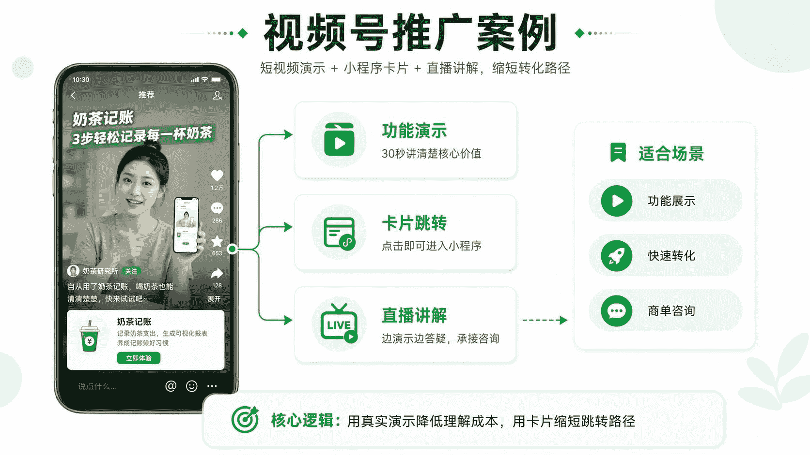

#### 六、微信搜索 SEO 优化（免费持续流量，长期收益）

很多用户会直接在微信顶部搜索框找小程序，做好关键词布局，可以拿到源源不断的免费自然流量。

操作步骤：

1. 小程序名称尽量带上核心业务关键词，名字一旦确定改动次数有限，前期就要规划好。
2. 小程序简介写清楚功能、解决什么问题，埋入用户会搜索的关键词。
3. 发布公众号文章、视频号内容的时候，标题、正文反复出现小程序名称和业务关键词，微信搜索引擎会抓取这些内容，提升小程序搜索排名。

#### 七、不同目的的推广侧重点区分

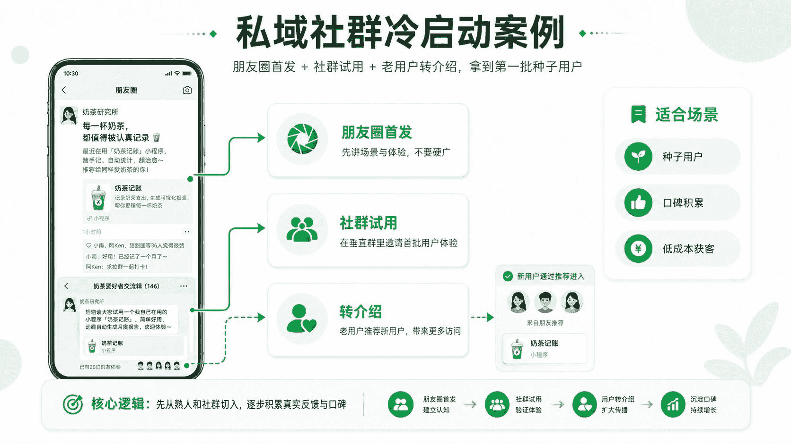

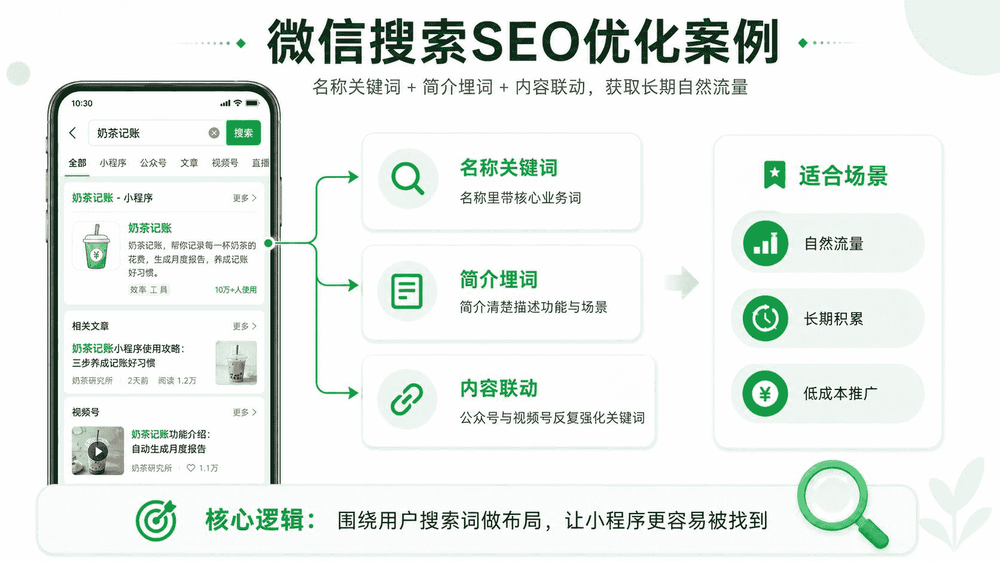

- 推广自己开发的小程序产品：重点做微信搜索、小红书种草、视频号演示、私域冷启动，目标是提升小程序访问量、留存。
- 用来接小程序商单：重点输出实战案例、开发复盘、踩坑经验，小红书、公众号、社群输出专业度，吸引有预约、信息发布、订单系统需求的商家主动咨询。

推广不是发布一次就结束，属于长期工作，个人开发者不用追求铺天盖地流量，优先把内容质量做好，小而精准的流量，不管对小程序产品还是商单接单，效果都会更好。

## 第四部分：如果你有商单，可以看下面

说明：以下报价仅供参考，属于我个人基于实际接单经验整理的拆解方式和价格区间，不代表任何团队、公司或行业统一报价标准。不同项目的需求、复杂度、交付范围不同，实际价格也会有所差异。

很多人第一次接商单，最容易遇到的问题就是：客户说了一个需求，我到底该报多少钱？

我自己的方式比较简单：

先看项目类型 → 再拆功能 → 算开发时间 → 最后加上服务器、数据库、存储等成本。

下面的价格，主要按照个人开发者 / 兼职接单来估算，只作为参考，不是固定报价。

### 1. 商城类小程序

商城看起来很常见，但其实是小程序里面功能比较多的一类。

常见功能：

- 首页
- 商品列表 / 商品详情
- 商品分类
- 购物车
- 下单
- 微信支付
- 订单管理
- 地址管理
- 用户中心
- Admin 管理后台
- 商品上传 / 编辑
- 用户管理
- 权限管理

大概报价：

基础商城：7000～15000 元左右。

如果再增加：

- 优惠券
- 退款
- 物流
- 会员
- 积分
- 分销
- 多商户

开发量会继续增加。

复杂商城：15000～30000 元+。

商城真正贵的不是页面，而是：

订单状态 + 支付 + 后台 + 数据库 + 业务逻辑。

### 2. 订阅 / 会员类小程序

比如：

- AI 工具
- 内容服务
- 会员工具
- 在线功能服务

常见功能：

- 首页展示
- 核心功能页面
- 微信登录
- 用户中心
- 开通会员
- 微信支付
- 会员有效期
- 权益判断
- 次数限制
- 订单记录
- Admin 后台

大概报价：

简单会员 / 订阅类：3000～6000 元左右。

如果还涉及：

- AI
- 次数扣减
- 多套餐
- 订单管理
- 后台配置
- 不同会员权益

大概：5000～11000 元左右。

这种项目页面不一定多，但会员权限、支付和后端逻辑会比较多。

### 3. 企业展示类小程序

这一类相对简单。

常见功能：

- 企业介绍
- 产品展示
- 服务介绍
- 新闻动态
- 联系我们
- 地图导航
- 简单表单

大概报价：

如果客户已经提供 UI 和素材：1500～3000 元左右。

如果还需要：

- UI 设计
- 内容整理
- 后台管理
- 数据维护

大概：2000～5000 元左右。

这种项目主要工作量一般在：

页面 + UI + 内容整理。

如果只是纯展示，没有后台和复杂交互，开发成本会低很多。

### 4. 工具类小程序

工具类的价格跨度其实比较大。

比如：

- 计算器
- 查询工具
- 记账工具
- 打卡工具
- 简单记录工具

#### 简单工具类

如果主要是本地功能，没有太复杂的后端：1000～2500 元左右。

比较适合：

- 页面少
- 逻辑简单
- 不需要复杂数据库
- 不需要管理后台
- 不涉及支付

#### 带后端的工具类

如果还需要：

- 用户系统
- 数据库存储
- 云端同步
- 文件上传
- AI
- OCR
- 第三方 API
- 会员订阅

大概：2500～10000 元+。

所以工具类不能只看页面多少，更重要的是：这个工具背后的业务逻辑复杂不复杂。

有些工具可能只有 3～5 个页面，但后端、AI、会员、数据处理非常复杂，价格反而比十几个展示页面的小程序更高。

### 人工成本怎么计算？

除了看项目类型，我还会算一下自己的时间成本。

比如：

当前工资：15000 元 / 月。

按照每个月 22 个工作日计算：

15000 ÷ 22 ≈ 680 元 / 天。

如果预计一个项目需要投入 10 个完整工作日：

680 × 10 ≈ 6800 元。

这个数字可以作为一个人工成本参考。

但它不是说项目一定要报价 6800 元。

因为实际接商单时，还要结合：

- 自己有没有现成代码
- 有没有成熟组件
- 能不能借助 AI 提效
- 功能是否重复开发过
- 客户提供的资料是否完整
- 项目后续修改多不多

比如一个自己已经做过很多次的登录、上传、后台管理功能，实际开发速度会快很多。

但商单也不能只计算“写代码”的时间。

还要把下面这些时间考虑进去：

- 需求沟通
- 需求整理
- UI 调整
- 前后端联调
- 测试
- 部署
- 上线
- Bug 修改
- 售后沟通

尤其是兼职开发，更容易低估自己的时间。

像我自己的第一单：

白天正常上班，晚上 9 点到 12 点开发，前后大概做了 2～3 周。

虽然每天只有几个小时，但这些时间加起来，都是项目成本。

所以报价的时候，最好不要只算：“写代码用了几天。”

还要考虑从接到需求到真正交付，整个项目占用了你多少时间。

### UI 要不要单独算？

要。

客户有没有 UI，对开发成本影响还是比较大的。

#### 客户提供完整 UI

如果客户已经提供：

- 完整 UI 稿
- 页面结构
- 图片素材
- Logo
- 文案

那你主要负责：

页面还原 + 功能开发。

这种情况下，价格可以相对低一些。

#### 客户没有 UI

如果客户只有一句：“我想做一个小程序。”

那你可能还需要帮他完成：

需求梳理 → 页面结构 → UI → 开发。

这部分其实也是人工成本。

普通项目可以根据页面多少，大概增加：500～2000 元左右。

如果页面比较多，或者客户对 UI 要求比较高，再单独评估。

所以我接需求时，一般会提前问：

“UI 是你们提供，还是需要我一起做？”

这个问题一定要提前确认。

不然很容易变成：

原本只是接开发，最后需求、产品、UI、开发全都自己干了。

### 服务器这些成本，也要提前算

除了开发人工，小程序真正上线还会产生一些固定成本。

这些钱最好提前和客户说明。

#### 域名

大概：50～100 元 / 年。

#### 云服务器

入门配置一般：300～1500 元 / 年左右。

如果访问量比较大，再根据实际配置增加。

#### 云数据库

如果单独购买数据库：300～1500 元 / 年左右。

小项目也可以和服务器部署在一起，前期降低成本。

#### COS / OSS 对象存储


公众号懒人搜索，懒人专属群分享

如果需要上传：

- 图片
- 视频
- 文件
- 用户头像

一般还会使用 COS / OSS。

前期可以粗略预留：

**100～500 元 / 年起**，具体还是看实际使用量。

短信

例如：

- 手机验证码
- 订单通知
- 预约提醒

一般按实际发送量计算。

**AI / 第三方 API**

比如：

- AI 对话
- 图片识别
- OCR
- 地图
- 翻译
- 内容审核

这些通常也是按照实际调用量计算。

所以最好提前告诉客户：

开发费用是开发费用，服务器、数据库、域名、短信、**AI API**、对象存储等第三方成本，一般单独计算。特别是 AI 类产品，一定不要自己长期承担 API 成本。

## 我会怎么快速判断一个商单价格？

如果只是前期聊天，还没有详细拆需求，我一般会先用下面这个价格区间做一个快速判断：

[内嵌电子表格 - 无法获取表格信息]

这个价格只是用来判断这个项目大概属于哪个区间。真正报价之前，我还是会完整拆一遍：

需求 ↓ 页面 ↓ 功能 ↓ UI ↓ 后端接口 ↓ 数据库 ↓ 管理后台 ↓ 支付 ↓ 第三方服务 ↓ 服务器部署 ↓ 测试上线

## 为什么不能只按照页面报价？

因为客户可能只会跟你说：

**“我就想做一个商城。”**

听起来只有一句话。

但真正拆开以后，可能是：

十几个页面 + 几十个接口 + 商品系统 + 订单系统 + 微信支付 + 用户系统 + Admin 后台。

同样的，客户说：

**“我就做一个预约功能。”**

真正拆开可能是：

选择项目 → 选择日期 → 选择时间 → 提交预约 → 查看预约 → 取消预约 → 后台管理 → 状态修改 → 消息提醒。

所以我现在评估一个小程序商单，不会只问：

“有几个页面？”

而是会问：

**“这个项目到底有多少功能和业务流程？”**

## 最后总结

我现在评估商单，大概看这几个东西：

项目类型 + 页面 + 功能 + UI + 后端 + 数据库 + 第三方服务 + 部署上线 + 修改成本。

其中最容易被低估的，往往不是前端页面，而是：

后端、数据库、支付、管理后台、第三方接口和后续修改。

所以：

**4K 的项目不一定便宜，1W 的项目也不一定贵。**

关键还是看：

为了把这个项目真正做完并交付，你到底需要做多少事情。

先把需求拆清楚，再谈价格，会靠谱很多。

说明：以下报价仅供参考，属于我个人基于实际接单经验整理的拆解方式和价格区间，不代表任何团队、公司或行业统一报价标准。不同项目的需求、复杂度、交付范围不同，实际价格也会有所差异。

————分割线————

看完这篇 SOP，你觉得你懂了。但 90% 的人一到实操就会卡在第一步。

工具和教程只是最低级的壁垒，真正的壁垒是“立刻动手”和“圈层信息差”。

如果你想看全网最新的变现玩法，并且和一群执行力极强的极客一起下场拿结果，欢迎围观我的核心私域：【懒人专属群】。

我们不聊虚的，只做商业闭环的拆解与 AI 效率的压榨。系统内已沉淀 1000+ 跑通的套利实战局。

⚠ 查阅圈子完整数字资产与上车门槛：

https://lazyso.com/insider/

认同价值、准备好下场干活的，扫码加我微信（lazyhelper1）。

备注：【实操上车】，不闲聊。


