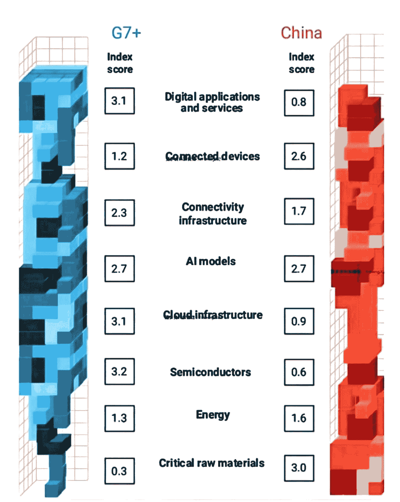

## 词元出海是伪命题，不符合基本逻辑

260823 大树乡谈

整理：公众号懒人搜索，懒人专属群精选  
懒人微信：lazyhelper1

有读者提问：我想请教如何发展词元出海经济。很多业内人士都认为这个是个伪命题，原因是出海跟全世界比拼的三要素模型、电力跟卡。电力那点略微优势无法弥补卡的溢价。

首先，考虑AI技术的应用速度和广阔前景，尤其对社会生产关系的根本变革，对AI竞争的对比需要打破静态和局部两个思维束缚，要从动态和全局角度思考。

动态角度，不能只静态观察2026年甚至2025年以前的中美对比，而是要思考2035年中美乃至中西方在AI领域的对比，毕竟AI发挥真正威力还需要至少几年时间，那么最起码也应该对比2030年时的情况，届时模型、电力、算力卡等，又会如何呢？

全局角度，AI绝不仅仅是模型、电力、卡，这太低估了AI的颠覆性和通用性，比如最近美国独立咨询公司荣鼎集团（Rhodium Group）发布报告，就从AI多个维度对比G7集团和中国，截图发附件了。

该报告从数字应用与服务、连接设备、连接基础设施、AI模型、云基础设施、半导体、能源、关键原材料等8个维度进行对比。但小镇认为这些维度仍然太窄，还没有脱离AI产业本身去评估全社会，比如还要纳入国民接受度、社会组织度、产业链完整性、AI推广速度等等维度，不过这就是后话了，更多维度的全局评估更适合2030年以后AI大规模推广的时代，2026年到2030年AI本身发展参考荣鼎集团的八个维度倒也够了。

该报告评估结果是，八个维度，中国相比整个G7集团，注意不仅仅是对比美国。中国在三个维度占据大幅优势，分别是关键原材料3对0.3、连接设备2.6对1.2、能源1.6对1.3。在四个维度居明显劣势，分别是半导体0.6对3.2、数字应用与服务0.8对3.1、云基础设施0.9对3.1、连接基础设施1.7对2.3。而在AI模型上，荣鼎集团认为中国同G7打了平手，得分均为2.7。所以，哪怕是2026年的当下，中国相对整个G7基本可以说平分秋色，尤其中国卡住了关键原材料，在这方面占据极为恐怖的碾压性优势，从源头上卡住了，那接下来几年G7总要更新设备吧，否则如何继续保持优势？

但小镇仍然认为词元出海目前就是个噱头，官方从来没这么说过，当前也不成立，这也属于“技术远视”，就是一件事刚刚有个苗头，就直接幻想最终某种完成形态。中国股市特别热衷于抢跑和炒作，自媒体又有流量需求，就导致这件当前根本不现实的事情被搞得特别热。

这跟所谓的电力人民币之类本质类似，从底层逻辑上就不可能。就算未来真的有可能以电力及衍生锚定人民币价值，那也需要很多非常艰难的前提条件，比如要建设一个以中国为核心的全球电力网络，这是多大的难度？相比如此宏大的工程，还是各国从中国购买风光电力设备，然后在本国自建电力网络来的更现实，这样的话，本质就是可再生能源设备出口，只是比现在规模更大，但这跟锚定人民币又有什么关联呢？回到词元出海经济。

这玩意还有个可以参考的，那就是这些年不管啥行业，只要带个电池的，就要蹭储能和电网调峰概念，比如搞两轮换电的，也说自己的换电柜可以如何平稳电网，可以获得调峰补贴等等，也写进了可行性报告里面，的确有这个功能，但是也得看体量啊，从大海捞一瓢水，的确可以改变大海水量，但实际影响有多大呢？除非真要把几亿辆电动自行车全部换电化，那还算可观，可是现实吗？AI作为颠覆性通用技术，在开始的时候存在“索洛悖论”，也就是都在讨论AI带动效率提升，但是现实中就是看不到。

综合目前各方信息和研究，AI真正发挥生产力带动性都要等到2030年以后，而且大概率先发生在中国，将掀起各行业的AI推广浪潮，这就意味着中国本土词元需求极其庞大，所以小镇才说未来10年，词元消耗量至少要有万倍增长。既然中国本土词元需求都可能超过供给，又哪来的额外词元对外出口呢？难不成认为未来中国词元或者说算力会像现在的制造业一样过剩？

何况全球有AI需求的国家才多少？大多数国家还停留在信息时代之前，本国连自己的信息产业都没有，更严重缺乏人工智能的研究和应用场景。就说前些年的云计算，全球真正有需求的国家都不多，也就是中东因为特殊性，所以成为了中美之外，云计算快速发展的一个中心，但因为战争影响，投资也在消退，剩下的还有啥？

日本、韩国、欧洲这些传统发达国家，信息、互联网产业都不咋地，怎么跨越式进入AI时代。何况，目前对AI需求最大的就是中国和美国，而美国显然不会接受从中国购买词元服务，美国还会死守自己的算力优势资源，也就是西方世界，在信息互联网时代，美国互联网公司已经占据了西方世界，必然要继续延伸到AI时代，近期路透社发了一篇文章，题为《美国将告诉合作伙伴，他们必须在与中国的AI竞争中选择阵营》，态度很明确了，那么欧洲、日韩等西方世界，能不能摆脱美国的掌控呢？

愿不愿意摆脱呢？西方之外全球还有很多国家，人口规模超过60亿，但是发展水平如何呢？要想达到对AI可观的需求，又需要多久呢？

既然未来很长一段时间，词元主要需求在中美，而海外需求并不高，那就算有需求，最现实的做法当然是在海外建设算力中心，然后就近供给啊，而且算力供应最具优势的还是云计算公司，而中国这些年已经在海外投资铺开了云计算服务，目前都达不到饱和使用，完全可以直接搭载AI大模型，就近提供服务。

而且正如开头提到的荣鼎集团评估，在云基础设施方面，中国相对G7处于明显劣势，海外云计算劣势就更大了，人家海外需要算力服务，就算要购买，为啥不买供给更充分的G7也就是美国云计算服务呢？

至于电力的优势，直接把中国风光发电设备和储能运到海外，就地配套建设不好吗？有很多技术手段可以解决当地人才不足的问题。前不久刚有个新闻，由特锐德制造的全球首台400千伏预制舱式变电站已在阿曼成功送电，整个变电站分为24个标准化功能模块，全部在中国完成设计生产与联调，现场仅需“搭积木”式拼接，将传统1.5至2年的建设周期压缩至不足6个月。变电站都可以，其他风光、储能设备就更容易了，直接大集装箱展开就是了。干嘛费力不讨好的搞什么词元出海？逻辑上根本不通，中国内部数据传输的时延都让“东数西算”大打折扣，小镇都写过文章说中国虽然整体电力供应充足，但是聚焦到算力需求最高的东部，也出现了电力卡脖子，需要加速强化东部电力供应。

那么比中国烂的多的全球信息传递，时延成了啥样？难不成就做一些不在乎时延的低端算力需求？这不就成了最原始的来件加工了吗，没多大经济价值。

所以，小镇压根不认可所谓的“词元出海”，小镇之前一直说的只是中国充足电力供应等基础设施对中国AI发展带来的优势，而非所谓的算力出海。

————分割线————

在这个AI能替你写代码、写文章的时代，基础技能正在迅速贬值。绝大多数人正被淹没在海量的免费垃圾信息里，陷入低效的体力内卷。

当“努力”不再是壁垒，人与人之间唯一的护城河，只剩下“信息过滤”的效率与“认知系统”的维度。

圈子已稳定运行7年。我们每天利用Python爬虫与大模型算力，过滤全网最顶级的政经内参和搞钱风向标，做你最冷酷的“外部大脑”。

如果你认同这种“重塑认知防线”的极客主义，欢迎围观我的个人情报智库：【懒人专属群】。

https://lazyso.com/insider/

认同信息过滤价值、想省下每天3小时无效阅读时间的读者，扫码加我微信（lazyhelper1）

