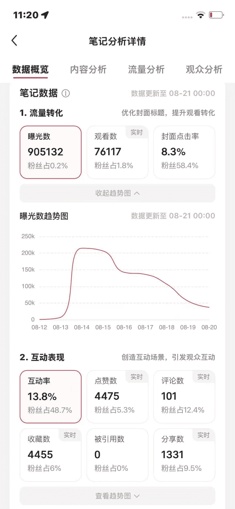
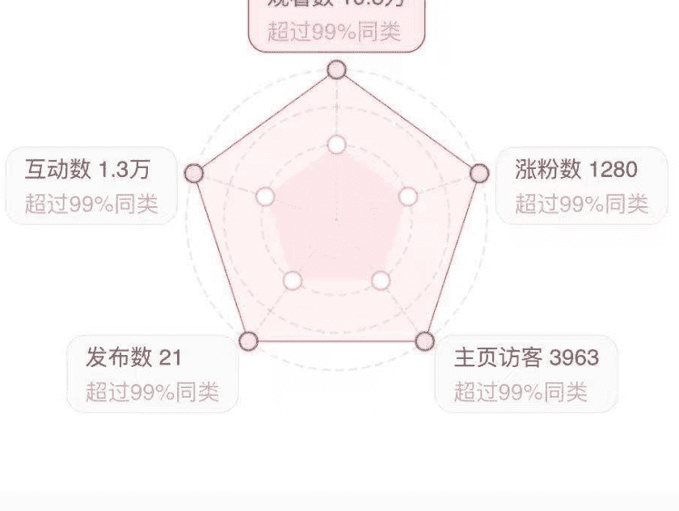
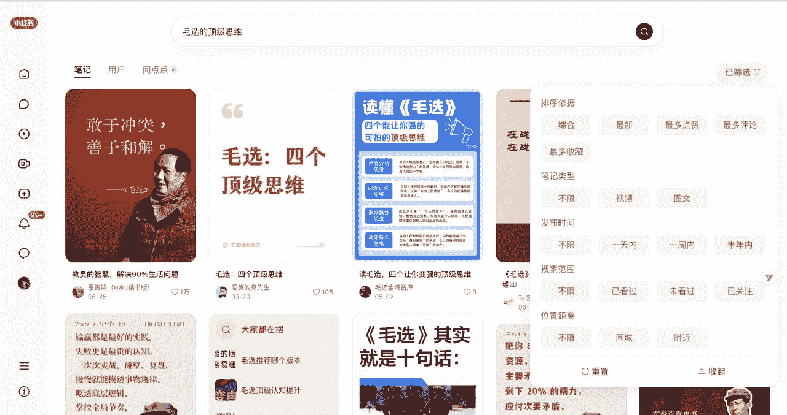
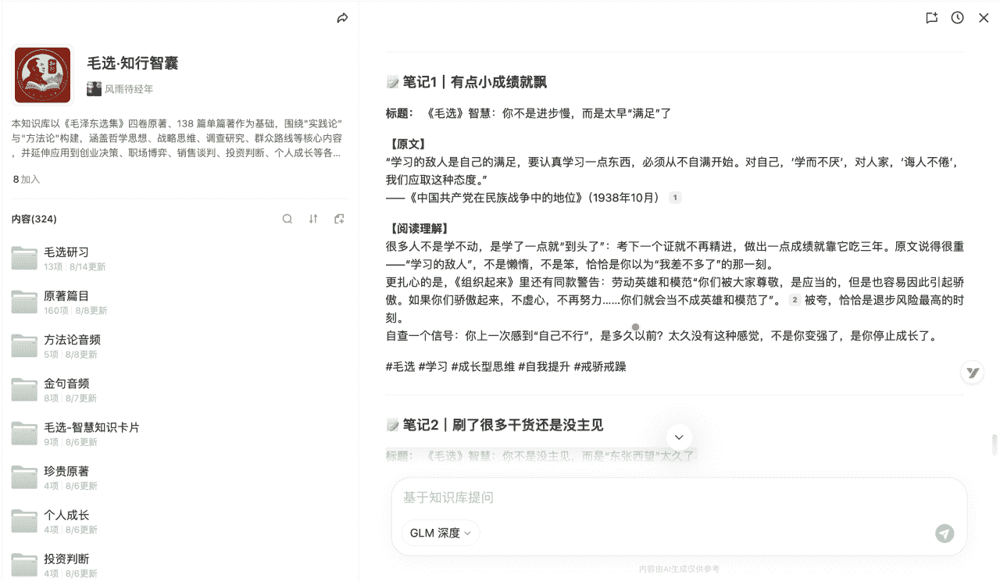
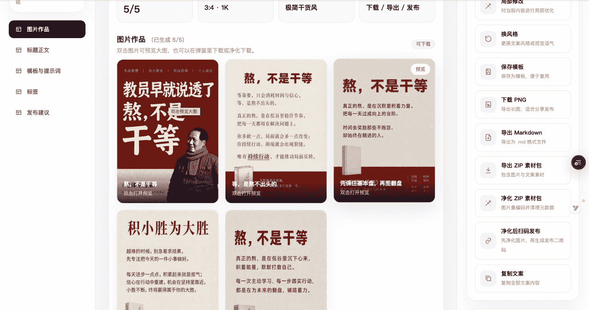
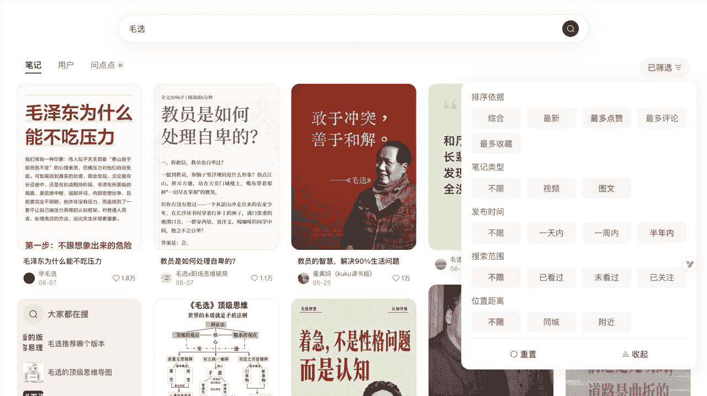
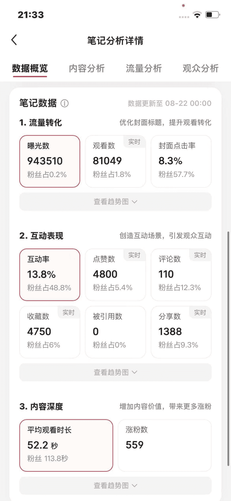
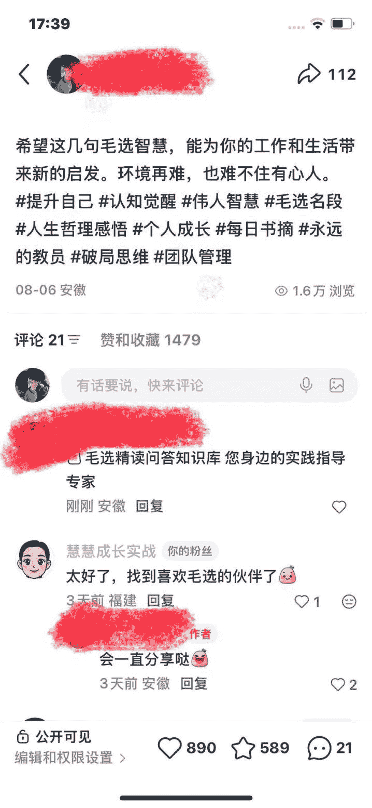
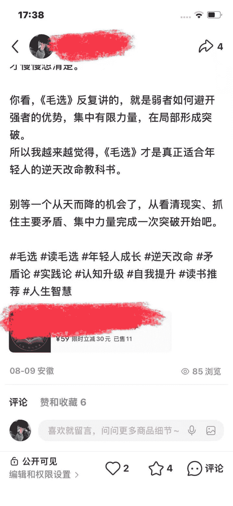

公众号懒人搜索，懒人专属群分享

# 从一条生财风向标到100万+流量：我用50元启动的虚拟产品IMA知识库一周跑通MVP

260824 副业SC精华

整理：公众号懒人搜索，懒人专属群精选

懒人微信：lazyhelper1

大家好，我是月明星稀，今年4月加入生财有术，目前主要在做AI企业服务和小红书电商。

很荣幸收到生财的邀请约稿，下面我将毫无保留地给大家分享，我是怎么从一条风向标，跑通小红书虚拟资料——IMA毛选知识库MVP的心路历程，以及我平时是如何利用生财风向标的。

如果你现在正在生财找项目，可能经历过这样的状态：

每天都能在生财看到新的项目，看见很多圈友拿到结果。每个项目看起来都能做，但真正轮到自己时，又忍不住反复比较考虑：这个项目适不适合我？现在进场晚不晚？我没有工具怎么办？产品还不完善，做得不好怎么办？

结果是收藏夹越来越满，而真正开始的项目却一个都没有。

我最近从一条生财风向标中看到一个“小红书毛选IMA问答知识库”的案例，没有继续研究一个星期，而是用两天做出了第一版产品，直接上架并开始发布内容。

整个过程没有投流，启动成本约不到50元。截至我写这篇复盘时，拿到的阶段性结果是：

- 10天发布了30篇笔记；
- 大部分笔记浏览量在1000+，单篇最高8万+；
- 单账号后台累计曝光120万+；
- 7天粉丝从80增长到1700+；
- 一周营业额1000+；
- 接到一单商单160元；
- 每天发布3篇笔记，从选题到发布用时优化到10分钟以内。

## 数据中心

账号概览　作品分析　粉丝数据　收入数据

**你的观看数为10.8万，超过99%同类创作者**

你的观看数据在同类作者中表现突出，快看看最近有哪些笔记数据亮眼，总结经验继续加油哦。

观看数据　互动数据　涨粉数据　发布数据

近7日　　近30日

| 指标 | 数值 | 环比 |
|---|---:|---:|
| 曝光数 | 125.9万 | +670% |
| 观看数 | 10.8万 | +660% |
| 封面点击率 | 8.7% | -1% |
| 平均观看时长 | 40.4秒 | +42% |
| 观看总时长 | 1335.8小时 | +892% |
| 视频完播率 | 50% | - |

| 指标 | 数值 |
|---|---:|
| 支付金额 | ¥1,062.0 |
| 支付订单数 | 18 |
| 退款金额 | ¥0.0 |
| 商品访客数 | 632 |
| 商品访问量 | 1,112 |
| 支付买家数 | 18 |
| 加购人数 | 49 |
| 可提现金额 | ¥0.0 |
| 商品平均评价 | - |
| 买手支付金额 | ¥0.0 |
| 广告支付金额 | ¥0.0 |
| 广告7日店铺... | 0 |

目前是一个账号、一个产品、10天左右的阶段性测试。它不能证明这个项目可以无限放大，也不代表任何人照做都能得到同样的结果。

我真正想分享的也不是“毛选知识库怎么做？到底赚不赚钱”，而是一个更普遍的问题：

当我们从生财看到一个已经有人拿到结果的机会后，普通人怎样用最小成本快速验证，如何从风向标找项目并且赚到第1块钱的方法，而不是一直停留在考察和犹豫中？

我的答案是：找项目不是等到完全想清楚再开始，而是先确认自己具备最低条件，然后立刻做一次最小验证。项目到底适不适合自己，只能在把手弄脏之后判断出来。

## 从生财风向标到100万+曝光：50元跑通AI知识库MVP

大家好，我是月明星稀，今年4月加入生财有术，目前主要在做AI企业服务和小红书电商。

很荣幸收到生财的邀请约稿。这篇文章，我想分享自己如何从一条生财风向标出发，用不到50元、两天时间，做出第一版小红书虚拟产品，并在10天内完成第一轮市场验证。

截至目前，这个项目阶段性拿到的结果是：

- 10天发布30篇小红书笔记；
- 大部分笔记浏览量在1000+，单篇最高8万+；
- 单账号后台累计曝光120万+；
- 7天粉丝从80增长到1700+；
- 一周营业额1000+；
- 接到一单160元的商单；
- 每天发布3篇笔记，从选题到发布用时优化到10分钟以内。

如果你也经常在生财看到很多项目，看到圈友不断拿到结果，却总是在思考“这个项目适不适合我”“现在入场是不是晚了”“没有工具能不能做”“产品不完善怎么办”，这篇文章或许能给你一些参考。

我真正想分享的，不只是“毛选知识库怎么做”，而是普通人如何从一条风向标中发现机会，用最小成本快速验证，完成从产品、内容到成交的第一轮闭环。

通过阅读这篇文章，你可以了解到：

一、如何判断一条生财风向标是否值得测试；

二、我如何用不到50元、两天时间做出第一版60分产品；

三、如何用AI知识库和已有工具提高选题、内容生产和发布效率；

四、10天发布30篇笔记后，我是如何判断项目是否初步成立的；

五、一篇8万+浏览笔记的选题、制作和迭代过程；

六、冷启动阶段直接挂商品链接后，我踩过的坑以及对流量和成交顺序的重新理解；

七、我总结出的轻项目六个筛选标准，以及普通圈友可以直接套用的“最小验证四步法”。

如果你也看过很多项目，却一直不知道该怎么选择、怎么开始，这篇文章会结合我的真实经历，重点讲清楚以下内容：

## 一、为什么看到这条风向标后，我马上开始做了

当时我手里已经有项目在做。因为使用AI提高了效率，每天多出了一部分时间，所以我也在留意有没有维护成本低、一个人能够完成的轻项目。也看了很多项目，不是重交付就是产品制作比较麻烦，我又是一个完全不懂代码的小白，偶然之下我看到一条生财风向标：

📄 小红书上新毛选AI知识库，99元一套，一天销量涨近80（后面也看到好几位圈友发了这个毛选知识库的风向标，可想而知生财圈友们敏锐的商业嗅觉）。

这条风向标里，有几个信息引起了我的注意：

第一，已经有人通过这个产品拿到了销量，说明需求不是凭空猜测出来的。

第二，产品客单价不算高，用户能够快速理解，购买链路也比较短。

第三，产品通过知识库交付，后续维护和交付相对较轻，一个人也有机会忙得过来。

第四，毛选相关内容长期都有人讨论，特别是现在年轻人对伟人的思想掀起了一股潮流，而不是一个短期的热点。

第五，AI已经可以帮助完成资料整理、知识库搭建、选题和内容生产，技术门槛没有想象中那么高。

同时巧合的是，我手里刚好有一个近期做的小红书笔记复刻工具。这个工具做出来已经有一段时间了，但一直没有找到特别合适的业务场景。

看到这条风向标以后，我没有先问“它最终能做多大”，而是先问了自己三个问题：

1. 我能不能在一两天内把第一版产品做出来？
2. 第一次测试即使失败，损失是否在我可以接受的范围内？
3. 我现有的时间和工具，能不能完成内容生产和交付？

三个问题的答案都是“可以”。

那就没有必要继续等。

我当时的想法很直接：先做，哪怕第一版做得像“狗屎”，也比在脑子里反复推演更有价值。做出一个60分版本，有用户下单、有真实反馈以后，再把它改到70分、80分。

## 二、用50元和两天时间，做出第一版60分产品

### 第一天：购买资料、整理资料、完成上架

第一天，我花2元购买了一份基础资料，先用它了解这类产品的内容组成，再通过Hermes对资料进行整理，制作第一版可以交付的知识库，并完成商品上架准备。这一步对于各种小众赛道的知识库依旧适用。

我给第一版设定的标准只有三个：

- 用户能理解它解决什么问题；
- 用户购买后能够正常使用；
- 我一个人能够完成交付和维护。

满足这三个条件，就先上架。

### 第二天：找选题、制作笔记、直接发布

第二天，我开始发小红书笔记。

最初的人工流程其实并不复杂：

搜索相关关键词  
→ 筛选近一周互动较高的笔记  
→ 拆解选题、标题和内容结构  
→ 让AI生成相近但不照搬的新角度  
→ 识别图片中的文字和版式信息  
→ 生成新的图文内容  
→ 检查并处理图片  
→ 扫码发布

1. 搜索相关关键词：筛选近一周互动较高的笔记。
2. 拆解选题、标题和内容结构：让AI生成相近但不照搬的新角度。
3. 生成新的图文内容：识别图片中的文字和版式信息，根据主题生成新的内容。
4. IMA毛选知识库负责给我提供选题和内容信息，我以前做的笔记工具负责提高生成效率，最后通过二维码扫码发布。

### 5. 注意事项

发布毛选等国家领导政要方面的笔记内容不要乱改，引用即可。商品涉及到国家领导人方面不行，所以商品上架的时候要避免出现毛选、伟人这方面的字眼。我的产品连续两次下架整改，修改过标题以及详情图就可以上架了。

IMA和使用的模型本身不需要用户充值，因此后续用户边际成本很低。按当时的客单和成交情况计算，一单左右基本就能覆盖启动成本。

不过，这里最容易出现一个误区：看到我用了Hermes、IMA和自建工具，就以为必须先把这些工具全部准备好才能开始。

其实正好相反。

这些工具只是加速器，不是入场券。普通圈友真正需要的最低条件只有：

- 一个符合平台要求、能够正常发布和经营的实名账号；
- 一个来源清晰、能够合规交付的产品；
- 知道人工完成一篇笔记要经过哪些步骤；
- 愿意连续发布、回复评论并记录数据。

没有复刻工具，可以先手工做；不知道怎么自动化，可以先把流程走三遍。

只有亲手做过，才知道哪个环节真的耗时间、哪个环节值得工具化。

## 三、10天后，我从哪些数据判断第一轮MVP成立了

10天里，我一共发布了30篇笔记，平均每天3篇。因为选题和内容生成流程已经被工具缩短，每天整体用时不到10分钟。

我没有只看营业额，而是把验证结果分成了四层：

### 第一层：有没有人看

累计曝光和多篇2000+浏览说明，这类选题在小红书存在传播空间，不是只有一篇笔记偶然跑出来。

### 第二层：看完以后，用户是否愿意继续关注

7天净增近1600个粉丝，说明用户并不是刷到一次就离开，而是对账号后续内容产生了一定预期。

### 第三层：内容能不能引发讨论

评论区里，很多用户会联系自己的性格和经历表达看法。这些评论不只是互动数据，也是我理解这类用户需求的第一手素材。

### 第四层：有没有人愿意付费

一周营业额1000+，说明这不仅是一个“有人看”的内容方向，也初步出现了从内容到付费的闭环。

所以，我对MVP成立的判断不是“赚了多少钱”，而是四个信号同时出现：有人看、有人关注、有人讨论、有人付费。

这四个信号出现后，我才有理由继续投入时间优化产品和流程。

## 四、一篇万+笔记，是怎么跑出来的

这次数据最好的一篇笔记标题是：

《毛选》智慧：你不是性格急，而是认知没升

这个选题不是我坐在电脑前凭感觉想出来的。

我的做法是先搜索相关关键词，筛选近一周内点赞和讨论比较多的笔记，然后分析这些内容的共同点：它们不是在讲一段离普通人很远的理论，而是把一个抽象认知，落到了“性格急”这个很多人都有感受的日常问题上。

接着，我让AI根据这个讨论方向生成一个相近但不照搬、有冲突感的新选题，再用工具完成内容和图片制作。

笔记发布后的前两天，浏览量就超过了1万，后来继续增长到8万+。

评论区里主要出现了两类声音：

- 一类用户觉得内容说中了自己，过去只觉得是性格问题，现在获得了一个新的理解角度；
- 另一类用户不同意这个判断，认为“急”也有积极的一面，能够提升执行力。

这两类评论都很有价值。

它们让我意识到，一个有传播力的选题不一定要给出所有人都认同的标准答案，但一定要让用户觉得“这件事和我有关”，并且愿意用自己的经历参与讨论。

笔记发布后，我也持续认真回复评论。根据这一个账号的观察，内容在讨论持续以后仍然获得了更多曝光。但我不会把两者简单写成必然因果，更不能理解成“只要回复评论，平台就一定继续推流”。平台推荐受到很多因素影响，我能确定的是：回复评论帮助我获得了更多真实用户反馈，也提高了内容讨论的完整度。

## 五、一次失败实验，让我重新理解流量和成交的顺序

并不是我发出的每篇笔记数据都很好。

刚开始时，我有一批笔记直接挂了商品链接，希望用户看到内容后马上完成购买。结果这些笔记的浏览量通常只有50—100。

后来，我调整了做法：冷启动阶段先把重点放在内容验证上，不急着让每篇笔记承担成交任务。在这个阶段，不直接挂商品链接的内容，大多数浏览量能够达到1000+。

当账号逐渐积累了一定的活跃度、粉丝和内容标签后，我再测试商品链接，内容启动速度和流量表现有所改善。

这只是我在一个账号、一个阶段里的对照结果，不代表平台存在一个对所有账号都适用的固定规则。

但它给了我一个很重要的提醒：

在账号和产品都没有被验证之前，不要急着让一条内容同时完成涨粉、建立信任和成交三个任务。

先确认用户愿不愿意看，再确认用户愿不愿意持续关注，最后在符合平台规则的前提下测试成交承接。把问题拆开验证，比一上来追求全部结果，更容易发现究竟是哪一环出了问题。

## 六、复盘下来，真正起作用的不是AI工具，而是三个决策

这次项目里用了不少AI和工具，但如果只把结果归因于工具，反而会错过真正能够复用的部分。

### 决策一：先跟随已经被验证的需求，不从零发明市场

我看到别人已经拿到结果后，没有继续证明这个需求“理论上是否成立”，而是直接做自己的第一轮验证。

这里说的跟随，不是复制别人的内容、素材或侵权销售，而是借鉴已经出现的需求信号、产品形态和验证路径，再用自己的内容、交付和差异化重新完成一遍闭环。

对新手来说，第一次做项目最稀缺的不是创意，而是完整走过“产品—内容—反馈—成交—交付”的全过程。

### 决策二：先手工跑通，再把重复动作工具化

一开始不要想着把所有环节都自动化。

先人工操作，才能了解完整流程；先知道哪里最耗时，才能判断工具应该解决什么问题。

我给自己定的原则是：同一个动作重复3次以上，再判断是否值得做成智能体或者工具。

工具应该服务于已经跑通的流程，而不是用来逃避对业务流程的理解。

### 决策三：让闲置工具进入真实业务

我的小红书笔记复刻工具其实做出来很久了，但过去一直没有合适的使用场景。

这次让我感受很深的一点是：不是做出了工具，就自然会有业务；而是先找到真实需求，工具才有机会从“功能”变成“杠杆”。

AI消除的是一部分技术门槛，但它不会替你完成项目判断。真正拉开差距的，还是你能否识别需求、快速行动、看懂数据，并在结果不好时及时调整。

## 七、我筛选轻项目的六个标准

跑完这一轮以后，我把自己筛选轻项目的判断整理成了六条。它们不是放之四海而皆准的标准，而是我用来控制试错风险的个人清单。

| 判断标准 | 我会怎么判断 |
|---|---|
| 1. 启动成本足够低 | 第一次投入必须在失败后也不影响正常业务和生活。对我来说，最好低于已见成功结果规模的十分之一。 |
| 2. 技术门槛可以被AI降低 | 有教程、有AI辅助，即使暂时不会，也能在短时间内做出第一版。 |
| 3. 没有工具也能手工完成 | 工具只是提高效率，不能成为迟迟不开始的理由。 |
| 4. 维护与交付足够轻 | 最好一个人能够完成，不依赖复杂团队和重售后。 |
| 5. 产品有继续差异化的空间 | 验证需求后，可以加入别人暂时没有的内容、工具或者服务。 |
| 6. 变现链路足够短 | 用户能够快速理解价值，从看到内容到购买使用，中间环节不要太多。 |

公众号懒人搜索，懒人专属群分享

# 套回这次项目：

- 启动成本只有约 50 元；
- AI 能解决资料整理、选题和内容生产的大部分效率问题；
- 即使没有自建工具，也能先人工发布；
- 知识库属于相对轻的交付方式；
- 后续可以加入毛选卡片抽卡小程序等附加价值；
- 内容、商品和交付之间的链路比较短，一个人能够承接。

满足这些条件，不代表项目一定成功，但意味着我可以用很小的代价换取一次真实答案。

## 八、普通圈友可以直接套用的“最小验证四步法”

如果把这次经历压缩成一套可以复用的流程，我会把它分成四步：

### Step 1：看结果——先找已经出现付费或明确需求的机会

输入：生财风向标、精华帖、航海案例、平台上的商品和用户反馈。

动作：找到最近已经有人获得曝光、咨询、成交或者复购的案例。

判断：不只看点赞和故事，要看是否有真实用户、真实产品和真实付费信号。

输出：一个值得进行低成本验证的候选项目。

常见错误：把“别人拿到结果”理解为“自己一定能拿到结果”，或者只看结果，不看对方的资源、时间和能力条件。

### Step 2：盘资源——判断自己是否具备最低启动条件

输入：自己的账号、时间、技能、已有工具、可用资料和可承受成本。

动作：只盘点启动第一轮验证需要什么，不提前准备未来放大阶段的所有资源。

判断：能否在一两天内做出第一版？失败以后，时间和金钱损失是否可以承受？

输出：一份最低启动清单和明确的成本上限。

常见错误：把“最好拥有”误认为“必须拥有”，为了等一个工具、一个账号或者一套自动化系统而延迟行动。

### Step 3：做 MVP——用 60 分产品跑通完整流程

输入：一个明确需求、一份可交付产品和一条获客路径。

动作：手工跑通产品制作、内容发布、用户咨询、成交和交付。

判断：第一版不追求漂亮，而是追求可理解、可购买、可交付。

输出：第一个真实产品、第一批内容和第一轮用户反馈。

常见错误：在没有用户之前打磨品牌、包装和自动化，把准备工作当成项目进展。

### Step 4：看数据——决定继续、调整还是停止

输入：曝光、互动、关注、咨询、成交、退款、时间成本和用户反馈。

动作：连续记录 7—10 天，不凭单篇爆款或一天没有成交就下结论。

判断：

- 有曝光、没关注：检查内容定位和账号承诺；
- 有关注、没咨询：检查产品与人群是否匹配；
- 有咨询、没成交：检查价格、信任和产品表达；
- 有成交、交付很重：检查交付方式是否值得继续；
- 四层信号都出现：再考虑优化、自动化和适度放大。

输出：一个有数据依据的决定，而不是继续靠想象判断项目。

整个流程可以压缩成一句话：

看结果 → 盘资源 → 低成本上线 → 用数据迭代。

## 九、从验证一个产品，走向理解一类用户

第一阶段，我借鉴的是一个已经验证过的产品形态。但如果一直停留在复制，产品很快会陷入同质化。

真正值得积累的，不是某一套资料，而是这一批用户到底在为什么问题付费。

在发布内容的过程中，评论区已经给了我很多线索：有人关心自己的性格和执行力，有人希望从经典内容里获得工作和生活的具体启发，也有人不愿意阅读大量资料，只希望快速得到适合当前问题的答案。

我现在也在继续分析这类人群的其他需求，尝试围绕同一批用户开发相邻的知识库产品和工具。例如，我正在做一个“毛选卡片抽卡”的微信小程序，希望用更轻、更有互动性的方式增加产品价值。

这部分目前仍在验证中，还不能写成已经成功的结果。但它代表了我下一阶段的方向：

第一阶段可以借鉴被验证过的产品；第二阶段一定要通过用户反馈，找到属于自己的内容、功能和差异化。

## 十、如果重新做一次，我会保留什么、删掉什么

### 我会继续保留的动作

- 看到真实需求信号后快速开始；
- 把第一次成本控制在可承受范围；
- 第一版只做到可以销售和交付；
- 连续发布 7—10 天再判断；
- 认真回复评论，记录用户的真实表达；
- 重复动作超过 3 次后再考虑工具化。

### 我会删除或延后的动作

- 冷启动时急着让每篇笔记都承担成交任务；
- 在需求没有验证前开发完整自动化系统；
- 一开始就投入大量时间做品牌和 IP 包装；
- 产品还没有自然流量反馈，就急着用投流掩盖问题；
- 因为追求速度，忽略资料版权、商品资质和平台合规。

特别是最后一点，需要单独强调。

毛选、历史人物、书籍资料和虚拟产品都可能涉及平台规则、版权及其他合规边界。不同平台、不同时期的规则也会调整。上架和发布前，应查看平台最新规则，确认素材来源和授权范围，避免夸大宣传；如果出现问题，应保留凭证、及时调整，并通过官方渠道处理。

最小验证的“快”，是减少不必要的准备，不是绕过必要规则。

## 十一、这套方法适合谁，又不适合谁

这套方法更适合：

- 目前没有明确项目，但已经收藏了很多机会的人；
- 手里有一些基础资源，能够在一两天内开始实践的人；
- 愿意先人工跑流程，再根据反馈调整的人；
- 能够接受第一版不完美，也能够承受一次低成本失败的人。

它不太适合：

- 只愿意看项目，不愿意真正发布、销售和交付的人；
- 希望产品一次做完，以后什么都不管就自动出单的人；
- 一定要获得确定答案以后才愿意行动的人；
- 不愿意处理评论、用户反馈、售后和平 台规则的人。

任何项目都没有“先得到确定性，再付出行动”这条路径。大多数时候，确定性本身就是行动之后产生的结果。

## 结尾：不要再用考察项目代替做项目

如果你现在也处于找项目的阶段，我建议你不要再增加第 101 个收藏，而是从已经考察的项目里挑出一个：

1. 已经有人拿到真实结果；
2. 你手里有基础资源，或者可以快速补齐；
3. 第一次测试的资金和时间损失在可承受范围；
4. 一个人能够完成第一轮产品、获客和交付；
5. 你愿意在 24 小时内迈出第一个真实动作。

然后给自己一次 7—10 天的最小验证：

- 做出一个 60 分产品；
- 发布第一批真实内容；
- 服务第一批真实用户；
- 记录曝光、关注、咨询、成交和时间成本；
- 最后再决定继续、调整还是停止。

你不需要先找到一个百分之百适合自己的项目。

先把手弄脏。项目是否适合你，答案会在行动和调整中逐渐出现。

————分割线————

看完这篇 SOP，你觉得你懂了。但 90% 的人一到实操就会卡在第一步。

工具和教程只是最低级的壁垒，真正的壁垒是“立刻动手”和“圈层信息差”。

如果你想看全网最新的变现玩法，并且和一群执行力极强的极客一起下场拿结果，欢迎围观我的核心私域：【懒人专属群】。

我们不聊虚的，只做商业闭环的拆解与 AI 效率的压榨。系统内已沉淀 1000+ 跑通的套利实战局。

📄 查阅圈子完整数字资产与上车门槛：

https://lazyso.com/insider/

认同价值、准备好下场干活的，扫码加我微信（lazyhelper1）

备注：【实操上车】，不闲聊

