公众号懒人搜索，懒人专属群分享

如何用个人工作台提效，用 **Skill** 做产品，构建并放大自己的虚拟产品生意？【内含 **2026** 年虚拟产品风向标】

260826 副业SC 精华

整理：公众号懒人搜索，懒人专属群精选
懒人微信：lazyhelper1

## 一、内容摘要

这篇文章主要讲了 5 个维度：

第一个维度是为什么新手一定要选择红海市场，以及红海市场的机会可能性。

第二个维度是 2026 年 AI 原创虚拟产品的下半场，如何用 Skill、Agent 原创虚拟产品，为什么不要凭空想需求，如何把 AI 用于已有生产资料的改造。

第三个维度是课件赛道的机会，每次改版对于课件来讲都是一次新的机会，以及课件赛道除了做课件，还有什么生意的可能性。

第四个维度是我怎么用 Skill 原创虚拟产品，以及 Skill 的设计逻辑，如何设计出基于自己业务的 Skill，以及真正能帮你提效的工作台到底怎么做。

第五个维度是一人公司如何 1-10 放大，一些一人公司的心得。

### 完整闭环与三阶段骨架

整场分享的骨架是一条完整的闭环：评论区商机挖掘 **→** 指南（做产品）**→** 长文 / 笔记（做内容积累 IP）**→** 选品 **→** 蒸馏对标博主。贯穿始终的方法论只有一个公式：虚拟产品 **=** 基础需求满足 **+** 体验创新，先用已有的东西满足基础需求，再做体验上的创新，这是所有虚拟产品的本质。

如果把这套方法论再往上一层抽象，它对应三个阶段：发现项目 **→** 定义项目 **→** 放大项目。发现，是在红海里找被验证的需求；定义，是用 Skill 把一个需求固化成能交付的产品（指南、工作台）；放大，是用内容积累 IP、用矩阵和人力杠杆把它做成一门持续的生意。整场分享的结构，就是沿着这三步展开的——先用一半篇幅讲清楚怎么发现和定义，再用另一半篇幅讲清楚怎么放大和守住。

### 四类机会

先给一个真实的参照：虚拟产品现在的机会主要集中在课件、PPT、知识库、面试题这四类。但如果想真正把它当生意来做，就应该围绕知识库来做。

有一位圈友做育儿知识库，从日入几十块做到了月入 3 万，每天工作 2 小时赚 1000 块，这说明知识库是一条能沉淀、能持续的路子。

这四类里，课件吃的是改版红利；PPT 和面试题是量大但同质化严重的品类，面试题光一个项目就能卖出几万单，所以不能单卖，要跟指南、简历组合起来做差异化；知识库最吃着力点，卖得动卖不动全看有没有找到“跟我有关”的钩子。但它们共同的底层，仍然是文字加图片。

### 前提背景与 AI 的本真理解

再补一个前提背景：做这件事的根基是长期的内容积累。做内容做了 8 年，每一篇文章都是 1 万字以上、全部原创，之所以能做出这些 Skill，就是因为先有了长文写作能力和行业经验，才能把这些能力固化成 Skill 让所有人用。这是一个关键前提——**Skill** 一定是从自己真实的能力和经验里长出来的，不是凭空造的，不是“我觉得该做个 Skill”就能做出有用的 Skill。

还有一个对 AI 最本真的理解贯穿始终：**AI** 真正帮我们节省时间，从而有更多时间去体验生活，再把体验生活的经验反过来用于 **AI** 的创造。最好的状态是，你的领导不懂 AI、你懂 AI，用 AI 把 8 小时的工作量压缩到 4 小时，剩下的 4 小时才是 AI 真正给你的价值，用来丰富自己、用来创造。

## 二、底层认知：先建立正确的商业判断

### 2.1 红海赛道才是新手的机会

#### 需求已被公认，别怕竞争

传统认知里，新手选品要避开红海，因为竞争多、不好做，但这个认知是错的。

红海之所以叫红海，恰恰是因为需求的确定性已经被所有人公认了。为什么 K12 赛道永远赚钱？因为 22 岁之前，考试是东亚人一辈子的课题。

K12 赛道竞争激烈、利润高，正因为如此反而更该做，而不是回避。第一件事就是不要害怕竞争——竞争是好事，选一个没有竞争的赛道才是不行的。在红海里需求已经被确定，直接抄作业就行；而在蓝海里需要去教育用户、传递一个全新的 idea，这对新手来说其实是个伪命题，因为新手没有那么大的市场创新能力。正确打法，是把自己的优势在红海市场里挖掘出来。

#### 最后的一公里

红海突围也不是单纯的卷，因为卷不过别人。正确姿势是扎根红海、寻找“最后的一公里”，这里引用毛选一个非常著名的观点——你打你的，我打我的，游击战策略，一定要在有敌人的地方去打。最后的一公里就是创新：在同样需求的满足下，让产品能被别人更好地获得。这背后其实就是一个视角的转换——把“避开竞争”换成“换一个视角看竞争”。

#### 常见误区

一个常见误区是：第一步一定要结合自己的优势再去挖掘在小红书上变现的可能，这个顺序是错的，因为你的优势在小红书上可能无人关注。就像现在很多人做 vibe Coding，觉得自己有一个非常疯狂的想法，但你会发现它在小红书上可能变不了现，还花了很多钱、很多 token。token 太贵了，每天早上起床第一件事就是打开 Twitter 看 OpenAI 有没有重置额度，有重置就赶紧把之前的消耗完。所以核心不是“我有优势所以做什么”，而是“红海里有什么确定的需求，我怎么把自己的优势插进去”。

### 2.2 暴雨型生意 vs 河流型生意

#### 对比

| 维度 | 暴雨型生意 | 河流型生意 |
|------|-----------|-----------|
| 特征 | 哗啦啦刷屏一阵，然后消失 | 持续、可积累、当事业长期做 |
| 承接 | 前后端无承接 | 前端后端有承接 |
| 结果 | 无声单、无壁垒、无体系 | 沉淀 IP、有复购、有护城河 |

#### 两类生意

虚拟产品其实分为两种类型的生意。第一种是爆品型（暴雨型）生意：像 SETI、各种测一测心理测试这类刷屏的产品——测一测你在历史上的原型人物、测一测前任能不能挽回，朋友圈哗啦啦刷屏一阵，之后就再没人关注。这类测试在小红书上现在也卖得很火，一个大概卖两毛钱，卖 100 单才 20 块钱，摊开算这笔账，这样的生意很难说值得投入。这就是暴雨型生意的特征：哗啦啦来一片，热度像下了一场大暴雨，来得猛、退得也快，一夜之间铺满朋友圈，一夜之后又归于平静，最后什么资产都没有留下来。

#### 判断标准：前后端承接

而应该做的是河流型生意——有一句话叫“流水不争先，争的是滔滔不绝”，要围绕整体把它看作一个事业来长期做。一旦把心态放到“这是一份事业”的位置，就不会焦虑，就更容易去积累自己的生意。这两类生意的关键区分，在于前端和后端有没有承接。

拿黑暗人格测试这类纯测试来说，它适合后端有产品承接的业务：比如一个职场博主，产品是给别人做简历诊断，这个为什么能变现？因为它有后端承接——简历诊断说“你这个简历得大改”，怎么大改？先做个测评，给一份 2000 字的测评报告，最后用户急了“老师快救救我”，这时候后端服务简历修改 1000 块改一次就顺理成章了，这就是前端跟后端有承接。反过来，如果前端后端没有承接，就像黑暗人格测试我测黑暗人格有什么用，它只适合后端是心理教育机构去做的场景。

#### 要避开的两种心态

很多人一直徘徊在 0 到 1，今天出了 1000 单、变现了 10 块钱，这种生意是无声单、无壁垒、无体系的：没有沉淀、没有复购、没有护城河，用户买完就散，关系一次性结清。它存在是合理的——背后一定有一定的需求和商业模式，但对一个想长期做的人来说，不要去做这样的生意。

还有一类人做不成，在于野心过大、过于主观、不尊重市场，进行无意义无价值的 vibe Coding、感动自己：做产品拍脑袋“我该做这个”，一拍脑袋就做，还没赚到一块钱就开始想赚到 100 万怎么办。这种幻想要放弃——在中国现在的环境，100 万很难赚。网上有个梗：用 2 万的 MacBook、100 美金的 CodeX，做了零收入的产品，很多人都是这样。

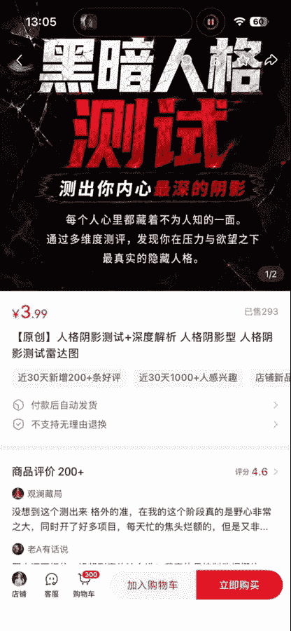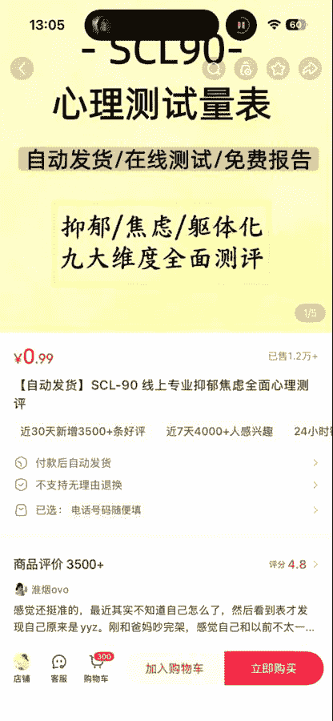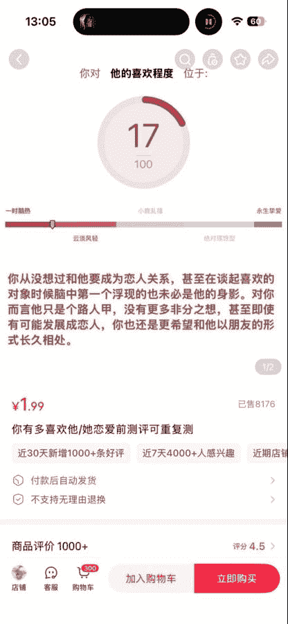

### 2.3 AI 的本质用法：改造旧生产资料

#### 背诵是永恒的旧需求

AI 的正确用法不是凭空创造需求，而是用于旧模式、旧工作的改造。不要说没有生产资料——每一个旧需求都可以用 AI 重做一遍。一个绝对有机会的品是背诵：背诵一直是东亚人 22 岁前的课题，包括知识点、考点、英语课文、古诗文言文、课文，一切需要背的东西都可以背。

而且背诵这件事没有尽头——小学背完初中还要背，初中背完高中还要背，换一套教材、换一个学段，就又有一批新的背诵需求冒出来，所以它是一个可以长期做、反复做的品类。

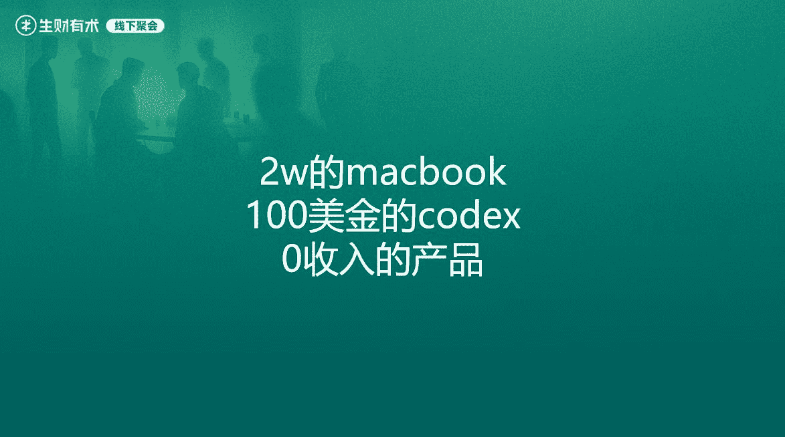

#### 一鱼三吃

每一次技术升级，都要思考这个创新对我来说机会是什么，这个思维一定要印在脑海里。

比如 Image 2 更新了一个关键能力：可以生成透明底的 **PNG** 图片。这个能力听起来没什么用，但对应到一个具体场景就有用了——公开课老师要做云朵字（黑板上板贴的字），以前老师用 PPT 做云朵字，现在可以用 Image 2 直接生成透明底的云朵字，做公开课课件也能用。去小红书搜“云朵字”，会发现已经有人做出了云朵字生成器卖了几百单，就这么一个简单的需求，也是外部固定出来的，不难。如果不深入了解市场，根本想不到这个东西能卖钱。

所以每一次技术迭代，不要只关注那些“天塌了”的自媒体，要真实地扎根到市场里，想清楚大模型升级到底给自己带来什么机会，把目标聚焦在我身上。

这里有一个“一鱼三吃”的思维：同一个需求，不同模型各做一遍。比如背单词的内容，一开始用 nano banana pro（早期的图像大模型）做，有人做了；Image 2 出来后，用 Image 2 把它重新做一遍；等新模型蒙娜丽莎升级出来后，又可以再重新做一遍。同一个需求、同样都是背单词，一个东西可以一鱼三吃，所以技术每升级一次，旧东西就多一次重做的机会。

一鱼三吃：同一个旧需求，nano banana pro → Image 2 → 蒙娜丽莎，每出一个新模型就重做一遍。只要旧需求有人用旧模型做过，新模型出来就多一次机会。

#### 不用二次教育用户

核心优势在于不用二次教育用户。为什么很多人的东西卖不出去？因为需要从 0 到 1 地教育用户，付费是有曲线的。而背单词、背知识点这件事，每个人都有经历——高中、高三的时候都死记硬背过，都背得痛苦，用动漫去帮助记忆，尤其是在教育这个场景下，就非常契合，这就是第一个风向标。

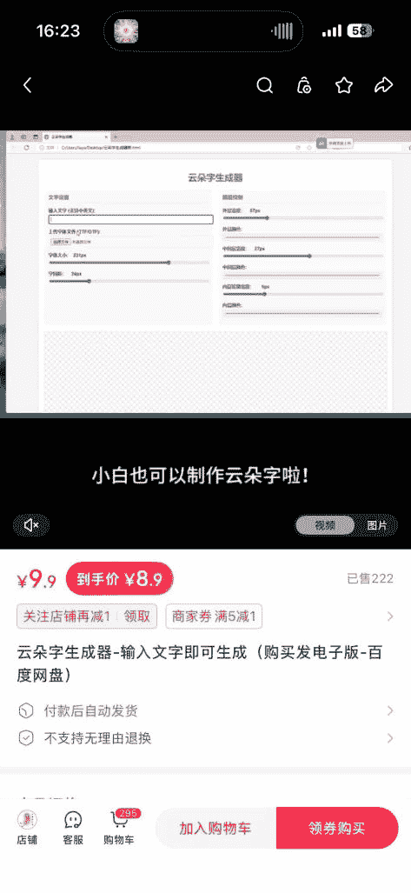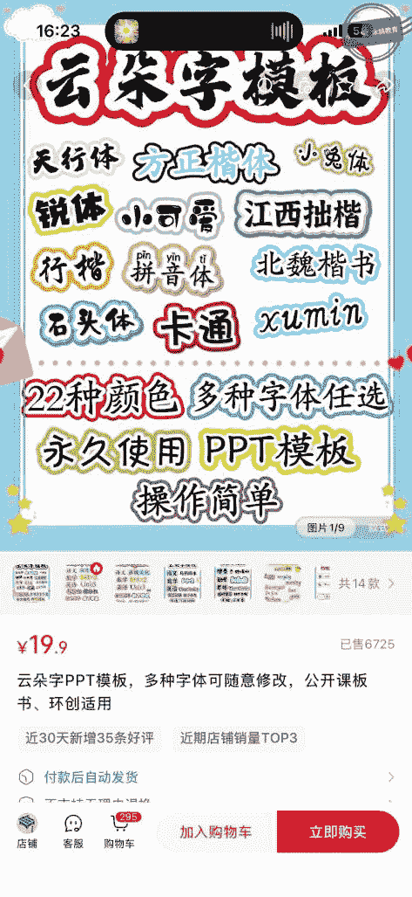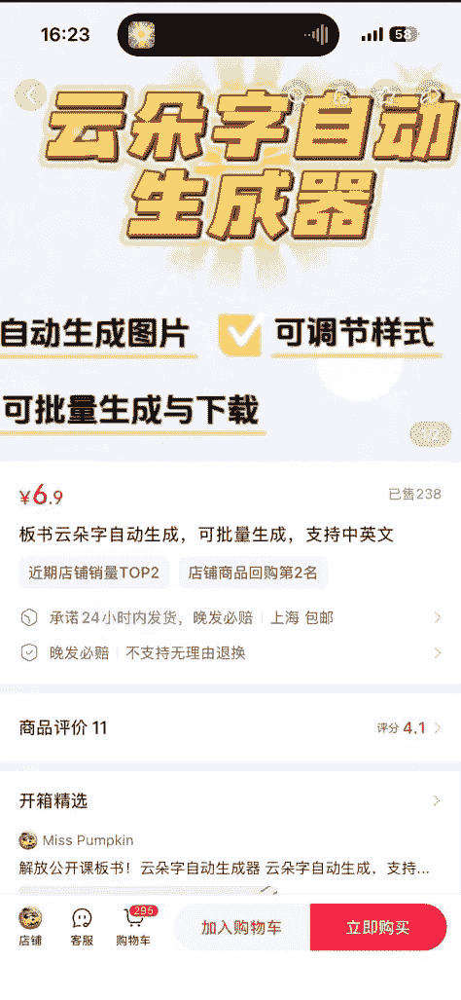

真实案例：一位同学看了分享后自己做了别的教材，一周到两周（还是一两个月）卖了 1.03 万。机会是什么？执行力是最好的风水，很多人是想，但要在干中学——一定要在干中去学，这个 sense 很重要。

### 2.4 课件赛道与改版红利

#### 教材改版是核心机会

课件赛道最核心的机会是教材改版。教材每年都在改版，每一次改版，之前的课件就不能用了。

这个改版要重点关注：去年改的是一二三年级，今年改的是四五六年级，改版之后老商家的资料全部作废，这对新入局的商家就是机会。

销量差距的来源可以直接印证这个逻辑——四上语文背诵复述学习导图和二上语文学习导图的销量差别为什么这么大？因为四上改版了，四、五、六年级改版之后之前的资料都不能用，四上那个背诵学习导图一周卖了 600 单，那个图就是 Image 2 做的。

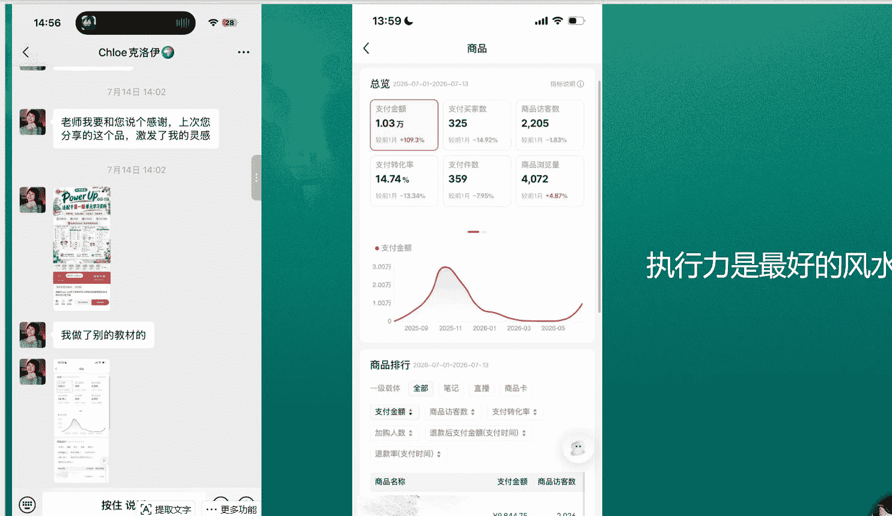

#### 用公众号找改版机会

怎么找到改版机会？用公众号。了解一个赛道不要只从小红书看，因为很多老师不刷小红书，而学校官方账号都在公众号上，所以一定要在公众号上看。做课件也不能只想着卖一个商品，只卖一个商品永远是个门外汉，看不到真正的机会，要成为这个行业的专家。方法是没事就刷、不断浸泡，甚至到一个“说者无意听者有心”的程度：在咖啡厅听到顾客说马上要带儿子去看钱塘江，立刻能推算出孩子现在三年级下、开学四年级上，四年级上第一课是《观潮》。

这种敏感只能来自长期浸泡在环境里。暑假在浙江图书馆看到很多小学生，甚至想这个教材我能不能拿来看一看，没事跟他们聊聊天做用户调研。

### 2.5 AI 赋能虚拟产品的两个阶段

AI 赋能虚拟产品分为两个阶段。第一阶段是 **2026** 年 **3** 月以前：主要用 Image 2、NotebookLM 做课件，用大模型做各种东西，但当时 Skill 并没有完全普及，其实并没有跟真正的 Agent 有大的介入。第二阶段是 **2026** 年 **4** 月到现在：进入 Agent 原创虚拟产品阶段，最大的变化是网站的门槛降低了，每个人都可以做一个网站。这个时间点很特殊，OpenAI 像是开窍了——以前 OpenAI 没有开窍，一会做 Sora、一会做 Atlas、一会做浏览器；但 4 月份这个时间点它开窍了，推出了 Image 2 这个大模型，还有 CodeX，真正把 Agent 从写代码转化到了解决你一切工作的场景。现在每个人都可以把自己的想法实现，做网站、做小程序，但要注意一个卡点：小程序收款需要个人营业执照，没有营业执照就很难收款，这是一个要提前注意的点。

## 三、产品层：用 Skill 把需求做成产品

### 3.1 Skill 与提示词的本质区别

| 维度 | 提示词 | Skill |
|------|--------|-------|
| 能力边界 | 只能产出内容 | 产出内容 + 交付结果的工作流 |
| 接飞书 CLI | 不能 | 能，直接把东西发到飞书 |
| 产出体量 | 受 token 限制，写不出长篇 | 一次性生成 7 万字 |

#### 提示词的局限

提示词和 Skill 在内容层面差别不大，都帮你做内容，但能力边界完全不同。提示词只能帮你产出内容，没有办法帮你完成操作，它的核心能力就是产出内容，能力边界基本就是它的全部能力了。

现在大模型的作用更多是谈心，Claude、Gemini 是心理委员，Gemini 会说“我要稳稳地接住你”，还有豆包，它们能陪你聊、能安慰你、能给你情绪价值。但仔细看，这些都停留在只能产出内容的层面，真正落到把一件事交付完的，它们做不到。提示词还有一个弊端：没有办法产出长篇大论，因为 token 有限制，百万 token 的窗口是有限的，聊着聊着，谈着谈着就开心了，最后它管你叫兄弟、你跟它说 bro，聊着聊着它突然就失忆了——因为到了 token 的限制。

#### Skill 的优势

**Skill** 则完全不同，它是产出内容 **+** 一套能交付结果的工作流。它接上飞书 CLI 之后，可以直接把东西发到飞书上，还可以一次性生成 7 万字的内容，这意味着小红书一类的虚拟产品（尤其是指南类）得到了解决。从内容角度看，按小红书逻辑：500-1000 字是笔记，1000-8000 字是长文，8000 字以上是 PDF，它们对小红书来说是不同的东西。所以 Skill 的厉害之处在于，从内容层面它走向了工作流和结果物。

#### 工具选择

顺带说工具选择：日常工作是 Claude Code 加 DeepSeek 的 API 来做，但 DeepSeek 从某天开始涨价（涨得很恐怖），做一个 Skill 花 30 块钱，以前 30 块是一个月的用量。装 Claude Code 可以用 Workbody 装——直接跟它说“帮我装 Claude Code”它就能装，以前 3 月的时候还要先装环境、装 City Switch、再配置，很麻烦，现在方便多了。Workbody 的定位是外包——很多插件装不了（比如 obsidian 的 Coding 插件），就用 Workbody 帮装，它还能安装自己做的 Skill。

#### 要避开的误区

同时要避免一个误区：不要去做那些无法真正改变生产力的 Skill。市场上 Skill 太多了，PPT Skill 一百个人一百个版本，公众号排版 Skill 每个人都有，尤其是那些没有接触过真正生产环境的 AI 博主只能去做排版。这些已经做好的，就秉持拿来即用原则，别人做得好的直接用，没有必要再做一遍、没有必要重新造轮子。做 Skill 一定要从自己的工作场景出发，解决自己真实遇到的那个具体问题。一个实际案例：有一位圈友用指南 Skill 一个月卖了 3000 块钱，而且是持续每个月 3000 块。

### 3.2 指南 Skill：内容出版平权的产品化

## 初心与定位

指南 Skill 的初心来自一个判断：AI 时代实现了表达平权和内容出版平权——每个人都会表达，普通人也可以把自己的经验做成能被看见、可被需要、可交付的内容。

三句话定位：内容是杠杆，指南是放大器，产品是变现器。从商业上看，指南承担的是双重角色：指南等于你的前端收入 + 后端客资，同时指南也是你的钩子品（引流品）。一份好的指南（比如内含完整低转高策略的广志大客户销售指南）既能直接卖钱，又能把用户引入后端、沉淀成客资。

但很多人指南卖不出去，问题不在指南本身，而在没有内容创作能力把它推出去——所以在场 30 个人如果都有指南，真正卖得出去的还是那个会做内容的人。这就引出了后面要讲的长文 Skill 和笔记 Skill：它们解决的是怎么把产品用内容推出去的问题。

## 它解决的核心问题

做指南 Skill 的场景可以借鉴：很多人不具备一次性写 1 万字以上的能力，而指南至少要 2 万字才能让用户真正珍惜。如果一个人拥有长文写作能力（做内容做了 8 年），就可以把这个能力做成一个 Skill 让所有人都用。

它解决的是隐性知识表达不出来的问题——很多人在行业里工作七八年，有经验但表达不出来，就像中医讲的中焦不通、肝火旺，感觉很堵。指南 Skill 就是开个方子：把想说的东西发给它，它就帮你写一份非常专业的指南，把无序的东西变成有序（物理学概念叫熵减，从无序变有序就是熵减的过程）。写指南不只有自己的经验，还有参考资料的问题，指南 Skill 还能帮你直接搜索参考资料。

## 六步私有上下文

指南 Skill 的使用流程是先积累私有上下文：话题、读者、个人经验（没有经验就说没有，它会自己去网上找）、信息源（有就提供）、形式（如飞书文档）、样本（用于蒸馏风格，没有样本时默认用一开始蒸馏好的文章风格），把这些私有上下文都给它，它就能做出一份专业指南。

这六步私有上下文，每一步都有讲究：话题要具体（不是杭州指南，而是杭州 9 月亲子游学指南）；读者要明确（是新手妈妈带宝宝游学，而不是泛泛的游客）；经验有就写成飞书文档发过去、没有就说没有，让它自己找；信息源是让指南有人味的关键——看到几个特别好的 YouTube 视频，把逐字稿下载下来发过去，再结合外部信息源；形式决定交付形态；样本是蒸馏——想让指南写得像某个人的风格，就把那个人的文章传上去，没有就默认用蒸馏好的文章风格。这六步本质是补足信息差，让 Skill 更懂你，做出来的指南才不是千篇一律的 AI 味。

## 实例产品清单

实例产品包括：复述训练指南（万物皆可指南）、写给 ADHD 的人生突破指南、广志大客户销售指南（内含完整的低转高策略，适合做低转高、职场赛道、私域运营的人）、各种教师场景指南（中小学教师社会化指南、中小学教师训话逐字稿、新手班主任入门指南、如何管理刺头学生、中小学语文数学成绩实战指南、课堂管理实战指南）等。

还有京东采销指南京东采销面试指南这类职场面试产品——京东采销是一个明确的人群，需求很具体，做职场赛道时拿它当钩子品很合适。这里还藏着一个组合打法：面试题本身是个大品类，光面试题就卖出去过几万单，但当所有人都在卖面试题时你就没有优势了，所以把面试题 + 面试指南 + 简历指南三合一打包，卖 19.9 元，就做出了差异化。

## 案例：吵架与炒股指南

万物皆可指南意味着只要能打开想象力，任何话题都能做成指南。比如吵架指南——真的有人需要，也真的做出来了，一次性生成，内容非常实用：

- 沉默压迫式：当话题对你不利时把桌子掀了重新摆。
- 掀桌子：同事在会议上质疑你的方案风险太大，这个时候议题对你不利就换——在讨论风险前，我想确认个问题：我们到底是做一个不犯错的方案，还是做一个能推进的方案？这背后的逻辑叫议题重置，不是诡辩，确实是在转移话题，但往更根本的问题转移。
- 核心差异：吵架高手与新手的核心差异就是高手永远不在对方的擂台上，要跳脱他的思维、跳出他的框。
- 亲密关系怎么吵赢：赢了道理但输了人，不是赢。

再比如炒股指南：推特上有个大神叫（白毛女），提出了紫苏叶理论，做法是把他在推特上的所有内容全部放下来（47257 次的内容）发给指南 Skill，它就做出了一份一个人投资方法论指南——会告诉你怎么选行业，还做了社区众包研究。

这里强调两点：一是做专属指南，语料一定要真实（把一个人全网的内容全放进去，就是你的语料库）；二是这类内容只展示制作逻辑，不构成投资建议，但可以完全当引流品去做。

## 案例：杭州 9 月亲子游学指南

现场演示的杭州 9 月亲子游学指南是一个完整范例，它从孩子的角度出发给出动手体验清单：浙江省博物馆之江馆（之江馆最大、亲子馆天花板）、中国丝绸博物馆、良渚（把 5000 年的文明玩出来）、茶玩家、九溪十八涧、梅家坞、水上巴士，甚至吃饭（西湖醋鱼孩子未必爱吃、片儿川、葱包烩）、九月天气（秋老虎还在、东北 20 多度杭州还 30 多度）、避坑清单、常见问题（几天够、孩子中途闹情绪怎么办、一个人带忙不忙得过来、要不要请导游、玩水安全吗）都涵盖。

做完后可以发给 NotebookLM 或 Image 2 做成图片版、加互动元素，价值感再上升。游学手册本身是个好赛道，如果在这个城市名胜景点特别多就可以做游学，比如浙江博物馆因为圆明园兽首值得做；有朋友今年 7 月只卖一个省的博物馆游学手册，49.9 元直接赚了 1 万块。

关键在于想清楚用户到底需要什么——用户不一定需要那个东西本身，而是需要一个让孩子看起来可能会用的东西。指南里还有一些体现从孩子视角出发的细节：外地人来杭州第一站往往挤在龙翔桥地铁站（人巨多，所以有个梗叫决战龙翔桥），良渚遗址公园里有鹿、有考古体验，水上巴士对孩子来说是会记住的体验。

指南做出来之后可以当引流品用——如果你做的是相关业务（比如亲子教育、本地生活），这份指南就是非常轻松的钩子品，用它在前面引流，把用户引入后端。

## 判断标准与差异化

做指南还要注意什么话题适合做指南。现场有人问穿搭指南能不能做，答案是穿搭不太适合做指南，因为穿搭直接找资料就行、不需要系统性梳理成 2 万字，但可以做一个流行趋势指南。

这背后的判断标准是：这个话题有没有足够的信息量需要被系统化、结构化地整理，像游学、博物馆、亲子出行这类有大量点位和知识需要组织的，就特别适合做成指南。

这里还要强调：当每个人都做指南的时候，大家的起跑线是一样的，人人都能做指南等于人人都没有优势，所以指南 Skill 解决的是能不能做出来的问题，而真正的差异化在后面的长文 Skill 和内容积累上——当人人都能用 AI 原创虚拟产品、做出大量内容的时候，真正的优势不是能不能做，而是你有没有质量、有没有深度、能不能被用户看见、能不能建立信任。

## 3.3 工作台：从真实场景长出来的工具

### 从真实痛点入手

工作台的本质是推动自己做事、节省时间效率，而不是一个孤立漂亮的东西。做工作台一定要从真实的场景/痛点入手，否则就会变成漂亮的废墟——很多人做的工作台都变成了漂亮废墟，就是因为他们没有从真实场景入手。

### 功能模块

一个具体的工作台（Luke Studio）设计逻辑：核心痛点是看 YouTube 视频。以前的链路很长——把 YouTube 视频字幕下载下来发给 Claude Code、加载到 Skill、再同步到飞书。为了解决链路长的问题，做了一整套工作台围绕这个痛点展开。

收字插件是一个收藏插件，可以收藏网页里任何东西（公众号、小红书、YouTube 都能收藏），看到符合眼缘的内容点一下收藏，收藏完选择下一个东西，下一个就直接去干活，它解决的是收藏这个动作和真正学习之间的断层；全民阅读，因为收藏是个动作，真正进脑子才是知识，所以做一个沉浸式阅读界面，把收藏的内容集中阅读，所有平台的内容（公众号、小红书、YouTube）都能按自己的 Skill 处理完同步到这里。

YouTube PDF 杂志，把今天看的 YouTube 内容一键变成 130 页的 PDF，导入微信读书在手机上躺床上看，阅读体验很高级，学习变得很快。

社群日报，把视频再压缩成 800 字的优质内容发到社群里，提升社群服务深度，比如做育儿母婴妈妈群，没事在 YouTube 上找优质育儿内容发进去，价值感就变强。

朋友圈创作建议，先写一个个人画像（我是谁、想做什么），再配合一个 Skill 帮写朋友圈，解决私域写作。有一个理念是 Skill 不应该只有全自动和纯手工两种模式，中间还有个半创造，有点像 “Be water, my friends”。

选题，帮想该写什么选题；闪念笔记，用 Ctrl+Shift+L 唤醒，随时记录灵感（比如“如何用 Agent 原创虚拟产品”这条闪念）；Skill 中心，所有 Skill 的看板，想做什么 Skill 直接在里面选，相当于一个 Skill 的调度中心。

### 内核与扩展

背后的内核是 CodeX，之后可以进一步用 DeepSeek Harness（一切皆插件的理念）做成内置，而且 DeepSeek Harness 也可以读图了。这个工作台甚至打通了 Obsidian 知识库——看到好的内容直接同步到 Obsidian，它解决的核心痛点是我只收藏了、没学习，东西没被我所用，所有目的和动作都是为我所用。

这种为我所用在学习上体现得特别具体：看视频不会看完整个，符合眼缘就点进去、点收藏；看公众号好文章，会按自己的提示词把它拆成逐段批注，讲清这一句为什么写得好，比如做销售一旦有了体系，客户和业绩都会持续增长——只有拆到为什么写得好这一层，内容才真正进脑子。

里面还藏着一个认知升级：从顾问思维到精者思维，不要只分析，要进入现场，这和学习工作台从收藏到为我所用是同一个道理。看到好的公众号内容，也能按自己的提示词拆解成逐段批注，告诉为什么写得好，再把可复用的东西存进 Obsidian（Obsidian 要装一个叫 Coding 的插件）。

工作台还能扩展：很多人把个人朋友圈、微信也加载进去，做销售线索的洞察等等；还可以做一个专属 Agent，把自己喜欢的品牌（比如 Hermès 爱马仕）全部融合进去，做出一个专属工作台，核心是有什么功能就加，跟 CodeX 加就行了。

更深一层的心法是把 Skill 焊在工作台上——Skill 和工作台本是一体，工作台就是整个内容创作学习的一个中心，把做好的 Skill 焊进去，它就变成工作台里的一个插件，点一下就能收藏、能处理。

工作台里还有一些个性化的巧思，比如做了一只猫搭子——给 CodeX 设置了一个宠物形象，每 15 分钟提醒站起来溜达一下、每 30 分钟提醒喝水（之前 CodeX 的宠物特别火，就加进去了），这个宠物的另一个作用是直接唤醒工作台：不想再手动打开工作台，就让 CodeX 做一个插件，点一下就唤醒。

再比如工作台一开始是用 Workbody 做的，做出来觉得太丑，就发给它重新做，其实还可以、够用了。

### 言出法随：一次把需求想完

关于工具的判断，还有一个点值得记住：DeepSeek Harness 是一个机会，它的理念是一切皆插件，而且现在也能读图了，值得用起来。这些新工具的出现本身就是一个软件诞生就意味着它有很多场景可以重新做一遍的例证。

做工作台的一个核心心法是言出法随：有什么想法、有什么卡点，就立刻让 CodeX 做一个插件来解决，不要反复改同一个需求。坑在于——想到一个需求就发一次、改完再发一个需求，反复改一个需求会非常消耗 token，一定要一次性把需求想完，把所有的要求一次性说清楚、说完整，让它在一次生成里就做到位。

做这个工作台总共消耗了两次 CodeX 重置机会。想省 token 的话，把已经验证成功的工作台设计文档发上去，告诉它这是一份已验证成功的工作台设计文档，我的需求是这个，你有什么可以学习的地方，帮我去做、不要踩坑，它就能省 token。

### 商业价值

工作台也有商业价值：

- 第一，作为独立虚拟产品交付的方法论（不教别人做工作台，而是告诉别人怎么做工作台的方法论，作为引流品）。
- 第二，卖工作台提示词，有人个人售卖一天出几百单。
- 第三，做 Workbody 工作台手册（国内用不上 CodeX 就用 Workbody 从零搭建工作台）。
- 第四，做细分人群的操作手册——语文老师、数学老师、物理老师的 Workbody 使用指南、财务人的 Workbody 自动化工作流知识库。

一个软件诞生，就意味着它有很多场景可以重新做一遍。

## 3.4 知识库的着力点：让产品与我有关

### 着力点

知识库能不能卖出去，关键在有没有着力点，也就是这个东西跟我有什么关系。

荣格知识库卖不出去——受众窄、没听过、谁知道干嘛用；但荣格视角下的社会化指南就有人买，因为社会化指南在小红书已经被验证（卖了 2 万单），荣格社会化指南也就有了着力点（800 多单、500 多单）。同理，毛选知识库难卖，但毛选知识库·职场版就有着力点。

### 案例：着力点怎么建立

几个典型案例说明了着力点怎么建立：

Justin Welsh 知识库卖不动，但把他包装成一人公司鼻祖、海外 1000 万美金，变成你的 24 小时 AI 助手，有任何一人公司的问题都可以问就能卖出去，因为它有了一个真实的着力点；Simms 教授知识库没人知道是谁，但说清斯坦福教授、只专注 40 岁以上女性健身就会买，因为这跟我有关。

所以卖一个知识库时，一定要想这个东西跟大家有什么关系，而不是我卖了一个知识库就一定能卖出去。

## 学习是终身课题

知识库这个品类本身，满足的是两类需求：第一是学习成长、自我挖掘，第二是一个人的成长和发展（尤其工作层面），所以知识库能卖出去，是因为它踩中了学习这个终身课题。

像毛选现在在小红书、知乎卖得最火（有人一个月卖了 800 单），道德经也可以做——关于学习和教育的，永远是终身课题，不是一时的蓝海。但卖这些看起来高级但没着力点的东西（毛选、道德经、荣格），关键仍然回到着力点：光说毛选知识库卖不动，说毛选知识库·职场版就有了着力点，着力点就是那个跟我有关的钩子。

### 切分到具体场景

做知识库不要只聚焦一个点，而要切分到具体场景。以职场知识库为例：小红书宣发要围绕如何找到工作展开——简历、面试、作品集写透，再写 landing（试用期）期怎么度过、面对 dirty work 怎么办、面对上级不合理任务怎么办，把从求职到拿到正式 offer 全部写透，再在小红书发笔记。

减脂也一样：别人都在讲少吃多动这种大路货，讲减脂就卖不动，要升维到睡眠、皮质醇、血糖、有氧、二区运动、线粒体这些别人听不懂但觉得高级的内容，别人才会为这份高级感买单，而这些内容在 YouTube 上都有现成的。

## 3.5 英语背单词：永远有机会的垂直方向

### 漫画化背单词

背单词这件事永远都有机会——小学要背、初中要背、高中要背、考研也要背，都需要，它最大的卡点是怎么背出花来。真实案例：生财有术的圈友里已经有两三个人靠英语单词赚了很多钱。

具体做法是把单词书漫画化：背英语单词的传统方式是拿单词书背，而每个年级的单词书都有统一共识——考研背红宝书、雅思有雅思单词书，把这些单词书直接变成漫画的形式，就能卖钱。

还有读爽文背单词——把它变成一个“重生之我在古代当皇帝背 5000 单词”的设定；还有人做成网站，把背单词的理念也放进去（比如漫画背单词之所以容易，就是因为它有理念融入）。

###

迁移性：漫画背任何东西

承载形态可以是图片、网站或 APP（像欧陆这种卖得好的做成了 APP），但如果是想快速试验，关键是要给一个场景 + 你的理念融进去，核心是把理念传进去：母语思维、不要从 abandon 开始背（因为真题考得最多的词往往不是 ABC 开头的，散布在整本书里）。

这里有一个重要的迁移性：漫画背单词这件事，可以迁移到漫画背任何所有东西，考研英语可以做，其他所有需要记忆的内容都能用同样的方式重做一遍，这就是为什么背单词永远有机会——它不是一个一次性的产品，而是一个可以无限复制、无限迁移的模式。

做这类产品的关键永远是想清楚我的理念是什么，然后把理念融进产品里，而不是做一个跟别人一模一样的背单词工具。还有一个把它卖成故事的打法：笔记可以这样写——试了市面上 8 个背单词 APP 都不满意，所以我手搓了一个，配上终于理解考研含金量的命题关联，一个产品故事就立起来了，100 个选题都能从里面长出来。产品故事加理念，才是让背单词这个老需求背出花来的关键。

### 做 Skill 的方法论：切口小、跟 AI 共创、营销视角

#### 切口小 + 跟 AI 共创

做 Skill 有一个核心原则：切口一定要小，它只能解决一个具体的问题（选题、内容、标题等等），要从自己的场景出发。如果不知道怎么做 Skill，就跟 AI 共创——把场景和困点发给它，问我能做个什么 Skill。

比如做 YouTube 内容知识蒸馏 Skill 时，问我想更高效地学习 YouTube 视频的知识，你认为这个 Skill 还能怎么做、还能增加什么功能，它会告诉你可以加一个 SOP、可以加一个 QA 问答，于是所有内容都有一个 QA 和问答，这就是 AI 告诉的。有时候自己想不明白，就让 AI 帮你找，把问题抛给它，核心就是多练，体验这件事很难速成。

#### 营销视角

还要有营销视角。推荐一本书《营销管理》，虽然厚但值得看——营销就四个层面：产品、价格、渠道、推广，看这四个层面就行。还要多看奢侈品（比如 42 Acquire 的奢侈品营销策略），看它们为什么能卖那么贵还有人买。保持疑问、保持好奇：为什么现在餐饮流行板前（板前河粉、板前牛粉），为什么要把制作流程呈现给用户？多锻炼这种商业 sense。做广告出身的人，习惯就是多去逛街、多看为什么能卖这么贵。另外，任何一本书都可以蒸馏成一个 Skill 帮自己去做（消费者行为洞察等等）。

#### 让 AI 写 + 永远测试

还有一个重要事实：这些 Skill 都不是手写的，都是让 AI 写的——包括提示词 Skill 本身都是用 AI 写的。做法就是告诉 AI 我想做一个 Skill，把自己的内容和 YouTube、公开资料整合成有个人风格、没有 IP 的东西，它就会告诉你核心是把个人知识和公开资料整合成个人风格指南，不能有 AI 味，然后帮你写出来（比如它会产出 personal guide writer 这个 Skill，并告诉你至少 2 万字、原材料不够时要主动告诉用户去补充什么）。任何 Skill 做完之后，接下来一步永远是测试。

比如让它写一个宝洁 88 问 Skill——宝洁 88 问原本是一套面试提问流程，在职场赛道卖得特别火，之前用 Flowwise、agent 写过宝洁 88 问指南，在小红书卖了几百单、49.9 元。

测试的时候，它直接创建了飞书文档、写满了 2 万字，一测就通，这就是 Skill 的厉害之处——有了这一个 Skill，往后任何想写的指南都能用它来批量产出。所以 Skill 的制作流程就是：说需求 → 让 AI 写 → 测试 → 迭代，全程可以让 AI 主导。

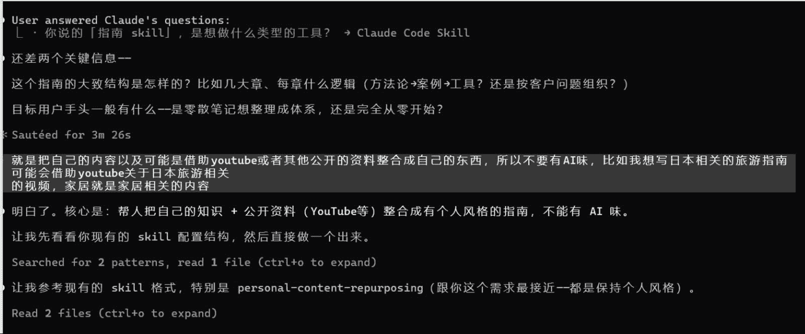
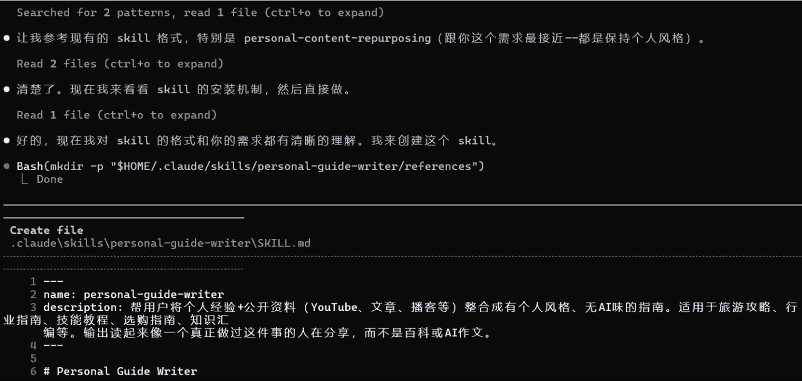

做 Skill 的完整流程：说需求 → 让 AI 写 → 测试 → 迭代。

## 四、内容层：用内容把产品推出去

### 评论区商机挖掘：从群众中来到群众中去

#### 底层原理

评论区里有黄金，这是底层原理。毛选里讲从群众中来到群众中去，评论区就是群众聚集的地方。第一步要识别高价值信号，识别出来后关键是让 Skill 把这些信号整理成一个指南。很多人不知道要写什么指南，比如做跨境电商不知道写什么，就去跨境电商同行的评论区看他们在讨论什么，把 Skill 发上去，它会给出商机矩阵、几个可以立即做的产品。关键是要识别什么样的评论区值得关注——不是吵架的，而是真正在讨论问题、进行高价值观点碰撞的评论区（比如一人分享一个抗糖小妙招），不是升级成骂战或引流的，都不要关注。

找的方法是用社媒助手去盘，筛选时找最多评论的，然后让 AI 帮忙筛选有信息量的（告诉它有信息增量、控糖技巧强相关的，它就能识别，AI 其实挺聪明，知道什么是口水话、什么是有信息增量的）。

#### 抗糖的延伸链路

拿抗糖举例，完整的延伸链路是：在抗糖评论区里找到高价值信息（比如邪修控糖法喝苹果醋这些真实经验），再去 YouTube 上找一些控糖的优质内容补充，就能拼出一份抗糖指南。但这里还有一个要提前想清楚的问题：这份抗糖指南到底能不能卖出去？评论区有需求，不代表一定有人付费，还得看有没有着力点、有没有后端承接。所以挖商机和判断能不能卖是两件事，前者靠 Skill，后者靠对市场的判断。

#### 班主任赛道的完整链路

现场用班主任赛道演示了完整链路，从评论区挖掘出商机矩阵、六个可以立即做的产品：开学第一周立威行动手册（一年级班主任最缺的就是立威）；被家长刁难的 50 个瞬间万能回应话术（比如老师你太年轻了、你没生过孩子你不懂怎么回，给的回应是我的确没生过孩子，但我也是从孩子长起来的，我受过专业教育，我现在教的孩子有几十个，而您只能看到自家孩子，这是把对方的战场拉回自己这边，再配合吵架指南的思路就闭环了）；班主任开学必备三张表格；班主任自保手册（留痕清单 + 安全红线）（哪些事情必须要留痕、安全红线清单）；不想当班主任：新班主任心态急救手册。这些可以直接卖 9.9 元，卖完再跟老师聊天，挖掘家长会、开学第一课、主题班会等后续需求，所以不要被垂直所困扰，而是围绕用户需求——卖被家长刁难的 50 个瞬间话术、卖开学第一课、卖主题班会都可以在一个账号卖。

#### 做出干货感

要做出干货感，就把评论区真实素材直接喂进去：拿到学生名单把每一个名字熟读、多音字生僻字查清楚，开学从容念出，这是给学生留下的第一个专业印象——这些都是真实班主任分享的真实经验，让指南变得有人味、有血有肉，跟纯 AI 生成的空洞无聊完全不同。如果一条评论区不够，就再去找其他素材，让 Skill 告诉你还缺哪些素材、该怎么找。商机挖掘 Skill 做完，再交给指南 Skill，就闭环了。

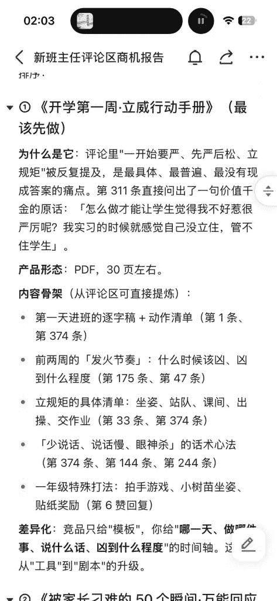
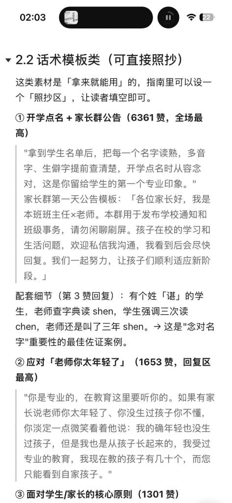
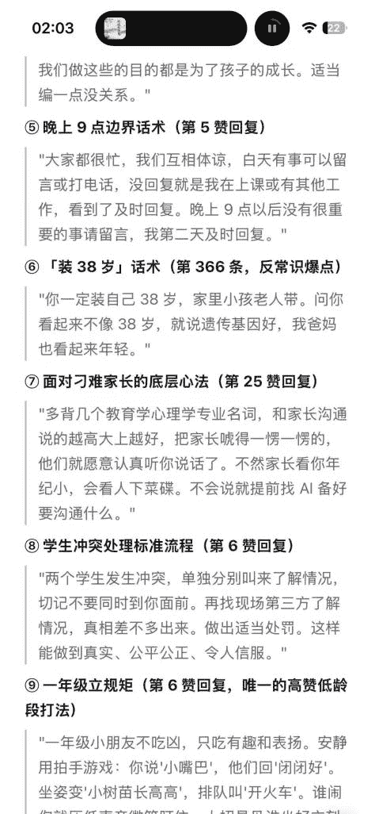

### 长文 Skill：去 AI 味与阅读流动感

#### 去 AI 味与章节节奏

长文 Skill 解决的核心问题是去 AI 味 + 章节重点 + 阅读流动感。AI 味的清单包括：喜欢用破折号、喜欢用不是……而是的转折、喜欢用无意义的比喻、短句太多——短句像一个个独立的方块堆在一起，缺乏流动感。真正有沉浸感的长文要有连贯的长句，句子之间要能牵着读者往前走，不要写太多短句，好的长文是能跟作者产生思想共鸣的，读者读着读着会停下来想这话说到我心坎里了。长文还要有章节节奏感：不能每个章节都一样重，比如 5000-6000 字的文章分五章，每章都 1000 字左右就会很平，读起来没有波澜壮阔的感觉，用户没有收获感，刚读入戏就切入下一个章节了。正确的做法是让第三章作为重点（1000/1000/3000/1000/1000 的结构），内容上重点展开。

AI 味清单（要避免）：破折号、不是……而是、无意义比喻、短句太多（缺乏流动感）。

#### 喂人写的样本

去 AI 味的根本方法是给它人写的样本让它模仿拆解——第一件事永远是喂训练语料，让它学习和拆解好样本，同时给它 AI 味清单让它避免，所有 Skill 提示词的第一件事都是这个。长文 Skill 的两个升级：一是搜索流量——把想写的关键词发给它，让它全部融入进去；二是出体系性长文——解决执行力差、不知道每天干什么的难题，做出百日内容计划，每天发什么、选题栏目都搭好，用户只需要复制粘贴。

#### 爆款是可迁移的

长文的核心认知是爆款是重复的、可迁移的。怎么找到下一个安克、大疆、影石并在初期加入是求职赛道的爆款选题，这个结构可以迁移到财经领域变成怎么找到下一个英伟达、美光并在初期买入。选题的来源是那些听起来很高级的热点理念：谢圣子见世面不要见消费端世面，要见生产端世面、身弱之人、着相（金刚经）、流量相等国学概念，以及身弱之人才适合做金融 / 一人公司这类有张力的选题——看到身弱之人才适合做金融公司这种选题，会想点进来。

#### 案例：身弱之人

长文 Skill 让用户只给观点就能写出 5000 字长文，也可以把某个博主的文章当风格蒸馏进去去掉 AI 味。写长文时它有一个优势：只给观点就行，而且它会去搜索（比如搜身弱之人会搜到八字身弱、体质精力低适合什么工作），所有语料都是与时俱进的，而不是写它理解的版本。现场写出的身弱之人才适合做一人公司长文 5600 字，多数人把身弱当成一个需要被修正的缺陷……身弱是一种精力错配……职场和创业都在反向抽干身弱的人，一人公司是为身弱准备的赛道，直接复制到小红书就能发。

这里要举一个用初版长文 Skill 写出来的、很有代表性的例子——为什么身弱的人在小红书反而吃香：

身弱的人在小红书有一个结构性的优势。身强的人能量太往外了，他们的表达方式是你们听我说，内容姿势是我来教你，节奏是快的，习惯快速输出、快速反馈、快速迭代。而在小红书，用户最讨厌一种气质，恰恰就是说教感。

由此引出身弱创作者生存法则：能量第一，产出第二；保护你的敏感，别把它磨钝了。最妙的一句是：小红书要的不是太阳，是月亮。把创作者分成两种——太阳型创作和月亮型创作，身弱的人天然适合月亮型创作。这就是听起来很高级、有张力的选题和表达，是能拿流量的。

顺带说选题的多元来源：小红书上有一些博主特别擅长造金句、起名字，比如谢圣子擅长把各种理论起名（狼狗论之类），他的见世面不要见消费端世面，要见生产端世面就值得展开成一篇长文。还有各种国学概念应用到具体场景——身弱之人身弱不担财、着相（金刚经里的概念，比如流量相——我们着了流量相）。这些理念跟现实问题碰撞结合，才能挖出优质选题。所以不是不创作了，而是要多读多元化的东西——身强身弱、金刚经、道德经、楞严经、毛选，把这些攒起来，再跟当下大家存在的问题碰撞，才能产出好选题。

#### 案例：下一个宇树科技

长文 Skill 现场写出的一个例子是怎么找到下一个宇树科技并在初期加入。这篇长文里有几个很扎心的点：为什么不完美的创始人比全能型更值得关注？王兴兴的履历放在任何一家大厂的简历筛选里，第一轮就会被刷掉；价格屠夫的底层逻辑：临界点，当一个赛道从能动转向能用，你的位置比公司更重要；加入下一个宇树科技，这句话里藏着一个很容易被忽略的问题——你加入的时候公司已经多大了；以及结尾那句选公司这件事，大多数时间刷的招聘网站，真正有价值的信息发生在搜索广告之外——去用它的产品，去翻创始人的所有公开内容，去找他的前客户聊。这些句子直接复制到小红书就能发，底下挂一个校招表格的链接，一切就闭环了。

#### 三个补充细节

长文这条线还有几个值得记住的细节。第一，小红书发长文有一个写长文按钮，写完不用自己作图，它会自动生成图片，所以从写到发几乎是零成本。

第二，长文 Skill 一直在迭代，现在已经做到 5.0 版本，5.0 不只是帮你写长文，而是能直接给你搭一整套长文的体系。第三，长文 Skill 和指南 Skill 本身就是一个小小的商业闭环：指南做产品、长文做内容，用内容建立影响力、用产品完成变现，两条线一起跑。

而长文 Skill、笔记 Skill 之所以做得出来，背后是真实的代运营积累——在小红书亲手写出过 1000 多篇自然流量的爆文，靠的是早年代运营的经历：做过海外卖房（卖英国曼彻斯特、伯明翰的房子）、写过婚礼策划、婚礼八大金刚、婚宴厅这些垂类内容。

正是因为这些看似不相关的经历都做过，才能提炼出爆文的方法论，再固化成 Skill 给别人用，这就是世界上没有白走的路。把这些东西开源出去本身也是一种策略：把想开源的开源出去，才能腾出手去创造更多新东西。

### 笔记 Skill：动态对标库

#### 动态对标库

笔记 Skill 专写指南类笔记（写完指南后宣传指南用的），核心是动态对标库 + 先读后写 + 单篇拆解 + 去掉 AI 味。痛点在于：写笔记要找对标，但很多人找完就忘了，下次写又重找，持续都在找对标。解法是把所有认为好的对标放进一个飞书文档（对标库），每次写笔记时让 Skill 完整读取对标库的全部内容，再逐篇仿写，让它写 10 篇就 10 篇、写 20 篇就 20 篇。

#### 踩过的坑：逐篇拆解

这里踩过一个坑：如果把对标库里 6 篇笔记结合成一个综合内容模型，就会写得四不像、六不像。正确做法是伤其十指不如断其一指——每一篇每一篇地拆内容模型，10 篇笔记就有 10 个内容模型，才能写出 10 个不一样的，让 AI 学到的是完整的叙事动力链条，而不是一堆碎片化修辞。

现场演示了日本旅游指南的 9 篇笔记：读了有真实人味的对标库后，写出来的笔记标题和正文都能直接用（如 5 年留学生跑遍日本后，我做了一份能查能问的知识库、在日本留学 5 年，我把日本自由行写成了 5 万字指南，正文花了 5 年时间，我在日本留学，顺便把这个国家从北海道到冲绳能跑的地方都跑个遍，翻了上百份攻略，踩过无数坑，也攒了一肚子只有住下来才懂的经验）。

没有不是而是、没有破折号，因为它是严格先拆内容模型再仿写。另一个杭州亲子游学的例子也很打动人：带娃在苏堤上走，他突然蹲下盯着水里的鱼，妈妈，这条鱼和昨天在花港看到的不一样。那一刻我突然明白，游学的学不是记住多少事，而是孩子在真实的世界里长出自己的观察。

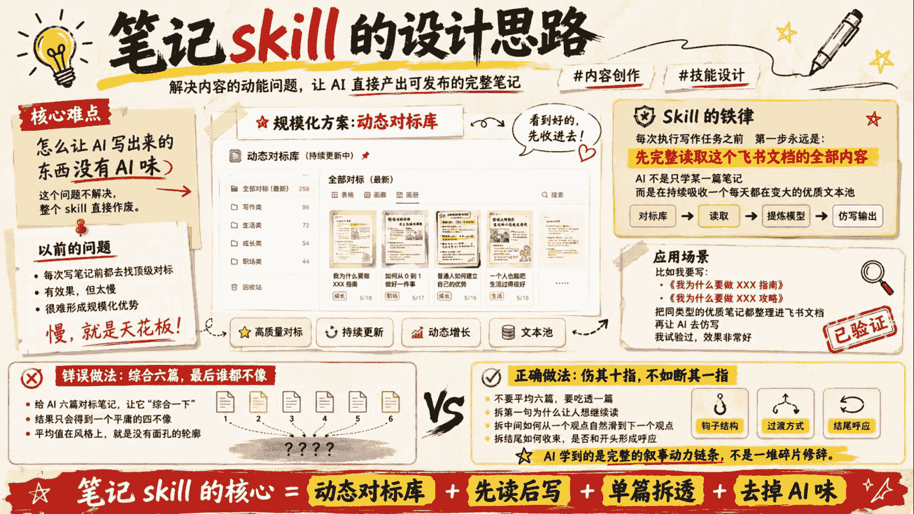

#### 怎么找对标

找对标的办法是找赛道里 100 个优质内容表达者的置顶笔记，一篇一篇地看他们怎么把产品和笔记融为一体——不是直接说产品多好，而是把产品巧妙地揉进内容里，让读者读完自然而然地想要这个东西，这种润物细无声的写法就是最好的对标。

笔记 Skill 还有一个很实用的用法：指南还没做出来，就能先写指南型笔记，做法是直接填一组标准发过去——产品形态（飞书文档）、产品规模（比如 5 万字或 3 万字）、作者背景（比如带孩子来杭州旅游的妈妈）、写几篇（比如 10 篇）、输出形式，Skill 会先读取最新对标库，再拆每篇的内容模型，逐篇仿写。正因为它是先拆内容模型再仿写，所以可以迁移到任何领域：想做哪一类笔记，就把那一类的好样本做成一个对标库，每次写都让它读。

笔记 Skill 做对了一件事：给规则，不给空标准，样本库是活的。AI 时代核心竞争力就是品味（taste），要不断给它你认为好的语料，让它越来越聪明，所以要多刷、多积累好样本。

### 蒸馏 Skill：从对标博主提取 knowhow

#### 本质与做法

蒸馏的本质不是模仿写作风格，而是让对标博主为你所用——出选题、出产品、搭产品结构。为什么有人能卖 1 万单、连续卖 4 年？因为他是有章法、有体系的，发笔记靠栏目和策略而不是拍脑门。他发了 1000 篇笔记，你人能看完吗？看完了能总结出章法吗？总结不出来——但 AI 可以。

做法是选一个与自己做品有交集的博主，用社媒助手爬取（建议 300 篇，因为过了 300 篇社媒助手容易崩，且 300 篇足以代表一个创作周期，不用蒸馏全部），导出 Excel 给 AI，加载蒸馏 Skill。它会交付：内容蒸馏分析报告、选题栏目（栏目 1 发什么、栏目 2 发什么）、爆文模型、标题句式、关键数据洞察，以及最关键的 knowhow（这个博主为什么能想出这些选题和观点）。之后直接让它给我出 100 个选题，甚至可以出内容。

#### 案例：说瘦就瘦

现场案例是说瘦就瘦这个卖考研英语外刊的博主，蒸馏出它的栏目（考研英语方法论、阅读提分、ADHD 也能坚持的考研邪修等），再迁移到自己的红宝书背单词网站——因为考研外刊和红宝书背单词有交集（都是背单词），有交集才能为你所用。

蒸馏出来的栏目本身就很有价值——如果只靠自己一篇篇看，是根本发现不了这些规律的，比如考研英语的风向标已经很明显了、考研出题人会把名牌直接打出来、疑似考研英语的邪修怪谈被泄露了、ADHD 也能坚持的考研邪修这类选题，一看就很有吸引力。这就是有章法的博主和拍脑门发笔记的本质区别：真正的创作者发笔记不是靠脑子一拍，而是有栏目、有策略——这

公众号懒人搜索，懒人专属群分享

个时候该发什么、下个时候该发什么，都是规划好的。写出的内容质量极高：

市面上几乎所有背单词 APP 都在做同一件事——把 5500 个大纲词扔给你让你每天打卡，但很少有人告诉你，这 5500 个词真题其实只考了 4200 个，剩下 1300 个过去 10 年一次都没出现过。

红宝书是一本好词典，但不是一本好背单词书，因为它的排列逻辑是按字母。你从 abandon 开始背，背了三个月终于到 Z 了，结果发现真题里最常见的词都散布在整本书里……所以我用真题词汇重新排了一遍，背单词第一个不是 abandon，是真题过去 10 年出现次数最多的那个词。顺序变了，背词效率差三倍。

## 落地成果

蒸馏完可以直接落地成 100 个选题 + 100 篇笔记 + 百日内容起号包，一个号的选题和内容就全都有了，剩下的只是照着发。

蒸馏 Skill 做完之后会给人一种瘫坐感——它把你原本要花几个月去琢磨的规律，几分钟就摊开在你面前，强得让人一时不知道还能做什么。

## 4.5 选品 Skill 与案例库

### 做法

选品不能拍脑门，要通过真实语料选品。

选品 Skill 的做法是：第一步先五轮对话沟通（你是干啥的、想在哪个赛道选品），沟通完有了初步印象；第二步去读案例库，看有没有跟你匹配的需求，这样选品是基于真实商业案例的。选品完之后遵循万物皆可指南原则，直接输出你该做什么指南 + 目录，再给 100 篇选题，选题、指南、选品都有了，号就起来了。

### 案例库

这个案例库是花了整整一年（从去年 8 月 9 日到今年）手搓的 356 个案例，每一个都配了专门的解读，不是软件提取的，全是人工一个一个筛选小红书真实商业机会。

世界上没有白走的路，每一步都算数——当时不知道它能做成 Skill，但现在知道可以做，所以不要担心此时的实践没有收获，未来一定会让你获得更多收获。案例库还有一个用法：下架的产品重新做，下架的原因可能是商家工作原因不做了，或者被小红书伤透了，但他的需求在小红书已经得到验证，所以只要刷到链接消失了，就重新做一个、去上架即可，这就是真实的卖点。

## 4.6 消费者洞察：数据之外，一线有神明

### 一线有神明

关于知识库搭建、爆款笔记是不是都能自动化爬取，答案是：对个体来说不太赞同自动化。用 AI 爬 500 篇笔记，你根本不知道这 500 篇写的是什么，只是从数据的维度去看，真正的洞察，数据只能帮你一部分，不能帮你所有。广告行业做用户调研会分为两种：一种是 Consumer Insight（消费者洞察），通过数据调研去做；另一种叫 focus group（焦点小组访谈），就是找典型的目标用户去刨根问底。

711 创始人写过一本书《零售的哲学》，里面有一句话特别值得记住：一线有神明，答案永远在现场。有时候数据不会给你正确的答案。什么是洞察？洞察是通过一个现象去发现背后的商业原理。怎么去洞察？一定要亲身经历，才能洞察。所以真正想做出优质的内容，要手动地、亲身地去看，而不是纯靠自动化爬取。

### Build in public

和洞察相关的还有一个打法叫 build in public（公开构建）：发笔记、分享产品理念，把自己做的东西晒出来。比如金老师教生物做了一个班主任 APP（iOS 技术上线），这篇笔记没有干货，但它就是 build in public——把做的东西发出来，评论区就成了商机的来源（要有留痕客户反馈，这些真实需求会浮出来）。

但要注意：当所有人都在做同一个东西的时候，机会只停留在那些快速进入市场的人；而垂直刚需永远有机会。别人都在做泛化的工作台，我只做留痕小程序，只专注于留痕这一件事，就有机会。再比如班主任排座——网上有一个可以离线编辑、不用部署服务器的班主任排座网页，卖了 300 多单，这也是 WebCoding，但它是基于真实需求和场景做的。所以不必非得做大而全，小而美、小而垂、垂而刚需才是更稳的路。

虚拟产品本质就是基础需求满足 + 体验创新——客户反馈这件事，一开始用表格就能满足，但你做成一个能个性化、老师真正能用的网页，就是体验创新。

## 五、放大与商业化

## 5.1 小红书的资质与引流玩法

### 资质现状与六种玩法

小红书虚拟产品的资质现状：电子资源现在比较难开，口子变小了，以前不满足资质也能轻松开，现在满足资质也开不了，只能等。

但有很多替代玩法：

- 金 V（行家），粉丝 3000 以上（或去小红书搜“成为行家”看自己有没有资格）可以无痛引流，不用担心封号；
- 卡类目，把商品标题关键词改掉，比如改成明信片杂志类目去上架（把关键词加上，它匹配到那个类目），等过一段时间再改回来，误区是它不能自动发货；
- 个人售卖，可以自动发货、也能出单，劣势是没有主页显示，但笔记排在前面概率大，非常方便，个人售卖也可以做关键词；
- 小红书群引流，发东西后加群，在群里个人售卖成交，或直接引流到微信成交；
- 卖实体送虚拟，比如刚哥运营笔记卖手稿——小红书不能卖未经出版的刊物，他就把虚拟内容变成赠送的手抄实体，价格卖得很高，规避了虚拟产品限制，卖错题本这种也是这个思路，需要邮寄，所以玩法很多；
- 挂靠商品开橱窗，还有那种帮你去挂靠商品的，开橱窗之后就能卖东西。

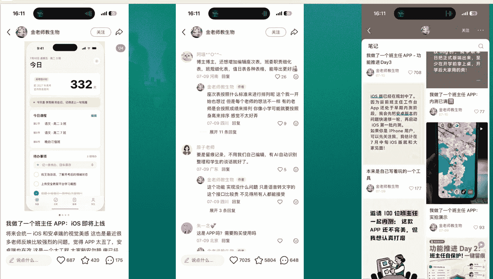

核心心态是强者不惧平台规则——门槛提高反而是好事，把很多人挡在门外，你能卖就卖得出去。

### 账号选择

另外关于账号选择：用个人号拿自然流量。一旦升级为蓝 V，小红书就认定你有付费需求，基本不给自然流量（蓝 V 只能靠聚光、薯条投流）。蓝 V 的优势是能开私信通获客，但现在金 V（行家）也可以。

很多人是企业店只发商品、不发笔记，用个人号带橱窗功能发笔记拿自然流量，核心是强者不惧平台规则，门槛提高反而是好事——把很多人挡在门外，口子还会再开的。

### 内容比产品更重要

这里还有一个贯穿全局的核心观点要单独拎出来：在小红书上，内容比产品更重要，出单的第一位不是产品，而是内容、选题、把用户的需求勾起来。同样是卖一个知识库，会不会写内容、会不会起标题、会不会做选题，直接决定了卖 10 单还是卖 1000 单。

小红书的产品在淘宝上都卖不出去，因为它是为内容而生的、是内容催生出来的东西。知识库在淘宝很难卖，但在小红书卖了 1000 多万——因为小红书用户更买单那些理念，所以一定要做好内容，这也是为什么后面有一整套长文 Skill、笔记 Skill 内容工具的原因。

## 5.2 从 0 到 1 再到 10：矩阵、人力杠杆、护城河

### 多开店做矩阵

0 到 1 的放大核心不是死磕一个账号，而是多开店做矩阵。想赚 100 万，不是从一个账号赚 100 万，而是一个账号赚 10 万、开 10 个账号，走量。

案例文学大佬做课件：英语课件跑通后，卖语文、卖历史、卖主题班会，每个学科开一家店，最后 100 万是 10 个店构成的，这样也规避了把鸡蛋放一个篮子的风险（小红书封店就完了）。

有了 0 到 1 的方法论，下一步就是快速复制。不同店不要卖一样的东西——学科就是语文卖语文、数学卖数学；引流品则可以多店卖同一商品（如 100 个不上班的出路是同一家公司多店做低转高，笔记极具争议性，比如孙宇晨：不敢承担风险是穷人最大的病；孙宇晨：低于 50 万的投资对你毫无意义，底下评论区挂链接，点进去买一毛钱的品，再拉群、三天直播课、最后卖课，这是知识付费的套路）。

### 人力杠杆

人力杠杆是放大的第二个关键。做课件不难，难的是 dirty work，所以把流程写成 SOP，自己只负责选品，把可编辑部分交给兼职。

兼职在 BOSS 直聘搜课件兼职（很多工作室在做矩阵化生意）、小红书找大学生（80—100 块一天，发大字报），甚至跟老师合作做 CPS 分成。想要了解一个行业，最直接的办法是去当他的员工，把别人的做法偷过来——比如郑州帮，不用听课，直接去公司学。劳动力价值现在相对便宜，兼职 80 块一天做 10 个课件，看准方向就去做。

### 护城河：加微信

护城河的核心是加微信。收入不要只局限于前端，尽可能加到对方微信。下单后能看到对方手机号，对方付费了就有基础信任——一年级班主任要不要买二年级课件？他不刷小红书时刷朋友圈，加了微信就能反复触达、洞察新需求。

加微信的由头很多：我是小红书卖家，忘发了一份讲稿，现在补给你；百度网盘文件夹里放加微信任选一个课件；要五星好评（好评能同步到商品笔记促单）。加微信本身是个枯燥但有效的活。

### 投流是放大

投流是放大而不是启动：连单都没出就投流可能跑不出去，出单了再投、正在出单就抓紧投，简单投就行。

更底层的区分是自然流量和商业流：一路走来做的都是自然流量（写出了 1000 多篇自然流量的爆文），商业流就是投流——得先找出你的爆款模型、转化模型，再直接投流（这是郑州帮的打法）。

自然流量是基本功，投流是在这个基本功之上做放大，而不是替代基本功——先靠自然流量验证出什么内容能爆、什么人会买，再把这个已经被验证的爆款模型拿去投流，钱才花得值。

## 5.3 一人公司的商业模型

### 收入来源（八种）

接商单、改简历写指南、做作品集模板、卖虚拟产品、专栏（小报童）、续产品、付费直播，外加一个隐藏角色——自媒体账号既接商单也当 Skill 测试场。

### 收入来源

一人公司的收入来源可以非常丰富，核心是世界上没有白走的路，把每一个积累都变成产品：

- 接商单：广告营销赛道的博主可以接商单，不露脸也能做，有前同事看到后也做了一个，上个月接商单变现了 2 万；
- 改简历、写指南：把行业经验（如广告营销）写成指南、做成简历修改服务；
- 做作品集模板：加很多广告行业求职群，群里大家会把作品集发上去，下载后把关键信息删掉变成作品集模板卖，卖了几百单；
- 卖虚拟产品：比如策划作品集手册只有 6 页卖 29.9 元，在小红书卖了 300 多单，工作时每天额外 300 块收入；
- 专栏（小报童）：把经验写成手册——《小红书创作指北》卖出去 1800 单，《小红书虚拟产品手册》卖出去 800 多单，发售方式是在极客平台（1 万多粉丝）发创始读者，限时特惠价 19.9 元，当天卖出去 180 单，慢慢做到 1800 单；
- 续产品：第一个手册做出微信后拉群、持续给干货，后来续产品手册两天卖了 400 多单、6 万块钱，80% 从群里来；
- 付费直播：每个月一次付费直播，300 多人听，每次都拼命交付。

### 1000 个铁粉

长期经营只需要积累 1000 个铁粉：1000 个铁粉每人每月 19.9 元就是 2 万/月，足够实现财务自由，而且这批人会跟着你一年又一年地买。

核心就是真诚交付、真诚表达，不要再想着套路用户——现在的用户已经不需要被套路了，他们已经看过太多套路，只要认真交付，用户就会持续付费，认为你靠谱，把你当成长期跟的人。很多知识付费同行都很垃圾的时候，你只要认真交付，别人都会为你付费。

### 隐藏角色：测试场

还有一个隐藏的角色值得说：自媒体账号（小红书）既是接商单的收入来源，也是 Skill 的测试场。一个 1.8 万粉的账号，一是用来接商单（前同事看到后也跟着做，上个月变现了 2 万），二是每次做完一个 Skill 就发到小红书上去测，测完再调整，这就是自媒体账号——账号不一定要天天更新，但它能持续帮你验证产品。

所以做 Skill 的人，最好都留一个自己的账号当测试场，这比什么都重要。

## 5.4 一人公司的状态管理

### 物理隔离

一人公司千万不要在家办公，即使有独立卧室、书房也不要，因为人需要明确的物理隔离——家是休息和放松的场，办公室是做事和产出的场，两者一旦混在一起，人就没有了身份的切换，物理隔离才能带来身份上的重置。

在家办公总有一种拧巴感，办着办着就躺沙发上看电视，一看到下午，晚上说累吃个饭，血糖上升就睡觉，睡到半夜又醒、熬夜，周而复始，第二天状态更差，形成恶性循环。

### 办公地点的选择

出去办公要选好地方：附近要有步行能到、有插座的咖啡馆（不要那种社区熟人咖啡馆，会聊成局外人；不要星巴克这种太普通的），杭州推荐 35mm（每个沙发座都有店员、可按铃叫服务员、会明显提醒不要吵闹，适合需要白噪音但不需要噪音的人）。

图书馆也适合，比如之江图书馆（人少、暖气足，冬天写东西很舒服）。还要有散步的地方、健身房、超市，不要在家吃饭、不要点外卖，出去吃。

### 时间安排

时间安排上，有 AI 之后一天工作 4 小时就够，有 AI 之后你工作 8 小时就是对 AI 的不尊重。12 点开始工作到 4 点，然后去骑车、上课，上完课在小区绕圈。

人一定要去没有天花板的地方，创造力才会丰盈起来，太宅思维会被限制住，尤其秋天的杭州（10—11 月）要尽量多去户外。

一个具体的节奏是：上完直播课（通常到晚上 10 点）先在沙发上躺两小时平复兴奋，再出门去西湖骑车——凌晨两点的西湖，是把高强度输出后的亢奋转化为创造力的方式，身弱之人尤其需要这种高输出之后的缓冲，而不是硬扛。

### 多社交多出门

另外要强调多社交、多出门。人一定得出门，多参加线下活动。一个人刚开始起步时，可能觉得参加活动听起来有收获，但对自己这个还没稳定跑通 0 到 1 的小白没啥帮助，于是越参加越少——这其实是错的。

社交和出门本身就是对抗一人公司孤独感和思维僵化的手段，哪怕只是去咖啡馆工作、去数字游民社区坐坐，都比一直闷在家里强。核心还是那句话：得有自己真正的爱好，得出去。

## 六、关键结论 / 行动框架

### 核心结论

- 红海才是新手的机会：需求已被验证，不用教育用户，直接抄作业；创新在最后的一公里。新手最容易犯的错误是先看自己有什么优势再看能做什么，正确顺序是反过来——先看红海里有什么被验证的需求，再把优势插进去。
- AI 用于改造旧需求，不用于凭空创造需求：文字用大模型，图片用图像模型，底层逻辑共通。背诵、课件、单词书、云朵字，全是旧需求，AI 只是把它们重做了一遍、做得更好。
- 做河流型生意，不做暴雨型生意：要前端后端有承接，积累长期资产。流水不争先，争的是滔滔不绝，把虚拟产品当事业做，而不是追单次爆款。
- 虚拟产品 = 基础需求满足 + 体验创新：先用已有东西满足基础需求（比如客户反馈用表格），再做体验上的创新（比如把表格做成个性化网页）。这就是全部虚拟产品的本质。
- Skill 的价值在工作流和结果物，不在内容本身：能接飞书 CLI、能产出 7 万字、能交付飞书文档，这才是它区别于提示词的地方。提示词只停留在线输出，Skill 走向了工作流。
- 产品卖不卖得出去，取决于有没有着力点：让它与我有关，切分到具体场景，做别人听不懂但觉得高级的升维内容。荣格知识库卖不动，荣格社会化指南卖得动——差别就在着力点。
- 完整闭环：评论区商机挖掘 → 指南（做产品）→ 长文 / 笔记（做内容积累 IP）→ 蒸馏对标博主（出选题出产品）。Skill 的边际效应是递增的，一个接一个串起来才值钱。
- 放大靠矩阵 + 人力杠杆 + 加微信护城河，不靠死磕单账号。一个账号赚 10 万、开 10 个店赚 100 万；dirty work 交给兼职；每个下单用户都想办法加微信。
- 执行力是最好的风水：在干中学，真诚交付，长期积累 1000 个铁粉。世界上没有白走的路，每一步都算数。

### 可执行的行动框架

1. 选赛道：去红海里找需求，找有后端承接的河流型生意，不要碰无壁垒的纯测试品。问自己：这个需求是不是已经被市场公认？我的前端有没有后端承接？
2. 找需求：去同行那买考点 / 资料，用 AI 重做（打乱顺序、换版本）；关注教材改版、大模型能力升级（如透明底 PNG 的云朵字）。
3. 挖商机：盯住真正在讨论问题的评论区（不是吵架、不是引流），让商机挖掘 Skill 整理成可做的指南方向，再交给指南 Skill 做产品。
4. 做产品：用指南 Skill 做 2 万字以上的指南，先积累私有上下文（话题、读者、经验、信息源、形式、样本），做完再发 NotebookLM / Image 2 做图文版增值。
5. 做内容：用长文 Skill 写长文（去 AI 味、第三章重点），用笔记 Skill（动态对标库 + 单篇拆解）写笔记。内容比产品更重要，内容催生交易。
6. 蒸馏对标：选与自己品有交集的博主，爬 300 篇（过了 300 社媒助手容易崩），蒸馏出栏目 + know-how + 爆文模型，批量出 100 个选题、100 篇笔记。
7. 放大：跑通后开矩阵店（学科分店）、招兼职写 SOP（自己只选品）、每个下单用户都想办法加微信（由头 + 百度网盘 + 好评）。

### 调研方法清单

- 公众号：了解赛道不看小红书单一渠道，学校官方账号都在公众号；教材改版信息也从公众号获取。
- 评论区：从群众中来到群众中去，评论区是需求的聚集地；用社媒助手盘，找最多评论的帖子，再让 AI 筛有信息增量的。
- YouTube：把优质海外博主内容转译成自己的指南（育儿、减脂、健身等）。

公众号懒人搜索，懒人专属群分享

看视频不用看完，符合眼缘就收藏，靠工作台批量处理。

- 手动筛选优先于自动化爬取：用 AI 爬 500 篇笔记，你根本不知道写的是什么；真正的洞察要靠亲身体验——一线有神明，答案永远在现场（711 创始人《零售的哲学》）。
- 消费者洞察两种方式：数据调研 + 焦点小组访谈（focus group），后者找典型目标用户刨根问底。
- 营销 4P：产品、价格、渠道、推广，看这四个层面即可；多看奢侈品营销、保持好奇（比如餐饮为什么流行板前、为什么要把制作流程呈现给用户）。
- 跟 AI 共创：不知道怎么做 Skill，就反过来问 AI 你认为还能加什么功能，它会告诉你加 SOP、加 QA 问答；把问题抛给它。
- 多读经典：毛选（你打你的我打我的、从群众中来到群众中去）、道德经、金刚经、营销管理、零售的哲学。
- 合理选择模型、控制 token 成本：做 Skill 消耗的 token 是真金白银，现场一次商机挖掘就跑了 58.6K token。做指南 Skill 这类活可以放在 Workbody 这类 agent 平台上跑——Workbody 每天都能领积分（年轻人的鸡蛋，要领），合理分配模型能省下不少钱。

最后落到一句话：执行力就是最好的风水，剩下的就是执行——选好红海里的旧需求，用 Skill 把它产品化，用内容把它推出去，用矩阵和人力杠杆把它放大，用微信把它沉淀下来。世界上没有白走的路，每一步都算数。

————分割线————

看完这篇 SOP，你觉得你懂了。但 90% 的人一到实操就会卡在第一步。

工具和教程只是最低级的壁垒，真正的壁垒是“立刻动手”和“圈层信息差”。

如果你想看全网最新的变现玩法，并且和一群执行力极强的极客一起下场拿结果，欢迎围观我的核心私域：【懒人专属群】。

我们不聊虚的，只做商业闭环的拆解与 AI 效率的压榨。系统内已沉淀 1000+ 跑通的套利实战局。

👉 查阅圈子完整数字资产与上车门槛：

https://lazyso.com/insider/

认同价值、准备好下场干活的，扫码加我微信（lazyhelper1）。

备注：【实操上车】，不闲聊。

