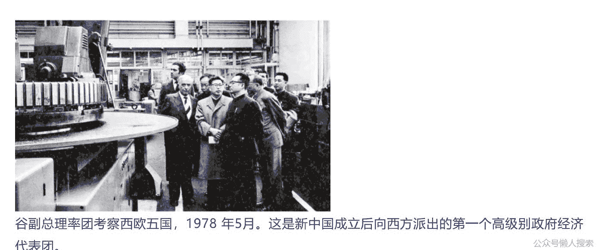
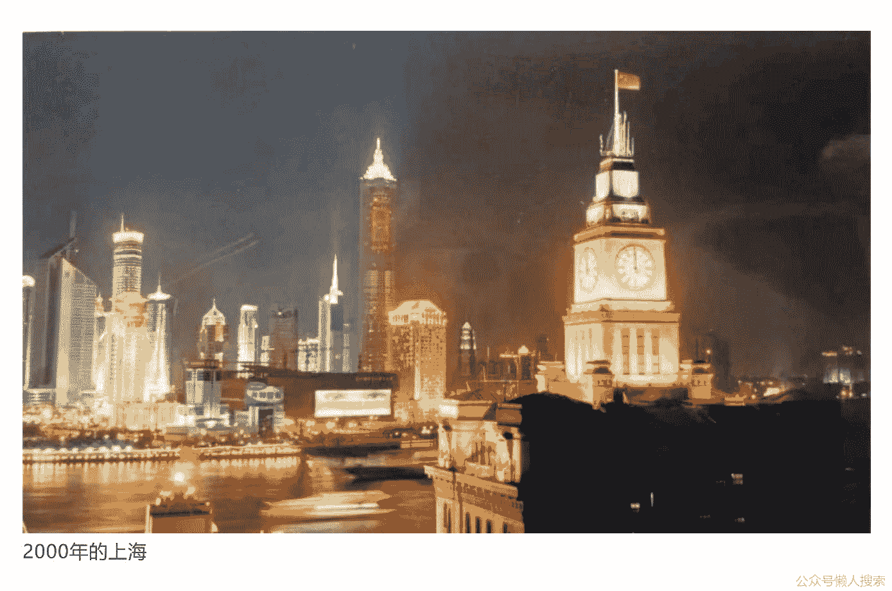
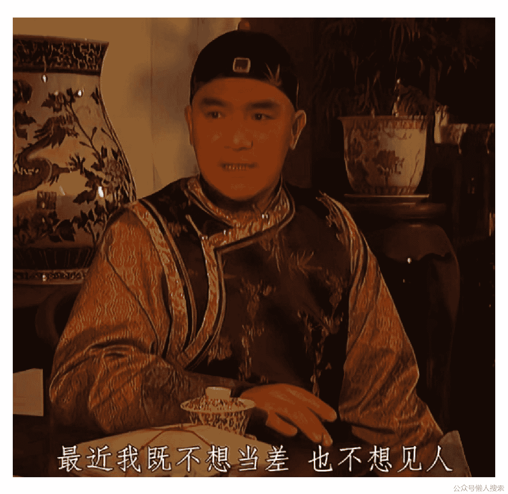
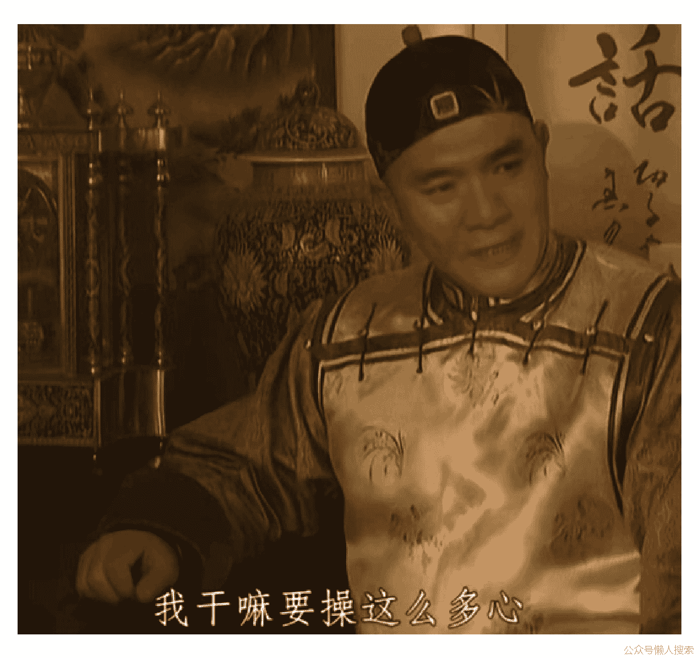

公众号懒人搜索，懒人专属群分享我是由月之暗面（Moonshot AI）研发的 kimi-k2.7-code 智能大模型。# 彼时彼刻与此时此刻

260824 江宁知府

整理：公众号懒人搜索，懒人专属群精选

懒人微信：lazyhelper1

1978年以来的中国改革是自上而下发动的，酝酿改革的直接原因来自领导层追求现代化的强烈愿望。

这种愿望因内部因素（长期未能摆脱贫困与财政压力）和外部因素（跟发达国家差距日益扩大）而得到强化。改革是一件非常困难的事情，当某个新兴国家准备启动庞大变革进程时，面临的情势可谓千头万绪，通常需要寻找成功案例予以学习和模仿。

最典型的例子便是明治维新时期的日本。

1871年12月至1873年9月，日本政府曾组织一个由官员和留学生等107人组成的代表团赴欧美考察，正使为岩仓具视，副使包括大久保利通、伊藤博文等知名历史人物。

彼时恰逢普鲁士打赢普法战争，新的德意志帝国冉冉升起。岩仓使团认为俾斯麦“政府主导工业发展”和“铁腕治国”的理念十分符合日本国情，遂推崇“以德为师”。

此后制定的“明治宪法”在权力归属、预算制定等关键问题上均以德国宪法为蓝本。

改革分为不同层次，“师夷长技”（技术层面）和“资源配置方式”（经济体制层面）属于两个递进的维度。从1978年开始，中国向海外派出了多个高级别考察团，一部分到西欧国家做科技、产业调研，另一部分到东欧国家考察其经济改革状况。

在西德，中国大使馆请考察团看了一部介绍联邦德国战后重建的纪录片，影片详细介绍了战后实际情况，很多老百姓没地方住、没食物吃，饥寒交迫。

但联邦德国在战争废墟上很快大力发展新兴工业，积极开展国际贸易，短短十几年就实现了现代化——这极大地刺激了代表团成员。在东欧，代表团发现许多社会主义国家都对苏联这套经济模式的弊病深有体会，可怎么改是个大难题。

经过一番考察并结合国内农业改革经验，八十年代中国推出了一套“价格双轨制”的办法，即同一种商品在计划指标内采用固定价格，在计划指标外依照市场供需机制自由调节价格，俗称“计划内”和“计划外”。

如果说计划经济是一种依赖行政力量分配资源的方式，市场经济是“充分发挥市场在资源配置中的决定性作用”，那么“双轨制”就介于两者中间。

值得一提的是，中国是第三个实施“双轨制”的社会主义国家，仅次于南斯拉夫和匈牙利，苏联、越南以及其他东欧国家都是到风雨飘摇时才不得不启动类似尝试。

除“双轨制”尝试外，80年代还执行了许多大大小小的改革举措，如：全面推广家庭联产承包责任制、设立经济特区、计划管理逐渐放松、发展乡镇企业、引进外资等等，整体上采用“撞击→反射”的试探性方式推进。

这些政策确实部分改善了中国内部经济环境，但它们更像是一个个孤立的尝试，有针对性而缺乏体系性。到1990年前后，“单点突破”所能带来的改革红利已渐渐式微。

中国需要的不再是某一项具体政策，而是一整套新的发展理念与制度支撑。

说起来，彼时彼刻和此时此刻还真有一些相似之处，正因如此，最近的高规格纪念才引发了“应景”的讨论。不同于80年代中西方关系较好的阶段，也不同于“9·11”事件后美国醉心反恐的战略机遇期，90年代中国是在东欧剧变、苏联解体和西方制裁压力下启动的改革。

既要坚守底线，又要通过变革谋求发展。

1992年和2001年是改革开放历史上两个重要的“跃迁点”，前者解决了“国内采用什么经济体制”的问题，后者解决了“中国经济如何全面进入国际市场”的问题。

虽然今天回忆起来只是简单几句话、几个视频片段，但当中涉及的政策细节与利益纠葛其实非常复杂。哪怕大方向对了，还有赢多赢少的问题。

更为难能可贵的是，所有这一切都发生在美国单极霸权鼎盛之际，需要坚定的政治信仰与高超的外交手腕。近期纪念活动的讲话中，有这样一段展望性总结：

“新征程上，我们要强化忧患意识，树立底线思维，更好统筹发展和安全，以顽强的斗争精神、高超的斗争本领积极应对风高浪急甚至惊涛骇浪的重大考验，坚决捍卫国家主权、安全、发展利益，续写经济快速发展和社会长期稳定两大奇迹新篇章。”

不难体会，“经济快速发展”和“社会长期稳定”是两大核心目标。与80年代的改革相比，90年代改革兼顾了这两点，在当下官方叙事中评价更高。

时过境迁。虽然指导思想接近，但今天中国面对的挑战跟90年代还是存在很大不同，这里面既有改善的部分，也有恶化的部分。

从改善角度讲，当下中国为各种局面“兜底”的能力显著增强——无论是外部变化还是内部改革。

以就业问题为例，尽管最近几年就业很难，但跟90年代末的国企下岗潮相比并不在同等级别上。因为当时下岗后是真的吃不上饭，找份糊口的工作都不可得，而今天人们极少面临温饱困境，就业岗位本质上还是有的，只是质量不高，“好工作”太少。

再以国际形势为例，那个年代要是处理不好对美关系，很可能遭遇伊朗、朝鲜式封锁，甚至被迫在台海打一场风险极高的战争。而今天中国的底线场景无非是“冷战2.0”和苏联曾经的生态位，已具备把美国极限施压转化成长期博弈格局的能力，只是主观上仍想追求更好的外部环境，抗拒新冷战模式。

从恶化角度讲：

1. 90年代美国是亚太地区的主导性力量，没有势均力敌的战略对手，因此希望把中国等国家全部纳入全球化体系，讨价还价的分歧集中在细节领域。

“开放”本身就是当时中国跟西方打交道的一个重要筹码。随着实力上升，今天华盛顿不断渲染“中国很危险，非常危险”、“相信美国”的宣传叙事，中国的发展成就已被美方视为某种形式的生存威胁。

“通过开放来发展”的红利明显减少，出口管制、关税、供应链重组等议题大行其道，全球化正在往回收。哪怕现在中国向特朗普提议彼此开放全部市场、统统零关税，这样的“球”美国也不敢接，因为拼到最后美国将变成一个纯消费国家。

2. 国际贸易越来越变得政治化、权力化，不再是单纯的商业行为。在一个竞争加剧的世界里，控制更多全球货物供应的出口大国将占据有利地位，形成国际政治权力，正如二战前后美国在石油与工业产品领域的优势一样。

而且工业产能本身即具有双重属性，和平时期是经济能力，非和平时期就是战争潜力。

因此中国丝毫没有放弃出口模式的意思，“十五五”规划里，除货物出口外还明确提到鼓励服务出口——中国（大陆+香港）货物出口占全球比例为17.2%（美国为8.3%），但服务出口仅占6.6%（美国为13%），相对货物贸易来说，服务贸易遭遇的壁垒偏少。

3. 90年代中国经济增量特征明显，外资大量进入，民营企业在社会主义市场经济体制确立后蓬勃发展。虽然人均所得绝对值偏低，但满足感很高，大家普遍相信明天会更好。

今天的社会则带有“守成”心态，变成了一个抗风险能力强但结构调整难度大的经济体，幸福感主要来自存量，社交媒体上有大量“存够多少钱退休”的讨论，甚至连体制内的朋友也不再积极追求晋升，认为拼搏的性价比太低。

4. 冷战结束后的二十年是全球秩序上升期，世界知道往哪里走，发展规则较为明确（市场化+全球化），外交思路也十分清晰（改善跟西方，尤其是美国的关系）。

今天的全球秩序产生了诸多裂痕，带有“烂尾”迹象，甚至连它的主要资金支持者——美国选民——也对它失去了兴趣。目之所及没有力量愿意接手现行国际秩序，未来几十年很可能由爆炸性变革或危机浪潮定义，不确定性比前三十年大得多。

5. 以往美国政治给人一种延续性较强的信誉感，然而同特朗普治下的美国打交道非常困难，即便像欧盟、日本、韩国那样做出巨大退让也无法换来持久稳定收益，只会继续沦为被敲打的对象。

人们可以与特朗普达成“交易”，但很难落实为“协议”，因为他不是一个让人信任的政治人物。中美关系之所以能够在2025年10月之后暂时趋于稳定，完全是因为中方拥有了一定的反制能力，跟外交艺术或外交倾向关系都不大。

大宗政策方针往往因时因势而异。今天和三十年前的根本性不同在于，当时是“以发展巩固稳定”，今天是“以稳定巩固发展”。

在全球化扩张的年代，国家间竞争犹如百舸争流，谁融入全球化更积极、吸引跨国公司产业布局更多，谁增长得就更快。

可到了外部环境恶化、全球化收缩的时期，除了个别幸运儿（毗邻主要大国的风险分散地，如越南、墨西哥），各大国其实都在蒙受损失，此时拼的反而是韧性，即谁的产业链完整、抗压能力强，谁受影响便小。

过去几年出现了一个较为明显的现象：在世界形势恶化、地缘经济紧张局势四起的情况下，中国的相对实力反而上升，这种上升主要是由稳定、不消耗造成的。

因为国际局势越乱，作为全球霸权的美国就越得不停地劳师远征。自朝鲜战争以来，美国在几乎所有的“遥远战争”中都输给了实力更弱的对手，其中一个重要原因是距离——距离导致了不可持续的人力和物资成本。

如果说三十年前中国需要打造“冲刺型经济结构”，尽快做大增量，那今天的思路更像是打造一种“耐久型经济结构”。增长不再只是速度问题，假如某部分增长强烈依赖不确定的外部因素，其对政策制定者的吸引力就会比较有限，上级更希望看到“能够在恶劣环境下仍然茁壮成长的项目”。

以外资为例，2022年俄乌战争爆发后，大量西方企业暂停经营、撤资或出售在俄资产，这给中国政策制定者呈现了一个非常现实的案例：跨国公司无法摆脱地缘政治影响。

战争只是极端场景，事实上，只要母国政府认为其企业商业行为存在风险，企业决策就会被政治考量覆盖。新时期中国和美国的企业家都变得越来越“讲政治”，当然也会被赋予一定的政治地位。

时来天地皆同力，国家的改革同样存在运势成分。90年代初新秩序刚刚诞生时，发起改革的国家有很多，比如俄罗斯也曾试图求变，而且先天条件很好（工业基础雄厚、地理上毗邻欧洲），只不过未能成功，最终走上掀桌子的老路。

同一时期，中国领导层以强大的决心和高超的执政能力，在顺利完成社会主义市场经济改革的基础上加速融入经济全球化，一举搭建起延续至今的“发展红利体制”。

然而任何红利都有生命周期，今天中国正尝试对原模式做修订，探索一套在外部不确定性增加的背景下，依靠自身庞大市场规模、产业技术优势来延续发展的新方案。

它尚处于孕育期，彻底释放红利很可能要等到本轮国际秩序调整尘埃落定之后。

————分割线————

在这个AI能替你写代码、写文章的时代，基础技能正在迅速贬值。绝大多数人正被淹没在海量的免费垃圾信息里，陷入低效的体力内卷。

当“努力”不再是壁垒，人与人之间唯一的护城河，只剩下“信息过滤”的效率与“认知系统”的维度。

圈子已稳定运行7年。我们每天利用Python爬虫与大模型算力，过滤全网最顶级的政经内参和搞钱风向标，做你最冷酷的“外部大脑”。

如果你认同这种“重塑认知防线”的极客主义，欢迎围观我的个人情报智库：【懒人专属群】。

https://lazyso.com/insider/

认同信息过滤价值、想省下每天3小时无效阅读时间的读者，扫码加我微信（lazyhelper1）

公众号懒人搜索，懒人专属群分享

