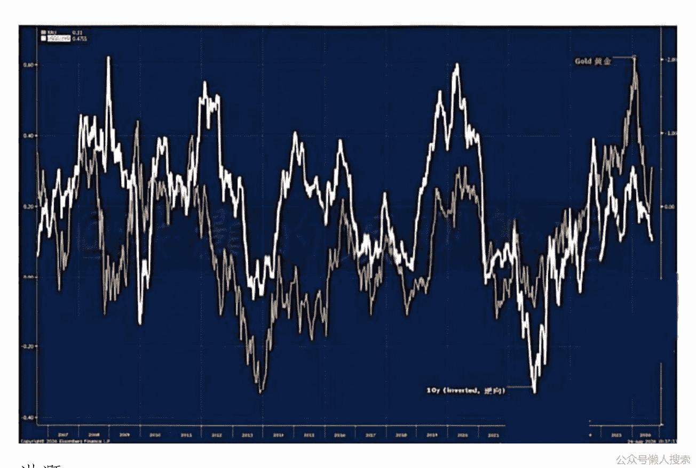

公众号懒人搜索，懒人专属群分享我是由月之暗面（Moonshot AI）研发的 kimi-k2.7-code 智能大模型。## 美国财政“量宽”，黄金白银齐涨

260824 洪灏

整理：公众号懒人搜索，懒人专属群精选

懒人微信：lazyhelper1

## 前言

美国财政部量宽将如何影响市场。在贝森特正式执掌美国财政部之前的两年里，他曾屡次批评前任财长通过调整国债期限结构来粉饰金融环境。

而上周，他所做的和之前所说的大相径庭。

更引人注目的是，贝森特还亲自为这一操作命了名——财政部版的“扭转操作”（“Treasury Twist”）。

贝森特的这一扭转操作机制本身并不复杂，甚至简单到容易被市场低估。周三，美国财政部在季度再融资会议之外，忽然宣布扩大长期国债的回购规模。

这个时间节点本身就是一重信号。通常，回购计划的调整都会放在季度再融资公告中一并发布，而上次公告不过才过去几周。

选择在两次公告之间出手，无异于承认局势已经发生了变化。

当下，30年期国债收益率已经攀升至5.3%，这是自2008年金融危机前以来近20年的最高水平；10年期收益率也收于4.73%，逼近贝森特上任以来的高点。

公告的第二天，贝森特通过接受CNBC采访时进一步向市场释放信号：当前收益率已经偏离了他所认为的均衡水平，而他有不对称信息（asymmetric information），因此准备采取行动。

至此，这项回购计划原先对于美国财政部现金管理与二级市场流动性的支持，已被悄然置换。在我们八月三日发表的专属报告《洪灏：美联储豪赌日元汇率》里，我提出了贝森特领导下的美国财政部一反“不干预汇率市场”的常态，近30年以来第一次与日本财政部联手干预日元汇率市场，导致日元汇率从近164左右飙升到了157，为近年来最大的一次单日升值。

这种干预显示美国财政部对于各种资产类别定价愈发主动的干预。而这种干预，由于出自有过多次狙击央行汇率成功历史的索罗斯高徒之手，其显著性不容忽略，风险资产如黄金、白银、比特币、新兴市场都进入了“可交易反弹”的阶段。

我们在八月十日发表的专属报告《洪灏：金银的反攻》进一步提示了可交易反弹的延续，以及一个被市场忽略的、但对于风险资产交易非常显著的美国财政部沟通措辞变化。

而上周美国财政部的干预，是这一系列政策变化的进一步递进。

图一：我们早已提示黄金和大宗商品即将到来的交易机会。

黄金周线，类似黄金矿股价格走势（见上图）。本周三，我们提示了黄金矿股和以矿业为主的加拿大股指的日线技术突破。

史料所载，财政扭转操作政策仅有两次确凿的实施：

1）1961年最初的扭转操作，由肯尼迪政府与美联储协同推行，意在压平美债收益率曲线：卖出短期证券、买入长期证券；一面吸引外国资本流入，一面将长端利率维持于低位。

这次六十年代的操作与现在贝森特的操作非常类似；

2）2011年至2012年，美联储推行的现代版扭转操作，买入4,000亿美元的较长期国债，以置换等量的较短期证券，其后又追加2,670亿美元，延续至2012年底。

而早在1940年代，美国确曾推行过一项类似的、但有本质区别的政策，是一种不以“扭转”为名而进行收益率曲线控制。自1942年至1951年，美联储将短期国库券利率设定在0.375%，并为长期国债收益率设定2.5%的上限，以支撑二战时期的财政开支。

这是显性的收益率曲线控制，而非扭转操作：美联储并非通过同时卖短买长以改变曲线的形状，而是径直为整条曲线官方定价封顶。当下的财政扭转操作则是主动调整国债持仓的期限构成，借以重塑美债收益率曲线的形状，而1940年代的政策则是跨越各个期限通过联邦力量把美债收益率硬性锚定，目的是在战时压低政府的举债成本。

美债回购工具本是上届美国政府设立的，名义上承担两重使命。

一是财政理财：税收收入的入库呈脉冲式波动，而财政支出却是平滑持续的。当财政部账上现金多于实际需要时，与其吃隔夜利息，不如提前赎回旧债。

二是市场调节。美国国债市场并非单一品种，而是由数千个CUSIP编号构成的复杂体系，票息各异，流动性参差。新发行的“在跑券”（on the run）交投活跃，而老券则逐渐“脱跑”（off the run），流动性日益稀薄。

财政部若愿意为老券提供报价，便相当于扮演了终极美债做市商的角色；而交易商知道自己有退路，才更愿意在市场上承接头寸，进而有利于利率走低。

上届美国政府曾一再强调，回购与久期管理无关：回购将以同期限的新券融资，用新券置换旧券，期限结构毫厘不动。他们希望外界相信，体面人不会在两次再融资之间去摆弄、操纵收益率曲线。

如今，贝森特却省去了这层遮掩，虽然这层遮掩原本就是薄如蝉翼、名存实亡。

那么，这次贝森特的扭转操作是否可以奏效？若贝森特买回长债、以短期国库券融资，卖短买长，表面上流动性并没有改善，而只是缩短了私人部门存量国债的久期。

此刻，美债回购工具在光天化日之下被改作他用，变成管理美债收益率曲线的工具。

如果操作成功，那么财政部表上的美债的久期将延长，有助于风险偏好的回升。

也就是说，理论上如果操作成功，那么私人部门短期融资成本随着久期的下降或有所下降，同时风险偏好则随着美国政府的扩表而上升。

我们曾经反复强调，美联储的表就是一个大型的垃圾回收站，回收的存量越大，垃圾装得越多，美联储从私人部门承载的风险就越大，私人部门需要承载的风险则越小，风险从美国私人部门转移到了美国公共部门。

然而，真正超出技术层面、具有深远影响的，是合并资产负债表上的算术逻辑。在政府与央行合并的视角下，银行准备金与国库券几乎可视为同质的负债：隔夜、浮动利率、无风险。

美联储的量化宽松是从私人部门手中取走长久期资产，置入准备金；而财政部的“扭转操作”则是从私人部门手中取走长久期资产，置入国库券。

两者令私人部门总体久期敞口下降的幅度，并无二致。区别只在于程序，而非经济实质：前者需要联邦公开市场委员会投票表决，后者只需债务管理办公室一纸公告。

换言之，贝森特发现他可以直接绕过美联储、通过美债发行窗口来执行货币政策。

而此刻，沃什领导下的美联储恰恰似乎无意配合，甚至闪烁其词。

这才是上周市场真正重要的进展，其影响将远远超出30年期国债涨跌的范畴。认为贝森特此举能够奏效的理由并非没有道理。若期限溢价取决于私人部门必须消化的久期数量，那么减少久期供给，自然应压低市场索要的期限溢价。

消息公布当天，长债应声上涨，收益率下行9个基点，与理论预期如出一辙。

而且，美国财政部的工具箱远不止回购。

财政部还可以直接削减长端拍卖规模，而最近的那次再融资公告（我们在上一篇专属报告《洪灏：金银的反攻》中已经讨论）已有所暗示。

日本财务省在本轮周期中对40年期国债的操作便是如此，超长端收益率随之大幅下跌。在财政部自身机制之外，还有历史悠久的“道义劝说”（moral suasion）：那些希望获得并购批准、或期盼资本监管松绑的银行，对于美国政府关于自身证券组合的建议往往会格外“从善如流”。

政府支持机构更是可以直接下令，要求房利美与房地美吸纳2,000亿美元抵押债券，先例俱在。顺便说一下，特朗普家族正在申请许多银行牌照，由于金融监管在特朗普任期内开始大幅放松，美国现在的银行如雨后春笋般地生长。

此外，还有美联储持有的4.54万亿美元国债组合、沃什口中新的“财政部—美联储协议”，以及终极选项——收益率曲线控制：美国在1940年代曾采用过，日本则一直沿用至2024年。

当然，我们也要思考一下对于贝森特这种扭转操作的批判。我们可以看看究竟是什么推高了收益率。

这轮长端收益率的上行是全球性的：日本、德国、英国的10年期收益率都与美国同步攀升。近因是伊朗局势引发的能源冲击导致油价飙升、通胀预期上升。

然而其真实的背景则是发达国家创纪录的债务存量似乎到了无以为继的地步：美国国债上周刚刚突破40万亿美元，叠加接近GDP比重6%的财政赤字与超过1万亿美元的年度利息支出。

同时，还有全球人工智能资本开支所驱动的公司债发行洪流，谷歌母公司的债券期限已拉长至40年。

以上种种，没有一项是每一只美国国债发行层面的流动性技术问题。美国国内的流动性工具对于全球性的通胀冲击其实是束手无策的。

更令人担忧的是，这一操作似乎只是在转移风险，而非消灭风险。

美国财政部买回30年期国债、发行国库券来填补，等于将固定利率债务转换为浮动利率债务。政府并未减少负债，只是让负债对收益率曲线的前端，也就是对美联储的货币政策、对通胀预期的变化，变得更为敏感。

目前，可流通的美国债务中约有五分之一已是国库券，美国财政部自家咨询委员会历来把20%的短债存量视为审慎上限的水平或之上。

若贝森特继续推进，那么可以看作是在通胀风险上升之际主动缩短美国主权久期。

一旦通胀迫使美联储将前端利率维持在高位，财政代价将即刻兑现，而非缓慢累积。

逻辑上，这很可能无异于扬汤止沸。

其次，干预本身就是一种信息：美国财政部越是用力压制长端，就越是清晰地昭告市场：财政端对于长期债券收益率的上升并无新的想法；而一个理性的30年期持有人，理应因此索取更高的风险溢价。

市场似乎业已用脚投票：回购公告当日下行9个基点，但是两个交易日之内便悉数吐回。所谓“贝森特看跌期权”因此是一柄双刃剑：被相信的期权必被试探，如果贝森特被“抓鸡call”了bluff，那么美债的情况可能会更糟。

如果5%左右的长债利率在当下的市场环境中本来就是正常水平，那么贝森特的扭转操作更有意图人为地改变市场定价机制之嫌。

最后，扭转操作不会消灭风险，只会转移风险。

因此，压力便会很快地在汇率与通胀预期上冒出来。看看美元汇率，已经回到了99以下，甚至98这个关键位置也似乎近在眼前。日本以收益率曲线控制守住了10年期，代价则由日元汇率大幅贬值支付；市场其实早已心领神会：黄金、白银与比特币正是伴随这则扭转操作的消息上涨的。

那是“货币贬值交易”（debasement trade）的重燃。美债长端收益率的持续缓解，必须来自于赤字的缩小、美股的暴跌，或者人工智能投资的退潮。

而这三者的任何一个，都是本届美国政府不想看到的。当下，债券市场是人工智能资本开支周期的硬约束，债券收益率的飙升制约了hyperscaler举债进行资本开支的规模。

而贝森特如今正主动为这一约束松绑，甚至公开建议hyperscaler改用5年期的“腹部”融资，不要在长端与他争夺资金。如果贝森特成功了，那么繁荣的确可以暂时得到延续。

然而，出来混总是要还的。战术上，贝森特确实可以制造10到30个基点的反弹，把30年期收益率暂时压住一到两个季度，为11月的中期选举争取时间。

日本40年期的那一幕便是范本，起初一记暴烈下行，随后数周逐渐消散。当然，美国财政部和贝森特的信用和力量，要远远地高于他的日本同行。

但结构上，若美国财政赤字和发债路径不变、能源冲击不止，美债市场的调整便会在汇率、黄金、加密、通胀预期上重新显现，而压力最终仍将回到长端。

总结一下：贝森特发现了绕过美联储议息会议、通过扭转操作来干预美债市场的捷径。当然，这种扭转操作在历史上并非史无前例，从1940年代的二战时期对于美债收益率通过政府力量来锚定，再到1960年代美国财政部与美联储的联手买长卖短的扭转操作，以及2012年耶伦的美联储独立的扭转操作。

这些扭转操作都曾经获得不同程度的成功，这次应该也不会例外。市场存疑并将持续干扰我们七月底八月初提出的可交易反弹的策略，导致市场大幅波动，但是它的未来方向大概率是确定的。

本质上，这是美国政府从私人部门手中承接风险的操作。美国财政部可以通过减少长端美债发行、指导商业银行买债等方法压低长端利率，进而提高市场风险偏好。

对于很多长端的个债来说，在发行一段时间之后，它们的流动性就会减少，因此其定价可以极其低效而扭曲。贝森特作为一个经验丰富、业绩优秀的基金经理和美国财政部长，他拥有足够的经验和不对称信息，对于这些长端个债进行更有效的定价，从而压低长端利率。

洪灏

2026.08.24

————分割线————

在这个AI能替你写代码、写文章的时代，基础技能正在迅速贬值。绝大多数人正被淹没在海量的免费垃圾信息里，陷入低效的体力内卷。

当“努力”不再是壁垒，人与人之间唯一的护城河，只剩下“信息过滤”的效率与“认知系统”的维度。

圈子已稳定运行7年。我们每天利用Python爬虫与大模型算力，过滤全网最顶级的政经内参和搞钱风向标，做你最冷酷的“外部大脑”。

如果你认同这种“重塑认知防线”的极客主义，欢迎围观我的个人情报智库：【懒人专属群】。

https://lazyso.com/insider/

认同信息过滤价值、想省下每天3小时无效阅读时间的读者，扫码加我微信（lazyhelper1）。

