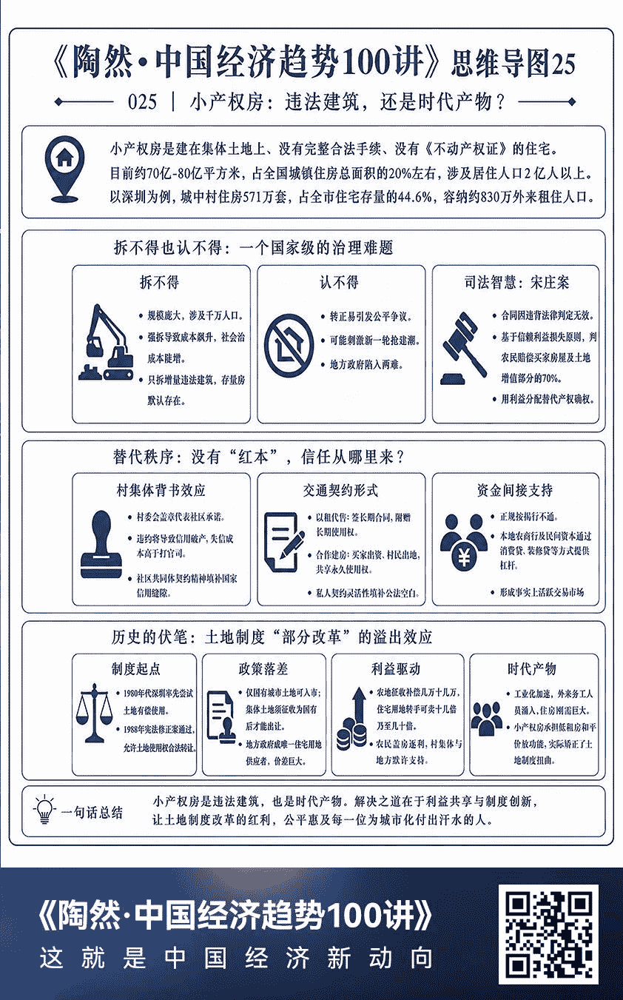

## 小产权房：违法建筑，还是时代产物？

260827

整理：公众号懒人搜索，懒人专属群精选

懒人微信：lazyhelper1

本文选自《中国经济趋势100讲》第25期，完整的课程在专属群内连载中。

上一讲我们讨论了结婚是否一定要买房的话题。今天，我们切换视角，聊一个大家耳熟能详却又始终处境模糊的事物——小产权房。

如果你去过北京昌平、房山、通州的近郊村镇，或是天津武清的各个街镇，或者广州、东莞的诸多镇区，就会发现：数以十万、百万计的外来务工者与城市新市民，长期居住在一类法律地位十分尴尬的住房中，这就是大众常说的“小产权房”。

“小产权房”并非严格的法律概念，而是民间约定俗成的称谓。它指的是建造在集体土地上，未办理完整的国有土地出让与正规报建手续，无法取得国家统一的《不动产权证》，因此不受完整法律保护的住宅。因为没有国家颁发的“红本”房产证，只有乡镇或村委会出具的证明，故而被称为“小产权”。

含AI生成

根据多家研究机构的估算，2020年前后，我国小产权房总面积约70亿—80亿平方米，占全国城镇住房总面积的20%左右，涉及的居住人口高达2亿人以上，是中国住房体系中不可忽视的重要组成部分。

这一现象在珠三角地区尤为突出。以深圳为例，截至2025年底，全市城中村住房达571万套，占全市住宅存量的44.6%，容纳约830万外来租住人口，占到全市常住人口的一半以上。

那么，小产权房为何能发展到如此规模？在法律的灰色地带，它依靠什么支撑起数万亿级的资产交易？更关键的是，面对这一治理难题，如何才能找到多方共赢的破局路径？

## 历史的伏笔：土地制度“部分改革”的溢出效应

要理解小产权房，首先要理清它的成因。

为什么地理位置相近的两块土地，城市国有土地与农村集体土地的价格会相差十几倍甚至几十倍？

答案要追溯到四十年前那场未完全走完的土地制度改革。

故事始于1980年代的深圳。当时城市建设急需土地，但宪法明确规定土地不得买卖。为打破僵局，深圳率先探索土地有偿使用制度。1988年宪法修正案正式通过，明确土地使用权可以依法转让。

这本是重大的制度突破，但后续的法律细化却留下了关键落差：只有国有土地可以进入住宅用地一级交易市场；农村集体土地必须先经政府征收为国有，才能作为住宅用地出让。

在这一制度设计下，地方政府成为住宅用地唯一的供应主体。一亩农地，征收时的补偿仅几万、十几万元，转手作为住宅用地出让，就能卖出十几倍乃至几十倍的价格。

如此巨大的价差，正是农民与村集体建设小产权房的直接动力。小产权房的出现，本质上是城郊农民和村集体主动参与土地增值收益分配的一种自发选择。

与此同时，工业化进程提速，大量外来务工人员涌入城市。正规商品房因住宅用地供应受限而价格高企，当年的保障房体系又基本空白。千万级人口的居住刚需，由谁来承接？

本地村集体和村民敏锐地捕捉到了这个缺口：法律不允许直接卖地，就在自家宅基地与集体建设用地上“种房子”。农民和村集体获得了稳定收益，基层也靠低成本住房留住了劳动力与人口，一个复杂的利益格局就此形成。

从更深层来看，尽管不符合现行法规，但小产权房在特定历史阶段，切实解决了大量城市外来人口的低成本居住问题。试想，如果没有城中村海量的小产权房，珠三角数千万外来务工者的居住成本会大幅上升，企业用工成本也会随之推高。

可以说，小产权房本质上是人口流入地的农民与村集体，对城乡二元土地制度扭曲的一种自发矫正。在特定的历史窗口期，它实际承担了我国城镇化进程中长期缺位的廉租房、平价房的功能。

## 替代秩序：没有“红本”，信任从哪里来？

主流经济学观点认为，缺乏正式产权保护的市场难以持续运转。秘鲁经济学家德·索托就曾提出经典论断：没有合法产权证的资产是“死资本”，交易只能局限在熟人社会内部，无法实现大规模流通。

但在中国，小产权房的交易不仅异常活跃，还吸引了大量互不相识的异地投资者。他们愿意拿出几十万、上百万资金，换取一张仅盖有村委会公章的纸质证明。

没有法律强制力的保障，陌生人之间的交易是如何达成的？

有意思的是，中国基层社会演化出了一套精密的“替代性制度秩序”。

首先是村集体的信用背书。

虽然国家层面不予认可，但在村庄这个熟人社会中，村委会掌握着实际的管理权与资源调配权。交易发生时，村委会在合同上加盖公章，对买家而言，这个印章就代表了社区实际控制者的承诺与认可。

更关键的是，如果村民违约毁约，其在村内的信用会彻底破产，后续无人愿意与之往来。这种社区层面的失信成本，往往比诉讼后果更让村民忌惮。基于社区共同体的契约精神，在特定环境中有效填补了正式制度的缝隙。

其次，基层衍生出多种处于法律灰色地带的变通契约形式。

比如“以租代售”：签订一份20年的正式租赁合同，再约定附赠20年使用权，实际接近长期使用权益；还有的签订“合作建房协议”，买家出资、村民出地，约定共同享有永久使用权。

这些看似粗糙的法律文书，实则是基层社会的制度创造性转化——用私人契约的灵活性，填补了公法管制的空白。

最后，资金也通过间接渠道流入这个市场。

正规住房按揭无法办理，但本地农商行与民间资本，会通过消费贷、装修贷等形式，变相为灰色市场提供金融杠杆支持。

于是形成了一个奇特的现象：尽管法律大门紧闭，但在社区信用、民间契约与基层利益同盟的共同支撑下，小产权房依然形成了事实上的交易市场。

## 拆不得也认不得：一个国家级的治理难题

面对规模如此庞大的小产权房灰色资产，地方政府长期陷入两难境地：拆不得，也认不得，始终处于模糊处置的状态。

先说说为什么“拆不得”。

以深圳为例，小产权房占全市总建筑面积近半，承载着上千万人口的居住需求。大规模强拆会直接推高城市居住与运营成本，也会带来巨大的社会治理压力。

因此在现实中，政府偶尔拆除几栋正在抢建的新增违建，更多是传递“严控增量”的威慑信号；面对海量存量住房，则只能采取默认其存在的务实策略。

再说说为什么“认不得”。

如果政府直接宣布小产权房全部转正，会引发一系列连锁问题：对花高价购置正规商品房的市民是否公平？更关键的是，处置不当极易引发新一轮抢建潮，让管控彻底失效。

这种困境也传导到了司法领域。最典型的案例就是当年备受关注的北京宋庄画家村案。一位村民将房屋卖给了画家，数年后房价大幅上涨，村民反悔起诉，要求判定买卖合同无效、收回房屋。

此时法院面临两难：判合同有效，违背土地管理法；判合同无效，又有违诚实信用原则。

最终，法院给出了极具智慧的折中判决：首先认定房屋买卖合同因违反法律规定而无效，守住了法律的形式底线；同时基于“信赖利益损失”原则，判定卖房村民需向买家赔偿房屋及土地增值部分的70%。

这种“三七分成”的利益调节方式，没有突破现有法律框架完成产权确权，而是通过经济补偿平衡了买卖双方的得失。既坚守了土地法规，也充分考量了购房者的长期居住投入与信赖损失。

这套折中处置思路，也为后续小产权房相关制度的完善，留下了可借鉴的实践样本。

## 从堵到疏：三条有可能走通的路

既然简单拆除与直接转正都非可行出路，小产权房的未来究竟在何方？

从各地实践探索来看，核心思路可以概括为八个字：利益共享、产权分置。

目前有三条路径正在逐步浮现：

### 第一，深圳模式：通过城市更新实现存量转化

政府引入开发商对城中村进行统筹拆除重建。开发商配套建设公益设施以换取商品房开发指标，村民通过回迁安置取得正规不动产权证。

这种模式本质是做大蛋糕后重新分配收益，在发展过程中完成产权的合法化转换。但也要看到，深圳模式门槛高、周期长、资金需求大，难以在房价偏低、财政紧张的城市直接复制。

### 第二，集体经营性建设用地进入租赁住房用地市场

2019年修订的《土地管理法》打开了关键切口：允许集体经营性建设用地直接进入城市租赁住房用地市场，为在集体建设用地上建设国家认可的正规租赁住宅创造了法律条件。

同一思路也可适用于部分存量小产权房：政府通过征收租金所得税的方式，认可集体经营性建设用地上已建成的存量租赁住房。既能为地方财政开辟长期稳定的新税源，也可避免对商品房市场造成过大冲击。

### 第三，差异化处置与管理闭环

对占用耕地、存在严重安全隐患的房屋，依法拆除并做好合理补偿；对符合规划、质量合格、已完成销售的小产权房，可探索通过补缴相关规费与土地出让金，转为国有用地后逐步纳入正规商品房管理体系。

## 结语

总结一下今天的讨论：小产权房，既是违法建筑，也是时代产物。

说它是违法建筑，是法条层面的客观事实。但如果只看到这一面，就等于用一把静止的尺子，去丈量一段复杂的历史进程。

说它是时代产物，是发展逻辑下的事实。它是数亿人在制度缝隙中做出的现实选择。

存量小产权房问题的解决，很大程度上与中国土地制度从政府垄断向多元供应的转型过程深度绑定。

解决好小产权房问题，不只是为了规范土地市场，更是为了让土地红利公平惠及每一位为城镇化付出过汗水的人。

从下一讲开始，我们进入全新模块，探讨一个关系亿万城市居民切身利益的话题：城市更新。

我是陶然，我们下一讲再见。

1. 小产权房，本质上是人口流入地的农民与村集体，对城乡二元土地制度扭曲的一种自发矫正。在特定的历史窗口期，它实际填补了我国城镇化进程中长期缺位的廉租房与平价房功能。

2. 简单拆除与直接转正皆非可行出路。从各地实践探索来看，小产权房的破局之道在于利益共享、产权分置，从堵到疏实现存量转化。

3. 小产权房，既是违法建筑，也是时代产物。它既是法条层面的客观事实，也是数亿人在制度缝隙中做出的现实选择。

————分割线————

在这个AI能替你写代码、写文章的时代，基础技能正在迅速贬值。绝大多数人正被淹没在海量的免费垃圾信息里，陷入低效的体力内卷。

当“努力”不再是壁垒，人与人之间唯一的护城河，只剩下“信息过滤”的效率与“认知系统”的维度。

圈子已稳定运行7年。我们每天利用Python爬虫与大模型算力，过滤全网最顶级的政经内参和搞钱风向标，做你最冷酷的“外部大脑”。

如果你认同这种“重塑认知防线”的极客主义，欢迎围观我的个人情报智库：【懒人专属群】。

https://lazyso.com/insider/

认同信息过滤价值、想省下每天3小时无效阅读时间的读者，扫码加我微信（lazyhelper1）。

