# **0** 经验做抖音无货源电商，月入**3w+**复盘

260827 副业SC 精华

整理：公众号懒人搜索，懒人专属群精选

懒人微信：lazyhelper1

大家好，我是阿秋，03年出生，25届毕业生。从快消公司裸辞后，0经验进入抖音电商赛道，全职做抖店商品卡（不靠直播、不拍短视频，靠商品链接和自然流量出单），目前已实现月入3w+。这篇文章复盘我从开店搭建、起店出体验分、选品定价到踩坑避雷的全过程，希望能帮到想入局的朋友。

目录

- 一、项目历程
- 二、抖音商品卡项目分析
- 三、保姆级开店流程，店铺基础搭建
- 四、开店完成后，下一步该如何操作
- 五、关于选品
- 六、实操案例与跑量数据
- 七、踩坑避雷
- 八、项目总结

含**AI**生成

## 一、项目历程

大家好，我是阿秋，03年出生，25届毕业生。毕业后我在快消公司做了大半年业务员，后来因为看不到更长期的成长空间，选择裸辞，0经验进入抖音电商赛道。

现在我全职做抖店商品卡，也就是不靠直播、不拍短视频，主要通过商品链接、选品、定价和平台自然流量出单。目前这个项目已经给我带来过月入3w+的阶段性结果。这篇内容主要复盘我从开店、起体验分、上福利品、上利润款、找供应商到踩坑避雷的全过程，也会讲清楚这个项目适合什么人、不适合什么人，以及新人最容易亏在哪里。

所有人都在用AI的情况下，其实做电商也应该用AI。那我还是想着坚持手搓，以真情实感来告诉大家，我一路的心路历程，可能没有别人AI写的那么好，但是全都是我一路的经历以及成就，在这里分享给大家。因为AI能代替一切的实际操作，却讲不出我认认真真心里想讲的话，也帮大家避避雷。AI时代是方便了我们快速前进的一个状态，但是也不能放弃我们独立思考的状态，希望大家在2026一起生财有术！

目前全职做抖店商品卡，吃过校园外卖小程序的一波红利，赚到我真正意义上的人生第一桶金，不过钱来的太快使我有些飘飘然，没过多久赚到的钱就回馈社会了。后来我也意识到，当一个人的财富与Ta的认知不匹配时，那么Ta的财富将很快会流回社会。

之后对自己的创业之路做了一个复盘总结了一些经验：当我做出一样产品、验证了市场、得到了正反馈之后，要不断去优化我的产品，去寻找怎么将其扩大的方法/路子，而不是守着一亩三分地吃饱就行。

后来离开校园步入社会实习了，就将我们的外卖小程序以及运营方法打包销售给了学弟，这里也是一笔收入。后来拿着这笔钱就回到了我的扎根地——惠州，玩了一个暑假，直到九月份才开始我步入社会的第一份工作——业务员。具体工作时间为2024年9月—2025年4月，在25年3月的某一天，我突然对这份工作看到了尽头，没资源、没人脉的我，只能靠着老业务分出来的一点资源苟延残喘，于是就决定了辞职。这个过程并没有跟家里人说，其实也是担心父母的不支持、不理解。后来就在生财上不断地去学习、去了解、去找项目，也是在生财了解到抖音电商这个项目，于是不断找朋友介绍，进入一家电商公司加入合伙。在公司里跟着老板实打实地也学到了不少东西。

但最后也是因为一些不合，终止了合作，选择了出来单干。我想用自己的项目真实经历，跟大家分享分享抖音电商是一个什么样的项目。

**1**、至于为什么我会选择做抖音商品卡，我可以先分析一下做电商的**2**大优势（仅代表个人看法）：

- **1.1** 做抖店无货源的开店成本仅需**200**（营业执照）+**500**（开店押金）+**x**（货款成本）
- **1.2** 我**0**经验上手，第二个月就得到了正向反馈

这里补充一下项目门槛和适合人群：

门槛：需要周转资金，建议**5k-3w**。（周转资金不代表投资，而是货款周转）

开店的固定支出不高，但无货源并不等于不需要资金，真正的门槛是货款周转和现金流。

适合人群：执行力强、想创业的人群。

不适合的人群：完全排斥互联网、不愿学习新工具、只想安稳不折腾的人，需谨慎！

总之，电商不看背景，看是否愿意结合自身优势找定位；就业靠技能深耕，创业靠轻模式试错，行动比空想重要！

因为我也不是出生于大富大贵的家庭中，我只是茫茫人海中的一只小蝼蚁，我始终认为小白在没有任何行业经验的时候，尽量做一些几乎不需要试错成本或者成本非常低的项目，以至于你失败了还有重来的机会。创业的成功率不足3%，很多人创业上来就投个几十万，一旦失败了，将背负债务，你的后半生都将在还债的路上。真正的大佬验证一个项目是否赚钱往往仅需100元，这确实是一个值得我们创业者学习的生意法则。

话不多说，先来分享一下我的抖店项目。

## 二、抖音商品卡项目分析

### 1. 抖音商品卡是什么？

抖音商品卡是抖音电商的一个板块，可以理解为跟淘宝、拼多多一样，不需要直播，不需要拍摄短视频，上链接定好价格就能出单，操作简单又粗暴。

### 2. 为什么做抖店商品卡？

成本低，上手难度低，一个人、一台电脑、一张营业执照，就能创造奇迹。不像做直播，需要主播、搭景、中控等……可以将抖店商品卡作为一个过渡点，先理解什么是货架电商，再去做，再到后来的升级转型做内容或者直播，将自己的上限再拉高。

### 3. 为什么选择抖音平台，而不是选择拼多多及淘宝等电商平台？

抖音作为目前国内体量最大的短视频平台，流量大，增速快，在抖音布局电商板块的时候，平台一定会给予商家流量扶持。举个例子：我身边十个人，起码有九个半的人手机上有抖音。在拼多多和淘宝等电商平台都已经成熟的情况下（自然流玩不通），选择一个还能低成本试错的平台，何乐而不为。

### 4. 平台补贴升级

2025年开始，抖音商品卡实行全面免佣，只需完成2—3个平台任务即可获得免佣资格。（免佣并不是完全0佣金，而是极低的0.6%佣金。）

### 5. 流量主要来源

做抖店商品卡前期的流量主要来源就是“猜你喜欢”+搜索流量。只要持续上新品，平台都会给分配流量。

综上所述，抖音商品卡是现阶段做抖音电商必做的方向，流量大，增速快，扶持大，操作简单，开店成本低，可做店群，可**SOP**流程化运作。

## 三、保姆级开店流程，店铺基础搭建

### 1. 店铺主体分类

- **1.1** 个人店：身份证+银行卡
- **1.2** 个体店：营业执照+法人身份证+法人银行卡+法人微信商户号
- **1.3** 企业店：个人独资或者合资的公司营业执照、法人身份证正反面、对公账户、法人微信商户号
- **1.4** 专卖店：1个或多个普通授权品牌，多个授权品牌需属于同一商标所有人
- **1.5** 专营店：授权2个及以上自有品牌或授权品牌
- **1.6** 旗舰店：可经营1个或多个一级独占授权品牌，多个授权品牌需属于同一商标所有人

（企业店包含的店铺接下来暂时不会涉及到，主要分享个体店，因为是最适合小白上手的店铺类型。）

### 2. 办理营业执照

### 3. 开设个体店

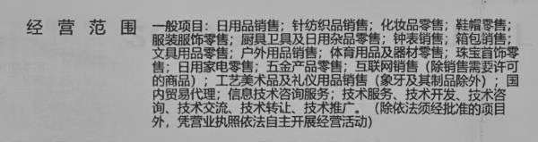

这里我比较建议开个体店，而不建议开个人店，原因如下：

#### 3.1 个人店限制较多

抖音小店个人店限制较多，包括商品类目受限、上架数量有限、提现周期长、无法参与平台活动和达人带货等。以下规则核验于2026年8月，具体以抖音电商最新官方政策为准。

#### 3.2 个人店开店条件

个人店只需身份证和手机号即可开通，不需要营业执照。相比之下，个体店和企业店需要营业执照和保证金，门槛更高但经营权限更大。

#### 3.3 商品类目限制

个人店不能售卖品牌商品，且可经营的类目非常有限，主要是运动户外用品、专用服饰和配件，如健美操、瑜伽服、球服等。普通鞋服、男装、女装、童装、食品、化妆品、家电、数码产品等大多数类目都不允许销售。

#### 3.4 上架数量与库存

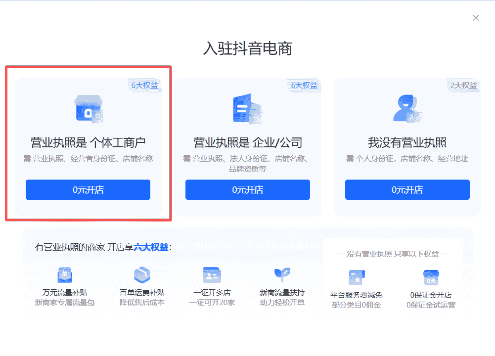

每个个人店铺最多只能上架100个商品，无论有货源还是无货源。这对新手或副业卖家来说可能限制了商品多样性。

#### 3.5 提现与结算

个人店的结算周期较长，货款需在确认收货后21天才能结算，每个月只能提现一次，且提现范围有限。这意味着资金回流速度慢，需要提前规划现金流。

#### 3.6 活动与流量限制

个人店无法加入精选联盟，不能使用平台补贴，也不能联系达人带货。只能依靠系统推荐的自然流量出单，对于新手来说获取流量较难。

#### 3.7 总结

个人店的优势是门槛低、无需营业执照，适合零成本试水或短期体验抖音电商。但缺点明显：类目受限、上架数量有限、提现周期长、活动和达人带货受限。如果计划长期经营或扩大规模，建议考虑开通个体店或企业店，以获得更多经营自由和流量支持。

### 4. 开通聚合账户

### 5. 开通子账号

### 6. 新建运费模板

常规偏远地区限售地区：香港、澳门、台湾、内蒙古、新疆、西藏、甘肃、青海、宁夏、海南。

还有几个仅退款重灾区，大家想了解的搜索一下就可以了，自己心里有个底就行。

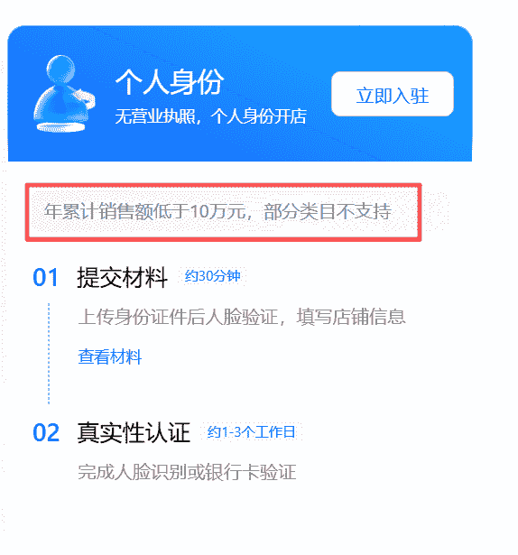
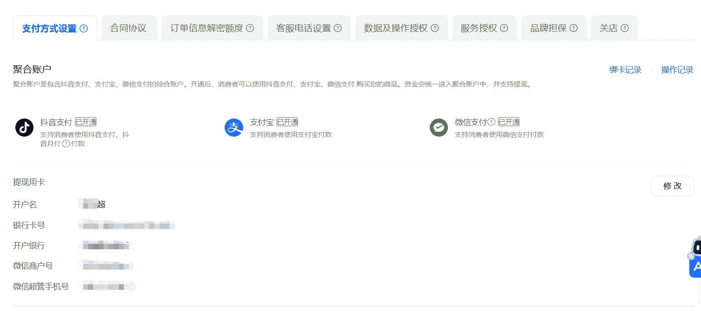
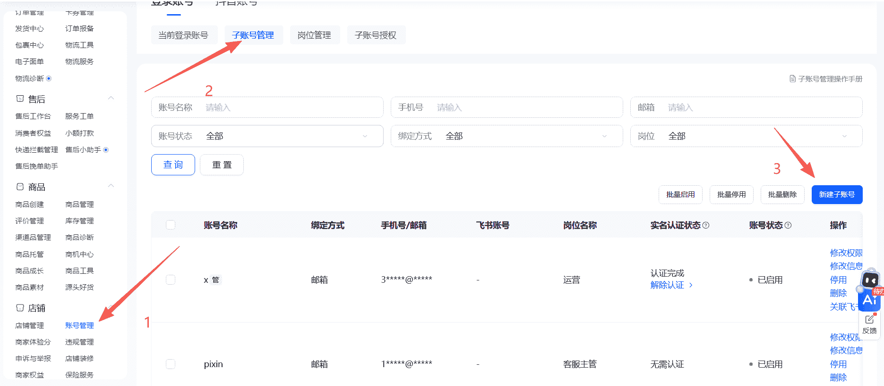

### 7. 设置初始发/退货地址

这一点一定要设置，店铺没有设置默认地址，厂家会打不了单、发不了货。

### 8. 上架产品与服务软件

这边我给大家分享一下我的上链接及发货使用的服务软件。

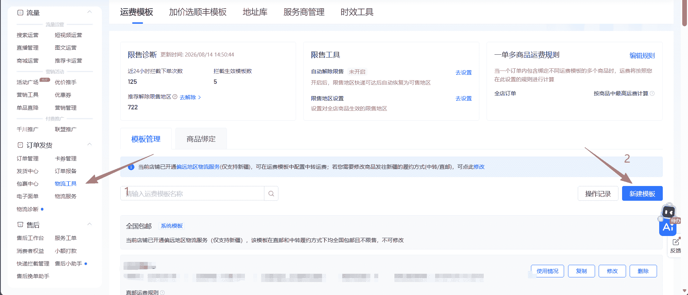
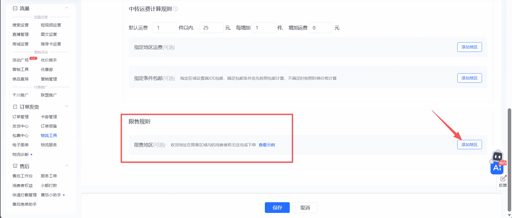
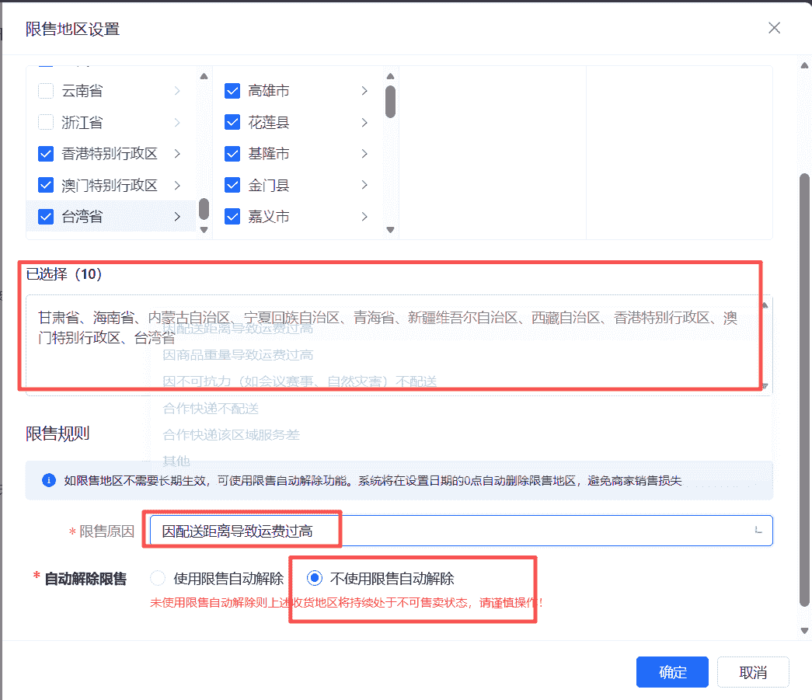
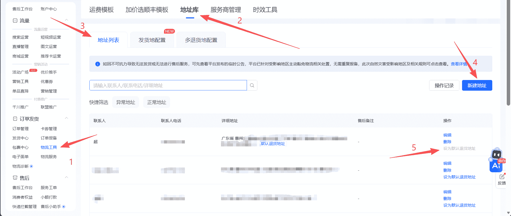

## 四、开店完成后，下一步该如何操作

### 1. 店铺开好后如何操作

刚开的店铺是没有体验分的，现在的抖店是比较看重体验分（即你的店铺外露评分），体验分越高，当然流量也分得更多。所以刚开的店铺完成基础搭建后要先出体验分，新店一定要把体验分拉到90分以上。

### 2. 如何快速出体验分

一般我会选择10元以内的福利商品累计订单，因为这个客单的商品比较好出单，只要出够30单了你就有70分的体验分，这边我常用的有剪刀、打水桶、小马扎这类一年四季都能售卖的品。（福利品一定要选择售后相对少的品。）

### 3. 上架利润款

我一般会先将利润款链接先做好，放在“商品管理”—“已下架”里，个人建议要做好四十条链接以上，等出了体验分，以及福利品将店铺曝光拉高之后，在同一天将利润款“全选”—“一键上架”，同时设置好活动（单品直降+优惠券）。

### 4. 如何定价

这里我用的是一套公式，高标低折的玩法，目的就是利用平台规则、活动，将平台给的免费流量吃干抹尽。

我报的活动是单品直降+优惠券，单品直降-10，加上优惠券3.7折，再加上运费两元。

我可以列一下我的定价公式：（x-2）/0.37+10。

举例：假如我有一个商品要卖9.9元，那么我的定价就是（9.9-2）/0.37+10=31.35。那么这条SKU我的定价就会是31.35。

为什么我要有两元运费，其实这是一个小技巧。例如我和我的同行卖同一个产品、同样的价格都是9.9，且同行是包邮的情况，那么他的外露价就会是9.9，而我这条链接的外露价就会是7.9。这样作为消费者看到同样的产品、同样的图片、同样的标题，价格却相差两块，那么消费者一定会先点进我的链接查看。

看到这里可能有人会问：那你都不包邮，我肯定不想买了。其实现在很多人已经默认商品包邮了，即使收运费，也不多，就两元。我们的目的就是要点击，有点击才可能会有成交。如果你的链接无人问津、无人点击，何来的成交呢？

### 5. 如何做链接

这里我做链接是参考对标流量最高的商品主图和标题，我从来不做创新，也是直接利用市场验证过的成果。

然后还有一个步骤就是找引流款。我拿我的打水桶为例子，那么我的引流款就是打水绳，可以参考下图。这样做的目的就是外露价足够低。

## 五、关于选品

### 1. 选品从哪里选

打开我们的抖店后台，在上边找到这个电商罗盘，点进去，随后就能看到一个榜单。

在这里可以看到商品卡的流量榜，从中去找有流量的品。

### 2. 如何选品

我先简单分享一下我的选品思路：

例如我是做百货类目的，我就选择智能家居/居家日用这一个分类去找品，然后选择近7天有销量以及转化率≥10%的品，去抖音了解一下市场价是在哪个区间，1688或者拼多多找更低价代发。（这里注意一点，产品图或者配件上不能含有带品牌Logo或者标志的，抖音对这块是0容忍。）然后再进行举一反三，去找其他类目的品。

（榜上有名的都是市场验证过的成果，我们轻创业、小投资，直接抄就行。）

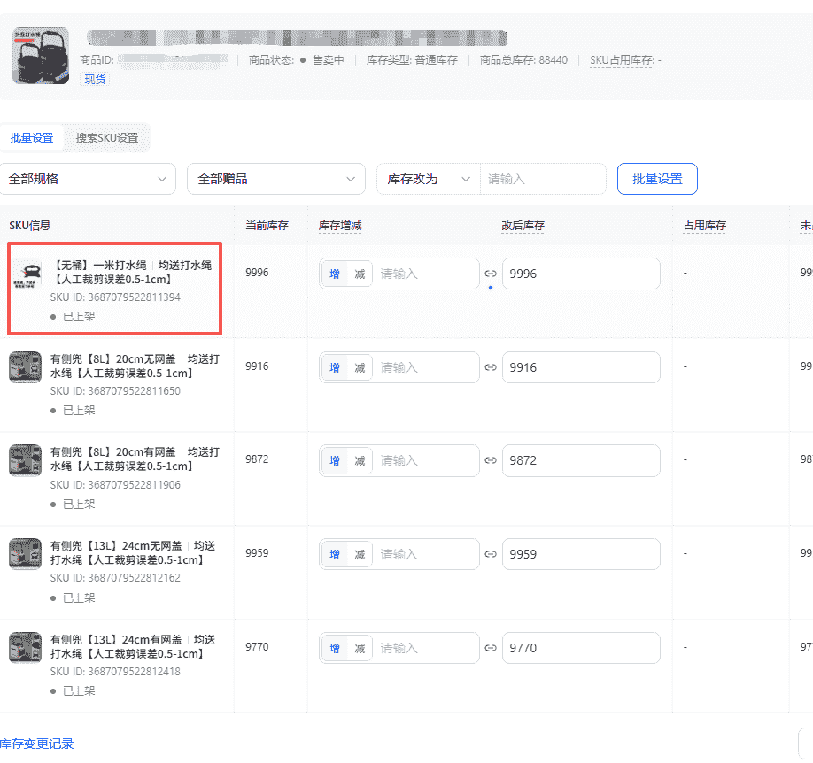
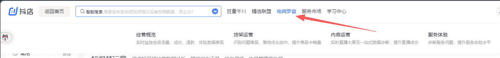
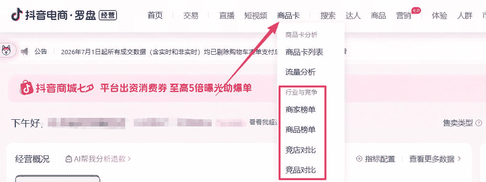

### 3. 如何找供应商

在1688以及拼多多上找。

#### 3.1 拼多多找供应商的方法

先在抖音上找到你要卖的品，随后在抖音以图搜图，对比一下市场价，然后再去拼多多以图搜图找同款低价，私信拼多多商家的客服，话术如下图。

#### 3.2 1688找供应商的方法

1688找供应商就更简单粗暴了，直接以图搜图对标产品，点进去看支不支持抖音密文代发即可。

（注：不要过度依赖1688，因为1688上也有很多二道贩子，具体如何甄别，去主页看看有没有工厂信息就能知道个大概了。）

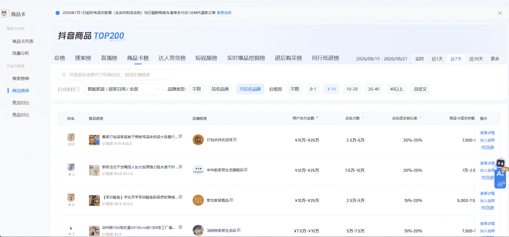

### 4. 我是怎么找到第一个福利品的

之前我用的福利品一直是K82剪刀，通过我的定价模式做到外露价0.01，选完付款+2元运费是2.01，成本是4.5，但是这个品比较亏，而且还会有售后，我就琢磨着怎么样去找一个能卖且售后少的品。

后来也是去分析了同行的店铺，找了好几家同行的店铺，进他们店铺主页一看，营业执照都是同一个地方的，我就知道我找对了。加上他们卖的品都一样，我就看他们都在卖什么品，哪一款适合作为福利品去卖，就看到了这款打水桶，然后就用上面的找供应商思路去找拼多多和1688对比价格，然后找到了现在给我代发的供应商。

我最喜欢的福利品是打水桶，这个品是我从接触抖店到现在一直在玩的一个品，但是这个品的利润极低、极低，甚至低到没钱赚，但是它能作为一个拉曝光很完美的品。

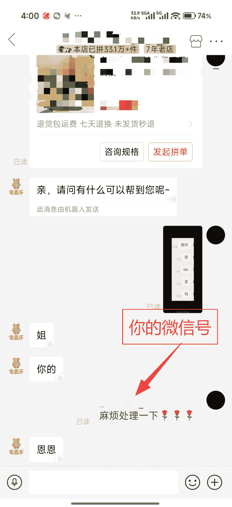
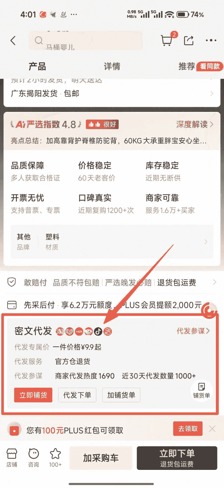

我以我的角度去分析这个品为什么是一个很好拉曝光的品：

- 打水桶属于渔具类，是一个比较典型的河北货，做过电商的都知道，河北货是有多卷，加上我跟供应商的长期合作，该打的价格都打下来了，目前我能做到的价格可以说是比拼多多还便宜。
- 打水桶可以说是钓鱼佬的必备，一年四季都有钓鱼佬，所以这个品一年四季都能卖，只要你敢卷，它就能出单。
- 供应商包售后，坏了、破了、漏水了包补，所以这个品的退货率极低。

## 六、实操案例与跑量数据

这是我最近开的新店，这是跑了**10**天左右的效果。当店铺有个基础的销量之后，后面的流量就会很稳定，店铺也会有一定的权重。

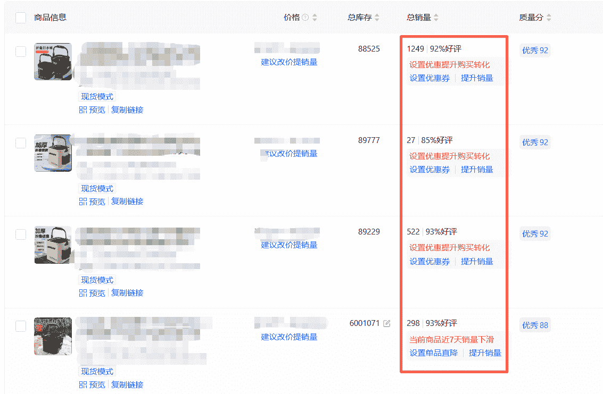

在这之前我做了什么动作：

- **1.** 根据定价公式定价格，上架福利品，每单亏**0.5-1**元之间（货损起店）
- **2.** 裂变**4-5**条链接，每条裂变的链接都换主图、换标题
- **3.** 上新品，在抖音电商罗盘里跟抖音热度选品（这里我一般会准备**40**个新品，在福利品跑起来的时候上架）

关于打水桶跑量总结：

- 总测试周期为10天，我上了4-5条链接
- 平均日出150-200单
- 我前期会亏得比较狠，一单亏1.5元，算上后来涨价带回的利润，这个品总亏损大约在600元
- 给我店铺带来了单日近10w的曝光，关于利润的可以参考结尾的利润截图

完成上述操作之后，就可以日复一日地选品了。电商圈一直有“七分选品、两分运气、一分运营”的说法，由此可见选品的重要性。

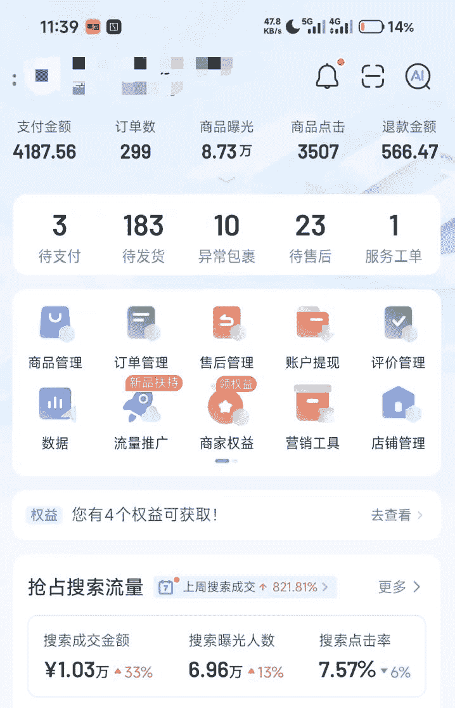
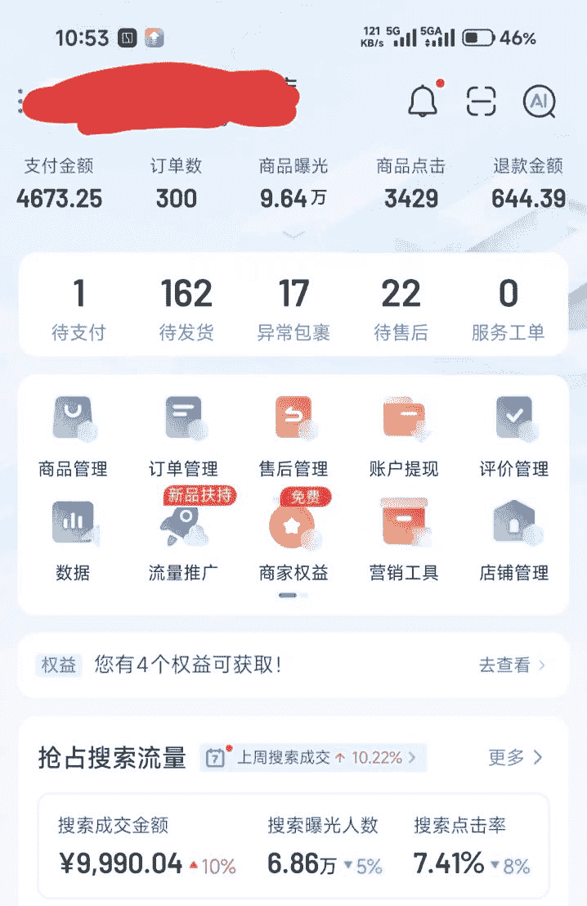

在抖音这么卷的情况下，选品这里我个人比较推荐：

- 日用品（复购率高）
- 婴幼儿启蒙玩具（利润高，前提一定要找到有资质的供应商）
- 跟爱情挂钩的 **DIY** 产品（售后少）
- 小学生专注力训练类产品（利润高）

七、踩坑避雷

第一次踩坑是我的千川账户被封一百年。我有一家店铺在卖当时抖音爆火的冰鼠水枪，我没仔细阅读平台的规则，剪辑了视频投放千川。因为抖音的审查基本都是 AI 审查，加上我剪辑的视频有混入枪声音效，起初目的也是为了我的视频看起来更逼真，然后导致 AI 识别到我在宣传售卖军火，把我的千川封了一百年。

第二次踩坑其实和第一次如出一辙。在 25 年底，这个品的爆火勾起了我的兴趣，我就去找了供应商给我代发，同样也是 AI 巡查，识别到我售卖军火，扣了我六千的货款以及店铺清退。

这里也给想做抖店的朋友们提个醒，选品一定要注意玩具枪这一类商品！

八、项目总结

根据我踩过的坑给大家提个醒，做电商本质就是靠平台吃饭，所以每次平台更新规则的时候一定不要嫌麻烦，一定要仔细阅读！

很多电商同行都说：电商？狗都不做。确实，狗不做我做。现在的同行，不仅做，还很卷！（当然，我身边有朋友想做电商的，我也是先劝退）下图为豆包的数据。

接下来我将以财务的角度分析一下我做抖店无货源的成本及利润：

运营这个店铺需要的成本：做电商一定要玩现金流的，我当时是兜里揣着 **2w** 就开干，主要是针对我们发货的一个货款。抖店的账期在 **3**、**10**、**15** 之间，取决于售卖的品类，要周转的金额会在 **1w** 左右，留 **1w** 给自己做保障金。

开店铺需要用到的场地及网络还有一些插件的费用：因为我是有一个工作室，所以我需要一个场地成本，每个月的开支在 **2500** 以内，还有各种插件的成本为：**15**（哈士奇）+**15**（智能店长）+**18**（逸淘）+**20**（店管家）**=68**，所以一个店一个月插件的固定支出就是 **68**。

然后就是利润：我每个月的利率比较平均，在营业额的 15% 上下浮动。上一年我经营着五个店铺（今年关的只剩两家在实际运营），每个店铺月 GMV 平均是 10w，扣除我的场地、插件、网卡以及售后成本之后，我的净利润能达到每个月 3w+，也是靠这个项目将我的收入翻了几翻。曾经跑业务干苦力，撑死一个月九千多。虽然这些成果摆在众多电商大佬前属于不够看的级别，但是我认为这是一个蛮不错的起步项目，也希望我分享的经验能帮助到还在找项目的大家！

简单分享一下战报，这是 2026 年 8 月 21 日截至中午 12:30，需要阿里采购的利润（不包含非阿里采购的品）。在 25 年 8、9、10 月的时候，5 家店都是这样稳定的战况，后来也是因为违规，关掉了 3 家。做电商跟做生意一样，比的是谁更稳定。

以上是我接触抖店这么久以来的一些心得和经验，大家有不了解的也可以留在评论区，知无不言言无不尽，感谢！

————分割线————

看完这篇 SOP，你觉得你懂了。但 90% 的人一到实操就会卡在第一步。

工具和教程只是最低级的壁垒，真正的壁垒是“立刻动手”和“圈层信息差”。

如果你想看全网最新的变现玩法，并且和一群执行力极强的极客一起下场拿结果，欢迎围观我的核心私域：【懒人专属群】。

我们不聊虚的，只做商业闭环的拆解与 AI 效率的压榨。系统内已沉淀 1000+ 跑通的套利实战局。

👉 查阅圈子完整数字资产与上车门槛：

https://lazyso.com/insider/

认同价值、准备好下场干活的，扫码加我微信（lazyhelper1）

备注：【实操上车】，不闲聊

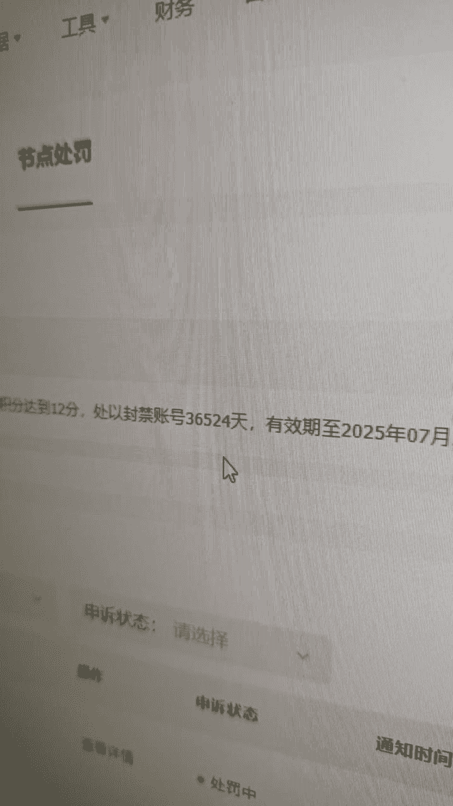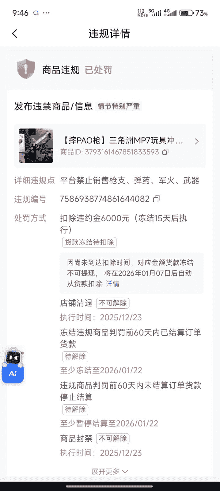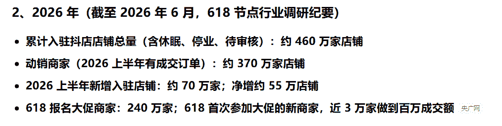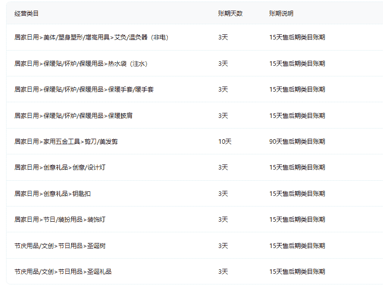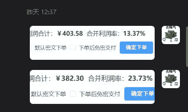
