# **3 个月 40 万 GMV：视频号 AI 剧情带货实战，与我的 Codex 提效工作流**

260825 副业 SC 精华

整理：公众号懒人搜索，懒人专属群精选

懒人微信：lazyhelper1

大家好，我是淳于。

我是 2025 年 3 月份来到生财的，到现在刚好一年多时间。

进入生财这一年多里，我其实就扎扎实实做了两个项目：一个是去年的 YouTube 项目，另一个是今年 5 月份开始做的视频号 AI 剧情带货。

数据先简单说一下：YouTube 做了大半年，总收益大概在 2 万—3 万美元；视频号做到现在，累计打出了大约 40 万 GMV。

最近 8 月份因为市场上批量搬运的科技横行，作品跑出有效 GMV 的产出比明显变低，我主动把生产节奏放慢了一点。正好趁着这个时间，把这一年多的经历，以及做视频号这三个月积累下来的经验和 Codex 工作流，完整复盘出来分享给圈友。

这篇文章主要讲两件事：

1. 一条能出单的 AI 剧情带货作品，到底是怎么做出来的（从找对标、选品、做脚本，到批量生视频、剪辑、发布和数据判断）。
2. 我是怎么用 Codex 搭建工作台，把这一整条繁琐的生产链路做成高效系统的。

这篇文章对已经做过视频号、或者有一定 AI 视频基础的圈友会更友好；如果是纯新手，也可以把它当成一张项目全景图，看看真正下场做起来，中间到底要经过哪些具体的环节。

哈喽各位圈友，我是淳于，来到生财一年多时间了。

之前我主要做的是抖音获客，当时正处于自己事业的低谷期，整个人挺迷茫的，为了寻找新方向加入了生财。

在生财这一年多里，我其实就扎扎实实做了两个项目，一直死磕在 AI 视频和内容带货上：去年跟着深海圈做 YouTube 跑通了出海变现，总共拿到了两三万美元的收益；后来账号被风控停收后，今年 5 月份我把注意力转回国内，正式下场做视频号 AI 剧情带货，3 个月跑下来累计打出了约 40 万 GMV。

最近 8 月份由于市场上批量搬运的科技横行，作品跑出有效 GMV 的产出比变低，我主动把生产节奏放慢了一些。正好借着这个空档，把自己这三个月从零跑通带货的一线实操经验，以及不懂代码如何用 Codex 搭建自动化工作台的过程做了一次系统复盘，分享给正在做内容和 AI 视频的圈友们。

本篇文章主要包含以下 6 个部分的内容：

一、视频号 AI 剧情带货的底层链路与出单方式

二、如何寻找起量对标、选品与排查商品链接

三、爆款脚本二创与前 30 秒开头的处理原则

四、SD 2.0 批量生成视频与真实制作成本核算

五、剪辑的人机分工与 10 分钟快速出片流程

六、如何用 Codex 搭建适合自己的工作台与生产系统

## 一、从 YouTube 到视频号，我是怎么走到这里的

2025 年开年那会儿，我正处于自己事业的一个低谷期。之前做的是抖音获客，业务很不顺，整个人挺迷茫的，不知道下一步该往哪走。

后来在知识星球看到生财常年霸榜第一，我想着这么大一个社群肯定有它的道理，就加入进来看看。

进来之后我花了大量时间看圈友分享的帖子，也参加了一些线下活动。那段时间我也加过不少别的社群，但生财最吸引我的一点，是这里不仅有教练、志愿者带着大家做航海实战，还有很多圈友愿意把真实项目、踩过的坑和验证过的方法无私分享出来。这种共建的氛围，让我觉得这里是一个能真正下场做事的地方。

后来看到亦仁发布的 YouTube“超级标”，加上我自己对海外业务有点基础，也想找一个能长期做下去的内容项目，于是就入局了 YouTube 航海。

在航海期间我开出了两个 YPP 账号。航海结束后为了继续深入学习，我又加入了曹教练的深海圈，开始更系统地了解 YouTube 生态和 AI 视频制作。

YouTube 项目前后做了大半年，总共拿到了 2 万—3 万美元的收益，主要来自少数几个账号。但相比赚到的钱，对我更重要的是在这个过程中积累下来的 AI 视频制作能力，以及对内容平台的一些基本体感。

转折发生在 2025 年的 11 月中下旬。

几乎是在一周左右的时间里，我的十几个 YPP 账号陆续被官方停止了收益，原因主要是儿童违规和同质化。当时大家都提交了申诉，但基本都没有挽回的可能，等于被判了死刑。

因为 YouTube 从起号到产生收益需要较长的周期，当时手里也还有其他事情，所以这个项目就暂时停了下来。

项目虽然停了，但我没有停止对 AI 视频的研究，依然在不断打磨视频制作能力。从去年到今年这一年多的时间里，大模型、生图和生视频工具的发展速度非常快。以前做不出来的画面、讲不通的故事，现在技术上完全可以跑通了。

到了今年 4 月份左右，深海圈开始内测 AI 视频号带货项目，我开始把注意力转回国内平台。

在这之前，我几乎没有研究过视频号，平时刷得也很少。决定做这个项目以后，我先把生财里能找到的视频号文章全部通读了一遍，把前辈们走过的路、积累的经验和踩过的坑先搞清楚，对平台大方向建立起基础认知。

我当时的逻辑很简单：AI 视频是我一直在磨练的技术，而国内视频号带货是一条变现路径非常直接、市场空间很大的方向。

技术和商业机会正好能接上，那就下场去干。

5 月中旬，我正式开始了视频号 AI 剧情带货。

## 二、先把视频号 AI 剧情带货这条链路讲清楚

很多没做过这个项目的朋友，一开始总觉得最难的是“怎么用 AI 把视频做出来”。

但真正下场做起来就会发现，做视频只是中间那一步。前面得找好品和脚本，后面还得盯账号、链接、开播和数据。视频有播放，不代表能卖出去货；产品再好，拿不到流量也白搭。

整条路其实很简单但细节很多：

找对标脚本 → 选好产品和可用链接 → 重新洗脚本 → 批量生成分镜和视频 → 人工挑出坏片并剪辑 → 发布作品（选短挂或短引）→ 看真实数据决定放大、换品还是停下。

在实际带货里，我主要跑过两种出单方式：短挂和短引。

### 短挂：短视频直接挂商品

短挂最直接，用户刷到剧情被吸引了，顺手点左下角的商品卡进去买。

做短挂有个特别关键的坑：商品链接必须在发视频前彻底弄清楚。主要是看这个链接稳不稳定、有没有被限单。有的链接一天就给卖几百单，或者总共卖到一定数量就下架了。短视频一旦发出去挂了车，中途是没办法改链接的。要是视频好不容易爆了，链接却被限单或者下架了，这一波流量就全浪费掉了。

这些问题要在发布前解决，若视频已经发布，就无法再做任何的修改。

### 短引：短视频负责找人，直播间负责成交

短引说白了就是短视频拉人、直播间卖货。

视频发出去之后，后台看着流速跑起来了，账号就赶紧开播。用户刷到你的视频，看到头像显示“直播中”，点进去就进了直播间。

有人可能以为直播只是顺带开一下，其实不是。在短引这条路子里，直播本来就是卖货的地方。短视频负责把想看想买的人引过来，真正下单是在直播间里完成的。

短挂和短引没有说哪个一定比哪个好，全看当时的市场行情。我刚开始做的时候短引好跑，到了 7 月份短挂效果好，我就转去测短挂。普通号和企业号也是一个道理，市场上什么好跑，咱就跟着用什么。

### 播放量不等于能赚钱（播放量 ≠ 转化 ≠ GMV）

做纯内容，播放量高可能就够了；但做带货，播放量只是个开头，最后卖了多少钱（GMV）才是结果。

这两者之间从来不是固定成比例的：

- 我遇到过 2 万播放卖出三四千块钱，也遇到过 20 万播放只卖了几百块；
- 同样是接近 100 万播放的大爆款，如果行情好、推流推的都是真正想买东西的人，一条甚至能卖 10 万元左右的 GMV；但要是赶上平台在推泛流量，推过来一堆看热闹的，同样的百万播放最后可能也就三五千块钱。

差距这么大，除了脚本和产品本身，主要就是看平台推过来的人群到底准不准。

做视频号这几个月，我最大的体会就是：平台的流量和推流机制一直在变，这是我们左右不了的；我们唯一能做好的，就是脚本质量、开头留不留得住人、产品对不对、链接稳不稳定，以及做视频的成本能不能压下来。能控制的事情提前做到位，不能控制的事情就交给真实数据去说话——跑出结果了就赶紧放量，跑不动了就及时换品换脚本，绝不抱侥幸心理。

## 三、如何复刻一条 AI 剧情带货作品：完整 SOP

在目前的视频号生态里，做 AI 剧情带货，追爆款依然是一个能拿到确定性结果的打法。

这里核心拼的就是速度：当你发现一条作品正在起量、带的商品转化也不错，就要尽快把自己的版本做出来。抢在这个内容还没有被全网大量搬运、没有烂大街之前发出去，跑出来的概率是最大的。

我说的“复刻”，不是把别人的视频扒下来加滤镜搬运，而是把原作品里验证过的黄金开头、情绪冲突、核心台词和人物关系拆解出来，围绕我们要带的货重新写脚本，全套用 AI 重新生成画面并剪辑。

整个生产路径一定要快。

找对标和脚本 → 确定产品与链接 → 重新产出脚本 → 生成分镜、图片与视频 → 剪辑 → 发布 → 短挂／短引成交 → 根据数据放大、换产品或换脚本

### 第一步：找到合适的脚本和对标作品

我最开始找脚本，主要靠自己每天去视频号广场上刷同行作品。

每天早上、中午和晚上，我都会花时间去刷。刷到一条合适的内容，我不会只盯着单一的播放量，而是把发布时间、互动数据、挂载商品和账号橱窗这几个维度放在一起看：

**1. 先看发布时间，判断这条作品还有没有时效**

追爆款一直是在跟时间赛跑。一条作品如果刚发了一个小时，点赞、收藏、评论和转发就已经开始快速往上窜，那它就极具跟进价值。发现得越早，留给你重新做脚本、生视频、剪辑和发布的时间就越多。

刷到数据好的作品之后，先看发布时间，判断这条作品还有没有时效。比如我之前刷到这一条作品，显示“1 小时前”发布，它已经拿到了 777 个点赞、100 次转发、726 次收藏和 166 条评论，这就属于非常优质的早期起量信号。看这个数据不是为了找一个固定的死标准，而是看它在同赛道、相近时间下的增长速度是不是明显快于普通作品。越早发现这种作品，然后尽早地去跟，越能拿到结果！

发布时间和挂载商品，是判断作品时效与产品的第一层证据。

商品卡与点赞、转发、收藏、评论共同反映作品的早期表现。

**2. 看它挂了什么商品，产品是怎么进入剧情的**

在作品评论区置顶或者视频播放几秒后左下角弹出的商品卡，确认它卖的是什么。

然后重点看这个产品是怎么在故事里出现的：是顺着人物的生活场景自然带出来的，还是剧情演到一半生硬插进去的？只有流量不错、商品有转化、同时产品植入又比较自然的作品，才值得继续往下拆。

**3. 点进主页和商品橱窗，看账号层面的带货数据**

看完单条作品，我还会点进作者主页。

主页里的“商品橱窗”是一个很重要的窗口，能看到这个账号近期反复在推什么品、主推哪些类目，以及整个橱窗累计卖了多少单。这里千万不要把数据看混了：

- 主页橱窗销量：比如主页顶部显示“销量 399 件”，这代表该账号的橱窗历史累计卖出了 399 单，是单账号维度的数据。
- 商品链接销量：商品卡上显示的“已售 6728”，代表这条商品链接在全平台累计卖出了 6728 单。因为一条公开链接可能有很多账号都在挂车推广，所以这个数字不能直接算在当前账号头上，更不能直接等同于这条视频卖出来的数量（除非确认对方挂的是独家专链）。①是账号橱窗累计销量，②是商品链接累计销量，两个口径不能混用。
- 直播间的实时销量反馈：如果对方在打短引开播，点进他的直播间，左下角弹出的“热卖 ×128”“热卖 ×912”，代表当前这场直播实打实出单的反馈。这个数据不需要通过橱窗去猜，是最及时证明当前短视频引流转化能力的指标。

### 从人工刷视频到系统记录

人工刷视频能快速建立体感，但也有一个很现实的痛点：很多内容刷过去就忘了。过几天再回头想复盘，很难记清当时市场在推什么、哪些产品是刚冒出来的、哪一类内容最近反复在爆。

后来我用 Codex 做了市场监控工具，接进了自己的工作台。现在一条作品刚开始起量，系统就会第一时间提醒我。更重要的是，最近哪些产品反复出现、同行都在卖什么、有没有新起量的好品，后台都会一直留下完整记录。

需要判断市场时，我不需要全靠脑子硬记，可以直接把前后的数据调出来对比。有了这套记录，我对当前市场在推什么品、最近的风向有没有变化，会看得更清晰，发现爆款和跟进作品的速度也提高了很多。

当然，不管是人工刷还是工具监控，最底层的判断标准是没有变的：工具负责帮我更早发现线索并留下数据记录，而这条作品到底值不值得做、这个品现在还能不能跟，依然要靠自己的网感来做最终决定。

### 第二步：确定自己要带的商品和商品链接

找到对标之后，不能盲目开工，必须先把产品和承接链接准备好。

在实际操作中通常有两个入口：

- 常规情况：手里先确定好准备打的产品和稳定货源，再去市场上寻找适配这个产品的爆款脚本。
- 抢跑情况：市场监控突然捕捉到一条作品正在疯涨，而它带的品我手里刚好有现成链接，或者能立刻在供应链拿到同款同类商品，那就直接以最快速度跟进。

不管从哪个入口切入，商品链接的稳定性和限单问题必须在发布前彻底确认清楚。

做短挂的时候，一定要提前跟供应链或者号商沟通：这条链接每天限不限单？是不是跑个几百单就不能跑了？

在做剧情带货的过程中，真正能跑出大爆款的作品本身就是有概率的，往往一个月的利润主要就靠跑出来的那么一两条核心作品来撑，前面其他测试视频和账号的成本最后都要靠这几条结果来覆盖。所以每一条作品都要认真对待，绝对不能随便找个能挂上去的野链接就开始打。如果辛辛苦苦跑出了大流量，链接却因为限单或者质量问题被下架了，这种损失是非常可惜的。

### 关于选品适配（保持场景一致，绝不强融）

如果拿不到完全一样的同款，在同品类里做替代也是非常成熟的做法。同一个品类里，这个阶段跑的是 A 品牌的酸辣汁，过几天可能就换成了 B 品牌的酸辣汁；原来卖红烧酱油，也可以换成红烧汁或同类复合调料。这属于同品类、同使用场景的自然轮换，用户在剧情里看着完全不会违和。

但绝对不能为了带货而强行乱融——比如原版剧情是一家人在厨房做饭吃饭的温馨场景，你硬要在结尾塞进去一条毛巾或者完全不相关的日用品。即使大模型在文字上能把故事强行圆过去，生成出来的画面和整体观感也会极其生硬。

AI 可以完成脚本文字层面的替换，但产品放进故事里到底自不自然、观众买不买账，最终必须由我们自己的网感来把关。

同一品类可以轮换产品，但产品在剧情中的作用不能变。

### 跟品与开新品的选择

我前面做出来的 40 万 GMV，绝大部分都是通过“跟品”打出来的。

跟品的核心优势在于：这个商品已经在市场上被同行验证过了，证明用户愿意买单。你只需要集中精力验证自己的脚本能不能拿到流量、产品放进你的剧情里还能不能继续出单。对新人而言，跟品是最稳、试错成本最低的路径。

开新品如果能打出来，第一波利润空间确实大，留给自己的放量时间也更长；但开新品需要同时验证“产品有没有市场”和“内容能不能拿流量”两个未知数，对视频产量、测试资金和供应链配合度的要求都高得多。新人刚进场，建议先把跟品的链路彻底跑顺，再去考虑开新品。

另外补充一个拿链接的实用小方法：有时候你会发现某个爆款挂的是独家链接，或者在公开的选品广场、常用供应链里一时找不到货源，但你又非常想跟这个品。这时候最直接的办法，就是直接点进这个商品的店铺后台找客服，要到商家的商务微信，直接加过去找对方要挂车链接。

这样通常能以最快速度拿到可用的链接。

不过这里也有一个实操中的小坑需要提醒大家：这种私下对接、尤其是走线下结算佣金的商家，我也遇到过自己辛辛苦苦帮他跑出了单子，最后对方扯皮赖账不给结算的情况。虽然这种情况整体比较少见，但在实操对接的时候，还是要多留个心眼，希望大家都不会遇到！

### 第三步：围绕目标产品，重新产出脚本

产品和链接确定好以后，下一步就是做脚本。

那么这么长一段剧情脚本、人物设定，还要拆分镜，到底是怎么高效做出来的？这里最开始的时候，也是跟着深海圈内测在走，是直接用购买的工作台来做的。现在市面上做 AI 短剧带货的工作台和工作流非常多，价格高低不等。它们背后的逻辑大体是一样的——把经过验证的提示词（Prompt）固化在工具里，你只要输入爆款母本和你的目标商品，它就会按照设定的流程，自动把故事结构、人物关系拆出来，并生成一套适配新产品的二创脚本。

给新手圈友的实在建议：刚起步的时候，千万别想着自己从零去研发什么系统。建议用市面上成熟的现成工具，先把视频做出来、把出单的闭环跑通才是第一位的。

到了中后期，当你做过大量视频、有了自己非常明确的网感和个性化需求之后，如果你有想法，完全可以像我后来一样，用 Codex 直接开发一套专属于你自己的工作台出来，进一步拉升效率。这个演变过程我们在后面的章节再细聊。

明白了工具是怎么回事，再来看我们在做脚本二创时的核心原则：

### 1. 前 0—30 秒黄金开头：必须 1:1 严格复刻，绝不大改

原版视频前 30 秒的冲突是怎么爆发的、信息是按什么顺序出来的、哪几句核心台词在死死抓着观众留下来、镜头是怎么推进的——这些已经被市场真金白银验证过的留人机制，老老实实照搬。

我们能做的是人物关系的等价替换：比如原版是“父亲和儿子”在吵架冲突，你可以换成“叔叔和侄子”，或者“公公和儿媳”。人物的外在身份可以换，但他们在剧情里承担的功能、制造的冲突，以及关键台词的情绪推进，必须原汁原味地保留下来。

Z 神有句话说得特别到位：如果你已经觉得开头很重要了，那它实际的重要程度，往往还要在你现在的理解上再乘以五。新手最容易犯的错误就是在前 30 秒大改，结果把原视频真正跑流量的“钩子”给改没了。前 30 秒必须在没有自己理解的情况下尽量锁死。

### 2. 30 秒往后：围绕产品自然重写剧情

从 30 秒往后，再根据你要卖的目标产品去重新展开剧情。重点是让产品自然地融进故事里，人物的行为动机和故事情节要前后成立，不能让观众一眼看出来这是个生硬的广告。

脚本初稿出来之后，按照现有的标准过一遍审核：逻辑顺不顺？产品植入会不会突兀？人物对话自不自然？打磨合格之后，才放行进入下一步。

这里再次强调：我们说的“复刻”是拆解爆款机制后，重新生成脚本、重新用 AI 生成画面并剪辑，绝对不是直接搬运原视频。

### 第四步：把脚本变成可以直接生产的资料

脚本通过以后，工作台会继续把它拆成人物、场景和分镜。

最后输出一份分镜 Excel，以及和每条分镜对应的角色图、场景图、产品参考图。

Excel 里会写清每一段使用什么提示词、引用哪几张图片，后面的生视频工作台可以直接读取。

我现在按日期管理不同作品。当天的脚本、Excel、图片和后面生成的视频，都会回到同一个任务文件夹。前端产出什么，后端就按同一套规则读取，中间不用再反复重命名和整理文件。

- 每条分镜对应独立文件夹，集中保存生产所需素材。
- Excel 记录每条分镜的提示词、参考图和任务信息。
- 脚本、图片、Excel 与生成视频按日期归入同一任务目录。

### 第五步：用 SD2.0 批量生成视频与成本控制

拿到 Excel 和对应的分镜图片包之后，就进入了视频生成环节。

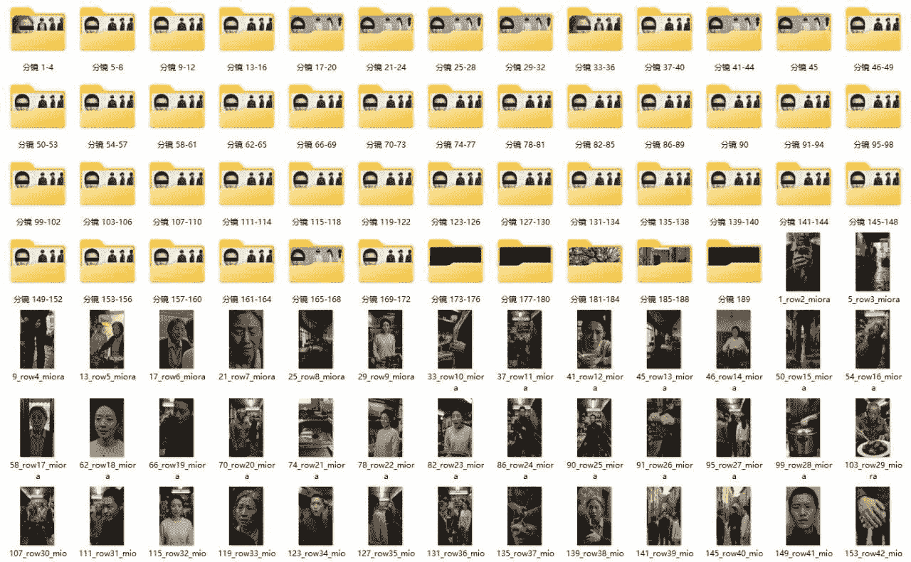
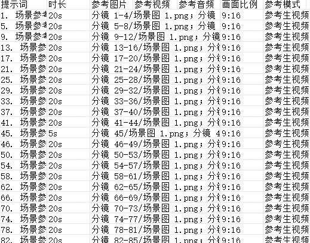

我现在做视频主要使用的是 SD2.0，也有尝试过使用这个 Mini 或者 Fast，但出来的效果不是特别好。

#### 1. 视频生成的单位与成片时长

我们生成的视频是以“任务”为单位的：

- 每一个生成任务是一段大约 15 秒的视频，里面通常包含 4 个小镜头；
- 我刚开始做一条作品大概需要 30—50 个任务（也就是 120—200 个分镜镜头）；
- 到了后期，为了增加剧情丰富度以及去同质化和给剪辑留下足够的冗余度，往往会做到 70—80 个任务（将近 300 多个小镜头）。

80 个 15 秒任务全部生成出来，原始素材大概有 20 分钟左右。剪掉废片和瑕疵镜头后，最终导出的成品视频通常在 10—15 分钟。

为什么要故意把视频做长？增加时长不只是为了把视频做长，核心目的是在保留原有爆款黄金开头和核心机制的前提下，加入新的剧情和支线镜头，拉开和市场上其他作品的差异，从而有效降低平台的“同质化”风控。

#### 2. 生成渠道的演变与批量化

刚入场的时候，我建议先用稳定、哪怕贵一点的官方 API 渠道，先把整个生视频、分镜调取的流程彻底摸熟。

等跑顺之后，再去寻找市面上低成本的渠道。这些渠道的价格差异非常大：

- 便宜的时候，一段 15 秒的视频可能只要几毛钱甚至更低，一条成片算下来十几二十块钱就能搞定；
- 用官方或者高价渠道，一条长作品可能要两三百块钱。

因为一条作品包含几十个独立任务，如果全靠人工在网页上一个个去选图、粘提示词、点提交，再手动下载，不仅人会累死，而且很多低价渠道时效性很短，可能一两天就失效了。

所以我后来搭了生视频的自动化工具：上游把 Excel 和图片准备好，工具直接批量读取、一键提交任务，生成完了自动按分镜序号下载回当天的日期文件夹。如果有某一段生成失败或者人物崩了，直接在后台勾选这一段单独重跑就行。

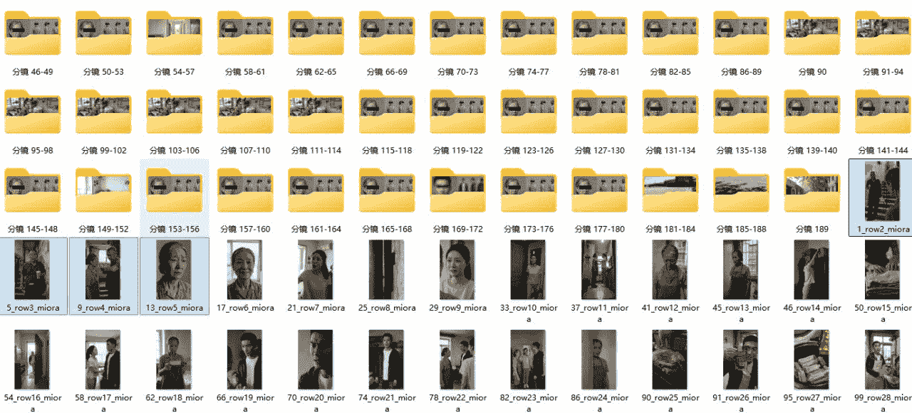
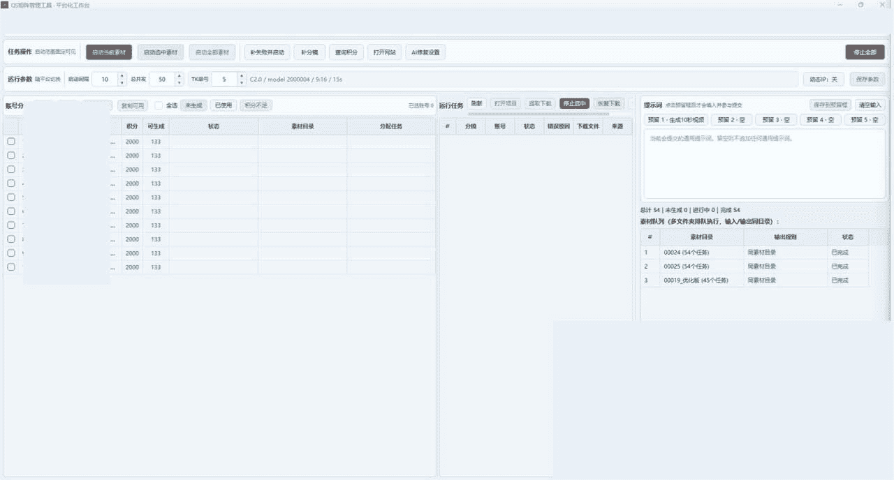

生成工作台统一读取上游资料并批量提交视频任务；批量任务记录用于跟踪生成状态、失败补做和结果回收。

#### 3. 关于成本与产量的真实认知：不要盲目囤片

单段生成成本低，最大的价值是能让你在同样的预算下，多测试几条作品、多拥有几次博爆款的机会。

但千万不要因为偶然找到了一个极低成本的渠道，就在家里疯狂批量生成几十上百条作品囤着。

因为视频号的市场和热销商品是在动态变化的。你提前做了一堆视频压在文件夹里，等过了一周你想发的时候，这个商品的生命周期可能已经过了，或者平台玩法变了，这些视频就全烂在手里了。

真正的原则是：做视频必须紧跟当下要打的产品和市场节奏。赶上行情好、产品正处于爆款期，哪怕用成本高一点的稳定渠道，只要能出单覆盖成本，该上就必须立刻上。

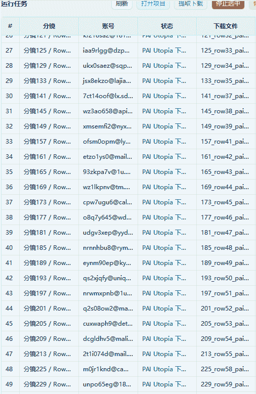

### 第六步：从自己拉片、找外包，到现在的“人机协同”剪辑

视频片段全部生成并下载到文件夹后，就进入了剪辑环节。

AI 生成视频最大的特征就是自带随机性。哪怕提示词写得再完美，画面里依然可能出现人物动作变形、肢体穿模、表情诡异的情况。更严重的是产品货不对版的问题：

比如你卖的是甘草金桔，AI 生成出来的金桔如果忽大忽小，或者包装、数量和真实售卖的商品明显不符，这种片段绝对不能留。这已经不单单是画面好不好看的问题，而是很可能直接触发平台“商品规格与实际展示不一致”的违规处罚。

- 产品外观、数量和包装与真实商品不一致时，画面不能使用。
- 商品规格展示不一致可能触发平台违规。

在剪辑这一环上，我也不是一开始就用工具的，而是踩着坑走过了三个阶段：

- 第一阶段（纯手工手搓）：

  刚开始做的时候，我完全是自己去看对标视频、一帧一帧去拉片，学习同行是怎么运镜、怎么卡点、怎么留悬念的，然后再自己一点点把视频剪出来。这个阶段虽然耗时耗力，但能帮你快速建立起对短剧节奏和画面取舍的真实网感。

- 第二阶段（尝试外包剪辑）：

  后来随着要做的事情越来越多——既要盯供应链、看数据，又要洗脚本、批量生视频，精力完全不够用了，我就尝试把剪辑工作外包出去。但实际跑下来有些需要注意的是：没有剪辑过这种带货逻辑视频的剪辑师，对故事走向和产品展示没有体感，不知道哪些生成的 AI 瑕疵镜头是绝对不能用的。剪辑出来的成片达不到自己的要求，需要反复沟通，改版其实是更浪费时间。就是你要从 0 培养一个剪辑师，也需要相当长的一个沟通过程！

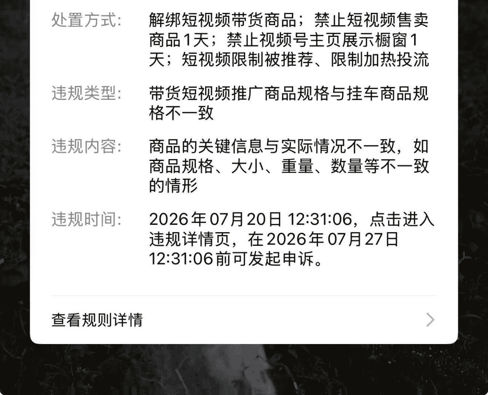

- 第三阶段（自己预检＋Codex 自动化收尾）：

  **a. 我先做预检（把控质量）：**我把所有生成的原始视频拖进剪映，顺着剧情大纲快速扫一遍。这一步完全靠人的网感——把人物崩坏的、产品展示有瑕疵的、动作不自然的废镜头随手删掉，只留下最顺畅、最符合剧情的核心画面。

  **b. Codex 批量收尾（拉满效率）：**只要把需要人判断的废片挑掉，剩下所有标准化的动作（包括音频对齐、字幕生成、BGM 卡点、固定片头片尾的拼接），全部按照我定好的剪辑 SOP，交给 Codex 和自动化工具直接完成。（但其实这个阶段也是经历过无数个日夜，慢慢打磨出来的。）

走完这三个阶段，现在的状态是：一条 10—15 分钟的带货长视频，我基本上花 10 分钟左右做个快速预检，剩下的交给工具收尾就搞定了。如果有大佬已经把 AI 长视频全自动的自动理解和稳定剪辑解决得更好，也欢迎在评论区交流方案。

### 第七步：准备账号、商品链接和发布条件

短挂和短引的成交逻辑，前面我们已经交代过了。真正到了发布这一步，我主要会在后台确认三件事：账号能不能正常跑、商品链接有没有问题，以及这条作品到底采用哪种方式去发布。

#### 1. 发布时间与日常习惯

我自己的发布时间通常集中在上午 9 点到下午 5 点。这只是我自己跑下来觉得数据比较平稳的个人习惯，晚上或者其他时间段也有很多人能跑出爆款，所以它并不是死板的固定规则。

#### 2. 短挂与短引的发布操作差异

- 如果是短挂：视频直接挂车发出去就可以了。不需要等流速起来再去开直播，只要前面把商品链接的稳定性和限单情况确认好，发完之后主要观察作品有没有起量，以及后台有没有产生真实的商品成交。
- 如果是短引：要继续盯紧作品流速。后台看着流速起来了就开播，这时候要重点看有多少人从短视频点进直播间，也就是短引进入率，同时看直播间商品卡有没有持续弹出出单反馈。

关于短引进入率，这个数据并不是一个固定的死标准，完全要结合当时的市场行情来看：

- 在行情比较好的时候，按照我当时的实操经验，平均进入率在 2% 左右，就属于行业里比较正常的水平；如果能跑到 3% 或者更高，那就算非常不错的表现了。
- 但到了行情波动、平台大盘不好的阶段（比如七月份的某些时候），整体的进入率就会被压得非常低。

我当时遇到的情况是：短视频端的数据明明跑得很好、播放量一直在涨，但一开播发现进入率只有零点几（比如 0.3% 左右）。

短视频端看起来热热闹闹，但人根本不进直播间，直播间承接不住，最后基本就等于一直在给代播团队打工！

所以看短引数据，千万不能拿一个死数字去硬套，必须结合当时的市场大环境和不同作品的具体表现来综合判断。

#### 3. 账号是极容易被低估的致命变量（号主的坑）

新人刚入场，我强烈建议先用自己或者经过明确授权的家人朋友的账号，先把整条制作和发布的流程跑通。

如果你后期为了扩大产量去租号，就必须面对号主配合度这个巨大的不可控因素：

- 租号市场上经过了好几层中介倒手，价格贵并不代表质量好；
- 最致命的问题是异地登录扫脸：租来的账号登在工具上，当你的视频突然爆了、后台流速疯涨的时候，微信往往会瞬间触发风控让你扫脸验证。你必须在 10 到 30 分钟内联系上号主完成扫脸。如果号主联系不上或者拖延，扫脸一旦超时，账号就会被官方直接掐掉流量（断流）。
- 我们往往是 10 个账号里才能搏出 1 个大爆款，这 1 个爆款的收益可能是要覆盖前面所有账号和测试的成本。结果好不容易跑出来的爆款苗子，却因为号主失联、没扫上脸而活活被限流断流，损失是极其惨重的。此外，我还遇到过号主误删作品、微信号被封、未成年等等各种意外。

我们常聊：“没想到，做视频号带货项目，最大的难点竟然是号主。”普通号和企业号也是一样的道理（比如 7 月份企业号挂车好跑），两种方式都要掌握，市场上哪个阶段有红利窗口，就及时切换到哪种方式。

这里再顺便说一个实操里的小技巧：在视频号里，其实同一个爆款作品是可以重复去发的。比如你手里有一条作品跑爆了，等它第一波流速慢慢掉下来之后，你可以拿这条原视频在同一个号上再去发一次，只要过完平台规范，后面甚至还能发第三次。在某些有口子的时候，市场上甚至能看到有人一条爆款连着发了十几次去吃流量。

除了在同一个号上重发，一个号爆了之后，你也可以把这条视频拿去授权给你手里的其他账号去发，把这一条爆款的流量彻底吃完。

不过有一点一定要搞清楚：前提必须是这条作品本身就是个大爆款。只有本身已经证明能拿到大流量的片子，重发才有效果；如果视频本来就没流量、不是爆款，那你重复发再多次，大概率也是没用（极个别情况除外，因为我也有遇到过第一遍发没有起量，第二遍发起量的情况，只是很少）。

### 第八步：根据真实数据决定放大、换产品还是换脚本

作品发出去之后，我依然坚持把播放量、转化和 GMV 分开看。播放起来了只代表内容端拿到了流量，只有打出真实的 GMV，才证明这一套“脚本＋商品”的组合跑通了。

在实操中，我主要根据数据的真实反馈，分为三种情况来处理：

#### 1. 第一种情况：流量和 GMV 都跑出来了——立即复刻放大

一旦某个“脚本＋产品”的组合跑出了正反馈，不仅有播放而且在持续出单，必须在 24 小时内立即围绕它进行裂变放大。

- 放大的原则：原作品验证过的黄金开头（前 0—30 秒）和整体故事逻辑坚决不要动，只去替换场景、背景和部分后端剧情，快速做出 5 到 6 个微调版本，分发到 4 到 5 个不同的账号上去跑。
- 放大的时效：跟出来的爆款，留给你的放大时间窗口通常非常短，往往只有几天到一周左右。必须以最快的速度把这波流量吃透，否则一旦市场上大量同行跟进搬运，这个组合的生命周期就迅速结束了。

#### 2. 第二种情况：播放量极高，但 GMV 极低——结合同行对账做诊断

如果一条作品跑了几十万甚至上百万播放，但后台只卖了几百块钱，这时候不要一个人闷头死改脚本，一定要找同行交流对账：

- 如果是大盘问题：如果问了一圈同行，大家都表示同一时间段“有播放没转化”，那说明是当时平台在调整推流算法，给大盘推的都是泛流量，这时候就不用怀疑自己的脚本，维持日常测试即可；
- 如果是自身问题：如果同行带这个品都在正常出单，唯独你自己不出单，那就要回头排查：是不是商品植入太生硬？是不是商品链接被限单了？还是脚本吸引的人群和买货人群不匹配？

#### 3. 第三种情况：发出去完全没有流速——果断止损换品换脚本

如果发出去几天流速完全没有起色，排查账号环境没有异常后，就果断放弃，换新的脚本和产品继续测试，不要在没有正反馈的内容上产生路径依赖。

做视频号核心就是：靠低成本的快速测试去博高确定性的结果。跑出结果了就重兵压上快速放大，跑不出结果就迅速止损换下一个。

## 四、我怎样用 Codex，把自己的判断变成工作流

一条作品的流程跑顺之后，我开始反过来处理里面反复出现的大量手工动作。这套工作方式，就是在这个阶段被一点点磨出来的。

5 月份跟着深海圈内测项目下场时，我先借助前辈已经验证过的方法，把整条链路跑通。刚进入一个新项目，对脚本、产品和平台都没有足够的体感，先站在前人的肩膀上起跑，比一开始闭门造车要实际得多。

但作品做得越来越多以后，我慢慢形成了

自己的一套判断：哪些开头坚决不能动，人物关系可以怎样做等价替换，产品应该在什么位置自然出现，什么样的脚本绝对不能放行进入生产……这些细节，每个创作者的理解和网感都不一样。

如果每次都在对话窗口里重新把背景解释一遍，结果出来之后再手动去改，产量一上来，时间很快就会被反复沟通和返工吃掉。也是在这个阶段，我开始用 Codex 搭自己的工作台。

## 一、从反复沟通，到把规则固定下来

我做工作台，核心目的就是想把自己已经验证过的这套业务判断给放进去。

现在整套流程跑下来非常顺畅：

一条作品在市场上开始起量后，数据监控先把变化记录下来；我决定要跟，就直接进入素材准备，提取内容结构和产品信息；产品资料确认之后，继续进入脚本创作、审核和返工；脚本通过以后，系统自动生成分镜 Excel 表格和对应的参考图片，按日期整理成一个完整的任务包。

真正的变化不在于界面上多了某一个按钮，而在于原来每次做视频都要重新找入口、重新解释需求、重新整理文件；现在规则和上下游的数据格式全部固定下来了，任务可以沿着同一条流水线直接往下走。

在这个过程中，需要我亲自把关的，依然是那几个核心节点：这个作品到底要不要跟？产品适不适合？脚本能不能进入生产？工作台提升的是发现线索和批量执行的效率，它替代不了我最后的商业判断。

数据监控把作品变化留下来，并提供继续复刻的入口。

素材库集中保存作品结构与后续生产所需资料。

产品图生成后与具体商品资料完成绑定。

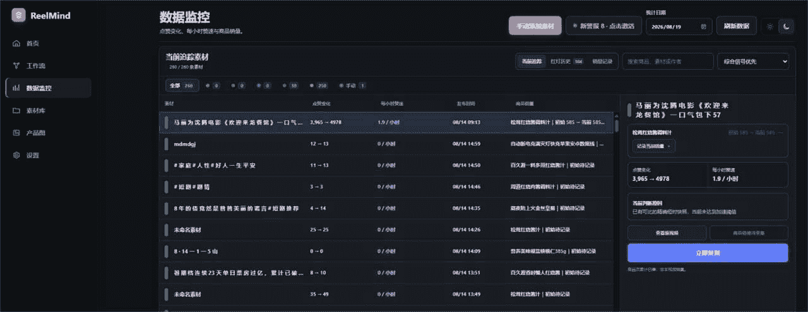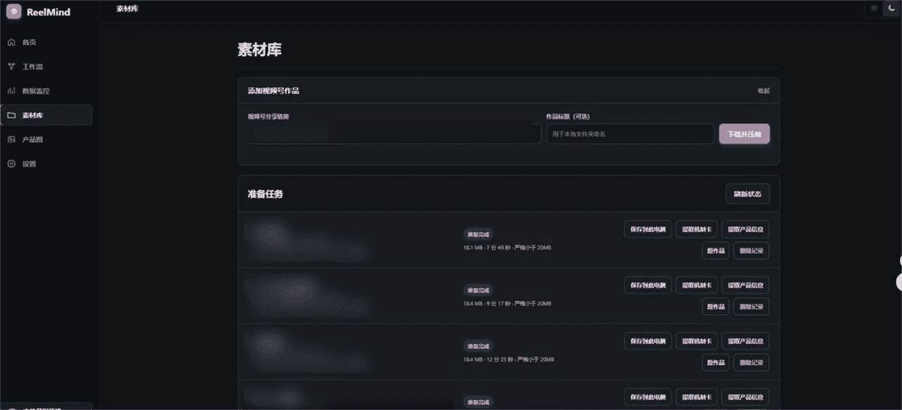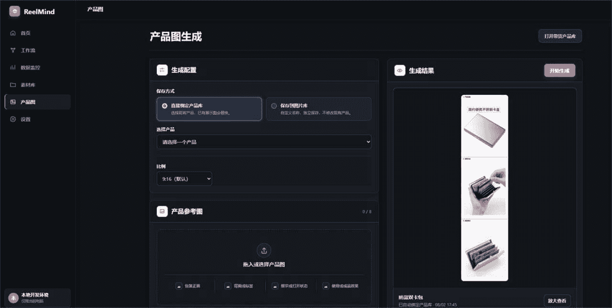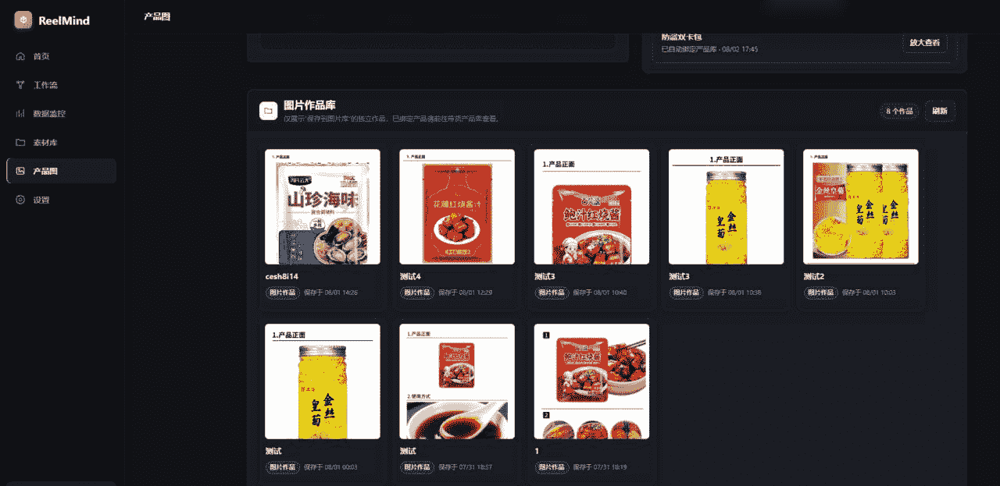

工作流运行记录让每一步的状态和结果都能追踪。

## 二、生视频平台，是产量上来以后逼出来的

脚本和制作资料标准化之后，新的生产瓶颈很快就转移到了“逐条提交视频”上。

一条作品有几十个 15 秒任务。如果完全靠人工去各个平台里逐段选图、填提示词、提交、等待、下载，再手动放回对应目录，不仅效率极低，而且往往会错过那些时效性很短的低价渠道。

所以我后来做的生视频平台，会直接读取上游输出的 Excel 和图片，统一在后台管理任务状态。生成完成后，平台会自动把视频片段按分镜序号下载回当天的作品文件夹。中途某一段失败了，可以单独重跑；任务中断了，可以继续原来的进度；几个分镜效果不满意，也可以随时指定重做。

我前后接入过十几个不同的生成平台。单独接入一个平台，其实只解决了一次性的问题；后来我把“如何接入新渠道”整理成了一套标准的适配流程，市场上只要出来新的低成本渠道，我只需要处理它不同的部分，就能快速接回原来的生产流程中。

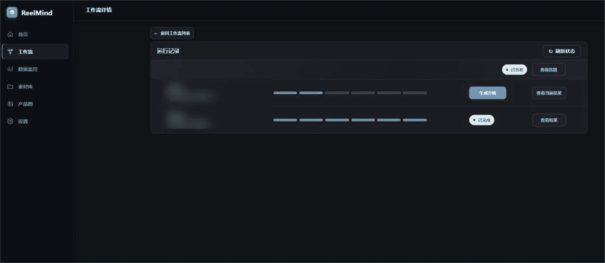

## 视频生成的真实成本与价格核算

做这个项目，生视频确实是日常开销里的大头，所以我最开始的核心思路也是尽可能压低单段成本，用最低的代价跑出正反馈。

具体的单条成本，完全取决于你手里的生成渠道：

- 官方 API 渠道：不管是 2.0 还是 2.5，官方价格都偏贵，一段 15 秒的视频生成下来基本要 7 到 10 块钱左右。如果一条长视频全用官方跑，成本很容易冲到两三百块；

- 市面上的低价渠道（口子）：像闲鱼或者一些第三方渠道，一段 15 秒、720P 的视频通常在 1 到 3 块钱之间，这属于目前最常规、可接受的成本区间；我遇到过最便宜的极端情况，一段只要 1 毛钱（不过这种超低价渠道一般时效很短）。

为了让大家心里有笔明白账，我们按常见的分镜数量来算一下单条完整作品的实际成本：

- 以 50 个 15 秒任务（成片约 8 分钟）为例：
  - 用 1 到 3 块钱的常规渠道跑，一条成片的成本大概在 50 到 150 块钱；
  - 如果碰上几毛钱的超低价渠道，成本能压到 50 块钱以内；
  - 如果混着用高价或官方渠道，一条成本大概在 150 到 200 块钱。
  - 综合来看，一条 50 分镜的作品，目前市面上的实际制作成本基本在 50 到 200 块钱之间。

- 以我目前常做的 80 个 15 秒任务（深度长视频，成片约 15 分钟）为例：
  - 任务量增加到 80 段之后，用常规低价渠道跑，一条成片大概是 70 到 80 块钱；如果渠道稍微贵一点，成本基本在 150 到 250 块钱之间。

在实际生产中，手头一定要常备几个不同的渠道，有贵的保底，有便宜的冲量，根据当时的单价灵活控制整条作品的预算。

一次便宜的渠道，只能降低这一批作品的成本；而能够快速接入新渠道、稳定管理和回收结果的这套 SOP，才是可以一直沉淀下来的重要因素。

## 三、剪辑让我重新划清人和 AI 的边界

剪辑是我和 Codex 磨合时间最长、踩坑最多的一环。

最开始，我总想着追求“全自动”，希望 Codex 直接按照规则把整条作品完全剪好。后来为了提升效果，我还接入了 Gemini，让它结合抽帧、音频和上下文去真正理解视频内容。虽然出来的效果确实比单纯套死板规则要好很多，但零点几秒的画面微小变形、肢体穿模，或者微小的违规瑕疵，AI 依然可能漏掉。

最后我把流程调整成了现在的模式：人先完成素材好坏的快速预检，Codex 再做标准化的批量收尾。这次调整对我触动很大：做自动化不是为了追求“全自动”这三个字，能稳定交付、不违规才有实际意义。把能说清楚、能验收的标准动作交给 AI，目前它判断不准、需要网感把关的部分，踏踏实实留给人来做。

## 四、我实际怎样和 Codex 一起做东西？

我本身没有任何代码基础，很多功能和需求，其实都是我用大白话直接口述给 Codex 的。

不会写代码，并不妨碍我们把工具做出来。核心前提是你必须真正下场做过这个业务，清楚自己到底要解决什么痛点，也知道什么样交付的结果才算及格。

我现在和 Codex 配合的习惯通常是：

1. 先划清边界：先让它把现有的文档和业务逻辑读透，讲清楚这一次只允许查看还是要直接修改，边界先说死；
2. 跑最小样本：把目标、不能改动的核心内容以及交付格式讲明白，先跑通一个小样本；
3. 把错误沉淀成规则：当生成的结果不符合预期时，我不会只简单地说一句“重新做一遍”，而是把具体错在哪里指出来。

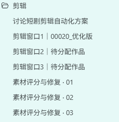

如果这个问题以后还会反复出现，我就要求把正确标准直接写回提示词、SOP 或代码逻辑里。

把当前这一次改对，只解决了眼前这一个任务；把错误原因写回工作流，下一次才能彻底少走同样的弯路。

至于产品现在值不值得跟、市场大盘怎么判断、供应商怎么对接、直播间怎么配合，这些事情 Codex 替代不了我们。它最大的价值是执行那些已经能被明确定义的事情，把我们的时间和精力解放出来，去盯那些真正需要商业判断的地方。

同时，我自己平时也在做企业端的 AI 落地。

给自己做工作台的时候，业务痛点、实际需求和验收标准都在我自己脑子里，哪里不好用，我分分钟就能发现并改掉；但给企业做的时候，第一轮需求往往来自对接人的口头描述，很多深水区的细节，只有真正深入到一线业务、经过团队持续试用之后才会暴露出来。

这也让我越来越看清一件事：工具能不能做出来是一回事，对业务本身有没有理解透，完全是另一回事。

## 五、做了三个月以后，我对视频号的几个真实感受

在这三个月的实际操盘里，经历了起伏，踩过了各种各样的坑，有几条心法是我现在非常坚信的：

### 1. 视频号一直在变，阶段性的经验只能阶段性使用

回顾这三个月的时间线：

- 5 月份：我主要是在花钱买经验，当时用较贵的 API 渠道，硬把产品、脚本、视频、账号、发布、直播和数据整条链路跑通，成本高一点也先认了；

- 6 月到 7 月：我每天维持多个账号稳定更新，靠持续的产量慢慢建立起了对视频号的网感和体感。7 月份整体产出最好，我也顺势集中精力做出了脚本工作台和生视频平台；

- 7 月底到 8 月份：市场上的批量搬运和科技明显泛滥起来。一条好作品刚开始起量，很快就会被大量同行搬运复制，原来可以吃上一周的放量窗口，被压缩得越来越短。同时，平台大盘推泛流量的情况变多，有播放没转化成了常态。

自己的测试量不够大时，很容易怀疑是不是自己的脚本出了问题。这时候，同行和社群的信息交流就极其重要——去和圈友横向对对账，发现大家都在面临同样的困境，就能少做很多盲目推翻自己、盲目改脚本的错误动作。

市场上一直有人在赚钱，这只能说明项目依然有解，但绝不代表别人的解法就是你的解法。8 月份我主动放慢生产节奏，把时间用来复盘、优化工作台，并且开始测试幅度更大的“大二创”路线（先通过多个差异化版本去测爆，跑出结果后再精细复刻放大）。市场好的时候拼命冲，投入产出明显下降时停下来调整系统、升级打法，这本身就是做项目必须具备的节奏感。

### 2. 能控制的事情，提前做好

做视频号有太多不可控变量：平台今天给什么推流、用户的购买意愿高不高、某一条作品最终能不能爆，这些我们左右不了。

但脚本质量、选品匹配、商品链接限单、制作成本控制、号主的紧急联系与扫脸配合，这些全部是我们自己可以提前掌控的。

很多时候，我们是测试了 10 个账号才博出 1 个真正的大爆款。任何一个本来可以提前避免的小失误（比如链接失效、号主失联扫不上脸），都会让你前面的 9 次测试和投入全部打水漂。所以我的原则一直很纯粹：能控制的事情提前做好，永远不要抱任何侥幸心理。

### 3. 做出来的作品，要尽快交给市场

刚找到特别便宜的生视频渠道时，我最开始也忍不住疯狂生成视频囤在电脑里。但真正做下来发现：产品和市场风向一直在变，提前做太多，很容易全部烂在文件夹里。

同时，关于生成剪辑出来的视频质量的问题，如果你觉得它不达标，那既然它做出来了，你就一定要去发布。我也存在那种就是自己觉得很垃圾的作品，但是发出去依然卖了大几千块钱。所以说，作品好不好，交给市场去进行检验，让市场给答案。千万不要把自己的主观审美，当成市场已经给出的答案——很多你自己觉得一般的视频，反而跑出了好的结果。

### 4. 一条作品的成本，要把前面的失败一起算进去

看视频号的账本，绝对不能只看“一条 15 秒视频花了多少钱”。

真实的投入还包括账号成本、工具额度、剪辑时间、直播运营，以及前面 9 个没有跑出来的失败账号和测试废片。低价渠道的真正价值，在于它拉低了你的试错门槛，让你在同样的资金下能多测试几批组合。

但如果不顾产品时效去盲目囤片，或者作品发不出去，视频再便宜也没有任何商业意义。把这笔分摊成本想明白了，你才能理性判断当前的项目到底赚不赚钱、该不该继续扩量。

## 六、如果现在你也想入场：一些真实的参数与避坑建议

如果你看完这篇复盘，也打算下场试一试视频号 AI 剧情带货，结合我这三个月真金白银踩出来的坑，我真诚地给你提几条大白话的建议。

先说大家最关心的真实花销和成本构成（这里先把生视频的消耗除外，只算做这个项目其他七七八八的必要开销）：

- 账号成本：
  - 租普通号：市场上大概是 150 到 250 块钱 7 天；
  - 外展号（挂车号）：市场价基本在 180 到 300 块钱之间，跟着大盘行情上下浮动；
  - 企业号认证：除去账号本身的费用，认证一个企业号官方需要 300 块钱。

- 脚本工作台：市面上现成的二创工具非常多，价格从几百块到几千块的都有，丰俭由人，新手根据自己的预算自由选择就行。

- 数据监控工具：比如看大盘和流速的小微猫，一个月会员大概是 80 块钱左右。

- 直播代播费用：如果打短引需要找代播，市场价一般是 30 到 45 块钱一个小时（白天和夜间的价格会稍微有点差异，不同代播团队报价也不一样）。

把这些零碎的账号、工具、代播成本，加上前期生视频的 API 测试消耗加在一起，手里备个 5000 到 10000 块钱，就足够你把整个链路跑上几个来回了。

账号准备上，新手起步千万别一上来就去租一大堆号，手里准备 2 个正常账号（最好是自己或者家人的），提前做上两三条作品留点容错空间就可以了。

至于时间，很多人问我能不能当下班后的轻量副业来搞？我的大实话是挺难的。因为你每天要刷对标、洗脚本、挑镜头、做剪辑、还要盯流速和开播，事情非常碎。如果真想把它当成一个能拿到正反馈的项目，前期每天至少得踏踏实实扑进去 5 到 8 个小时。

再聊聊现在的市场大环境：以目前 8 月份搬运科技满天飞的情况，不建议纯新手直接重仓冲进来硬拼数量。现在一个好作品刚出来，可能几个小时就被搬运烂了。现阶段更聪明的做法是先练内功，用现成的工具把做视频、拆爆款、做剪辑的手感彻底练熟，哪怕用小成本去测测不同风格的二创剧情。等看懂了整条出单的底层逻辑、摸清了平台的推流脾气，赶上下一波好的市场窗口再果断放大。

这几个月里，我也见过不少新人容易走偏的地方，很多教训都是拿真金白银换来的：

最常见的就是一上来就死磕“纯原创”。在自己连什么是有效开头、阿姨们到底为什么愿意停下来看都没搞明白的时候，千万别盲目自创剧本，很容易陷入自我感动，发出去连几百播放都拿不到。前期老老实实去 1:1 复刻市场上验证过的爆款机制，先拿到第一笔出单，比什么都强。

还有就是千万别贪便宜盲目囤片。有时候偶然找到一个一两毛钱的便宜渠道，很多人就忍不住疯狂生成几十上百条视频存在电脑里。但视频号的商品和风向变化极快，等你过几天想发的时候，这个品可能早就卖不动了，囤的视频全成了废片。做视频必须紧跟当下的商品时效，做出来就发，绝不囤货。

另外，别拿自己的年轻人审美去替市场做决定。我们自己做完一条视频，可能觉得画面不够精致、甚至觉得有点土，就嫌弃它不想发。但视频号核心的买货人群很多是中老年群体（阿姨们），她们看重的点跟年轻人完全不一样。只要视频没有明显的违规和硬伤，做完就赶紧发出去给市场看，很多你自己觉得一般的片子，反而跑出了意想不到的成交。

账号和链接的问题也绝对不能大意。很多时候我们测了 10 个号好不容易爆了 1 个，流速刚起来，结果因为异地登录要扫脸，号主在上课或者联系不上，直接被平台掐断推流，这种损失是最让人吐血的；还有人辛辛苦苦跑了上百万播放，才发现挂的商品链接一天就给卖两百单，剩下的流量全打水漂了。所以在发视频之前，一定要跟号主打好招呼、花几分钟把链接的限单和资质彻底查清楚。

最后就是，刚起步千万别执着于“全自动”或者自己去写代码搭工具。你连单条视频怎么出单都没搞顺，去搞自动化只是在批量制造错误。先把市面上成熟的现成工具用起来，等你的出单闭环彻底跑通了、每天产量确实遇到瓶颈了，再去考虑用 Codex 做出专属于你自己的工作台。

## 写在最后

以上就是我分享的一些经验之谈，只是我个人实操里面的一些方式和方法，视频号带货涉及的细节非常多，这篇文章更多是把我实操跑出来的核心框架、实战心法和关键避坑点分享出来。如果大家对这个项目感兴趣，建议也可以多结合一些优秀的资料去进一步丰富细节，带着思考亲自跑一跑，也欢迎指正。

从 YouTube 到视频号，这一年多我拿到过一些结果，也踩了不少坑。回头看，留在自己身上的变化更重要。

以前看一个项目，我更多会先看能不能赚钱。现在还会继续看它处在什么周期，哪些事情掌握在自己手里，项目停下来以后，自己还能留下什么。

过去我几乎没有认真做过内容。经过 YouTube 和视频号以后，我对国内外内容的网感、爆款开头、人物关系、剧情推进和视频拆解，都有了更具体的体感。

做项目的思路也比以前清晰了一些。从找对标、确定产品、生产内容，到发布测试、观察数据、放大结果，我开始把零散经验整理成一条能够反复使用的路径。

视频号这三个月大约 40 万 GMV，是一个阶段性的结果。它来自产品、内容、账号、直播和市场共同作用，也来自这几个月持续生产和测试。

Codex 帮我缩短了发现、准备、生成和剪辑的路径，让很多重复动作可以由一个人管理。产品怎么判断、市场怎么变化、脚本有没有网感、最后要不要继续投入，仍然要自己负责。

这套方法的起点，是生财、深海圈、项目发起人和前辈们已经跑过的经验。落到自己手里以后，我再继续测试、调整和迭代，才慢慢形成了现在这套适合自己的流程。

口子没了可以继续找，产品窗口过去了就换品，平台变了就继续看市场。这几个月积累下来的 AI 视频能力、内容判断、业务理解和工作流，不会跟着某一个短期机会一起消失。

就拿我自己来说，如果在做 YouTube 的时候，没有在深海圈跟着周期把 AI 视频的制作能力和对内容的体感实打实磨炼出来，后来转战国内做视频号短剧带货时，我也绝不可能拿到结果。

平台和项目会一直换，但每一个项目沉淀下来的底层能力是可以随时进行“能力迁移”的。只要你在一个项目里真正死磕拿到过正反馈，未来换到任何新的场景和赛道，这种能力都会成为你快速破局的底气。

关于我接下来的方向：一方面是在继续稳固、放大现有视频号打法的同时，花更多精力往“大幅度二创”甚至偏原创的高壁垒内容方向去走；另一方面，我也会去尝试视频号里更多不同赛道和内容方向的玩法，比如生财航海推出的图书带货等类目。

短视频和 AI 的发展速度极快，写下这些与大家共勉，共同学习，共同进步。也欢迎对视频号不同赛道、不同内容方向感兴趣的圈友们互相交流！

最后感谢生财有术、深海圈，以及一路上愿意分享市场信息和实操经验的圈友、群友。

关于 AI 剧情脚本的二创、视频生成工作台、剪辑 SOP 和 Codex＋Gemini 的自动剪辑方案，后面有机会我再分别展开。

谢谢！

————分割线————

看完这篇 SOP，你觉得你懂了。但 90% 的人一到实操就会卡在第一步。

工具和教程只是最低级的壁垒，真正的壁垒是“立刻动手”和“圈层信息差”。

如果你想看全网最新的变现玩法，并且和一群执行力极强的极客一起下场拿结果，欢迎围观我的核心私域：【懒人专属群】。

我们不聊虚的，只做商业闭环的拆解与 AI 效率的压榨。系统内已沉淀 1000+ 跑通的套利实战局。

👉 查阅圈子完整数字资产与上车门槛：

https://lazyso.com/insider/

认同价值、准备好下场干活的，扫码加我微信（lazyhelper1）

备注：【实操上车】，不闲聊

