# **300** 人点赞投锚，月入**7w** 后，我的**Agent** 员工军团搭建流程全公开。（**38000** 字实操版）

260828 副业SC 精华

整理：公众号懒人搜索，懒人专属群精选

懒人微信：lazyhelper1

# 一、前言

圈友们好呀，见字如面，我是枕棠，04 年 AI 超级个体，在杭全职创业。

自 2026 年 6 月参加广东航海家大会后，至今 2 个多月的时间，我用 codex 烧了 260 多亿的 Token，把我所有的一切都完成了 AI 化，搭建出了现在这支 Agent 员工军团。

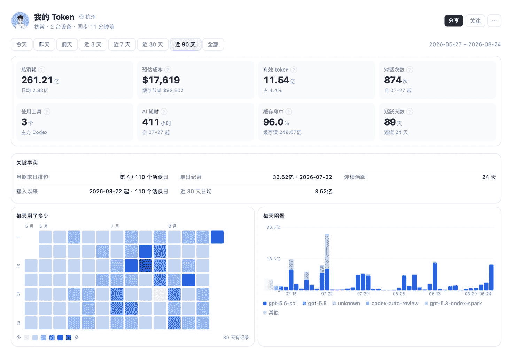

当然，**Agent** 员工军团本身没有任何意义。

真正有意义的是：它到底有没有帮我提升效率，有没有帮我拿到真实的结果。

从生活上来说，我的减肥、旅行规划、目标规划和 OKR 设立，都已经陆续开发出了对应的工作台和 Agent。过去很多需要我自己记忆、规划和反复决策的事情，现在都可以交给 AI 辅助完成，降低了很多心力消耗。

从事业上来说，我的核心业务是通过公众号引流获客，再在私域售卖自己的知识付费产品。所以这段时间，我的公众号创作、朋友圈营销写作、发售文案、产品设计、海报设计……各个维度都开始全面接入 AI。

这期间写出了不少爆款，上个月也实现了月入 7w。

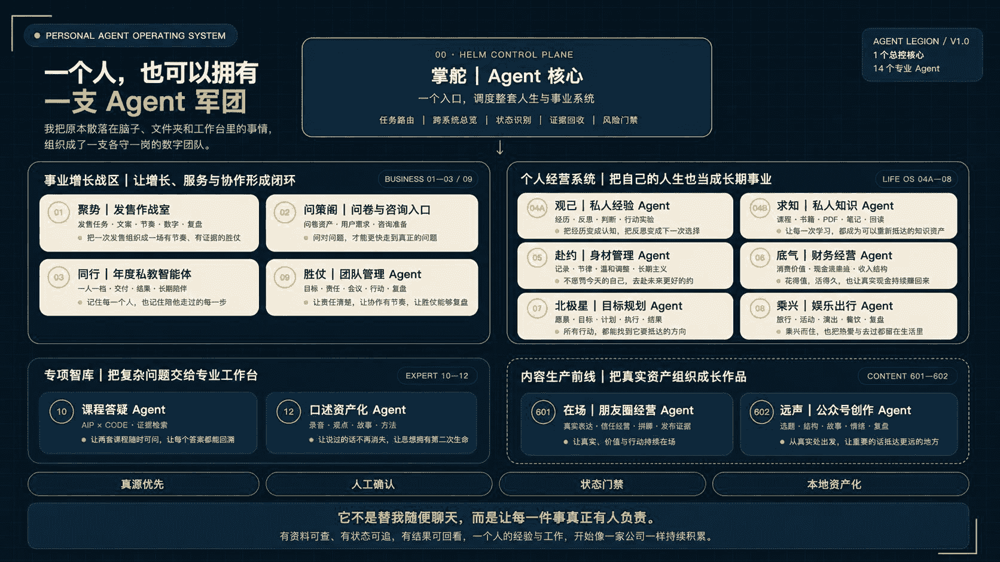

当然，我不能说一切都是 AI 完成的。

但 AI 确实帮我更加稳定地拿到了结果，同时把很多内容工作的时间成本，降低到了原来的 1/3～1/2。

上个月，我写了一篇帖子：

《从 AI 小白到 12 个 Agent 员工，我的 60 天 150 亿 Token 系统升级之旅》

我当时说，如果点赞投锚的人多，我就把搭建 AI 员工军团的全流程公开。

最后有 300 多位圈友点赞投锚催更。

收到这份激励后，过去一个月的时间，我一直在反复推敲这篇文章。

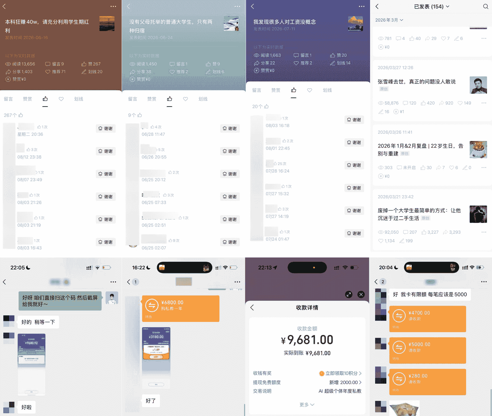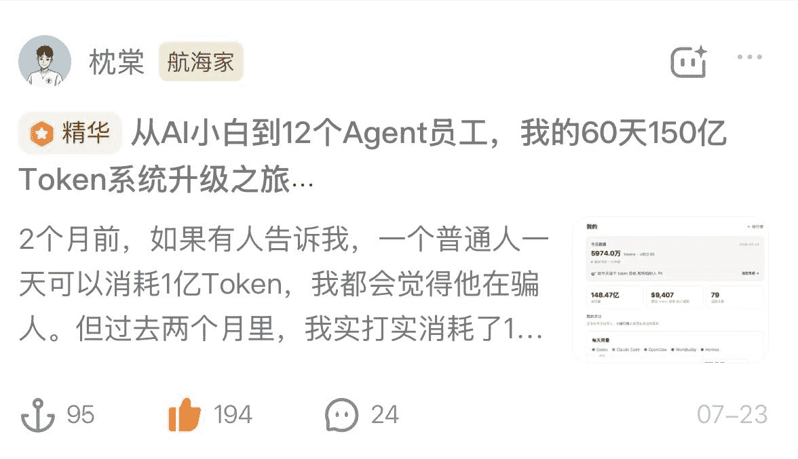

从整篇文章的结构，到每一步到底应该怎么讲，再到相关的提示词、案例和实操细节，前前后后改了很多版，才有了现在 38000 字的完整教程。

所以今天，我就来完整分享一下：

我是怎样一步一步，搭起这支 Agent 员工军团的。

它的底层并不是多学几个 AI 工具，也不是下载一堆现成的 Agent。

而是尝试把 AI 拉下神坛。

把场景、知识库、Skill、交互和反馈串成一条完整的工作流。

让大家真正理解：这些东西为什么有用、彼此之间是什么关系，以及到底应该怎么一步一步把它们搭出来。

最后真正用到自己的工作和生活里，拿到结果。

因为如果不能落地，那么学再多 AI、搭再多 Agent，都没有意义。

整篇文章主要分成三个板块：

一：为什么要搭建 Agent 员工军团？

二：如何用五步搭出自己的 Agent 员工军团？

1. 拆解业务，找到提效场景
2. 数据采集，搭建第二大脑
3. Skill 固化，稳定产出结果
4. 设计交互，搭建 Agent 员工
5. 反馈回流，驱动系统进化

三：相关教程、提示词和代码。

好，话不多说我们开始。

# 二、为什么要搭建 Agent 员工军团？

## 1. “用上 AI”，还是“用 AI 提效”？

我研究了七年时间管理，也研究了七年人的目标和动机。

这些年我意识到一个东西：

如果我们真的想做成一个结果，首先要找到自己的目标和方向，以及我们为什么要做这件事情。

所以在我们正式开始搭建 Agent 员工军团之前，首先要思考的一个问题就是：

我们为什么要搭建 Agent 员工军团？

很多人的答案可能是：

因为 AI 是这个时代最新的生产力，所以我要用上 AI。

但“用上 AI”本身并不是一个目标。

如果你只是想和 AI 聊聊天、问问题、写一点东西，那么 ChatGPT、豆包这些对话式 AI，其实已经完全够用了。

那为什么我们还要费这么大的力气，去搭建一支 Agent 员工军团？

为什么还要折腾 Codex、Hermes、飞书 CLI、Obsidian，搭知识库、写 Skill、设计工作流，把这么多东西连接起来？

因为我们真正想要的，不是“用上 AI”。

而是用 AI 提效，把 AI 真正落地到完整的业务里。

我们需要把一个个零散的对话串成完整的工作流，让 AI 能够读取我们的业务资料，按照我们已经验证过的方法做事，并且更加稳定地给出结果。

因为说到底：

AI 的目的只有一个：用更低的成本，获得更高的产出。

更快、更稳定地为我们产出结果。

这才是我们真正想要的。

而这些事情，单纯依靠 ChatGPT 这样的对话式 AI，很难做到。

它有三大结构性问题决定了它做不到这一点。

第一，要反复喂给 AI 同样的话，它经常容易忘，容易搞混。

第二，AI 做出来的结果浮动特别大，难以稳定产出。

第三，AI 要你说一句才做一句，交互起来特别累，并且只能在聊天框里使用。

我们展开说说：

## 2. 对话式 AI 的三大结构性问题

### 1. AI 记不住你，而且记忆容易混乱

这是最容易被大家感知到的问题。

你刚刚和 AI 讲完自己的身份、受众、产品和写作要求，换一个聊天框，它又像第一次认识你。

于是每次开始任务以前，都要重新介绍自己的背景、贴过去的文章、补充产品信息，再解释一遍什么能写、什么不能写。

更麻烦的是，AI 不只是容易忘，还容易记乱。

当你同时处理多个项目、多个身份时，它可能把 A 项目的信息带进 B 项目，把不同业务的人设、产品和上下文混在一起。

所以对话式 AI 的第一个问题，就是记忆既不稳定，也不清晰。

### 2. AI 偶尔做得很好，但结果很难稳定

第二个问题，是 AI 的产出非常容易波动。

同样一个任务、同样一条指令，昨天做得很好，今天可能完全不能用。

同样让它写一篇公众号，有时候能给出一个很有力量的开头，有时候却写得像行业报告，逻辑都对，但一句人话都没有。

最麻烦的是：

它不是不会，而是偶尔特别会。

所以你永远不知道下一次出来的结果到底怎么样，也很难真正把一项重要工作放心交给它。

对话式 AI 的第二个问题，就是能做出好结果，但很难稳定地做出好结果。

### 3. AI 碰一下做一下，而且始终困在聊天框里

第三个问题，是 AI 依然需要你不断推动。

你让它找材料，它才找材料；你让它写结构，它才写结构；你让它继续，它才继续。

拨一下，它转一下。

看起来 AI 已经帮你完成了很多工作，但你还是得守在电脑前，不断发指令、等回复、复制结果，再把结果搬到下一个地方。

以前是自己干活，现在只是变成了：

“指挥 AI 的手工劳动。”

而且这些能力始终被困在聊天框里。

你必须主动打开 AI、找到对应的对话，再告诉它下一步做什么。

它很难像一个真正的员工一样，在固定的时间或者事件发生以后开始工作，再把结果主动送到你平时使用的飞书、微信里。

所以第三个问题其实是：

AI 不仅碰一下做一下，而且始终困在聊天框里，没有真正进入我们的工作流。

## 3. 从对话式 AI 走向 Agent 员工

接下来我们来聊聊怎么解决这个问题。

第一个，AI 总是忘记你，是因为它没有一套可以持续读取的知识库。

所以我们要把自己的经历、产品、客户、案例、方法和判断沉淀下来，让 AI 每一次工作的时候，都知道应该去哪里读取。

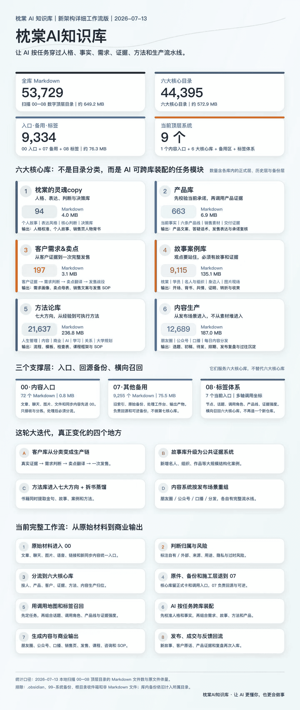

第二个，AI 结果忽好忽坏，是因为你拆得不够细，没有制作 Skill。

所以我们需要把已经验证过的做事方法固化成 Skill，把“怎么做”“用什么”“怎样算好”真正告诉 AI。

第三个，交互起来累，是因为你没有设计 Agent。

AI 碰一下做一下，是因为前面的能力依然困在聊天框里，没有形成完整的交互和工作流。

所以我们需要进一步把这些能力封装成 Agent 员工和工作台，让 AI 真正进入我们的工作和生活。

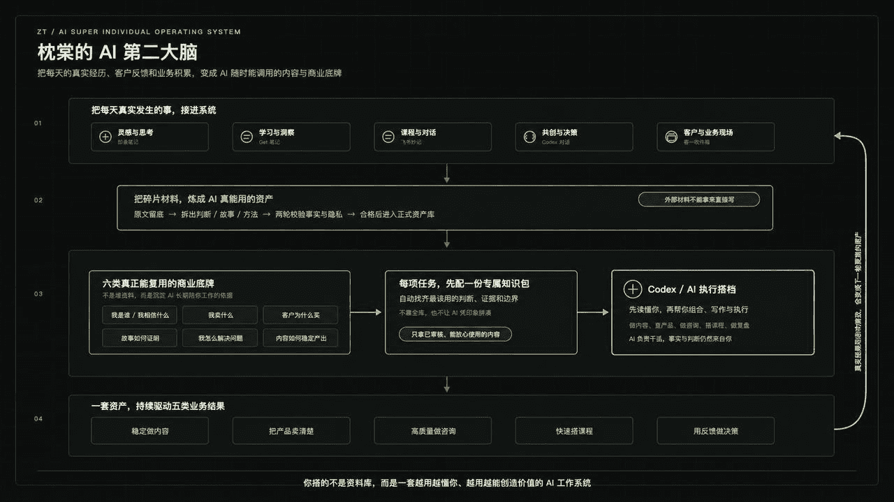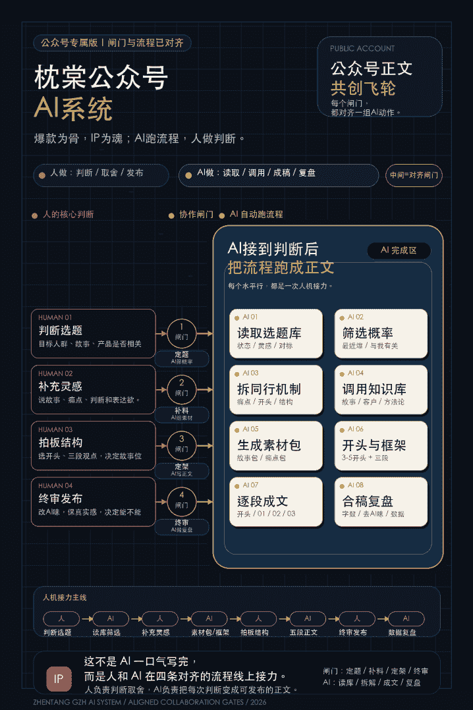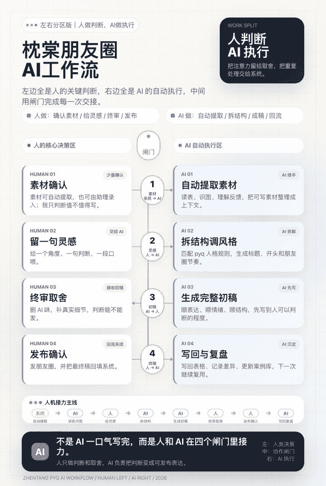

于是你会发现：

知识库，让 AI 认识你。

Skill，让 AI 学会怎么干活。

Agent 和交互，让 AI 正式成为员工。

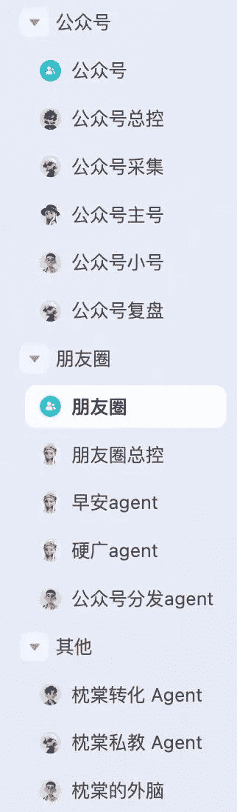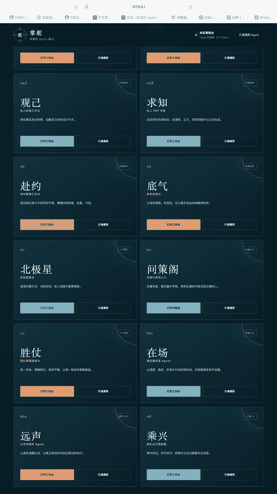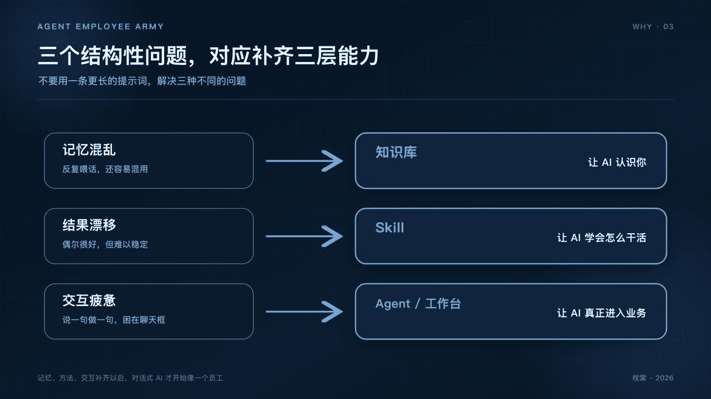

而这也是我理解的，从“对话式 AI”走向“Agent 员工”的真正过程。

不是换一个更高级的 AI 工具。

而是一步一步，把一个只会陪你聊天的幕僚，变成一个真正了解你、会做事、能够进入业务的员工。

接下来我们正式开始来讲要怎么做这件事。

我们一个完整的 Agent 员工的搭建过程，分为这 5 个板块：

- 第一步：拆解业务，找到提效场景。先明确到底要让这个 Agent 帮你解决什么问题，避免一开始就为了用 AI 而用 AI。
- 第二步：数据采集，搭建第二大脑。把完成这项任务需要的经历、产品、客户、案例、方法和历史资料整理出来，让 AI 真正认识你、认识业务。
- 第三步：Skill 固化，稳定产出结果。把已经验证过的做事方法、判断标准和工作流程固化下来，让 AI 从“偶尔做对”，变成“稳定做对”。
- 第四步：设计交互，搭建 Agent 员工。把知识库和 Skill 封装进真正的工作流里，通过飞书、工作台等方式，让 AI 不再困在聊天框里，而是真正进入你的工作和生活。
- 第五步：反馈回流，驱动系统进化。把真实使用中的数据、人工修改、用户反馈和业务结果重新沉淀回知识库和 Skill，让这支 Agent 员工军团越用越懂你。

# 三、如何 5 步搭出自己的 Agent 员工军团？

## Step1：拆解业务，找到提效场景

### AI 启动的正确姿势

现在我们已经知道，为什么要从对话式 AI 走向 Agent 员工了。

但真正开始搭建 Agent 的时候，很多人马上会遇到一个新的问题：

我到底应该先让 AI 帮我做什么？搭建什么员工。

很多人学 AI 最大的问题，就是没有抓手也没有方向。

一上来就在问：

Codex 应该怎么学？

Claude Code 有哪些 Skill？

怎样搭一支 Agent 员工军团？

这些问题都没有错，但如果继续问一句：

你到底想用它解决哪件事？效率到底提高在哪里？

最后是要多交出一篇文章、一张表格、一份方案，还是多成交一个客户？

很多人其实并不知道，于是就很容易陷入一个循环：

今天看一个教程，明天装一个插件，后天从 GitHub 下载一个热门 Skill。

今天想做公众号 Agent，明天又想研究自动化电商，后天看到别人做了一个很酷的工作台，又想重新做一个工作台。

折腾了一周，电脑里的东西越来越多，真正能够有效果的没几个。

热门 Skill 装好了，插件装好了，然后就没有然后了。

兜兜转转，毫无效果的原因就是，一切都是从互联网上道听途说开始，而不是从一个真实的任务和目标开始。

没有真实任务，就没有真实产出。

没有真实产出，就没有时间、数据、用户和金钱的反馈。

而没有反馈，AI 系统就无法落地，也无法完善。

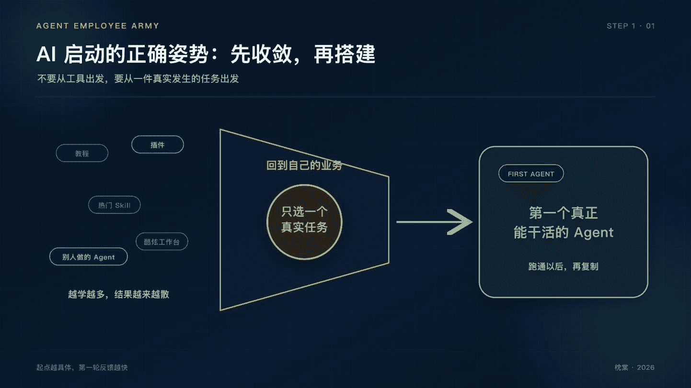

你做着做着一定会开始怀疑：

我折腾这些东西，到底有什么用？怎么效果这么差？

所以搭建 Agent 员工军团的第一步，不是打开 Codex，也不是先去搭知识库、写 Skill。

而是先回到自己的业务里：

寻找一个能提效的场景，深耕于此，搭出第一个真正能干活的 Agent 员工。

等它跑通以后，再把这套方法复制到其他场景里，搭建 Agent 军团。

## 2. 提效场景的四大筛选标准

那什么样的场景，适合作为我们的第一个 Agent 员工呢？

我现在主要看四个标准。

第一，它是否足够高频。

优先选择那些你反复在做的事情。

最好一周会发生三次以上，如果任务本身频率比较低，至少一个月也应该发生三次。

因为 Agent 不是搭完就结束了。

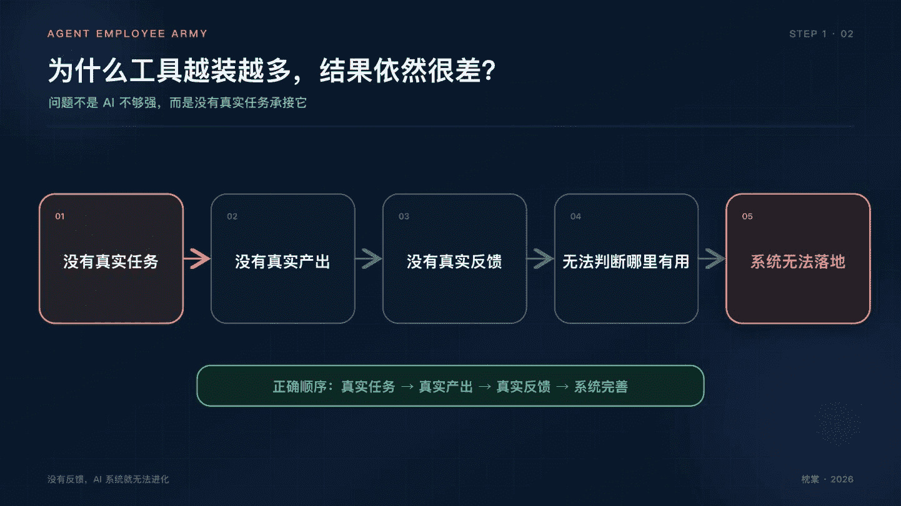

你需要不断使用、不断发现问题、不断调整。

频率越高，你获得反馈的速度越快，也就越容易在短时间里把它真正跑通。

第二，它是否有一个明确的数字化产物。

文章、PPT、表格、报告、方案、视频脚本、图片、问卷、会议纪要，都属于非常好的数字化产物。

因为它们有一个共同特点：

最后到底有没有完成，是可以直接看见和验收的。

“帮我把公司经营得更好”，这个目标就太大了。

但如果变成：

“每周一读取已经确认的经营数据，生成一份三页周报，并列出三个需要我拍板的问题。”

它立刻就变成了一个 AI 可以承接的具体任务。

所以场景一定要足够具体，最后最好能落到一个明确的结果上。

第三，它是否足够重要，并且能够获得真实反馈。

这个场景最好真的和你的工作、生活或者业务结果有关。

它可以直接带来收入，也可以明显节省时间、降低心力、减少错误，或者提高一项重要工作的交付质量。

更重要的是：

做完以后，你要能够收到真实反馈。

文章有没有阅读量，客户有没有回复，方案有没有通过，做图有没有被真正使用，完成一次到底节省了多少时间……这些都是真实反馈。

只有反馈回来，你才知道这个 Agent 到底有没有用，以及下一步应该优化什么。

第四，它最好是你过去已经跑通过、比较擅长的事情。

这一点我觉得非常重要。

很多人刚开始用 AI，就喜欢让 AI 去做一件自己完全不会的事情。

但问题是：

如果你自己都不知道什么叫好，你又怎么判断 AI 做得好不好？

搭建 Agent 的过程，本质上是把你过去已经验证过的经验、方法和判断，一点点交给 AI。

所以第一个场景，最好是你足够擅长、能够辨别好坏的事情。

你过去做过很多次，有足够的历史样本，也知道哪里容易出问题，什么结果算好，什么结果必须推倒重来。

先让 AI 复制你已经拥有的能力，再让 AI 放大你的能力。

AI 会平等放大强者的强和弱者的弱。

所以总结下来，第一个 Agent 场景最好同时满足四个条件：

足够高频、有明确产物、能够获得真实反馈，而且是你自己擅长的事情。

当然能够同时四个都满足的，可遇不可求，尽可能满足的越多越好。

## 3. 我的 Agent 军团，为什么从公众号开始？

讲完上面的四个标准，你可能觉得会有点抽象，我们直接用我的业务来举例。

最开始我使用 AI 的时候，选择的核心场景，就是公众号创作。

因为它几乎完美符合前面的四个标准。

第一，足够高频。

我一周至少要写三篇公众号。

这意味着我可以在很短的时间里不断使用、不断发现问题、不断调整系统。

一个流程（如设计产品）如果一个月才跑一次，前期没必要费心费力做个 Agent，而且很多问题可能几个月以后才暴露出来。

但公众号不一样。

这一周发现问题，下周我就可以继续测试。

所以它天然适合用来快速迭代一套 Agent 系统。

第二，有非常明确的数字化产物。

公众号最后交出来的，就是一篇完整文章。

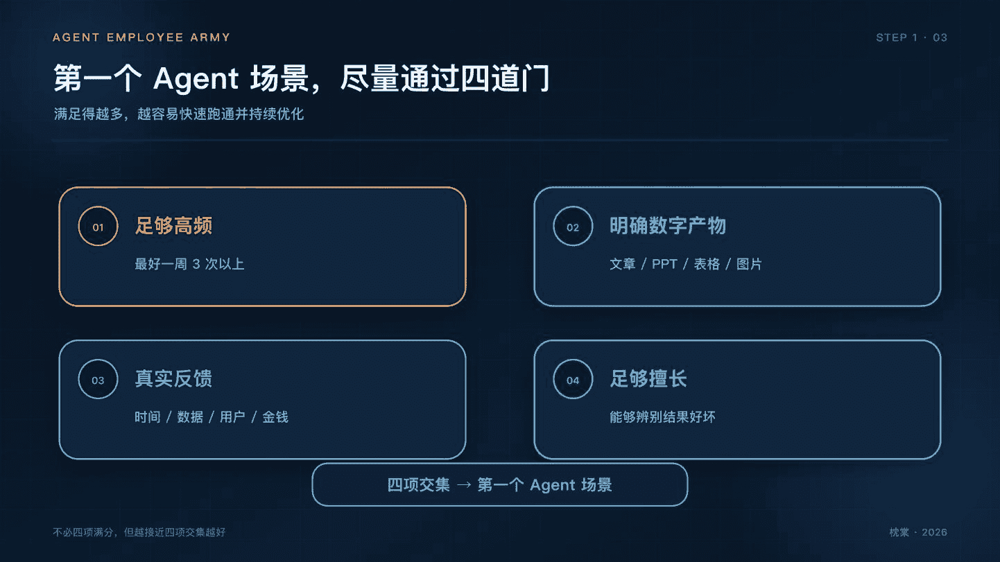

从选题、标题、开头、结构，到正文、配图和排版，全部都可以被读取、修改、保存和复盘。

而且每一步都有明确的中间产物。

选题是一个结果，结构是一份结果，正文也是一份结果。

这意味着我可以非常清楚地判断：

到底是哪一步出了问题。

第三，它足够重要，而且有真实反馈。公众号不是我拿来练习 AI 的玩具，它本身就是我的核心获客渠道，我会非常重视。

一篇文章发出去以后，有阅读量、点赞、转发，也会给我带来客户和收入。

所以 AI 到底有没有提效，不需要靠感觉判断。

它最后会直接反馈在：

创作时间有没有下降，内容质量有没有变稳定，流量有没有提高，客户有没有增加，收入有没有变化。

第四，也是最重要的一点：我已经做公众号很久，足够擅长，也能判断结果好坏。

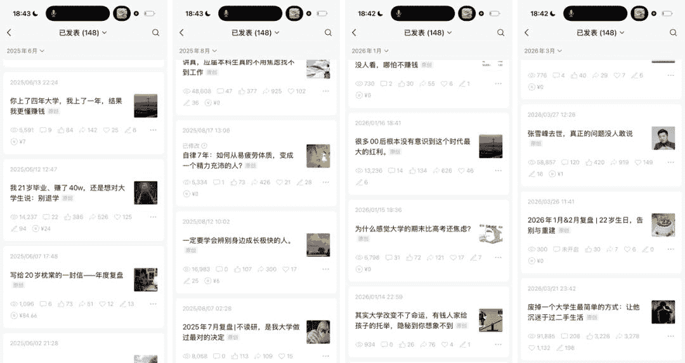

我已经写过很多文章，也靠公众号拿到过流量、客户和收入。

所以一篇文章放在我面前，我大概知道它哪里好、哪里不对。

我知道什么选题只是阅读量高，却吸引不到真正会付费的人；我也知道产品能承诺到哪里，一篇文章写到什么程度可以交给我精修，什么程度必须推倒重来。

正因为我自己足够懂，我才有能力不断告诉 AI：

这里哪里不对，为什么不对，以及下一次应该怎么做。

所以我没有从一个完全陌生的领域开始，而是先让 AI 复制、放大我已经跑通的能力。

后面大家会看到的知识库、Skill、Agent 和反馈系统，也都是从公众号这个真实场景里一点点长出来的。

当然，你不要觉得公众号这么好，你也选公众号。每个人都有适合自己的场景。再举个例子，前两天，我给一位做社群运营的私教学员做 AI 规划，给她选的场景是做海报图。

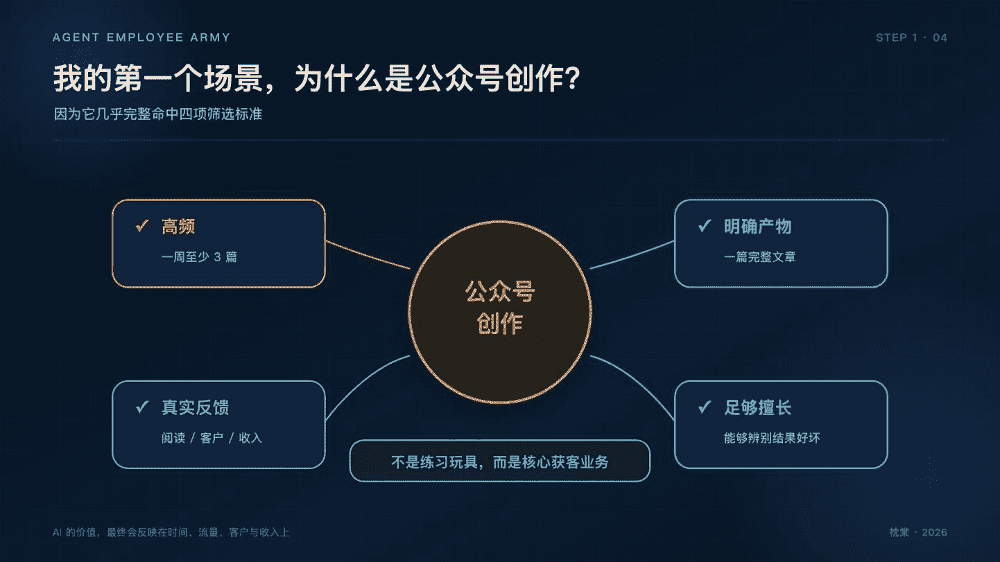

因为活动海报和传播图是她反复要做的事情，最后有一张明确的图片可以验收，而且她自己长期负责这项工作，一眼就知道一张图到底能不能用。

所以我们没有一上来给她搭一整支 Agent 员工军团，而是先解决一个非常具体的问题：

怎样把一段已经确认的内容，稳定地变成一张可以使用的传播图？

你会发现，我做公众号，她做图片，看起来完全是两件事情。

但背后的选择逻辑完全一样：

高频、有明确产物、有真实反馈，而且是自己已经做过、能够判断好坏的事情。

所以真正重要的，从来不是：

“别人最近都在搭什么 Agent？”

而是回到自己已经做过、能够判断好坏的真实业务里：

我现在反复在做的哪一件事情，最值得先交给 AI？

找到这件事，我们才有了后面搭知识库、写 Skill、做 Agent 的起点。其实到这里，一个 Agent 最初的“岗位”也就已经确定了。

因为我一直倾向于：

一个明确的任务，对应一个明确的 Agent。

比如公众号创作，就是公众号 Agent；活动海报，就是海报 Agent；我们先确定它到底负责什么、最终要交付什么结果，后面的知识库、Skill 和交互，都是围绕这个岗位继续往下搭。

至此，搭建 Agent 军团这件事，才算是迈出了一大步！

## Step 2：数据采集，搭建第二大脑

### 1. 知识库，就是 AI 的大脑

前面我们已经确定了第一个要提效的场景，找到了第一个 Agent 员工的方向。

而关于搭建 Agent，首先要解决的就是知识库问题。

而关于知识库，其实只需要回答一个问题：

为了把这件事做好，AI 到底需要知道什么？

注意，我这里的顺序非常重要。

不是先搭一个知识库，再思考这个知识库能拿来干什么，这样非常容易做了一堆无用功。而是先确定任务，再从任务倒推知识。

因为知识库从来不是为了“存知识”而存在的。

知识库，是为了完成任务而存在的。任务决定 AI 需要什么，AI 需要什么，决定知识库里应该放什么。还是拿我自己的公众号创作来举例。

我的目标，是让 AI 更好地完成公众号创作。

所以我才会继续往下倒推：

为了写好公众号，它需要知道我是谁、我的产品是什么、客户需要什么；需要知道我有哪些真实故事和方法论、过去写过哪些文章，以及我判断一篇文章好坏的标准。

这些信息原本散落在我的脑子、聊天记录、飞书、微信和硬盘里。

所以第二步要做的事情，就是：

把完成这个任务真正需要的信息整理出来，沉淀成一套 AI 可以持续读取的知识库。

而这套知识库，我更愿意把它理解成：

关于这个任务的第二大脑。因为它里面保存的，本质上就是我自己关于这件事情的全部了解：

我知道什么、经历过什么、有哪些资料、形成过哪些方法，以及我是怎么判断好坏的。

对 AI 来说，它会依据这套知识去理解任务、寻找资料和完成工作。

而对我来说，它又是把原本只存在于我脑子里的知识、经验和判断，完整地外化了出来。

所以如果只从公众号创作这个任务来看：

它既是 AI 完成公众号创作时的大脑，也是我自己关于公众号创作的第二大脑。这也是为什么我把这一步叫做：

数据采集，搭建第二大脑。

### 好的知识库长什么样？

既然知识库是为了任务而生的，那么判断一个知识库好不好，也就有了一个非常简单的标准：

不是看它存了多少资料，而是看它能不能更好地帮助 AI 完成任务。所以知识库绝对不是把所有资料一股脑塞进去。

很多人做知识库的方法就是：

“我把电脑里的 PDF、聊天记录、文章、课程资料全部扔进去，AI 自己找就行了。”

但这里其实已经偏离了知识库最开始的目标。

任务只需要 100 份资料，你却给了 AI 10000 份资料，剩下 9900 份不是资产，而是噪音。……所以知识库的第一步，一定是围绕任务做筛选：

这个任务需要什么，就放什么；这个任务不需要什么，就不要放什么。哪怕你最后留下来的 100 份资料全部和任务相关，如果它们依然混乱地堆在一起，AI 照样很难使用。

会遇到两个问题。

第一，资料太多，它不知道去哪里找，挨个遍历，速度特别慢，所以只能编一个应付你。第二，资料太乱了，资料找到了，它不知道该相信哪个、怎么使用，所以只能强行杂糅。最后就很容易出现一种情况：

每份资料单独看都是对的，但 AI 把它们组合起来以后，却得到了一个错误的答案。

所以其实：

知识库最重要的从来不是“大”，而是“清晰”。让 AI 在使用的时候，能够：找得到、找得准、用得对。

而要实现这一点，其实只需要做到一件事情，就是把知识库的一、二级文件夹设计得足够清晰。每个文件夹都应该清晰地知道：

这个文件夹为什么存在？里面应该放什么？

什么东西不应该放？AI 在什么任务下应该调用它？

如果这些问题连我们自己都说不清楚，AI 更不可能搞清楚。

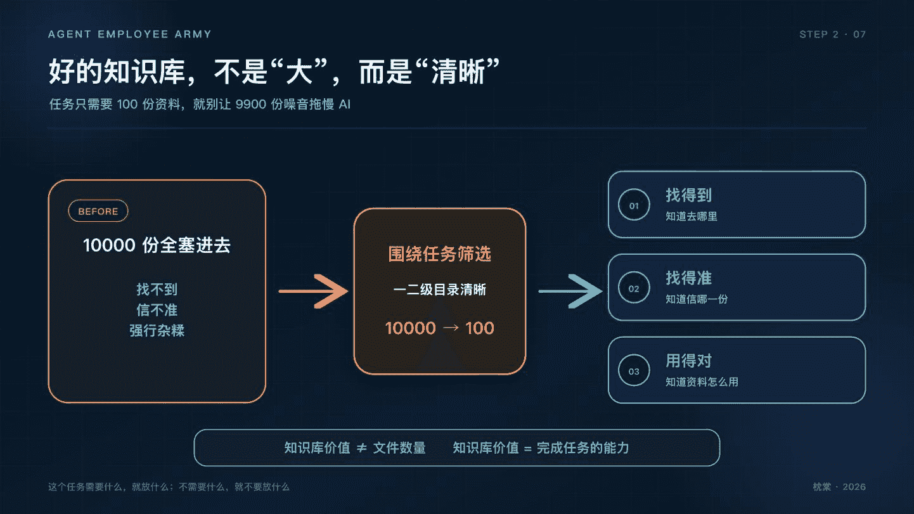

所以一个真正好的知识库，并不是把你的硬盘复制一份给 AI。

而是：

把你脑子里原本隐性的业务结构、真实资料和判断标准，拆成一个个层次分明的文件夹，让 AI 能够清晰地调用。变成一套 AI 可以持续读取和理解的第二大脑。接下来，我直接拿自己的内容知识库给大家看看，我是怎么设计这套文件夹架构的。

### 3. 我的 AI 内容知识库

前面我们已经讲过：

知识库不是为了存知识，而是为了完成任务。于是我围绕公众号创作这个任务，把长期会反复调用的知识，主要拆成了五类：

- 01｜枕棠的灵魂 Copy
- 02｜产品库
- 03｜客户需求与卖点
- 04｜故事案例库
- 05｜方法论库

然后再单独用一个：

- 602｜公众号原创

来承接真正的公众号生产过程。

这几个文件夹看起来是在“分类资料”，但实际上，每一个文件夹都对应着公众号创作里的一个具体问题。

**01｜枕棠的灵魂 Copy**：解决“这篇文章到底是谁写的？”这里保存的是和“枕棠这个 IP”直接相关的长期信息。

包括我的故事，我的定位，我的表达风格，我常说的金句。它们共同解决的是一个最底层的问题：

AI 到底在替谁写文章？

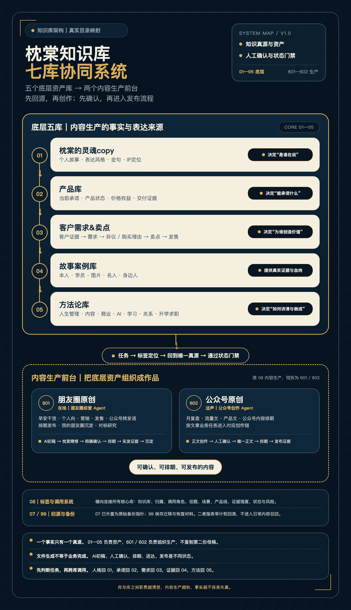

比如一篇文章涉及我的创业经历，AI 就应该知道哪些事情属于我的商业主线；比如文章写到最后需要收束观点的时候，可以来这里寻找我过去真正说过的金句和判断；比如一篇文章写完以后需要去 AI 味，也可以读取我的表达风格。

所以这个库决定的是一篇文章最底层的：

身份、叙事和表达。

**02｜产品库**：解决“文章最终要卖什么？”

这里保存的是我所有的产品，包括在售的产品、过期的产品、筹备中的产品。

因为公众号本身就是我的获客和转化渠道，于是一旦需要卖产品，就需要知道关于产品的信息。比如它的详细海报、它的价格、交付的截图、用户的反馈，方便直接调用，用来销售的朋友圈和文章就会非常方便，能够直接调用对应的文章和朋友圈。

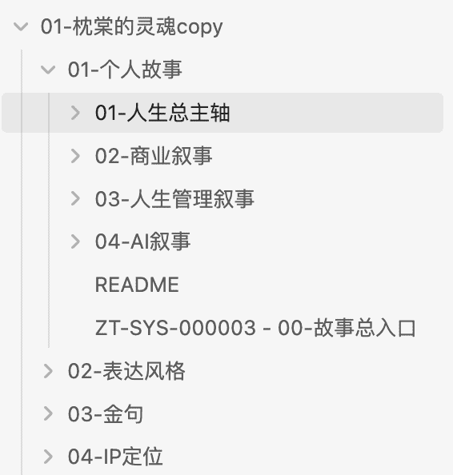

**03｜客户需求与卖点**：解决“这篇文章到底写给谁？”如果产品库解决的是“我有什么可以卖”，那么客户需求与卖点库解决的就是另一边：客户为什么会需要它？这里保存的是来自真实成交过程的存档和分析。

包括咨询记录、购买理由、未成交原因、常见异议、深度客户个案，以及从这些真实材料里进一步沉淀出来的客户画像、需求分类和卖点。

以后我在做选题、标题、开头，或者在卖我的新产品的时候。

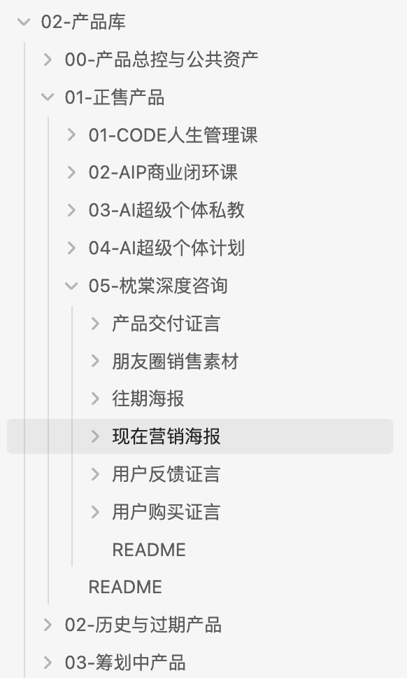

感觉不知道怎么，读者在想什么的时候，都会让 AI 优先回到这里寻找真实证据。

**04｜故事案例库**：解决“这篇文章拿什么证明？”如果一篇公众号最终要承接高客单转化，它就不能只有正确的信息，还必须有足够强的 IP 属性。

而 IP 感很大一部分，就来自真实发生过的故事。

所以我专门建了一个故事案例库。

有我自己的故事，我学员的故事，名人的故事（纳瓦尔、乔布斯），以及我身边朋友的故事。我的个人故事还会继续往下拆：

读书学历、上班事业、创业搞钱、人生管理、AI 生产力、高光结果、低谷代价……

这样我写文章的时候，AI 就可以通过主题去调用对应的故事，实现有力且真实的印证。

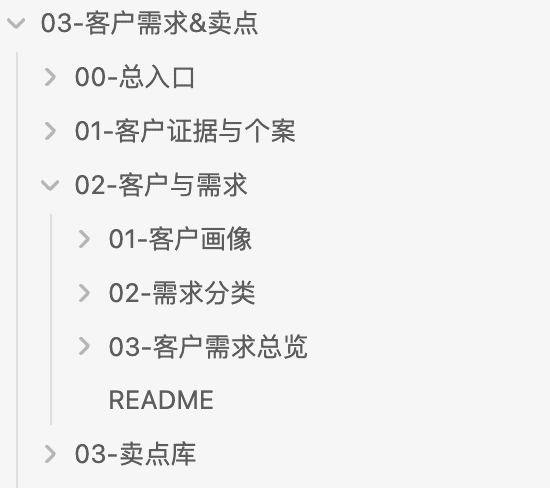

**05｜方法论库**：解决“这篇文章到底要给出什么有用的东西？”公众号不能只有共情，也不能只讲故事。

一篇真正有价值的文章，最后还得给读者一些让人拍案叫绝的认知，以及真正能用的方法。

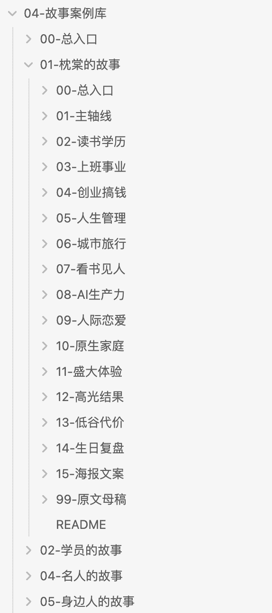

所以这里放的是我在人生管理、商业、内容创作、AI、学习等领域长期沉淀的方法和判断。

每次 AI 需要方法论，就会自动来这里调取相关的我的系统方法论，然后写进文章里。

这样 AI 就不会每次临时从互联网上拼一套“正确但和我没关系”的解决方案。

**602｜公众号原创**

前面的五个文件夹，更像公众号的长期知识资产。

而 602，才是真正发生公众号创作的地方。

我目前核心需要创作的公众号，主要分成三个大类：

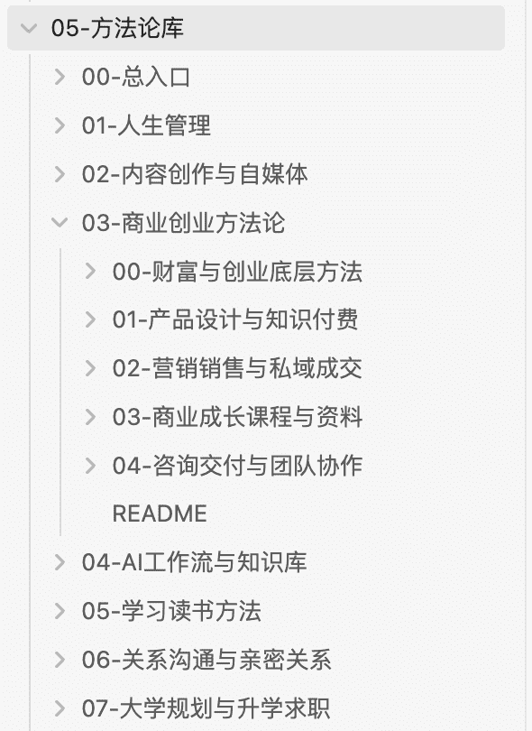

月复盘、产品文和流量文，每一类文章都有自己专门的生产文件夹。

里面会保存对应的 SOP，以及一篇文章从：

选题 → AI 初稿 → 人工精修 → 最终发布

的完整生产过程。

真正开始写一篇文章的时候，AI 会在 602 里沿着对应的公众号 Skill，调用前面的不同知识库，一步一步组织成最终的文章。

所以你会发现：

我的公众号知识库，并不是几个彼此独立的文件夹。

它本质上是一套围绕“写好公众号”这个任务，倒推出来的知识分工。

01｜枕棠的灵魂 Copy，解决：这篇文章是谁写的？02｜产品库，解决：我到底有什么可以卖？03｜客户需求与卖点，解决：这篇文章到底写给谁，他们真正关心什么？

04｜故事案例库，解决：这篇文章拿什么真实经历和案例来证明？05｜方法论库，解决：面对这篇文章的问题，我到底有什么认知和解决方案？602｜公众号原创，则负责把前面的这些知识真正组织起来，沿着公众号创作流程，在这个文件夹里，一步一步生产成最后的文章。

所以知识库的目录，本质上不是为了“分类得漂亮”。

而是在创造一个好的第二大脑，让 AI 在执行任务的时候，每一个需要的东西都能有一个清晰知识库文件夹去对应和解决。AI 知道什么时候应该去哪里，以及为什么要去那里。这就是我前面一直说的：

找得到、找得准、用得对。

### 4. 如何搭建你的初版知识库？

前面给大家展示的，是我现在已经比较成熟的一套内容知识库。

但如果你刚刚开始搭知识库，我并不建议直接照抄我的目录。

因为每个人的任务不同，需要的知识也不同。

我的产品库、客户需求库、故事案例库，是围绕“公众号创作”这个任务一点点长出来的。

如果你做的是海报、PPT、公司报告，直接把我的文件夹复制过去，反而又违背了我们前面一直强调的原则：

知识库，是为了任务而存在的。所以第一版知识库，不需要追求大而全。

只围绕 Step 1 找到的那个真实任务，先给 AI 搭一个“最小可用的大脑”。

我自己总结了一套几乎适合所有任务的初始结构：

- 01｜任务 DNA
- 02｜任务标准
- 03｜任务资产
- 04｜任务工作区

我们一个个来看。

**01｜任务 DNA**：什么东西决定了这是“你的任务”，而不是别人的？

任务 DNA 最核心的关键词只有一个：独特性。也就是把那些独属于你、独属于你的 IP，或者独属于你们公司的东西放进来。

因为同样让 AI 写一篇公众号，为什么最后写出来的应该是“你的公众号”，而不是另外一个人的？

同样让 AI 做一张海报，为什么一眼看过去应该像你们公司的，而不是随便一家公司 的？

靠的就是任务 DNA。

比如做公众号，你可以把自己的故事、IP 定位、核心观点、内容边界、过去写过的代表作，以及自己的表达风格放进来。

比如做公司海报，你可以把公司的品牌定位、Logo、品牌色、字体规范、视觉风格，以及过去最能代表公司的设计放进来。

这些东西是你每次让 AI 做你们的任务都要重新说一遍的东西，这个世界上也只有你会说这样的话。

**02｜任务标准**：什么样的结果才算好？

知道“像谁”以后，第二个问题就是：

到底做到什么程度，才算做好？所以任务标准里，放的是你对最终结果的要求。

这里既可以放明确写出来的规则，也可以直接放真实的正反案例。比如做公众号，你可以放：

说清楚你理想公众号的字数、段落、效果等等，然后放自己最满意的几篇文章、行业里你觉得特别牛的文章，以及你明确不喜欢的文章。然后进一步告诉 AI：

为什么这篇好？为什么那篇不好？

什么样的标题你会用？什么样的表达你觉得有 AI 味？

进一步清晰最终结果的标准。

做海报也是一样。

你可以放过去最满意的几张海报、行业里特别优秀的设计，以及你觉得很差的反例。

再加上尺寸、信息层级、字体、交付格式等明确规范。

因为很多时候，我们很难凭空把“什么叫好”完整描述出来。但是把好的和差的东西同时摆在 AI 面前，它反而更容易理解。

所以：规则告诉 AI 什么叫好，正反案例让 AI 真正看见“好”长什么样。

**03｜任务资产**：还有哪些好东西，可以帮助 AI 把任务做得更好？

如果说任务 DNA 解决的是：“什么东西是我的”，

那么任务资产解决的是：“还有什么东西可以拿来，把这件事情做得更好？”

比如写公众号，除了需要放表达风格、IP 定位等属于 DNA 的东西以外，我们还可以放生财里垂直小号相关的精华帖，和你的定位有关的好书和好课。

以及纳瓦尔、乔布斯这些名人的故事，只要真的能够帮助文章表达，都可以成为任务资产。

做海报也是一样。

除了公司的 Logo、品牌色这些属于 DNA 的东西以外，你还可以继续放优秀的设计案例、设计方法论、字体素材、图标、图片、行业参考和各种可以直接调用的视觉素材。

它们不一定独属于你。

甚至可能是全世界都可以使用的好东西。

但只要它能够帮助 AI 更好地完成这个任务，就可以成为你的任务资产。

**04｜任务工作区**：这件事情到底怎么做，以及现在做到哪里了？

最后一个，是任务工作区。

这个文件夹我建议直接再拆成两个部分：

**01**｜**SOP**

**02**｜任务生产记录

第一部分 SOP，保存的是：

这件事情到底怎么做的具体方法论，其实也就是我们下个板块要去写的 **Skill**。第二部分，则是任务生产记录。

这里保存每一次真实任务，从初稿到成品的全过程：原始输入 → **AI** 初稿 → **人工精修** → **最终成品** → **发布** / **交付** → **复盘**。这样的话也非常方便我们去复盘，到底是哪一步出了问题。

而 AI 初稿和人工终稿之间的差异，本身就是非常有价值的数据。

后面我们写 Skill，以及让整个 Agent 系统不断进化的时候，都会继续用到这些东西。

所以到这里，第一版知识库其实已经搭出来了：

任务 **DNA**：告诉 **AI**，什么东西是独属于我的。

任务标准：告诉 **AI**，什么样的结果才算好。

任务资产：告诉 **AI**，还有哪些好东西可以拿来完成任务。

任务工作区：告诉 **AI**，这件事情怎么做，以及每一次到底是怎么做出来的。

如果你还是觉得有点抽象，我们来举个好玩的例子。

比如：

你要帮公司安排一次重要的客户饭局，那这件事情一样可以搭知识库。

任务 **DNA** 里，可以放独属于你们公司的信息：王总不吃辣，李总不吃海鲜，张总特别喜欢粤菜；谁和谁比较熟，过去招待他们有什么习惯，公司商务宴请有什么特殊要求。

这些东西别人没有，只有你们知道。

任务标准里，可以放：

人均预算多少、距离多远、需不需要包间、环境和服务要达到什么程度，以及过去安排得特别好的几次饭局。

任务资产里，可以放：

杭州餐厅清单、餐厅评价、菜单、停车信息、商务宴请礼仪、酒水搭配，以及各种能够帮助你把这顿饭安排得更好的资料。

任务工作区里，则真正开始完成这一次饭局：确认时间和人数 → 筛选餐厅 → 形成方案 → 人工确认 → 完成预订 → 记录最终反馈。

你会发现：

无论写公众号、做海报，还是请客户吃一顿饭，需要的知识库底层逻辑是一样的。

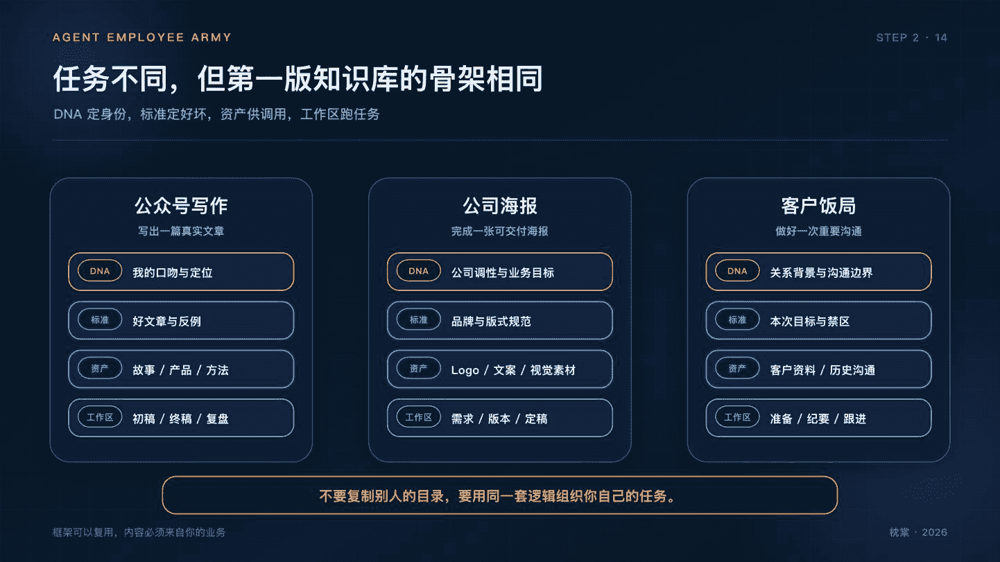

先告诉 **AI** 什么是独属于你的；再告诉它什么叫做好；给它足够完整、好用的资产；最后让每一次真实任务，都在一个清晰的工作区里跑起来。

这就是你的第一版知识库，属于一个 AI 最好的第二大脑。

好了，当我们有了知识库之后，我们终于可以去做 Skill，正式开始让 AI 干活了。

## step3：Skill 固化，稳定产出结果

### 1. Skill 是给 AI 看的摇奶茶 SOP

前面我们已经给 AI 搭好了知识库。

它开始知道我是谁、手里有什么资料、什么样的结果是好的。

但知道这些，不代表它就一定会干活，也不代表它能够稳定地产出好的结果。

在讨论怎么让 AI 稳定产出结果之前，我们先看看，人是怎么稳定产出结果的。

奶茶店员工几乎不需要培训太久，很快就能上岗，并且稳定地做出一杯好的奶茶。

原因就在于，他们有一套非常清晰的 **SOP**。

加多少糖、加多少冰，第一步做什么、第二步做什么、第三步做什么……只要跟着这套 SOP 一步一步做，就能够稳定地拿到结果。

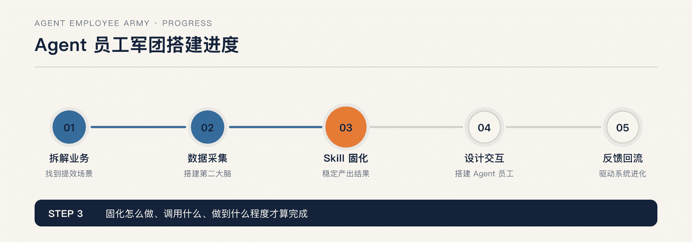

那怎么样让 AI 也稳定地拿到结果？

很简单，给 **AI** 也写一套 **SOP**。而给 AI 看的 SOP，其实就叫 **Skill**。

它会告诉 AI：

第一步做什么，第二步做什么，第三步做什么，第四步做什么……让 AI 按照一套清晰的流程执行，最终更加稳定地产出结果。

### 2. 好的 Skill 有什么标准？

那一份好的 Skill，到底应该怎么写？

最核心的就是三个问题：

第一，怎么做。

也就是这件事情具体分成哪几步，每一步先做什么、后做什么。

第二，用什么。

每一步需要调用什么东西。

可能是知识库里的资料，可能是一个工具，也可能是上一步已经产生的结果。

第三，怎样算好。

也就是每一步做到什么程度，才算完成，才可以继续进入下一步。

我们还是举一个最简单的例子：

西红柿炒鸡蛋。

如果把西红柿炒鸡蛋写成一份 Skill，它绝对不能只写一句：

“帮我做一份好吃的西红柿炒鸡蛋。”

而是要把整个过程拆开，并且每一步都回答：

怎么做、用什么、怎样算好。

第一步，处理食材。

怎么做：把西红柿洗净切块，鸡蛋打入碗里搅散。

用什么：西红柿、鸡蛋、菜刀、砧板、碗和筷子。

怎样算好：西红柿切成大小相近的块，鸡蛋液充分打散，没有明显完整蛋清。

第二步，把鸡蛋炒熟。

怎么做：锅烧热以后放油，倒入鸡蛋液，等底部开始凝固以后快速翻炒。

用什么：鸡蛋液、食用油、锅和锅铲。

怎样算好：鸡蛋基本凝固、颜色金黄，保持嫩软，不要炒焦，然后先盛出来。

第三步，炒西红柿。

怎么做：锅里重新放少量油，倒入西红柿翻炒。

用什么：西红柿、食用油、锅和锅铲。

怎样算好：西红柿开始变软并炒出汁水，但还保留一定块状。

第四步，把鸡蛋倒回去一起翻炒。

怎么做：把刚才炒好的鸡蛋重新倒进锅里，和西红柿一起翻炒，再加入盐等调味料，翻炒均匀。

用什么：炒好的鸡蛋、西红柿、盐等调味料、锅和锅铲。

怎样算好：鸡蛋和西红柿充分混合、味道均匀，西红柿有汁但没有完全炒烂，就可以关火出锅。

你会发现：

一份真正能让人照着执行的 SOP，不是笼统地说第一步、第二步、第三步。

而是每一步都要说清楚：怎么做、用什么、怎样算好。这三个东西，任何一个不清晰，都可能导致最后的结果做不好。

怎么做不清晰，AI 就不知道具体该执行什么；用什么不清晰，AI 就不知道应该调用哪些知识和工具；怎样算好不清晰，AI 就不知道做到什么程度才能停下来、进入下一步。

所以我们给 AI 写 Skill，本质上也是一样的。

把一件原本依赖经验和感觉的事情，拆成一套 **AI** 能够理解、执行和验收的 **SOP**。

但问题在于，不是所有的东西都像西红柿炒鸡蛋一样有清晰的步骤，有很多东西步骤是不清晰的。我们以我的公众号举个例子，我们做自媒体的内容生产，应该怎么样去设计 Skill。

### 3. 我的 Skill：公众号九维创作系统

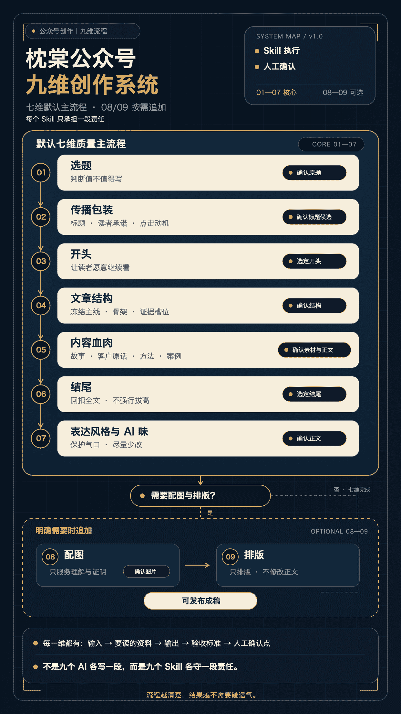

还是拿我最熟悉的公众号来举例。

一开始，我搭建好了知识库，就直接让 AI 读取资料帮我写。

但很快我发现：

故事和观点必须由我主动提醒，它才知道去哪里读取，而且经常调用得不够准确，整个过程依然很累。

如果我什么都不说，它写出来的文章又很空，没有我的故事，也没有我的方法论。

所以我意识到：

光有知识库还不够，我还需要给公众号创作设计一套完整的 **Skill**。最后，我把整个公众号创作流程拆成了 9 个维度，也就是现在这套「公众号九维创作系统」。

**01**｜选题

解决的是：这篇文章到底写什么？最终确定一个垂直于我的人群，有爆款潜力，且能变现引流的选题。

**02**｜传播包装

解决的是：怎么让别人愿意点进来？最终产出主标题、副标题和转发语，增加这篇文章的传播能力。

**03**｜开头

解决的是：别人点进来以后，为什么愿意继续读？抓好文章的黄金一百字，写出一个能够承接标题，并且抓住读者眼球的开头。

**04**｜文章结构

解决的是：整篇文章到底应该怎么写？最终确定全文主张和板块顺序，让整篇文章层层递进，观点和叙事始终围绕同一条主线。

**05**｜内容血肉

解决的是：具体的文章内容写什么？

根据这篇文章的具体场景，从知识库里调用适配的故事、案例、客户需求、产品和方法论，把原本的结构填成一篇真正有血有肉的文章。

**06**｜结尾

解决的是：如何写一个好结尾？

最终回扣全文主线，留下一个清晰的观点或者恰到好处的升华，同时承接加微信、点赞、评论等行动。

**07**｜表达风格与 AI 味

解决的是：AI 味太重，不像我的问题。通过词语替换、句式调整和表达风格处理，让最后的文章更像是我逐字逐句写出来的。

**08**｜配图

解决的是：整个文章读起来更舒服。

根据文章内容自动识别适合配图的位置，制作金句图、框架图等视觉内容并插入其中。

这篇帖子里的很多图片，也是直接用这个 Skill 做的。

**09**｜排版

解决的是：做成 Markdown 格式，一键复制排版；做好段落的大标题划分、下划线、加粗的处理，直接可以复制到草稿箱进行发布，提升阅读体验。

所以你会发现：

这套九维创作系统真正解决的是把原来一句非常模糊的：

“帮我写一篇好的公众号。”

拆成九个更加具体、更加容易被 AI 执行的任务。

“帮我写一篇好公众号。”拆成九份职责清楚的工作，每一步都能出一个结果，然后责任到人。

选题不行，就回选题。

开头留不住人，就重做开头。

逻辑乱，就回结构。

文章太空，就补内容血肉。

表达不像我，就回第七维。

标题承接不了正文，就重新做传播包装。

这样 AI 才从“偶尔灵光一现写出一篇好文章”，慢慢变成：

稳定地产出高质量的结果。

为什么它能够稳定？

因为我把整个过程中可能让 AI 跑偏的变量，尽可能全部穷尽并约束了。

每一步应该做什么、调用什么资料、做到什么程度算好，都已经提前写进了 Skill。

AI 不需要每一次都重新猜我的意图，也不需要临场发挥，只需要沿着已经设计好的流程一步一步往下走。

变量越清晰，约束越明确，**AI** 的结果就越稳定。这才是一份真正好的 Skill 应该有的样子。

### 4. 如何创造属于自己的 Skill？

那知道了 Skill 是什么以后，下一个问题就是：

我们到底怎么获得一份真正属于自己的 **Skill**？

第一步：找现成的 **Skill**

其实，我们现在需要的大多数产品和产出物，互联网上往往都已经有前人做过了。

而 AI 最大的好处就是：

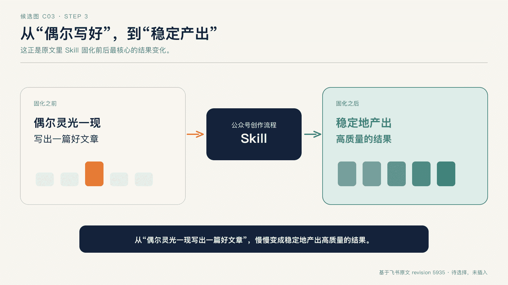

过去我们只能复制认知，现在我们甚至可以直接复制结果。别人已经写好的 Skill，我们拿过来，一样可以直接使用。

那我们要怎么获得这些好的 Skill 呢？

第一个，是直接去 **GitHub** 搜索现成的 **Skill**、**Prompt** 和工作流。比如我自己的「表达风格与去 AI 味 Skill」，最开始就参考了大 V 卡兹克对于写作和去 AI 味的一些方法。

比如我现在做海报使用的一些 Skill，最开始也是直接从 GitHub 上找到的。

做法也非常简单，你甚至不用自己去找，直接让 **AI** 帮你搜就好了。

第二个，是直接去找这个领域里你认为真正厉害的人。去购买他的 SOP、方法论，甚至已经做好的 Skill。

我自己针对整个自媒体商业闭环，其实就付费了好几个五位数，去购买和学习对应的方法论和 Skill。

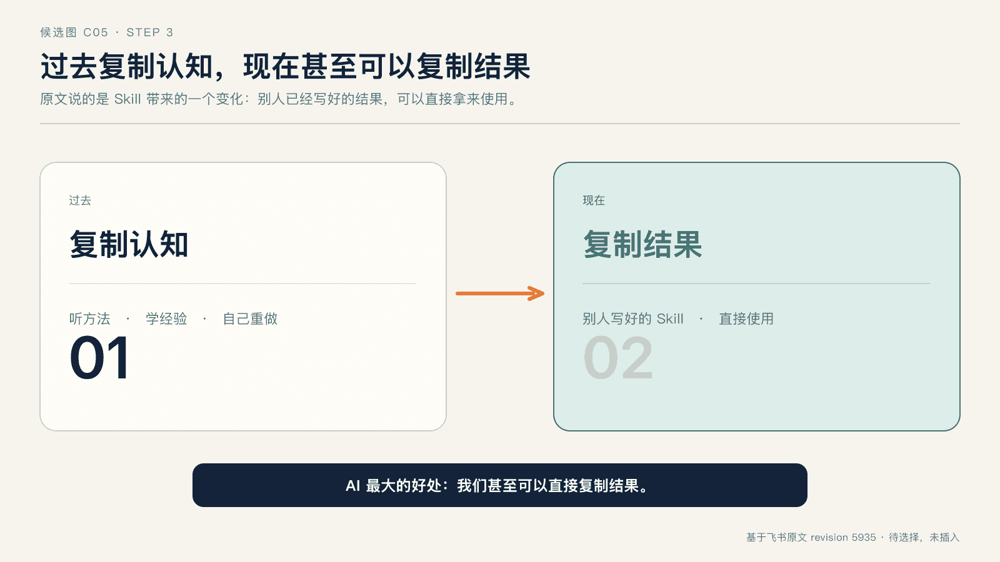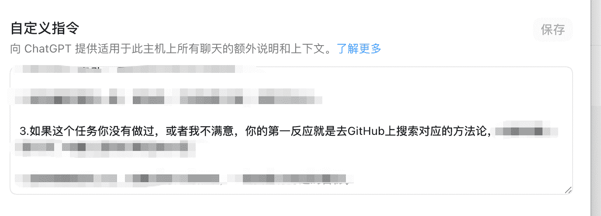

包括我自己的公众号九维创作系统，现在也会直接给我的私教学员使用。

这一点的核心就是：

永远不要重新造那些已经存在的轮子。这个世界上已经有大量被别人验证过的好东西了。

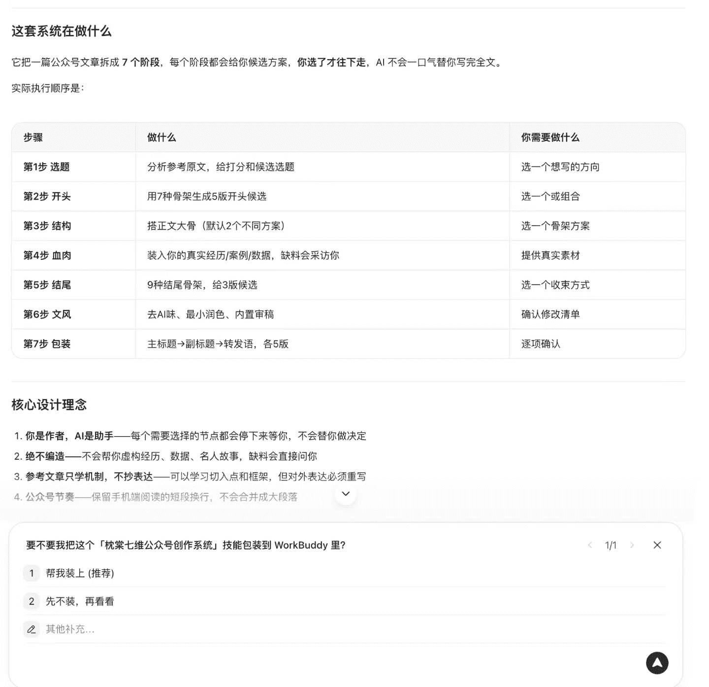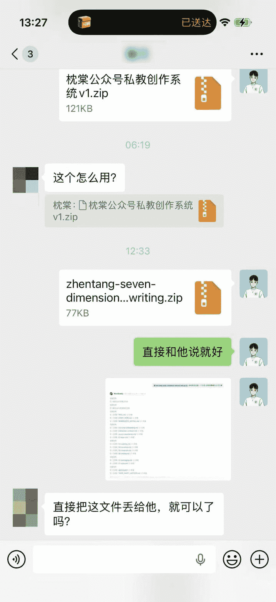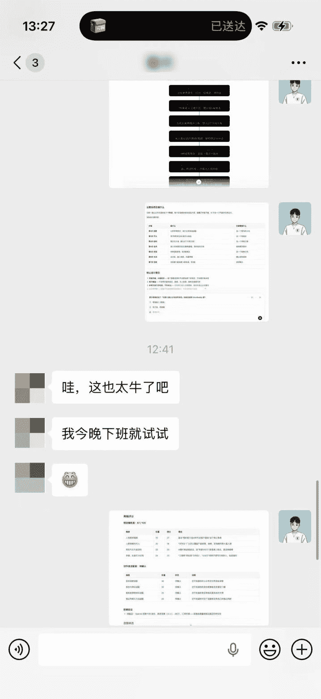

能找到，就直接拿来用；能站在别人的肩膀上，就不要从零开始。

第二步：**Skill** 本土化

找到别人的 Skill，不等于已经拿到了结果。

因为别人的 Skill，我们自己使用的时候一定会存在水土不服。

这个世界上不会存在两个完全相同的使用场景，所以别人的 Skill 也绝对不可能百分之百适配我们自己的场景。

所以第二步就是：

直接拿自己的真实任务去跑。跑出来以后，看哪里好、哪里不好，然后直接修改。

你也可以把自己对这个领域原本的经验和判断告诉 AI，让它结合这些东西继续修改和优化。

然后一次次跑结果，不断迭代。

比如我最开始使用卡兹克的去 AI 味 Skill 时，也不会直接全盘照搬。

我会真的拿自己的一篇文章，去测试它去 AI 味的效果。

AI 改完以后，我再逐字逐句去看：

哪些修改我认可？哪些地方改完反而不像我？

然后有的删除，有的保留，再把我的判断告诉 AI，让它记住这些规则，回头继续修改整个 Skill。

所以整个 Skill 本土化的方法其实就是反复地：

执行 → 看结果 → 人工修改 → 修改 Skill → 再执行。

直到最终跑出一个我们自己真正满意的结果为止。

第三步：固化 **Skill**

终于我们跑出了一个完整 SOP 后，接下来要把它给固化下来。

你可以把下面这段话发给 GPT，它就会把你上面的流程固化为一个 Skill。

请根据我们刚才完成这项任务的完整过程，帮我把它梳理并正式固化成一个可以重复调用的 Skill。第一步，请先回顾刚才真实完成任务的全过程，按照实际发生的步骤进行拆解，不要凭空增加我们没有做过的流程。每一步都必须梳理清楚三个问题：

**1. 怎么做**：这一环节具体做什么，先做什么、后做什么？

**2. 用什么**：这一环节需要调用哪些知识库、资料、案例、工具，或者上一步产生的什么结果？

**3. 怎样算好**：这一环节最终要产出什么？做到什么程度才算完成，才可以进入下一步？

同时结合刚才实际执行的过程，补充容易出错的地方、必须人工确认的节点，以及明确不能做的事情。第二步，梳理完成以后，请直接调用 Skill Creator，把这套已经跑通的 SOP 正式固化成一个 Skill。Skill 的目标不是记录这一次任务的答案，而是提炼出以后遇到同类任务时，可以重复执行的方法。完成后告诉我：这个 Skill 解决什么问题、什么时候调用，以及最终固化到了哪里。

然后下一次就可以直接使用这个 Skill 了。

到这里，其实我们已经完成了非常关键的两步：

知识库解决的是，**AI** 知道什么。Skill 解决的是，**AI** 应该怎么做。

如果你真的按照前面的方法一步一步搭下来，那么到这一步，你应该已经能够让 **AI** 比较稳定地完成一个具体结果了。它可以是一篇公众号文章，也可以是一张海报、一份 PPT、一条朋友圈，或者任何你前面选定的真实任务。

但现在还有最后一个问题：

即使 AI 已经知道什么、也知道怎么做了，我们很多时候还是得打开 Codex，主动告诉它开始、继续、下一步。

把这些已经跑通的知识库和 Skill，进一步封装成 AI 员工和工作台，让他们正式成为我们的 AI 员工。

## step4：设计交互，搭建 Agent 员工军团

### 1. 真正让 AI 接驳生活

前面三步做完以后，其实 AI 已经具备了两样最重要的东西：

知识库，让它知道应该读取什么。

Skill，让它知道应该怎么做。

到这里，如果你打开 Codex，把任务交给它，它其实已经能够比较稳定地帮你完成工作了。

但这时候还有最后一个问题：

你到底准备怎样使用它？

如果每次工作以前，你还是要打开 Codex，重新找到对话框，然后告诉它：

“现在开始。”

“继续下一步。”

“把结果发给我。”

“再帮我处理一下。”

那本质上，你只是把原来的人工劳动，变成了：指挥 **AI** 的人工劳动。所以真正意义上的 AI 落地，不应该是我们每天专门去

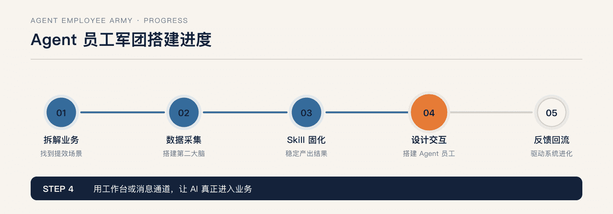

适应 AI。

而应该反过来：

让 **AI** 适应我们原本的工作方式，真正接驳我们的工作和生活。

那我们平时最习惯的交互方式是什么？

无非就是两种：

一种是像各种 App、网页一样，在页面里点击、选择和操作；另一种是像微信、飞书一样，通过聊天和消息完成交互。

所以我最后也把 AI 的交互主要做成了两种：

一种是 **AI 工作台**，一种是 **AI 员工**。

## 2. 工作台：言出法随

第一种交互方式，就是 AI 工作台。

其实它很好理解。

我们平时使用绝大多数软件，并不会打开一个聊天框，然后一句一句告诉它：

“帮我打开这个功能。”

“帮我搜索一下。”

“帮我进入下一步。”

而是直接打开 App，点击按钮、搜索、筛选、选择，然后得到结果。

**AI 工作台**，本质上就是把已经跑通的知识库和 **Skill**，做成一个更适合人使用的页面。

你不需要再记提示词，也不需要知道背后到底调用了哪个 Skill。

需要什么，就点什么。我现在已经做了十几个工作台，覆盖我生活的方方面面。

其中有两个比较典型，可以作为例子展示给大家。

第一个，是我的知识采编台。

我平时会产生大量飞书妙记、会议录音和个人口述。

以前这些东西录完以后，很容易就躺在飞书里吃灰。

所以我做了一个知识采编台。

它会把这些原始口述一步一步处理成：

原始录音 / 逐字稿 → 可读母稿 → 观点 / 方法 / 故事 / 案例 / 选题。

现在里面已经整理了 273 份飞书妙记、254 份可读母稿。

我打开工作台，就可以直接搜索某一份妙记，看原文、看整理后的母稿，再逐条确认 **AI** 从里面提取出来的知识资产。这样我原本散落在飞书里的大量口述，就真正变成了一套可以持续使用的知识。

第二个，是我的朋友圈工作台——「在场」。

它负责的是另一件事情：

把前面已经确认好的素材、观点和故事，进一步生产成朋友圈。

我可以直接选择：

早安干货、个人向、营销、发售、公众号转发语……

然后把素材交进去，让它调用对应的知识库和 **Skill** 生成内容。生成以后，我再在工作台里完成修改、确认和后续处理。

所以你会发现：

工作台并没有创造一种新的 AI 能力。

真正让 AI 会干活的，依然是我们前面搭好的：知识库 + Skill。工作台做的事情，只是给这些能力套上一层更适合人使用的界面。

以前我要打开 Codex，告诉它：

“读取哪个知识库。”

“调用哪个 Skill。”

“帮我执行哪一步。”

现在，这些东西都被封装到了按钮和页面背后。

我不再需要学习怎么使用 AI，而是像使用一个普通 App 一样，直接使用 AI 已经拥有的能力。

而这一点，即使对我这样一个工科出身、会写代码的人来说，也依然有一种言出法随的震撼。

过去开发一个小程序或者网页，保底要写一两周。

现在有了 AI，很多工作台可能一两个小时就能做出来。

和当时的效率相比，现在的创作速度真的有种言出法随的感觉。

## 3. AI 员工：消息来回

第二种交互方式，就是 AI 员工。

工作台更像一个 App，需要的时候我主动打开它。

而 AI 员工更像一个真正的员工：

我不需要每次主动去找它，它会在该工作的时候自己开始工作，调用背后的知识库和 Skill，把任务做完以后，再把结果直接送到我的飞书。

我现在主要在内容生产和咨询相关的业务里，搭了 12 个左右的 AI 员工。

### 公众号

- 公众号
- 公众号总控
- 公众号采集
- 公众号主号
- 公众号小号
- 公众号复盘

### 朋友圈

- 朋友圈
- 朋友圈总控
- 早安 Agent
- 硬广 Agent
- 公众号分发 Agent

### 其他

我给大家举两个例子来介绍一下这两个是怎么做的。

第一个，是我的公众号助理。它负责每天帮我看：

外面到底发生了什么？同行最近又写了什么？

每天早上，它会自动采集我关注的对标公众号，把新增文章抓下来，完成整理和分析。然后把几十篇文章压缩成一份真正值得我看的公众号情报日报，直接发送到飞书。我每天早上醒来之后，就可以直接看一下，然后思考今天的选题。

第二个，是我的早安 **Agent**。它负责的是每天稳定生产我的早安朋友圈。

它会读取我过去的朋友圈、公众号、口述和书籍资料，再调用我已经做好的朋友圈 Skill，提前生成候选内容。

经过我的确认和排期以后，到固定时间，它会把当天最终版本直接送到飞书。每天早上醒来后，直接复制发布就可以了。

所以你会发现：

AI 员工同样没有创造一种新的 AI 能力。

真正让它会干活的，还是前面已经搭好的：知识库 + Skill。只不过工作台，是把这些能力封装成一个页面；AI 员工，则是把它包装成了飞书里的一个机器人。

它可以每天自己开始工作，把结果主动发到聊天框里，我需要的时候直接回复它就可以继续处理。

而把员工放进飞书还有一个很大的好处：

当我不方便使用电脑的时候，也可以直接拿手机给它发消息。

我把任务交给它，它在后台调用对应的知识库和 Skill 完成处理，再把结果发回来。

所以到这里，Step 4 其实就很清楚了。

工作台，是把 AI 的能力做成一个我们主动使用的 App；AI 员工，是把 AI 的能力做成一个会主动工作的“员工”，在该干活的时候自己干活，再把结果送到我们面前。

它们看起来完全不一样，但底层其实是一回事：

知识库提供大脑，**Skill** 提供能力，工作台和 **AI** 员工负责让这些能力真正进入我们的工作和生活。到了这一步，AI 才真正不再只是一个需要我们反复打开、反复对话的工具。

而是开始融入我们原本的工作方式里。

你需要的时候，打开工作台直接使用；你不需要主动操作的时候，就让 AI 员工自己去干活。

这才是我理解的：

让 **AI** 真正接驳生活。

当然，到这里还没有结束。

因为不管知识库、Skill，还是工作台和 AI 员工，第一次搭出来都不可能是完美的。

真正让这套系统越来越好用的，是最后一步：

**Step 5：反馈回流，驱动系统进化**

前面四步做完以后，我们已经有了一套可以真正开始工作的 Agent 系统：

场景 → 知识库 → Skill → Agent 与交互。

但这时候，它依然只是第一版。

因为很多问题，在真正使用以前我们根本发现不了。

只有它开始干活以后，我们才会知道：

哪里做得不好？

为什么做得不好？

下一次到底应该改哪里？

所以 Step 5 做的事情其实非常简单：

把真实使用过程中产生的反馈重新收回来，再反过来修改前面的系统。

我现在主要看两类反馈：

一类是我自己的人工修改；另一类是真实世界给我的数据反馈。

### 1. 第一类：人工反馈

第一类，是我们自己对 AI 结果的修改。

还是拿公众号来举例。

AI 写出初稿以后，我会继续人工精修，然后让 AI 对比：

我改了什么？为什么要改？这个问题到底出在哪一层？

如果 AI 写错了我的故事、产品信息或者客户需求，那可能是 **Step 2** 知识库出了问题：资料缺失、错误，或者没有及时更新。

如果资料明明都有，但 AI 不知道什么时候调用，或者结构、表达、步骤总是反复出问题，那说明 **Step 3 Skill** 还需要继续修改。

如果结果本身已经很好，但每次使用都特别麻烦，比如飞书里不知道什么时候触发、结果发错地方、需要反复操作，那就是 **Step 4 Agent** 和交互封装出了问题。

所以一次人工修改，真正有价值的不是：

“把这篇文章改好了。”

而是继续追问：

为什么这次还需要我改？下一次应该修改系统的哪一层，才能让 AI 自己做好？

然后把这次反馈重新沉淀回去，最终才能打磨形成一个完善的 Agent 员工。

### 2. 第二类：数据反馈

第二类，是把 Agent 真正投入使用以后，现实世界给我们的数据反馈。

因为我们自己觉得 AI 做得好，不代表它真的能够拿到结果。

还是拿公众号来举例。

文章发布以后，我会继续看：

阅读量怎么样？点赞、转发怎么样？有没有涨粉？有没有带来客户和成交？

然后直接把这些真实数据交给 AI，让它帮我总结和分析：

这次为什么数据好？为什么数据差？

哪些选题、标题、开头、结构被验证有效？

如果某种标题、结构、表达连续几次表现更好，就把这些被真实数据验证过的规律继续沉淀进 **Skill**。

所以真实数据的价值，也不是简单看一句：

“这次数据不错。”

而是把现实世界的结果重新交给 AI，让它帮我们提炼规律，再反过来修改前面的系统。

我们自己的修改，告诉 AI 什么更符合我们的标准；真实世界的数据，告诉 AI 什么真正有效。这两种反馈一起回来，Agent 才会越跑越准。

### 3. 反馈的最终目的，是重新迭代前面四步

前面的两类反馈，最后其实都会指向同一件事情：

找到问题到底发生在前面哪一步，然后只修改那一步。

如果一开始连任务和目标都定义错了，就回到 **Step 1** 场景。

如果 AI 缺资料、拿错资料、用了旧资料，就回到 **Step 2** 知识库。

如果资料都有，但 AI 还是不会调用、流程总跑偏、结果不稳定，就回到 **Step 3 Skill**。

如果能力本身已经没问题，但使用起来很麻烦，触发、确认、发送这些环节总出问题，就回到 **Step 4 Agent** 和交互。

所以 Step 5 本身并不是再搭一个新的东西。

它更像整个系统的“反馈回路”。

人工反馈，让 AI 越来越懂我的标准；数据反馈，让 AI 越来越懂真实世界。然后再把这两种反馈不断送回前面的四步：

哪里有问题，就迭代哪里。

于是整套系统才真正形成一个闭环：

找到场景 → 搭知识库 → 固化 Skill → 封装 Agent → 获得反馈 → 定位问题 → 继续迭代。

这时候，Agent 员工军团才真正成为了一套闭环的系统。

每多完成一次真实任务，就会不断进化。

它就会比上一次更懂你一点，也更懂业务一点。

# 四、尾言

写到这里，这篇文章终于快结束了。

前前后后一个多月，38000 多字，我把自己过去这段时间搭建 Agent 员工军团的整个过程，几乎全部拆开讲了一遍。

但如果让我最后只留下一个观点，我想说的是：

**AI** 的目的永远不是为了炫技，而是为了获得一个真实的改变。

不是你装了多少插件、下载了多少 Skill、搭了多少 Agent，也不是你的工作台看起来有多酷，自动化流程有多复杂。

真正重要的是：

它有没有让你少花一点时间，少消耗一点心力，更稳定地完成工作，或者真正帮你多拿到一些结果。

所以我展示自己的知识库、Skill、工作台和 AI 员工，也不是希望你照着复制一套“枕棠的系统”。

因为我的经历、产品、业务和工作方式，只属于我自己。

真正值得复用的，是背后的这条路径：从一个真实任务开始。

先想清楚到底要解决什么问题，

再给 AI 搭建完成这件事需要的知识库，把已经跑通的方法固化成 Skill，再选择最适合自己的方式，把它封装成工作台或者 AI 员工，最后不断把人工修改和真实数据反馈回来，让整个系统持续进化。

所以请把 Agent 军团当做一个美好的目标，先去选一件你每天、每周都在反复做的事情，认真把它交给 AI 跑通。

让它真的帮你少花一个小时，少做一次重复劳动，多交付一个结果，甚至多赚到一笔钱。

当第一个 Agent 真正产生价值以后，当你感受到 AI 时代带来的巨大提升后，

第二个、第三个、第四个，自然就会一点点长出来。

说一千道一万，我在这 38000 多字里写下的关于 AI 的魅力，可能都不足它真正魅力的万分之一。它真正的魅力，只有当你亲自把它落地到自己的工作和生活里，真正拿到结果的那一刻，才能感受得到，而在那一刻，命运的齿轮也会正式开始转动。

最后用一句话结束这篇文章吧：

何以 AI，唯有落地。

本文到这里就全部结束了。

如果对你有帮助的话，欢迎点赞投锚，在评论区留下你的收获和反馈。有任何问题也欢迎留言，我看到就会解答，你的支持也是我持续写作最大的动力。

另外，我目前在杭州全职创业，常在聚会和联合办公冒泡。

如果你对 AI 有什么新想法，也欢迎来找我交流呀～最后，非常感谢你一路看到这里。

一起生财有术！

# 五、附录：三份可以直接复制的提示词

前面的正文，负责讲清楚搭建 Agent 员工军团的完整逻辑。

这一部分不再重复讲方法，只保留三份真正能够帮助你搭出具体成果的提示词：给 AI 搭建第一版知识库、把知识库和 Skill 封装成 AI 员工，以及把高频流程做成 AI 工作台。

使用时不要一次把三份全部丢给 AI。先选择你当前最需要解决的一件事，把对应提示词原封不动发给 Codex。

点击这个链接直达提示词汇总（可一键复制版本）

**https://my.feishu.cn/docx/Poe9dkkH0okO0**

**7xok9scdx95nuJ?from=from_copylink**

附录 01｜初版知识库搭建

附录 02｜初版 AI 员工搭建

附录 03｜初版 AI 工作台搭建

————分割线————

看完这篇 SOP，你觉得你懂了。但 90% 的人一到实操就会卡在第一步。

工具和教程只是最低级的壁垒，真正的壁垒是“立刻动手”和“圈层信息差”。

如果你想看全网最新的变现玩法，并且和一群执行力极强的极客一起下场拿结果，欢迎围观我的核心私域：【懒人专属群】。

我们不聊虚的，只做商业闭环的拆解与 AI 效率的压榨。系统内已沉淀 1000+ 跑通的套利实战局。

👉 查阅圈子完整数字资产与上车门槛：

https://lazyso.com/insider/

认同价值、准备好下场干活的，扫码加我微信（lazyhelper1）

备注：【实操上车】，不闲聊

