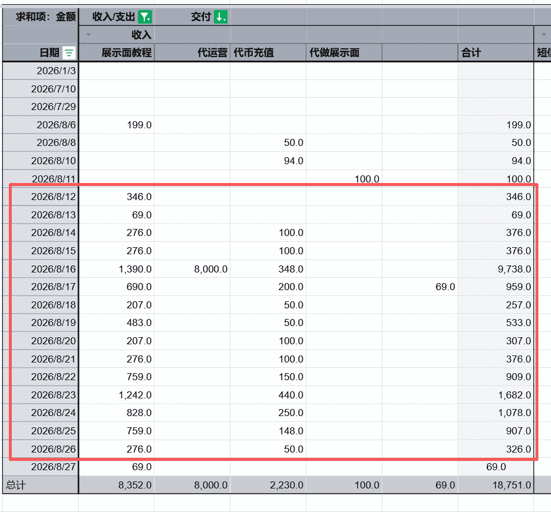
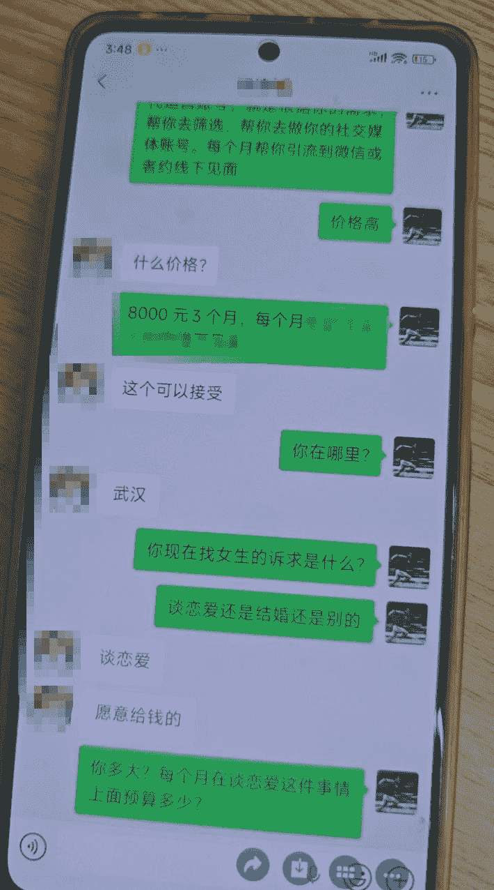
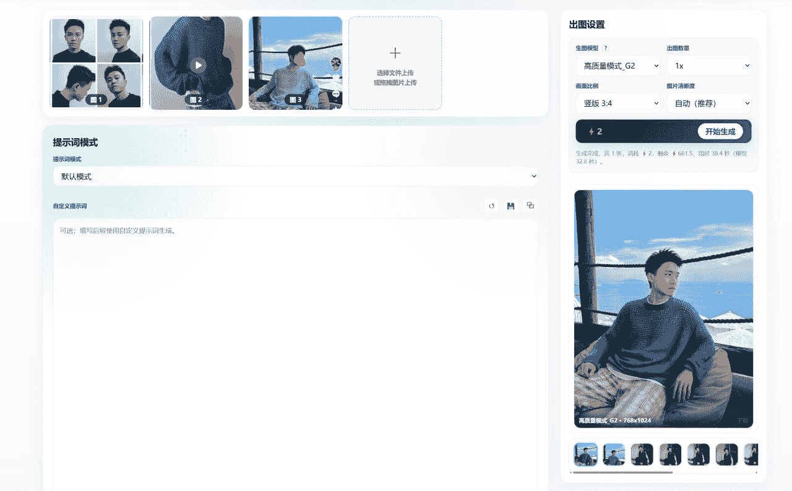
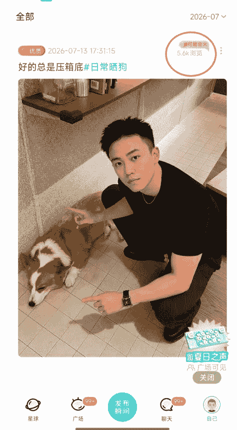
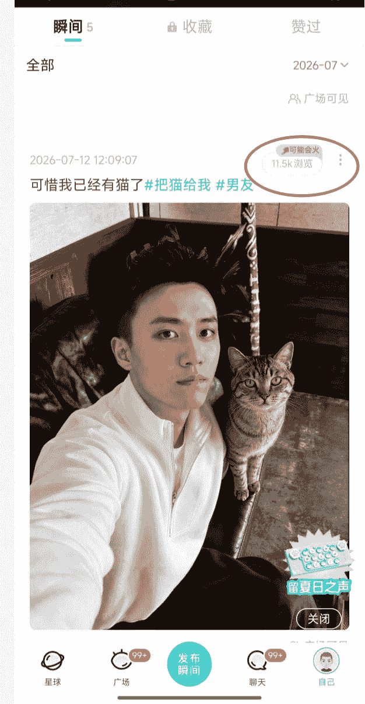
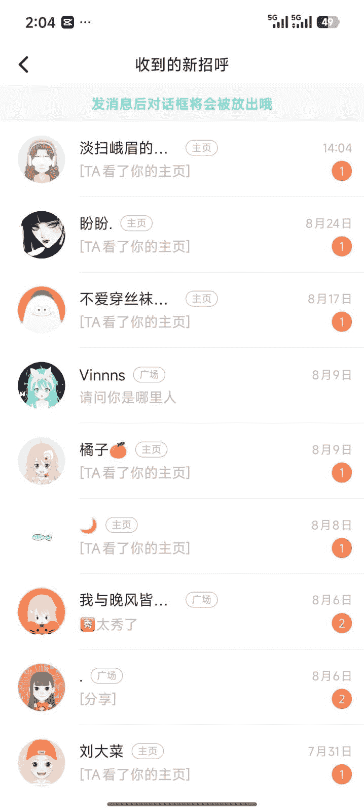
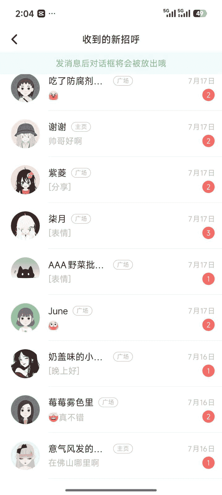
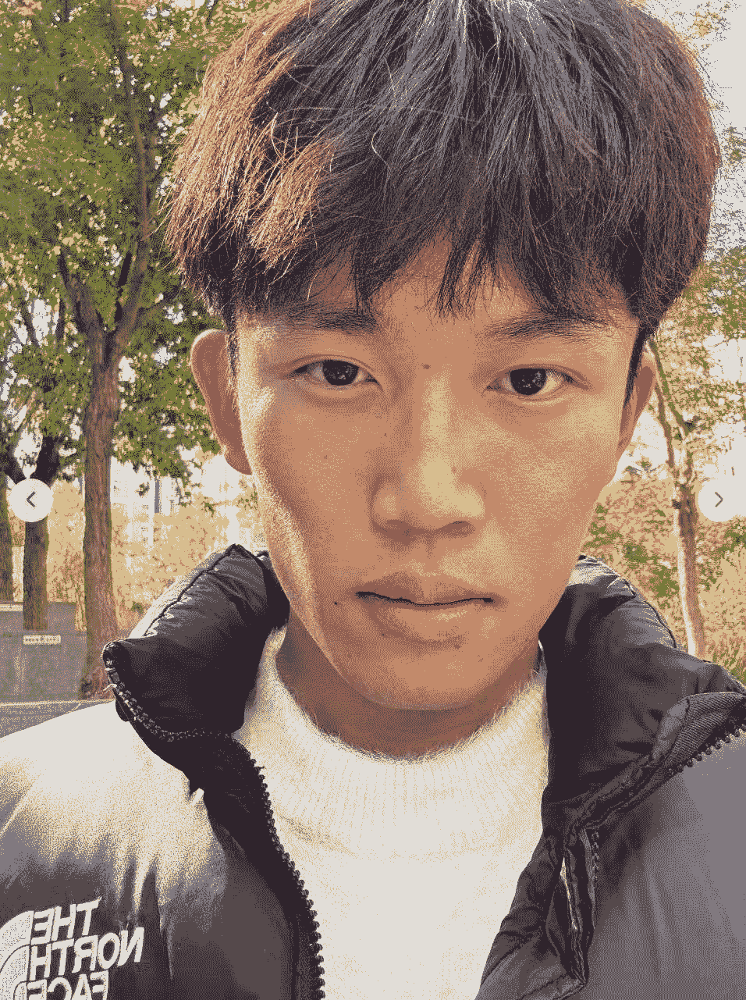
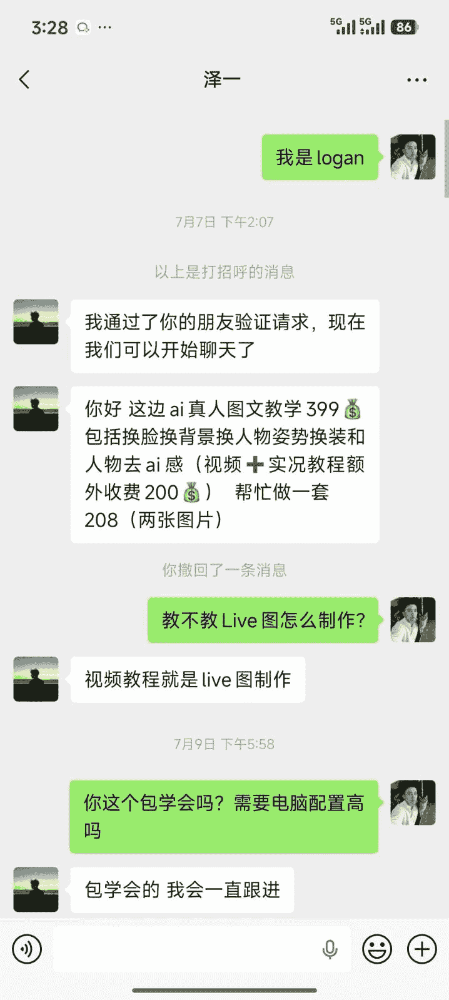
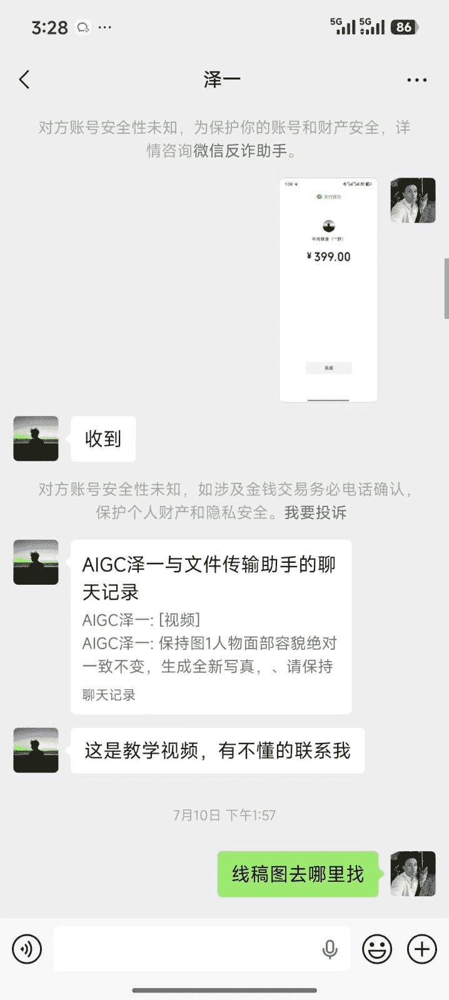

公众号懒人搜索，懒人专属群分享我是由月之暗面（Moonshot AI）研发的 kimi-k2.7-code 智能大模型。## 周变现 2 万，起因只是为了在交友软件匹配上更多女生，做了个 AI 展示面工具

260827 副业 SC 精华

整理：公众号懒人搜索，懒人专属群精选

懒人微信：lazyhelper1

大家好，我是 Logan。

这篇文章想分享一个我最近做的小项目——【AI 展示面大师】。

两周时间，项目一共做了接近两万元。其中一部分来自 69 元的教程和用户后续在我工具里面的充值，以及一位富哥们 8,000 元代运营单。

我为什么想把这件事从头到尾写下来？

得从我自己的经历讲起：我是北邮硕士，毕业以后，先后在 360、百度做过几年产品经理。24 岁年薪达 60 万，职级也在同龄人里算高了。

但我一直有一块心病：我完全不懂代码。

以前和研发对接，我能做的事情，主要是提需求、写 PRD、画原型、盯进度。产品怎么想、用户需要什么、流程应该怎么设计，这些我都能讲清楚；但真正把一个想法做成产品，最后还是要等研发来实现。

说白了，我离“亲手把一个产品做出来”，始终差着代码这一关。

所以 AI 解决了 PM 不懂代码的问题，真的让我回到了舒适区的感觉，如鱼得水。如果只把这件事写成“我用 AI 编程两周赚了两万”，其实没什么价值。

我觉得真正有价值的部分，不是我敲出了一个网页，也不是我发了一条爆款视频。

而是这件事让我把一条很具体的 AI 变现路径走了一遍：我先从自己真实遇到的问题出发，确认这不是我一个人的问题，再用 AI 把原来很重、很贵的服务压成一个普通人能买、能自己用的工具，最后在获客和交付里，看见了项目真正的瓶颈。

# 01 我的这个项目叫【AI 展示面大师】

它服务的是一群很具体的人：想找对象、身边异性资源不多、平时也不太会拍照的男生。他们在交友软件、抖音、小红书、朋友圈上，往往没有几张能让人停下来多看一眼的照片。不是说人不行，而是他没有一个合适的“展示面”。

而一旦他做几张高质量的生活化展示面，效果就是如下。是我自己实操 Soul 的效果，其他平台数据也很好。

说起来有点不好意思，像我们这样的普通男生，大部分人平时其实不怎么拍照。手机相册里翻来翻去，可能全是工作截图、吃饭、路上随手拍的东西。真到需要放几张自己的照片时，才发现手上根本没有几张能拿得出手的。

但现在找对象，交友软件已经是很多人的主流选择。无论是牵手、青藤、Soul 还是其他交友平台，异性第一次认识你，靠的就是头像和主页里的照片。

第一印象很重要。可对很多男生来说，最难的地方恰好就在这里：你让他从过去五年、甚至十年的相册里翻，最后可能也只能找出两三张“看着还行，凑合”的照片。

这不是少数人的问题。我自己也有，所以我很清楚：很多男生并不是真的不想把自己展示得更好，只是不会拍、不知道怎么拍，也没有合适的照片。这个需求很真实，也很痛。

所谓展示面，在情感赛道里是个常见词。你可以把它理解成：别人还没有认识你之前，通过照片、朋友圈、社交主页，对你形成的第一印象。

以前解决这个问题的办法，很重。有人会把男生约到线下，租豪车、跑车、总统套房，再请摄影师拍一整天。一批人轮流拍，最后从一堆图里挑几张能用的。这套服务当然有需求，否则不会有人一直做。但它的成本太高，用户门槛也高，交付更重。

而且这种暴发户、炫富、不生活化、装逼风格，现在也早已经过时了。而 AI 给我的机会，是把原来需要线下场景、摄影、修图、反复沟通才能完成的一部分事情，先用一个轻量工具解决掉。用户上传一张自己的人脸图，再上传一张自己喜欢的穿搭、场景或者风格参考图，配上一段提示词，就能生成一张更有氛围感的社交展示照片。它不能替代真实生活，也不应该伪造成另一个人，但它可以帮一个本来不会拍照、也不知道怎样呈现自己的人，先获得一张更有表达力的照片。

假设一个男生自拍最好的效果如下：

展示面成片（下面 3 张）：

不改变五官，不是把他变成吴彦祖、谢霆锋，仅仅是优化穿搭、光线、环境，更有氛围感、审美。

AI 展示面大师，就是这样做出来的。

# 从自己的痛点出发，不是让你只做自己

很多人听到“从自己出发”，会有一个误解：是不是我必须做一个我自己遇到的问题？

当然不是！

从自己出发的价值，是你对这个问题有第一手体感。你知道它发生在什么场景，知道用户不会怎么描述它，知道他真正不爽的地方在哪里，也知道一个看上去很厉害的功能，放到真实使用里可能根本没人点。

你先是这个问题的用户，再变成解决这个问题的人，判断会更准。

但在动手之前，还是要出去看一眼：有没有别人也在讲？有没有人已经付过钱？现有方案哪里贵、哪里慢、哪里麻烦？

自己经历，给你方向。

市场反馈，给你验证。

# 02 开干之前，我先花 399 元买了一次同行的交付

我确认需求存在以后，我没有直接开干，而是先花钱买了一次同行的教程。对方卖 399 元，交付是聊天合集和一个大而全的 AIGC 平台链接，叫做 RunningHub。399 元是不包含后期生图需要的 token 费用的，用户还需要单独充值购买。

我没有觉得这个模式不行。它能卖，说明它一定服务了一部分用户。

但我立刻知道，这不是我想做的模式。

原因很简单：对于一个只是想解决“我没有几张好照片”这个问题的男生来说，教程、复杂平台、token、各种功能入口，这些东西太多了。他本来就不熟悉 AI，也没有耐心研究。他只是想快点看到效果。如果我只是复制这个模式，我卖的还是信息差。

用户买完以后，真正的难题还留在他手里：去哪里上传、怎么选图、token 在哪里买、生成失败怎么办、生成得不像怎么办。

这就不叫解决问题。这叫把问题换了个地方放。

于是，我开始给自己的 PRD 做减法。我不做大而全的 AIGC 平台。我只想把“展示面”这个功能单独抽出来，做成一个手机和电脑浏览器都能打开的网页工具。用户按步骤上传图片，生成结果；新用户可以先试一次；想继续用，再为生成次数付费。

很多 AI 创业者最容易犯的错，就是工具太多，所以觉得产品也要做得很全。其实对于新手用户来说，功能越多，越不知道从哪里开始。他不是来参观你会多少模型的。他是来解决一个具体问题的。

所以我给自己定了一个很简单的标准：用户付款以后，能不能在很短的时间里完成第一次生成，并且知道下一步该做什么。

如果不能，产品就还不够简单。

# 03 从 199 元到 69 元：不是为了卷价格，是自研产品的商业模式

工具有了以后，我一开始其实没有直接卖 69 元。我参考同行的做法，也是卖教程，定价在 199 元。但我没说这个产品是我自己的，因为充值的钱也是我要赚的。

我在抖音发视频，讲 AI 展示面，也有人来问。按理说，有咨询就是一个好信号，说明内容至少戳中了人。但真正到付款这一环，转化很低。十几个、二十个咨询里，可能都转不了一个。

转化率超级低。

我接受了一个现实，199 元对于想用展示面去改善社交呈现的年轻男生来说，确实有点高了；但更重要的是，他买到的还是一个需要自己研究、自己操作、自己承担结果的教程。对一个不熟悉 AI 的人来说，199 元买的不是“生成一套展示面”，而是一串新的任务。

他要学，要试，还要担心自己搞不明白。

用户心里会算一笔账：我花 199 元，最后到底能不能拿到我想要的照片？如果还要自己去别的平台买 token，过程里又会不会有新的坑？

这笔账算不清，转化自然就低。

于是我把前端教程和工具直接一脚斩，降到 69 元。

69 元到底卖什么？

交付很简单：用户购买以后，拿到一个微信合集和视频教程，知道该上传什么图、怎么选参考图、怎样进入工具。平台注册后，新用户可以免费体验一次。后续如果想多生成，最低 50 元起充，差不多可以生成 50 次，平均一块钱生成一次。

有人会问：你从 199 降到 69，不就是降价换量吗？

不完全是。

如果我还是把用户甩到一个公用平台，用户后续的 token 消费跟我没有关系，那 69 元确实很难成立。因为我把主要的服务价值都给了出去，剩下的是一次性、低客单、还需要不断找新人的生意。

但这个工具是自己的。用户后续充值仍然留在我的产品体系里。

于是，69 元变成了一个入门门槛，而不是全部收入。

收入结构变成两层：

- 第一次购买，降低用户开始使用的心理门槛。

降价之后，转化率的变化非常明显。以前二十个人咨询，都不一定有人付费；后面基本上三个咨询里，能有一个成交，转化率到了 30% 多。

这件事让我重新理解了定价。

很多人做 AI 项目，定价时第一反应是：我花了多少时间做，AI 有多强，功能有多少，同行卖多少钱。

这些都可以看。

但你还得看：用户第一次面对你时，他到底要跨过多少门槛。

一个用户愿不愿意付钱，往往不取决于你给他的东西值不值 199，而取决于他付完钱以后，离想要的结果还有多远。

如果他还要学很多、研究很多、承担很多失败风险，低价也不一定好卖。

如果你把路径缩短了，把最烦的步骤接过去了，把第一次结果做得更快，价格反而更容易被接受。

但依然不妨碍这个项目天花板很低，哈哈哈。

# 04 接近两万元是怎么来的：先把账算明白，别把流水写成能力

这个项目两周接近两万元，主要由三部分组成。

第一部分，是 69 元的产品销售。卖了 100 多单。

第二部分，是一部分用户后续在平台里的充值。大概有三分之一的购买用户会继续充值，单笔充值大约 50 元。这个比例也很有意思。它说明有人愿意为这个需求付钱，但并不是每个买了入门产品的人，都会变成持续使用者。

第三部分，是一位用户提出的 8,000 元服务单。他问我能不能做代运营：帮他运营抖音账号，再把主动过来聊天的女生微信推给他。这本质上已经不是 69 元工具生意，而是另一种更重的脱单服务。

当时我也懵了一下。因为我完全没有这个服务。用户提出来的时候，我先停下来想：这件事能不能交付？我愿不愿意交付？做完以后会不会把自己困住？

最后我接了第一单。

原因不是我觉得 8,000 元已经多高，而是我想把这条流程也跑一遍。第一单定价是 8,000 元做三个月，价格其实不高。后面如果这个服务被验证，高净值用户、月度服务、模板化交付、Agent 辅助操作，可能都有继续优化的空间。

但我要特别说清楚：这个 8,000 元不是拿来炫耀“高客单”的。

它反而让我看到了低客单和高客单之间的区别。

69 元的工具，可以让用户自己操作，交付相对轻。高客单服务，用户期待的是结果、沟通、定制和持续回应。它的收入更高，但你付出的心力也更高。

如果你只看客单价，很容易以为高客单一定更好。

不一定。

你必须把交付成本也写进账里。

我过去做过的一些项目，本来就偏重交付。所以我现在做项目时，会优先问自己：这件事到底会不会把我拖进反复沟通、反复改稿、反复解释的泥潭？如果需要面对大量定制需求，还要和情绪不稳定、预期不清楚的客户长期拉扯，这种钱可能不值得赚。

钱不是只有到账的那一刻才算成本。时间、注意力、心情、可复制性，都是成本。这也是我没有选择做人工代做展示面的原因。

市面上有人做人工代做。一张可能 100 到 200 元，三张可能 600 元。听上去单价比 69 元工具高很多。但我自己免费帮用户做过几张，很快就发现这件事并不好做。

AIGC 生图不是每次一张就能达到效果。它更像抽卡，需要多次生成，再从多张图里挑相对好的。你觉得这张很好，客户未必觉得像自己；客户自己看照片，也会有各种感受。很多人对 AI 的预期又很高，会觉得“既然是 AI，就应该一次完美”。最后，原本一件看起来很简单的代做，就会变成大量沟通：这一张不像、那个场景不喜欢、衣服换一下、表情不对、再来几次。

越想让用户满意，交付就越重。

所以我选择把更多精力放在自助工具上。工具当然也有客服和故障，也需要优化，但它至少可以让用户自己参与生成、自己挑选、自己控制次数。你把用户从“等待你交付的人”，变成“能够自己获得结果的人”。

这件事决定了项目能不能放大。

# 05 最痛的一课不是产品，而是引流承接

如果你问我，这两周里最想放弃的时刻是什么。

不是写网页。

不是调接口。

不是用户骂“完全不像”。

而是第一条视频爆了以后，用户大量加微信，我的个人微信号被干废了 6 个。

这个坑，我以前真的没有认真想过。

我过去做过几个业务，口播表达、文案和引流对我来说不算特别难。基本上做一个号，起一个号。所以刚开始时，我天然会把“内容爆了、用户来咨询”当成好事。

它当然是好事。

但它只证明你的前半段链路通了。

内容把人吸引过来，不等于你有能力安全、稳定地把这些人接住。

我以前没做过这种私域引流生意。用户突然大量加过来，我只能临时研究企微、卡片、不同承接方式。后来因为操作不当、发送太多，账号可能被降权，出现了严重的吞卡问题。

所谓吞卡，就是你以为自己发出去了，对方却不一定收到；或者在用户看来，承接突然断掉。你前面花时间做的内容、流量和咨询，都可能在这一段白白流失。

那一刻我才真正明白：项目不是“会获客”就够了。

它是一条完整链路。

内容只是入口。

承接、支付、交付、复购、售后、风控，每一个环节都要能接住前一个环节给你的量。

任何一个环节突然断掉，前面的努力都会变得很脆弱。

后来我和一个做出过大结果的大哥聊。他给我的建议很直接：69 元这种低客单，完全没必要硬把人拉进私域。

我认同。

低客单用户，最适合走短链路：看内容，进入网站或小程序，付款，开始用。用户不需要加你的个人微信，你也不需要每一单都手动接待。

私域不是不能做。但私域应该留给需要深度沟通、高客单、复杂决策的用户。你把一个 69 元产品的所有用户，都导向人工承接，等于主动把一个本来可以轻交付的项目，做成了重人工项目。

所以我现在在做的调整，是把展示面大师转成小程序。以前已经付过 69 元的用户，后面不再需要重复交入门门槛费，直接开始充值使用；我也会给他们补一些权益，诸如一定周期内的免费生成次数。

高客单用户，可以通过小程序或网站里的联系方式来找我。

而不是让所有人都先加我的个人微信。

我后面也会继续验证蓝 V、付费投放和更符合平台规则的企业化引流方式。具体平台政策会持续变化，做之前必须自己看当下的官方规则，也不要把绕开风控、批量导私域当成能力。

一个项目能长期跑，靠的是它能在规则内被重复执行。

不是你短时间内把多少人导到一个随时可能出问题的账号里。

# 06 这次项目，留给我的四个判断

第一，先找已经有人用笨办法解决的问题。不要从“AI 能做什么”出发，而要从“人现在为了什么在花钱、花时间、忍受麻烦”出发。展示面原来靠线下约拍解决，重、贵，但需求是真实的；AI 能把其中一段流程压轻，机会才出现。

公众号懒人搜索，懒人专属群分享我是由月之暗面（Moonshot AI）研发的 kimi-k2.7-code 智能大模型。有用。我买同行的产品，不是为了照抄，而是为了看清用户付款后到底拿到了什么、还卡在哪里。公开内容只能看到表面，交付才能让你看见结构。

第三，AI 编程最该帮我做的是验证，而不是做一个功能齐全的作品。第一版只要跑通一条链路：有人看见，有人付款，有人完成第一次生成。那个“监控优秀展示面、一键复刻”的功能我没有先做，因为它会把项目做重。

第四，获客、承接和交付必须一起设计。内容爆了只是入口，不代表业务跑通。以后我会优先把低客单用户放进网站或小程序，让他自助购买、自助使用；高客单用户再进入人工沟通。项目要在规则内能重复跑，才有继续做的价值。

至于用户价值，我也不准备只用“没有退款”来证明。购买、生成、继续充值、真正把照片用于社交展示，这是一条不同强度的验证链路。展示面工具只能帮用户更好地呈现自己，不能承诺脱单，更不能帮用户伪造身份。

# 07 写给会用 AI 却还没用 AI 跑出第一块钱的朋友们

我觉得这篇文章的受众群体是一类很具体的人。

可能已经会用不少 AI 工具了，知道大模型能写文案、做图片、写代码、做表格、做自动化，也看过很多“一个人做产品”的案例。每次看完都有点兴奋，觉得 AI 时代机会会很大。

但真正让你做一个项目时，你又会停住。你不知道做什么；怕自己没有技术；觉得用户、获客、产品、支付、交付，每一个都不会。

这很正常，因为你缺的往往不是工具能力，而是一块具体的业务场景。

没有场景，AI 会让你学得越来越多，也让你越来越焦虑。你会不断收藏工具、收藏提示词、收藏项目拆解，却没有一个问题需要你今天就去解决。

我自己的经验是：不要先问“现在什么 AI 项目最赚钱”，可以先去看一眼自己的生活和身边的人。

最近有没有一件你反复觉得麻烦的事？有没有一个行业里的人，总在用很笨的方式做重复工作？有没有一种服务，大家明知道贵、慢、麻烦，但还是在付钱？有没有一段你自己做过、也知道其中痛苦在哪里的流程？

把它写下来。然后找三个人聊聊，去搜同行，去买一次现有产品，去看他们到底怎么交付。

如果你确认问题是真实的，就不要在岸上研究半年。用 AI 给自己做一个最小版本。

这个版本不需要漂亮，不需要功能齐全，也不需要一开始就有品牌、团队和商业计划书。它只需要让一个真实用户，完成一次关键动作，得到一次看得见的结果。

你做出来以后，再去发一条内容，找十个用户聊，听他们在哪一步停住、为什么愿意付钱、为什么不愿意继续用。

这个过程中，你会自然学会很多事：怎样描述需求，怎样让 AI 写代码，怎样做页面，怎样定价，怎样写内容，怎样设计交付，怎样面对用户的真实反馈。

这些能力，靠看是学不会的。

必须在项目里学。

我这次做展示面大师，两周赚到接近两万元，不代表这个项目已经多成熟，也不代表每个人照着做都会得到同样的结果。它只是让我亲手跑通了一次：从一个自己的痛点出发，找到市场证据，用 AI 编程做出工具，调整产品价格，拿到付款，再被承接问题狠狠教育。

这条路不完美。

但它是真的。

而真实跑过一次，比收藏十个“AI 变现项目”更重要。

如果你现在还没有合适的项目，就先去找一个能让你练手的小需求。需求不需要一开始就很大，用户也不需要很多。你只要找到一件你愿意一直琢磨、有人愿意为结果付钱、AI 能明显帮你把流程变轻的事。

然后，去干。

先让 AI 在具体业务里为你干活。

你再在具体业务里，学会搞钱。

希望这篇复盘，能给正在找 AI 项目方向的你一点启发。

也提醒我自己：以后做项目，少一点对功能的迷恋，多一点对用户、链路和交付的敬畏。

我叫 Logan，目前坐标广州佛山交界之地——金沙洲，有对 AI 编程变现感兴趣的小伙伴可以过来找我喝喝茶。一起聊聊场景、聊聊需求，帮更多人用 AI 赚到第一块钱。

感谢阅读。感谢生财。

——分割线——

看完这篇 SOP，你觉得你懂了。但 90% 的人一到实操就会卡在第一步。

工具和教程只是最低级的壁垒，真正的壁垒是“立刻动手”和“圈层信息差”。

如果你想看全网最新的变现玩法，并且和一群执行力极强的极客一起下场拿结果，欢迎围观我的核心私域：【懒人专属群】。

我们不聊虚的，只做商业闭环的拆解与 AI 效率的压榨。系统内已沉淀 1000+ 跑通的套利实战局。

👉 查阅圈子完整数字资产与上车门槛：

https://lazyso.com/insider/

认同价值、准备好下场干活的，扫码加我微信（lazyhelper1）。

备注：【实操上车】，不闲聊。

