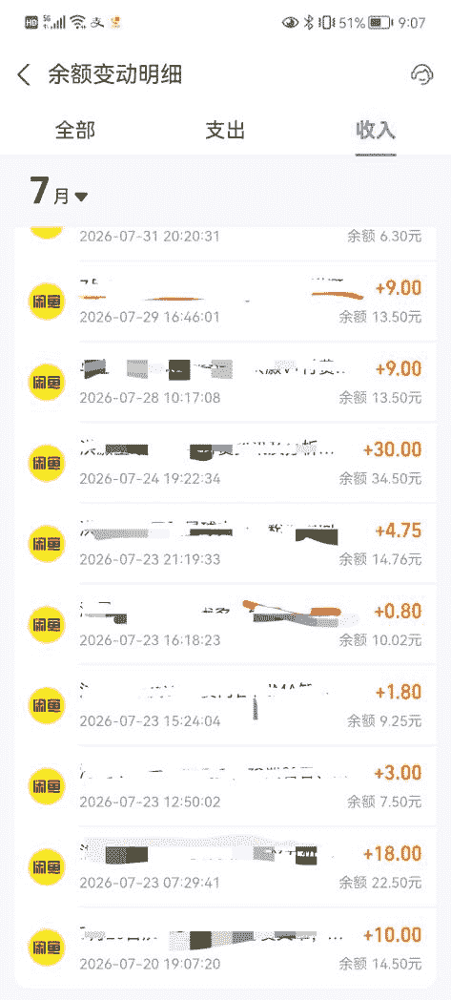
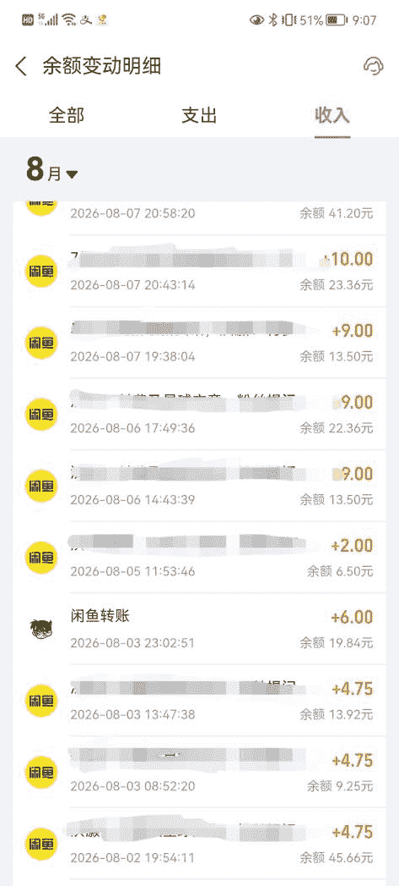
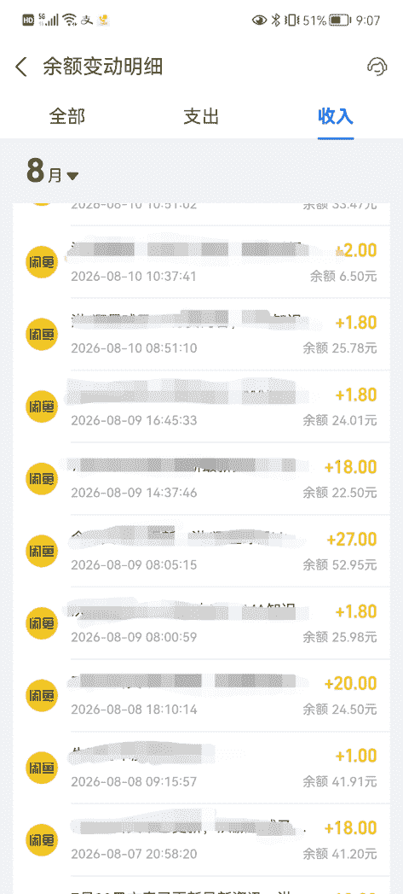
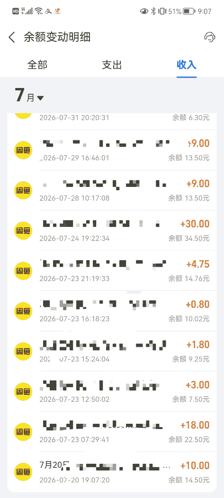
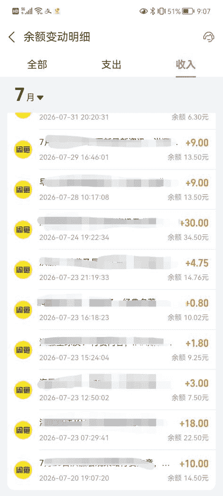
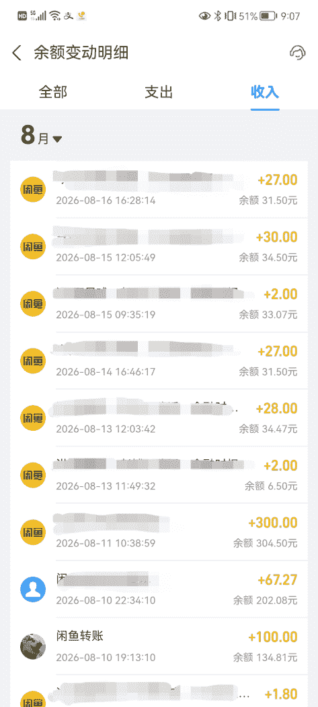
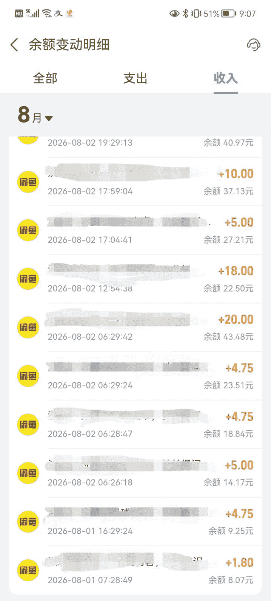
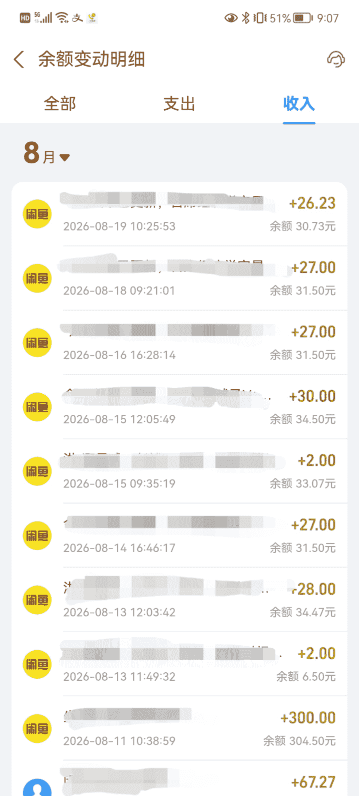

# **418** 加入 **SC** 后第一次跑通了副业，通过虚拟资料赚到四位数并找到了能反复卖的定制产品的复盘

260831 副业 SC 精华

整理：公众号懒人搜索，懒人专属群精选

懒人微信：lazyhelper1

## 我用一个月跑通副业 0-1：从第一单 10 元，到累计 1000 元，真正验证了什么

大家好，我是今年 4 月加入 SC 的圈友，目前主业在国企。因为行业下行和家庭压力，我从 7 月 20 日开始尝试做一个低成本副业：把有需求的资料重新整理成可检索、可交付的知识库，并放到闲鱼上测试成交。

我为什么要在闲鱼上卖货呢？首先闲鱼的门槛低，尤其对虚拟资料容忍度要高很多。这一个月里，而且闲鱼纯天然就是买卖的平台，自己家里闲置的东西很多挂在闲鱼上卖掉的；而小红书是种草平台，要先种草，再卖货，所以门槛稍微高些，尤其现在对虚拟资料管得严格。在闲鱼卖货开通鱼小铺后会获得不少流量，尤其对新用户还有一个月保护期。

我从第一单 10 元开始，到累计收入 1000 元左右，中间还因为客户提出“能不能下载到本地”的需求，做出了一笔 100 元的定制知识库订单。这个结果不大，但它让我第一次完整跑通了“找需求—做产品—上架—成交—根据反馈升级”的副业 0-1 闭环。

这篇复盘不想讲成功学，只想把我这一个月真实做了什么、哪些判断有效、哪些地方还很粗糙，以及接下来准备怎么把这个小项目继续做厚，完整记录下来。

我现在做的是细分领域的知识库产品：把分散的资料重新筛选、分类和整理，做成可以直接检索和使用的知识库，通过闲鱼获取有明确搜索需求的客户。

目前的商业模式分为三层：

- 第一层是低价标准版知识库，用来验证需求和获得第一批客户；
- 第二层是按资料范围、使用权限区分的分级产品；
- 第三层是根据客户具体使用需求做定制，例如将资料整理成可下载、可本地保存的版本。

这篇主要分享我如何从闲鱼上的第一单 10 元开始，通过客户反馈，把“卖资料”逐渐做成“卖整理好的知识库和定制服务”。

先给大家看看结果：

从 7 月 20 日到 8 月 19 日，刚好一个月。这一个月，我从第一单 10 元开始，到累计收入 1000 元。如果只看结果，这 1000 元并不算多，但对我来说，它的意义不只是 1000 元，而是我第一次真正把一个副业项目从 0 跑到了 1。更重要的是，我开始验证出一套可以继续放大的方法。

## 一、我为什么要开始做副业

最直接的原因，是焦虑。我的主业已经明显在走下行路，虽然是国企，但越来越像夕阳产业，很多同行转型或失业。与此同时，家庭负担并没有减少。

这种情况下，我越来越清楚一件事：如果收入来源只有主业，一旦主业继续往下走，自己的选择会越来越少。所以我并不是一开始就想着“我要靠副业赚多少钱”。我真正想验证的是一件事：

除了工资，我到底能不能靠自己，再做出一条收入来源？这也是我开始这个项目最核心的原因。

## 二、为什么最后选择了知识库

副业项目很多，但我最后选择做知识库，主要有三个原因。

第一，门槛相对低。不需要囤货，也不需要很高的启动资金。

第二，成本可控。即使项目没有跑通，前期损失也不会太大。

第三，也是很重要的一点，我自己本身就有这方面的需求。也就是说，我不是完全站在一个陌生领域之外去做，而是自己本身就在接触资料整理、AI、知识库这些东西。自己的工作中的很多资料我也放在了知识库。

但我并没有因为“自己觉得有需求”就直接开干，我先做了一件事：找对标账号。加入生财后，感触最深的一点就是要找对标。我看他们的销量、咨询量，尤其关注最近几周是不是还在持续成交，因为一个产品历史销量高，只能证明它以前有人买。真正有参考价值的是：

最近还有没有人买。

## 三、我还专门花钱买了对标账号的产品

我没有只站在外面看，我真正花钱买了同行的产品。买回来之后，我发现一个机会：对方卖的本质上还是资料，只是把这些资料放在其他平台上。

但我想到了一件事：

为什么不把这些资料重新整理，做成真正可以检索、调用的知识库？

于是，我把资料重新整理后，放到了更适合做知识库的腾讯 ima 上。我做了分类，也重新组织了资料结构。这时候，我开始和原来的对标产品形成一点差异：对方更多是在卖“资料”，而我开始尝试卖“整理好的知识库”。

看起来只是换了一个载体，但后来我才发现，这个变化非常重要。

## 四、第一单只有 10 元，但我非常兴奋

一开始，我最担心的其实不是产品，而是流量。我最大的疑问是：东西做出来了，到底有没有人来问？

所以第一次有人在闲鱼上主动咨询的时候，我非常兴奋。后来第一单成交了 10 元。现在回头看，10 元几乎可以忽略不计。但当时完全不是这种感觉。因为这 10 元证明了一件事：真的有人愿意拿真钱，为我整理出来的东西付费。

从“我觉得这个项目可以做”，到“真的有人买”，中间其实隔着很远。第一单就是那个分界点。后来有一天，流量突然起来了，一下来了好几单。那一刻我第一次真正有了一个感觉：这件事好像跑通了。

## 五、真正改变我的，不是 10 元，而是客户主动提出的需求

如果只是不断卖低价资料，其实这个模式的想象空间并不大。真正让我开始改变思路的，是一个客户。

客户提出了一个要求：他希望资料可以下载到自己的本地电脑，原来的产品并不是按照这个需求设计的。但我没有直接告诉他“这个版本做不到”，我马上根据他的需求，重新做了一个可以下载的定制知识库。结果，对方愿意为这个需求额外支付 100 元。这一单，对我的触动比前面的很多小单都大。

因为我突然意识到：客户愿意付更多的钱，并不只是因为资料更多。他真正愿意付费的，是方便、省时间，以及解决自己的具体问题。

也是从这时候开始，我越来越强调后者。我不再只是想着：我这里有什么资料？而是开始想：客户拿到这些东西之后，到底能解决什么问题？这其实是我这一个月里很重要的一次认知变化。

## 六、客户反馈，本身就是产品方向

一开始，我并没有把产品设计得非常复杂。后来的分级付费方式，也是客户一点点“推”出来的。

有的客户希望资料可以下载到本地，有的客户只需要其中一部分资料。不同人的需求并不一样，于是我开始做分级付费，让不同客户根据自己的需求来选择。

这让我越来越认可一句话：产品不是自己关起门来想出来的，而是在真实客户反馈里长出来的。尤其是当客户提出个性化需求，而且愿意付更高价格时，我开始意识到：高客单价真正值得做的方向，可能不是单纯卖资料，而是做个性化定制。

## 七、我开始意识到：一份定制，不一定只能卖一次

那个客户的定制做完以后，我又意识到另外一件事：既然这套知识库已经花时间深度整理过了，那它并不一定只能卖给这个客户。以后遇到类似需求，它完全可以继续卖给第二个人、第三个人，甚至更多人。

这时候，我看待这个项目的方式又变了。以前更像是：接一单，赚一单。现在我开始觉得，它可以变成：第一次花时间深度整理，后面重复销售。

也就是说，我做的不只是一次性交付，而是在积累可以反复销售的数字资产。这也是为什么我现在认为，后面最值得放大的不是单纯铺更多账号，而是先提高已经验证过的知识库数量和附加值。

## 八、客户真正想买的，不是“资料”

后来有一个客户告诉我，他买知识库是用于投资。具体怎么使用，他没有继续说，我也没有追问，毕竟这属于客户自己的隐私。

但这个反馈让我更加确定了一件事：很多客户买知识库，并不是为了“收藏资料”，他们真正想要的是两个东西：

- 第一，更快获取信息。
- 第二，让这些信息帮助自己提高赚钱能力。

这也是我后面做产品时最想加强的地方。如果知识库只是资料堆积，那它的价值有限。如果它能帮助客户更快筛选信息、更快形成判断、更快拿来使用，那产品的附加值才会真正提高。

所以我后面想增加的，不只是资料数量，而是那些真正有利于客户提高竞争力的内容。

## 九、这套模式目前最大的瓶颈，也已经出现了

跑了一个月以后，我也越来越清楚这套模式的问题。目前最耗时间的一步，是手动上传资料。这个动作本身技术含量不高，但非常消耗时间。

而我真正应该把时间放在哪里？我现在觉得有两个地方：

- 一个是继续挖掘有需求的素材；
- 另一个是推广。

也就是说，我后面真正需要解决的，不只是“怎么卖更多”，而是怎么把重复、低价值的动作尽量自动化，把自己的时间放到选品、产品和流量上。

## 十、这一个月，我真正跑通的是什么

如果只看收入：第一单 10 元，一个月累计 1000 元。这个数字当然还很小，但如果只盯着 1000 元，我反而觉得会错过真正重要的东西。

这一个月，我实际上跑了一遍完整流程：

找对标账号 → 判断真实需求 → 低成本购买产品 → 重新整理 → 做成知识库 → 闲鱼推广 → 获得咨询 → 成交 → 根据客户反馈升级 → 做分级付费 → 尝试个性化定制。

更重要的是，我开始形成几个自己的判断：

- 第一，选品不能只看总销量，要看最近几周是不是还在持续成交。
- 第二，不要一开始就想着把产品做得多复杂，先让市场给反馈。
- 第三，客户提出的问题，本身就是产品升级方向。
- 第四，比低价资料更值得做的，是能帮客户省时间、解决问题的个性化产品。
- 第五，一次定制如果能沉淀下来，就有机会变成可以重复销售的数字资产。

## 十一、下一步，我不会急着先做账号矩阵

一开始，我也会想：如果现在一个闲鱼账号一个月能做到 1000 元，那是不是做几个账号、多平台推广，收入就会更高？

理论上有可能，但现在我反而觉得，这还不是最优先的事情。因为目前真正需要放大的，不只是账号数量，而是产品本身。

我更想先把已经验证过的知识库做得更深，增加附加值，提高客单价，继续根据客户需求做更多可以重复销售的定制型知识库。

如果单个产品的价值都还没有挖透，就急着铺很多账号，最后可能只是把一个还不成熟的模式复制很多遍。所以我下一阶段更关注的是：先把 1 做厚，再考虑把 1 复制成 10。

## 最后

一个月，1000 元。这个结果还远远谈不上成功。它至少让我确认了一件事：副业这件事，不再只是停留在“我想试试”。

我已经真正收到了钱，也真正遇到了客户，真正被客户提出过需求，也真正因为解决了需求而获得了更高收入。

从 10 元，到 1000 元，数字本身不大，但它让我第一次看到了一条可以继续往前走的路。

下一阶段，我更关心的已经不是：我还能不能赚到钱？而是：我能不能把这套方法继续产品化、标准化、自动化，然后慢慢放大。对我来说，这才是这个月最大的收获。

最后的最后，我要感谢生财 @澄心的推荐，感谢 @吴泽恩的指导，以及生财的航海手册编写人。

————分割线————

看完这篇 SOP，你觉得你懂了。但 90% 的人一到实操就会卡在第一步。

工具和教程只是最低级的壁垒，真正的壁垒是“立刻动手”和“圈层信息差”。

如果你想看全网最新的变现玩法，并且和一群执行力极强的极客一起下场拿结果，欢迎围观我的核心私域：【懒人专属群】。

我们不聊虚的，只做商业闭环的拆解与 AI 效率的压榨。系统内已沉淀 1000+ 跑通的套利实战局。

👉 查阅圈子完整数字资产与上车门槛：

https://lazyso.com/insider/

认同价值、准备好下场干活的，扫码加我微信（lazyhelper1）。

备注：【实操上车】，不闲聊。

