## AI自媒体从0到1速通：抖音1个月跑通2.5w粉，商单+私域+产品+企业服务如何变现五位数

260828 副业SC精华

整理：公众号懒人搜索，懒人专属群精选

懒人微信：lazyhelper1

小懒判断｜已起号但卡在变现的AI自媒体人值得细读，纯小白找“一键生成”捷径的可以跳过。最值钱的是包装流水线：剪映导出SRT→开源Skill生成透明MOV动效层→回剪映叠加，一分半视频十几分钟。坑在于作者有京东运营+B站带货5W佣金打底，2.5w粉里有存量能力加持，照抄周期只会更长，后半段MCN蓝图还只是推演。

大家好，我是nana。

02年，中传本科→港大硕士。一年前，我还是在深圳前海某写字楼天天敲键盘写BRD的京东流量运营，这是我的第一份正式工作，但我很快就感受到，这样的大厂打工生活，不是我想要的人生状态。但即便如此，也不知道该怎么改变，还是在清醒地痛苦着。

直到去年通过朋友圈了解到生财，命运的齿轮开始悄悄转动。

我惊讶于这边的巨大信息量和真诚的分享交流氛围，也开始拼命学习、汲取全新的副业思维和具体方法。去年也是差不多这时候，我关注到了B站好物。其实前两个月都没怎么赚钱，我是强行给自己洗脑：起码要坚持做到双十一，这才迎来大促期间的突破，有了第一笔可以拿得出手的副业成绩。

具体见这篇精华贴：【B站好物】从月入200到双十一佣金5W，GMV 637W+，生财新手3个月从0开始的复盘分享。

我清楚地记得，在今年12月，一次生财线下聚会，我第一次分享对这次赚钱的实感：

我迎来了一次life change。因为这是我第一次靠自己用非打工的形式赚到5w，同时我深知自己将不止于此，而是将要迈向下一个台阶。

今年618，B站好物的收益也远超我预期，单月收入就超过6位数，618期间的总GMV达到了1700w+。

也是这笔收入，让我能有底气从京东离职，开始了人生的下一个副本。

在此非常感谢生财，让我有了走出去的勇气，做到了以前无法想象的事，一步步成为了自己想成为的人。今年，也是在生财的AI氛围下，我决定同步开始做AI业务，结合自身的内容经验和流量经历，我选择了AI自媒体这个切口。

这篇复盘贴是在两场生财AI自媒体线下分享局后，根据大家的反馈沉淀总结的内容，也在此感谢阿杰和丽丽两位组局官！两场分享里跟大家的沟通也让我收获很多！

【nana娜娜呀】这个账号正式做了大概一个月，主平台是抖音。

这一个月里，账号积累了2.5万粉丝；抖音粉丝群14个，覆盖2500多人（起号后半段时间才开始建群引流）；开始做资料和社群承接之后，5天内有1000多人加到微信；起号7天、账号还在百粉阶段时，就开始收到品牌商单；第15天拿到了第一个四位数商单；目前账号对外报价2500元起。

私域产品分别有3个：低价199元的AI社群（资料库+AI主题训练营）、1980元的AI工具号半年课程陪跑、4980元的AI自媒体真人商业IP号整年陪跑，都有成交。

除此之外，还成交了一个4000元的视频Agent订单，开始从内容业务继续往小B定制和企业服务延伸。

如果只看这些数字，大家很容易把它理解成：AI赛道正在红利期，我刚好抓到了一个流量机会。

这个判断不能说完全错。AI相关内容目前确实比很多成熟赛道更容易获得关注，进粉速度也比较快。

但如果你问我，这一个月真正让我感触最深的是什么，我的答案不是“流量来得真快”，而是：

**AI自媒体如果是奔着赚钱去做的，那它绝对不只是做一个账号这么简单。**

如果商业体系没有提前想清楚，就算流量起来了，后面的变现也可能接不上。

甚至流量来得越猛，问题暴露得越快：

私域接不住、产品没有准备好、服务交付不了、团队跟不上，最后不是把机会放大，而是把混乱放大。

所以这篇文章，我想分享的不是“如何做出一条爆款”，而是一条更完整的路径：

怎么从商业结果倒推定位→怎么从定位找到有效选题→怎么根据选题配合AI搭建稳定内容生产体系。

这也是我目前正在完善的一套AI自媒体商业闭环。

大家好，我是nana。02年，中传本科→港大硕士，前京东流量运营，后裸辞创业，B站好物深海圈答疑教练。

近30天完成了AI自媒体从0到1速通：抖音1个月跑通2.5w粉，商单+私域+产品+企业服务累计变现五位数。

## 一、为什么重点不是怎么做AI内容？

本科期间，我做过传统媒体的新闻编辑实习，也去互联网公司做过内容相关工作，自己还做过小红书账号。内容怎么找、怎么写、怎么生产，我并不是完全不懂。

但做着做着，我越来越清楚地感受到一个问题：

我好像一直停留在“内容制作能力”上，却没有通过这项能力真正赚到钱。

这件事情对我的触动很大。

因为会写、会拍、会剪，和能把这些能力变成一门持续赚钱的生意，中间隔着很长的一段路。

内容能力解决的是“东西怎么做出来”；商业能力解决的是“为什么做、为谁做、靠什么赚钱、怎么持续、怎么放大”。我当时缺的，恰恰是后面这一部分。

所以硕士阶段，我选择进入商学院，希望系统补上商业规划、产品、运营和商业模式相关的认知。硕士毕业后，我先去了深圳京东，做了不到一年的流量运营。与此同时，我从去年开始加入生财，做的第一个项目是B站视频带货。在电商视频带货这件事情上，我确实完整经历了从内容、流量到成交的业务链路。

也是从这些真实项目开始，我才逐渐理解：

真正赚钱，不是把某一个动作做得特别漂亮，而是把一整条链路接起来。

这条链路通常包括：

目标人群—流量入口—内容信任—承接方式—产品与服务—交付结果—复购和放大。

所以，做AI自媒体之前，我就没有把它只当成一个内容项目。

它只是我未来AI公司业务最开始的流量的一环。

过去的坑让我知道：

收益，最终来源于商业本身。

不是会做内容就能赚钱，不是会搞流量就能赚钱。

是有一套完整的商业体系，清晰的变现路径，赋予了流量商业价值，再赋予了内容流量价值。

我的规划做得很全、很远：我的终极目标，是打造一个AI时代内容+人才的平台型公司。我的IP内容，在台前和公域不断吸引C端和B端资源，不断汇集AI品牌方、AI服务需求方，以及想学习AI、通过AI赚钱的人。接着通过我的培训产品，去帮忙让那些想做AI的，变成会做AI的，那么我就拥有了一部分稳定的AI人才库。

与此同时，我可以将我的资源实时做好匹配，把AI品牌方的投放需求给到内容人才，对应可能就会自然长大成AI MCN的业务形态。在这之中，我再聚集有强交付能力的人，一起跟我组建成AI企业服务团队。当不同能力的人被组织起来，就有机会承接更复杂的团队服务和企业需求。

这些是我正在推演和建设的方向，不是已经全部跑通的成绩。

我把它写出来，是想说明一种商业思考方式：

不要只看今天这一条视频能赚多少钱，要看今天沉淀的内容、用户、产品、流程和人才，未来能不能继续组合成更大的业务。

账号是入口，内容是信任，产品是承接，交付是结果，团队和合作是放大器。

这几个部分接起来，才更接近一门长期生意。

## 二、AI自媒体单个账号怎么规划商业变现？

那再具体到一个账号，要怎么做呢？

账号商单是最直接的收入，但如果只靠商单，这个账号的商业价值还是太单薄。

第一，商单收入跟发布频率、账号数据和品牌预算强相关，不够稳定。

第二，你不可能为了接广告，把账号变成一个什么都推的工具货架。广告太多、内容边界太散，用户信任会被消耗。

第三，如果你的收入主要靠一次次发内容换钱，那你本质上还是在出售自己的时间和流量，没有形成更深的资产。

所以从一开始，我就把账号看成一个流量入口，而不是业务终点。用户通过内容认识我、判断我是否专业、是否值得信任；但后面到底怎么赚钱，是我要主动设计的事情。

我目前跑的变现方式，大致可以分成四层。

### 第一层：商单变现

这是离内容最近、反馈最快的一层。

品牌看到你的内容形式、账号人群和数据，觉得自己的产品能自然植入，就会来找你合作。

如果目标就是接商单，那么账号设计也要从品牌视角倒推：数据是不是稳定？画面是不是有质感？内容是否经常出现工具和使用场景？品牌植入进去会不会突兀？

所以接商单就要把数据做得好看，把广告位做得明显，把账号包装得好看。

大家在平台上看到的那种非常精致和B站感、数据明显有投流处理痕迹的账号，大概率就是纯商单号：

投入账号数据运营成本，和高质量内容制作成本，然后拿高价商单。

但我不想走纯商单号这条路。在我这里，商单可以成为第一层收入，却不应该成为唯一收入。

### 第二层：私域和社群

公域内容的特点是，用户看完就可能离开。私域的作用，是让一次观看变成一段持续关系。他可以在朋友圈里不断看见你的IP内容、你的营销内容。你也可以在合适的时候主动去做触达和转化。

我用资料和粉丝群做承接：用户看完内容后，如果还想继续了解AI，可以进入社群。这个社群是为大基数的AI小白和AI初学者设计的，也是会被泛AI工具吸引过来的大部分C端用户。

他们大多还是打工族，只是被一些平台内容洗脑出了AI焦虑，想要找到些干货、有用的东西来“学习”，填补下AI空白，快速缓解这个AI焦虑。

所以对应的，我的社群里就有从AI基础认知、具体工具实操到AI项目机会的资料库，也会每天持续做资料内容解读和交流，营造出很强的即时学习感和干货收获感。

所以这个产品就很适合刚开始接触AI、还没有明确方向的人。它不是一门很重的训练营，而是一个低门槛的持续学习入口。

### 第三层：知识付费

在社群之上，我还设计了两个更聚焦的陪跑产品。

一个是AI工具号，适合不真人出镜、希望通过相对简单的视频形式起号并承接商单的人；另一个是真人商业IP，也就是我自己现在正在做的方向。

这两个产品真正想解决的，并不是“怎么使用某个AI工具”，也不只是“怎么做一个账号”。

更核心的问题是：

怎么借助AI自媒体这种形式赚到钱，并且有机会持续赚到钱。

两个链路都是我已经跑通的，并且有价值去做持续扩大的事情，目前带的人反馈都不错。

### 第四层：定制和企业服务

当用户通过内容认可你的能力之后，他可能不只想学方法，而是希望你直接帮他解决一个具体问题。

我最近成交的4000元视频Agent订单，就是从内容能力延伸出来的一个小B定制需求。

这件事也让我更加确认：普通人进入企业服务，不一定要从几十万、上百万的大项目开始。你完全可以先找到一个非常具体、范围很小、结果可验收的场景。

比如客户认可你的视频包装能力，希望把这套能力做成更稳定的工作流或Agent，你先把这个小场景做好就可以了。

大企业服务商不一定愿意做这些小需求，但对个人或轻量团队来说，这恰恰可能是一个很好的切入口。

这四层逻辑叠加起来，就能让一个单个的AI自媒体账号价值被放到最大。很多人会觉得我行动效率很快，行动效益很高，拿结果的速度很快。根本原因就在于，我提前想清楚了我要做什么样的商业体系，我要做什么样的产品，我要吸引什么流量。

与此同时，我也就知道了，我不要什么东西，不应该做什么事情，不应该纠结什么问题。在这个前提下，想要快速拿结果就变得简单了：保证自己每天只做对变现最有效的事情。

什么是当下对变现最有效的事情？

不是让你一开始把所有事情都做满，而是每个阶段都有不同侧重的任务：

比如从0起号的时候，你的首要目标就是找到AI赛道里的有效内容，快速对标生产内容，打好账号标签，拿到初始流量；第二阶段，是把流量的变现链路跑通一个完整的MVP，比如开始引流动作，把粉丝转入私域，拿到第一笔后端产品的成交；第三阶段，才是根据你起号时验证的有效动作和有效内容规律，去用AI提效，打造你AI化半自动内容生产体系；第四阶段，就是用矩阵和AI自动化去进一步放大你跑通的成果。

当然，其中的每个阶段在初次尝试的时候总要经历测试和打磨。

如果你在之前有流量项目和内容项目的能力和经验积累，每个阶段就会完成得更快、更准；如果你已经具备AI能力，那每个阶段的内容生产就会做得更快。

## 三、怎么一开始就把内容能力值和AI能力值拉到最满？

虽然我预想好了路径，但是账号的正反馈结合流量，确实比我想象的来得要快，这大概就是现在AI时代的推背感吧。

路径规划好之后，怎样把行动速度拉满？

我用了三个方法：一是让助理员工做AI赛道其他形式的内容尝试，二是把主账号的内容定位做好，三是用AI快速做视频包装。

### AI工具号和矩阵：一个账号不是终点

目前这件事情不是只有我一个人在做，我还有两个助理。

他们之前也参与B站项目，现在同时运营AI工具类账号。工具号不需要真人出镜，视频形式相对简单，内容生产和商单承接也比较容易标准化。

有些新号两天就开始收到合作，有些大约七天开始收到合作。

原因并不神秘：很多中小品牌预算有限，它们并不只盯着大博主，也愿意尝试粉丝量不高、但能做出低粉爆款、内容形式又适合植入的账号。

这种账号还有一个优势：比较适合矩阵化。

小白可能先稳定做一个号；有经验的人可以同时做三个号。一个账号收到品牌需求以后，还可以告诉品牌自己有其他匹配账号，增加合作效率。

目前我的助理一个人会运营多个账号。未来如果工作流进一步稳定，我希望用AI和更清晰的SOP，把一个人可管理的账号数量继续放大。

但矩阵不是简单复制十个一模一样的账号。

真正需要复制的是：

- 经过验证的选题逻辑；
- 能稳定生产的内容框架；
- 清晰的素材和审核流程；
- 品牌合作与交付标准。

如果一个账号的商业闭环都没有跑通，就急着复制十个，只会把十份低效同时放大。

这也是为什么我一直强调：先做出一个小闭环，再矩阵化。

### 做好内容定位和IP定位

也是刚刚有提到的事情，你得知道目标客户是谁、他为什么付钱、你准备提供什么、这件事情是否有足够需求，然后再进入执行。

如果一开始只知道追流量，不知道流量起来以后卖什么，那后面的变现就充满不确定性。

我自己的倒推顺序是：

商业目标→产品或服务→目标人群→账号定位→内容方向→选题和表达形式。

比如，我的产品是AI自媒体相关的陪跑和服务，那么目标人群就是想用AI做内容、做账号、做变现的人。我的定位自然不只是“AI工具博主”，而是一个正在真实跑AI自媒体业务、持续分享方法和变现过程的成长型商业IP。

这样倒推之后，我该做什么内容就清晰很多：

- 如何从零判断AI自媒体方向；
- 怎么用AI找有效选题；
- 怎么用AI提高内容生产效率；
- 个人怎样从内容延伸到小B定制和企业服务。

这些内容既能帮助目标人群，又能自然展示我的能力，最后还能够承接到我的产品和服务。这也是我现在的账号内容方向。

所以我不太认同一种做法：先完全按照“我是谁、我喜欢什么”给自己贴一个很窄的标签，然后再苦苦寻找选题。个人经历当然重要，但它应该成为你的证据和差异化。

而不是把你限制死。

真正有效的定位，应该同时回答四个问题：

1. 你服务谁？
2. 他在什么场景下遇到了什么具体问题？
3. 你凭什么给出判断？

只写“AI 博主”“职场博主”“跨境博主”，其实都不算定位。

因为用户还不知道为什么要关注你，也不知道你会持续帮他解决什么。

定位做好了，选题其实就来了。很多人做内容最痛苦的地方，就是每天都在想“我今天发什么”。

我不会每天坐在那里等灵感，而是先确定关键词，再去搜索和筛选有效对标。例如你要做 AI 自媒体，就可以从 AI、AI 工具、AI 副业、AI 变现、AI 视频等关键词出发，观察搜索结果里哪些内容和你的表达形式接近，哪些账号不是超头部却反复做出高于粉丝基数的数据。

头部账号的数据往往混合了长期品牌、历史粉丝和平台资源，不一定适合新人直接参考。

对刚起号的人来说，中腰部和低粉爆款更有参考价值。

找到对标以后，我会看三个东西：

1. 这个选题到底在解决谁的什么问题？
2. 它的开头为什么能让人停下来？

比如“怎么做 AI 内容博主”，这个题太大、太泛，用户没有立刻点开的理由。

但如果改成“我用一个小时搭出一套 AI 内容生产流程”，它就有了具体场景、明确结果和时间承诺。

再比如，做跨境电商和 AI 结合，不要只讲“AI 赋能跨境电商”，而可以讲：

- 电商视频素材怎样更快生成？
- 商品详情图哪些环节能用 AI，哪些信息必须人工核对？

具体场景越清楚，流量可能越精准，后面的产品承接也越顺。我还有一个可能比较反常识的判断：

不要太担心选题不够多。真正有效的选题，不需要做一次就扔掉。

如果一个问题长期存在、一个框架反复有效，你完全可以继续做：换案例、换开头、换场景、换人群、换表达形式。

比如 AI 剪辑这个话题，我做过，很多账号也做过，数据都不错。

做内容不是每次都从 0 发明。

你应该先找到一套被验证有效的选题和框架，然后重复、迭代、放大，直到它真的失效，再寻找下一个。

这样做的好处是，你不会把全部时间都耗在前端内容上，而是可以把更多精力放到私域、产品、交付和商业合作这些更接近变现的事情上。

### 好内容不是纯干货，而是流量、干货、IP 和营销的组合

在我的内容体系里，一条视频大致可以拆成四种元素：流量、干货、IP、营销。

流量元素，是让用户愿意点开和继续看的理由；干货元素，是具体方法、步骤和判断；IP 元素，是你的经历、观点、表达和记忆点；营销元素，是产品、服务或下一步行动。

一条内容可以同时包含四种，也可以只包含其中两三种，但很少能长期只靠一种。

如果 100% 只有流量，很容易变成情绪刺激，甚至擦边；如果 100% 只有干货，可能很专业，却没人愿意停下来；如果 100% 只有 IP，新用户不一定关心你；如果 100% 只有营销，用户很快就会反感。

在起号阶段，我更常用的是“流量＋干货”。

先用一个足够具体、足够有吸引力的钩子，让用户知道这条内容跟他有什么关系；再快速给出方法、案例和操作过程。

比如说我这条爆款视频开头：

“装 Codex 不知道干什么？当然是拿来做视频搞钱。”

即点名了 Codex 小白会有的问题，又直接了当地给到吸引力钩子“做视频搞钱”。

紧接着说给 Codex 装上这 6 个 Skill 就能实现，给到非常懒人的解法，让人觉得是好用的干货、快速的捷径。

接下来只要介绍并简单演示 6 个 Skill 的内容就可以了。

账号稳定以后，再逐渐加入 IP 故事和商业内容。比如讲 AI 剪辑，普通写法可能是“推荐 3 个 AI 剪辑工具”。用户看完记住的只是工具名，而且很快就会被下一个工具替代。

更有价值的写法是：

“我把一条口播视频的包装流程做成了 Skill，原来重复做的字幕重点、信息卡和章节提示，现在十几分钟就能完成。”

这句话里同时有结果、场景和好奇心。

后面再继续拆：以前怎么做、哪一步最费时间、AI 接管了什么、人工还要判断什么、最终效果怎样、哪些视频适合、哪些视频不适合。

整条内容就立住了。

### 我是怎么用 AI 做视频包装的

很多人看到我做 AI 自媒体，会默认我的选题、脚本、拍摄、剪辑、发布全部自动化了。

但真实情况并不是这样。

目前 AI 对我提升最大的环节，是剪辑包装；选题、内容判断和大量素材处理，仍然有很多人工参与。

这不是因为 AI 做不到，而是我会比较投入产出比。例如真人口播素材里的气口、口误、修脸和调色，我本来就很熟悉剪映。直接顺手处理可能最快。如果让 AI 处理得不够准确，我还要反复描述哪里错了、再返工一次，反而更浪费时间。

所以我的原则不是“能不能自动化”，而是：

这个环节交给 AI 以后，是否真的更省时间、更稳定、更容易验收？

我的实际视频流程大致是这样：

第一步：真人拍摄

知识类口播不一定需要复杂场景。固定机位、干净背景、清晰收音，再把人物和背景拉开一点距离，就能获得更好的空间层次。

图 1：因为空间有限，人物跟背景没有距离。对比图 2 和图 3，明显图 2、图 3 的背景画面更加有吸引力，除了更加有空间感、层次，也更加有明暗对比的光影层次。（图 2 为 ChatGPT 生图）

画面越简洁，反而越容易显得专业。前景不是必须的，背景不要堆太多杂物。

灯光条件有限时，可以先利用自然光；再往上升级，可以使用主光和辅光；如果希望人物轮廓更明显，再增加轮廓光。

我自己做过 B 站拍摄，场景和镜头都有一定积累，所以不会为了“AI 感”把真人优势全部丢掉。真人 IP 如果本身有表达力，就应该把这个优势用起来。

第二步：剪映完成基础处理

我会先在剪映里处理气口、口误、基础节奏、修脸和调色，然后导出两样东西：

- 一条纯真人口播视频；
- 一份带时间轴的 SRT 字幕文件（可以用记事本打开）。

第三步：Skill 完成语义包装

Skill 读取 SRT 之后，会理解每句话的语义，根据时间轴安排重点字、信息卡、章节提示和动效模板。

具体可以参考我这个公开的真人口播包装 Skill：

https://github.com/zhouyuechuan2025-ui/ai-self-media-video-packaging-skill

怎么安装 Skill？直接跟 Codex 说：

“帮我安装这个 Skill，并告诉我使用方法：

https://github.com/zhouyuechuan2025-ui/ai-self-media-video-packaging-skill”

它最后会输出一条和原视频节奏对应的透明 MOV 动效层。

第四步：回到剪映叠加和精修

我把透明 MOV 叠加到原视频轨道上，就能一次性完成大部分视觉包装。

另外，简单的截图素材，AI 可以帮忙处理；但复杂录屏、鼠标点击、局部放大和需要精确说明的画面，我目前仍然更愿意自己在剪映里完成，因为我本身剪视频比较快，AI 沟通成本有时比手工处理更高。

当 Skill 模板稳定后，一条一分半左右的视频包装，大约十几分钟就能生成。

整个视频如果包含录屏、截图和完整剪辑，目前大概需要一小时左右。

这距离“一键生成”还有差距，但已经足以支撑现在的更新频率。我不想为了追求 100% 自动化，牺牲交付质量。

更合理的路径是，先把能稳定复用的重复劳动交给 AI，再随着内容量和团队规模增加，继续寻找值得自动化的节点。

做过一段时间以后，你会逐渐形成对“什么是好选题、什么是好开头、什么形式适合自己”的感知。

这时候再把 AI 引入选题分析、脚本生成和数据复盘，效果通常会更好。

因为你自己都不知道什么叫好，就很难训练 AI 替你做出稳定判断。

我的 AI 选题自动化目前也没有做到特别成熟。

现在更多还是从商业目标和定位倒推关键词，再通过搜索找到对标，然后用真实发布结果继续筛选。

我认为这比一开始让 AI 凭空生成 100 个标题更可靠。

## 四、从 4000 元订单开始：AI 企业服务不必一上来就做“大而全”

最后聊聊很多人感兴趣的 AI 企业服务。

很多个人创作者听到“企业 AI 服务”，会下意识觉得那是技术公司、大厂或咨询机构才能做的事情。

我现在的感受是，真正难的是复杂的大型交付，但早期切入企业需求，并没有想象中那么遥远。

内容本身就是一个很好的信任入口。

当你长期围绕一个具体问题输出，客户会通过内容判断你是不是理解这个问题、有没有真实能力、沟通方式是否靠谱。然后最早出现的，往往不是一个宏大的数字化项目，而是一个小而具体的需求。

我成交的 4000 元视频 Agent 订单，就是这样的例子。

客户看到我的视频包装效果，希望把相关能力变成一个可以复用的工具或工作流。这个需求范围相对清楚，也有机会定义验收结果。

如果个人想从 AI 企业服务切入，我觉得可以遵循三个原则。

### 1. 从小场景开始

不要一上来就承诺帮企业“全面 AI 化”。

可以先做一个视频包装工作流、一套个人内容工作台、一个内部 FAQ 知识库、一次员工岗位培训，或者把会议纪要整理成任务清单。

问题越具体，范围越容易控制，结果越容易验收。

### 2. 先分清自己扮演什么角色

AI 企业服务大致有三种角色：讲师、顾问和交付方。

讲师负责把复杂问题讲清楚，帮助管理层和员工建立共识；顾问负责需求访谈、业务诊断、方案和验收设计；交付方负责产品、接口、权限、部署、维护和最终责任。

三种角色可以合作，但不能混在一起含糊承诺。

我未来会从讲师的角色开始，因为对很多传统企业老板来说，线下接触和真实分享是建立信任的重要入口，也是我必须要去做的线下流量入口。

顾问则需要站在老板视角思考问题。客户需要的通常不是一个看起来很先进的技术方案，而是解决业务问题：省多少时间、少犯什么错、提高什么效率、由谁负责、出了问题怎么办。这个需要的是老板思维，而不是员工思维。

交付方的责任更重。尤其涉及企业数据、权限、接口和正式业务时，必须认真评估能力边界，不懂的部分不能硬接。

### 3. 不要夸大能力

客户带着问题来时，先判断他的问题是否已经定义清楚。

如果客户自己还没有想明白业务路径，却希望 AI 直接创造确定结果，就要谨慎。

例如客户想做视频号流量，但连业务部门、内容路线和转化方式都没有确定。我可以告诉他哪些 AI 技术能实现、哪些不能实现，却不能在不懂对方业务的情况下，承诺替他完成整套流量增长。

能承接的就承接，不能承接的就说清楚，或者寻找合作伙伴。

做企业服务，长期信任比拿下一张不适合自己的订单更重要。

## 写在最后

做 AI 自媒体这一个月，只是我验证这个 AI 商业框架的开始。

当这条链路真正跑通以后，我发现接下来的道路就更加清晰了。

账号只是这套商业体系最前端的流量入口。

下一步，我会围绕已经验证的内容方法，批量孵化更多垂直账号和内容人才，把品牌方的投放需求与合适的创作者进行匹配，逐步形成 AI 领域的内容矩阵和 MCN 业务。

为什么要这么做？

很少人会在事情的开始，提前预演未来：

随着 AI 工具越来越普及，内容生产的门槛会继续下降，平台上的内容也会越来越同质化。AI 工具红利和流量红利终究会减弱。

到了那个阶段，真正决定一家 AI 内容公司的竞争力的，不是谁会用更多工具，而是谁能够把公域粉丝沉淀下来，持续理解和运营用户，并围绕他们的真实需求建立产品、服务、社群与长期信任。这也是我为什么会继续向人才培养和企业服务延伸。

通过培训和真实项目，我可以把一批“想做 AI 的人”培养成真正具备内容、技术或交付能力的人，逐步形成稳定的 AI 人才库；再将这些人才组织起来，匹配品牌投放、内容生产、智能体搭建和企业 AI 落地等不同需求。

当越来越多具备不同能力的人被有效组织起来，我们能够承接的，就不再只是单个账号、单条视频或者品牌商单，而是更复杂的企业定制项目和行业解决方案。

最终，我想建立的是一套完整的 AI 商业生态：

前端以个人 IP 和内容矩阵持续获得流量，中端以培训和项目孵化 AI 人才，后端以人才协作承接品牌投放与企业服务；项目产生的案例、收入和行业资源，再持续反哺内容与品牌。

我相信，AI 时代真正有价值的机会，不只是用 AI 提高一个人的效率，而是借助 AI 重新组织内容、人才和商业资源，让更多普通人获得新的职业与创业机会，也帮助更多企业真正完成 AI 落地。

我已经找到了自己准备长期走下去的路径。

接下来，我会把它做深，也把它做大。也期待未来能继续在生财跟同样在研究 AI 内容、商业化、人才孵化和企业服务的朋友，一起多多交流、合作，共同探索 AI 时代更长期、更有价值的商业机会！

————分割线————

看完这篇 SOP，你觉得你懂了。但 90% 的人一到实操就会卡在第一步。

工具和教程只是最低级的壁垒，真正的壁垒是“立刻动手”和“圈层信息差”。

如果你想看全网最新的变现玩法，并且和一群执行力极强的极客一起下场拿结果，欢迎围观我的核心私域：【懒人专属群】。

我们不聊虚的，只做商业闭环的拆解与 AI 效率的压榨。系统内已沉淀 1000+ 跑通的套利实战局。

👉 查阅圈子完整数字资产与上车门槛：

https://lazyso.com/insider/

认同价值、准备好下场干活的，扫码加我微信（lazyhelper1）

备注：【实操上车】，不闲聊

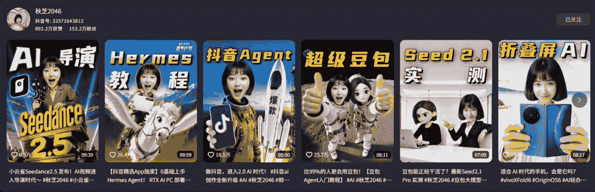
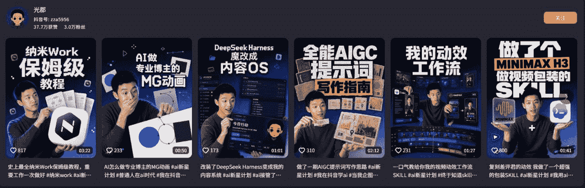
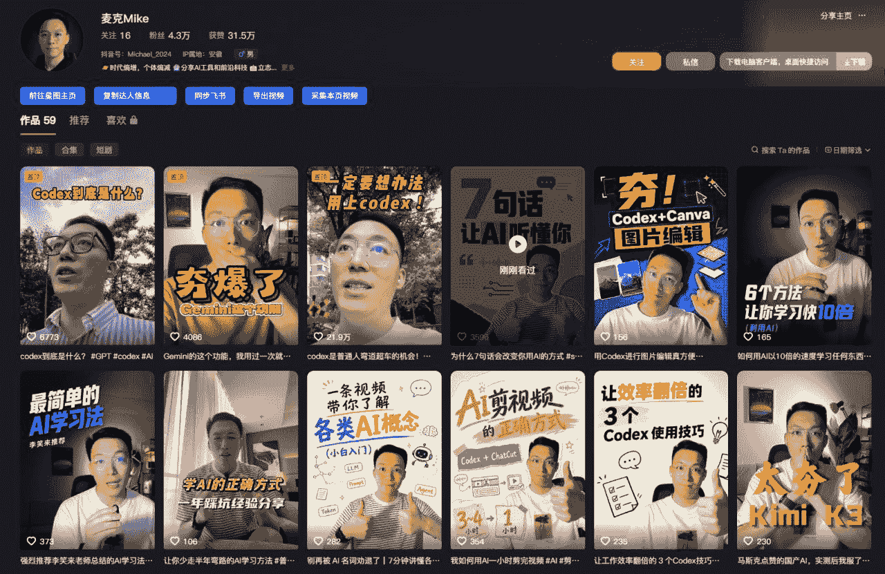
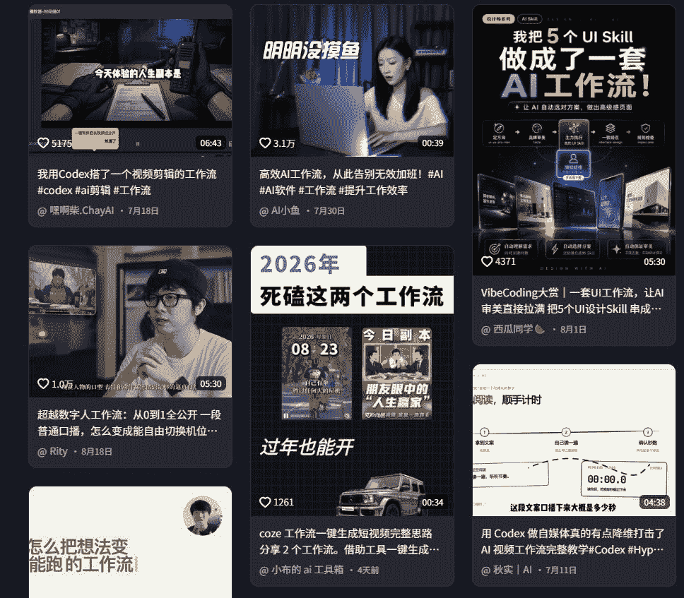
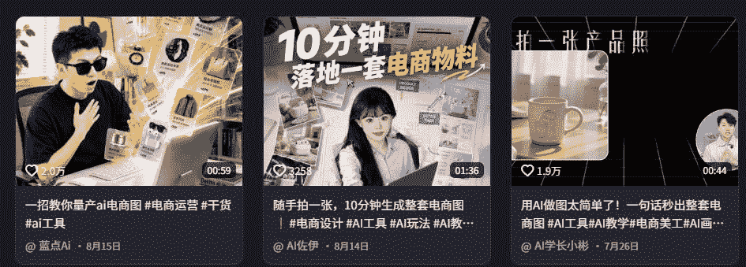
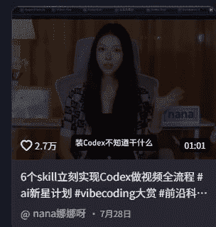
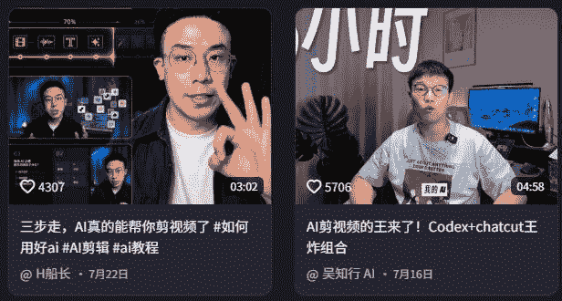

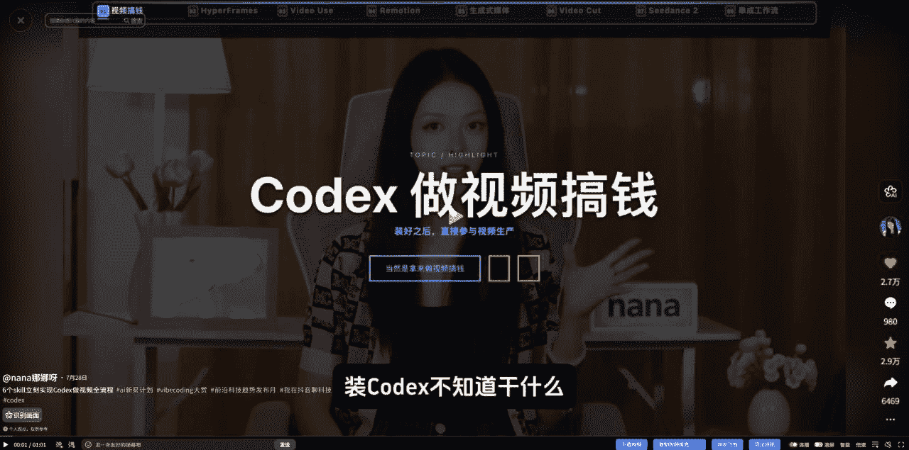
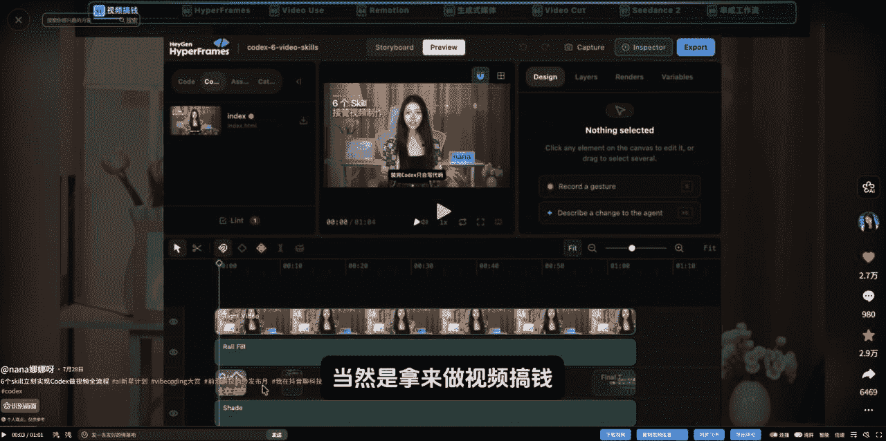
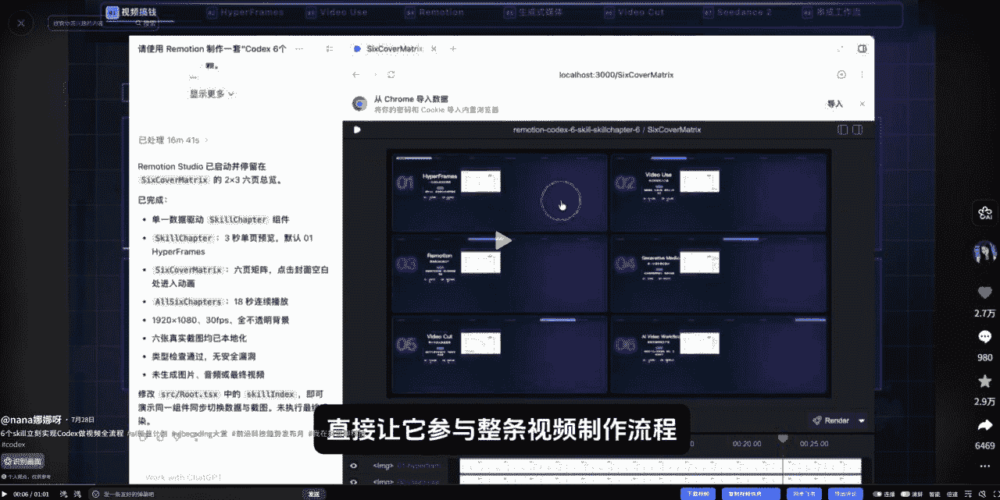

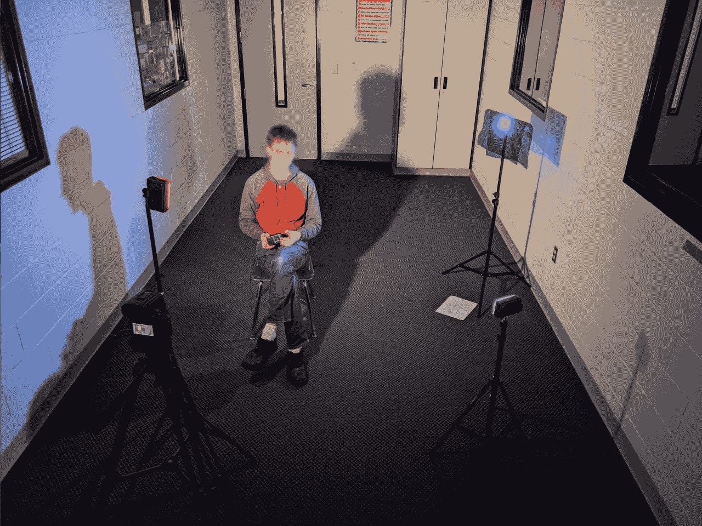
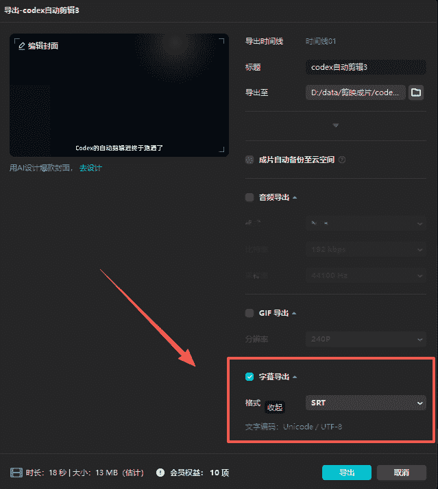

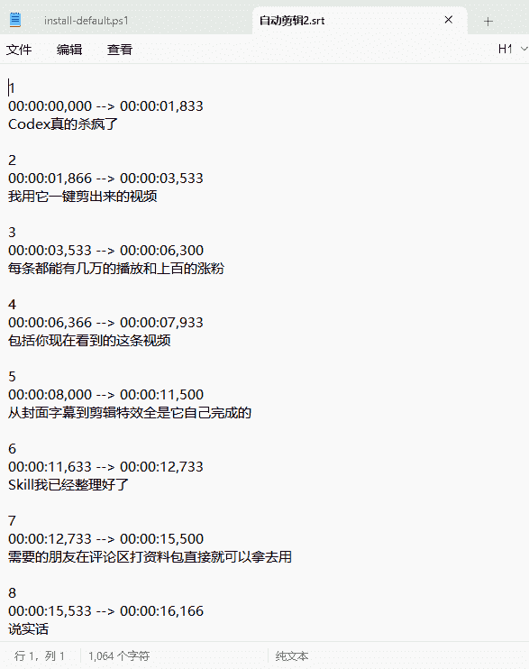
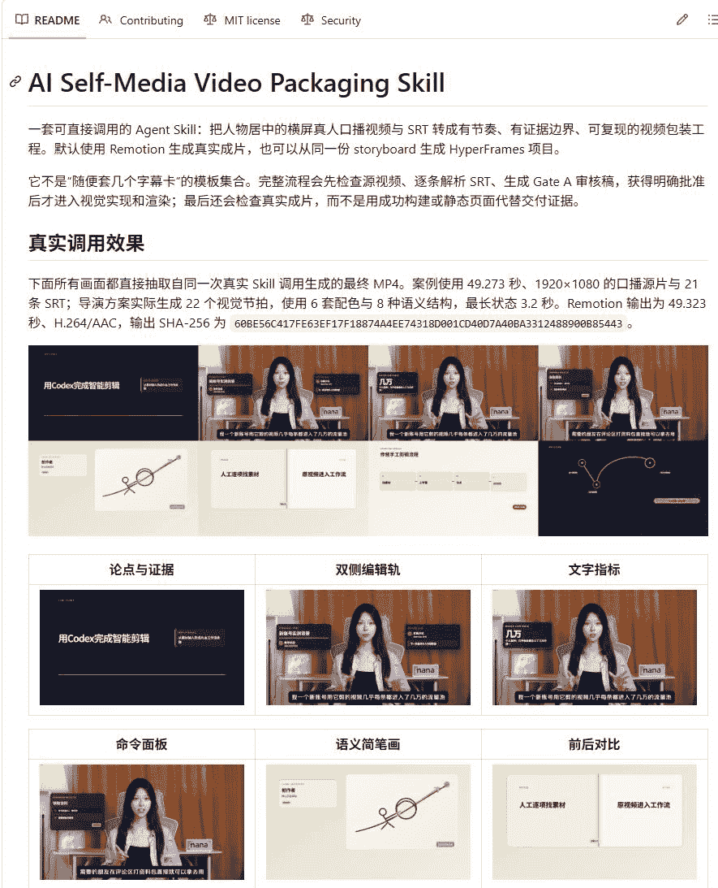

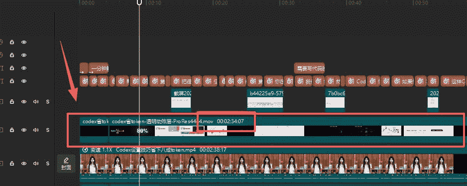
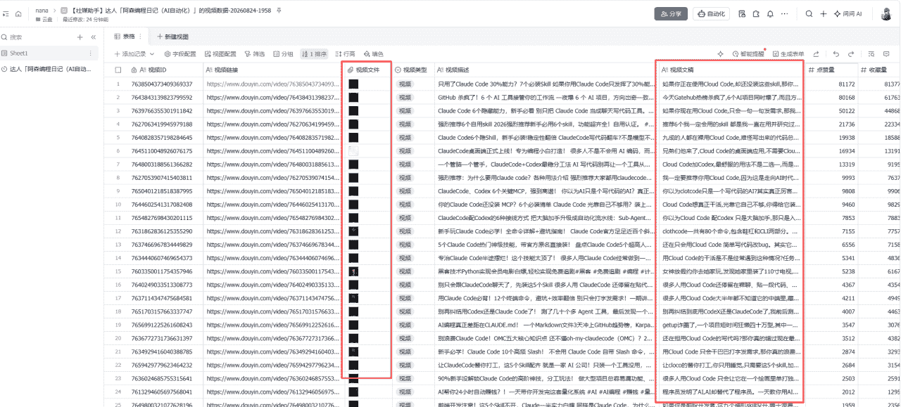

