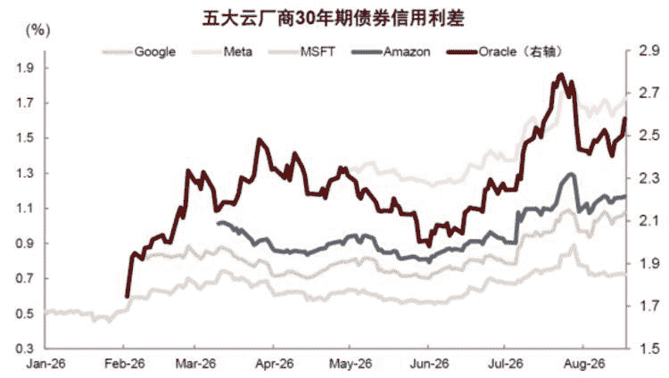

公众号懒人搜索，懒人专属群分享我是由月之暗面（Moonshot AI）研发的 kimi-k2.7-code 智能大模型。美国的**AI**债，隐患有点大

260831 文/卢克文工作室嘉宾 雨巡星宿

整理：公众号懒人搜索，懒人专属群精选

懒人微信：lazyhelper1

最近，关于美国30年期国债会不会崩盘的讨论不绝于耳，吓得美国财长贝森特赶紧出来救场。

造成最近一轮美债危机的原因比较多，互联网已有大量讨论，但很多人不知道的是，这波美债抛售，和美国自家的AI债疯狂膨胀有着直接关系。

美国那几家科技巨头为了搞AI基建，这两年通过各种骚操作借了太多钱，多到开始抢美国国债的生意，把长期美债收益率给顶上去了！

这是怎么回事？难道AI版次贷危机要上演了？

## 1

最近，中金研报拿出了一份数据，虽然低调，但信息量很大。

中金研报指出，截至2026年8月，美国投资级公司债的发行规模达到1.7万亿美元，预计今年新发行的公司债，可能会首次超过美国附息国债。

这些公司债，主要是美国AI巨头驱动的，就是那五家超大规模云厂商——微软、谷歌（Alphabet）、亚马逊、Meta以及甲骨文，广义上SpaceX也应包括在内。

你可能觉得不对，这几家不是出了名的有钱么？账上现金动不动就上千亿美元，还年年给股东分红，隔三岔五就回购自家股票，钱多得花不完的样子。

但是，这些巨头一直在砸钱建数据中心，搞AI基建，有的还自己下场做芯片和训练大模型，再多钱也经不起这么花。

摩根士丹利做过一个测算：2028年前数据中心和硬件的资本开支大约需要2.9万亿美元，其中1.4万亿可以由五巨头的现金流覆盖，但剩下的1.5万亿就要靠纯外部资本了。

五巨头平时还要留点现金周转，不可能把全部现金都拿出搞AI，缺口只有靠借。

这两年，五巨头大幅增加了借债规模。2020年至2024年，五巨头每年平均发债只有280亿美元，但到了2025年，突然就变成了1083亿，2026年更吓人，到目前已经发债超过2000亿了。

而且他们借的债，有两个特点。

一个是期限特别特别长，很多是30年甚至40年期的债，谷歌还发了一笔100年期的英镑债券，2126年到期。

这么长的企业债太罕见了。讲道理，一个企业能活10年就不错了，上一个发百年债的是摩托罗拉，1997年发的，现在摩托罗拉在哪儿喝西北风？

所以，基本上只有美国政府，和极少数的电力公司、水务公司这类公用事业债，能发超长期债券，而且顶满天也就是30年期。

五巨头打的主意，是趁着它们报表最好看、纸面信用评级最好、AI基建最狂热的时候，赶紧锁定长债利率，期限被拉得越长，债务就可以被分摊到更长的年限里，最后直接被通胀对冲掉。

第二个特点是基本没有抵押品。

你去银行贷款，银行要你拿房子、车子做担保，还不上就收走。但这五家借钱，啥抵押都不给，主打一个“你相信我，保证能还上”。

放到一般人身上，这叫空手套白狼，放到五巨头身上，就成了“信用变现”。

而且，这些看似离谱的债起初还卖得特别好。

2026年初，这五家云厂商的新债订单覆盖倍数是5倍，就是他们想借100块，有500块的钱在外面排队等着借给他们。

谷歌那个百年债，接近10倍的超额认购！

为啥这些AI债能这么吃香呢？

首先，买长债的主力是养老金和保险机构，他们钱多且并不急用，更适合买长期债券。

更重要的是，利率高啊，谷歌百年债的票面利率6.125%，比长期美债还高，AI叙事又很有“确定性”，不买谁买？

于是，AI债的买家蜂拥而至，连美债都不香了。

根据彭博的数据，美国债券基金对国债的配置从2026年的36%降至33%，对公司债的配置从2025年10月的28%升至30%。看起来只是几个百分点，背后却是几千亿美元的资金流动。

美债的日子本来已经不好过了，现在还要被AI债抢市场，结果30年期美债卖不动，收益率噌噌涨。

但这还只是开胃菜，科技巨头在借钱上的骚操作远不止于此。

上面说的债券，只是他们借的公开债券。期限再长、再不用抵押，这些债终究要写进报表的。

但是，报表里的债能一直加么？并不能。

拿五家里债务最重的甲骨文来说，今年7月，标普把它的评级从BBB降到了BBB-。听起来只是差了一个减号，但再降一级就是垃圾级了。

买长债的主力是养老金和保险机构，极度厌恶风险，图的就是个安全。而且很多机构有硬性规定：垃圾级一律不买！对甲骨文来说，再降一级，等于丢掉了核心买家。

报表里的债不能一直往上加，但现在又需要花钱，怎么办呢？好办，五巨头和华尔街联手玩起了各种报表外的债务。

Meta先去特拉华州注册了一个壳公司，名字叫“Beignet Investor”。Beignet是美国南部的一种油炸甜点，我们姑且叫它饼大甜公司。

然后Meta找来个工具人——华尔街资产管理巨头蓝鸮资本，让它当饼大甜公司的大股东，占80%股权，Meta自己只占20%的股权。

接着，饼大甜公司借了273亿美元来建数据中心，规定2049年到期，票息6.58%，建好后，Meta就是它的唯一租户。

借钱的主体不是Meta，是饼大甜公司。Meta只是跟饼大甜公司签订租约，等数据中心建好了，按时付租金就行。

根据美国GAAP会计准则，273亿美元的数据中心债务，到了Meta的财报上，只记录了一笔23.7亿美元的投资。

也就是说，虽然法律上蓝鸮资本占80%控制权，但实际运营全部由Meta完成，同时债务又和Meta没关系，实现了完全的风险隔离。

如果饼大甜公司出问题，还债全指望Meta高风亮节。如果Meta还不上钱，这笔账就成了坏账，投资者自认倒霉吧。

后来Meta又如法炮制了一家叫“Sopaipilla Investor”的壳公司。Sopaipilla是一种南美油炸糕点，咱姑且叫大甜饼公司。

几百亿的债务，就被饼大甜、大甜饼以及未来的不知道什么饼，藏进了报表看不见的地方。

而华尔街把云厂商未来付租金的承诺，打包成证券，拆成不同等级，卖给不同口味的投资机构。

没错，就是把现在连个影都没有的租金，变成了理财产品，再赚一波。

是不是听着有点耳熟？2007年次贷危机，金融衍生品也是这么玩的。只不过那时候的抵押品，是每月“一定会还”的房贷，现在成了云厂商“一定会付”的租金。

谷歌还开发出一个玩法——担保。

一些数据中心开发商想借钱盖楼，但自己信用不够，银行利息又很高，甚至根本不借。这时候谷歌站出来说：你们放心借，万一还不上，我来兜底。

银行一看有谷歌兜底，贷款利率一下子就降下来了，数据中心开发商就能借钱了。

谷歌不是来做慈善的，它对开发商提出的条件是，数据中心建成后，必须优先部署谷歌自家的TPU芯片。

也就是谷歌为了跟英伟达抢生意，用担保换市场，帮自家AI芯片铺路。

到2026年6月，谷歌这类担保的规模已经高达438亿美元，但你再看看谷歌的资产负债表，为这些担保计提的公允价值，只有8.15亿美元！

这时，沉默已久的英伟达缓缓吐出一个烟圈，眯着眼说：“你们还是太年轻了。”

英伟达联合六家顶级华尔街资管机构，直接把自家GPU当抵押品，借5000亿美元！

你没看错，抵押品不是能用20年、30年的数据中心，是英伟达平时卖给云厂商的芯片。

但是，芯片和土地、建筑能一样吗？芯片会折旧、会过时，三年后新一代替换旧一代，未来还能有多少残值谁都说不准。

虽然英伟达目前不缺钱，但它一是担心五巨头后面没钱造数据中心，它的芯片没销路；二是担心谷歌真把AI芯片搞起来，会极大地挑战自己的霸主地位。

至此，美国AI巨头的真实杠杆率，已经拉满了。在它们的带领下，中小公司也跟着上杠杆，美国的AI债务正以惊人的速度膨胀。

## 2

这些花式借钱操作，其实都靠同一个叙事：AI算力需求会一直猛涨，数据中心租约会一直签下去。

那万一这个叙事说不下去了呢？

比如6月底，坏消息就来了。

英伟达下一代高端GPU的生产目标被爆缩减，Meta被爆在出租闲置算力，黑石开始出售数据中心股权。市场开始质疑，不是说AI算力需求一直满足不了么？怎么还减产芯片，出租剩余算力了？

恐慌立刻传到了债券市场。

这里要解释一个词：信用利差。

企业发债的利率，都是在美国国债收益率的基础上再加一点。这个多出来的部分，就是投资者跟你收的“补偿”，因为任何企业都不可能比美国政府更有信用。利差越高，代表市场越担心你还不上钱。

五巨头30年期债券的信用利差，从6月下旬开始一路上升，甲骨文的利差甚至一度飙升到了2.8%。

这说明市场不但嫌弃美债，更深深质疑AI债的叙事，收益再高都不敢买了。

如果本体都出问题了，分身还能躲过吗？

不能，壳公司发的项目债也只有跟着崩。

黑石跟微软开的壳公司QTS，4月发的项目债收益率5.7%，到8月同款新债收益率已经飙升到了7.23%！

短短4个月时间，利差就上升了1.5%。

我们粗略算笔账，1.5个百分点，意味着100亿美元、10年期的债，每年要多付1.53亿美元利息，十年下来，多掏15.3亿美元！

7—8月，五大云厂商发债节奏明显降温。上半年动辄几百亿美元的超大额债券变少，认购热度也大不如前，平均新债订单覆盖倍数从年初的5倍降至2倍。

这才几条捕风捉影的利空消息，就让云厂商的借债成本涨成这样，足以说明这套借钱玩法有多脆弱。

好的时候，人人锦上添花；一旦市场开始怀疑，立刻变成火上浇油。

借钱总是要还的，根据评级机构穆迪的测算，等五巨头总价值8200亿美元的数据中心盖好，租约生效，它们就要一笔一笔往外掏钱了。未来利息加上租金，可能会消耗它们22%—30%的经营现金流。

AI科技利润高，还能覆盖这么高的利息，但问题是五巨头这样资产雄厚的公司，借贷成本都已经高达5.5%—7.5%了，那普通中小企业怎么办？它们的借贷成本，将轻轻松松冲到8%甚至10%以上，而美国传统制造、零售、交通的纯利率，大多数时候都只有个位数，高利息会让它们的处境非常艰难。

又加上现在油价到83美元一桶了，美国通胀看似很难压下去。美联储新主席沃什虽然嘴上说“不着急”，但如果年底通胀再往上冲，他很可能被迫动手加息。

到时候，管你公开债、表外债、项目债，借钱成本全都会涨，不排除会成为拉爆AI债务风险的最后一根引线。那么，摆在云厂商面前就三条路：

1. 主动削减AI投资，承认故事讲不下去，市场爆发一轮AI重估。
2. 继续硬着头皮借钱，赌AI真的能兑现。
3. 赌美联储降息。这需要科技巨头和白宫联手美联储鸽派，成功打压美联储鹰派。

但从现实情况来看，美联储年底前不加息就不错了，就算美联储降0.25%意思意思，也是杯水车薪，一个负面消息就能打回原形。

AI早就不是股市里的一个热点了，它已经成了美国经济最重要的增长引擎。如果AI债务戳破AI泡沫，可能会以下面三种方式中的任意一种或几种引爆：

第一，在中国AI的激烈竞争下，美国AI卖不动，下游商业化出了问题。下游企业租不起算力，会导致算力出现相对过剩，进而导致云巨头打价格战，各种壳公司的租金无法覆盖债券利息，借新还旧的链条断裂。

第二，下一代GPU性能跃升，存量GPU残值快速崩塌，击穿英伟达的“残值担保”假设，以英伟达表外债爆雷，累及整个AI债市场。

第三，美联储被迫加息，流动性骤然收紧，长端美债收益率再度上行，AI债的再融资成本飙升，AI公司融不到钱，资金链突然断裂，裁员从AI行业开始扩散至全产业链，累及地方收入和公共支出，到时候带崩的不只是科技股，而是整个美国经济。

也许你会说，这次是新生产力基建，不一样，那我们看看19世纪的美国铁路债。

在当时，铁路是全世界最先进的基建，初期利润极为丰厚，确定性极高，美国铁路巨头在欧洲发行了大量长期债券，在美国疯狂修铁路。

1870至1880年的十年里，美国铁路里程增长近一倍，超过全欧洲总和，但此时铁路已不再是稀缺资源，铁路巨头打起了价格战，把全部利润用来还债也还不上。

1873年美国铁路债危机爆发，最后89家铁路公司破产，全美约五分之一的铁路里程陷入债务违约，危机进一步造成全美经济萧条，衰退持续5—6年。

历史规律告诉我们，举债发展本身就是豪赌，不要对任何过度举债心存侥幸，因为没人知道未来会发生什么。

————分割线————

绝大多数人只盯着眼前的工资，却不知道一次远在中东的冲突、一次降息的决议，就能在一夜之间洗牌普通人的财富。

看懂宏观，是为了在周期切换时，不被当作代价。

如果你认同这种“抬头看路”的长期主义，欢迎围观我的个人情报智库：【懒人专属群】。

圈子已稳定运行7年。我们每天利用Python爬虫与大模型算力，过滤全网最顶级的政经内参和搞钱风向标，做你最冷酷的“外部大脑”。

https://lazyso.com/insider/

认同价值的，扫码加我微信，备注：【进群】

