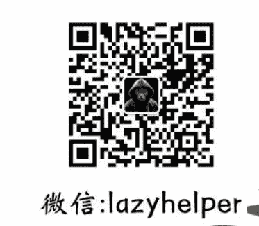
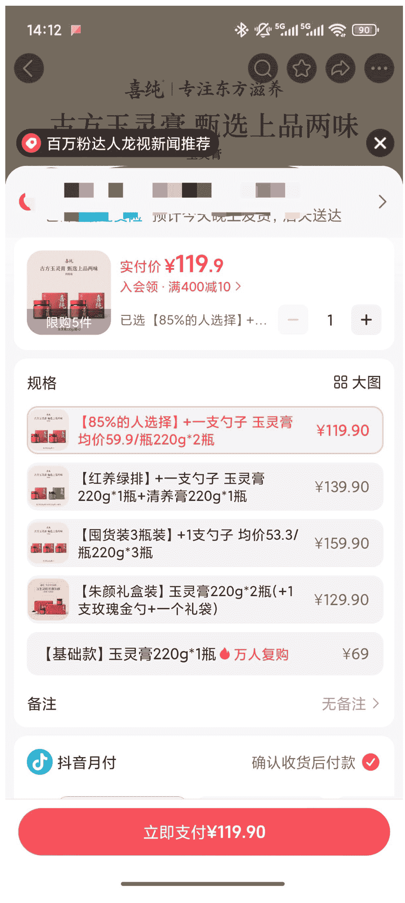
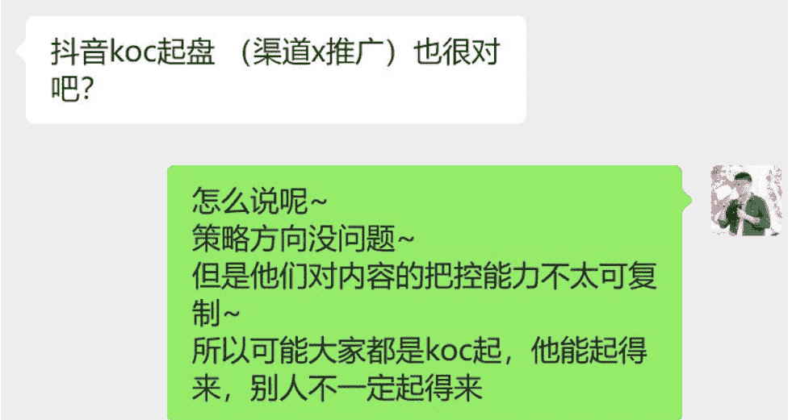
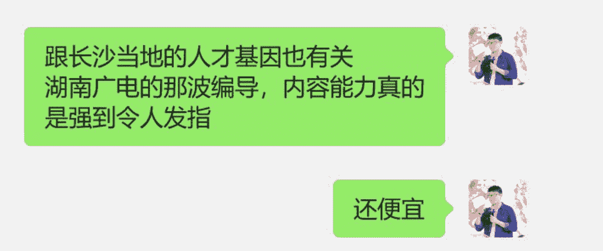
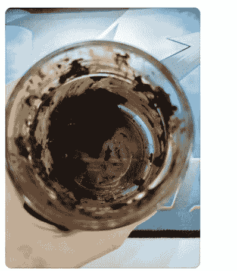
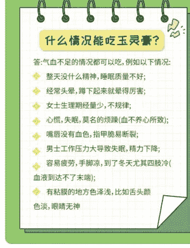
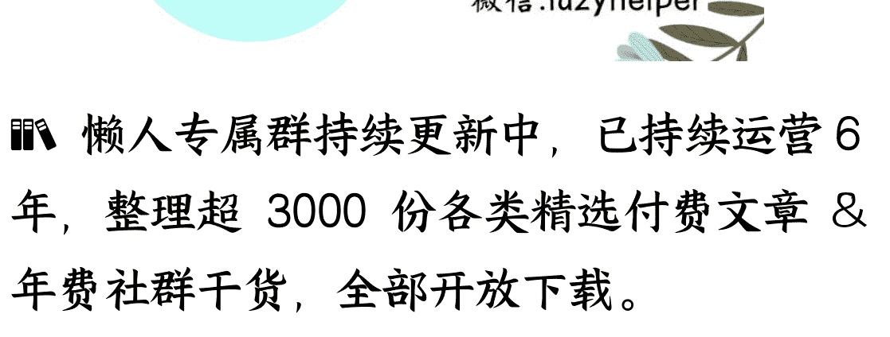

## 一周内 3 位 10 亿级滋补品牌大佬问我：喜纯你怎么看；我：挂逼！！

250901 生财精华

公众号懒人搜索，[懒人专属群](#) 独享

懒人微信：lazyhelper

喜纯是最近两年新起的中式滋补品牌

列几个三方平台看到的数据，大概就有概念为什么大佬们会对他很感兴趣

- 2023 年底，公司注册
- 2024 年初，正式入驻抖音
- 2024 年 7 月，单月销售额破千万
- 2025 年 2 月，单月销售额破亿

（对比实际肯定略有出入，但整体趋势可参考）

至于怎么看，一句话极简回答

稍微展开一点，用游戏圈的话就是：挂逼！！

感觉他们在其他项目上，把能力磨到位了

起手做这个牌子

每一步都很对！！！

没有废动作

就很恐怖

拿着游戏攻略闯关的感觉

要知道，企业最大的成本不是原料、不是生产、不是人力、甚至不是营销成本

是走错的每一步，付出的沉没成本

在我看来，喜纯在【犯错】这部分的成本，无限趋近于0

查了查资料果不其然，喜纯的老板，李鹤，原曦子科技（西子健康、西子电商的母公司）股东

| 序号 | 变更日期 | 变更项目 | 变更前 | 变更后 |
| :--- | :--- | :--- | :--- | :--- |
| 1 | 2024-05-15 | 登记机关变更 | 长沙市雨花产业工商行政管理局 | 湖南省工商行政管理局 |
| 2 | 2024-05-15 | 高级管理人员变更（董事、监事、经理等） | 李鹤【退出】 | 孔杰【新进】 |

西子健康这家公司，如果不是湖南电商圈的可能不太熟悉，说说他们的旗下品牌：

Fiboo、谷本日记、她练、Foyes

做大健康食品的朋友们，是不是如雷贯耳！

在正式开始详细拆解之前，先说明下，为什么大佬们会问我看法：

- 作为合伙人，做成过一个大几亿的食品品牌。有从 0.1 到 1 的完整经验
- 在平台做过策略、也管过行业。有平台视角，甚至直接参与过平台流量分配机制设计
- 最早的时候还在代运营当过大头兵，对实操有最真实最细节的体感
- 作为合伙人，搞砸过两个滋补项目，有亲历的失败经验

下面用营销 4P 的结构：选品、定价、渠道、推广四个方面进行分析，说说李解对喜纯这个滋补超新星品牌的理解

前面两个选品、定价对一线运营小伙伴会很无聊，可以划过去直接看渠道、推广

### 选品定江山

#### 品类上，为什么是中式滋补，不是西式保健？

对新品牌来说，越标品，越难做。

标品容易被比价，一旦陷入比价陷阱，只有头部品牌，只有全产业链效率优胜者会赢

相比来说，保健更标品，滋补更非标

中式滋补是对大健康新品牌更友好的品类选择

#### 可是极致非标品，没有价值共识，教育成本太高了，怎么办？

讲一个新概念，恨不得要在《养生堂》节目讲个小时

要不就是，线下拉用户到大会议室，搞个养生医疗大讲堂

这效率也太低了，怎么办呢？

中式滋补大品类中，虽然配方、价格、剂型并不标准

但很多细分品类、产品有极高的价值共识

- 比如以形补形
- 比如红色补血、黑色养发、白色养胃
- 比如各种耳熟能详的散、膏、汤、丸的名字

所以要在非标行业中，找价值共识，作为开品切入点

这样既规避了标品比价的尴尬，又能借助消费者已有的心智概念，降低教育门槛

我推测，正是因为，才有了喜纯的核心爆品，玉灵膏

产品选定了，配方、工艺、剂型是做更科学的创新，还是遵照古法古方？

遵照古法，必须遵照古法！！

创新是大企业才能做的事！！

当你经历过调整配方，加入了更科学的，效果更好的小众原料

你会发现，小众原料种植生产，因为没有规模化、工业化

剧烈的价格波动，会让你辛苦一整年，只为原料商打工

当你经历过优化工艺，用更好的提取技术，达到更好的吸收效果

你会发现，更好的提取意味着更新、更贵的技术

在成品中，原料更无法直接用眼睛看到

消费者购买就需要更高的信任成本，更长的决策周期

这些都不是一个新品牌能承受的

外行看上面，可能觉得：没错，逻辑上说 得通

内行能知道，老李曾经经历过怎样的痛苦

所以我推测，正是因此，喜纯的玉灵膏，配方、工艺、剂型完全遵照清代中医名家王孟英（王士雄）的著作《随息居饮食谱》。

膏体可以做的更细腻吗？

工艺上当然可以，但消费者认知上不接受

膏体可以直接变成提取液吗？

工艺上当然可以，但消费者认知上不接受

甚至，连看上去是个破绽的原料，西洋参都保留了。

朴素地认为，西洋参不是个新玩意么，怎么还在清代的方子里出现了

#### 我查了一下，无懈可击！

1. 西洋参在清代已明确入药

西洋参自18世纪初入中国后，迅速被中医药体系接纳。成书于1757年的《本草从新》首次记载西洋参的药性：“苦寒微甘，补肺降火，生津液，除烦渴”，并指出其适用于“虚而有火者”。清代宫廷医案中，西洋参被广泛用于治疗肝肾阴虚、阴虚内热等证候，尤其受到皇室青睐（如光绪和慈禧太后的医案中频繁出现），因此，王孟英在《随息居饮食谱》（1861年）中选用西洋参配伍龙眼肉，是基于当时成熟的药用实践。

但是药食同源，尊重古方古法都没问题，但是功效、药方来源都违反广告法呀，怎么办呢？

这个具体在渠道推广部分做详细拆解。

### 定价定生死

定价，是老板、合伙人会关心的关键决策点

渠道负责人往往更关注流量、转化打法，这些看上去更高级

但是定一个售价数字，确定一个毛利

这个最不性感，看上去最没水平的业务动作，才是定生死的关键点。

产品毛利大概有多少？是割韭菜吗？

1688上查一下西洋参、龙眼肉、玻璃瓶的价格，我就不贴图了

考虑到各种产品包装、工艺人力成本，以及大规模生产、采购的规模优势

玉灵膏一瓶69的定价，产品成本控制在20%以内，不是难事

算上仓储物流耗材的成本，销售毛利应该稳在75%以上

算是滋补行业的常规定价区间了

对比竞品有优势吗？

对比竞品价格数据如下，截图取自 https://mp.weixin.qq.com/s/VCClHi-jPxkPDnhA6N9ztw

#### 玉灵膏品类竞争格局

| 品牌 | 创立时间 | 定位/广告语 | 主打产品 | 玉灵膏价格 | 销售额区间(2024年) | 市场份额 | 排名 |
| :--- | :--- | :--- | :--- | :--- | :--- | :--- | :--- |
| 雷允上 | 1734年 | 中医药大健康产业集团 | 西洋参、孢子粉 | 79元/200g(29.5元/100g) 39元/150g(26元/100g) | 2500w~5000w | <0.1% | 251 |
| 福东海 | 2006年 | 淘系食养 | 高党、人参、人参泡酒瓶红参 | 200w~2500w | <0.1% | 428 |
| 北京同仁堂 | 1669年 | 百年品牌同仁堂 | 冬虫夏草、滋补高端深海海参 | 89元/300g(29.7元/100g) | 500w~750w | <0.1% | 819 |
| 鸿德泰 | 1995年 | 安徽老字号专注养生单品 | 黄精、参、灵芝、猴丸 | 89元/300g(29.7元/100g) | 250w~500w | <0.1% | 1109 |
| 九芝堂 | 1650年 | 370年传承 中药老字号 中华中医药遵产 | 葛花、阿胶、黄芪口服液、胶原蛋白粉 | 89元/200g(40.5元/100g) | 1亿+ | 0.20% | 104 |
| 直氏 | 2023年 | 专注西方滋养 | 玉灵膏 | 69元/200g (31.4元/100g) | 1.9亿 | 0.30% | 50 |

数据来源：飞瓜数据平台、天猫药品旗舰店 建德战略部整理

对比竞品，单价算是中等。

但考虑到其他几家品牌的成立时间和广泛的消费者共识，一个新品牌做这个价格，算是偏高的了

推测内部决策逻辑：玉灵膏这个小品类，用户有一定的价值共识、功效共识，但并没有价格共识

作为新品牌，在控制好总价的前提下，毛利高一点不影响转化，且有更多预算可以做推广投放

靠内容拉成交，更重要的是靠内容拉品类新客（即第一次购买该品类的消费者）

这波消费者对比价的敏感度更低，只对总价的敏感度高一些（经验值，不要超过100块）

#### 微调组品规格，消费者人均利润翻倍

老板们有兴趣的话，可以算算两种组品方案

单瓶购买 VS 两瓶立省+买赠

按照前面测算的毛利率，当抖音 ROI 分别为 2、1.75、1.5 的时候

两种组品方案，在做管理费用均摊时，消费者人均利润能差多少

#### 又是一个不起眼的微操，但大比例影响利润

对了，直播间的组团客单更高，更激进~

有很多人问过老李，电商运营到底是干啥的

即使我已经干了十年了，还是说不清楚
但显然，刚刚说的这个小技巧，就是电商运营的本职之一

选品、定价，都很无聊，但都很本质
说完两个无聊的，后面来说说看上去更高级，更时尚的渠道、推广

### 渠道、推广定规模

老法师说，中式滋补在小红书很好做，为啥要选抖音这么卷的渠道呀？

最简单的答案就是

肉不够吃啊！

中式滋补单品，百元以内单价

自营商笔、直播配合投放，再加达人分销，月销售额做到 100 万，已经算是顶尖选手，想突破 200 万，难如登天！

回头看看前面的抖音单渠道数据

200 万/月在抖音，才算刚刚上道

更何况，抖音的卷，对于新手来说，是雷区

但是对老法师来说，正是舒适区

#### 那淘系呢，为什么不在那里起盘？

因为淘系的核心还是搜索。

只要还是搜索，就必须回答的问题是

- 在淘宝APP搜索框中，用户敲出来的搜索词，是从哪里来的？
- 用户为什么会搜这个词？
- 他之前的信息获取来自哪里？

如果最后承接品是玉灵膏，我们期待用户搜的是什么？

膏方？不对，没有功效指向，用户不会这么泛泛的搜

玉灵膏？也不对，这玩意听着熟悉，但真让一个人去搜这三个字，可能吗？

喜纯？还是不对，一个新品牌，除了公司的运营，谁会搜一个新品牌的品牌名呢？

所以，起盘只能在内容平台

让目标消费者，从没有任何产品、品牌、功效认知，通过精心打磨的内容，一步跨进A3（认可）乃至A4（购买）人群

#### 抖音起盘要怎么起呢？第一个业务重心要放在哪里呢？短视频？直播？自营？分销？商城货架？

但凡做过抖音的，都或多或少听说过这个版本的答案：
抖音起盘靠 KOC 分销。
跟当年的淘宝天猫，用淘客起盘类似，纯佣、风险小、试错空间大

不延展，快速说一下其他几个模块为什么大概率不行：
- 自播：成本高；主播、设备、投放预算、素材制作人力等，自然风险也就高
- 有坑位费的 KOL 短直分销：头部达人，新品选不上；中腰部，聚焦各自垂类，也不会选你；尾部小达人，你图他便宜能出量，他图你没量也有坑位费
- 商城货架：跟淘系一样的问题，初始曝光哪里来？

#### 我的业务在抖音，能不能也用 KOC 分销起盘呢？
上截图！

#### 所以，KOC 分销起盘的胜负手到底是什么？

业务小白以为，KOC 业务的账是这么算的：

我找 1000 个 KOC，人均产出 1000 块，最终 100 万到手

但实际上，大概率是

- 找 1000 个 KOC，900+KOC，一毛钱成交都没有
- 50+KOC，100 块以内
- 10+KOC，1000 块
- 2~3 个 KOC，一人卖了 10 万
- 最大的 1 个，一人卖了 100 万

所以，KOC 起盘的胜负手是什么？总结起来两个半

- 一个：用内容，提升概率
- 一个：用数量，堆平概率
- 半个：用投放，放大好内容，对抗低概率

#### 关于内容

我翻了一下朋友圈记录，发现圈子里最早讨论到他的达人内容，是这个

1.28 s@e.Bt 10/01 usR:/ 夏季更要好好养自己，特别是25+的女孩儿# 经验分享# 亲测分享# 好物推荐# 喜纯玉灵膏 https://v.douyin.com/i6T3UqMv/ 复制此链接，打开抖音搜索，直接观看视频！

我把原视频录屏放在这里。老板们看完，评论区可以聊聊看完这条内容的感受

还有最近的两条，看看达人筛选，内容脚本的迭代方向，评论区见~

对了，别看他这两条数据好。

这俩达人其他带货视频点赞量都不过 20，盲猜播放量过千都悬

虽然大概率有投流加热的影响，但显然内容也已经好到算的过来账了，要不然也不会投这么多。

还有一个非常有意思的细节，看看他们的评论区

提醒！！别光看梗，猜猜哪些是自己人的评论引导

**购物 每一口都不白吃**
已售99w
评价6.8w | 直播间同价
**评论 651**
商品评价 6.8万

- 用户: osborn11
  内容: 脑子:想划走
  眼睛:想看变化
  手:闲着没事干看看评论区
  莫名其妙买了一瓶 花了我69
  时间: 08-12 · 湖南 · 回复
  点赞: 575
  展开44条回复

- 用户: 年糕(☻ ●—●)つ
  内容: 不是 我准备打算断案的 一看这有点适合我啊 买了不会骗我吧
  AI医生: 玉灵膏有益气补血、安神助眠，改善面色等功效。
  玉灵膏主要由龙眼肉和西洋参组成。龙眼肉能补益心脾，养血安神。西洋参可补气养阴，二者搭配能起到益气补血的作用，适合气血不足人群。
  它能缓解因气血不足导致的失眠、多梦问题，起到安神助眠效果。
  气血充足后有助于改善面色萎黄，使人面色更红润有光泽。
  对缓解疲劳、增强体质也有一定帮助，适合易疲劳、体质虚弱者。
  时间: 08-11 · 湖南 · 回复
  点赞: 341
  展开46条回复

- 用户: 做个快乐的 屁
  内容: 我做了个小手术，我姐给我买了好几罐，我都没咋吃。我回去得赶紧吃了去。
  时间: 08-13 · 北京 · 回复
  点赞: 13

善语结善缘，恶言伤人心

**购物 每一口都不白吃 已售99w**
评价6.8w | 直播间同价

周轶城是小猪
哈哈哈哈我是身边朋友都看我吃这个感觉脸色变好了之后也开始跟着我在吃

08-11 辽宁 回复 64

唐图图 【作者】
哈哈入股不亏
08-11 山东 回复 1

展开21条回复

yo-ya悠悠
原来我失眠是因为气血不足啊 难怪啊难怪啊
08-13 广东 回复 7

展开1条回复

alwaysyou
那些人的眼神不好只能说，我十三四岁的时候带弟弟妹妹玩一个奶奶过来说这两孩子都是你的呀这个小的几个月了
08-13 · 湖北 回复 3
展开3条回复

什么小蛋挞
@AAA建材王哥 @阿霜 @氢气球鸭 @应春好 我买了一罐吃觉得对睡眠真的有帮助，比以前睡觉早
08-13 · 浙江 回复 75
展开18条回复

好运满格
是时候把我遗忘在冰箱里的两瓶拿出来吃了
08-13 · 河南 回复 10
展开1条回复

韩yue
真的有效果吗，真实测评的有没有
3天前 · 河南 回复

en小土豆
这个气血不足的人 确实可以吃 但是我是冲水这样干吃不苦吗

善语结善缘，恶言伤人心

**购物 每一口都不白吃 已售99w**
评价6.8w | 直播间同价

**评论 651**
商品评价 6.8万

且行且珍惜
是不是我不买就不会放过我啊啊啊啊
08-13 · 安徽 · 回复

蔷薇花
味道好看不🧐主要的是这个
08-13 · 福建 · 回复

珊珊在合肥
我那个17的继子再吃😂
08-13 · 安徽 · 回复

小Y
这个有啥功效我想买给我妈妈试试
08-12 · 河南 · 回复

余之
04被叫阿姨😄
08-13 · 广东 · 回复

A、九姨娘
干吃我吃不下，泡水喝一次喝完
08-13 · 江苏 · 回复

善语结善缘，恶言伤人心

**购物 每一口都不白吃**
已售99w
评价6.8w | 直播间同价

- 评论 651
- 商品评价 6.8万

酒婆
我每天都在吃甜甜的不苦早上吃一勺
08-12 · 河北 · 回复 3

展开4条回复

大大怪_o(^o^)_o
吃了特别嘘嘻🤠
08-12 · 浙江 · 回复
作者回复过

展开11条回复

唐图图 作者
玉灵膏知识在这里哦 大家看情况行动

08-11 · 山东 · 回复 3
展开4条回复

南啵儿兔
98年，一直被叫姐姐😊

08-13 · 广东 · 回复

展开3条同名

善语结善缘，恶言伤人心

至于我们做业务的时候有啥可抄的，这里就不展开了，实在是太长了

可以去视频号-李解的理解预约直播，回头直播间聊聊

#### 关于数量

不是几十，不是几百，是上千个达人！

这是 2024 年的全年

| 全部 | 品牌自营号 | 商家自营号 | 达人号 |
| :--- | :--- | :--- | :--- |
| 粉丝量级 | 抖音号 | | |
| 头部 >500w | 10 | | |
| 肩部 100w-500w | 20 | | |
| 腰部 10w-100w | 227 | | |
| 小达人 1w-10w | 982 | | |
| 尾部 <1w | 1,200 | | |

*(注：原文表格结构较为松散，根据语义整理如下)*

| 类别 | 头部 >500w | 肩部 100w-500w | 腰部 10w-100w | 小达人 1w-10w | 尾部 <1w |
| :--- | :--- | :--- | :--- | :--- | :--- |
| 全部 | 10 | 20 | 227 | 982 | 1,200 |

*(注：由于OCR提取的表格列对应关系可能存在偏差，上述表格尝试还原“数量分布”的逻辑，即各数量级达人的总数)*

更准确的还原（基于原文竖排逻辑）：

| 维度 | 全部 | 品牌自营号 | 商家自营号 | 达人号 |
| :--- | :--- | :--- | :--- | :--- |
| 头部 >500w | 10 | ... | ... | ... |
| 肩部 100w-500w | 20 | ... | ... | ... |
| 腰部 10w-100w | 227 | ... | ... | ... |
| 小达人 1w-10w | 982 | ... | ... | ... |
| 尾部 <1w | 1,200 | ... | ... | ... |

*(考虑到OCR丢失了具体的列数值对应关系，仅保留原文中出现的数字分布，通常这类图表是横向展示不同平台或纵向展示不同数量级，这里依据原文“这是2024年的全年”及数字罗列，保留最原始的文本结构或简化表)*

**简化还原：**

| 粉丝量级 | 数量 |
| :--- | :--- |
| 头部 >500w | 10 |
| 肩部 100w-500w | 20 |
| 腰部 10w-100w | 227 |
| 小达人 1w-10w | 982 |
| 尾部 <1w | 1,200 |

#### 关于投放

数据看不到，不敢瞎说~

KOC 分销的规模好像是有上限的，怎么突破这个规模呢？

纵然喜纯们在优化 KOC 拍摄脚本时，会尽量把拍摄难度，和对 KOC 的素质要求降到最低，以求最大量的 KOC 覆盖

但这种方式能覆盖的量还是相当有限的。

想要突破这个规模，就得上直播了。

不管是达人直播，还是自播。

短视频和直播是完全两个流量池

如果再算上付费，那就更刺激了~

### 直播搞了！那怎么突破直播规模呢？核心靠什么呢？

达人直播本质还是商务拓展逻辑，这里不详细展开（主要是因为想要详细分析单品牌达播效果太费时间了，顶不住顶不住）。

这里主要聊聊自播业务。

常规的直播间的人货场优化，以及话术优化，是个精细活，也不在这里多聊。

有兴趣的，还是预约视频号-李解的理解直播间吧，那里可以聊的更尽兴一些。

聊到自播，所有尝试过一段时间的老板们都多多少少有下面的疑问：

- 为什么隔壁品牌自播月销几千万
- 我特么同品类，自播月销只有百万上下？？！！
- 我特么天天研究他直播间的搭建、背景设计、话术
- 我连主播都直接找跟他们主播长得像的
- 为啥还差这么多！！！

因为投放~

不对呀，我也投了呀，钱没少花，利润都打平了，甚至都已经亏了，这量还是上不去。

因为投放素材~

不对呀，我也 1:1 照抄了他们的素材，为啥还是跑不动。

因为人群规模~

相同素材，AI~A3 人群规模大小，直接影响综合投放成本。简单说就是，一对双胞胎，姐姐品学兼优，自己做个人 ip，还经常参加线下聚会；妹妹，内向的不行，虽然长相和穿衣品味跟姐姐类似，但同样要找对象的时候，姐姐有明显优势，因为圈子里的人对她更熟悉。

这里更多聊的是逻辑。主要也是因为喜纯的投放素材，我刷了一下，系统推给我的并不多，不像 KOC 的内容，可以直接搜出来，就不特别进行针对性分析了。

前面写过一个另一个香氛类目的投放素材分析，也有发在生财，可以翻翻看看。

### 总结

很多人说，电商最让人绝望的，是打法每天在变。今天的头部，明天就是尘土。

可为什么总有团队，总有品牌能够穿越周期，持续在场？

电商毕竟本质是消费品。

纵然打法在变，基础的分析决策框架，不会变化。

如果你还没拿到过结果，不要急着追逐潮流，先用扎实的框架拿到第一个结果。

如果你已经有成功案例，花更多时间洞察一个又一个成功品牌背后【不变】的本质，才是持续成功的关键。

电商的世界，没有捷径，但有方法。

穿越周期，持续在场，不下牌桌！

最后，安利小懒的付费群：

### 懒人专属群

懒人专属群持续更新中，已持续运营 6 年，整理超 3000 份各类精选付费文章 & 年费社群干货，全部开放下载。

本资料为付费群内部分享，仅供真正有需要的朋友查阅。

懒人专属群更新记录：
https://lazy2025.top/blog/record2

懒人专属群更新记录（需梯子，备用）：
https://lazybook.fun/blog/record2
