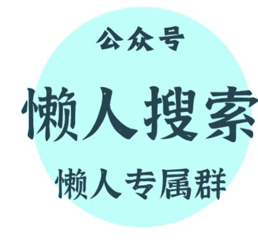

# 明星那么有钱，为啥还总想着找接盘

260901 九边

整理：公众号懒人搜索，懒人专属群精选

懒人微信：lazyhelper1

微信：lazyhelper1

小懒判断丨吃瓜想吃出门道的可以看，想蹲桃色细节的会失望，全程技术分析。最值钱的是财富幻觉拆解：孙割 85 亿是币的市值不是现金，一卖就跌，只能靠热搜把筹码输送给散户；景田国民级咖位年收入也就两三千W。坑在核心数据全是作者推测，当逻辑框架看行，别当实锤。

明眼人都能看出来，这次景田对孙割是没啥好感，没啥好感还往一起凑，有人说这属于渣男和捞女的“恶人局”。咱不做道德评价，单纯技术分析一下这事。

可能景田实在是太违心了，或者其他原因吧，最后关头选择了加价。这个操作也好理解，有些自媒体博主碰上了一个特别不喜欢的广子，就会给出一个特别离谱的价格，如果对方接受了，那看在超额收益的份上也就忍了。如果对方不接受，正好不接了。

但这次倒霉就倒霉在，对方是一个奇葩，完全没底线，而且孙割对热搜有刚需，所以直接放了大招。

还有小伙伴没看懂孙割为啥一再要造势抢热搜，比如天价买香蕉、上太空什么的。其实是明摆着的，他现在身价 85 亿，并不是真的有 85 亿，而是手里的币的市值那么多，但是他一卖，立刻就跌，如果卖太多，跌太狠，大家恐慌性抛售，弄不好归零了，根本回收不了多少。

所以合适的做法，就是学习大A的一些股东，不断造势，不断让新人关注到自己的公司，新韭菜进来，会形成一波波的增量，逐步买走他手里的币，在热火朝天的气氛里，把筹码输送给散户，这样才能把虚高的股份逐步变成真钱。

理解了这事，才能理解他为啥会做这么离谱的事，主要还是流量在他那里确实能兑现。

不说孙割了，说景田，按理说她一女明星不缺钱啊，为啥会去做这事？

事实上不止她，不少女明星都选了这么一条路，在高位套现，找个明显自己不喜欢、甚至很反感的人接盘，接盘不好听，改成“下嫁”吧。

原因不复杂，这些明星们，比普通老百姓更缺钱，或者说，跟普通老百姓一样缺钱。

首先很重要的一个问题，就是绝大部分明星的收入都被严重高估了。我看不少糊涂蛋动不动就觉得明星年收入几十亿，景田这样的，一年咋得得上亿吧，这已经缺乏基本常识了。

咱们稍微先分析下这帮人的收入，国内一线顶流，类似沈腾这种，票房动不动就超级大卖，偶尔还有国民级的爆款，这种一年赚几个亿是没问题的，甚至接近十亿。

但数量极少，全国凑不出来一只手。还有一些很多明星按理说是国民级的，但年龄大了之后已经没了票房号召力，收入暴跌。

多说一句，明星收入本质是他们的粉丝支付能力。老戏骨收入低，是因为老戏骨的粉丝一个个嗓门大，年龄也大，一毛不拔，明星收入自然也不上去。流量明星收入高，因为他们的粉丝核心都是一群年轻妹子们，真肯花钱，花父母的钱也不心疼，流量明星收入自然高。

说完“超一线”，接下来是一线，胡哥、雷大头等等，可能差不多是破亿的收入，不过也不是旱涝保收，比如今年他俩和冯小刚的那个电影就栽了，片酬肯定不会少，但分成什么的就受影响。

接下来是二线明星，直接掉到了两三千万，景田大概就是这样的位置，可能稍微偏上一些。

如果掉到三四线，直接温饱水平了，而且饥一顿饱一顿，甚至可能几年开不了张。

整体来讲，娱乐圈跟体育圈一样，收入不是平滑下降，而是急剧下降，顶级头部可能类似邹市明那种，整个职业生涯能攒下两三亿的收入，其他人也是个温饱水平。而且同样是冠军，有些运动项目平日里有很多看，并且付费看，有些完全没人看，更别提付费看，导致运动员收入差距大极了。

还有一点跟体育圈接近的地方，就是明星的黄金期普遍偏短，尤其女星。

需要注意的是，这里说的都是他们税前收入，明星赚到钱后，需要交税，养团队，跟经纪公司分成，最后明星到手剩下一半不错了。因为赚钱这事她自己只是个门面，背后也是靠着一大堆人忙前忙后，都得分成。

景田比较尴尬，咖位确实是国民级的，整个八零后九零后几乎都认识，可真正能打的作品并不多，更没有太多票房号召力。加上 2022 年被处罚，这几年状态一直不太好，可能收入也就跌到了两三千万一年，可能到手也就干把来万，甚至更少，跟网传的上亿年收入差距极大。

其实但凡接近点网友臆想的那个数字，可能就不会理会孙割这种人。

说完这些，再看孙割小作文里的那俩数据，3000 万人民币和 5000 万美刀，他俩事先约定好支付 3000 万代孕，事到临头，景田要求追加 5000 万。

有人说，3000 万大概是她两三年的收入，她可能觉得，这几年状态不好，跟这个币圈阔佬谈恋爱顺便生个孩子，赚两三年收入也不错。

但后来意识到代孕这事可能太大了，在美国无所谓，但在中国属于违法且严重违背社会公序良俗，传出去会毁掉整个职业生涯，又提了个 5000 万美元，三亿人民币。为啥是这么个数呢？猜测大概她就是她的整个职业生涯总套现。

孙割看着好像 85 亿美刀资产规模，买一个香蕉几千万，上了一次太空几千万等等，给 5000 万美元不难吧？

其实孙割现金规模被高估了，他天价买香蕉，本质是要维持自己的热度，维持热度才能赚钱，才能维持身家。那个香蕉，并不是消费，而是成本，是必须要支付的。没见过世面的人第一反应是他好有钱，竟然花那么多钱买香蕉。

稍微了解点情况，就知道，天价买香蕉是为了维持他那个高度不稳定的空中楼阁，得支付必要的成本。

很多富人都都这么干，比如贷款买路虎或者大G，但孙割更懂宣传和流量，你们花大大价钱买的那些东西都“太有用”，有用的东西再贵都不算贵。完全没用的东西，大价钱买回来，才能证明自己的实力，而且有营销效果。

要知道，币圈是极度不稳定的，随时会崩那种。韩国之前有个非常著名的加密货币项目 LUNA，市值几天内就从两百多亿美刀跌成了 0。美国那边的“爆炸头”SBF，他的交易所市值巅峰三百多亿美刀，也是极短时间就从“斯坦福天才”、慈善家、科技新贵变成了诈骗犯，并顺利入狱踩美国的缝纫机。他们币圈才是真正的“生死一线间”。

说到这里，就大概清楚了，景田觉得孙割有 85 亿美刀，给我 5000 万不过分吧？不到千分之六，相当于身价 500 的黄毛精神小伙请精神小妹吃根辣条。

但这里明显高估了，前文也分析过，孙割手里主要是股权，真现金可能过亿都费劲。

如果孙割手里现金大概率只有两三亿甚至都还不到，这个基础上要 5000 万，换你，你都不干。孙割说他找 AI 问了之后，AI 不建议这么搞，带入这些实际数据一算，根本不用找 AI。如果满脑子都是什么“景田年收入过亿”，“孙割 85 亿美刀资产”，才会感觉极度别扭。

而且孙割搬出 AI，看似是求助，其实是把责任推出去，你看，AI 这种“技术中立”的东西都不赞成，可见。把商业决策外包给 AI，既避免了“我舍不得钱”的抠门形象，又迎合了当下“AI 权威”的舆论氛围。

你买香蕉的时候，AI 咋给你建议的，你听了吗？

最后再聊一个问题，为啥女明星都那么愿意嫁富豪，有几个搞笑的，甚至嫁了伪富豪，你们可以去查下，有个一线女明星，也是嫁了富豪，生了孩子，然后才发现对方即将成老赖，赶紧离婚切割了。还有明星嫁了之后卖房帮老公还债的。

按理说她们都那么有钱了，赚多少是个够？

主要也是绝大部分其实并没有赚到太多，他们又普遍喜欢豪宅（这个是刚需，不然咖位上不去），买了豪宅就没啥钱了，这也是为啥女星出事动不动需要卖房。

更关键的是，他们要维持巨大的“体面开支”，不能在某次活动中带相同的包，要有一屋子又丑又贵的鞋，出门要头等舱，还有其他各种开销，一年几百万都正常。

如果是职业的黄金期还好，反正赚得多，但是明星这个行业，类似运动员，花期极短，赚钱就那么几年，剩下的时间就是坐吃山空。

而且大家都有个深刻的恐惧，就是“20减0”，美国那边有个说法，说你的存款，如果投资不明白，每 20 年就会去掉一个零，也就是现在攒了 3000 万，二十年后购买力只剩下 300 万了。这个算法不一定是真的，但恐惧是真的，尤其想到到那时候消费降级，再被别人拍到了热搜，标题是“落魄女星”，晚上睡觉都会被吓醒。

如果投资呢？那更危险，容易变老赖。

要维持几十年的体面，存款再多，谁都慌，更何况绝大部分明星没赚太多，还有不少在后期投资过程中赔了不少。

理解了这些，就理解了这也是为啥早年港星，甚至一些息影多年的，这几年又都出来恰饭了。还有好几个，年轻时挺佛系，这两年极度卖力，大概率是年轻时候以为赚钱会一直这么容易没着急，这两年急了。

没办法的事，以前一年赚几百万就多的离谱了，现在看确实少了点。大家都在竭力榨出职业生涯最后几滴柠檬汁。

在这个过程中，不少人就被骗了，一些女星想嫁给富豪保障后半生，其实富豪指望女星的名声给自己续命。然后女星发现富豪快成老赖了，指着她赚钱还债，富豪发现女星已经过气了，指着自己给她养老。

我这里不方便指名道姓，大家用 AI 一搜一大堆。

文章到这里差不多了，我说个别的事来为这篇文章收尾。

年轻时候第一次看到“司马懿指洛水为誓”，随后杀了曹爽三族，一群老臣痛心疾首捶胸顿足，让我感觉很奇怪，你们真相信发誓才表现得这么认真？神佛会惩罚背誓的人啊。

年龄大了慢慢理解了，这背后本质就是大家相信“誓言”这个公共品不会被砸了，越是上层人，越不会砸共识，因为他们能做上层人，本身就是基于一些共识，你破坏了这些东西，下层的起来闹，可能接下来就会很难收场了。

事实上反噬来的极快，很快晋朝就陷入了各种危机，人人自危，八王之乱，他们司马家的人就跟遭报应了一样，像一窝老鼠一样互相撕咬，然后又被别人吃干抹净，死的要多惨有多惨，也是领了个全家桶。

我觉得，这也是为啥赵长鹏昨天发帖暗戳戳地说“爆料”这事太下流，不仅下流，而且极具伤害性。我觉得他可能已经意识到了，做事太下流，把之前默认不会公开的事拿出来博流量，会破坏了整个圈的形象，如果大家都对币圈避而不及，到时候伤害的就不是景田了，而是他们整个行业，自然也包括他自己。

在这个 AI 能替你写代码、写文章的时代，基础技能正在迅速贬值。绝大多数人正被淹没在海量的免费垃圾信息里，陷入低效的体力内卷。

当“努力”不再是壁垒，人与人之间唯一的护城河，只剩下“信息过滤”的效率与“认知系统”的维度。

圈子已稳定运行 7 年。我们每天利用 Python 爬虫与大模型算力，过滤全网最顶级的政经内参和搞钱风向标，做你最冷酷的“外部大脑”。

如果你认同这种“重塑认知防线”的极客主义，欢迎围观我的个人情报智库：【懒人专属群】。

[https://lazys o.com/insider/](https://lazys o.com/insider/)

认同信息过滤价值、想省下每天 3 小时无效阅读时间的读者，扫码加我微信（lazyhelper1）

