# AI 自媒体万粉，2026 年接了 60 个广告，纯广告收益月入过万，我的一人公司内容系统

260828 副业 SC 精华

整理：公众号懒人搜索，懒人专属群精选

懒人微信：lazyhelper1


> 小懒判断 | 适合真想靠 AI 自媒体赚钱的普通人，尤其有行业经验想放大的；只想蹭热点发工具测评凑热闹的不用看。最有颗粒度的是选题来源：评论区出现超过 3 次的问题就是现成选题，Agent 抓爆款加知识库调用让单篇创作从三小时压到半小时。坑在小红书讲国内 AI 工具（豆包即梦）极易被判违规限流，接广告还有中介张口干要 45% 返点。

大家好，我是竹子。

2023 年 4 月加入生财有术，是生财的资深传授师。过去这几年，我尝试过很多项目，视频号、闲鱼、YouTube AI 视频都做过，也都跑通了 0~1。从 2025 年开始深耕做 AI 自媒体、AI 知识付费和企业 AI 培训。

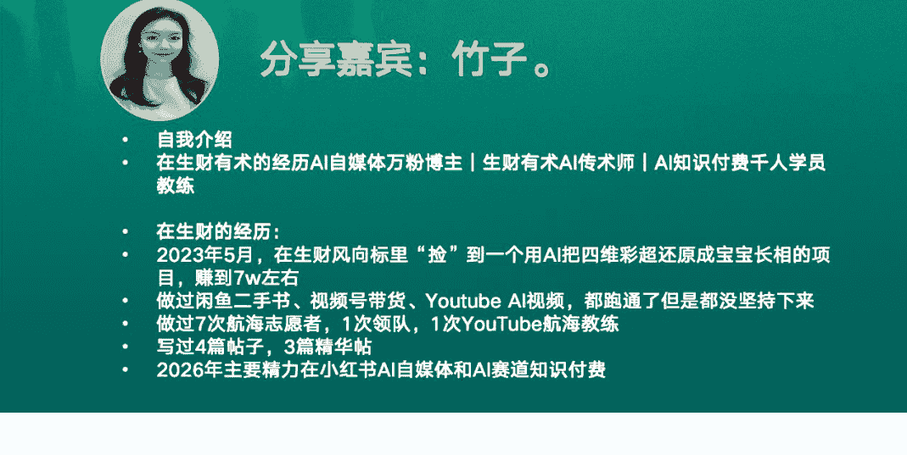

上个月在长沙生财同城 AI 项目沙龙分享了《AI 内容工厂：用知识库和 Agent 搭建内容生产线》，这个月上周又组了一个 AI 自媒体 + agent 搭建知识库的分享局，所以这篇文章结合一下 AI 自媒体 + agent 知识库，来给大家做一个完整的分享。

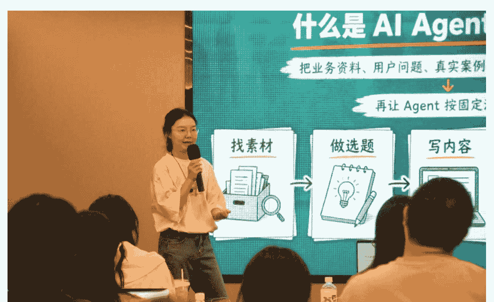

先说几个结果：我的小红书账号目前是 1.5 万粉；2026 年目前 8 个月接了 60 个左右 AI 工具类广告，基本每个月广告收入可以稳定过万。

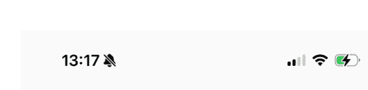

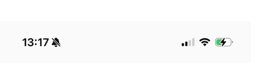

| 收益明细 | 类型 | 2026-08 | 备注 | 收益明细 | 类型 | 2026-08 | 备注 |
| :--- | :--- | :--- | :--- | :--- | :--- | :--- | :--- |
| 提现 15120.00 元至支付宝 2026-08-10 19:11:07 | -15,120.00 余额 ¥ -15,120.00 | | | libtv-agent 2026-07-12 13:01:07 | +2800.00 余额 ¥ +2800.00 | | |
| 综合服务费 2026-08-09 13:12:48 | -280.00 余额 ¥ -280.00 | | | 提现 10793.59 元至支付宝 2026-07-10 21:20:48 | -10,793.59 余额 ¥ -10,793.59 | | |
| 千问 7 月种草 SEO+ 倩倩 2026-08-08 12:34:52 | +2800.00 余额 ¥ +2800.00 | | | 综合服务费 2026-07-03 10:50:50 | -250.00 余额 ¥ -250.00 | | |
| 综合服务费 2026-08-06 12:34:52 | -280.00 余额 ¥ -280.00 | | | libtv 2026-07-03 10:50:50 | +2500.00 余额 ¥ +2500.00 | | |
| libtv 2026-08-05 13:53:59 | +2800.00 余额 ¥ +2800.00 | | | 综合服务费 2026-07-01 11:51:27 | -250.00 余额 ¥ -250.00 | | |
| 综合服务费 2026-08-05 13:53:59 | -280.00 余额 ¥ -280.00 | | | lib 2026-07-01 11:51:27 | +2500.00 余额 ¥ +2500.00 | | |
| libtv-导演台 or 面部表情 2026-08-01 13:53:59 | +2800.00 余额 ¥ +2800.00 | | | 综合服务费 2026-06-30 12:20:23 | -184.50 余额 ¥ -184.50 | | |
| 综合服务费 2026-07-29 13:33:06 | -280.00 余额 ¥ -280.00 | | | 秒蛇合作 2026-07-01 12:20:23 | +1845.00 余额 ¥ +1845.00 | | |
| lib 2026-07-29 13:33:06 | +2800.00 余额 ¥ +2800.00 | | | 综合服务费 2026-06-30 12:20:23 | -250.00 余额 ¥ -250.00 | | |
| 综合服务费 2026-07-28 13:05:46 | -280.00 余额 ¥ -280.00 | | | lovart 2026-06-30 12:20:23 | +2500.00 余额 ¥ +2500.00 | | |
| lovart 2026-07-28 13:05:46 | +2800.00 余额 ¥ +2800.00 | | | 综合服务费 2026-06-26 11:10:14 | -250.00 余额 ¥ -250.00 | | |
| 综合服务费 2026-07-22 13:10:07 | -280.00 余额 ¥ -280.00 | | | 星流 2026-06-26 11:10:14 | +2500.00 余额 ¥ +2500.00 | | |
| libtv-agent 2026-07-22 13:10:07 | +2800.00 余额 ¥ +2800.00 | | | 综合服务费 2026-06-17 12:34:41 | -14.79 余额 ¥ -14.79 | | |

但对我来说，比广告收入更重要的是：AI 自媒体这个账号，给我带来了一个持续被看见、被信任、被邀请的身份。

因为有账号、有内容、有案例，我后面延展出了知识付费、企业 AI 培训。

C 端有 AI 课程卖了 1000 多份的，B 端给平安保险、湖南信息学院电子商务系、望城区华伟人力资源中心组织的企业 AI 培训、湖南省人工智能协会师资班都做过培训。

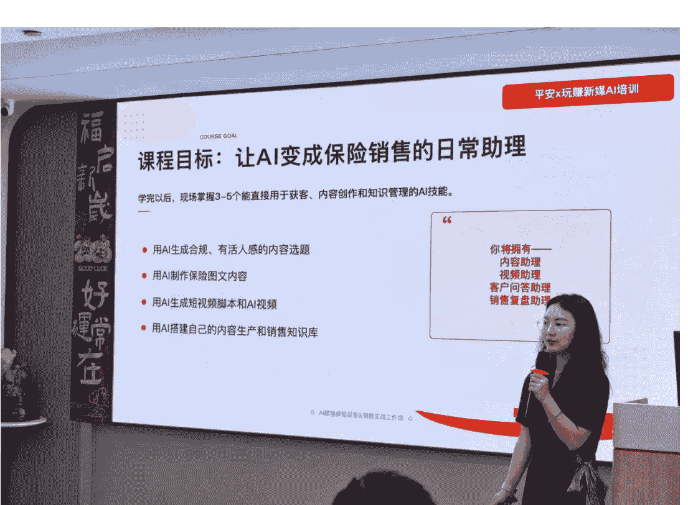

## AIGC 赋能新媒体内容创作与商业应用专题培训简报

发布时间：2026-06-04 17:27 浏览量：6

为紧跟人工智能技术发展浪潮，深化学生对新媒体与电子商务、数字经济融合创新的理解，拓展第二课堂实践教学，2026 年 6 月 2 日，国际商学院数字系与电子商务系联合特邀北京玩赚新媒体科技有限公司 AIGC 金牌讲师郭思竹老师，为国际商学院学生开展了题为“AIGC 赋能新媒体内容创作与商业应用”的专题讲座。

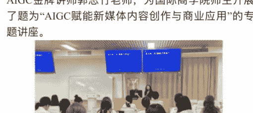

郭老师从 AI 行业现状与未来趋势出发，系统讲解了 AIGC 在新媒体内容创作、电商图像生成、视频制作及商业变现中的核心应用。她通过丰富的商业案例，生动展示了 AI 工具如何驱动内容革命与营销效率提升，并重点剖析了 AIGC 时代大学生应具备的竞争力。针对学生的实际需求，郭老师现场演示了“豆包”“即梦”等平台的操作流程，指导学生进行 AI 生图与视频制作练习。学生们自带电脑完成平台注册与实操任务，将理论知识与行业实践紧密结合，进一步提升了 AIGC 素养与商业应用能力。

此次培训不仅是对数字经济与电子商务专业课程内容的有益延伸，更通过第二课堂的形式，为学生搭建了与资深行业专家面对面交流的桥梁，激发了他们对 AIGC 赋能新媒体与电商领域的探索热情。未来，两系将持续开展此类高水平专题培训，助力学生在实践中成长，为行业培养更多具备 AIGC 思维与实战能力的数字商务与新媒体电商人才。

- 供稿：彭会锋
- 一审：金傲雪
- 二审：匡益明
- 三审：陈加新

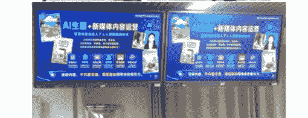

所以如果你问我：现在入局做 AI 自媒体还来得及吗？

我的答案是：如果你想追 AI 工具热点、做泛流量 AI 教程，可以做，适合起号，但是会越来越卷，因为这个方向相对来说确实门槛低，有大量的选题，所以也意味着，大家都能做。

如果你想把 AI 自媒体当成一个入口，用它建立个人 IP、沉淀内容资产、帮特定人群用 AI 解决问题，承接产品服务，那这件事有门槛，但是非常值得做。

这篇文章，我就结合我自己做 AI 自媒体的结果，从定位、选题、内容输出、广告合作、产品承接，到 Agent + 知识库内容工厂的完整系统拆给你看：

怎么从 0 开始做 AI 自媒体，怎么找到赚钱定位，怎么持续生产选题和内容，怎么把广告、课程、咨询、培训串起来，以及怎么用 Agent + 知识库，搭建一套属于自己的一人公司内容工厂。

## 一、AI 自媒体的两条路，分别对应的内容和变现方式

很多小伙伴想做 AI 自媒体，但是不知道做什么内容，我这个赛道拆成两条路：

第一条路，是教人用 AI。

第二条路，是用 AI 帮人解决问题。

这两条路背后的内容逻辑、用户心态和变现方式是不一样的。

### 先说第一条：教人用 AI。这类账号做什么？

工具测评、提示词分享、AI 新闻解读、教程拆解、工具清单、功能演示。用户为什么看？因为他不知道这个工具是什么，不会用这个功能，不知道最近 AI 又更新了什么。

这类内容的优势很明显：反馈快、选题多、容易跑出数据，用户会喜欢点赞收藏，也比较容易接 AI 工具商单。比如 AI 生图工具、AI 视频工具，都需要有人帮它们做教程、测评和使用场景展示。如果你的账号足够垂直，内容质量稳定，有一定粉丝量，就会有品牌方来找你合作。

我今年接的很多广告，其实都来自这条路径。但这条路也有一个弊端：它容易同质化，一个选题火了，会有 N 个 AI 博主来做同样的内容。而且依赖平台和品牌方，万一你的账号因为平台的规则变化被封了，或者品牌预算缩减了，收入就会变得不稳定，我之前这个万粉账号就被永封过一次，当是真的天塌了哈哈，虽然后面申诉回来了，但是也不敢把宝全部压在接广告上了。

所以如果你只做“AI 工具和教程”，账号很容易变成一个工具人账号，变现的形式会比较单一，主要来自广告收入，当然，如果你只想靠接广告变现，那也 OK。

第二条路，是用 AI 帮人解决问题然后承接自己的产品或者服务。比如：

- AI + 自媒体，用 AI 工具、skills、agent 帮创作者解决定位、选题、内容输出、变现的问题，可以做 agent+自媒体内容输出的课程、训练营、陪跑。
- AI + 教育，帮老师解决课件、教案、题库、作业批改的问题，可以做针对教师的 AI 课程、定制服务
- AI + 电商，帮商家解决产品图、ai 视频、种草文案、带货脚本、客服的问题，我之前接广告的时候，电商带货课程、电商产品 ai 视频制作、工具都挺多人咨询的。

这条路的重点不是“我教你用哪个工具”，而是“我帮你解决一个具体业务问题”。用户看你的内容，心态也不一样。

他不是单纯想知道“这个工具怎么玩”，而是在想：“我的问题，能不能用 AI 更好地解决？”

这类内容其实是需要你先确定你的变现方式，比如课程、咨询、陪跑、工作流搭建服务和企业服务。然后再基于你的产品来做内容。这类内容的流量肯定不如泛 AI 教程分享来的快，但是它是更精准的。

因为工具发展的很快，但用户问题长期存在。比如做自媒体的人，长期会遇到定位不清、选题枯竭、内容断更、不知道怎么变现的问题。

所以，不管有没有 ai，都会有人想要付费学习做自媒体，加上 ai，你就可以讲怎么用 agent+skill 去帮你抓取选题，代替手动刷内容、怎么用 agent 搭建自媒体内容输出系统帮助你更快输出？

这条路其实它更适合有某个行业的经验的人来做，它真正有价值的地方，就是帮你把原来就存在的经验、流程和业务能力用 AI 放大。

所以我给新手的建议是：如果你没有明显行业经验，可以先从工具教程开始。因为它门槛低、反馈快，适合起步。

但如果你过去有行业经验、项目经验、服务经验、培训经验、管理经验，我更建议你尽早往“AI + 具体人群 + 具体问题”走，就不要只是做一个 AI 工具号，要做一个用 AI 解决问题的 IP。

## 二、做 AI 自媒体，怎么确定自己的定位

很多人做自媒体第一关就被拦住了，在定位上非常的纠结哈哈，我用一个公式来帮大家梳理：

现在其实各个原本的赛道，都可以加上 AI 来做内容和解决方案来，最核心的定位公式：

**赛道定位 = 用户身份 × 高频任务 × 高价值问题 × AI 解决方案 × 可售卖产品** 举例：

假设一个人有 10 年 HR 经验。

不要定位成：

- ❌ AI 博主
- ❌ 职场博主
- ❌ HR 博主
- ❌ AI+职场博主

而是一步一步推：

最后形成一句定位：

> 帮助 3-10 年职场人，用 AI 提升求职效率和面试竞争力，实现更高质量的跳槽和涨薪。

这就比：

> “分享 AI 工具的职场博主”

清楚很多。

这样你后面所有选题，都可以围绕这条线展开。定位怎么做？我建议先做这 3 步。

**第一步，盘点你的资源和优势。** 你过去做过什么？你有哪些行业经验？你擅长什么？你有什么真实案例？你有什么资源、人脉、课程、产品、服务？你愿意长期输出什么？很多人一上来就问“哪个赛道最赚钱”，但这其实不是最好的起点。更好的起点是：你已经有什 么东西是别人没有办法轻易复制的。

比如你做过教育，就可以从 AI + 教育提效切入。你做过电商，就可以从 AI + 电商内 容、产品图、带货脚本切入。你做过自媒 体，就可以从 AI + 内容生产、AI + 选题系 统、AI + 个人 IP 切入。

**第二步，找目标用户的真实痛点。** 你要具 体到一个真实的人群和场景。比如：

- 想借助 AI 做自媒体，但目前卡在定位、内 容持续输出和商业变现上的个人创作者。
- 有课程和服务，但是内容输出效率低的一人公司主理人。
- 想用 AI 赋能教学做课件、备课，但不知道 AI 工具在具体场景怎么使用的老师。

人群越具体，你的内容越容易写。因为你知道他每天卡在哪里。

**第三步，倒推变现方式。**

你要从一开始就想清楚：这个账号未来怎么赚钱。是接广告？是卖资料包？是做课？是做训练营？是做咨询和陪跑？还是做企业培训和工作流搭建？不同的变现方式，会反过来决定你的内容。

如果你主要想接广告，你需要持续做 AI 工具、教程、测评、使用场景。如果你想做课程和陪跑，你需要更多讲方法论、案例、复盘、认知和路径。

如果你想梳理一下自己适合的方向，可以用我的这个 AI 自媒体商业教练 skill，安装到任意 agent 工具，workbuddy、codex，甚至上传到 ima 知识库都行，说「使用 AI 自媒体商业教练开始采访」就可以开始了，完成之后会输出一个定位诊断报告，告诉你适合的方向、产品建议、选题建议等。

附一些不同行业+AI 的方向案例：

## 三、Codex+obsidian 内容输出体系搭建

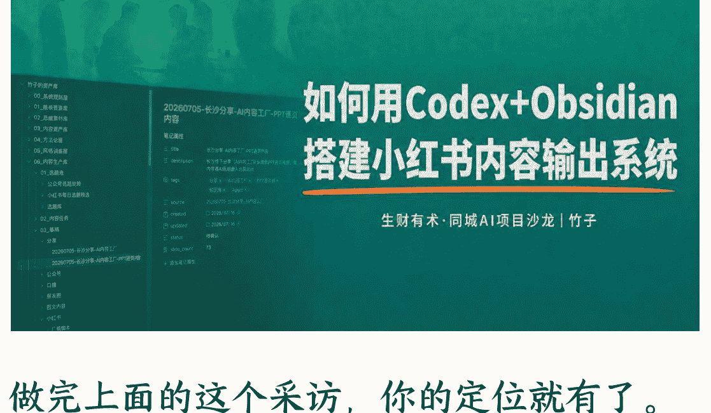

做完上面的这个采访，你的定位就有了。当然，定位不是一次性就能完全确认的，他可以给你一个方向，你可以先去做，边做边调整。

有了方向，我们就该输出内容了。内容输出是所有自媒体人的第二个关卡。

从不知道写什么，到怎么持续输出不断更，任何一个环节坚持不了，你就做不起来。所以这就是为什么要做内容输出体系，就是为了不用每次都从头找灵感，**用系统来对抗人性**。这就是我搭建 Agent + 知识库内容工厂的原因。

我理解的内容工厂，不是让 AI 替你批量生产一堆没有灵魂的内容，而是把“素材进入知识库、Agent 读取知识库、生成选题、选题变成不同平台内容、发布和复盘、把高频流程沉淀成 Skill”这些环节连成一套工作流：

```text
输入层: 用户问题 / 聊天记录 / 爆款笔记 / 产品资料 / 个人故事
    ↓
知识库层: 定位库 / 产品库 / 需求库 / 素材库 / 方法论库 / 内容库
    ↓
Agent 层: 读取资料 / 判断选题 / 生成内容 / 归档结果
    ↓
输出层：小红书 / 口播 / 公众号 / 朋友圈 / 社群 / 销售内容
↓
复盘层：数据记录 / 好标题 / 好开头 / 用户反馈 / 下次优化
```

把这些环节连起来，就是一套从收集素材、输出内容到发布复盘的工作流程。

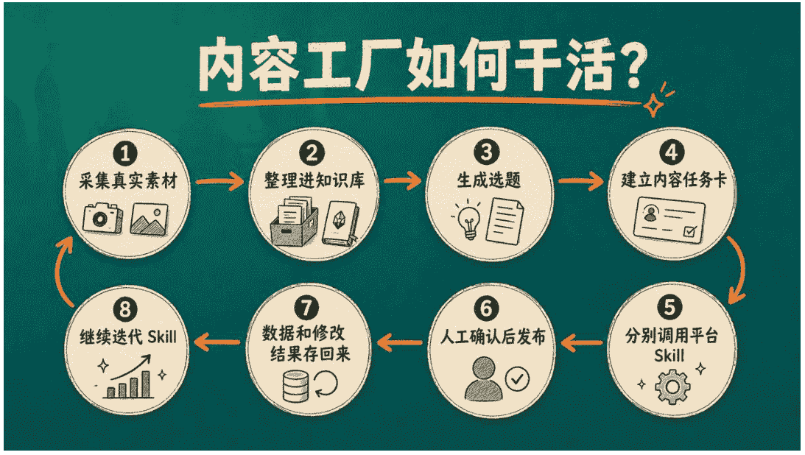

在这套系统里，Obsidian 知识库负责提供资料，Agent 负责执行流程，Skill 负责固化高频动作，人负责最终判断。

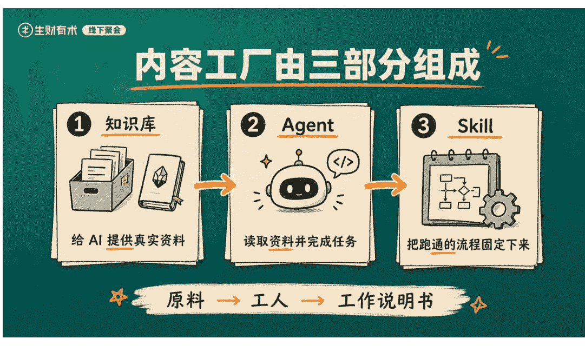

以前我每天找选题，要重新刷平台、重新翻资料、重新想角度。现在我可以让 Agent 去平台根据我的关键词去抓取爆款选题，再读取我的定位、产品、用户问题、素材案例和方法论，先帮我整理出一组适合我的选题方向。

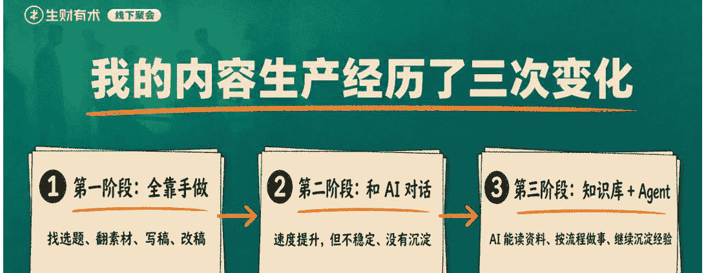

整个创作过程可以从两三个小时缩短到二三十分钟，而且数据还不错。

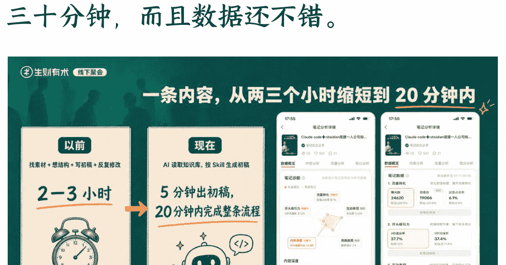

真正有用的知识库，一定要围绕你的业务流程来搭。如果你是做 AI 自媒体、一人公司、知识付费、咨询服务，可以用这个框架：

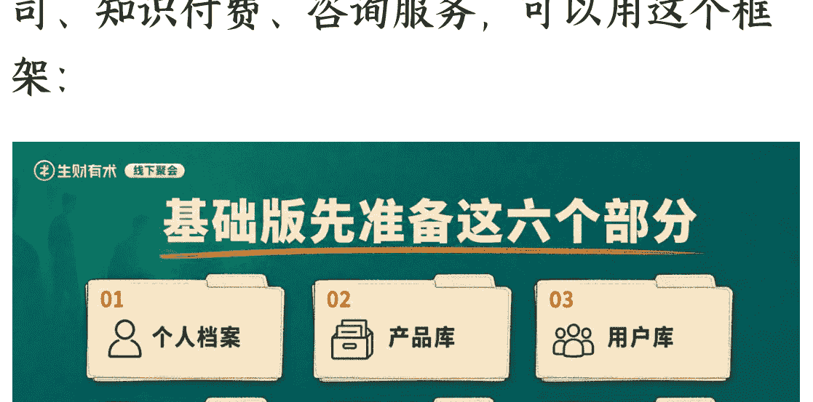

你可以直接下载好 codex/workbuddy 和 obsidian 之后，用这个提示词来创建知识库框架：

```text
请帮我在当前文件夹创建一套“AI 内容工厂”的 Obsidian 知识库骨架。

适用场景：
我是一名自媒体内容创作者，需要持续输出小红书、口
播、公众号、朋友圈内容。

请创建以下文件夹：
1. 01_老板说明书
2. 02_产品库
3. 03_客户需求库
4. 04_素材案例库
5. 05_方法论库
6. 06_内容生产库
7. _模板

要求：
1. 每个文件夹里创建 README.md，说明这个库放什么、
   不放什么、怎么用。
2. 创建 首页.md，作为整个知识库入口。
3. 在 _模板 里创建：
   - 用户问题卡.md
   - 素材案例卡.md
   - 选题卡.md
   - 小红书成稿卡.md
   - 内容复盘卡.md
4. 所有文件使用 Obsidian Markdown 格式，带
   frontmatter。
```

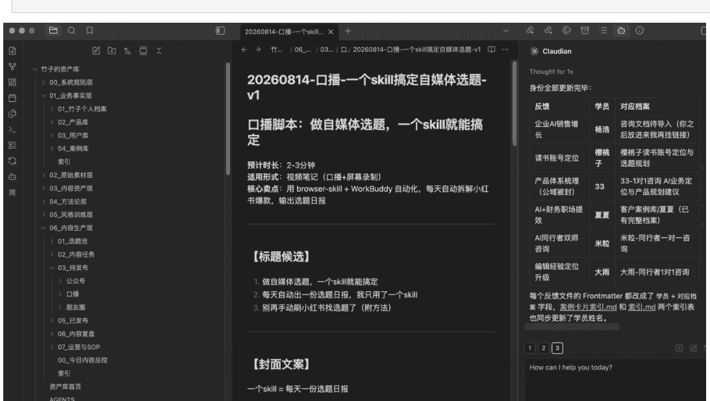

第一个板块，个人档案库，也可以叫老板说明书。这里放你是谁，你的经历，你的表达风格，你的价值观，你的个人故事，你的内容边界，你喜欢的、不喜欢什么表达。


### ②生成有术 线下聚会

### 老板说明书：先让 AI 认识你

- 你做过什么，有哪些真实成绩
- 现在在做什么业务
- 擅长什么，不擅长什么
- 服务哪类人
- 说话和写作习惯
- 哪些内容和表达不能出现

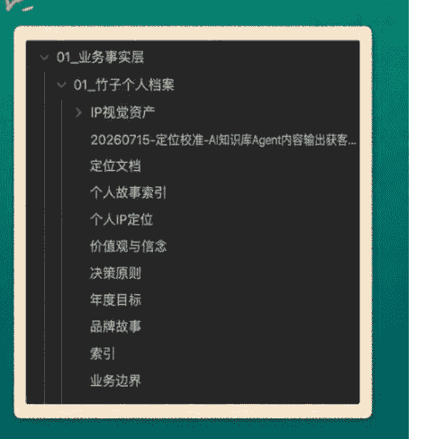

这个部分的作用，是让 AI 更像你。很多人说 AI 写出来不像自己，本质上是因为它根本不了解你。它不知道你经历过什么，不知道你说话，不知道你看重什么，也不知道哪些话你绝对不会说。

如果你希望 AI 写出的内容更贴近你，就不能每次临时在对话框里解释自己。你要把这些信息沉淀下来。

你会写的话，可以做一个采访机器人 skill 来给你做采访，一边采访，一边把内容存到知识库里面：

### 老板说明书不会写，就让 AI 采访你

`.agents/skills/知识库采访机器人/`

- 请用“知识库采访机器人”Skill，开始基础采访。
- 一次只问我一个问题，我会用口语回答。
- 每个问题如果信息不够，可以继续追问一个具体例子。
- 采访结束后，请把内容整理进我的 6 大资产库。

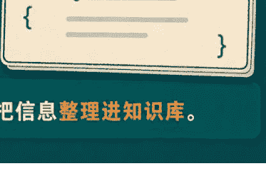

用语音回答大约 30 分钟，AI 会把信息整理进知识库。

这个是在之前航海家大课叁斤老师分享的采访 skill 上做了一个调整的版本，大家可以直接下载安装使用。

第二个板块，产品库。这里面放你的课程、资料包、训练营、咨询、陪跑、企业服务。

每个产品至少要写清楚：

- 产品是什么
- 适合谁，不适合谁。
- 解决什么问题。
- 价格和权益是什么。
- 交付流程是什么。
- 用户常见顾虑是什么，有哪些案例和反馈。

产品库的作用，是让内容能自然承接产品。如果你想写的内容，和你的定位和产品不相干，它就可以帮你判断，这篇内容到底值不值得写。

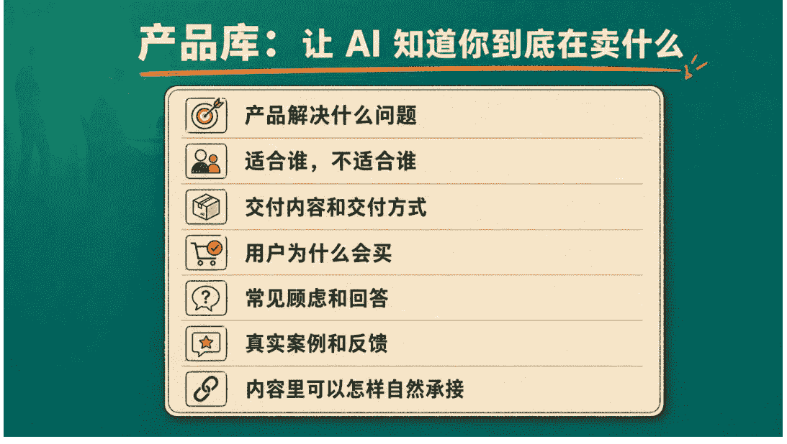

**第三个板块，用户需求库。** 这里面放评论区问题、私信问题、学员反馈、咨询记录、高频FAQ、用户原话。这个库非常重要。

因为真正好的选题，不是你坐在电脑前想出来的，而是用户一次次问出来的。比如用户问：我不知道自己适合做什么 AI 自媒体方向。我每天用 AI 写稿，为什么还是断更？

我账号有流量，但为什么没人咨询？我想接广告，要多少粉丝才可以？我不会出镜，能不能先做图文？这些都是非常好的选题来源。

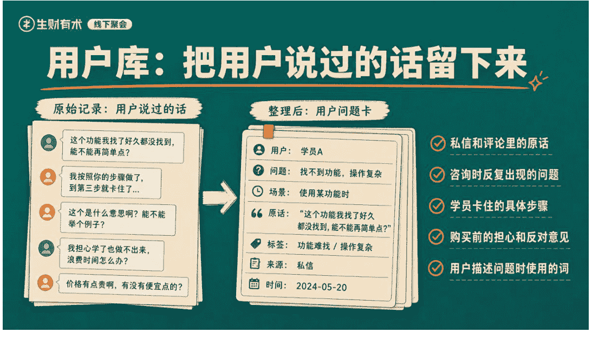

第四个板块，素材案例库。 这里面放自己的案例、学员案例、商单案例、企业培训案例、平台爆款素材、失败复盘。

内容想有说服力，一定不能只有观点。你要有故事，有过程，有结果，有前后对比。

比如我在这篇文章开头放自己的结果，不是为了炫耀，而是为了让你知道：这套方法不是我坐在家里想出来的，而是我在账号、商单、课程和培训里跑出来的。你自己的案例越多，内容越有底气。

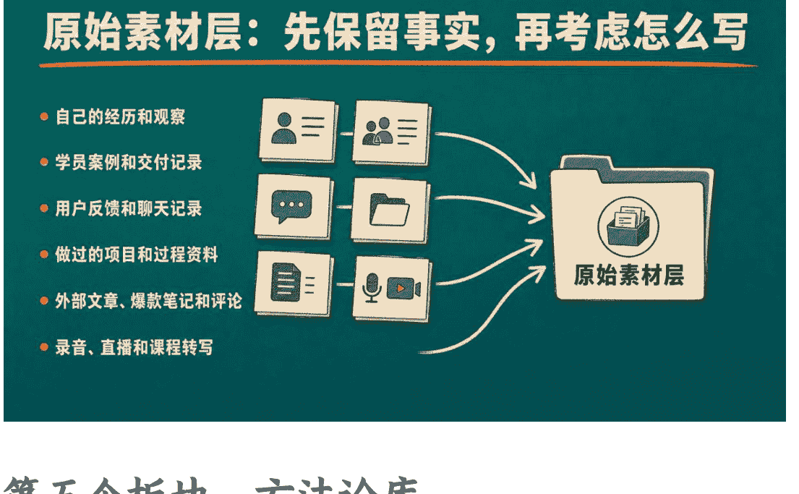

### 第五个板块，方法论库。

这里面放你业务相关的方法论，比如定位方法论、选题方法论、图文写作规则、口播脚本规则、商单 SOP、内容复盘方法、一鱼多吃流程。方法论库的作用，是让 AI 按你的方法写，表达的都是你自己的观点。

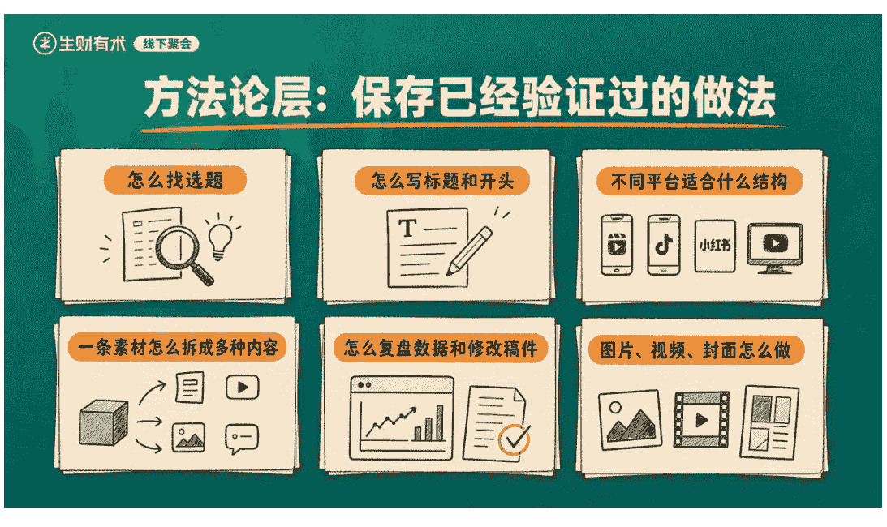

第六个板块，内容生产库。这里放选题池、内容任务卡、各平台待发布内容草稿、已发布内容和数据复盘。内容生产库的作用，是让内容从想法流动到发布，再从发布回到复盘。

很多人内容做完就结束了。但真正的内容系统，一定要有复盘。哪条标题点击好？哪个开头留住了人？哪个选题带来了咨询？哪个内容适合延展成系列？

评论区出现了什么新问题？这些信息都要回到知识库里。积累两三个月之后，你就可以问你的知识库：从已发布内容看，哪类选题最适合我的账号？哪些标题结构表现更好？哪些内容更容易带来私信？哪些用户问题反复出现？

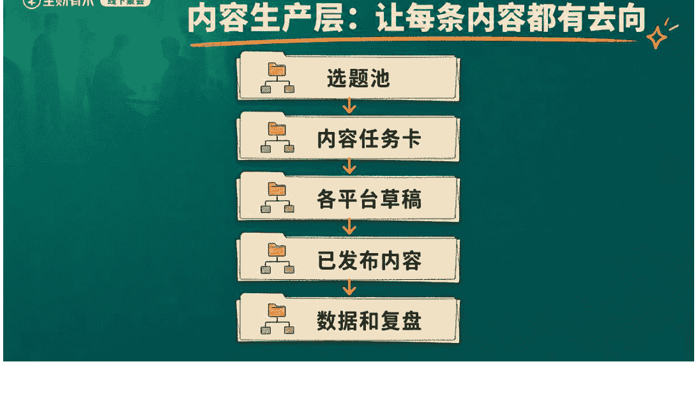

这些复盘的信息你都可以直接在 agent 里面提供，然后让它再帮你写进数据复盘的文件里，这样你就可以持续的迭代更新你的知识库和内容输出方法了～上面这套是我做自媒体时用的框架，如果你做的是别的业务，知识库里要放的东西当然也不同。你可以先把自己的工作讲清楚，让 AI 根据业务、素材来源和日常任务，设计一版更适合你的框架。

我想搭建一个适合我业务的 AI 内容工厂知识库。

我的业务是：
[说明你做什么，比如电商 / 咨询 / 教育 / 本地门店 / 企业销售]

我的目标用户是：
[说明用户是谁]

我每天或每周需要输出的内容是：
[比如小红书、短视频脚本、商品文案、朋友圈、社群内容、直播脚本、销售话术]

我的素材来源包括：
[比如客户咨询、评论区、商品资料、用户评价、案例、课程、直播回放、同行爆款]

我希望这个知识库帮我解决的问题是：
[比如不知道发什么、素材太乱、话术重复写、内容不稳定、团队协作混乱]

请你根据我的情况，设计一套 Obsidian 知识库框架。

输出要求：

1. 给我 6-10 个一级文件夹。
2. 每个文件夹说明放什么、不放什么。
3. 告诉我新手最先应该填哪 5 个文件。
4. 给我 3 个模板：素材卡、选题卡、成稿卡。
5. 最后给我一段可以直接复制给 Codex 执行的建库指令。

## 四、如何用 Agent+skill 辅助选题和素材采集

定位有了，知识库有了，可以把自己业务相关的素材，都让 agent 帮你整理进知识库，方便内容生产。

接下来就到了内容生产阶段，内容生产阶段包括做什么+怎么做。

做什么，就是选题了，我们来说怎么找选题。

很多人做内容最痛苦的事情是：不知道今天写什么。每天打开小红书，刷同行，翻热点，看评论区，刷着刷着一个小时过去了，注意力早就被短视频吸引走了，最后还是不知道发什么。我以前也会这样。

最开始我们做选题都是手动刷完记录在表格里。现在好了，有 agent 来做这件事情了。

选题有两个来源：

1. 去平台刷关键词下的爆款内容
2. 用户反复提到的问题、真实场景、没解决的困惑和你的判断或方法，来源可能是用户找你咨询的内容、社群答疑的内容、同行或者自己内容的评论区里出现频率超过 3 次的内容。

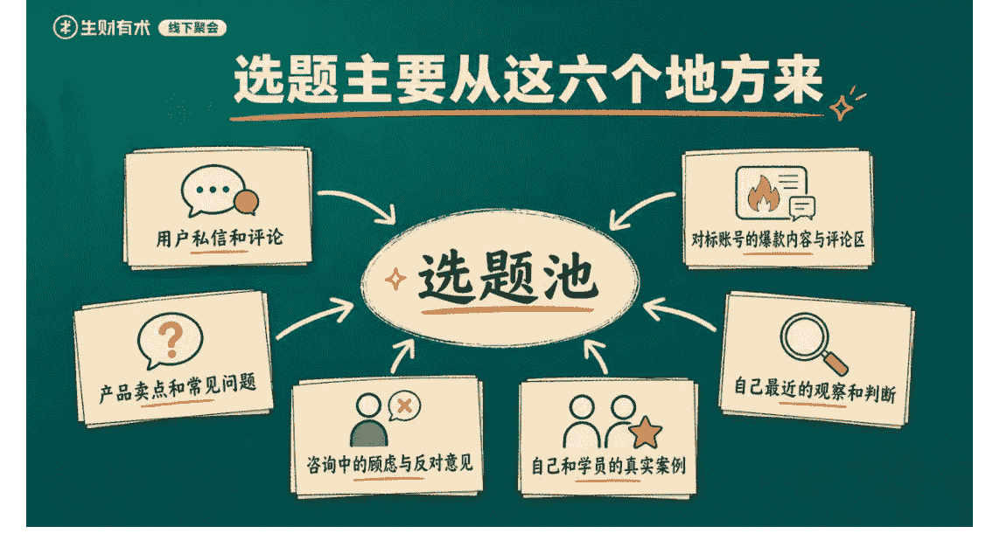

现在这两个动作都是可以通过 agent 来完成的。比如说第一个通过关键词去抓取爆款内容：

### 方法一：Browser skill 和配套的浏览器插件

https://github.com/Tencent/BrowserSkill 安装这个 Browser skill 和配套的浏览器插件，就可以根据你设定的关键词去抓取选题了。

浏览器插件：

打开 Chrome，访问：

```
https://chromewebstore.google.com/detail/lhcmgoofomhgciiibhipgmkggnoenaoi
```

点击「添加到 Chrome」

安装完成后，点击浏览器右上角的扩展图标确认弹窗显示 已连接（绿色）即为成功

### 拆解小红书AI自媒体爆款选题

选题我已跑完，以下是本次采集的核心发现：

数据采集量：6个关键词 × 每个8条 = 50条笔记，全部附带短链接，精读了5篇最高互动的笔记正文和评论区。

5条趋势洞察：

1. AI工作流SOP类是最高流量密码——给出具体SOP+工具组合的笔记收藏率极高（如Skill搭建笔记1.6万收藏比6.7收藏，收藏比1.6）
2. “一人公司/从口写变方案”——评论区不再是质疑质疑，而是追问“我这个行业能不能复制”
3. 「单子」焦虑催生方法论需求——先打从再给方法类的笔记结构仍有效
4. 变现渠道是最大信息量——评论区最高频问题不是“怎么做”而是“在哪变现”
5. 社恐/不露脸自媒体从小众走向主流——AI漫画、条漫等形式吸引大量社恐人群入场

8个精选选题已全部完成“借骨架换血肉”——保持标笔记的标题格式和内容结构，换成你自己的AI自媒体个人IP案例（母等博主转写经历、16+Skill体系、AI的官方工产方法、1499字阅读流099条变现在里）。

评论区痛点TOP3：变现渠道不清楚、Skill选择困难、真实性质疑。今天你想做什么？ @@ 引用对话文件，\ 调技能指令

### 2026-08-17-AI自媒体选题日报

AI自媒体个人IP·小红书选题日报

- 采集时间：2026年8月17日
- 采集关键词：AI自媒体 / AI个人IP / AI赚钱 1 / 超级个体 1 一人公司 / 单人
- 数据来源：小红书实时搜索（共采集 50+ 笔记，精选 5 篇爆文 + 评论区）

### 一、今日爆款数据总览

| # | 笔记标题 | 博主 |
| --- | --- | --- |
| 1 | 30W粉！WorkBuddy搭建自媒体工作台教程！ | 一只鱼饼 |
| 2 | 发现自媒体起号最快方式：用AI把内容陌生化 | 子于维 |
| 3 | 1个人做5个号，自媒体届的拼好饭来了 | 歌子倾城 |
| 4 | AI领域挑战 14用AI赚自媒体副业（月副斜打） | 钱要在刀刀上 |
| 5 | Howto用AI启动自己的自媒体IP分身？ | 乙南 |
| 6 | 想做自媒体的人请去趟这条路雷店！ | 小梨爱面包 |
| 7 | 吃到代码Red1 如何用3天跑通小红书变现？ | 大嘴吃卡Nika |
| 8 | 工具我好不好用到使用带体感的品味 | 发现橘子 |

这个你可以自己定义输出的报告形式、保存到知识库的路径，还可以创建定时任务，比如每周帮你抓取一次这一周的选题。

### 方法二：obsidian 里的插件-xiaohongshu importer +workbuddy 转写提取逐字稿

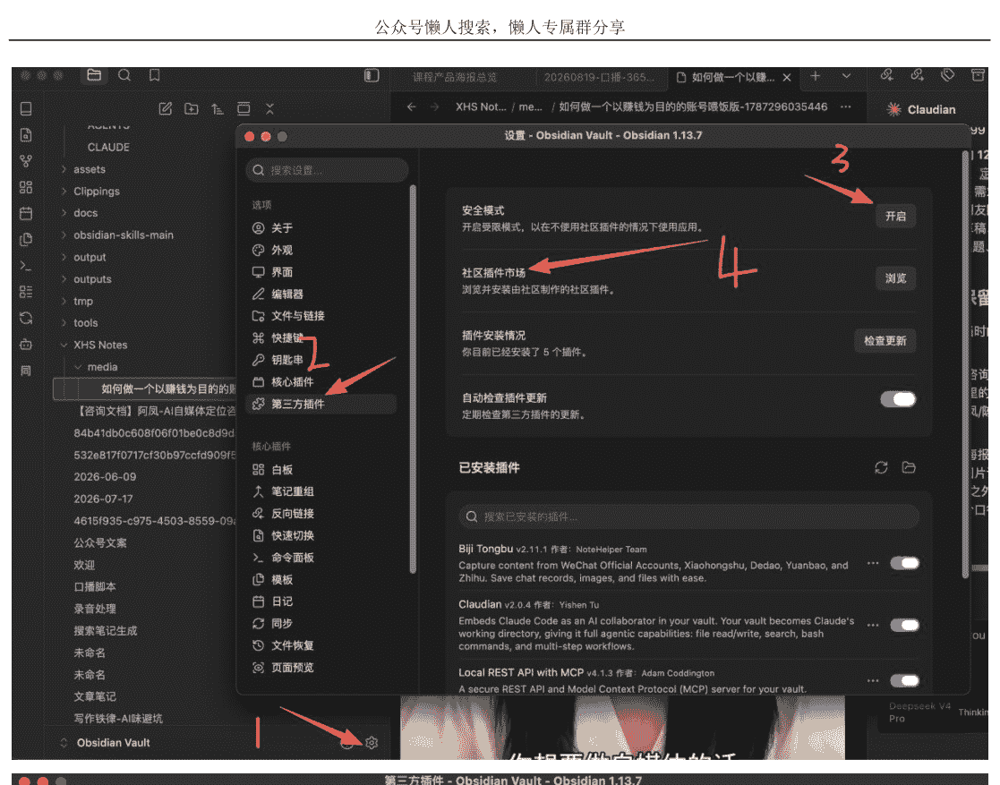

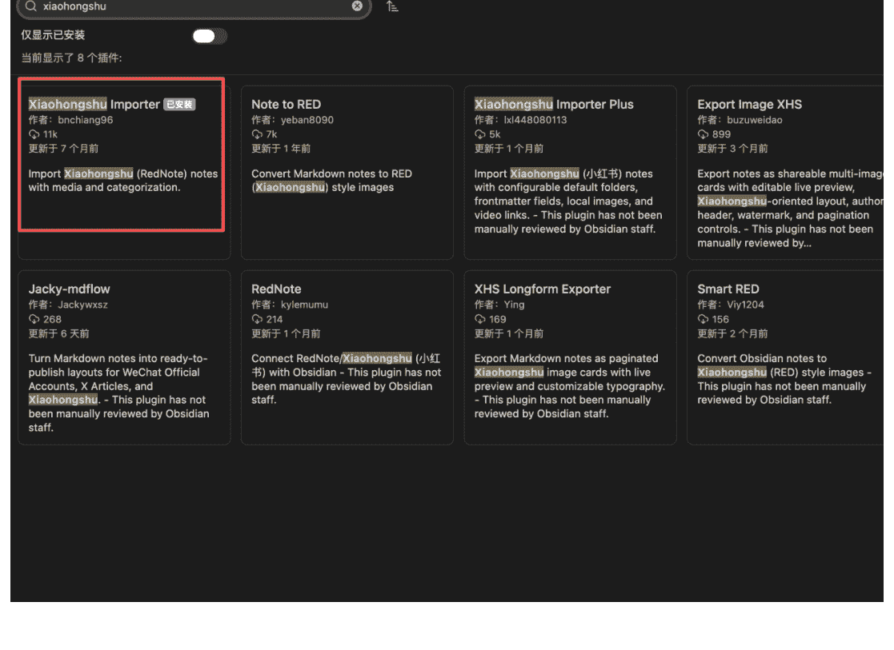

安装之后，你就能看到 obsidian 侧边栏里有一个书的图标：

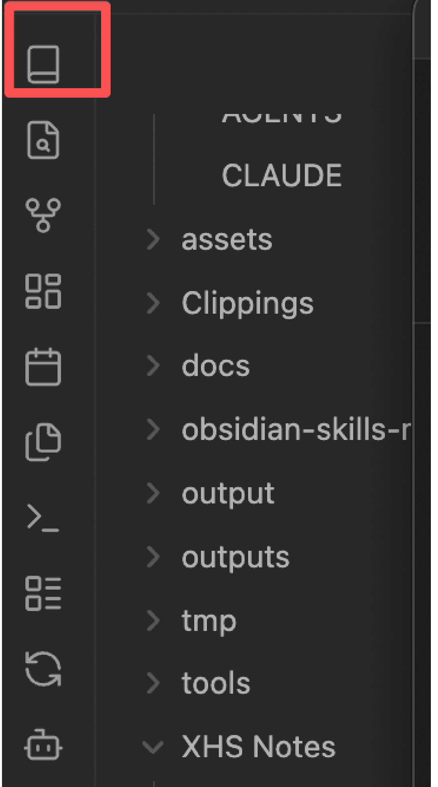

点击就可以输入小红书的链接（电脑网页版），就可以把这篇内容采集出来了，不过只能采集图片、文字、视频，视频的逐字稿是没有的

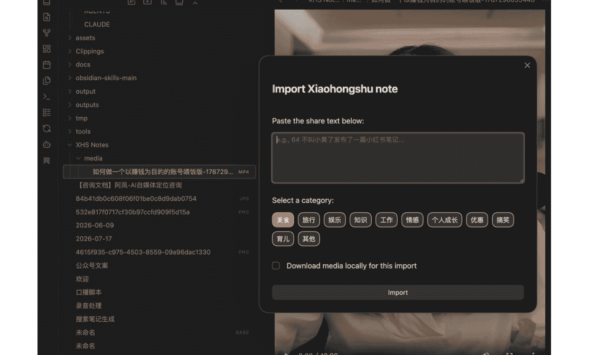

可以同步在 workbuddy 里做一个定时任务，每天固定时间，把当天采集的视频全部转写成文字放进 obsidian 知识库里

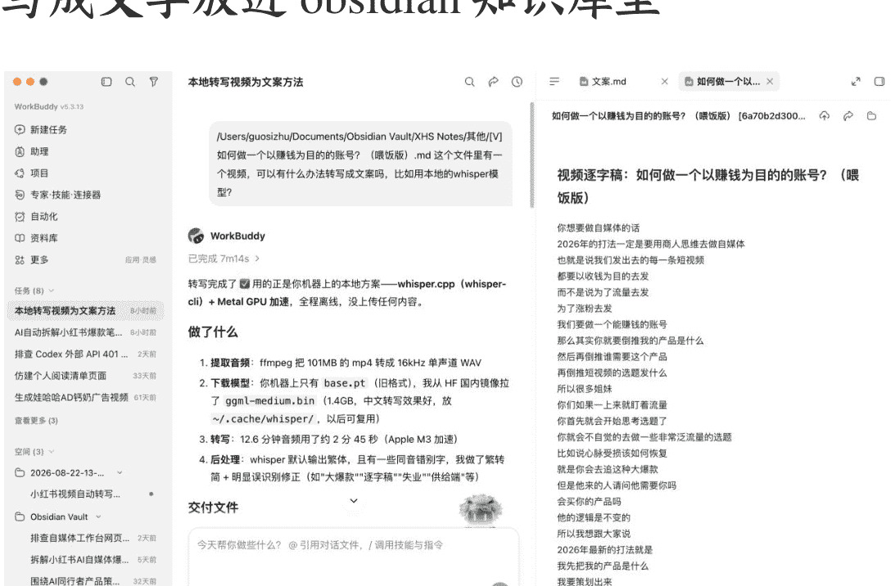

直接复制下面这段发给 WorkBuddy 就行（把两个路径替换成自己的）：

### 用法就 3 句话：

我想搭建一个「本地视频自动转写」的流程，请帮我完成：

1. 检查环境：whisper-cli (whisper.cpp) 和 ffmpeg 是否已安装，没有就用 Homebrew 装；
    检查 ~/ .cache/whisper/ggm1-medium.bin 模型是否存在，没有就从 hf-mirror.com 下载
    `(curl -L -o ~/ .cache/whisper/ggm1-medium.bin https://hf-mirror.com/ggerganov/whisper.cpp/resolve/main/ggm1-medium.bin`
2. 写一个通用转写脚本 transcribe_to_kb.py，功能：
    - ffmpeg 提取 16kHz 单声道音频 → whisper-cli 用 ggml-medium 模型转写（中文）→
    - 繁体转简体（用 zhconv，没装就 pip 装）→ 生成带 frontmatter 的 Markdown 逐字稿，
    - 可选输出简体 srt 字幕，转写的临时文件自动清理
3. 用这个脚本把视频 <填：你的视频路径> 转写一遍，给我看效果
4. 建一个定时任务（每天一次）：自动扫描文件夹 <填：你要监控的视频文件夹>，
    - 发现新视频就转写，把 md 存到素材库 <填：你的素材库文件夹>，
    - 素材库里已有的视频自动跳过，不重复处理

遇到缺的环境组件你自己装，最后告诉我整个流程跑通没有。

### 方法三：还有一种更简单的方式

小红书的笔记转发给问点点（小红书自带的 ai），发送“总结视频逐字稿”，就可以直接提取视频号的转发给元宝，抖音的发给豆包然后复制保存到 obsidian 素材库里，或者复制发给 workbuddy/codex 让它们来按固定格式保存

## 五、AI 自媒体内容输出指南

### 1. 一鱼多吃：选题内容卡+不同平台 skill

很多人一听内容工厂，就会想到“一鱼多吃”。一个选题，生成小红书、口播、公众号、朋友圈、社群文案。这个思路没错。

但这里有一个非常大的坑：不要让 AI 一口气把所有平台内容打包生成。因为不同平台的内容逻辑完全不一样。小红书图文，要有封面、标题、收藏点和卡片结构。

短视频口播，要有前 3 秒钩子，要让人听得下去。公众号长文，要有完整论证、故事案例和结构递进。朋友圈，要像一个人当天真实发出来的表达。

同一个选题，可以先创建一张内容任务卡，然后分别调用不同平台的写作流程 skill。

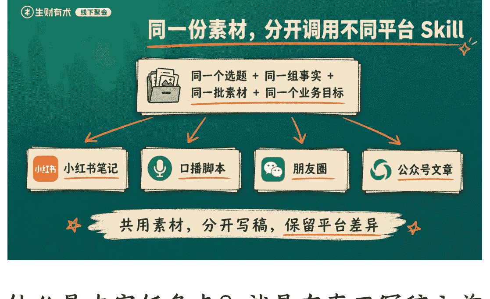

什么是内容任务卡？就是在真正写稿之前，先把这次内容的核心信息整理清楚。它至少包括：

- 这次内容写给谁
- 对方正在遇到什么具体问题
- 我想讲清楚的核心观点是什么
- 可以使用哪些真实案例、用户原话和方法
- 是否需要承接产品
- 适合输出到哪个平台
- 不同平台分别从什么角度切入

##### ② 生财有术 线下聚会

#### 内容任务卡提示词（上）：先让 Agent 找齐资料

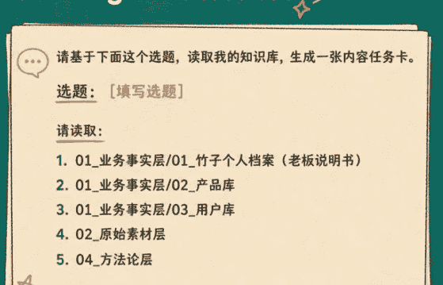

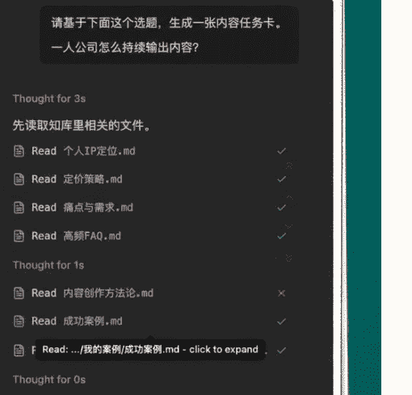

##### ② 生财有术 线下聚会

#### 内容任务卡提示词（下）：把事实和角度锁定

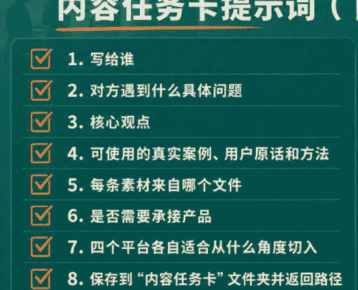

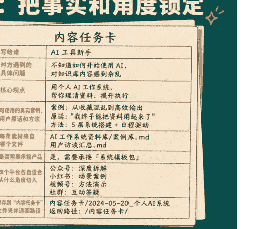

⚠️ 先不要写平台正文，也不要补写知识库里没有的案例和数据。✨

举个例子，比如我要写一个选题：做自媒体没有方向？你缺一个自媒体商业教练 skill 那它的选题内容卡片应该是这样的：

不同平台的切入角度可以是这样的：

你可以做一个选题卡片 skill，让他给你输出这种报告：

【选题名称】

一、内容目标
这篇内容最终希望用户产生什么认知/行动？

二、目标用户
这次具体写给谁？
他现在处于什么阶段？

三、具体场景
他最近会在什么情况下遇到这个问题？

四、用户原话
他会怎么描述自己的问题？
至少记录 3-5 句真实表达。

五、核心矛盾
他以为问题是什么？
真正的问题是什么？

六、核心观点
这篇内容只允许讲透一个什么观点？

七、认知反差
旧认知：
新认知：

八、论据素材
- □ 自己经历
- □ 学员案例
- □ 咨询案例
- □ 用户原话
- □ 数据
- □ 方法论
- □ 失败案例
- □ 对比案例

九、方法/解决方案
准备提供什么框架、步骤或工具？

十、商业承接
- □ 不承接
- □ 引流资料
- □ Skill
- □ 低价产品
- □ 正价课程
- □ 咨询/陪跑

十一、平台拆解
小红书：
用户为什么会点开？
封面角度：
正文切入：
适合 CTA：

口播：
前 3 秒观点：
核心冲突：
案例：
结尾 CTA：

公众号：
文章的大问题：
核心方法论：
需要展开的案例：
承接方式：

朋友圈：
真实场景：
个人观察：
认知：
产品/行动：

十二、一句话母题
如果所有内容最后只能让用户记住一句话：
______

然后再去调用不同平台的 skill，比如口播脚本 skill，公众号长文 skill 来写内容。这样比给一个选题让 ai 直接写会效果更好。

### 2. 爆款内容二创 skill

如果你要根据上一部分提取的爆款文案来做二创的话，在做二创之前，你可以就你想要二创的内容，和 ai 进行一轮沟通，比如你是只想改一下表达方式，整体内容观点和结构都不变（类似洗稿），还是说，你只想要保留这个选题、开头钩子、表达框架，换成你自己的观点、案例素材等。

聊完先让 ai 给你按照参考文案输出一版二创版本，你觉得 ok 再让他提炼为一个二创 skill。

我这个版本的是不会调用知识库版本的，如果你要调用知识库里你自己的案例素材，可以让 workbuddy 或者 codex 给你改一下，你只要告诉它去你的知识库哪些地方调用素材就行，然后安装修改过的 skill 就可以使用了。

### 3. 封面和文案

封面我一般都是用 GPT 去生成图片，把自己的照片和素材上传，让 GPT 去排版，加上我要求的标题文字就行。如你想固定一个封面风格输出的话，可以把它创建成一个 skill，然后直接在 codex 里面去提供素材，让它调用 skill 去生成相同风格的封面。

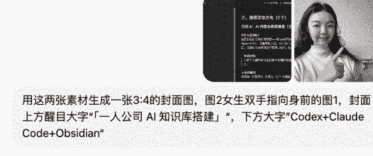

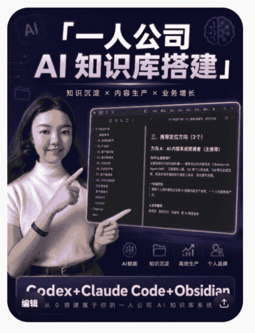

一般封面标题和文字标题可以起两个不同的，一个负责提高点击，一个负责搜索曝光，标题和文案可以用这个去根据内容提炼生成，这个我也创建了一个 skill：

## 六、如果你现在从 0 开始，先跑这个最小闭环

看到这里，你可能会觉得：这套 agent+知

识库的系统会不会很复杂？其实还好，大部分工作都可以交给 codex 完成。

如果你是新手的话，可以先跑一个最小闭环。

- 第一步，先把定位采访做完。
- 第二步，把知识库框架搭起来。
- 第三步，整理素材，比如先整理 10 个用户真实问题和案例。
    可以来自评论区、私信、社群、咨询、聊天记录，也可以来自你观察到的目标用户痛点。不要写抽象词。比如不要写“不会做内容”。要写：每天不知道发什么。写脚本要三个小时。发了很多干货但没人咨询。想做 AI 自媒体但不知道选什么方向。
- 第四步，让 AI 去搜集 5-10 个选题。
- 第五步，选一个选题做一张内容任务卡。把这次内容写给谁、讲什么问题、用什么案例、承接什么产品先写清楚。
- 第六步，先发布一个平台。新手可以先从图文开始。因为图文门槛低、成本低、适合测试。如果你想建立信任，可以尽快做真人口播。因为现在 AI 内容越来越多，用户会更看重真实的人。
- 第七步，发布后复盘。不要只看点赞和收藏。还要看：哪个标题被点击？哪个开头让人停留？评论区出现了新问题？有没有人私信咨询？这条内容适不适合延展成下一条？
- 第八步，把数据反馈和复盘放回知识库。这一步很重要。

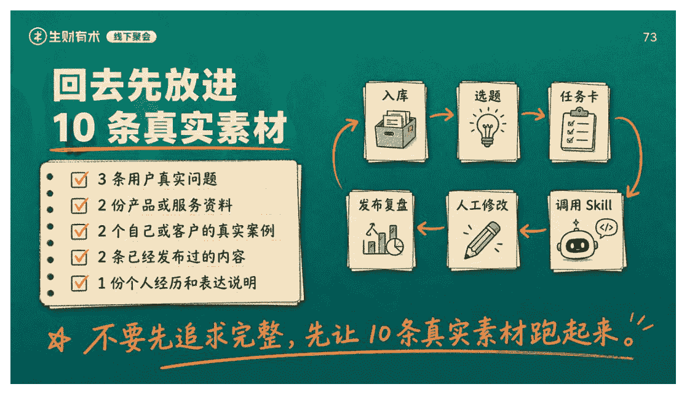

你的知识库不是一次性搭建好的，它是在你每一次内容发布、每一次用户反馈、每一次产品迭代里慢慢长出来的。所以新手不要一开始就追求自动化。先跑通：

定位 -> 用户问题 -> 选题 -> 内容 -> 发布 -> 复盘 -> 入库。

这个闭环跑通以后，再考虑更加复杂的多 Agent、Skill 协作。

## 七、最后分享一些 AI 自媒体踩坑经验

1. 很多小伙伴关心的讲 AI 工具会不会违规的问题：
    这个有一定概率，特别是讲国内的即梦和豆包，这两个在小红书是很容易被判引导第三方的，因为他们找了很多 AI 创作者发水下广告，你但凡漏出品牌名字了，都很容易限流，这个其实可以理解，不走平台的合作，平台赚不到钱嘛。所以注意讲这两个工具的时候不要露出品牌，当然这个是概率问题。
    但是讲国外的工具，比如 codex, claude code 这种就不会，反而流量很好，因为众所周知，国外工具并不会在国内投放哈，属于纯经验分享，但是不要公开讲网络问题。
2. 内容包含 AI 生成的素材的话，记得主动标明含 AI 生成内容。这个主动标记不会影响流量。
3. 上半年之前水下 ai 工具广告还挺多的，但是 7 月有一波把水下 ai 工具的内容全违规了，所以接广告的时候，能走平台就走平台。价格记得留出返点平台服务费的空间，现在品牌中介要返点要的都挺狠的，遇到过要 45% 的，尽量保证自己到手价格是心理预期价格。
4. 尽量不要讲批量生产内容、批量做账号之类的内容，之前我账号被永久封禁过一次不过申诉回来了，封禁原因就是说教别人批量运营账号，但是我可能就是一提了一下生成多张图片。所以自己平时做内容的时候注意一下措辞～以上就是 7 月和 8 月组局分享完整版了哈哈。希望对大家有所帮助～


看完这篇 SOP，你觉得你懂了。但 90% 的人一到实操就会卡在第一步。

工具和教程只是最低级的壁垒，真正的壁垒是“立刻动手”和“圈层信息差”。

如果你想看全网最新的变现玩法，并且和一群执行力极强的极客一起下场拿结果，欢迎围观我的核心私域：【懒人专属群】。

我们不聊虚的，只做商业闭环的拆解与 AI 效率的压榨。系统内已沉淀 1000+ 跑通的套利实战局。

- 查阅圈子完整数字资产与上车门槛：
    https://lazyso.com/insider/

认同价值、准备好下场干活的，扫码加我微信（lazyhelper1）
备注：【实操上车】，不闲聊


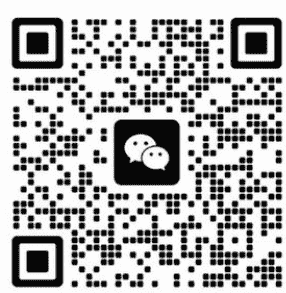

微信：lazyhelper1
